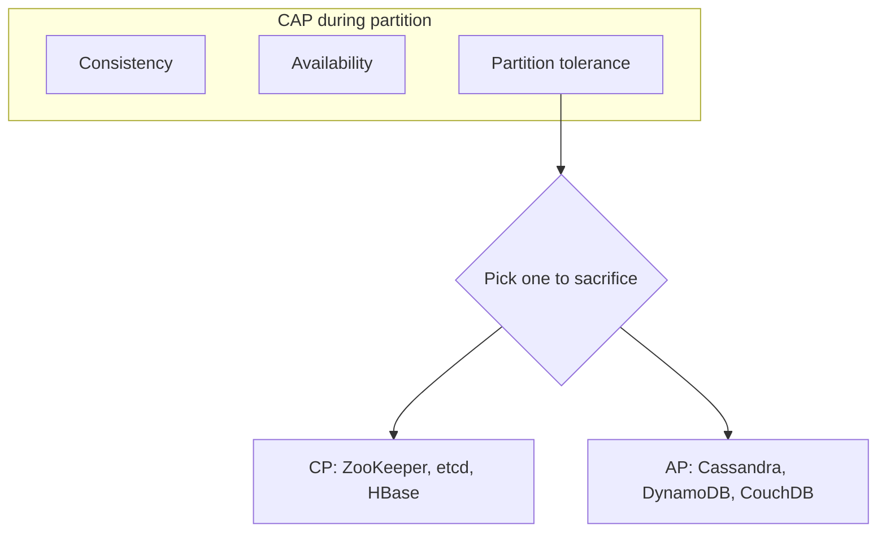
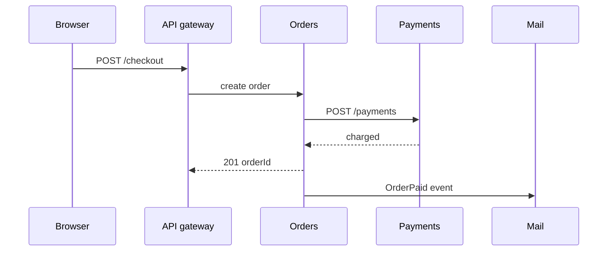
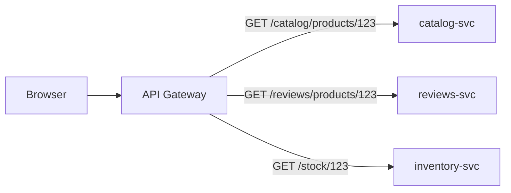
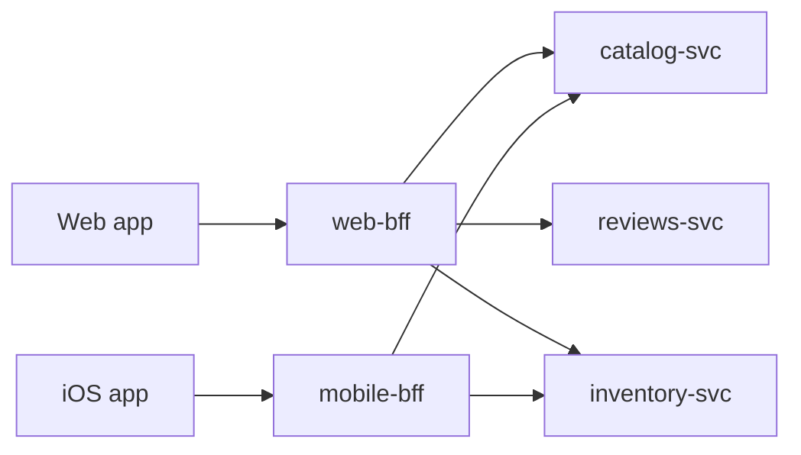
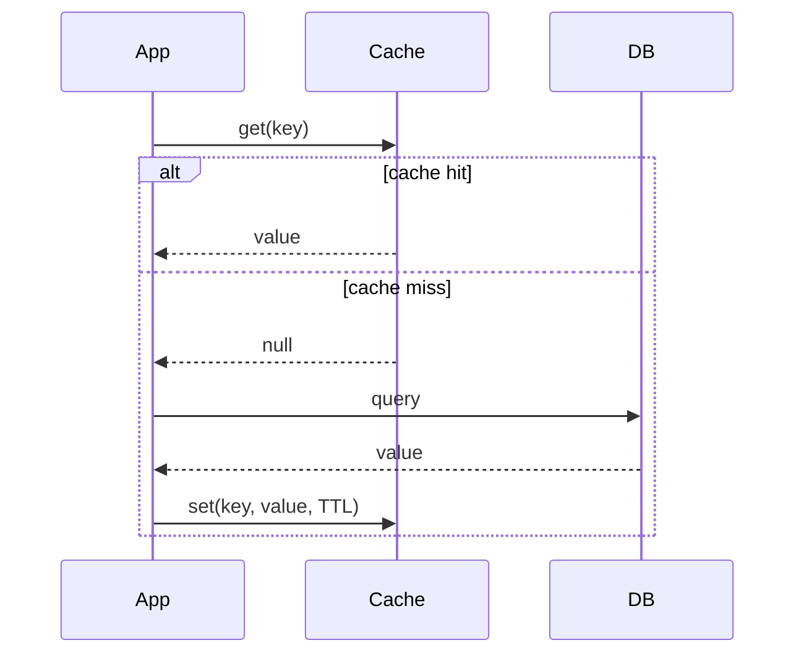
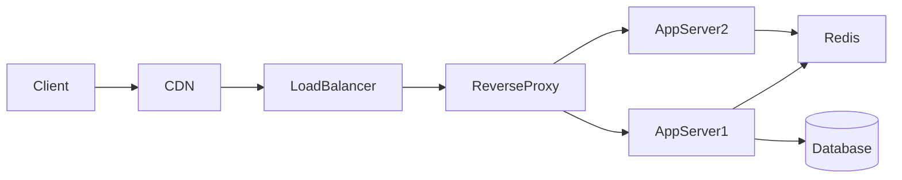

# System Design — overview

Covers distributed systems, architecture styles, data & caching, infrastructure, software principles (SOLID, GRASP), and design patterns — interview-ready and practical.

### Related docs

* [Interview hub](./0_interview.md) · [Interview Practice](./0_system_design.md#interview-practice) · [7_special](./7_special.md#interview-practice) · [JS OOP](./3_js_oop.md) · [React architecture](./4_react.md) · [Next.js rendering](./4_nextjs.md) · [TTFB](./6_web_api.md#ttfb-time-to-first-byte) · [Web server](./6_web_api.md#web-server) · [How the Internet works](./6_web_api.md#how-the-internet-works) · [OSI & TCP/IP](./6_web_api.md#osi--tcpip-models) · [TCP vs UDP](./6_web_api.md#tcp-vs-udp) · [Build & deploy](./10_build.md) · [DevOps / OTel](./15_devops.md) · [Databases / Elasticsearch](./9_database.md#elasticsearch) · [SQL normal forms](./9_database.md#normal-forms-1nf3nf-bcnf)
* [Process & threads (Node)](./8_nodejs.md#process--threads) · [Unix process management](./15_devops.md#unix-process-management) · [Memory: stack and heap](./3_js_core.md#memory-stack-heap)
* [Problem solving](./0_problem.md) · [Doka architecture overview](https://doka.guide/tools/architecture-and-design-patterns/) · [Doka — Gateway & BFF](https://doka.guide/tools/gateway-bff/) · [Doka — OOP](https://doka.guide/tools/oop/)

### Main concepts

| Area | Topics |
|------|--------|
| **Foundations** | Requirements, scalability, latency/throughput, [processes / OS multitasking](#processes-multitasking), reliability, SPOF, client–server |
| **Distributed** | CAP, PACELC, ACID/BASE, consistency, replication, sharding, idempotency, saga |
| **Architecture** | Monolith, microservices, modular monolith, CQRS, DDD, Clean/Hexagonal, [three-layer](#three-layer-architecture-doka), BFF, micro-frontends |
| **Frontend** | Architecture vs patterns, work placement, SSG/ISR/SSR/RSC/islands, edge vs data locality, FSD, Atomic Design, module boundaries, state at scale |
| **Data** | SQL vs NoSQL, indexing, caching, CDN, Redis, Elasticsearch |
| **Infrastructure** | Load balancing, reverse proxy, API Gateway, APIs, rate limiting, queues, observability |
| **Principles** | SOLID, DRY, YAGNI, KISS, GRASP, TDD/BDD |
| **Patterns** | 23 GOF catalog + Doka behavioral shortlist (Strategy, CoR, Command, Observer) |

### Navigation

| Part 1 | Part 2 |
|--------|--------|
| [1. Foundations](#1-foundations) | [5. Data & caching](#5-data--caching) |
| [2. Distributed systems](#2-distributed-systems) | [6. Infrastructure](#6-infrastructure) |
| [3. Architecture styles](#3-architecture-styles) | [7. Principles & patterns](#7-principles--patterns) |
| [4. Frontend architecture](#4-frontend-architecture) | [8. Resources](#8-resources) |

### Topic template

Every major topic follows:

**Definition** → **Pros / Cons** → **When to use** → **Example** → **Notes** → **Source**

---

<a name="1-foundations"></a>

## 1. Foundations

<details>
  <summary>What is system design</summary>

### What is system design

**Definition:** System design is the process of defining architecture, components, modules, interfaces, and data flows to satisfy functional and non-functional requirements at scale.

| Pros (structured approach) | Cons |
|----------------------------|------|
| Surfaces tradeoffs early | Easy to over-engineer on paper |
| Aligns teams on constraints | Requirements change — design must evolve |
| Interview signal | Diagrams ≠ working production system |

**When to use:** Greenfield products, scaling existing systems, architecture reviews, incident post-mortems, technical interviews.

**Example — interview framework:**

1. **Clarify requirements** — features, scale (DAU, QPS), latency, consistency needs
2. **Back-of-envelope estimation** — storage, bandwidth, servers
3. **High-level design** — clients, LB, app servers, DB, cache, queue
4. **Deep dive** — bottlenecks, failure modes, tradeoffs
5. **Wrap up** — monitoring, rollout, future scaling

**Notes:** Start with constraints, not technology. "We'll use Kafka" before knowing throughput is a red flag. Good answers narrate tradeoffs.

**Source:** [ByteByteGo — Top 20 System Design Concepts](https://blog.bytebytego.com/p/ep160-top-20-system-design-concepts)

</details>

<details>
  <summary>Client–server architecture (why a backend)</summary>

### Client–server architecture (why a backend)

**Definition:** Architecture is a high-level contract for how parts of a system interact. **Client–server** is the usual web contract: a **client** (browser / frontend) sends requests; a **server** (backend) applies rules and talks to **storage**.

**How it works:** A browser UI is HTML, CSS, and JS (WASM exists; ignore it at this level). Anything users create or reuse must be stored, authorized, and processed — that work lives on the server.

| Role | Job |
|------|-----|
| **Client** | Ask the server to read, transform, or save data. For the user: render data and collect updates. Almost always the browser. |
| **Server** | Accept requests, persist via the DB, apply **business logic**, expose data under those rules. May also run background jobs (search indexing, email). |
| **Database** | Durable store for user and system data — fast, reliable access (often several stores: primary, replicas, backups). |

```
Browser  --HTTP request-->  App server  -->  Database
         <--JSON / HTML--              <--rows--
```

**Cases:** Any product with accounts, documents, feeds, payments. Static marketing HTML can skip a custom backend; as soon as data is shared or must survive a refresh, you need a server.

**Example — X (Twitter) sketch:** Client = HTML/CSS/JS UI. Server = APIs that read/write stores. Databases = persistence, replication, failover.

| Pros | Cons |
|------|------|
| Shared data, auth, and jobs off the user’s machine | Extra hop, ops, and failure modes |
| Many clients (web, mobile) can share one API | Tight coupling if HTML is generated only on the server |

**Key idea:** The picture in the browser is not the product — durable data and rules are why a backend exists.

**Source:** [Doka — How web apps work](https://doka.guide/tools/web-app-works/) · HTTP/REST details: [6_web_api.md — HTTP protocol](./6_web_api.md#http-protocol)

</details>

<details>
  <summary>Functional vs non-functional requirements</summary>

### Functional vs non-functional requirements

**Definition:** Functional requirements describe *what* the system does (features). Non-functional requirements (NFRs) describe *how well* it does it — performance, availability, security, maintainability.

| NFR category | Examples |
|--------------|----------|
| Performance | p99 latency < 200ms, 10k QPS |
| Availability | 99.9% uptime (8.7 h downtime/year) |
| Scalability | 10× traffic growth without rewrite |
| Consistency | Strong for payments, eventual for feeds |
| Security | Auth, encryption, audit logs |

**When to use:** Every design session. NFRs drive technology choices more than feature lists.

**Example:** URL shortener — functional: shorten/redirect URLs. NFR: redirect < 50ms, 100M URLs stored, 99.99% availability for redirects.

**Notes:** Translate vague NFRs to numbers. "Fast" → p99 latency target. "Highly available" → nines + acceptable data loss window.

</details>

<details>
  <summary>Scalability</summary>

### Scalability

**Definition:** Scalability is the ability of a system to handle increased load by adding resources.

| Type | How | Pros | Cons |
|------|-----|------|------|
| **Vertical** | Bigger machine (more CPU/RAM) | Simple, no distributed complexity | Hardware ceiling, downtime to resize |
| **Horizontal** | More machines | Near-unlimited scale, fault isolation | Distributed systems complexity |

**When to use:**

- Vertical: early stage, databases (often first step), low traffic
- Horizontal: web/app tier, stateless services, read replicas

**Example — URL shortener QPS estimate:**

```
100M DAU × 2 redirects/day = 200M redirects/day
200M / 86,400 ≈ 2,300 QPS average
Peak (3×) ≈ 7,000 QPS → plan for ~10k QPS
```

**Notes:** Scale stateless tiers first. Stateful tiers (DB) need replication, sharding, or caching. "Just add servers" fails when session/state is pinned to one node.

</details>

<details>
  <summary>Latency vs throughput vs concurrency</summary>

### Latency vs throughput vs concurrency

**Definition:**

- **Latency** — time for one operation (ms)
- **Throughput** — operations per second (QPS/TPS)
- **Concurrency** — simultaneous in-flight operations

| Tradeoff | Insight |
|----------|---------|
| Low latency + high throughput | Need parallelism, efficient I/O, minimal blocking |
| Optimizing one can hurt the other | Batching ↑ throughput, may ↑ latency |

**When to use:** Capacity planning, SLA definition, choosing sync vs async processing.

**Example:** Payment API — low latency critical (user waits). Analytics pipeline — high throughput, latency tolerant (batch OK).

**Notes:** Report percentiles (p50, p95, p99), not averages. Tail latency dominates user experience at scale.

</details>

<a name="processes-multitasking"></a>

<details>
  <summary>Processes, multitasking & interrupts</summary>

### Processes, multitasking & interrupts

**Definition:** A **process** is the OS abstraction that gives a running program CPU time and its own memory. The OS (scheduler / dispatcher) runs ready processes in short turns so many programs and users share one machine.

**How it works:**

- **Not always true parallelism.** One core still runs **one** instruction stream at a time. “Several apps at once” is **time-sharing**: each process gets a short slice, then the scheduler switches. Several cores / CPUs can run processes **in parallel**.
- **Why multitasking exists.** Early single-task OS: one program owns the machine until it exits. While it waits on disk, keyboard, or a user, the CPU idles. The OS started overlapping **wait** of one program with **work** of another (I/O overlap), then a **dispatcher** that picks the next ready process so the CPU stays busy.
- **Ready queue.** Runnable processes sit in a **ready queue**. Priority decides who runs next. On Linux the user-visible **nice** value is **−20** (most CPU-favored) … **19** (least); default **0**. A normal user can *raise* niceness (be nicer / lower priority); lowering niceness (higher priority) needs privilege (`CAP_SYS_NICE` / root). `nice` / `renice` at start or while running. (Linux autogroup can weaken classic nice effects — see `sched(7)`.)
- **Wait queues.** Devices take different time (keyboard vs disk vs GPU). Processes **blocked** on I/O sit on **wait / device queues**, not on the CPU ready queue, until the device is ready — then they become ready again.
- **What a process is.** Not only code. The OS keeps: **program** (instructions in RAM), **data** (variables; must be in RAM before the CPU uses them), **context** so it can pause and resume — CPU registers, user stack, kernel stack, memory mappings. Saving/restoring context is a **context switch**. Context also enables IPC and talking to the kernel.
- **Priority queue.** The scheduler’s model is a **priority queue**: highest-priority ready process first. System processes often outrank user apps. Chrome-style **one process per tab / site** isolates crashes and sandboxing — one app, many processes.
- **Classic states:** **new** → **ready** → **running** → **terminated**. **Blocked / waiting** = waiting on I/O or a lock (not on the CPU). Optional **suspended** (swapped / paused) while ready or blocked: extra “frozen” states.

**Interrupts**

- An **interrupt** stops the current process so the CPU/OS can handle an event (timer tick → preemption; disk ready; move a process between queues). Some interrupts are kernel-only; others user programs can handle (like DOM events).
- **Hardware interrupts** (CPU / devices). OS can enable/disable classes; programs see them as events with a handler.
  - **External, asynchronous** — timer, NIC, disk ready, keyboard, mouse.
  - **Internal, synchronous** (exceptions/faults) — divide by zero, illegal opcode, bad memory access, stack overflow.
- **Software interrupts** — a program instruction (syscall) to talk to the kernel, drivers, or other processes.
- **Windows:** mostly a **message** model (window UI, some IPC). Messages do **not** replace kill/stop/restart of a process.
- **Unix / POSIX:** **signals**. Delivery interrupts the process and runs a handler (or the default action). Signals come from the **tty** (keys), the **kernel**, or **kill** from another process (or `raise` to self). POSIX lists standard names; apps can also use **real-time** signals (`SIGRTMIN`+n) — those **queue**; ordinary signals **do not**.

| Signal | Role | Notes |
|--------|------|--------|
| `SIGINT` | Interrupt (job control) | Terminal **Ctrl+C**. Catchable. Default: terminate. |
| `SIGQUIT` | Quit from keyboard | **Ctrl+\\**. Default: terminate + core. |
| `SIGTSTP` | Terminal stop | **Ctrl+Z**. Catchable. Default: stop. Resume with `SIGCONT`. |
| `SIGSTOP` | Stop | Kernel/job control. **Cannot** catch, block, or ignore. |
| `SIGCONT` | Continue | Resume a stopped process. |
| `SIGKILL` | Kill | Immediate terminate. **Cannot** catch, block, or ignore. |
| `SIGTRAP` | Trace / breakpoint | Debugger / `ptrace`. Default: core. |
| `SIGUSR1` / `SIGUSR2` | App-defined | POSIX “user” signals. |

**Cases:** Explain concurrency vs parallelism in interviews. Isolate browser tabs. Handle Ctrl+C / deploy **SIGTERM** in Node. `kill -9` vs graceful shutdown. Why one spinning loop does not freeze the whole OS (preemption).

| + | − |
|---|---|
| CPU used during I/O waits; many users/apps on one box | Context-switch cost; isolation is not free (Chrome RAM) |
| Signals: simple Unix control + IPC | Standard signals do not queue; `SIGKILL` skips cleanup |
| Priority / nice for batch vs interactive | Unprivileged users cannot steal CPU with nicer values |

**Example — catch Ctrl+C in Node (SIGINT is catchable; SIGKILL is not):**

```js
import process from 'node:process';

process.stdin.resume(); // keep the process alive

process.on('SIGINT', () => {
  console.log('Received SIGINT. Press Control-D to exit.');
});

// SIGKILL / SIGSTOP: listeners are ignored — process is killed / stopped anyway
```

**Common pitfalls:**

- Calling time-sharing **multithreading**. A process may have many threads; the OS still schedules **threads**. Node’s JS is one thread; that is a different layer — [Process & threads](./8_nodejs.md#process--threads).
- Confusing **Ctrl+Z** (`SIGTSTP`) with **`SIGSTOP`**. Only `SIGKILL` and `SIGSTOP` are uncatchable (`signal(7)`).
- Assuming Windows process control works like POSIX signals (Node emulates a few `kill` names).
- Treating “dispatcher queues every CPU *instruction*” as literal — teaching model; real CPUs run until a **timer interrupt**, syscall, or I/O interrupt, then the scheduler picks the next thread.

**Key idea:** Multitasking is the scheduler + interrupts + saved **context**. Signals are POSIX’s user-visible interrupts for process control.

**Source:** [Doka — Multitasking and processes](https://doka.guide/tools/multitasking-and-processes/) · [Linux `signal(7)`](https://man7.org/linux/man-pages/man7/signal.7.html) · [Linux `getpriority(2)` nice −20…19](https://man7.org/linux/man-pages/man2/getpriority.2.html) · [Node.js signal events](https://nodejs.org/api/process.html#signal-events)

</details>

<details>
  <summary>Reliability, availability, fault tolerance</summary>

### Reliability, availability, fault tolerance

**Definition:**

- **Reliability** — system works correctly over time
- **Availability** — system is operational when needed (uptime %)
- **Fault tolerance** — system continues operating when components fail

| Term | Formula / meaning |
|------|-------------------|
| SLA | Contract with users (e.g. 99.9%) |
| SLO | Internal target (e.g. p99 < 300ms) |
| SLI | Measured metric (error rate, latency) |

**When to use:** Defining on-call expectations, redundancy decisions, multi-AZ deployment.

**Example:** 99.9% = ~43 min downtime/month. 99.99% = ~4.3 min/month. Each nine is an order of magnitude harder.

**Notes:** Availability ≠ correctness. A system returning stale data is "available" but unreliable. Define both.

</details>

<details>
  <summary>Single point of failure (SPOF)</summary>

### Single point of failure (SPOF)

**Definition:** A SPOF is any component whose failure takes down the entire system or critical path.

| Pros (accepting SPOF) | Cons |
|-----------------------|------|
| Simpler architecture early | Outage affects all users |
| Lower operational cost | Harder to hit high availability |

**When to use:** Identify SPOFs in every diagram. Eliminate or mitigate (replicas, failover, circuit breakers).

**Example:** Single database with no replica = SPOF. Single load balancer = SPOF → use active-passive pair or cloud-managed LB.

**Notes:** Draw the request path and ask "what breaks if this box dies?" for every node.

---

</details>

<a name="2-distributed-systems"></a>

## 2. Distributed systems

<details>
  <summary>CAP theorem</summary>

### CAP theorem

**Definition:** In a distributed data store, during a network **partition**, you can guarantee at most two of: **Consistency**, **Availability**, **Partition tolerance**.

| Guarantee | Meaning |
|-----------|---------|
| **C** — Consistency | Every read returns the latest write or an error |
| **A** — Availability | Every request gets a non-error response |
| **P** — Partition tolerance | System operates despite network splits between nodes |



| CP (consistency + partition tolerance) | AP (availability + partition tolerance) |
|----------------------------------------|----------------------------------------|
| Strong consistency during partition | May return stale data |
| Some requests may fail/timeout | System stays responsive |
| ZooKeeper, etcd, traditional RDBMS with sync replication | Cassandra, DynamoDB, Riak |

**When to use:**

- CP: financial ledgers, distributed locks, config management
- AP: social feeds, shopping carts, metrics, session data with TTL

**Example:** Two data centers lose network link. CP system rejects writes on minority partition. AP system accepts writes on both sides — resolves conflicts later.

**Notes:** Partition tolerance is not optional in real distributed systems — networks fail. The real choice is C vs A *during* a partition. Outside partitions, you can have both. CAP is often misquoted as "pick any two forever."

**Source:** [ByteByteGo — CAP](https://blog.bytebytego.com/p/ep160-top-20-system-design-concepts)

</details>

<details>
  <summary>PACELC</summary>

### PACELC

**Definition:** Extension of CAP: if **P**artition, choose **A** or **C**; **E**lse (normal operation), choose **L**atency or **C**onsistency.

| System | PACELC profile |
|--------|----------------|
| DynamoDB / Cassandra | PA/EL — available + low latency |
| PostgreSQL (sync replica) | PC/EC — consistent, higher latency on writes |

**When to use:** Explaining why systems behave differently under normal load vs during failures.

**Notes:** More accurate than CAP alone for comparing databases in interviews.

</details>

<details>
  <summary>ACID vs BASE</summary>

### ACID vs BASE

**Definition:**

- **ACID** — Atomicity, Consistency, Isolation, Durability (traditional RDBMS transactions)
- **BASE** — Basically Available, Soft state, Eventually consistent (NoSQL flexibility)

| ACID | BASE |
|------|------|
| Strong guarantees | High availability, partition tolerance |
| Transactions across rows | Optimistic concurrency, conflict resolution |
| PostgreSQL, MySQL | Cassandra, DynamoDB, Couchbase |

**When to use:**

- ACID: money transfers, inventory, booking systems
- BASE: activity feeds, analytics, caching layers, high-write social data

**Example:** Bank transfer — debit + credit must be atomic (ACID). Like count on a post — eventual consistency acceptable (BASE).

**Notes:** BASE is not "no consistency" — it's eventual consistency with explicit conflict handling.

</details>

<details>
  <summary>Consistency models</summary>

### Consistency models

**Definition:** Rules governing when a write becomes visible to reads in distributed storage.

| Model | Guarantee |
|-------|-----------|
| **Strong** | Read always returns latest write |
| **Eventual** | Replicas converge given no new writes |
| **Causal** | Causally related ops seen in order |
| **Read-your-writes** | User sees own updates immediately |

**When to use:**

- Strong: account balances, inventory counts
- Eventual: CDN cache, search indexes, social timelines
- Read-your-writes: user profile edits (session stickiness or routing)

**Example:** User updates avatar → CDN may serve old image for minutes (eventual). User must not see old avatar on own profile page (read-your-writes).

**Notes:** Pick consistency per operation, not per system. Payment = strong; notification badge = eventual.

</details>

<details>
  <summary>Replication</summary>

### Replication

**Definition:** Copying data across multiple nodes for availability, durability, and read scaling.

| Strategy | How | Pros | Cons |
|----------|-----|------|------|
| **Leader-follower** | Writes to leader, async/sync to followers | Simple, strong consistency option | Leader is bottleneck/SPOF |
| **Multi-leader** | Writes to any leader, replicate bidirectionally | Write locality, multi-region | Conflict resolution needed |
| **Leaderless** | Quorum reads/writes (e.g. W=2, R=2 of N=3) | High availability | Complex, stale reads possible |

**When to use:**

- Leader-follower: most OLTP (PostgreSQL replicas)
- Multi-leader: multi-region active-active
- Leaderless: Cassandra-style high-write availability

**Notes:** Sync replication = CP (write waits for replicas). Async = faster writes, risk of data loss on leader crash.

</details>

<details>
  <summary>Partitioning / sharding</summary>

### Partitioning / sharding

**Definition:** Splitting data across multiple nodes so each node holds a subset (shard).

| Strategy | How | Pros | Cons |
|----------|-----|------|------|
| **Hash-based** | `shard = hash(key) % N` | Even distribution | Resharding painful when N changes |
| **Range-based** | Keys A–M on shard 1, N–Z on shard 2 | Range queries efficient | Hot spots (e.g. all recent data on last shard) |
| **Consistent hashing** | Keys map to ring; add/remove nodes move minimal data | Elastic scaling | Implementation complexity |

**When to use:** Single DB node exceeds storage or write throughput. Sharding is hard to undo — plan key choice carefully.

**Example:** User data sharded by `user_id`. Hot celebrity account = hot shard. Mitigate: sub-shard, cache, dedicated partition.

**Notes:** Prefer vertical partitioning or read replicas before horizontal sharding. Sharding adds operational burden forever.

</details>

<details>
  <summary>Idempotency</summary>

### Idempotency

**Definition:** An operation is idempotent if performing it multiple times has the same effect as performing it once.

| Pros | Cons |
|------|------|
| Safe retries on network failure | Requires design upfront (idempotency keys) |
| Critical for distributed systems | Storage for dedup keys |

**When to use:** Payment APIs, webhooks, message queues (at-least-once delivery), any retry logic.

**Example:**

<details>
  <summary>Code</summary>

```ts
// Client sends idempotency key with payment
POST /payments
Headers: Idempotency-Key: "pay_abc123"
Body: { amount: 100, currency: "USD" }

// Server: if key exists, return cached result; else process and store
```

</details>

**Notes:** At-least-once delivery + non-idempotent consumer = duplicate charges. Always pair retries with idempotency keys or dedup.

</details>

<details>
  <summary>Distributed transactions & Saga</summary>

### Distributed transactions & Saga

**Definition:** Coordinating transactions across multiple services without a single ACID database.

| Approach | How | Pros | Cons |
|----------|-----|------|------|
| **2PC (two-phase commit)** | Coordinator: prepare → commit/abort all | Strong atomicity | Blocking, coordinator SPOF, doesn't scale |
| **Saga** | Sequence of local transactions + compensating actions | Scales, fits microservices | No isolation, complex rollback |

**Saga styles:**

- **Orchestration** — central coordinator tells each service what to do
- **Choreography** — services react to events, no central coordinator

**When to use:** Saga for multi-service workflows (order → payment → inventory → shipping). Avoid 2PC across microservices in production.

**Example — order saga:**

```
1. Create order (pending)
2. Charge payment → fail → compensate: cancel order
3. Reserve inventory → fail → compensate: refund payment, cancel order
4. Confirm order
```

**Notes:** Compensating transactions are business logic, not automatic rollbacks. "Refund" may not fully undo "ship."

**How each step works (orchestration):**

1. Orchestrator receives `PlaceOrder` command.
2. Calls OrderService → local tx creates order `PENDING`.
3. Calls PaymentService → on success continues; on fail → `CancelOrder` compensating call.
4. Calls InventoryService → on fail → `RefundPayment` + `CancelOrder`.
5. Calls OrderService → `CONFIRMED`.

**Choreography variant:** OrderService emits `OrderCreated` → PaymentService listens and emits `PaymentCompleted` or `PaymentFailed` → Inventory reacts — no central coordinator, but harder to debug.

| Saga concern | Mitigation |
|--------------|------------|
| Partial failure | Compensating transactions + idempotency keys |
| Duplicate events | Idempotent handlers, dedup table |
| Visibility | Saga log / outbox pattern for reliable events |

**Key idea:** Prefer saga over 2PC in microservices; design compensations explicitly in domain language.

**Source:** [Microservices.io — Saga](https://microservices.io/patterns/data/saga.html)

</details>

<a name="3-architecture-styles"></a>

## 3. Architecture styles

<details>
  <summary>Monolithic architecture</summary>

### Monolithic architecture

**Definition:** The entire application — UI, business logic, data access — is built and deployed as a single unit.

| Pros | Cons |
|------|------|
| Simple to develop, test, deploy initially | Becomes hard to scale teams and codebase |
| No network calls between modules | Entire app must scale together |
| ACID transactions across modules easy | One bug can crash everything |
| Lower operational overhead | Technology lock-in for whole app |

**When to use:** Startups, MVPs, small teams, low complexity domains. Default choice until pain is proven.

**Example:** Single Node.js/Next.js app with API routes + DB — one repo, one deploy.

**Notes:** Monolith ≠ bad. A well-structured modular monolith beats a poorly decomposed microservices mess.

**Source:** [Build & deploy — monolith vs microservices](./10_build.md)

</details>

<details>
  <summary>Microservices architecture</summary>

### Microservices architecture

**Definition:** One product as a **suite of small services**, each in its **own process**, around a **business capability**, talking over HTTP/RPC/queues, **independently deployable**. Languages and datastores may differ; centralized control stays small. (Fowler)

**How it works:** A monolith is one executable — `charge()` is a function call; a pay-bugfix redeploys the whole shop. A service owns a narrow job; reuse is the **API**, not a shared folder (`POST /payments`). Doka: logic fits in **one head**. Fowler: independent lifecycle beats LOC. New coupling = **network + contract**. CI, K8s, discovery, Prometheus, Kafka are the **microservice premium** (build, place, find, watch, buffer).

| | Monolith | Microservices |
|--|----------|---------------|
| Pay | in-process `payments.charge` | `POST /payments` (or `OrderPlaced`) |
| Pay-bugfix | rebuild entire shop | deploy **only** Payments |
| Black Friday | clone the whole app | 20 Pay replicas, 2 Catalog |
| Mail outage | often kills the request | pay can succeed if mail is async |



| + | − |
| --- | --- |
| Independent scale/deploy; team autonomy; reuse; fault isolation | Distributed failures; contract versioning; no cheap ACID; ops cost |

**Cases:** Hotspot autoscale; team ≳10–15; reuse auth/mail in a **new product**; huge builds / uneven CPU vs I/O. **Not:** small team, unclear domain, no CI/CD/tracing. Fowler **monolith-first** — successful splits usually started as a monolith that got too big. Doka “cheaper to maintain” is true only after the monolith is already expensive.

**Example:** Mail as its own process. Shop (or a jobs board) calls `POST http://mail:8000/send` instead of `import sendMail`. Candidates: auth, bulk email, activity tracking, image resize.

<details>
  <summary>Code</summary>

```js
import http from 'node:http';

const server = http.createServer((req, res) => {
  if (req.method === 'POST' && req.url === '/send') {
    res.writeHead(202, { 'Content-Type': 'application/json' });
    res.end(JSON.stringify({ queued: true }));
    return;
  }
  res.writeHead(404);
  res.end();
});
server.listen(8000);
```

</details>

**Common pitfalls:** Split by technical layer instead of capability. Shared DB. Greenfield microservice suite with no ops maturity.

**Key idea:** Split when a capability needs its own **scale, team, or reuse** — and you can afford the network as coupling. Else stay a [modular monolith](#modular-monolith).

**See also:** [7_special.md](./7_special.md#4-system-architecture)

**Source:** [Fowler — Microservices](https://martinfowler.com/articles/microservices.html) · [Monolith First](https://martinfowler.com/bliki/MonolithFirst.html) · [Microservice Premium](https://martinfowler.com/bliki/MicroservicePremium.html) · [Doka — Микросервисы](https://doka.guide/tools/microservices/)

</details>

<details>
  <summary>Modular monolith</summary>

### Modular monolith

**Definition:** Single deployable unit with strict internal module boundaries (by domain/feature), enforcing dependency rules between modules.

| Pros | Cons |
|------|------|
| Simple deployment like monolith | Requires discipline to maintain boundaries |
| ACID transactions within monolith | All modules scale together |
| Easier refactor to microservices later | Can decay into big ball of mud without linting/reviews |
| One repo, one CI pipeline | |

**When to use:** Recommended default for most teams. Split to microservices only when module boundaries and team structure justify it.

**Example:** Modules `billing/`, `auth/`, `catalog/` — each exposes a public API; no cross-module internal imports.

**Frontend variant:** One app, two ownership layers — a **platform** slice (design system, shared hooks, logging) owned by a platform team, and **domain** folders (`user/`, `payments/`) owned by feature teams. Same instinct as hexagonal/clean architecture, without three layers between a button and a `fetch`. Full clean architecture is usually overkill on the client.

**Notes:** "Modular monolith first" is increasingly the staff-engineer recommendation. Extract services (or micro-frontends) when a module needs independent scale, independent deploys, or team ownership — not because the codebase got large. See [Micro-frontends](#micro-frontends).

</details>

<details>
  <summary>Event-driven architecture</summary>

### Event-driven architecture

**Definition:** Components communicate by producing and consuming events asynchronously, decoupling producers from consumers.

**How it works:**

1. Producer publishes domain event (`UserRegistered`, `OrderPlaced`) to broker or event bus.
2. Broker persists and delivers to N subscribers (at-least-once typical).
3. Each consumer processes independently — may publish new events (choreography).
4. Failures retried; dead-letter queue for poison messages.

| Pros | Cons |
|------|------|
| Loose coupling | Eventual consistency |
| Easy to add new consumers | Debugging distributed flows harder |
| Natural audit trail | Schema evolution / versioning |
| Handles traffic spikes (buffer in queue) | Ordering guarantees vary by broker |

**When to use:** Order pipelines, notifications, analytics, integrations, microservices communication, CQRS projections.

**When NOT to use:** User waiting for synchronous result that depends on all steps — use request/response or saga orchestrator with polling/WebSocket.

**Example:** `OrderPlaced` event → inventory service reserves stock, payment service charges, email service sends confirmation — independently.

**Building blocks:** Kafka/RabbitMQ/SNS+SQS, schema registry (Avro/JSON Schema), outbox pattern for reliable publish-after-DB-write.

**Notes:** Define event contracts (versioned schemas). Idempotent consumers are mandatory with at-least-once delivery. Correlate with `trace_id` in OpenTelemetry.

**Source:** [Microservices.io — Event-driven architecture](https://microservices.io/patterns/data/event-driven-architecture.html)

</details>

<details>
  <summary>CQRS</summary>

### CQRS

**Definition:** Command Query Responsibility Segregation — separate models and paths for writes (commands) and reads (queries).

| Pros | Cons |
|------|------|
| Optimize read and write independently | Increased complexity |
| Scale reads separately (read replicas, denormalized views) | Eventual consistency between read/write models |
| Simpler write model, rich read model | Overkill for simple CRUD |

**When to use:** Read-heavy apps with complex queries, different scaling needs for reads vs writes, event sourcing companion.

**Example:** Write: normalized `orders` table. Read: denormalized `order_summaries` materialized view updated by events. Forms: [9_database.md — Normal forms](./9_database.md#normal-forms-1nf3nf-bcnf); snapshots: [Normalize vs denormalize](./9_database.md#normalization-vs-denormalization).

**Notes:** Don't apply CQRS everywhere. Use when read patterns genuinely differ from write patterns and justify the sync cost.

</details>

<details>
  <summary>DDD (Domain-Driven Design)</summary>

### DDD (Domain-Driven Design)

**Definition:** Software design approach centered on the business domain, using a ubiquitous language and bounded contexts to model complex domains.

| Concept | Meaning |
|---------|---------|
| **Bounded context** | Explicit boundary where a domain model applies |
| **Ubiquitous language** | Shared vocabulary between devs and domain experts |
| **Aggregate** | Cluster of entities treated as one unit for consistency |
| **Entity / Value object** | Identity vs defined-by-attributes |

| Pros | Cons |
|------|------|
| Aligns code with business | Steep learning curve |
| Clear service boundaries for microservices | Over-modeling slows delivery |
| Reduces mismatched assumptions | Requires domain expert access |

**When to use:** Complex business domains (finance, logistics, healthcare). Less valuable for simple CRUD apps.

**Example:** "Customer" in Sales context ≠ "Customer" in Support context — different models, different bounded contexts, integrate via APIs/events.

**Notes:** DDD is strategic (bounded contexts) and tactical (aggregates, entities). Interviews often focus on bounded contexts as microservice boundaries.

</details>

<details>
  <summary>Clean Architecture & Hexagonal</summary>

### Clean Architecture & Hexagonal

**Definition:** Family of architectures with the same interview idea: **business rules do not depend on frameworks, DBs, or UI**. Hexagonal (ports & adapters, Cockburn) draws a domain hexagon with inbound/outbound ports. Onion (Palermo) is the same instinct with slightly different rings. Clean Architecture (Uncle Bob) draws concentric rings: **entities → use cases → interface adapters → frameworks & drivers**. Doka’s **three-layer** cut (domain / application / ports-and-adapters) is the same idea for small apps — treat the names as synonyms until the project is large enough that the extra rings matter. See [Three-layer architecture](#three-layer-architecture-doka).

**How it works — Uncle Bob rings:** Inner circles are **policies**; outer circles are **mechanisms**. **The Dependency Rule:** source-code dependencies only point **inward**. An inner circle must not name anything declared in an outer circle (class, function, type, or a framework row/DTO). Data that crosses a boundary is a simple structure convenient for the **inner** circle — not a Prisma row or an Express `Request`.

| Ring | Owns | Independent of |
|------|------|----------------|
| **Entities** | Enterprise / app business rules (objects or data + functions) | UI, DB, navigation, auth flavor |
| **Use cases** | Application-specific scenarios; orchestrate entities | DB, UI, frameworks |
| **Interface adapters** | MVC, presenters, controllers, SQL, API mappers | — converts inner shapes ↔ outer shapes |
| **Frameworks & drivers** | HTTP framework, ORM, DB, glue | Details live here so they can be replaced |

Uncle Bob’s goals (all of these architectures): independent of frameworks, UI, DB, and external agencies; **testable** business rules without those.

**How it works — Hexagonal:** Domain defines **ports** (interfaces): `OrderRepository`, `PaymentGateway`. **Adapters** implement them: Prisma, Stripe SDK, Express/React. Use cases orchestrate entities and ports. UI and Nest/Express are **outer** — replaceable.

```
Frameworks (HTTP, ORM, queue)
        ↓ adapters
Use cases / application
        ↓
Entities / domain
```

Flow of control can go **outward** (use case → presenter) while **source** dependencies still point **inward**: the use case calls an **output port** interface it owns; the presenter in the outer ring implements it (**Dependency Inversion**).

| Pros | Cons |
|------|------|
| Test domain without a database | Extra interfaces on a 4-endpoint CRUD app |
| Swap Postgres for a fake in tests | "Use case class per button" cargo cult |
| Same story as FSD layers on the frontend | Teams argue about folder names |

**Cases:** Long-lived backends with real domain rules. **When NOT:** a weekend MVP — a modular monolith with clear modules is enough. See [0_mvp.md](./0_mvp.md).

**Example:**

<details>
  <summary>Code</summary>

```ts
// port (owned inward — application/domain)
export type ChargeCard = (input: { orderId: string; cents: number }) => Promise<void>;

// use case — no Express, no Prisma
export function completeCheckout(charge: ChargeCard) {
  return async (orderId: string, cents: number) => {
    await charge({ orderId, cents });
  };
}
```

</details>

**Common pitfalls:** Putting Prisma calls in React components. Calling it Hexagonal while importing `pg` from the domain folder. Passing ORM row types into entities.

**Key idea:** Dependencies point inward. The domain does not know Nest or Next.

**See also:** [Three-layer architecture](#three-layer-architecture-doka) · [Architecture vs design patterns](#architecture-vs-design-patterns) · [DDD](#3-architecture-styles) · [FSD](./4_react.md) · [Kafka vs RabbitMQ vs BullMQ](./10_build.md)

**Source:** [Alistair Cockburn — Hexagonal](https://alistair.cockburn.us/hexagonal-architecture/) · [Robert C. Martin — The Clean Architecture (2012)](https://blog.cleancoder.com/uncle-bob/2012/08/13/the-clean-architecture.html) · [Doka — Three-layer architecture](https://doka.guide/tools/clean-architecture/)

</details>

<a name="three-layer-architecture-doka"></a>

<details>
  <summary>Three-layer architecture (Doka)</summary>

### Three-layer architecture (Doka)

**Definition:** Split the app into **domain**, **application**, and **ports & adapters**, with a hard rule: **every dependency points toward the domain**. The rest of the code exists to feed the domain the shapes it wants, call its functions, and persist or display the result. Goal: cheaper features and cheaper bug hunts because you know which layer owns the mistake.

**How it works — picture:** Draw three rings. Center = **what the business is** (cart rules). Middle = **what the user is doing** (checkout). Outer = **how we talk to the world** (button click, HTTP, Postgres). A bug in “10% off is wrong” is domain. A bug in “we forgot to save after checkout” is application. A bug in “snake_case from the API” is an adapter.

```
     ┌─────────────────────────────────────────┐
     │  ports & adapters  (UI, fetch, DB)      │  ← world
     │   ┌─────────────────────────────────┐   │
     │   │  application  (use cases)       │   │
     │   │   ┌─────────────────────────┐   │   │
     │   │   │  domain (pure rules)    │   │   │
     │   │   └─────────────────────────┘   │   │
     │   └─────────────────────────────────┘   │
     └─────────────────────────────────────────┘
              arrows of *imports* only go inward
```

**How it works — layers:**

| Layer | Question it answers | Allowed to do | Forbidden |
|-------|---------------------|---------------|-----------|
| **Domain** | What are the rules of *this* product? | Types + **pure** functions (same in → same out) | `fetch`, React, Prisma, `window` |
| **Application** | What happens in this **scenario**? | Load via **port**, call domain, save via **port** | Import Stripe SDK / `fetch` / JSX |
| **Ports & adapters** | How do we plug into the real world? | Implement ports; map DTO ↔ domain | Business rules (discounts, totals) |

| Code | Layer | Why |
|------|-------|-----|
| `type Cart = { items: CartItem[] }` | Domain | Subject data |
| `cartTotal(cart)` / `addItem(cart, product)` | Domain | Rule, no I/O |
| `interface CartStorage { load(); save() }` | Application | Contract we wish the world had |
| `checkout(userId, storage)` | Application | Scenario: load → domain → save |
| `fetch('/cart').then(fromApi)` | Driven adapter | Real HTTP + field mapping |
| `onClick={() => checkout(...)}` | Driving adapter | User signal in |
| Express `POST /checkout` | Driving adapter | Same idea on the server |

**Port vs adapter:** a **port** is the *wish*: “give me `saveCart(cart)`.” An **adapter** makes a messy API look like that wish. Mapping `product_id` → `productId` is adapter work. `function saveCart(c) { return api.save(c) }` is **not** an adapter until you can swap the backend **without editing application code**.

**Driving vs driven:** **Driving** (left) — world tells the app: UI, HTTP, CLI. **Driven** (right) — app tells the world: storage, email, payments. Both live in the outer ring.

**Infrastructure** = real DB, SMS, payment APIs. **Shared kernel** = cheap globals (`window`, language). Browser + Node shared code → those globals become adapters.

**How it works — dependency direction:** Domain imports nothing outer. Application imports domain + **port types**. Outer **implements** ports and is passed in (DI). JS has no native DI — pass functions as arguments, or Inversify (`container.bind(id).to(Impl)`).

**Cases:** Real domain rules; browser + SSR + RN; swap backends. **Minimum:** extract **domain** first. Full three layers when I/O and use cases actually hurt.

| Pros | Cons |
|------|------|
| Bug hunt: rule vs scenario vs glue | Design time, onboarding |
| Domain unit-tests with no mocks | Extra files; more JS to parse |
| Swap UI or API without rewriting totals | Overkill for a 3-page marketing site |

**Example 1 — cart (all three layers):**

```ts
// --- domain/cart.ts  (pure; test with plain objects) ---
export type CartItem = { productId: string; priceCents: number; qty: number };
export type Cart = { items: CartItem[] };

export function addItem(cart: Cart, item: CartItem): Cart {
  const i = cart.items.findIndex((x) => x.productId === item.productId);
  if (i === -1) return { items: [...cart.items, item] };
  const items = cart.items.map((x, n) =>
    n === i ? { ...x, qty: x.qty + item.qty } : x,
  );
  return { items };
}

export function cartTotalCents(cart: Cart): number {
  return cart.items.reduce((sum, x) => sum + x.priceCents * x.qty, 0);
}

export function applyPercentOff(totalCents: number, percent: number): number {
  return Math.round(totalCents * (1 - percent / 100));
}

// --- application/ports.ts + addToCart.ts ---
export interface CartStorage {
  load(userId: string): Promise<Cart>;
  save(userId: string, cart: Cart): Promise<void>;
}

import { addItem, cartTotalCents, type Cart, type CartItem } from '../domain/cart';

export async function addToCartUseCase(
  userId: string,
  item: CartItem,
  storage: CartStorage, // port — not fetch
): Promise<{ cart: Cart; totalCents: number }> {
  const cart = await storage.load(userId);
  const next = addItem(cart, item);
  await storage.save(userId, next);
  return { cart: next, totalCents: cartTotalCents(next) };
}

// --- adapters/httpCartStorage.ts  (driven) ---
import type { CartItem } from '../domain/cart';
import type { CartStorage } from '../application/ports';

function fromApi(row: { product_id: string; price_cents: number; qty: number }): CartItem {
  return { productId: row.product_id, priceCents: row.price_cents, qty: row.qty };
}

export const httpCartStorage: CartStorage = {
  async load(userId) {
    const res = await fetch(`/api/carts/${userId}`);
    const body: { items: { product_id: string; price_cents: number; qty: number }[] } =
      await res.json();
    return { items: body.items.map(fromApi) };
  },
  async save(userId, cart) {
    await fetch(`/api/carts/${userId}`, {
      method: 'PUT',
      headers: { 'Content-Type': 'application/json' },
      body: JSON.stringify({
        items: cart.items.map((i) => ({
          product_id: i.productId,
          price_cents: i.priceCents,
          qty: i.qty,
        })),
      }),
    });
  },
};

// --- adapters/AddToCartButton.tsx  (driving) ---
// onClick is the adapter; it must not compute discounts itself
async function onAddClicked(userId: string, item: CartItem) {
  await addToCartUseCase(userId, item, httpCartStorage);
}
```

**Wrong (everything in the click handler) vs right:**

```ts
// WRONG — domain + HTTP + UI glued; cannot test total without fetch
async function onAddClickedWrong(userId: string, item: CartItem) {
  const res = await fetch(`/api/carts/${userId}`);
  const cart = await res.json();
  cart.items.push(item);
  await fetch(`/api/carts/${userId}`, { method: 'PUT', body: JSON.stringify(cart) });
}

// RIGHT — same click, but rules are testable:
//   expect(cartTotalCents(addItem(empty, item))).toBe(500)
```

**Example 2 — rename product (Doka handler shape):** load → pure update → save.

```ts
type Product = { id: string; name: string };

interface ProductsStorage {
  getProductById(id: string): Product;
  saveProduct(product: Product): void;
}

function updateProduct(product: Product, patch: { name: string }): Product {
  return { ...product, name: patch.name };
}

function renameProductHandler(
  command: { productId: string; name: string },
  storage: ProductsStorage,
) {
  const product = storage.getProductById(command.productId);
  const updated = updateProduct(product, { name: command.name });
  storage.saveProduct(updated);
}
```

**Example 3 — fractal trees (Doka):** domain = fractal + 2D math; application = fractal → draw commands; outer = DOM/Canvas. Same split: geometry is not mixed with `canvas.getContext('2d')`.

**Common pitfalls:** Domain that `fetch`es. Application that imports Stripe. Adapter that only renames a method. Port **implementations** sitting next to use cases. Putting `%` discount logic in JSX.

**Key idea:** Program *to the domain*. Outer layers serve it; adapters make the world compatible — ports make the app reachable.

**See also:** [Clean Architecture & Hexagonal](#clean-architecture--hexagonal) · [Architecture vs design patterns](#architecture-vs-design-patterns) · [Modular monolith](#modular-monolith)

**Source:** [Doka — Three-layer architecture](https://doka.guide/tools/clean-architecture/) (Bespoiasov, updated 2023-01-27) · [Martin — Dependency Rule](https://blog.cleancoder.com/uncle-bob/2012/08/13/the-clean-architecture.html) · [InversifyJS — bind / inject](https://github.com/inversify/InversifyJS)

</details>

<details>
  <summary>API Gateway</summary>

### API Gateway

**Definition:** A single public entry point (usually a reverse proxy) that routes client requests to the right backend service and hides the service map from the UI.

**How it works:** Microservices each expose their own API. If the frontend calls them directly, it must know addresses, auth, and shapes for every service — tight coupling. A gateway gives **one contract**: protocols, hosts/ports, request rules, response rules. Internals can change without rewriting the client.

Walk one product page:

1. Browser talks only to `https://api.shop.com` (one host, one TLS cert, one auth cookie).
2. Gateway matches the path and **forwards** the request. It does not assemble a page model.
3. `catalog-svc` / `reviews-svc` still return *their* JSON. The UI still makes **one round trip per service** unless you add a BFF.



Microsoft’s **Gateway Routing** pattern: L7 path/host routing; the gateway also often owns **cross-cutting** work (auth, TLS, rate limits, logging). Typical products: Kong, NGINX, Envoy, AWS/Azure API Gateway.

| Pros | Cons |
|------|------|
| One URL / contract for many services | Extra hop; gateway is a **SPOF** unless HA |
| UI decoupled from service split/rename | Fat gateway if you dump domain logic here |
| Cache, auth, rate-limit at the edge | Versioning and routing config become ops work |

**Cases:** Microservice (or many) backends, many clients sharing similar request shapes, need a stable public API. **When NOT:** one frontend + one backend — you already have a single door.

**Example — path routing (NGINX, Azure Gateway Routing):**

```nginx
server {
    listen 80;
    location /catalog/ { proxy_pass http://catalog-svc; }
    location /reviews/ { proxy_pass http://reviews-svc; }
    location /stock/   { proxy_pass http://inventory-svc; }
}
```

Same idea as Node if you only **proxy** (still not a BFF — no aggregation):

```js
// Express 5: res.json(obj) only — set status separately. Catch async errors with next(err).
import express from 'express';

const app = express();
const SVC = {
  catalog: 'http://catalog-svc',
  reviews: 'http://reviews-svc',
};

app.get('/catalog/products/:id', async (req, res, next) => {
  try {
    const upstream = await fetch(`${SVC.catalog}/products/${req.params.id}`);
    const body = await upstream.json();
    res.status(upstream.status).json(body); // same payload, new public URL
  } catch (err) {
    next(err);
  }
});

app.use((err, req, res, next) => {
  res.status(err.status || 500).json({ error: err.message });
});
```

**What the UI still sees** (three calls, three shapes):

```http
GET /catalog/products/123  →  { "id":"123", "title":"Mug", "priceCents":1299, "warehouseSku":"W-9" }
GET /reviews/products/123  →  { "items":[{ "stars":5, "text":"…" }], "average":4.6 }
GET /stock/123             →  { "sku":"W-9", "qty":14 }
```

**Common pitfalls:** Treating the gateway as a second checkout service. Letting the browser keep hard-coded internal hostnames (`catalog-svc:8080`). Forgetting HA on the gateway.

**Key idea:** Shared door. Route + policy, not a page-shaped JSON.

**Notes:** Doka: cache hot paths; light shaping is OK. When each *client* needs a different payload, add a [BFF](#bff-backend-for-frontend).

**Source:** [Azure — What is an API gateway](https://learn.microsoft.com/azure/architecture/microservices/design/gateway) · [Azure — Gateway Routing](https://learn.microsoft.com/azure/architecture/patterns/gateway-routing) · [Express — async errors / `res.json`](https://expressjs.com/) · [Doka — Gateway and BFF](https://doka.guide/tools/gateway-bff/)

</details>

<details>
  <summary>BFF (Backend for Frontend)</summary>

### BFF (Backend for Frontend)

**Definition:** A thin server layer **owned by the frontend team** that sits between one UI and domain backends, reshaping data into exactly what that client needs. Doka’s framing: BFF **includes a Gateway** (one contract) **plus** response preparation for that frontend.

**How it works:** Named at SoundCloud (~2013) while splitting a monolith: web, iOS, and Android fought over one shared API that fit nobody. Phil Calçado documented the pattern; Sam Newman popularized the write-up. Each client gets its own BFF (or one BFF per *class* of UI — e.g. iOS + Android listener apps sharing one BFF). Netflix used per-device adapters (smart TV vs phone). Azure: a **separate BFF per interface** (desktop vs mobile) so one backend is not torn between conflicting payload/latency needs.

Walk the same product page:

1. Web UI makes **one** call: `GET /bff/pdp/123`.
2. Web BFF, **on the server**, fans out to catalog + reviews + stock (parallel `fetch`).
3. It maps those three JSON blobs into **the web PDP shape** (trim fields, rename, nest). Domain services stay unchanged.
4. Mobile BFF is a **different process** with a smaller mapper — not query-params on a shared mega-endpoint.



The shared-API failure mode: mobile needs name, price, thumbnail; web also needs reviews, stock, related items. One endpoint over-fetches for mobile or under-fetches for web — then you chase `?include=` forever.

**Middle-end (informal):** REST backends change rarely, so responses often include fields a given UI never uses. Dropping fields breaks old clients; cloning near-identical endpoints is expensive. A BFF or **GraphQL** returns only what that client asked for.

| Pros | Cons |
|------|------|
| Tailored payloads (no over-fetch / extra round trips) | Extra service to run, monitor, and keep alive |
| Frontend team owns its data shape | **SPOF:** if the BFF is down, the UI is down even if domain APIs are fine |
| Shields UI from microservice churn | Duplication across BFFs (SoundCloud later extracted Value-Added Services for shared domain logic) |
| Client-specific auth, caching, rate limits | Can become a god-service if domain logic leaks in |

**When to use:** Multiple clients (web, mobile, partner API) needing **meaningfully different** shapes from the same backends. Microservices backend. GraphQL alternative when the team prefers REST + ownership.

**When NOT to use:** A single frontend talking to one API — you mostly add a network hop. Microsoft: skip BFF if all UIs make the same calls, or only one interface talks to the backend. GraphQL with per-client resolvers or a shared API gateway can be enough.

**Gateway vs BFF:**

| | API Gateway | BFF |
|--|-------------|-----|
| Who owns it | Platform / backend | Frontend team for that client |
| Clients | Often many, same-ish API | One UI (or one *class*: iOS+Android) |
| Job | Route, auth, cache, translate | Aggregate + **shape the screen payload** |
| Stack | NGINX/Kong/cloud GW | Often Node (I/O-heavy; Doka: Deno/GraalVM as alternatives) |

A company-wide Kong is not a BFF. A `web-bff` that fans out to ten services and returns one home-page JSON is. You can stack them: UI → BFF → shared gateway → services.

**Doka extras (JS BFF):** shared templates (e.g. JSX) on client and BFF; same language so code can be reused; speed from cache **and** preparing data for the next client request. Node fits lots of I/O, not CPU-heavy work.

**Layering a BFF (Doka):** keep it a **thin facade** — domain rules stay in real backends.

| Approach | Fit for BFF |
|----------|-------------|
| **Classic 3-tier** (client / business / data) | Weak — upper layers glued to DB/API shape. Not the same as Doka’s [three-layer](#three-layer-architecture-doka) (domain-first). |
| **Full DDD** (UI / app / domain / infra) | Too heavy if product domain already lives downstream; **leaky abstraction** if app code must see infra |
| **Clean / hexagonal** | Outer ring = HTTP + fetch adapters; inward = BFF DTOs. Don’t grow a second domain model. See [Clean Architecture](#clean-architecture--hexagonal). |

Doka’s “how to start” stack: Node + Express, often with NestJS — still follow the product, not the framework.

**Example — web BFF aggregates; mobile BFF trims** (Express 5: `try/catch` + `next(err)`; `res.status(n).json(obj)`):

```js
import express from 'express';

const app = express();
const CATALOG = 'http://catalog-svc';
const REVIEWS = 'http://reviews-svc';
const STOCK = 'http://inventory-svc';

async function loadProductGraph(id) {
  const [catalogRes, reviewsRes, stockRes] = await Promise.all([
    fetch(`${CATALOG}/products/${id}`),
    fetch(`${REVIEWS}/products/${id}`),
    fetch(`${STOCK}/${id}`),
  ]);
  if (!catalogRes.ok) {
    const err = new Error('product not found');
    err.status = catalogRes.status;
    throw err;
  }
  const [catalog, reviews, stock] = await Promise.all([
    catalogRes.json(),
    reviewsRes.json(),
    stockRes.json(),
  ]);
  return { catalog, reviews, stock };
}

// Pick one mapper per deployed BFF (Azure: separate service per interface).
function toWebPdp({ catalog, reviews, stock }) {
  return {
    id: catalog.id,
    title: catalog.title,
    price: catalog.priceCents / 100,
    inStock: stock.qty > 0,
    reviewAverage: reviews.average,
    reviews: reviews.items.slice(0, 3),
  };
}

function toMobilePdp({ catalog, stock }) {
  return {
    id: catalog.id,
    name: catalog.title,
    price: catalog.priceCents / 100,
    thumbnail: catalog.images[0],
    inStock: stock.qty > 0,
  };
}

const toPdp = toWebPdp; // mobile-bff: toMobilePdp

app.get('/bff/pdp/:id', async (req, res, next) => {
  try {
    const graph = await loadProductGraph(req.params.id);
    res.json(toPdp(graph));
  } catch (err) {
    next(err);
  }
});

app.use((err, req, res, next) => {
  res.status(err.status || 500).json({ error: err.message });
});

app.listen(4000);
```

**Web response** vs **mobile response** (same product `123`):

```json
{
  "id": "123",
  "title": "Mug",
  "price": 12.99,
  "inStock": true,
  "reviewAverage": 4.6,
  "reviews": [{ "stars": 5, "text": "…" }]
}
```

```json
{ "id": "123", "name": "Mug", "price": 12.99, "thumbnail": "https://cdn/…", "inStock": true }
```

The UI never sees `warehouseSku` or three URLs. Checkout/discount rules stay in domain services — the BFF only **maps**.

**Common pitfalls:** Putting “apply coupon” in the BFF. One BFF for web+mobile that grows `if (isMobile)` forever (Azure: conflicting requirements). No timeout/`Promise.all` failure handling — one slow review service hangs the whole PDP. Skipping SLOs: if the BFF is down, the UI is down even when catalog is healthy.

**Notes:** Aggregate, transform, cache. Microsoft: keep **client-specific** logic in the BFF; put shared auth/monitoring in other patterns (often the gateway). Duplication across BFFs is expected; SoundCloud later extracted Value-Added Services for shared domain work.

**Key idea:** One round trip, one screen-shaped JSON, one BFF per client class — domain rules stay downstream.

**Source:** [Phil Calçado — BFF](https://philcalcado.com/2015/09/18/the_back_end_for_front_end_pattern_bff.html) · [Sam Newman — Backends For Frontends](https://samnewman.io/patterns/architectural/bff/) · [Azure — Backends for Frontends](https://learn.microsoft.com/azure/architecture/patterns/backends-for-frontends) · [Doka — Gateway and BFF](https://doka.guide/tools/gateway-bff/) · [Doka — How web apps work](https://doka.guide/tools/web-app-works/) (middle-end / GraphQL)

</details>

<details>
  <summary>Micro-frontends</summary>

### Micro-frontends

**Definition:** Frontend architecture where independently deployable frontend applications compose into a single user-facing product — usually a **shell** loading remotes at runtime (e.g. Webpack Module Federation).

| Composition | How | Pros | Cons |
|-------------|-----|------|------|
| **Build-time** | npm packages imported at build | Simple | Coupled release cycle |
| **Runtime — iframe** | Each MFE in iframe | Strong isolation | UX/performance; Spotify later consolidated a desktop iframe setup partly because seams cost more than independence returned |
| **Runtime — Module Federation** | Webpack/Vite federated modules | Independent deploy, shared deps | Complex setup; **dependency drift** |
| **Runtime — Web Components** | Custom elements as boundary | Framework-agnostic | Tooling immature in places |

**The failure that actually burns teams** is not "mixing React and Vue." It is **shared dependency drift**: one remote upgrades React, another does not, two copies fight over one DOM.

**When to use:** The bottleneck is **deploy coordination between teams**, not app complexity. Zalando, IKEA, DAZN and others have written about this at large org size with heavy shared tooling. Reference: [micro-frontends.org](https://micro-frontends.org/).

**Heuristic (org size, not app size):**

| Headcount / pain | Typical fit |
|------------------|------------|
| Under ~15 engineers | Modular monolith almost always wins — not enough people for N deploy pipelines |
| ~15–50, clear domains | BFFs + a well-owned modular monolith; micro-frontends still premature |
| 50+ and teams **block each other on deploys** | Micro-frontends start paying — because the *organization* scaled, not because the bundle did |

**Example:** Shell app loads `header`, `checkout`, `catalog` as federated modules from different teams/deploys. Pin a **single** shared React version in the shell; treat version skew as an incident.

**Notes:** Micro-frontends solve *organizational* scaling. Shared design system, routing conventions, and a dependency contract are mandatory. Mixing frameworks is possible but rarely the reason to adopt the pattern.

**Source:** [micro-frontends.org](https://micro-frontends.org/)

</details>

<a name="4-frontend-architecture"></a>

## 4. Frontend architecture

Senior interviews rarely ask *what* you built. They ask **why that way**. Two frames: **how modules talk** (architecture vs patterns), and **how much work the browser vs server vs build does**. SSR, RSC, micro-frontends, BFFs are different places to draw that second line.

<details>
  <summary>Architecture vs design patterns</summary>

### Architecture vs design patterns

**Definition:** **Architecture** is the set of decisions about how modules talk to each other and to the outside world — constraints, rules, and heuristics for the whole system. A **design pattern** is a named template for a smaller, recurring problem closer to the code. Architecture covers the project; patterns cover local jobs.

House metaphor (Doka): architecture is “how to build the house”; patterns are “how to drive piles / mix cement / run wiring.”

**How it works — in plain language:** Imagine a photo editor.

- **Architecture** answers: Who owns the canvas? Who talks to the camera? Does UI mutate pixels, or only send “apply sepia”? Is this one deployable app or a checkout widget loaded from another team? Those rules apply to *every* feature.
- **A pattern** answers a *local* mismatch: the camera SDK returns `{ some_data: ["Name", "Lastname"] }` but your UI wants `{ someData: "Name Lastname" }` → **Adapter**. You do not need a new architecture for that one mapping.

Same product can use **both**: layers + one-way store (architecture) *and* Adapter / Strategy / Observer inside a module (patterns).

**How it works — why named solutions exist:** Every extra line loads the reader; too few details hide meaning. Community-standard cuts (MVC, layers, Flux) and named patterns help hold that balance.

**How it works — why architecture:** Requirements will change; people cannot forecast the future well. A useful architecture makes change cheaper:

- Regulated module APIs → swap implementations.
- Regulated I/O → fewer accidental leaks of internals (and of data).
- Clear splits → easier tests.
- Predictable layout → faster features and bug hunts.
- Known style → faster onboarding.

**How it works — families of approaches** (group by *goal*, not by brand name):

| Family | Question it answers | Frontend examples |
|--------|---------------------|-------------------|
| **Responsibility** | Which module owns which job? | MVC / MVP / MVVM — [7_special.md](./7_special.md#3-architecture-patterns) · Doka “Model View Whatever” |
| **Distance from domain** | What is business logic vs infrastructure? | Three-layer / Clean / Hexagonal — photo **filters** (domain) vs **camera API** (infra) |
| **Data flow** | Direct calls, bus, or one-way store? | Flux / Redux (unidirectional); two-way / reactive — [7_special.md](./7_special.md#data-flow--one-way-vs-two-way) |
| **Composition** | One program or many? | Monolith vs microservices / micro-frontends |

**Example — four architecture families (same photo app):**

```ts
// 1) Responsibility (MVC-shaped): controller never paints pixels; view never talks to camera
type Photo = { pixels: Uint8ClampedArray };
const model = { photo: null as Photo | null };
function controllerCapture() { /* I/O */ model.photo = { pixels: new Uint8ClampedArray() }; viewRender(); }
function viewRender() { /* DOM only reads model.photo */ }

// 2) Distance from domain: filters are testable without a phone
function applySepia(photo: Photo): Photo { /* pure domain */ return photo; }
async function readCamera(): Promise<Photo> { /* infrastructure */ throw new Error('device'); }

// 3) Data flow — Redux Toolkit (redux.js.org getting-started). One-way: UI → dispatch → reducer → new state → subscribe
import { createSlice, configureStore } from '@reduxjs/toolkit';

const editor = createSlice({
  name: 'editor',
  initialState: { filter: 'none' as 'none' | 'sepia' },
  reducers: {
    setFilter(state, action: { payload: 'none' | 'sepia' }) {
      state.filter = action.payload; // Immer draft; store still immutable
    },
  },
});
const store = configureStore({ reducer: editor.reducer });
store.subscribe(() => console.log(store.getState()));
store.dispatch(editor.actions.setFilter('sepia'));
// UI may only change state through dispatch — not store.getState().filter = 'sepia'

// 4) Composition: one Next.js app vs a separately deployed checkout remote (micro-frontend)
```

**How it works — pattern groups** (too small for an architecture, too common to invent each time):

| Kind | Job | Doka shortlist |
|------|-----|----------------|
| **Creational** | Create objects / families; less duplication | Factory (informal), Factory Method, Abstract Factory, Builder |
| **Structural** | How to assemble a component | Adapter, Decorator, Facade, Proxy |
| **Behavioral** | How to organize behavior / talk | Chain of Responsibility, Strategy, Command, Observer |

**Example — one pattern from each group:**

```ts
// Creational — Factory: hide `new` / format choice
type Filter = { id: string; apply: (p: Photo) => Photo };
function createFilter(id: 'sepia' | 'gray'): Filter {
  if (id === 'sepia') return { id, apply: applySepia };
  return { id, apply: (p) => p };
}

// Structural — Adapter: foreign API → app shape (Doka)
function serverToClientAdapter(data: { some_data: string[] }) {
  return { someData: data.some_data.join(' ') };
}

// Behavioral — Strategy: same call site, swap algorithm
const price: Record<'usd' | 'eur', (cents: number) => string> = {
  usd: (c) => `$${(c / 100).toFixed(2)}`,
  eur: (c) => `${(c / 100).toFixed(2)} €`,
};
function formatPrice(cents: number, currency: 'usd' | 'eur') {
  return price[currency](cents);
}

// Behavioral — Observer: subject notifies whoever subscribed
type Listener = (photo: Photo) => void;
const listeners = new Set<Listener>();
function subscribe(fn: Listener) { listeners.add(fn); return () => listeners.delete(fn); }
function notify(photo: Photo) { listeners.forEach((fn) => fn(photo)); }
```

**Redux data flow (verified, redux.js.org):** one-way process — UI event → `dispatch(action)` → store runs reducers → new state → `subscribe` / `useSelector` → UI re-renders. State in, view out; dispatch is the only state-change API. Prefer `configureStore` + `createSlice` (RTK); legacy `createStore` still works but is deprecated. Notes: [7_special.md — Data flow](./7_special.md#data-flow--one-way-vs-two-way).

**Cases:** Use a named architecture when the app is already a “high-rise” — many modules, many people, long life. Skip heavy architecture on a throwaway prototype (YAGNI). Pick an approach after comparing **cost vs benefit**.

| Pros | Cons |
|------|------|
| Change, test, onboard cheaper at scale | Time, money, cognitive load to invent *and* follow it |
| Shared vocabulary in interviews | Wrong architecture is expensive to unwind |
| | Over-architecture on a 2-week spike |

**Common pitfalls:** Treating MVC or Redux as the *goal*. Shipping layers nobody needs. Copying a pattern because it is famous.

**Key idea:** Architecture and patterns are tools. Add them when benefits beat cost — they are not a scorecard.

**See also:** [Clean / Hexagonal](#clean-architecture--hexagonal) · [State at scale](#state-at-scale) · [GOF catalog](#gof-design-patterns--catalog) · [Adapter](#adapter)

**Source:** [Doka — Architecture and design patterns](https://doka.guide/tools/architecture-and-design-patterns/) (Bespoiasov, updated 2023-01-25) · [Doka — Data flow](https://doka.guide/tools/architecture-data-flow/) · [Redux — Getting started (RTK counter)](https://redux.js.org/introduction/getting-started) · [Redux — data flow](https://redux.js.org/tutorials/fundamentals/part-2-concepts-data-flow) · [Refactoring Guru — catalog](https://refactoring.guru/design-patterns/catalog)

</details>

<details>
  <summary>Work placement — thin vs thick clients</summary>

### Work placement — thin vs thick clients

**Definition:** Frontend architecture is the allocation of routing, data fetching, HTML generation, validation, and interactivity across **build time**, **server**, and **browser**.

**How it works — the pendulum:**

1. **Static HTML** — files on disk. Instant, nothing to break, no dynamic data.
2. **Server MVC** (Django, Rails, ASP.NET) — HTML per request. Dynamic, full reload on every click.
3. **SPA** (React, Vue, Angular) — browser owns routing, state, often validation/auth. UI feels instant *after* load. Cost: large JS, slow first paint. Google can execute JS, but indexing can lag on big sites; many preview/AI crawlers never run JS — if they cannot see the HTML, the content does not exist to them.
4. **Hybrid** (SSR + hydration, RSC, islands) — move HTML and data work back to server/build; ship JS only for interactive islands.

| Client | Who does the work | Typical cost |
|--------|-------------------|--------------|
| **Thin** | Server / CDN | Fast first paint, more server load, less client flexibility |
| **Thick** | Browser | Rich UX after load, worse TTFB/LCP, SEO/crawler risk |

**When to use:** Treat this as the interview frame. Pick a mix per surface (marketing vs dashboard), not one slogan for the whole company.

**Notes:** "It's what the team already had" is not an architecture answer. Name the line you drew and the trade-off you accepted.

**Source:** [React — Server Components](https://react.dev/reference/rsc/server-components) · [Next.js rendering](./4_nextjs.md)

</details>

<details>
  <summary>Rendering strategies (when HTML is built)</summary>

### Rendering strategies (when HTML is built)

**Definition:** Strategies differ by **when** HTML is produced. Everything else (cache, personalization, JS cost) follows from that.

| Strategy | When HTML is built | Freshness | JS cost |
|----------|--------------------|-----------|---------|
| **SSG** | Build time, CDN files | Frozen until next deploy | Lowest if static |
| **ISR** | Build + background rebuild after `revalidate` | Stale-while-revalidate | Like SSG between rebuilds |
| **SSR (classic)** | Every request, whole tree then hydrate | Live / personalized | Full bundle hydrates markup |
| **Streaming SSR** | Chunks as ready (`renderToPipeableStream`) | Same as SSR, faster TTFB | Hydration still needed |
| **RSC + islands** | Server for static/data; JS only for interactive leaves | Mix | Smallest client JS |
| **Resumability (Qwik)** | Serialize state into HTML; skip replay hydration | Mix | Loader + on-interaction chunks |

**SSR vs SSG (interview one-liner):** SSR builds HTML per request (live data). SSG builds once at build (fastest, cheapest, as fresh as last deploy). ISR splits the difference with a timer (or on-demand revalidate).

**How it works (RSC in Next.js 15+):** `params` is a **Promise** — await it. Data fetch runs on the server. Only Client Components (`AddToCartButton`) ship JS.

```tsx
// app/products/[id]/page.tsx — Next.js 15+
import { fetchProduct } from '@/lib/api';

export default async function ProductPage({
  params,
}: {
  params: Promise<{ id: string }>;
}) {
  const { id } = await params;
  const product = await fetchProduct(id); // server

  return (
    <main>
      <h1>{product.name}</h1>
      <p>${product.price}</p>
      <AddToCartButton productId={product.id} />
    </main>
  );
}
```

**Islands (Astro):** Page is static HTML; `client:*` directives hydrate only marked widgets. **PPR (Next.js):** static shell from the edge/CDN, dynamic holes streamed from compute near data.

**When to use:** Marketing/docs → SSG. Catalog that changes hourly → ISR. User-specific dashboard → SSR/RSC. Content sites with a few widgets → islands. MPA vs SPA (full reload vs JS routing): [6_web_api.md — Types of web apps](./6_web_api.md#types-of-web-apps).

**Notes:** Implementation detail lives in [4_nextjs.md](./4_nextjs.md) (ISR, PPR, `revalidate`) and [4_react.md §8](./4_react.md#8-server-rendering--rsc) (RSC, streaming). Streaming SSR improves TTFB by sending HTML chunks early — [TTFB](./6_web_api.md#ttfb-time-to-first-byte). Here the interview skill is choosing *when* HTML is built.

**Source:** [Next.js ISR](https://nextjs.org/docs/app/guides/incremental-static-regeneration) · [renderToPipeableStream](https://react.dev/reference/react-dom/server/renderToPipeableStream) · [Astro islands](https://docs.astro.build/en/concepts/islands/) · [Qwik resumable](https://www.qwik.dev/docs/concepts/resumable/)

</details>

<details>
  <summary>Edge rendering vs data locality</summary>

### Edge rendering vs data locality

**Definition:** Running SSR in a PoP **close to the user** (Cloudflare Workers, former Vercel Edge Functions) vs running Node **close to the database**.

**How it works:** 2021–2023 pitch — less distance to the visitor, faster pages. Failure mode: most databases live in **one region**. An isolate in Tokyo calling Virginia often loses to rendering in Virginia. Lee Robinson (then Vercel VP of Product) wrote that compute must sit near data; v0 testing found Node.js SSR + streaming beat edge rendering for that workload. Partial Prerendering keeps the modest win: **static shell from the edge**, dynamic parts from regional compute.

**Platform status (verified 2025–2026):**

- Vercel: standalone **Edge Functions are deprecated** for new projects. Prefer **Vercel Functions + Node.js** (default), pin the function **region to the database**. Next.js `export const runtime = 'edge'` is **deprecated** — remove it. Routing Middleware may still use the Edge runtime.
- Cloudflare Workers remain a real edge-SSR option when **data is also globally distributed** (or accessed over HTTP at the edge).

| Pros (edge compute) | Cons |
|---------------------|------|
| Static/CDN and geo routing still belong at the edge | Chatty DB round trips across the ocean |
| Fast isolates when data is local or KV/D1-like | Limited Node APIs; ORM/native addons often fail |
| | Naming confusion: *edge location* ≠ *Edge runtime* |

**When to use:** Auth/geo middleware, static shells, globally replicated data. **Default for SSR + DB:** Node in the same region as the database.

**Interview takeaway:** Data locality beat user locality. Knowing *why* the industry reversed is worth more than the buzzword.

**Source:** [Vercel — Do not use Edge Functions](https://vercel.com/docs/functions/runtimes/edge/edge-functions) · [Next.js — Edge runtime deprecated](https://nextjs.org/docs/messages/edge-runtime-deprecated) · [Partial Prerendering](https://vercel.com/docs/partial-prerendering) · [4_nextjs.md — Edge vs Node](./4_nextjs.md#edge-vs-node-runtime)

</details>

<details>
  <summary>Talking about architecture in an interview</summary>

### Talking about architecture in an interview

**Definition:** A senior answer is a **choice with trade-offs**, not a catalog of patterns.

**Shape:**

1. **What you run** — "Marketing is SSG, dashboards are SSR/RSC, mobile has a BFF."
2. **Why** — "SSG for sub-second first paint where content barely changes. SSR so the user's name never flashes wrong content."
3. **Trade-off you accepted** — "The BFF adds a hop and a SPOF, but the frontend team owns its payload. Worth it."
4. **What you did not pick** — "We looked at micro-frontends. Coordination cost was not worth it at our headcount yet."

That last point is the difference between reciting a diagram and making a decision. The Vercel edge reversal is a ready-made example: the platform that sold edge SSR changed the default when measurements said Node near the database was faster.

**When to use:** Every "how would you architect X" prompt. Start from constraints (team size, data location, deploy pain, SEO/crawlers), then name the line between browser / server / build.

</details>

<details>
  <summary>Feature-Sliced Design (FSD)</summary>

### Feature-Sliced Design (FSD)

**Definition:** Frontend architecture methodology organizing code into **layers** (app, pages, widgets, features, entities, shared) and **slices** by business domain, with a strict public API rule per slice.

| Layer | Responsibility |
|-------|----------------|
| `app` | Providers, router, global styles, entry |
| `pages` | Full pages, route composition |
| `widgets` | Composite UI blocks (header, sidebar) |
| `features` | User actions (login, add-to-cart) |
| `entities` | Business nouns (user, product) |
| `shared` | UI kit, API client, utils — no business logic |

| Pros | Cons |
|------|------|
| Predictable structure at scale | Learning curve, can feel heavy for small apps |
| Enforced dependency direction (top → down) | Migration cost from flat structure |
| Team ownership per slice | Over-segmentation if slices too granular |

**When to use:** Medium-to-large SPAs, multiple teams, long-lived products.

**Example:**

<details>
  <summary>Code</summary>

```
src/
  app/
  pages/cart/
  widgets/header/
  features/add-to-cart/
  entities/product/
  shared/ui/
```

</details>

Import rule: `features/cart` can import `entities/product` and `shared/*`, never another feature's internals.

**Notes:** Public API = `index.ts` barrel per slice. Cross-slice imports only through public API — enforce with ESLint `boundaries` plugin.

**Source:** [feature-sliced.design](https://feature-sliced.design/)

</details>

<details>
  <summary>Atomic Design</summary>

### Atomic Design

**Definition:** UI methodology building interfaces from five levels: Atoms → Molecules → Organisms → Templates → Pages.

| Level | Examples |
|-------|----------|
| **Atoms** | Button, Input, Label, Icon |
| **Molecules** | Search form (input + button), Form field (label + input + error) |
| **Organisms** | Header, Product card, Login form |
| **Templates** | Page layout without real data |
| **Pages** | Templates with real content |

| Pros | Cons |
|------|------|
| Reusable component hierarchy | Can be rigid — not everything fits neatly |
| Shared design language | Atoms/molecules distinction can be subjective |
| Works well with Storybook | Doesn't address data/state architecture |

**When to use:** Design systems, component libraries, teams with designers using shared vocabulary.

**Notes:** Atomic Design complements (not replaces) FSD. Atoms/molecules live in `shared/ui`; organisms may be widgets or features.

</details>

<details>
  <summary>Module / package boundaries</summary>

### Module / package boundaries

**Definition:** Encapsulation rules defining what code is public vs internal within a module, and which direction dependencies may flow.

| Pros | Cons |
|------|------|
| Prevents spaghetti imports | Requires tooling (ESLint, Nx, Turborepo) |
| Enables safe refactoring inside modules | Wrong boundaries are expensive to fix |
| Clear ownership | |

**When to use:** Monorepos, large codebases, libraries consumed by multiple apps.

**Example:**

<details>
  <summary>Code</summary>

```ts
// packages/billing/src/index.ts — public API only
export { createInvoice } from './api';
export type { Invoice } from './types';
// ./internal/* never exported
```

</details>

**Notes:** Dependency direction: features → entities → shared. Never shared → features. Cyclic deps = boundary smell.

</details>

<details>
  <summary>State at scale</summary>

### State at scale

**Definition:** Decision framework for where to store UI and server state in large frontend applications.

| State type | Where | When |
|------------|-------|------|
| **Local component** | `useState` | UI-only, not shared |
| **Shared client** | Context, Zustand, Jotai | Cross-component, client-only |
| **Server** | React Query, SWR, RTK Query | Remote data, caching, sync |
| **URL** | Router search params | Shareable, bookmarkable state |
| **Form** | React Hook Form | Complex forms, validation |

| Pros (right placement) | Cons (wrong placement) |
|------------------------|------------------------|
| Minimal re-renders | Global store for everything = unmaintainable |
| Clear data flow | Server state in Redux = manual cache hell |

**When to use:** Default local → lift or URL → server cache → global store only when truly cross-cutting.

**Notes:** "Server state is not client state." Don't put API responses in Redux/Zustand — use a server-state library. See [React — Ecosystem & architecture](./4_react.md).

---

</details>

<a name="5-data--caching"></a>

## 5. Data & caching

<details>
  <summary>SQL vs NoSQL</summary>

### SQL vs NoSQL

**Definition:** SQL (relational) databases store structured data in tables with schemas and ACID transactions. NoSQL databases trade strict schema/transactions for flexible models and horizontal scale.

| | SQL (PostgreSQL, MySQL) | NoSQL |
|---|-------------------------|-------|
| **Schema** | Fixed, migrations | Flexible (document, key-value, column, graph) |
| **Transactions** | ACID | Often eventual (BASE) |
| **Scale** | Vertical + read replicas + sharding | Native horizontal partitioning |
| **Queries** | Complex joins, SQL | Varies; often denormalized |
| **Examples** | PostgreSQL, MySQL | MongoDB, Cassandra, Redis, Neo4j |

**When to use:**

- SQL: relational data, transactions, reporting, most business apps
- NoSQL: high-write throughput, flexible schema, caching, time-series, graph relationships

**Notes:** Polyglot persistence is normal — PostgreSQL for orders, Redis for cache, Elasticsearch for search. Pick per access pattern. ES depth (analyzers, mappings, Query DSL, JS client): [9_database.md — Elasticsearch](./9_database.md#elasticsearch).

</details>

<details>
  <summary>Database indexing</summary>

### Database indexing

**Definition:** Data structures (typically B-tree) that speed up row lookup at the cost of extra storage and slower writes.

| Pros | Cons |
|------|------|
| Dramatically faster reads on indexed columns | Slower INSERT/UPDATE (index maintenance) |
| Enables efficient sorting/filtering | Wrong index = wasted space, no benefit |
| Composite indexes for multi-column queries | Too many indexes hurt write performance |

**When to use:** Columns in WHERE, JOIN, ORDER BY. Analyze with `EXPLAIN ANALYZE`.

**Example:** `CREATE INDEX idx_users_email ON users(email)` — O(log n) lookup vs full table scan O(n).

**Notes:** Index selectivity matters. Index on `gender` (2 values) is usually useless. Index on `email` (unique) is high value.

</details>

<details>
  <summary>Caching strategies</summary>

### Caching strategies

**Definition:** Storing frequently accessed data in fast storage (memory) to reduce latency and database load.

| Strategy | How | Pros | Cons |
|----------|-----|------|------|
| **Cache-aside** | App checks cache; on miss, read DB, populate cache | Simple, cache only what's needed | Cache miss stampede possible |
| **Write-through** | Write to cache + DB synchronously | Cache always fresh | Write latency |
| **Write-back** | Write to cache; async flush to DB | Fast writes | Data loss risk on crash |
| **Read-through** | Cache fetches from DB on miss (cache manages) | App logic simpler | Cache layer complexity |



**When to use:** Read-heavy workloads, expensive queries, static/semi-static data. Always set TTL.

**Example:**

<details>
  <summary>Code</summary>

```ts
async function getUserById(id: string): Promise<User> {
  const cached = await redis.get(`user:${id}`);
  if (cached) return JSON.parse(cached);

  const user = await db.users.findById(id);
  await redis.set(`user:${id}`, JSON.stringify(user), 'EX', 3600);
  return user;
}
```

</details>

**Notes:** Cache invalidation is hard. Prefer TTL + event-driven invalidation. Watch for thundering herd — use request coalescing or probabilistic early expiration.

</details>

<details>
  <summary>CDN (Content Delivery Network)</summary>

### CDN (Content Delivery Network)

**Definition:** Geographically distributed edge servers that cache and serve static content close to users.

| Pros | Cons |
|------|------|
| Lower latency for static assets | Cache invalidation delay |
| Reduces origin server load | Cost at very high scale |
| DDoS absorption | Dynamic content needs careful cache headers |
| TLS termination at edge | Stale content if TTL too long |

**When to use:** Images, JS/CSS bundles, videos, fonts, API responses with cache headers.

**Example:** `Cache-Control: public, max-age=31536000, immutable` for hashed build assets. `max-age=60` for semi-dynamic API responses.

**Notes:** CDN for static assets is table stakes. Don't CDN personalized authenticated responses without Vary headers and short TTL.

</details>

<details>
  <summary>Redis use cases</summary>

### Redis use cases

**Definition:** In-memory data store used as cache, session store, rate limiter, pub/sub broker, and lightweight queue.

| Use case | Pattern |
|----------|---------|
| Cache | Key-value with TTL |
| Session store | `SET session:{id}` with expiry |
| Rate limiting | Sliding window counter per IP/user |
| Leaderboard | Sorted sets (`ZADD`, `ZRANGE`) |
| Pub/sub | Real-time notifications |
| Distributed lock | `SET key NX EX` (with caution) |

| Pros | Cons |
|------|------|
| Sub-millisecond latency | Data size limited by RAM |
| Rich data structures | Persistence optional — not primary DB |
| Atomic operations | Single-threaded — hot key bottleneck |

**When to use:** Hot data caching, rate limiting, real-time features, session storage.

**Notes:** Redis is not a replacement for PostgreSQL. Use for ephemeral or hot data with explicit TTL and eviction policy (`allkeys-lru`).

---

</details>

<a name="6-infrastructure"></a>

## 6. Infrastructure

<details>
  <summary>Load balancing</summary>

### Load balancing

**Definition:** Distributing incoming traffic across multiple servers to improve availability, throughput, and fault tolerance.

| Layer | Operates on | Examples |
|-------|-------------|----------|
| **L4 (transport)** | IP + port | HAProxy, AWS NLB |
| **L7 (application)** | HTTP headers, path, cookies | Nginx, AWS ALB, Envoy |

Layer numbers are **OSI names** on a TCP/IP stack: [OSI & TCP/IP models](./6_web_api.md#osi--tcpip-models).

| Algorithm | Behavior |
|-----------|----------|
| Round robin | Sequential rotation |
| Least connections | Send to least busy server |
| Consistent hashing | Same key → same server (sticky, cache-friendly) |
| Weighted | More traffic to stronger servers |

| Pros | Cons |
|------|------|
| Horizontal scaling | LB itself can be SPOF (mitigate with HA pair) |
| Health checks remove bad nodes | Sticky sessions complicate stateless design |

**When to use:** Any multi-instance deployment. L7 when routing by URL/path matters.

**Notes:** Terminate TLS at LB. Use health checks that verify app readiness, not just TCP open port.

</details>

<details>
  <summary>Reverse proxy</summary>

### Reverse proxy

**Definition:** Server that sits in front of application servers, forwarding client requests and returning responses — handling TLS, compression, caching, routing.

| Pros | Cons |
|------|------|
| SSL termination | Extra hop (minimal latency) |
| Request routing, path-based dispatch | Misconfiguration can block traffic |
| Static file serving | |
| Rate limiting, WAF integration | |

**When to use:** Almost every production deployment. Nginx, Apache httpd, Envoy, Caddy, cloud ALB.

**Example:** Nginx routes `/api/*` → app servers, `/static/*` → CDN/origin, `/ws` → WebSocket backend.

**Notes:** Reverse proxy ≠ load balancer, but most reverse proxies do both. An **API Gateway** is a reverse proxy specialized for APIs (path routing, auth, rate limits) — see [API Gateway](#api-gateway). HTTP-layer proxy jobs (cache, filter, LB, auth, logging): [6_web_api.md — HTTP protocol](./6_web_api.md#http-protocol). HTTP role of a web server → [6_web_api.md — Web server](./6_web_api.md#web-server). Config details: [Nginx](./15_devops.md#nginx-configuration) · [Apache](./15_devops.md#apache-http-server) · [Build — nginx](./10_build.md).



</details>

<details>
  <summary>API styles</summary>

### API styles

**Definition:** Protocols and conventions for client-server communication.

| Style | Transport | Pros | Cons |
|-------|-----------|------|------|
| **REST** | HTTP + JSON | Simple, cacheable, universal | Over/under-fetching, many endpoints |
| **GraphQL** | HTTP POST | Client specifies shape, single endpoint | Complexity, caching harder, N+1 risk |
| **gRPC** | HTTP/2 + Protobuf | Fast, typed contracts, streaming | Browser support limited (needs proxy) |
| **WebSockets** | TCP upgrade | Full-duplex real-time | Stateful connections, scaling complexity |
| **SSE** | HTTP stream | Server push, simple, auto-reconnect | Unidirectional (server → client) |

**When to use:**

- REST: public APIs, CRUD, caching matters
- GraphQL: mobile clients, varied data needs, BFF alternative
- gRPC: internal service-to-service, high performance
- WebSockets: chat, live dashboards, collaborative editing
- SSE: live feeds, notifications, simpler than WebSockets

**Notes:** GraphQL N+1 — use DataLoader or query complexity limits. REST versioning: URL (`/v2/`) or header — pick one and stick to it. TCP vs UDP / HTTP/3 QUIC → [6_web_api.md — TCP vs UDP](./6_web_api.md#tcp-vs-udp).

</details>

<details>
  <summary>Rate limiting</summary>

### Rate limiting

**Definition:** Controlling the number of requests a client can make in a time window to protect services from abuse and overload.

| Algorithm | How |
|-----------|-----|
| **Token bucket** | Tokens refill at fixed rate; request consumes token |
| **Sliding window** | Count requests in rolling time window |
| **Fixed window** | Count per clock window (simple, boundary burst issue) |

| Pros | Cons |
|------|------|
| Protects against DDoS and bugs | Legitimate burst traffic may be throttled |
| Fair resource allocation | Distributed rate limiting needs shared store (Redis) |

**When to use:** Public APIs, auth endpoints, expensive operations (AI, reports).

**Example:** 100 requests/minute per API key — return `429 Too Many Requests` with `Retry-After` header.

**Notes:** Rate limit at edge (API gateway/CDN) and app layer. Return clear error messages and retry headers. IP limits fail against large DDoS; Slowloris needs read timeouts, not only 429. See [Special — DoS](./7_special.md#denial-of-service-dos--ddos).

</details>

<details>
  <summary>Message queues</summary>

### Message queues

**Definition:** Asynchronous middleware where producers send messages to a broker; consumers process them independently.

| | Kafka | RabbitMQ |
|---|-------|----------|
| **Model** | Distributed commit log | Message broker (AMQP) |
| **Throughput** | Very high | Moderate-high |
| **Ordering** | Per partition | Per queue |
| **Retention** | Configurable (days/weeks) | Until consumed (default) |
| **Use case** | Event streaming, analytics, log aggregation | Task queues, RPC-style, routing |

| Delivery guarantee | Meaning |
|--------------------|---------|
| **At-most-once** | Fire and forget — may lose messages |
| **At-least-once** | Retry on failure — may duplicate (need idempotency) |
| **Exactly-once** | Hard; usually "effectively once" with idempotent consumers |

**When to use:** Decouple services, buffer traffic spikes, async processing, event sourcing, audit logs.

**Notes:** Start with at-least-once + idempotent consumers. Exactly-once is expensive and often unnecessary. Broker comparison (queue vs log vs Redis jobs) → [10_build.md — Kafka vs RabbitMQ vs BullMQ](./10_build.md).

</details>

<details>
  <summary>Observability</summary>

### Observability

**Definition:** Ability to understand system internal state from external outputs — **logs**, **metrics**, **traces** (three pillars).

| Pillar | What | Tools |
|--------|------|-------|
| **Logs** | Discrete events, errors | ELK, Loki, CloudWatch |
| **Metrics** | Aggregated numbers over time | Prometheus, Grafana, Datadog |
| **Traces** | Request path across services | Jaeger, Zipkin, OpenTelemetry |

| Pros | Cons |
|------|------|
| Faster incident resolution | Storage cost at scale |
| SLO tracking and alerting | Instrumentation overhead |
| Performance bottleneck visibility | Cardinality explosion in metrics |

**When to use:** Every production system. Instrument from day one — retrofitting is painful.

**Notes:** Correlate logs with `trace_id`. Alert on SLO burn rate, not every error. High-cardinality labels (user_id) in Prometheus kill performance.

---

</details>

<a name="7-principles--patterns"></a>

## 7. Principles & patterns

<details>
  <summary>Entities, relations & constructor injection</summary>

### Entities, relations & constructor injection

**Definition:** Design names **entities** (domain actors) and **relations** (who depends on whom). Express them as objects that send messages. Pass collaborators in through the **constructor** (manual DI) so arrows stay one-way.

**How it works:**

- External world = data in/out. Internal world = entity-to-entity messages.
- UML arrows point at the dependency: History → Record; DailyAmount → Budget + History. Cycles (A constructs B constructs A) are a smell.
- Keep knowledge on the expert (GRASP): History computes `spentToday`, Budget computes `perDay`, DailyAmount only subtracts.
- JS has no interfaces — constructor injection still decouples *construction*, but DIP onto an abstraction needs TypeScript or duck typing.

| Pros | Cons |
|------|------|
| Code map matches the domain | Upfront modeling |
| Tests swap fakes at the constructor | God constructors with 8 deps |
| Avoids hidden `new` inside business classes | JS won't enforce the contract at runtime |

**When to use:** More than one collaborating concept (order + lines, budget + ledger). Skip for a single function.

**Example:**

<details>
  <summary>Code</summary>

```ts
class DailyAmount {
  constructor(
    private readonly budget: { perDay: number },
    private readonly history: { spentToday: number },
  ) {}
  get valueOf() {
    return this.budget.perDay - this.history.spentToday;
  }
}
```

</details>

**Notes:** Full OOP walkthrough (budget clone): [7_special.md — OOP](./7_special.md#2-oop--fp). GRASP Expert + Creator sit next to this.

**Source:** [Doka — OOP](https://doka.guide/tools/oop/)

</details>

<details>
  <summary>SOLID principles</summary>

### SOLID principles

**Definition:** Five OOP design principles (Robert C. Martin) for maintainable, extensible systems — apply to modules and functions, not only classes. React-agnostic cheat sheet here; per-letter essays: [7_special.md — SOLID](./7_special.md#9-solid--principles). React components/hooks: [4_react.md — SOLID in React](./4_react.md#solid-in-react).

| | Principle | One-liner |
|--|-----------|-----------|
| **S** | Single Responsibility | One reason to change per module |
| **O** | Open/Closed | Open for extension, closed for modification |
| **L** | Liskov Substitution | Subtypes must honor the parent contract |
| **I** | Interface Segregation | Small, focused interfaces |
| **D** | Dependency Inversion | Depend on abstractions, not concretions |

**How it works:** Together they push toward small units that change independently and extend via **new** code. JS/TS: composition + injected functions; TypeScript interfaces express DIP/ISP (JS cannot natively).

| + | − |
| --- | --- |
| Shared review vocabulary; easier tests | Abstraction sprawl if applied as a scorecard |

**Cases:** God classes; payment/export variants; injectable data layers. **Not** a 50-line script.

**Example (DIP):** checkout depends on a `PaymentProcessor` port, not `new StripeClient()` — swap Stripe/PayPal or a fake in tests without editing the use case.

```ts
type PaymentProcessor = { charge(amount: number): Promise<void> };

class OrderService {
  constructor(private readonly payment: PaymentProcessor) {}
  async checkout(total: number) {
    await this.payment.charge(total);
  }
}
```

**Common pitfalls:** SRP ≠ “one method.” `Square extends Rectangle`. Fat `Worker` with `eat()` that robots stub. Instantiating SDKs inside domain modules.

**Key idea:** Depend inward on contracts; add variants without editing the core.

**See also:** [7_special.md — SOLID (overview)](./7_special.md#solid-overview) · [DRY, YAGNI, KISS](#dry-yagni-kiss)

**Source:** [Doka — OOP](https://doka.guide/tools/oop/) · [freeCodeCamp — SOLID](https://www.freecodecamp.org/news/solid-principles-single-responsibility-principle-explained/)

</details>

<details>
  <summary>DRY, YAGNI, KISS</summary>

### DRY, YAGNI, KISS

#### DRY (Don't Repeat Yourself)

**Definition:** Every piece of knowledge should have a single, unambiguous representation in the system.

| Pros | Cons |
|------|------|
| Less duplication, easier changes | Premature abstraction creates wrong shared code |
| Consistent behavior | "Copy-paste" vs "wrong abstraction" dilemma |

**When to use:** Repeated business logic, validation rules, API clients. Not for coincidentally similar code with different reasons to change.

**Example:** Extract shared `formatCurrency()` — not forced shared component for two UIs that look similar but evolve differently.

#### YAGNI (You Aren't Gonna Need It)

**Definition:** Don't implement functionality until it is actually needed.

| Pros | Cons |
|------|------|
| Faster delivery | May need refactor when requirement arrives |
| Less dead code | Under-engineering if requirements are well-known |

**When to use:** Default stance. Build for today's requirements with clean extension points (OCP), not speculative features.

#### KISS (Keep It Simple, Stupid)

**Definition:** Most systems work best when kept simple rather than made complicated.

| Pros | Cons |
|------|------|
| Easier to understand and debug | May need to revisit when scale demands |
| Lower maintenance cost | "Simple" is subjective |

**When to use:** Always prefer the simplest solution that meets current requirements. Complexity must be justified by measured need.

**Notes:** DRY vs WET (Write Everything Twice) — duplicate once, abstract on third occurrence. YAGNI fights gold-plating. KISS fights resume-driven architecture.

</details>

<details>
  <summary>GRASP principles</summary>

### GRASP principles

**Definition:** General Responsibility Assignment Software Patterns — nine principles for assigning responsibilities to classes and objects.

| Principle | Definition | When to apply |
|-----------|------------|---------------|
| **Expert** | Assign responsibility to the class that has the information needed to fulfill it | Order calculates its own total |
| **Creator** | Class A creates class B if A contains/records/uses/closely relates to B | Order creates OrderLine |
| **Controller** | Object handles system events, delegating to domain objects | OrderController handles HTTP, delegates to Order |
| **Low Coupling** | Minimize dependencies between classes | Inject services, avoid direct concrete deps |
| **High Cohesion** | Keep related responsibilities together in one class | PaymentValidator validates, doesn't send emails |
| **Polymorphism** | Use polymorphism for type-varying behavior | PaymentProcessor interface, not switch on type |
| **Indirection** | Assign responsibility to intermediate object to decouple | Repository between service and DB |
| **Protected Variations** | Shield elements from changes in other elements with stable interface | Adapter around third-party API |
| **Pure Fabrication** | Create classes that don't represent domain concepts to achieve low coupling/high cohesion | Repository, Factory, DTO |

**Notes:** GRASP is more practical than memorizing all 23 GOF patterns for day-to-day design. Expert + Creator + Controller cover most assignment questions.

</details>

<details>
  <summary>TDD & BDD</summary>

### TDD & BDD

#### TDD (Test-Driven Development)

**Definition:** Write a failing test first, then minimal code to pass, then refactor (Red → Green → Refactor).

| Pros | Cons |
|------|------|
| Forces clear requirements | Slower initial development |
| High test coverage by design | Tests can be brittle if over-mocked |
| Safer refactoring | Not suited for exploratory/spike work |

**When to use:** Core business logic, algorithms, utilities with clear inputs/outputs.

#### BDD (Behavior-Driven Development)

**Definition:** Tests describe expected behavior in natural language (Given/When/Then), shared between devs and stakeholders.

| Pros | Cons |
|------|------|
| Shared language with product | Ceremony overhead |
| Tests as living documentation | Gherkin scenarios can become UI-test duplicates |

**When to use:** Complex business rules, cross-team alignment on behavior. Often with Cucumber/Playwright.

**Notes:** TDD/BDD are practices, not architecture. Use where feedback loop helps — don't mandate 100% TDD for UI prototypes. Friction (tight coupling, no fixtures) is why TDD gets skipped — [Making tests easy](./7_special.md#making-tests-easy).

</details>

<details>
  <summary>GOF design patterns — catalog</summary>

### GOF design patterns — catalog

**Definition:** Gang of Four (Gamma, Helm, Johnson, Vlissides) — 23 reusable OOP design patterns from *Design Patterns: Elements of Reusable Object-Oriented Software* (1994).

| Creational | Structural | Behavioral |
|------------|------------|------------|
| Factory Method | Adapter | Chain of Responsibility |
| Abstract Factory | Bridge | Command |
| Builder | Composite | Interpreter |
| Prototype | Decorator | Iterator |
| Singleton | Facade | Mediator |
| | Flyweight | Memento |
| | Proxy | Observer |
| | | State |
| | | Strategy |
| | | Template Method |
| | | Visitor |

**Notes:** Patterns are vocabulary, not goals. "We need a Factory" is the wrong starting point — identify the problem first, then name the pattern. Deep JS/Doka notes: [7_special.md — Creational cheat sheet](./7_special.md#creational-patterns--cheat-sheet).

Doka’s frontend shortlist (not the full 23):

| Kind | Job | Names to know |
|------|-----|----------------|
| **Creational** | Create objects / families without duplication | Simple Factory (informal), Factory Method, Abstract Factory, Builder |
| **Structural** | Combine entities (“how to assemble a component”) | Adapter, Decorator, Facade, Proxy |
| **Behavioral** | Who does what, how they talk (“how to organize behavior”) | Chain of Responsibility, Strategy, Command, Observer |

Refactoring Guru: creational = creation mechanisms; structural = assemble objects/classes; behavioral = algorithms and responsibility. **Simple Factory** is a common name for a function that `switch`es on type — useful, but not a separate GoF pattern (Factory Method is). Shortlists: [structural](#structural-patterns--cheat-sheet) · [behavioral](#behavioral-patterns--cheat-sheet).

**Source:** [Refactoring Guru — Catalog](https://refactoring.guru/design-patterns/catalog) · [Doka — Architecture and design patterns](https://doka.guide/tools/architecture-and-design-patterns/) · [ByteByteGo — OOP Design Patterns](https://blog.bytebytego.com/i/162154465/oop-design-patterns-you-must-know)

</details>

<details>
  <summary>Structural patterns — cheat sheet</summary>

<a name="structural-patterns--cheat-sheet"></a>

### Structural patterns — cheat sheet

**Definition:** Structural patterns compose objects (“how to assemble a component”). Full JS notes: [7_special.md](./7_special.md#structural-patterns--cheat-sheet).

| Pattern | Job | Not this |
|---------|-----|----------|
| **Adapter** | Different interface / data shape → what the client already uses | Not adding logging |
| **Facade** | New *simple* API over a *subsystem* (many objects or steps) | Not wrapping one object to match a target type |
| **Decorator** | Same interface; *add* behavior; wrappers stack | Not changing the public contract |
| **Proxy** | Same interface; *control* access (lazy, protect, remote, cache) | Not primarily enriching the API |

**Key idea:** Translate / simplify / add / gate. JS `Proxy` is a trap mechanism — the GoF pattern is the *intent*.

```js
// Adapter: rename fields so the UI never depends on the server contract
const toUser = (row) => ({ id: row.ID, name: row.user_name });

// Facade: one call hides inventory + pay + persist
const placeOrder = async (items) => {
  const reserved = await inventory.reserve(items);
  const payment = await payments.charge(reserved.total);
  return orders.create({ items, payment });
};

// Decorator: wrap fn, keep the same call signature
const withLog = (fn) => (...a) => { console.log(a); return fn(...a); };

// Proxy: intercept reads; target object stays intact
const view = new Proxy(user, {
  get(t, k, r) { return k === 'ssn' ? undefined : Reflect.get(t, k, r); },
});
```

Adapter **maps**. Facade **orchestrates**. Decorator **wraps a function**. Proxy **intercepts property access**.

**Source:** [Refactoring Guru — Adapter](https://refactoring.guru/design-patterns/adapter) · [MDN `Proxy`](https://developer.mozilla.org/en-US/docs/Web/JavaScript/Reference/Global_Objects/Proxy)

</details>

<details>
  <summary>Behavioral patterns — cheat sheet</summary>

### Behavioral patterns — cheat sheet

**Definition:** Behavioral patterns answer “who does what, and how do they talk?” — they split **responsibility** and **communication**, not object creation or assembly.

| Pattern | One line | Swap in your head |
|---------|----------|-------------------|
| **Strategy** | Same job, different algorithm; pick (and swap) at runtime | Navigator: walk / bike / drive |
| **Chain of Responsibility** | Request walks handlers until **one** can handle it | Charge USD vs EUR vs RUB |
| **Command** | Action + data become an object you can queue, log, undo | Redux action `{ type, payload }` |
| **Observer** | Subject notifies whoever subscribed; list can change | Vacancy → matching applicants |

**How they differ:**

- **Strategy vs CoR** — Strategy: caller *chooses* the algorithm. CoR: caller *does not know* who will handle; order of handlers decides.
- **CoR vs `switch`** — `switch` works when all cases are known and owned here (Redux reducers). CoR wins when handlers, order, or variants are unknown or plugged in later — the dispatcher does not import every handler.
- **CoR vs middleware** — Doka: middleware lets **every** link run (auth → log → handler). Canonical CoR: **one** handler consumes the request and stops. Refactoring Guru still treats middleware as CoR with inverted “always call `next()` unless you stop.”
- **Null Object** — same interface, does nothing. Use as `switch` `default` or chain terminator so callers skip `if (handler)`.
- **Command vs Observer** — Command is a *one-shot* encapsulated request (invoker → `execute`). Observer is *ongoing* subscription (`attach` / `detach` / `notify`).

**When to use (interview):**

| Use | Pattern |
|-----|---------|
| Algorithm may change while the app runs | Strategy |
| Unknown / plugin handlers; don’t couple dispatcher to all of them | CoR |
| Undo, queue, history, extra payload on an action | Command |
| Unknown how many listeners; subscription is temporary | Observer |

**Key idea:** Name the *problem* (swap algorithm / pass until handled / reify an action / notify many). The pattern is vocabulary, not a class count.

**Source:** [Doka — Behavioral patterns](https://doka.guide/tools/design-patterns-behaviorial/) · [Refactoring Guru — Catalog](https://refactoring.guru/design-patterns/catalog)

</details>

<details>
  <summary>Factory Method</summary>

### Factory Method

**Definition:** Define an interface for creating objects, but let subclasses decide which class to instantiate.

| Pros | Cons |
|------|------|
| Decouples creation from usage | More classes |
| Easy to add new product types | Overkill for simple creation |

**When to use:** Object creation logic is complex or varies by context. Framework hooks (React creates component instances).

**Notes:** A lone `createX(type)` with a `switch` is **Simple Factory** (idiom). Factory Method is when a *class* defers instantiation to subclasses (or an equivalent override).

**Example:**

<details>
  <summary>Code</summary>

```ts
interface Dialog { render(): void; }
class WindowsDialog implements Dialog { render() { /* native */ } }
class WebDialog implements Dialog { render() { /* HTML */ } }

function createDialog(os: string): Dialog {
  return os === 'windows' ? new WindowsDialog() : new WebDialog();
}
```

</details>

</details>

<details>
  <summary>Abstract Factory</summary>

### Abstract Factory

**Definition:** Provide an interface for creating families of related objects without specifying concrete classes.

| Pros | Cons |
|------|------|
| Ensures compatible product families | Hard to add new product types |
| Swaps entire UI theme/platform | Many interfaces |

**When to use:** Cross-platform UI kits, themed component families (dark/light mode with matching button/input/dialog).

**Example:** `UIFactory` creates `Button`, `Checkbox`, `TextField` — all Windows-style or all macOS-style.

</details>

<details>
  <summary>Builder</summary>

### Builder

**Definition:** Separate construction of a complex object from its representation, enabling step-by-step creation.

| Pros | Cons |
|------|------|
| Readable construction of complex objects | Verbose for simple objects |
| Immutable result | |
| Optional parameters without telescoping constructors | |

**When to use:** Objects with many optional fields (QueryBuilder, HTTP request builder, test data builders).

**Example:**

<details>
  <summary>Code</summary>

```ts
const user = new UserBuilder()
  .setName('Ada')
  .setEmail('ada@example.com')
  .setRole('admin')
  .build();
```

</details>

</details>

<details>
  <summary>Singleton</summary>

### Singleton

**Definition:** Ensure a class has only one instance and provide global access to it.

| Pros | Cons |
|------|------|
| Controlled access to sole instance | Hidden global state — hard to test |
| Lazy initialization | Violates SRP |
| | Concurrency issues in multi-threaded env |

**When to use:** Rarely. Database connection pool config, logger — prefer module-level exports in JS/TS.

**Notes:** Singleton is often an anti-pattern in modern apps. In JS, `export const db = createPool()` is a module singleton — prefer that over class Singleton. Hard to mock in tests.

</details>

<details>
  <summary>Adapter</summary>

### Adapter

**Definition:** Convert the interface of a class into another interface clients expect — wrap incompatible APIs.

| Pros | Cons |
|------|------|
| Integrate legacy/third-party without changing them | Extra indirection layer |
| Single Responsibility — conversion isolated | |

**When to use:** Third-party SDK with wrong interface, legacy API migration, normalizing different data formats.

**Example:**

<details>
  <summary>Code</summary>

```ts
// Legacy API returns XML; app expects JSON
class WeatherAdapter {
  constructor(private legacy: LegacyWeatherApi) {}
  async getForecast(city: string): Promise<Forecast> {
    const xml = await this.legacy.fetchXml(city);
    return parseXmlToForecast(xml);
  }
}

// Doka: snake_case array → camelCase string the app owns
function serverToClientAdapter(data: { some_data: string[] }) {
  return { someData: data.some_data.join(' ') };
}
```

</details>

**What this does:** `WeatherAdapter.getForecast` is the method the app already wants; inside it calls `fetchXml` and converts. `serverToClientAdapter` does the same job for JSON field names. Neither changes the legacy API.

**Notes:** Adapter changes **interface**; Decorator adds **behavior** on the same interface. Typical at API boundaries.

</details>

<details>
  <summary>Decorator</summary>

### Decorator

**Definition:** Attach additional responsibilities to an object dynamically without altering its structure.

| Pros | Cons |
|------|------|
| Flexible alternative to subclassing | Many small wrapper objects |
| Compose behavior at runtime | Debugging through layers is harder |

**When to use:** Middleware, stream transforms, adding logging/caching/validation to services.

**Example:**

<details>
  <summary>Code</summary>

```ts
function withLogging(fn: FetchFn): FetchFn {
  return async (url) => {
    console.log(`GET ${url}`);
    return fn(url);
  };
}
const fetchWithLog = withLogging(fetch);
```

</details>

**What this does:** `fetchWithLog('/users')` logs `GET /users`, then calls real `fetch`. Call site still looks like `fetch`. Stack more wrappers the same way.

**Notes:** React HOCs and middleware (Express, Redux) are Decorator pattern. React hooks composition is a functional variant.

</details>

<details>
  <summary>Facade</summary>

### Facade

**Definition:** Provide a simplified interface to a complex subsystem.

| Pros | Cons |
|------|------|
| Reduces coupling to subsystem | Can become a god-object if too much logic |
| Easier onboarding | |

**When to use:** API client wrapping multiple endpoints, service layer over complex domain, `index.ts` public API of a module.

**Example:**

<details>
  <summary>Code</summary>

```ts
class OrderFacade {
  async placeOrder(items: Item[]): Promise<OrderId> {
    const inventory = await this.inventory.reserve(items);
    const payment = await this.payment.charge(inventory.total);
    return this.orders.create({ items, payment });
  }
}
```

</details>

**What this does:** Checkout code calls `placeOrder(items)` once. Reserve / charge / create stay inside the facade so screens do not orchestrate three services.

</details>

<details>
  <summary>Proxy</summary>

### Proxy

**Definition:** Provide a surrogate or placeholder to control access to another object.

| Pros | Cons |
|------|------|
| Lazy loading, access control, caching, logging | Extra indirection |
| Transparent to client | |

**When to use:** Virtual proxy (lazy init), protection proxy (auth check), caching proxy (memoization), remote proxy (RPC stub).

**Example:**

<details>
  <summary>Code</summary>

```ts
const handler: ProxyHandler<User> = {
  get(target, prop) {
    if (prop === 'ssn') throw new Error('Access denied');
    return target[prop as keyof User];
  },
};
const safeUser = new Proxy(user, handler);
```

</details>

**What this does:** `safeUser.ssn` throws; `safeUser.name` still reads from `user`. The real object is unchanged — access is gated, not remapped to a new type.

**Notes:** JS `Proxy` is native language support for the pattern. Vue 3 reactivity uses Proxy. Use `Reflect.get` when you need default `[[Get]]` + correct `receiver` ([MDN](https://developer.mozilla.org/en-US/docs/Web/JavaScript/Reference/Global_Objects/Proxy)).

</details>

<details>
  <summary>Strategy</summary>

### Strategy

**Definition:** Family of interchangeable algorithms behind one interface; a **context** holds the current strategy and delegates to it.

| Pros | Cons |
|------|------|
| Swap the algorithm at runtime without rewriting the caller | Client (or UI) still picks *which* strategy |
| Context stays free of `if/else` per algorithm | Extra types if you over-abstract one variant |

**When to use:** Several ways to do the same job — especially if the choice can change **while the program runs** (navigator: bike → walk).

**Example:**

<details>
  <summary>Code</summary>

```ts
type RouteStrategy = { findRoute(from: Point, to: Point): Step[] };

class Navigator {
  constructor(private strategy: RouteStrategy) {}
  use(strategy: RouteStrategy) { this.strategy = strategy; }
  homeToWork() { return this.strategy.findRoute(home, work); }
}

const nav = new Navigator(cyclistRoute);
nav.use(pedestrianRoute); // same method, new algorithm
```

</details>

**Notes:** Context does not implement routes; it only calls `findRoute`. Opposite of stuffing walk/bike/drive into one giant function.

**Source:** [Doka — Behavioral](https://doka.guide/tools/design-patterns-behaviorial/) · [Refactoring Guru — Strategy](https://refactoring.guru/design-patterns/strategy)

</details>

<details>
  <summary>Observer</summary>

### Observer

**Definition:** Subject keeps a list of observers and **notifies** them on change; observers can **subscribe / unsubscribe** without the subject knowing their concrete types in advance.

| Pros | Cons |
|------|------|
| Add/remove listeners without changing the publisher | Memory leaks if you never `unsubscribe` |
| Unknown count of listeners at write time | Notification order can matter |

**When to use:** You don’t know who must update, and the subscription may be temporary (DOM events, store listeners, job-board applicants).

**Example:**

<details>
  <summary>Code</summary>

```ts
class HrAgency {
  private listeners: { update(role: string): void }[] = [];
  subscribe(o: { update(role: string): void }) { this.listeners.push(o); }
  notify(role: string) { this.listeners.forEach((o) => o.update(role)); }
}
```

</details>

**Notes:** Observer → Pub/Sub when a **broker** sits between publishers and subscribers (they don’t hold each other’s refs). React state / `EventTarget` are Observer-like.

**Source:** [Doka — Behavioral](https://doka.guide/tools/design-patterns-behaviorial/) · [Refactoring Guru — Observer](https://refactoring.guru/design-patterns/observer)

</details>

<details>
  <summary>Mediator</summary>

### Mediator

**Definition:** Behavioral pattern — defines an object that **centralizes** how other objects interact, so components don't reference each other directly.

| Pros | Cons |
|------|------|
| Reduces tangled dependencies (N×N → N) | Mediator can become a god-object |
| Single place to change interaction rules | Extra indirection |
| Components stay focused on their job | |

**How it works:**

- Colleagues send messages to **Mediator**, not to each other.
- Mediator routes messages, coordinates state, triggers side effects.
- Opposite of letting every component hold references to every other component.

| Pattern | Coupling | Mediator role |
|---------|----------|---------------|
| **Direct calls** | A knows B, C | None |
| **Mediator** | A knows only Mediator | In-process coordinator |
| **Pub/Sub** | Publisher knows broker only | Broker is often a Mediator + async transport |

**When to use:**

- Chat room / group messaging — users talk through room object.
- Air traffic control UI — many forms/dialogs coordinated by one controller.
- **NestJS** — `CommandBus`, `EventBus`, `QueryBus` (CQRS module).
- **Redux** — store mediates between actions and reducers (components don't call each other).

**Example:**

<details>
  <summary>Code</summary>

```ts
interface Mediator {
  notify(sender: object, event: string, payload?: unknown): void;
}

class ChatRoom implements Mediator {
  private users = new Map<string, User>();

  register(user: User) {
    this.users.set(user.name, user);
    user.setMediator(this);
  }

  notify(sender: User, event: string, payload?: unknown) {
    if (event === 'message') {
      for (const user of this.users.values()) {
        if (user !== sender) user.receive(payload as string);
      }
    }
  }
}
```

</details>

**Mediator vs Observer:** Observer — subject holds list of observers and notifies directly. Mediator — colleagues are decoupled; only mediator knows the graph.

**Mediator vs Saga:** Mediator coordinates **in-process** communication. Saga coordinates **distributed transactions** across services with compensations.

**Key idea:** Use when many-to-many object communication creates spaghetti — centralize routing, keep endpoints dumb.

**Source:** [Refactoring Guru — Mediator](https://refactoring.guru/design-patterns/mediator)

</details>

<details>
  <summary>Chain of Responsibility</summary>

### Chain of Responsibility

**Definition:** Pass a request along linked handlers until **one** handles it (or the chain ends). Each handler knows only `setNext` / `handle`, not the full set of siblings.

| Pros | Cons |
|------|------|
| Caller need not import every handler or know their order | Request can “fall off” the end |
| Plug in handlers without rewriting the dispatcher | Order and stop-vs-continue must be explicit |

**When to use:** Handler set, order, or variants are **not all known** up front. If the set is closed and owned in one file, a `switch` is enough (higher coupling).

**Example:**

<details>
  <summary>Code</summary>

```ts
abstract class Handler {
  protected next?: Handler;
  setNext(h: Handler) { this.next = h; return h; }
  handle(currency: string, amount: number) {
    this.next?.handle(currency, amount) ?? console.log('No handler');
  }
}
class UsdHandler extends Handler {
  handle(currency: string, amount: number) {
    if (currency === 'USD') return console.log(`charged ${amount}$`);
    super.handle(currency, amount);
  }
}
// rub.setNext(usd).setNext(eur) — start from any link that is connected
```

</details>

**Notes:** **Null Object** = same interface, no-op — useful as `default` in a `switch`. **Middleware** usually lets *each* layer run (`next()`); Doka treats that as similar-but-not-the-same. Refactoring Guru: middleware is still CoR with inverted continue/stop.

**Source:** [Doka — Behavioral](https://doka.guide/tools/design-patterns-behaviorial/) · [Refactoring Guru — Chain of Responsibility](https://refactoring.guru/design-patterns/chain-of-responsibility)

</details>

<details>
  <summary>Command</summary>

### Command

**Definition:** Turn an action (and the data it needs) into an object so you can delay, queue, log, or undo it — invoker calls `execute` without knowing the receiver’s internals.

| Pros | Cons |
|------|------|
| Undo / history / job queue | Extra types |
| Invoker decoupled from *how* work is done | Easy to over-command simple clicks |

**When to use:** Operation needs extra payload; buffer/queue/history of actions; **undo**.

**Example:**

<details>
  <summary>Code</summary>

```ts
// Classic: command *is* the handler
const updateUser = { execute(payload: User) { /* mutate / API */ } };

// Common split (Redux / CQRS): data object + handler outside
const action = { type: 'UPDATE_USER', payload: { name: 'Alex' } };
function userReducer(state, action) {
  if (action.type === 'UPDATE_USER') return { ...state, ...action.payload };
  return state;
}
```

</details>

**Notes:** Redux **actions** are Command *data*; the reducer is the handler (not inside the action). Application-layer “use cases” often use `Command` + `CommandHandler`.

**Source:** [Doka — Behavioral](https://doka.guide/tools/design-patterns-behaviorial/) · [Refactoring Guru — Command](https://refactoring.guru/design-patterns/command)

</details>

<details>
  <summary>State</summary>

### State

**Definition:** Allow an object to alter its behavior when its internal state changes — object appears to change its class.

| Pros | Cons |
|------|------|
| Eliminates large conditionals | Many state classes |
| State transitions explicit | Overkill for few states |

**When to use:** Workflow engines, TCP connection states, media player (playing/paused/stopped), order lifecycle.

**Example:**

<details>
  <summary>Code</summary>

```ts
type OrderState = { submit(order: Order): void };
const draft: OrderState = {
  submit(order) { order.state = pending; order.notifyWarehouse(); },
};
const pending: OrderState = {
  submit() { throw new Error('Already submitted'); },
};
```

</details>

**Notes:** State vs Strategy — State transitions are internal and often define valid next states. Strategy is chosen externally and interchangeable.

---

</details>

<a name="8-resources"></a>

## 8. Resources

<details>
  <summary>Primary references</summary>

* [ByteByteGo — Top 20 System Design Concepts](https://blog.bytebytego.com/p/ep160-top-20-system-design-concepts)
* [ByteByteGo — OOP Design Patterns](https://blog.bytebytego.com/i/162154465/oop-design-patterns-you-must-know)
* [Refactoring Guru — Design Patterns Catalog](https://refactoring.guru/design-patterns/catalog)
* [Doka — Architecture and design patterns](https://doka.guide/tools/architecture-and-design-patterns/)
* [Doka — Behavioral patterns](https://doka.guide/tools/design-patterns-behaviorial/)
* [Doka — OOP](https://doka.guide/tools/oop/)
* [Feature-Sliced Design](https://feature-sliced.design/)
* [SOLID — freeCodeCamp](https://www.freecodecamp.org/news/solid-principles-single-responsibility-principle-explained/)
* [Dependency Inversion — Stackify](https://stackify.com/dependency-inversion-principle/)
* [SOLID in JavaScript](https://javascript.plainenglish.io/empowering-experience-engineers-with-solid-principles-016f8f1f0ed4)
* [Design Patterns — Gang of Four (1994)](https://en.wikipedia.org/wiki/Design_Patterns)
* [Calçado — BFF](https://philcalcado.com/2015/09/18/the_back_end_for_front_end_pattern_bff.html) · [Newman — BFFs](https://samnewman.io/patterns/architectural/bff/)
* [Kanjariya — frontend architecture patterns](https://medium.com/@TusharKanjariya/every-frontend-architecture-pattern-explained-a7ec07e7bbbb) (interview frame; facts cross-checked with Next.js / Vercel / React docs)

</details>

<details>
  <summary>Related repo docs</summary>

### Related repo docs

* [Interview questions](./0_interview.md) — OOP, SOLID, DRY, KISS, YAGNI · [Interview Practice](./0_system_design.md#interview-practice)
* [JS OOP](./3_js_oop.md) · [Special — OOP & SOLID](./7_special.md#2-oop--fp)
* [React — Ecosystem & architecture](./4_react.md)
* [Next.js — SSR, SSG, ISR, PPR, runtimes](./4_nextjs.md)
* [Build & deploy — monolith, nginx, RabbitMQ, Docker](./10_build.md)
* [Problem solving framework](./0_problem.md)

</details>

---

<a name="interview-practice"></a>

<details>
  <summary>Interview Practice</summary>

### Interview Practice

Questions from [0_interview.md](0_interview.md). Try answering before opening solutions.

### Question index

| Topic | Answer |
|-------|--------|
| CAP theorem | Q&A |
| Load balancing | Q&A |
| Caching layers | Q&A |
| Message queues | Q&A |
| Event-driven architecture | Q&A |
| Saga pattern | Q&A |
| Mediator pattern | Q&A |
| URL shortener design | Task 1 |
| Why a backend / client–server | Q&A |
| BFF vs one API | Q&A |
| API Gateway vs BFF | Q&A |
| SSR vs SSG vs ISR | Q&A |
| Edge rendering | Q&A |
| When micro-frontends | Q&A |
| Monolith vs microservices | Q&A |
| Architecture vs patterns | Q&A |
| Three-layer / Clean Architecture | Q&A |
| Behavioral patterns (Strategy / CoR / Command / Observer) | Q&A |
| What are classes / constructor injection | Q&A |

---

## Questions & Answers

<details>
  <summary>Why does a web app need a backend?</summary>

### Why does a web app need a backend?

The browser only paints HTML/CSS/JS. User data must be stored, authorized, and processed under **business rules** — that is the server. The client names the action; the server talks to the DB and may run jobs (index, email). Architecture name: **client–server**. See [Client–server architecture](#clientserver-architecture-why-a-backend).

</details>

<details>
  <summary>CAP theorem?</summary>

### CAP theorem?

Distributed system can guarantee at most **two** of: **C**onsistency, **A**vailability, **P**artition tolerance. Under network partition, choose CP (strong consistency) or AP (availability + eventual consistency).

</details>

<details>
  <summary>Load balancing strategies?</summary>

### Load balancing strategies?

Round-robin, least connections, consistent hashing (sticky sessions). L7 (HTTP path/host) vs L4 (TCP). Health checks remove bad nodes.

</details>

<details>
  <summary>Caching layers?</summary>

### Caching layers?

Browser → CDN → API gateway → app memory (Redis) → DB query cache. Cache invalidation: TTL, write-through, write-behind, cache-aside. Stale-while-revalidate for UX.

</details>

<details>
  <summary>When message queue?</summary>

### When message queue?

Decouple producers/consumers, absorb traffic spikes, async jobs (email, exports), event-driven microservices. Trade-off: complexity, eventual consistency, ordering guarantees.

</details>

<details>
  <summary>Event-driven architecture — what and where?</summary>

### Event-driven architecture — what and where?

**Definition:** Services communicate by **publishing and consuming events** asynchronously instead of synchronous HTTP chains.

**How it works:**

1. Service A completes action → publishes `OrderPlaced` event to broker (Kafka, RabbitMQ, SNS).
2. Multiple subscribers react independently — inventory, payment, email, analytics.
3. No direct coupling — new consumer added without changing producer.

| Pros | Cons |
|------|------|
| Loose coupling, independent scaling | Eventual consistency |
| Natural audit trail (event log) | Harder debugging (distributed traces needed) |
| Buffers traffic spikes in queue | Schema evolution / versioning required |

**Where used:** E-commerce order flows, notifications, data pipelines, microservice integration, CQRS read-model updates.

**Requirements:** Versioned event contracts, **idempotent consumers** (at-least-once delivery), observability (trace_id across services).

**Example flow:**

```
OrderService --[order.placed]--> Kafka --> InventoryService (reserve)
                                      --> PaymentService (charge)
                                      --> NotificationService (email)
```

**vs Request-response:** Sync HTTP when user waits for result; events when work can happen later or fan-out to many systems.

**Source:** [Microservices.io — Event-driven architecture](https://microservices.io/patterns/data/event-driven-architecture.html)

</details>

<details>
  <summary>Saga pattern?</summary>

### Saga pattern?

**Definition:** Manages **distributed transactions** across microservices as a sequence of **local transactions**, each with a **compensating action** if a later step fails.

**How it works — order example:**

```
1. Create order (status: pending)
2. Charge payment     → fail → cancel order (compensate)
3. Reserve inventory  → fail → refund payment + cancel order
4. Confirm order
```

**Two styles:**

| Style | How | Pros | Cons |
|-------|-----|------|------|
| **Orchestration** | Central coordinator calls each service | Clear flow, easy to trace | Coordinator = SPOF if not HA |
| **Choreography** | Services react to events, no central boss | Decoupled | Hard to see full picture |

**vs 2PC (two-phase commit):** 2PC blocks and doesn't scale across microservices — sagas trade isolation for availability.

**Pitfalls:** Compensations are business logic (`refund` ≠ undo `ship`). Not all steps are reversible.

**Cases:** Order + payment + inventory, travel booking, multi-step onboarding.

See [Distributed transactions & Saga](#distributed-transactions--saga) in section 2.

</details>

<details>
  <summary>Mediator pattern?</summary>

### Mediator pattern?

**Definition:** Central object coordinates communication between components so they don't reference each other directly.

**Cases:** Chat rooms, UI dialog coordinators, NestJS `EventBus`/`CommandBus`, Redux store.

**vs Observer:** Observer — subject knows observers directly. **Mediator** — only mediator knows everyone.

**vs Pub/Sub:** Mediator usually in-process; pub/sub uses external broker for cross-service async messaging.

See [Mediator](#mediator) in section 7.

</details>

<details>
  <summary>BFF vs one shared API?</summary>

### BFF vs one shared API?

A **BFF** is a frontend-owned adapter that returns the exact payload one UI needs. Use it when web vs mobile (or TV vs phone) would otherwise over-fetch or under-fetch from one generic API. Skip it with a **single** client — extra hop + extra SPOF. Domain logic stays downstream; BFF aggregates and shapes. Origin: SoundCloud (~2013), documented by Calçado / Newman.

See [BFF](#bff-backend-for-frontend).

</details>

<details>
  <summary>API Gateway vs BFF?</summary>

### API Gateway vs BFF?

**Gateway** = one shared door: route to microservices, one public contract, often auth/cache/rate-limit. The browser still calls `/catalog/…` and `/reviews/…` separately; JSON stays service-shaped.

**BFF** = that idea plus **per-client composition** (Doka: BFF includes a gateway). Web: `GET /bff/pdp/123` → `{ title, price, reviews, inStock }`. Mobile BFF returns `{ name, price, thumbnail }`. Kong/NGINX for the whole company ≠ BFF. Stack: UI → BFF → gateway → services. Skip BFF if every client wants the same API.

See [API Gateway](#api-gateway) · [BFF](#bff-backend-for-frontend).

</details>

<details>
  <summary>SSR vs SSG vs ISR?</summary>

### SSR vs SSG vs ISR?

**SSR** — HTML per request (personalized, live). **SSG** — HTML at build, CDN (fastest, frozen until deploy). **ISR** — SSG + rebuild after `revalidate` (stale-while-revalidate). RSC/islands: only interactive leaves ship JS. The variable is *when HTML is built*.

See [Rendering strategies](#rendering-strategies-when-html-is-built) · [4_nextjs.md](./4_nextjs.md).

</details>

<details>
  <summary>Is edge rendering dead?</summary>

### Is edge rendering dead?

No — the **default** changed. Vercel deprecated standalone Edge Functions; Next.js `runtime = 'edge'` is deprecated. Put **Node compute next to the database**. Edge still wins for **static shells**, geo/auth middleware, and apps whose **data is global** (e.g. Cloudflare Workers + distributed storage). PPR: shell from the edge, dynamic from regional compute.

See [Edge rendering vs data locality](#edge-rendering-vs-data-locality).

</details>

<details>
  <summary>When micro-frontends?</summary>

### When micro-frontends?

When **team deploy coordination** is the bottleneck, typically 50+ engineers with clear domains — not because the SPA is "complex." Under ~15: modular monolith. 15–50: BFF + modular monolith is usually enough. Real failure mode: **two React versions on one page** (dependency drift), not mixing frameworks.

See [Micro-frontends](#micro-frontends).

</details>

<details>
  <summary>Monolith vs microservices?</summary>

### Monolith vs microservices?

**Monolith:** one deployable, modules share a process. **Microservices:** many processes, each a business capability, independently deployable over HTTP/RPC/queues.

**Why split:** independent scale of a hotspot, reuse (auth/mail in several products), team ownership when ≳10–15 people — not because small HTTP servers are cheaper.

**Interview example:** Shop checkout. Monolith: `orders.create` → `payments.charge` → `mail.send` in one process; a pay fix redeploys everything; Black Friday clones the whole app. Microservices: `POST /checkout` → Orders → `POST /payments`; Mail is a separate process (often via a queue) shared with other products; scale 20 payment boxes and 2 catalog boxes.

**Stay monolith** until pain is real and you have CI/CD + tracing. Fowler: most successful splits started from a monolith that got too big. Doka’s “cheaper to maintain” is the optimistic case after ops is mature.

See [Microservices architecture](#microservices-architecture).

</details>

<details>
  <summary>Architecture vs design patterns?</summary>

### Architecture vs design patterns?

**Architecture** = decisions about how *the whole system* is cut and how modules talk (MVC roles, layers vs infra, Flux/Redux one-way flow, monolith vs many apps). **Patterns** = named fixes for *local* problems (Adapter maps `{ some_data: ["Name", "Lastname"] }` → `{ someData: "Name Lastname" }`; Factory hides `new`; Strategy swaps `format.usd` / `format.eur`; Observer `subscribe`/`notify`). Same photo app: `applySepia` is domain, `readCamera` is infra, `dispatch(setFilter)` is one-way state — that is architecture; the Adapter is a pattern inside it. Neither is the goal — skip ceremony on a prototype.

See [Architecture vs design patterns](#architecture-vs-design-patterns).

</details>

<details>
  <summary>Three-layer / Clean Architecture?</summary>

### Three-layer / Clean Architecture?

**Three layers (Doka):** **domain** (pure business data + transforms), **application** (use cases + port *interfaces*), **ports & adapters** (UI, HTTP, DB glue). **Clean / Hexagonal / Onion** are the same family: Uncle Bob adds a fourth outer ring (frameworks & drivers).

**Dependency rule:** source dependencies only point **inward**. Domain knows nothing outer. Application never calls Stripe/`fetch` directly — it calls a port; the adapter implements it.

**Port vs adapter:** port = the API *we* want (`saveProduct`); adapter = make a real service look like that. A rename wrapper is not an adapter until you can swap the vendor without changing application code.

**Driving vs driven:** UI/HTTP/CLI *drive* the app; storage/email/payments are *driven* by the app.

**Start cheap:** extract the domain first; full layers when multiple UIs or replaceable I/O actually hurt.

**Place this line:** `Math.round(cents * 0.9)` → domain. `await storage.save(userId, cart)` → application. `body.product_id` → `productId` → adapter. `onClick` → driving adapter.

See [Three-layer architecture](#three-layer-architecture-doka) · [Clean Architecture & Hexagonal](#clean-architecture--hexagonal).

</details>

<details>
  <summary>Behavioral patterns — Strategy, CoR, Command, Observer?</summary>

### Behavioral patterns — Strategy, CoR, Command, Observer?

**Strategy** — same interface, swap the algorithm (even at runtime). **Chain of Responsibility** — request walks handlers until one handles it; dispatcher need not know the full set (`switch` is fine when it does). **Command** — action + data as an object (queue/undo); Redux actions are the data half. **Observer** — subscribe/notify when you don’t know how many listeners. Don’t mix CoR with middleware: middleware usually lets *every* layer run.

See [Behavioral patterns — cheat sheet](#behavioral-patterns--cheat-sheet).

</details>

<details>
  <summary>What are classes? Constructor injection?</summary>

### What are classes? Constructor injection?

A **class** is a blueprint: fields, methods, `constructor`. In JS it is prototype sugar. **Constructor injection** passes collaborators in (`new DailyAmount(budget, history)`) so the high-level type does not `new` its tools — tests swap fakes, UML arrows stay one-way.

See [Entities, relations & constructor injection](#7-principles--patterns) · [3_js_oop.md](./3_js_oop.md) · [7_special.md — What are classes?](./7_special.md#interview-practice)

</details>

---

### Tasks

### Task 1 — Design URL shortener

High-level components for read-heavy short URL service.

<details><summary>Outline</summary>

API (redirect + create), hash/id generator, SQL/NoSQL store mapping short→long, Redis cache hot links, CDN for 301 redirects, rate limit create endpoint, analytics async via queue.

</details>

---

<details>
  <summary>Middle — Общие (architecture)</summary>

### Middle — Общие (architecture)

7. Расскажите о паттернах Observer, Pub / Sub. Какая между ними разница? Приведите примеры реализации этих паттернов в известных фреймворках / библиотеках / браузерных API.

</details>

<details>
  <summary>Общие (architecture)</summary>

### Общие (architecture)

4. Какой стек технологий можно выбрать для реализации клона какого-нибудь известного проекту и почему?

5. Имеется проект на старых технологиях, необходимо в него вносить изменения. Как это сделать лучше всего?

6. Если у кандидата есть опыт работы с несколькими фреймворками: какой будете использовать для следующего проекта? Какие факторы будут влиять на выбор?

</details>

</details>
