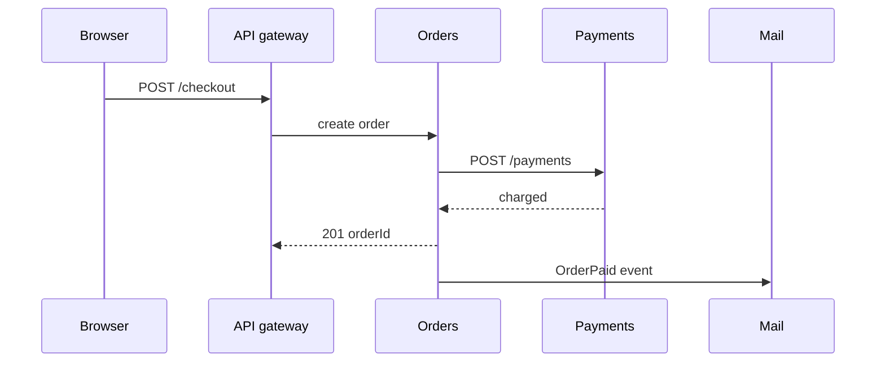

# System design — Architecture

Architecture *styles*: how the system is composed and deployed, plus where HTML is built.

[← Back to hub](./0_system_design.md)

### Related docs

* [System design — Core](./0_system_design_core.md) · [System design — Architecture](./0_system_design_architecture.md) · [Architecture patterns](./7_special_architecture.md) · [System design — Data](./0_system_design_data.md) · [SOLID](./7_special_engineering.md) · [DRY, KISS, YAGNI](./0_system_design_principles.md) · [GRASP](./0_system_design_grasp.md) · [Design patterns](./7_special_patterns.md) · [System design — Interview](./0_system_design_interview.md)

### Sections

- [3. Architecture styles](#3-architecture-styles)
- [4. Frontend architecture](#4-frontend-architecture)

Named composition patterns (modular monolith, events, gateway, BFF, micro-frontends), layers, DDD, CQRS, FSD, and Atomic Design: [Architecture patterns](./7_special_architecture.md). GoF recipes: [Design patterns](./7_special_patterns.md).

---

## 3. Architecture styles

<details>
  <summary>Monolithic architecture</summary>

### Monolithic architecture

**Definition:** The entire application — UI, business logic, data access — is built and deployed as a single unit.

**When to use:** Startups, MVPs, small teams, low complexity domains. Default choice until pain is proven.

**Pluses and minuses:**

| + | − |
|------|------|
| Simple to develop, test, deploy initially | Becomes hard to scale teams and codebase |
| No network calls between modules | Entire app must scale together |
| ACID transactions across modules easy | One bug can crash everything |
| Lower operational overhead | Technology lock-in for whole app |

**Examples:** Single Node.js/Next.js app with API routes + DB — one repo, one deploy.

**Thoughts:** Monolith ≠ bad. A well-structured modular monolith beats a poorly decomposed microservices mess.

**Sources:** [Build & deploy — monolith vs microservices](./10_build.md)

</details>

<details>
  <summary>Microservices architecture</summary>

### Microservices architecture

**Definition:** One product as a **suite of small services**, each in its **own process**, around a **business capability**, talking over HTTP/RPC/queues, **independently deployable**. Languages and datastores may differ; centralized control stays small. (Fowler)

**How it works:**

A monolith is one executable — `charge()` is a function call; a pay-bugfix redeploys the whole shop. A service owns a narrow job; reuse is the **API**, not a shared folder (`POST /payments`). Doka: logic fits in **one head**. Fowler: independent lifecycle beats LOC. New coupling = **network + contract**. CI, K8s, discovery, Prometheus, Kafka are the **microservice premium** (build, place, find, watch, buffer).

| | Monolith | Microservices |
|--|----------|---------------|
| Pay | in-process `payments.charge` | `POST /payments` (or `OrderPlaced`) |
| Pay-bugfix | rebuild entire shop | deploy **only** Payments |
| Black Friday | clone the whole app | 20 Pay replicas, 2 Catalog |
| Mail outage | often kills the request | pay can succeed if mail is async |



**When to use:**

Hotspot autoscale; team ≳10–15; reuse auth/mail in a **new product**; huge builds / uneven CPU vs I/O. **Not:** small team, unclear domain, no CI/CD/tracing. Fowler **monolith-first** — successful splits usually started as a monolith that got too big. Doka “cheaper to maintain” is true only after the monolith is already expensive.

#### Common pitfalls

Split by technical layer instead of capability. Shared DB. Greenfield microservice suite with no ops maturity.

**Pluses and minuses:**

| + | − |
| --- | --- |
| Independent scale/deploy; team autonomy; reuse; fault isolation | Distributed failures; contract versioning; no cheap ACID; ops cost |

**Examples:**

Mail as its own process. Shop (or a jobs board) calls `POST http://mail:8000/send` instead of `import sendMail`. Candidates: auth, bulk email, activity tracking, image resize.

```js
import http from 'node:http';

const server = http.createServer((req, res) => {
  if (req.method === 'POST' && req.url === '/send') {
    res.writeHead(202, { 'Content-Type': 'application/json' });
    res.end(JSON.stringify({ queued: true }));
    return;
  }
  res.writeHead(404);
  res.end();
});
server.listen(8000);
```

**Thoughts:** Split when a capability needs its own **scale, team, or reuse** — and you can afford the network as coupling. Else stay a [modular monolith](./7_special_architecture.md#modular-monolith).

**See also:** [Monolith vs microservices — decision guide](#monolith-vs-microservices--decision-guide)

**Sources:** [Fowler — Microservices](https://martinfowler.com/articles/microservices.html) · [Monolith First](https://martinfowler.com/bliki/MonolithFirst.html) · [Microservice Premium](https://martinfowler.com/bliki/MicroservicePremium.html) · [Doka — Микросервисы](https://doka.guide/tools/microservices/)

</details>

<details>
  <summary>Monolith vs microservices — decision guide</summary>

### Monolith vs microservices — decision guide

**Definition:**

Decision matrix for choosing monolithic vs microservices architecture based on team, domain, scale, and ops maturity.

| Factor | Monolith | Microservices |
|--------|----------|---------------|
| Team size | Small | Multiple teams |
| Domain clarity | Evolving | Well-bounded contexts |
| Scale needs | Uniform | Per-service hotspots |
| Ops maturity | Basic | K8s, tracing, SRE |
| Time to market | Faster initially | Slower setup |

**Thoughts:**

Extract services when **pain** justifies **cost** — not because Netflix does it. Doka lists Netflix/Amazon/Uber as proof they **use** microservices, not as proof they are cheaper for a small team.

Team, domain, per-service scale, ops maturity — if three of four still favor a monolith, stay there.

**See also:** [Monolithic architecture](#monolithic-architecture) · [Microservices architecture](#microservices-architecture) · [Modular monolith](./7_special_architecture.md#modular-monolith)

</details>

## 4. Frontend architecture

Where routing, data, and HTML run — not folder structure. Folder methodologies live in [Architecture patterns](./7_special_architecture.md#frontend-structure).

<details>
  <summary>Work placement — thin vs thick clients</summary>

### Work placement — thin vs thick clients

**Definition:** Frontend architecture is the allocation of routing, data fetching, HTML generation, validation, and interactivity across **build time**, **server**, and **browser**.

**How it works:**

1. **Static HTML** — files on disk. Instant, nothing to break, no dynamic data.
2. **Server MVC** (Django, Rails, ASP.NET) — HTML per request. Dynamic, full reload on every click.
3. **SPA** (React, Vue, Angular) — browser owns routing, state, often validation/auth. UI feels instant *after* load. Cost: large JS, slow first paint. Google can execute JS, but indexing can lag on big sites; many preview/AI crawlers never run JS — if they cannot see the HTML, the content does not exist to them.
4. **Hybrid** (SSR + hydration, RSC, islands) — move HTML and data work back to server/build; ship JS only for interactive islands.

| Client | Who does the work | Typical cost |
|--------|-------------------|--------------|
| **Thin** | Server / CDN | Fast first paint, more server load, less client flexibility |
| **Thick** | Browser | Rich UX after load, worse TTFB/LCP, SEO/crawler risk |

**When to use:** Treat this as the interview frame. Pick a mix per surface (marketing vs dashboard), not one slogan for the whole company.

**Thoughts:** "It's what the team already had" is not an architecture answer. Name the line you drew and the trade-off you accepted.

**Sources:** [React — Server Components](https://react.dev/reference/rsc/server-components) · [Next.js rendering](./4_nextjs.md)

</details>

<details>
  <summary>Rendering strategies (when HTML is built)</summary>

### Rendering strategies (when HTML is built)

**Definition:**

Strategies differ by **when** HTML is produced. Everything else (cache, personalization, JS cost) follows from that.

| Strategy | When HTML is built | Freshness | JS cost |
|----------|--------------------|-----------|---------|
| **SSG** | Build time, CDN files | Frozen until next deploy | Lowest if static |
| **ISR** | Build + background rebuild after `revalidate` | Stale-while-revalidate | Like SSG between rebuilds |
| **SSR (classic)** | Every request, whole tree then hydrate | Live / personalized | Full bundle hydrates markup |
| **Streaming SSR** | Chunks as ready (`renderToPipeableStream`) | Same as SSR, faster TTFB | Hydration still needed |
| **RSC + islands** | Server for static/data; JS only for interactive leaves | Mix | Smallest client JS |
| **Resumability (Qwik)** | Serialize state into HTML; skip replay hydration | Mix | Loader + on-interaction chunks |

**How it works:**

SSR builds HTML per request (live data). SSG builds once at build (fastest, cheapest, as fresh as last deploy). ISR splits the difference with a timer (or on-demand revalidate).

`params` is a **Promise** — await it. Data fetch runs on the server. Only Client Components (`AddToCartButton`) ship JS.

```tsx
// app/products/[id]/page.tsx — Next.js 15+
import { fetchProduct } from '@/lib/api';

export default async function ProductPage({
  params,
}: {
  params: Promise<{ id: string }>;
}) {
  const { id } = await params;
  const product = await fetchProduct(id); // server

  return (
    <main>
      <h1>{product.name}</h1>
      <p>${product.price}</p>
      <AddToCartButton productId={product.id} />
    </main>
  );
}
```

Page is static HTML; `client:*` directives hydrate only marked widgets. **PPR (Next.js):** static shell from the edge/CDN, dynamic holes streamed from compute near data.

**When to use:** Marketing/docs → SSG. Catalog that changes hourly → ISR. User-specific dashboard → SSR/RSC. Content sites with a few widgets → islands. MPA vs SPA (full reload vs JS routing): [6_web_api.md — Types of web apps](./6_web_api_apps.md#types-of-web-apps).

**Thoughts:** Implementation detail lives in [4_nextjs.md](./4_nextjs.md) (ISR, PPR, `revalidate`) and [4_react.md §8](./4_react_server.md#8-server-rendering--rsc) (RSC, streaming). Streaming SSR improves TTFB by sending HTML chunks early — [TTFB](./6_web_api_security.md#ttfb-time-to-first-byte). Here the interview skill is choosing *when* HTML is built.

**Sources:** [Next.js ISR](https://nextjs.org/docs/app/guides/incremental-static-regeneration) · [renderToPipeableStream](https://react.dev/reference/react-dom/server/renderToPipeableStream) · [Astro islands](https://docs.astro.build/en/concepts/islands/) · [Qwik resumable](https://www.qwik.dev/docs/concepts/resumable/)

</details>

<details>
  <summary>Edge rendering vs data locality</summary>

### Edge rendering vs data locality

**Definition:** Running SSR in a PoP **close to the user** (Cloudflare Workers, former Vercel Edge Functions) vs running Node **close to the database**.

**How it works:**

2021–2023 pitch — less distance to the visitor, faster pages. Failure mode: most databases live in **one region**. An isolate in Tokyo calling Virginia often loses to rendering in Virginia. Lee Robinson (then Vercel VP of Product) wrote that compute must sit near data; v0 testing found Node.js SSR + streaming beat edge rendering for that workload. Partial Prerendering keeps the modest win: **static shell from the edge**, dynamic parts from regional compute.

- Vercel: standalone **Edge Functions are deprecated** for new projects. Prefer **Vercel Functions + Node.js** (default), pin the function **region to the database**. Next.js `export const runtime = 'edge'` is **deprecated** — remove it. Routing Middleware may still use the Edge runtime.
- Cloudflare Workers remain a real edge-SSR option when **data is also globally distributed** (or accessed over HTTP at the edge).

Data locality beat user locality. Knowing *why* the industry reversed is worth more than the buzzword.

**When to use:** Auth/geo middleware, static shells, globally replicated data. **Default for SSR + DB:** Node in the same region as the database.

**Pluses and minuses:**

| + (edge compute) | − |
|---------------------|------|
| Static/CDN and geo routing still belong at the edge | Chatty DB round trips across the ocean |
| Fast isolates when data is local or KV/D1-like | Limited Node APIs; ORM/native addons often fail |
| | Naming confusion: *edge location* ≠ *Edge runtime* |

**Sources:** [Vercel — Do not use Edge Functions](https://vercel.com/docs/functions/runtimes/edge/edge-functions) · [Next.js — Edge runtime deprecated](https://nextjs.org/docs/messages/edge-runtime-deprecated) · [Partial Prerendering](https://vercel.com/docs/partial-prerendering) · [4_nextjs.md — Edge vs Node](./4_nextjs_platform.md#edge-vs-node-runtime)

</details>

<details>
  <summary>Talking about architecture in an interview</summary>

### Talking about architecture in an interview

**Definition:** A senior answer is a **choice with trade-offs**, not a catalog of patterns.

**How it works:**

1. **What you run** — "Marketing is SSG, dashboards are SSR/RSC, mobile has a BFF."
2. **Why** — "SSG for sub-second first paint where content barely changes. SSR so the user's name never flashes wrong content."
3. **Trade-off you accepted** — "The BFF adds a hop and a SPOF, but the frontend team owns its payload. Worth it."
4. **What you did not pick** — "We looked at micro-frontends. Coordination cost was not worth it at our headcount yet."

That last point is the difference between reciting a diagram and making a decision. The Vercel edge reversal is a ready-made example: the platform that sold edge SSR changed the default when measurements said Node near the database was faster.

**When to use:** Every "how would you architect X" prompt. Start from constraints (team size, data location, deploy pain, SEO/crawlers), then name the line between browser / server / build.

</details>
