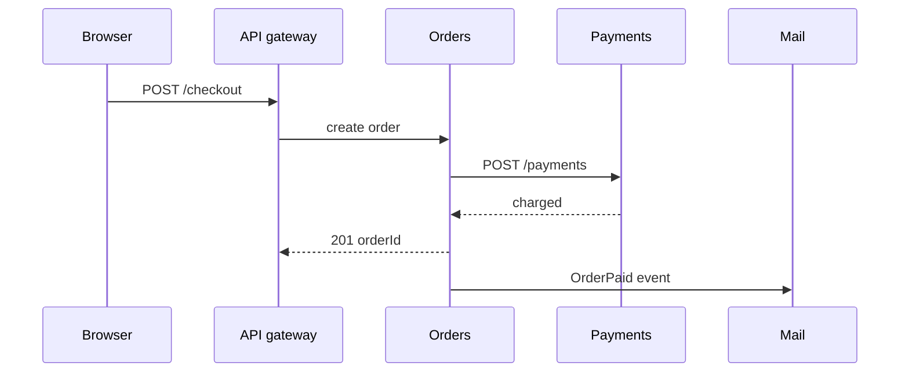
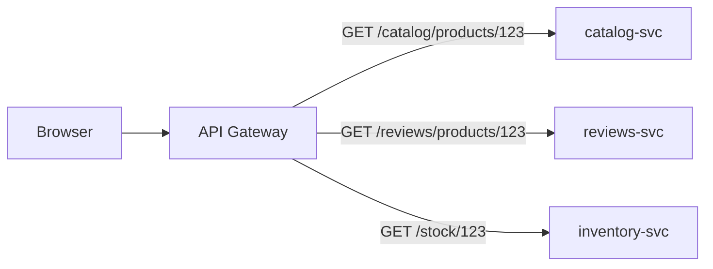
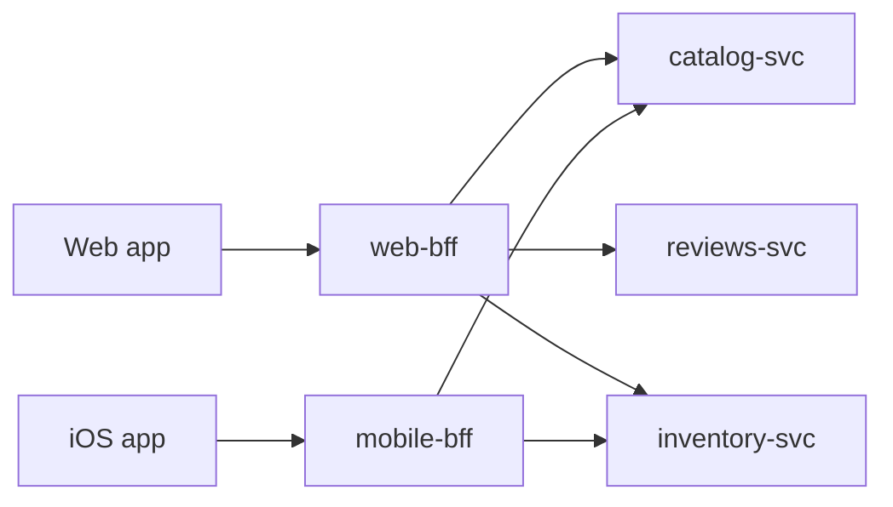

# System design — Architecture

Architecture styles and frontend architecture.

[← Back to hub](./0_system_design.md)

### Related docs

* [System design — Foundations](./0_system_design_foundations.md) · [System design — Architecture](./0_system_design_architecture.md) · [System design — Data](./0_system_design_data.md) · [System design — Patterns](./0_system_design_patterns.md) · [System design — Interview](./0_system_design_interview.md)

### Sections

- [3. Architecture styles](#3-architecture-styles)
- [4. Frontend architecture](#4-frontend-architecture)

---

## 3. Architecture styles

<details>
  <summary>Monolithic architecture</summary>

### Monolithic architecture

**Definition:** The entire application — UI, business logic, data access — is built and deployed as a single unit.

**When to use:** Startups, MVPs, small teams, low complexity domains. Default choice until pain is proven.

**Pluses and minuses:**

| + | − |
|------|------|
| Simple to develop, test, deploy initially | Becomes hard to scale teams and codebase |
| No network calls between modules | Entire app must scale together |
| ACID transactions across modules easy | One bug can crash everything |
| Lower operational overhead | Technology lock-in for whole app |

**Examples:** Single Node.js/Next.js app with API routes + DB — one repo, one deploy.

**Thoughts:** Monolith ≠ bad. A well-structured modular monolith beats a poorly decomposed microservices mess.

**Sources:** [Build & deploy — monolith vs microservices](./10_build.md)

</details>

<details>
  <summary>Microservices architecture</summary>

### Microservices architecture

**Definition:** One product as a **suite of small services**, each in its **own process**, around a **business capability**, talking over HTTP/RPC/queues, **independently deployable**. Languages and datastores may differ; centralized control stays small. (Fowler)

**How it works:**

A monolith is one executable — `charge()` is a function call; a pay-bugfix redeploys the whole shop. A service owns a narrow job; reuse is the **API**, not a shared folder (`POST /payments`). Doka: logic fits in **one head**. Fowler: independent lifecycle beats LOC. New coupling = **network + contract**. CI, K8s, discovery, Prometheus, Kafka are the **microservice premium** (build, place, find, watch, buffer).

| | Monolith | Microservices |
|--|----------|---------------|
| Pay | in-process `payments.charge` | `POST /payments` (or `OrderPlaced`) |
| Pay-bugfix | rebuild entire shop | deploy **only** Payments |
| Black Friday | clone the whole app | 20 Pay replicas, 2 Catalog |
| Mail outage | often kills the request | pay can succeed if mail is async |



**When to use:**

Hotspot autoscale; team ≳10–15; reuse auth/mail in a **new product**; huge builds / uneven CPU vs I/O. **Not:** small team, unclear domain, no CI/CD/tracing. Fowler **monolith-first** — successful splits usually started as a monolith that got too big. Doka “cheaper to maintain” is true only after the monolith is already expensive.

#### Common pitfalls

Split by technical layer instead of capability. Shared DB. Greenfield microservice suite with no ops maturity.

**Pluses and minuses:**

| + | − |
| --- | --- |
| Independent scale/deploy; team autonomy; reuse; fault isolation | Distributed failures; contract versioning; no cheap ACID; ops cost |

**Examples:**

Mail as its own process. Shop (or a jobs board) calls `POST http://mail:8000/send` instead of `import sendMail`. Candidates: auth, bulk email, activity tracking, image resize.

```js
import http from 'node:http';

const server = http.createServer((req, res) => {
  if (req.method === 'POST' && req.url === '/send') {
    res.writeHead(202, { 'Content-Type': 'application/json' });
    res.end(JSON.stringify({ queued: true }));
    return;
  }
  res.writeHead(404);
  res.end();
});
server.listen(8000);
```

**Thoughts:** Split when a capability needs its own **scale, team, or reuse** — and you can afford the network as coupling. Else stay a [modular monolith](#modular-monolith).

**See also:** [7_special.md](./7_special_architecture.md#4-system-architecture)

**Sources:** [Fowler — Microservices](https://martinfowler.com/articles/microservices.html) · [Monolith First](https://martinfowler.com/bliki/MonolithFirst.html) · [Microservice Premium](https://martinfowler.com/bliki/MicroservicePremium.html) · [Doka — Микросервисы](https://doka.guide/tools/microservices/)

</details>

<details>
  <summary>Modular monolith</summary>

### Modular monolith

**Definition:** Single deployable unit with strict internal module boundaries (by domain/feature), enforcing dependency rules between modules.

**How it works:** One app, two ownership layers — a **platform** slice (design system, shared hooks, logging) owned by a platform team, and **domain** folders (`user/`, `payments/`) owned by feature teams. Same instinct as hexagonal/clean architecture, without three layers between a button and a `fetch`. Full clean architecture is usually overkill on the client.

**When to use:** Recommended default for most teams. Split to microservices only when module boundaries and team structure justify it.

**Pluses and minuses:**

| + | − |
|------|------|
| Simple deployment like monolith | Requires discipline to maintain boundaries |
| ACID transactions within monolith | All modules scale together |
| Easier refactor to microservices later | Can decay into big ball of mud without linting/reviews |
| One repo, one CI pipeline | |

**Examples:** Modules `billing/`, `auth/`, `catalog/` — each exposes a public API; no cross-module internal imports.

**Thoughts:** "Modular monolith first" is increasingly the staff-engineer recommendation. Extract services (or micro-frontends) when a module needs independent scale, independent deploys, or team ownership — not because the codebase got large. See [Micro-frontends](#micro-frontends).

</details>

<details>
  <summary>Event-driven architecture</summary>

### Event-driven architecture

**Definition:** Components communicate by producing and consuming events asynchronously, decoupling producers from consumers.

**How it works:**

1. Producer publishes domain event (`UserRegistered`, `OrderPlaced`) to broker or event bus.
2. Broker persists and delivers to N subscribers (at-least-once typical).
3. Each consumer processes independently — may publish new events (choreography).
4. Failures retried; dead-letter queue for poison messages.

Kafka/RabbitMQ/SNS+SQS, schema registry (Avro/JSON Schema), outbox pattern for reliable publish-after-DB-write.

**When to use:**

Order pipelines, notifications, analytics, integrations, microservices communication, CQRS projections.

User waiting for synchronous result that depends on all steps — use request/response or saga orchestrator with polling/WebSocket.

**Pluses and minuses:**

| + | − |
|------|------|
| Loose coupling | Eventual consistency |
| Easy to add new consumers | Debugging distributed flows harder |
| Natural audit trail | Schema evolution / versioning |
| Handles traffic spikes (buffer in queue) | Ordering guarantees vary by broker |

**Examples:** `OrderPlaced` event → inventory service reserves stock, payment service charges, email service sends confirmation — independently.

**Thoughts:** Define event contracts (versioned schemas). Idempotent consumers are mandatory with at-least-once delivery. Correlate with `trace_id` in OpenTelemetry.

**Sources:** [Microservices.io — Event-driven architecture](https://microservices.io/patterns/data/event-driven-architecture.html)

</details>

<details>
  <summary>CQRS</summary>

### CQRS

**Definition:** Command Query Responsibility Segregation — separate models and paths for writes (commands) and reads (queries).

**When to use:** Read-heavy apps with complex queries, different scaling needs for reads vs writes, event sourcing companion.

**Pluses and minuses:**

| + | − |
|------|------|
| Optimize read and write independently | Increased complexity |
| Scale reads separately (read replicas, denormalized views) | Eventual consistency between read/write models |
| Simpler write model, rich read model | Overkill for simple CRUD |

**Examples:** Write: normalized `orders` table. Read: denormalized `order_summaries` materialized view updated by events. Forms: [9_database.md — Normal forms](./9_database_core.md#normal-forms-1nf3nf-bcnf); snapshots: [Normalize vs denormalize](./9_database_core.md#normalization-vs-denormalization).

**Thoughts:** Don't apply CQRS everywhere. Use when read patterns genuinely differ from write patterns and justify the sync cost.

</details>

<details>
  <summary>DDD (Domain-Driven Design)</summary>

### DDD (Domain-Driven Design)

**Definition:**

Software design approach centered on the business domain, using a ubiquitous language and bounded contexts to model complex domains.

| Concept | Meaning |
|---------|---------|
| **Bounded context** | Explicit boundary where a domain model applies |
| **Ubiquitous language** | Shared vocabulary between devs and domain experts |
| **Aggregate** | Cluster of entities treated as one unit for consistency |
| **Entity / Value object** | Identity vs defined-by-attributes |

**When to use:** Complex business domains (finance, logistics, healthcare). Less valuable for simple CRUD apps.

**Pluses and minuses:**

| + | − |
|------|------|
| Aligns code with business | Steep learning curve |
| Clear service boundaries for microservices | Over-modeling slows delivery |
| Reduces mismatched assumptions | Requires domain expert access |

**Examples:** "Customer" in Sales context ≠ "Customer" in Support context — different models, different bounded contexts, integrate via APIs/events.

**Thoughts:** DDD is strategic (bounded contexts) and tactical (aggregates, entities). Interviews often focus on bounded contexts as microservice boundaries.

</details>

<details>
  <summary>Clean Architecture & Hexagonal</summary>

### Clean Architecture & Hexagonal

**Definition:** Family of architectures with the same interview idea: **business rules do not depend on frameworks, DBs, or UI**. Hexagonal (ports & adapters, Cockburn) draws a domain hexagon with inbound/outbound ports. Onion (Palermo) is the same instinct with slightly different rings. Clean Architecture (Uncle Bob) draws concentric rings: **entities → use cases → interface adapters → frameworks & drivers**. Doka’s **three-layer** cut (domain / application / ports-and-adapters) is the same idea for small apps — treat the names as synonyms until the project is large enough that the extra rings matter. See [Three-layer architecture](#three-layer-architecture-doka).

**How it works:**

Inner circles are **policies**; outer circles are **mechanisms**. **The Dependency Rule:** source-code dependencies only point **inward**. An inner circle must not name anything declared in an outer circle (class, function, type, or a framework row/DTO). Data that crosses a boundary is a simple structure convenient for the **inner** circle — not a Prisma row or an Express `Request`.

| Ring | Owns | Independent of |
|------|------|----------------|
| **Entities** | Enterprise / app business rules (objects or data + functions) | UI, DB, navigation, auth flavor |
| **Use cases** | Application-specific scenarios; orchestrate entities | DB, UI, frameworks |
| **Interface adapters** | MVC, presenters, controllers, SQL, API mappers | — converts inner shapes ↔ outer shapes |
| **Frameworks & drivers** | HTTP framework, ORM, DB, glue | Details live here so they can be replaced |

Uncle Bob’s goals (all of these architectures): independent of frameworks, UI, DB, and external agencies; **testable** business rules without those.

Domain defines **ports** (interfaces): `OrderRepository`, `PaymentGateway`. **Adapters** implement them: Prisma, Stripe SDK, Express/React. Use cases orchestrate entities and ports. UI and Nest/Express are **outer** — replaceable.

```
Frameworks (HTTP, ORM, queue)
        ↓ adapters
Use cases / application
        ↓
Entities / domain
```

Flow of control can go **outward** (use case → presenter) while **source** dependencies still point **inward**: the use case calls an **output port** interface it owns; the presenter in the outer ring implements it (**Dependency Inversion**).

**When to use:**

Long-lived backends with real domain rules. **When NOT:** a weekend MVP — a modular monolith with clear modules is enough. See [0_mvp.md](./0_mvp.md).

#### Common pitfalls

Putting Prisma calls in React components. Calling it Hexagonal while importing `pg` from the domain folder. Passing ORM row types into entities.

**Pluses and minuses:**

| + | − |
|------|------|
| Test domain without a database | Extra interfaces on a 4-endpoint CRUD app |
| Swap Postgres for a fake in tests | "Use case class per button" cargo cult |
| Same story as FSD layers on the frontend | Teams argue about folder names |

**Examples:**

```ts
// port (owned inward — application/domain)
export type ChargeCard = (input: { orderId: string; cents: number }) => Promise<void>;

// use case — no Express, no Prisma
export function completeCheckout(charge: ChargeCard) {
  return async (orderId: string, cents: number) => {
    await charge({ orderId, cents });
  };
}
```

**Thoughts:** Dependencies point inward. The domain does not know Nest or Next.

**See also:** [Three-layer architecture](#three-layer-architecture-doka) · [Architecture vs design patterns](#architecture-vs-design-patterns) · [DDD](#3-architecture-styles) · [FSD](./4_react.md) · [Kafka vs RabbitMQ vs BullMQ](./10_build.md)

**Sources:** [Alistair Cockburn — Hexagonal](https://alistair.cockburn.us/hexagonal-architecture/) · [Robert C. Martin — The Clean Architecture (2012)](https://blog.cleancoder.com/uncle-bob/2012/08/13/the-clean-architecture.html) · [Doka — Three-layer architecture](https://doka.guide/tools/clean-architecture/)

</details>

<a name="three-layer-architecture-doka"></a>

<details>
  <summary>Three-layer architecture (Doka)</summary>

### Three-layer architecture (Doka)

**Definition:** Split the app into **domain**, **application**, and **ports & adapters**, with a hard rule: **every dependency points toward the domain**. The rest of the code exists to feed the domain the shapes it wants, call its functions, and persist or display the result. Goal: cheaper features and cheaper bug hunts because you know which layer owns the mistake.

**How it works:**

Draw three rings. Center = **what the business is** (cart rules). Middle = **what the user is doing** (checkout). Outer = **how we talk to the world** (button click, HTTP, Postgres). A bug in “10% off is wrong” is domain. A bug in “we forgot to save after checkout” is application. A bug in “snake_case from the API” is an adapter.

```
     ┌─────────────────────────────────────────┐
     │  ports & adapters  (UI, fetch, DB)      │  ← world
     │   ┌─────────────────────────────────┐   │
     │   │  application  (use cases)       │   │
     │   │   ┌─────────────────────────┐   │   │
     │   │   │  domain (pure rules)    │   │   │
     │   │   └─────────────────────────┘   │   │
     │   └─────────────────────────────────┘   │
     └─────────────────────────────────────────┘
              arrows of *imports* only go inward
```

| Layer | Question it answers | Allowed to do | Forbidden |
|-------|---------------------|---------------|-----------|
| **Domain** | What are the rules of *this* product? | Types + **pure** functions (same in → same out) | `fetch`, React, Prisma, `window` |
| **Application** | What happens in this **scenario**? | Load via **port**, call domain, save via **port** | Import Stripe SDK / `fetch` / JSX |
| **Ports & adapters** | How do we plug into the real world? | Implement ports; map DTO ↔ domain | Business rules (discounts, totals) |

| Code | Layer | Why |
|------|-------|-----|
| `type Cart = { items: CartItem[] }` | Domain | Subject data |
| `cartTotal(cart)` / `addItem(cart, product)` | Domain | Rule, no I/O |
| `interface CartStorage { load(); save() }` | Application | Contract we wish the world had |
| `checkout(userId, storage)` | Application | Scenario: load → domain → save |
| `fetch('/cart').then(fromApi)` | Driven adapter | Real HTTP + field mapping |
| `onClick={() => checkout(...)}` | Driving adapter | User signal in |
| Express `POST /checkout` | Driving adapter | Same idea on the server |

Domain imports nothing outer. Application imports domain + **port types**. Outer **implements** ports and is passed in (DI). JS has no native DI — pass functions as arguments, or Inversify (`container.bind(id).to(Impl)`).

a **port** is the *wish*: “give me `saveCart(cart)`.” An **adapter** makes a messy API look like that wish. Mapping `product_id` → `productId` is adapter work. `function saveCart(c) { return api.save(c) }` is **not** an adapter until you can swap the backend **without editing application code**.

**Driving** (left) — world tells the app: UI, HTTP, CLI. **Driven** (right) — app tells the world: storage, email, payments. Both live in the outer ring.

**Infrastructure** = real DB, SMS, payment APIs. **Shared kernel** = cheap globals (`window`, language). Browser + Node shared code → those globals become adapters.

```ts
// WRONG — domain + HTTP + UI glued; cannot test total without fetch
async function onAddClickedWrong(userId: string, item: CartItem) {
  const res = await fetch(`/api/carts/${userId}`);
  const cart = await res.json();
  cart.items.push(item);
  await fetch(`/api/carts/${userId}`, { method: 'PUT', body: JSON.stringify(cart) });
}

// RIGHT — same click, but rules are testable:
//   expect(cartTotalCents(addItem(empty, item))).toBe(500)
```

**When to use:**

Real domain rules; browser + SSR + RN; swap backends. **Minimum:** extract **domain** first. Full three layers when I/O and use cases actually hurt.

#### Common pitfalls

Domain that `fetch`es. Application that imports Stripe. Adapter that only renames a method. Port **implementations** sitting next to use cases. Putting `%` discount logic in JSX.

**Pluses and minuses:**

| + | − |
|------|------|
| Bug hunt: rule vs scenario vs glue | Design time, onboarding |
| Domain unit-tests with no mocks | Extra files; more JS to parse |
| Swap UI or API without rewriting totals | Overkill for a 3-page marketing site |

**Examples:**

```ts
// --- domain/cart.ts  (pure; test with plain objects) ---
export type CartItem = { productId: string; priceCents: number; qty: number };
export type Cart = { items: CartItem[] };

export function addItem(cart: Cart, item: CartItem): Cart {
  const i = cart.items.findIndex((x) => x.productId === item.productId);
  if (i === -1) return { items: [...cart.items, item] };
  const items = cart.items.map((x, n) =>
    n === i ? { ...x, qty: x.qty + item.qty } : x,
  );
  return { items };
}

export function cartTotalCents(cart: Cart): number {
  return cart.items.reduce((sum, x) => sum + x.priceCents * x.qty, 0);
}

export function applyPercentOff(totalCents: number, percent: number): number {
  return Math.round(totalCents * (1 - percent / 100));
}

// --- application/ports.ts + addToCart.ts ---
export interface CartStorage {
  load(userId: string): Promise<Cart>;
  save(userId: string, cart: Cart): Promise<void>;
}

import { addItem, cartTotalCents, type Cart, type CartItem } from '../domain/cart';

export async function addToCartUseCase(
  userId: string,
  item: CartItem,
  storage: CartStorage, // port — not fetch
): Promise<{ cart: Cart; totalCents: number }> {
  const cart = await storage.load(userId);
  const next = addItem(cart, item);
  await storage.save(userId, next);
  return { cart: next, totalCents: cartTotalCents(next) };
}

// --- adapters/httpCartStorage.ts  (driven) ---
import type { CartItem } from '../domain/cart';
import type { CartStorage } from '../application/ports';

function fromApi(row: { product_id: string; price_cents: number; qty: number }): CartItem {
  return { productId: row.product_id, priceCents: row.price_cents, qty: row.qty };
}

export const httpCartStorage: CartStorage = {
  async load(userId) {
    const res = await fetch(`/api/carts/${userId}`);
    const body: { items: { product_id: string; price_cents: number; qty: number }[] } =
      await res.json();
    return { items: body.items.map(fromApi) };
  },
  async save(userId, cart) {
    await fetch(`/api/carts/${userId}`, {
      method: 'PUT',
      headers: { 'Content-Type': 'application/json' },
      body: JSON.stringify({
        items: cart.items.map((i) => ({
          product_id: i.productId,
          price_cents: i.priceCents,
          qty: i.qty,
        })),
      }),
    });
  },
};

// --- adapters/AddToCartButton.tsx  (driving) ---
// onClick is the adapter; it must not compute discounts itself
async function onAddClicked(userId: string, item: CartItem) {
  await addToCartUseCase(userId, item, httpCartStorage);
}
```

load → pure update → save.

```ts
type Product = { id: string; name: string };

interface ProductsStorage {
  getProductById(id: string): Product;
  saveProduct(product: Product): void;
}

function updateProduct(product: Product, patch: { name: string }): Product {
  return { ...product, name: patch.name };
}

function renameProductHandler(
  command: { productId: string; name: string },
  storage: ProductsStorage,
) {
  const product = storage.getProductById(command.productId);
  const updated = updateProduct(product, { name: command.name });
  storage.saveProduct(updated);
}
```

domain = fractal + 2D math; application = fractal → draw commands; outer = DOM/Canvas. Same split: geometry is not mixed with `canvas.getContext('2d')`.

**Thoughts:** Program *to the domain*. Outer layers serve it; adapters make the world compatible — ports make the app reachable.

**See also:** [Clean Architecture & Hexagonal](#clean-architecture--hexagonal) · [Architecture vs design patterns](#architecture-vs-design-patterns) · [Modular monolith](#modular-monolith)

**Sources:** [Doka — Three-layer architecture](https://doka.guide/tools/clean-architecture/) (Bespoiasov, updated 2023-01-27) · [Martin — Dependency Rule](https://blog.cleancoder.com/uncle-bob/2012/08/13/the-clean-architecture.html) · [InversifyJS — bind / inject](https://github.com/inversify/InversifyJS)

</details>

<details>
  <summary>API Gateway</summary>

### API Gateway

**Definition:** A single public entry point (usually a reverse proxy) that routes client requests to the right backend service and hides the service map from the UI.

**How it works:**

Microservices each expose their own API. If the frontend calls them directly, it must know addresses, auth, and shapes for every service — tight coupling. A gateway gives **one contract**: protocols, hosts/ports, request rules, response rules. Internals can change without rewriting the client.

Walk one product page:

1. Browser talks only to `https://api.shop.com` (one host, one TLS cert, one auth cookie).
2. Gateway matches the path and **forwards** the request. It does not assemble a page model.
3. `catalog-svc` / `reviews-svc` still return *their* JSON. The UI still makes **one round trip per service** unless you add a BFF.



Microsoft’s **Gateway Routing** pattern: L7 path/host routing; the gateway also often owns **cross-cutting** work (auth, TLS, rate limits, logging). Typical products: Kong, NGINX, Envoy, AWS/Azure API Gateway.

**When to use:**

Microservice (or many) backends, many clients sharing similar request shapes, need a stable public API. **When NOT:** one frontend + one backend — you already have a single door.

#### Common pitfalls

Treating the gateway as a second checkout service. Letting the browser keep hard-coded internal hostnames (`catalog-svc:8080`). Forgetting HA on the gateway.

**Pluses and minuses:**

| + | − |
|------|------|
| One URL / contract for many services | Extra hop; gateway is a **SPOF** unless HA |
| UI decoupled from service split/rename | Fat gateway if you dump domain logic here |
| Cache, auth, rate-limit at the edge | Versioning and routing config become ops work |

**Examples:**

```nginx
server {
    listen 80;
    location /catalog/ { proxy_pass http://catalog-svc; }
    location /reviews/ { proxy_pass http://reviews-svc; }
    location /stock/   { proxy_pass http://inventory-svc; }
}
```

Same idea as Node if you only **proxy** (still not a BFF — no aggregation):

```js
// Express 5: res.json(obj) only — set status separately. Catch async errors with next(err).
import express from 'express';

const app = express();
const SVC = {
  catalog: 'http://catalog-svc',
  reviews: 'http://reviews-svc',
};

app.get('/catalog/products/:id', async (req, res, next) => {
  try {
    const upstream = await fetch(`${SVC.catalog}/products/${req.params.id}`);
    const body = await upstream.json();
    res.status(upstream.status).json(body); // same payload, new public URL
  } catch (err) {
    next(err);
  }
});

app.use((err, req, res, next) => {
  res.status(err.status || 500).json({ error: err.message });
});
```

**What the UI still sees** (three calls, three shapes):

```http
GET /catalog/products/123  →  { "id":"123", "title":"Mug", "priceCents":1299, "warehouseSku":"W-9" }
GET /reviews/products/123  →  { "items":[{ "stars":5, "text":"…" }], "average":4.6 }
GET /stock/123             →  { "sku":"W-9", "qty":14 }
```

**Thoughts:**

Shared door. Route + policy, not a page-shaped JSON.

Doka: cache hot paths; light shaping is OK. When each *client* needs a different payload, add a [BFF](#bff-backend-for-frontend).

**Sources:** [Azure — What is an API gateway](https://learn.microsoft.com/azure/architecture/microservices/design/gateway) · [Azure — Gateway Routing](https://learn.microsoft.com/azure/architecture/patterns/gateway-routing) · [Express — async errors / `res.json`](https://expressjs.com/) · [Doka — Gateway and BFF](https://doka.guide/tools/gateway-bff/)

</details>

<details>
  <summary>BFF (Backend for Frontend)</summary>

### BFF (Backend for Frontend)

**Definition:** A thin server layer **owned by the frontend team** that sits between one UI and domain backends, reshaping data into exactly what that client needs. Doka’s framing: BFF **includes a Gateway** (one contract) **plus** response preparation for that frontend.

**How it works:**

Named at SoundCloud (~2013) while splitting a monolith: web, iOS, and Android fought over one shared API that fit nobody. Phil Calçado documented the pattern; Sam Newman popularized the write-up. Each client gets its own BFF (or one BFF per *class* of UI — e.g. iOS + Android listener apps sharing one BFF). Netflix used per-device adapters (smart TV vs phone). Azure: a **separate BFF per interface** (desktop vs mobile) so one backend is not torn between conflicting payload/latency needs.

Walk the same product page:

1. Web UI makes **one** call: `GET /bff/pdp/123`.
2. Web BFF, **on the server**, fans out to catalog + reviews + stock (parallel `fetch`).
3. It maps those three JSON blobs into **the web PDP shape** (trim fields, rename, nest). Domain services stay unchanged.
4. Mobile BFF is a **different process** with a smaller mapper — not query-params on a shared mega-endpoint.



The shared-API failure mode: mobile needs name, price, thumbnail; web also needs reviews, stock, related items. One endpoint over-fetches for mobile or under-fetches for web — then you chase `?include=` forever.

REST backends change rarely, so responses often include fields a given UI never uses. Dropping fields breaks old clients; cloning near-identical endpoints is expensive. A BFF or **GraphQL** returns only what that client asked for.

| | API Gateway | BFF |
|--|-------------|-----|
| Who owns it | Platform / backend | Frontend team for that client |
| Clients | Often many, same-ish API | One UI (or one *class*: iOS+Android) |
| Job | Route, auth, cache, translate | Aggregate + **shape the screen payload** |
| Stack | NGINX/Kong/cloud GW | Often Node (I/O-heavy; Doka: Deno/GraalVM as alternatives) |

A company-wide Kong is not a BFF. A `web-bff` that fans out to ten services and returns one home-page JSON is. You can stack them: UI → BFF → shared gateway → services.

shared templates (e.g. JSX) on client and BFF; same language so code can be reused; speed from cache **and** preparing data for the next client request. Node fits lots of I/O, not CPU-heavy work.

keep it a **thin facade** — domain rules stay in real backends.

| Approach | Fit for BFF |
|----------|-------------|
| **Classic 3-tier** (client / business / data) | Weak — upper layers glued to DB/API shape. Not the same as Doka’s [three-layer](#three-layer-architecture-doka) (domain-first). |
| **Full DDD** (UI / app / domain / infra) | Too heavy if product domain already lives downstream; **leaky abstraction** if app code must see infra |
| **Clean / hexagonal** | Outer ring = HTTP + fetch adapters; inward = BFF DTOs. Don’t grow a second domain model. See [Clean Architecture](#clean-architecture--hexagonal). |

Doka’s “how to start” stack: Node + Express, often with NestJS — still follow the product, not the framework.

**Example — web BFF aggregates; mobile BFF trims** (Express 5: `try/catch` + `next(err)`; `res.status(n).json(obj)`):

```js
import express from 'express';

const app = express();
const CATALOG = 'http://catalog-svc';
const REVIEWS = 'http://reviews-svc';
const STOCK = 'http://inventory-svc';

async function loadProductGraph(id) {
  const [catalogRes, reviewsRes, stockRes] = await Promise.all([
    fetch(`${CATALOG}/products/${id}`),
    fetch(`${REVIEWS}/products/${id}`),
    fetch(`${STOCK}/${id}`),
  ]);
  if (!catalogRes.ok) {
    const err = new Error('product not found');
    err.status = catalogRes.status;
    throw err;
  }
  const [catalog, reviews, stock] = await Promise.all([
    catalogRes.json(),
    reviewsRes.json(),
    stockRes.json(),
  ]);
  return { catalog, reviews, stock };
}

// Pick one mapper per deployed BFF (Azure: separate service per interface).
function toWebPdp({ catalog, reviews, stock }) {
  return {
    id: catalog.id,
    title: catalog.title,
    price: catalog.priceCents / 100,
    inStock: stock.qty > 0,
    reviewAverage: reviews.average,
    reviews: reviews.items.slice(0, 3),
  };
}

function toMobilePdp({ catalog, stock }) {
  return {
    id: catalog.id,
    name: catalog.title,
    price: catalog.priceCents / 100,
    thumbnail: catalog.images[0],
    inStock: stock.qty > 0,
  };
}

const toPdp = toWebPdp; // mobile-bff: toMobilePdp

app.get('/bff/pdp/:id', async (req, res, next) => {
  try {
    const graph = await loadProductGraph(req.params.id);
    res.json(toPdp(graph));
  } catch (err) {
    next(err);
  }
});

app.use((err, req, res, next) => {
  res.status(err.status || 500).json({ error: err.message });
});

app.listen(4000);
```

**Web response** vs **mobile response** (same product `123`):

```json
{
  "id": "123",
  "title": "Mug",
  "price": 12.99,
  "inStock": true,
  "reviewAverage": 4.6,
  "reviews": [{ "stars": 5, "text": "…" }]
}
```

```json
{ "id": "123", "name": "Mug", "price": 12.99, "thumbnail": "https://cdn/…", "inStock": true }
```

The UI never sees `warehouseSku` or three URLs. Checkout/discount rules stay in domain services — the BFF only **maps**.

**When to use:**

Multiple clients (web, mobile, partner API) needing **meaningfully different** shapes from the same backends. Microservices backend. GraphQL alternative when the team prefers REST + ownership.

A single frontend talking to one API — you mostly add a network hop. Microsoft: skip BFF if all UIs make the same calls, or only one interface talks to the backend. GraphQL with per-client resolvers or a shared API gateway can be enough.

#### Common pitfalls

Putting “apply coupon” in the BFF. One BFF for web+mobile that grows `if (isMobile)` forever (Azure: conflicting requirements). No timeout/`Promise.all` failure handling — one slow review service hangs the whole PDP. Skipping SLOs: if the BFF is down, the UI is down even when catalog is healthy.

**Pluses and minuses:**

| + | − |
|------|------|
| Tailored payloads (no over-fetch / extra round trips) | Extra service to run, monitor, and keep alive |
| Frontend team owns its data shape | **SPOF:** if the BFF is down, the UI is down even if domain APIs are fine |
| Shields UI from microservice churn | Duplication across BFFs (SoundCloud later extracted Value-Added Services for shared domain logic) |
| Client-specific auth, caching, rate limits | Can become a god-service if domain logic leaks in |

**Thoughts:**

Aggregate, transform, cache. Microsoft: keep **client-specific** logic in the BFF; put shared auth/monitoring in other patterns (often the gateway). Duplication across BFFs is expected; SoundCloud later extracted Value-Added Services for shared domain work.

One round trip, one screen-shaped JSON, one BFF per client class — domain rules stay downstream.

**Sources:** [Phil Calçado — BFF](https://philcalcado.com/2015/09/18/the_back_end_for_front_end_pattern_bff.html) · [Sam Newman — Backends For Frontends](https://samnewman.io/patterns/architectural/bff/) · [Azure — Backends for Frontends](https://learn.microsoft.com/azure/architecture/patterns/backends-for-frontends) · [Doka — Gateway and BFF](https://doka.guide/tools/gateway-bff/) · [Doka — How web apps work](https://doka.guide/tools/web-app-works/) (middle-end / GraphQL)

</details>

<details>
  <summary>Micro-frontends</summary>

### Micro-frontends

**Definition:**

Frontend architecture where independently deployable frontend applications compose into a single user-facing product — usually a **shell** loading remotes at runtime (e.g. Webpack Module Federation).

**The failure that actually burns teams** is not "mixing React and Vue." It is **shared dependency drift**: one remote upgrades React, another does not, two copies fight over one DOM.

**How it works:**

| Headcount / pain | Typical fit |
|------------------|------------|
| Under ~15 engineers | Modular monolith almost always wins — not enough people for N deploy pipelines |
| ~15–50, clear domains | BFFs + a well-owned modular monolith; micro-frontends still premature |
| 50+ and teams **block each other on deploys** | Micro-frontends start paying — because the *organization* scaled, not because the bundle did |

**When to use:** The bottleneck is **deploy coordination between teams**, not app complexity. Zalando, IKEA, DAZN and others have written about this at large org size with heavy shared tooling. Reference: [micro-frontends.org](https://micro-frontends.org/).

**Pluses and minuses:**

| Composition | How | + | − |
|-------------|-----|------|------|
| **Build-time** | npm packages imported at build | Simple | Coupled release cycle |
| **Runtime — iframe** | Each MFE in iframe | Strong isolation | UX/performance; Spotify later consolidated a desktop iframe setup partly because seams cost more than independence returned |
| **Runtime — Module Federation** | Webpack/Vite federated modules | Independent deploy, shared deps | Complex setup; **dependency drift** |
| **Runtime — Web Components** | Custom elements as boundary | Framework-agnostic | Tooling immature in places |

**Examples:** Shell app loads `header`, `checkout`, `catalog` as federated modules from different teams/deploys. Pin a **single** shared React version in the shell; treat version skew as an incident.

**Thoughts:** Micro-frontends solve *organizational* scaling. Shared design system, routing conventions, and a dependency contract are mandatory. Mixing frameworks is possible but rarely the reason to adopt the pattern.

**Sources:** [micro-frontends.org](https://micro-frontends.org/)

</details>

<a name="4-frontend-architecture"></a>

## 4. Frontend architecture

Senior interviews rarely ask *what* you built. They ask **why that way**. Two frames: **how modules talk** (architecture vs patterns), and **how much work the browser vs server vs build does**. SSR, RSC, micro-frontends, BFFs are different places to draw that second line.

<details>
  <summary>Architecture vs design patterns</summary>

### Architecture vs design patterns

**Definition:**

**Architecture** is the set of decisions about how modules talk to each other and to the outside world — constraints, rules, and heuristics for the whole system. A **design pattern** is a named template for a smaller, recurring problem closer to the code. Architecture covers the project; patterns cover local jobs.

House metaphor (Doka): architecture is “how to build the house”; patterns are “how to drive piles / mix cement / run wiring.”

**How it works:**

Imagine a photo editor.

- **Architecture** answers: Who owns the canvas? Who talks to the camera? Does UI mutate pixels, or only send “apply sepia”? Is this one deployable app or a checkout widget loaded from another team? Those rules apply to *every* feature.
- **A pattern** answers a *local* mismatch: the camera SDK returns `{ some_data: ["Name", "Lastname"] }` but your UI wants `{ someData: "Name Lastname" }` → **Adapter**. You do not need a new architecture for that one mapping.

Same product can use **both**: layers + one-way store (architecture) *and* Adapter / Strategy / Observer inside a module (patterns).

Every extra line loads the reader; too few details hide meaning. Community-standard cuts (MVC, layers, Flux) and named patterns help hold that balance.

Requirements will change; people cannot forecast the future well. A useful architecture makes change cheaper:

- Regulated module APIs → swap implementations.
- Regulated I/O → fewer accidental leaks of internals (and of data).
- Clear splits → easier tests.
- Predictable layout → faster features and bug hunts.
- Known style → faster onboarding.

**How it works — families of approaches** (group by *goal*, not by brand name):

| Family | Question it answers | Frontend examples |
|--------|---------------------|-------------------|
| **Responsibility** | Which module owns which job? | MVC / MVP / MVVM — [7_special.md](./7_special_architecture.md#3-architecture-patterns) · Doka “Model View Whatever” |
| **Distance from domain** | What is business logic vs infrastructure? | Three-layer / Clean / Hexagonal — photo **filters** (domain) vs **camera API** (infra) |
| **Data flow** | Direct calls, bus, or one-way store? | Flux / Redux (unidirectional); two-way / reactive — [7_special.md](./7_special_architecture.md#data-flow--one-way-vs-two-way) |
| **Composition** | One program or many? | Monolith vs microservices / micro-frontends |

one-way process — UI event → `dispatch(action)` → store runs reducers → new state → `subscribe` / `useSelector` → UI re-renders. State in, view out; dispatch is the only state-change API. Prefer `configureStore` + `createSlice` (RTK); legacy `createStore` still works but is deprecated. Notes: [7_special.md — Data flow](./7_special_architecture.md#data-flow--one-way-vs-two-way).

**When to use:**

Use a named architecture when the app is already a “high-rise” — many modules, many people, long life. Skip heavy architecture on a throwaway prototype (YAGNI). Pick an approach after comparing **cost vs benefit**.

#### Common pitfalls

Treating MVC or Redux as the *goal*. Shipping layers nobody needs. Copying a pattern because it is famous.

**Pluses and minuses:**

| + | − |
|------|------|
| Change, test, onboard cheaper at scale | Time, money, cognitive load to invent *and* follow it |
| Shared vocabulary in interviews | Wrong architecture is expensive to unwind |
| | Over-architecture on a 2-week spike |

**Examples:**

```ts
// 1) Responsibility (MVC-shaped): controller never paints pixels; view never talks to camera
type Photo = { pixels: Uint8ClampedArray };
const model = { photo: null as Photo | null };
function controllerCapture() { /* I/O */ model.photo = { pixels: new Uint8ClampedArray() }; viewRender(); }
function viewRender() { /* DOM only reads model.photo */ }

// 2) Distance from domain: filters are testable without a phone
function applySepia(photo: Photo): Photo { /* pure domain */ return photo; }
async function readCamera(): Promise<Photo> { /* infrastructure */ throw new Error('device'); }

// 3) Data flow — Redux Toolkit (redux.js.org getting-started). One-way: UI → dispatch → reducer → new state → subscribe
import { createSlice, configureStore } from '@reduxjs/toolkit';

const editor = createSlice({
  name: 'editor',
  initialState: { filter: 'none' as 'none' | 'sepia' },
  reducers: {
    setFilter(state, action: { payload: 'none' | 'sepia' }) {
      state.filter = action.payload; // Immer draft; store still immutable
    },
  },
});
const store = configureStore({ reducer: editor.reducer });
store.subscribe(() => console.log(store.getState()));
store.dispatch(editor.actions.setFilter('sepia'));
// UI may only change state through dispatch — not store.getState().filter = 'sepia'

// 4) Composition: one Next.js app vs a separately deployed checkout remote (micro-frontend)
```

**How it works — pattern groups** (too small for an architecture, too common to invent each time):

| Kind | Job | Doka shortlist |
|------|-----|----------------|
| **Creational** | Create objects / families; less duplication | Factory (informal), Factory Method, Abstract Factory, Builder |
| **Structural** | How to assemble a component | Adapter, Decorator, Facade, Proxy |
| **Behavioral** | How to organize behavior / talk | Chain of Responsibility, Strategy, Command, Observer |

```ts
// Creational — Factory: hide `new` / format choice
type Filter = { id: string; apply: (p: Photo) => Photo };
function createFilter(id: 'sepia' | 'gray'): Filter {
  if (id === 'sepia') return { id, apply: applySepia };
  return { id, apply: (p) => p };
}

// Structural — Adapter: foreign API → app shape (Doka)
function serverToClientAdapter(data: { some_data: string[] }) {
  return { someData: data.some_data.join(' ') };
}

// Behavioral — Strategy: same call site, swap algorithm
const price: Record<'usd' | 'eur', (cents: number) => string> = {
  usd: (c) => `$${(c / 100).toFixed(2)}`,
  eur: (c) => `${(c / 100).toFixed(2)} €`,
};
function formatPrice(cents: number, currency: 'usd' | 'eur') {
  return price[currency](cents);
}

// Behavioral — Observer: subject notifies whoever subscribed
type Listener = (photo: Photo) => void;
const listeners = new Set<Listener>();
function subscribe(fn: Listener) { listeners.add(fn); return () => listeners.delete(fn); }
function notify(photo: Photo) { listeners.forEach((fn) => fn(photo)); }
```

**Thoughts:** Architecture and patterns are tools. Add them when benefits beat cost — they are not a scorecard.

**See also:** [Clean / Hexagonal](#clean-architecture--hexagonal) · [State at scale](#state-at-scale) · [GOF catalog](./0_system_design_patterns.md#gof-design-patterns--catalog) · [Adapter](./0_system_design_patterns.md#adapter)

**Sources:** [Doka — Architecture and design patterns](https://doka.guide/tools/architecture-and-design-patterns/) (Bespoiasov, updated 2023-01-25) · [Doka — Data flow](https://doka.guide/tools/architecture-data-flow/) · [Redux — Getting started (RTK counter)](https://redux.js.org/introduction/getting-started) · [Redux — data flow](https://redux.js.org/tutorials/fundamentals/part-2-concepts-data-flow) · [Refactoring Guru — catalog](https://refactoring.guru/design-patterns/catalog)

</details>

<details>
  <summary>Work placement — thin vs thick clients</summary>

### Work placement — thin vs thick clients

**Definition:** Frontend architecture is the allocation of routing, data fetching, HTML generation, validation, and interactivity across **build time**, **server**, and **browser**.

**How it works:**

1. **Static HTML** — files on disk. Instant, nothing to break, no dynamic data.
2. **Server MVC** (Django, Rails, ASP.NET) — HTML per request. Dynamic, full reload on every click.
3. **SPA** (React, Vue, Angular) — browser owns routing, state, often validation/auth. UI feels instant *after* load. Cost: large JS, slow first paint. Google can execute JS, but indexing can lag on big sites; many preview/AI crawlers never run JS — if they cannot see the HTML, the content does not exist to them.
4. **Hybrid** (SSR + hydration, RSC, islands) — move HTML and data work back to server/build; ship JS only for interactive islands.

| Client | Who does the work | Typical cost |
|--------|-------------------|--------------|
| **Thin** | Server / CDN | Fast first paint, more server load, less client flexibility |
| **Thick** | Browser | Rich UX after load, worse TTFB/LCP, SEO/crawler risk |

**When to use:** Treat this as the interview frame. Pick a mix per surface (marketing vs dashboard), not one slogan for the whole company.

**Thoughts:** "It's what the team already had" is not an architecture answer. Name the line you drew and the trade-off you accepted.

**Sources:** [React — Server Components](https://react.dev/reference/rsc/server-components) · [Next.js rendering](./4_nextjs.md)

</details>

<details>
  <summary>Rendering strategies (when HTML is built)</summary>

### Rendering strategies (when HTML is built)

**Definition:**

Strategies differ by **when** HTML is produced. Everything else (cache, personalization, JS cost) follows from that.

| Strategy | When HTML is built | Freshness | JS cost |
|----------|--------------------|-----------|---------|
| **SSG** | Build time, CDN files | Frozen until next deploy | Lowest if static |
| **ISR** | Build + background rebuild after `revalidate` | Stale-while-revalidate | Like SSG between rebuilds |
| **SSR (classic)** | Every request, whole tree then hydrate | Live / personalized | Full bundle hydrates markup |
| **Streaming SSR** | Chunks as ready (`renderToPipeableStream`) | Same as SSR, faster TTFB | Hydration still needed |
| **RSC + islands** | Server for static/data; JS only for interactive leaves | Mix | Smallest client JS |
| **Resumability (Qwik)** | Serialize state into HTML; skip replay hydration | Mix | Loader + on-interaction chunks |

**How it works:**

SSR builds HTML per request (live data). SSG builds once at build (fastest, cheapest, as fresh as last deploy). ISR splits the difference with a timer (or on-demand revalidate).

`params` is a **Promise** — await it. Data fetch runs on the server. Only Client Components (`AddToCartButton`) ship JS.

```tsx
// app/products/[id]/page.tsx — Next.js 15+
import { fetchProduct } from '@/lib/api';

export default async function ProductPage({
  params,
}: {
  params: Promise<{ id: string }>;
}) {
  const { id } = await params;
  const product = await fetchProduct(id); // server

  return (
    <main>
      <h1>{product.name}</h1>
      <p>${product.price}</p>
      <AddToCartButton productId={product.id} />
    </main>
  );
}
```

Page is static HTML; `client:*` directives hydrate only marked widgets. **PPR (Next.js):** static shell from the edge/CDN, dynamic holes streamed from compute near data.

**When to use:** Marketing/docs → SSG. Catalog that changes hourly → ISR. User-specific dashboard → SSR/RSC. Content sites with a few widgets → islands. MPA vs SPA (full reload vs JS routing): [6_web_api.md — Types of web apps](./6_web_api_apps.md#types-of-web-apps).

**Thoughts:** Implementation detail lives in [4_nextjs.md](./4_nextjs.md) (ISR, PPR, `revalidate`) and [4_react.md §8](./4_react_server.md#8-server-rendering--rsc) (RSC, streaming). Streaming SSR improves TTFB by sending HTML chunks early — [TTFB](./6_web_api_security.md#ttfb-time-to-first-byte). Here the interview skill is choosing *when* HTML is built.

**Sources:** [Next.js ISR](https://nextjs.org/docs/app/guides/incremental-static-regeneration) · [renderToPipeableStream](https://react.dev/reference/react-dom/server/renderToPipeableStream) · [Astro islands](https://docs.astro.build/en/concepts/islands/) · [Qwik resumable](https://www.qwik.dev/docs/concepts/resumable/)

</details>

<details>
  <summary>Edge rendering vs data locality</summary>

### Edge rendering vs data locality

**Definition:** Running SSR in a PoP **close to the user** (Cloudflare Workers, former Vercel Edge Functions) vs running Node **close to the database**.

**How it works:**

2021–2023 pitch — less distance to the visitor, faster pages. Failure mode: most databases live in **one region**. An isolate in Tokyo calling Virginia often loses to rendering in Virginia. Lee Robinson (then Vercel VP of Product) wrote that compute must sit near data; v0 testing found Node.js SSR + streaming beat edge rendering for that workload. Partial Prerendering keeps the modest win: **static shell from the edge**, dynamic parts from regional compute.

- Vercel: standalone **Edge Functions are deprecated** for new projects. Prefer **Vercel Functions + Node.js** (default), pin the function **region to the database**. Next.js `export const runtime = 'edge'` is **deprecated** — remove it. Routing Middleware may still use the Edge runtime.
- Cloudflare Workers remain a real edge-SSR option when **data is also globally distributed** (or accessed over HTTP at the edge).

Data locality beat user locality. Knowing *why* the industry reversed is worth more than the buzzword.

**When to use:** Auth/geo middleware, static shells, globally replicated data. **Default for SSR + DB:** Node in the same region as the database.

**Pluses and minuses:**

| + (edge compute) | − |
|---------------------|------|
| Static/CDN and geo routing still belong at the edge | Chatty DB round trips across the ocean |
| Fast isolates when data is local or KV/D1-like | Limited Node APIs; ORM/native addons often fail |
| | Naming confusion: *edge location* ≠ *Edge runtime* |

**Sources:** [Vercel — Do not use Edge Functions](https://vercel.com/docs/functions/runtimes/edge/edge-functions) · [Next.js — Edge runtime deprecated](https://nextjs.org/docs/messages/edge-runtime-deprecated) · [Partial Prerendering](https://vercel.com/docs/partial-prerendering) · [4_nextjs.md — Edge vs Node](./4_nextjs_platform.md#edge-vs-node-runtime)

</details>

<details>
  <summary>Talking about architecture in an interview</summary>

### Talking about architecture in an interview

**Definition:** A senior answer is a **choice with trade-offs**, not a catalog of patterns.

**How it works:**

1. **What you run** — "Marketing is SSG, dashboards are SSR/RSC, mobile has a BFF."
2. **Why** — "SSG for sub-second first paint where content barely changes. SSR so the user's name never flashes wrong content."
3. **Trade-off you accepted** — "The BFF adds a hop and a SPOF, but the frontend team owns its payload. Worth it."
4. **What you did not pick** — "We looked at micro-frontends. Coordination cost was not worth it at our headcount yet."

That last point is the difference between reciting a diagram and making a decision. The Vercel edge reversal is a ready-made example: the platform that sold edge SSR changed the default when measurements said Node near the database was faster.

**When to use:** Every "how would you architect X" prompt. Start from constraints (team size, data location, deploy pain, SEO/crawlers), then name the line between browser / server / build.

</details>

<details>
  <summary>Feature-Sliced Design (FSD)</summary>

### Feature-Sliced Design (FSD)

**Definition:**

Frontend architecture methodology organizing code into **layers** (app, pages, widgets, features, entities, shared) and **slices** by business domain, with a strict public API rule per slice.

| Layer | Responsibility |
|-------|----------------|
| `app` | Providers, router, global styles, entry |
| `pages` | Full pages, route composition |
| `widgets` | Composite UI blocks (header, sidebar) |
| `features` | User actions (login, add-to-cart) |
| `entities` | Business nouns (user, product) |
| `shared` | UI kit, API client, utils — no business logic |

**When to use:** Medium-to-large SPAs, multiple teams, long-lived products.

**Pluses and minuses:**

| + | − |
|------|------|
| Predictable structure at scale | Learning curve, can feel heavy for small apps |
| Enforced dependency direction (top → down) | Migration cost from flat structure |
| Team ownership per slice | Over-segmentation if slices too granular |

**Examples:**

```
src/
  app/
  pages/cart/
  widgets/header/
  features/add-to-cart/
  entities/product/
  shared/ui/
```

Import rule: `features/cart` can import `entities/product` and `shared/*`, never another feature's internals.

**Thoughts:** Public API = `index.ts` barrel per slice. Cross-slice imports only through public API — enforce with ESLint `boundaries` plugin.

**Sources:** [feature-sliced.design](https://feature-sliced.design/)

</details>

<details>
  <summary>Atomic Design</summary>

### Atomic Design

**Definition:**

UI methodology building interfaces from five levels: Atoms → Molecules → Organisms → Templates → Pages.

| Level | Examples |
|-------|----------|
| **Atoms** | Button, Input, Label, Icon |
| **Molecules** | Search form (input + button), Form field (label + input + error) |
| **Organisms** | Header, Product card, Login form |
| **Templates** | Page layout without real data |
| **Pages** | Templates with real content |

**When to use:** Design systems, component libraries, teams with designers using shared vocabulary.

**Pluses and minuses:**

| + | − |
|------|------|
| Reusable component hierarchy | Can be rigid — not everything fits neatly |
| Shared design language | Atoms/molecules distinction can be subjective |
| Works well with Storybook | Doesn't address data/state architecture |

**Thoughts:** Atomic Design complements (not replaces) FSD. Atoms/molecules live in `shared/ui`; organisms may be widgets or features.

</details>

<details>
  <summary>Module / package boundaries</summary>

### Module / package boundaries

**Definition:** Encapsulation rules defining what code is public vs internal within a module, and which direction dependencies may flow.

**When to use:** Monorepos, large codebases, libraries consumed by multiple apps.

**Pluses and minuses:**

| + | − |
|------|------|
| Prevents spaghetti imports | Requires tooling (ESLint, Nx, Turborepo) |
| Enables safe refactoring inside modules | Wrong boundaries are expensive to fix |
| Clear ownership | |

**Examples:**

```ts
// packages/billing/src/index.ts — public API only
export { createInvoice } from './api';
export type { Invoice } from './types';
// ./internal/* never exported
```

**Thoughts:** Dependency direction: features → entities → shared. Never shared → features. Cyclic deps = boundary smell.

</details>

<details>
  <summary>State at scale</summary>

### State at scale

**Definition:**

Decision framework for where to store UI and server state in large frontend applications.

| State type | Where | When |
|------------|-------|------|
| **Local component** | `useState` | UI-only, not shared |
| **Shared client** | Context, Zustand, Jotai | Cross-component, client-only |
| **Server** | React Query, SWR, RTK Query | Remote data, caching, sync |
| **URL** | Router search params | Shareable, bookmarkable state |
| **Form** | React Hook Form | Complex forms, validation |

**When to use:** Default local → lift or URL → server cache → global store only when truly cross-cutting.

**Pluses and minuses:**

| + (right placement) | − (wrong placement) |
|------------------------|------------------------|
| Minimal re-renders | Global store for everything = unmaintainable |
| Clear data flow | Server state in Redux = manual cache hell |

**Thoughts:**

"Server state is not client state." Don't put API responses in Redux/Zustand — use a server-state library. See [React — Ecosystem & architecture](./4_react.md).

---

</details>

<a name="5-data--caching"></a>
