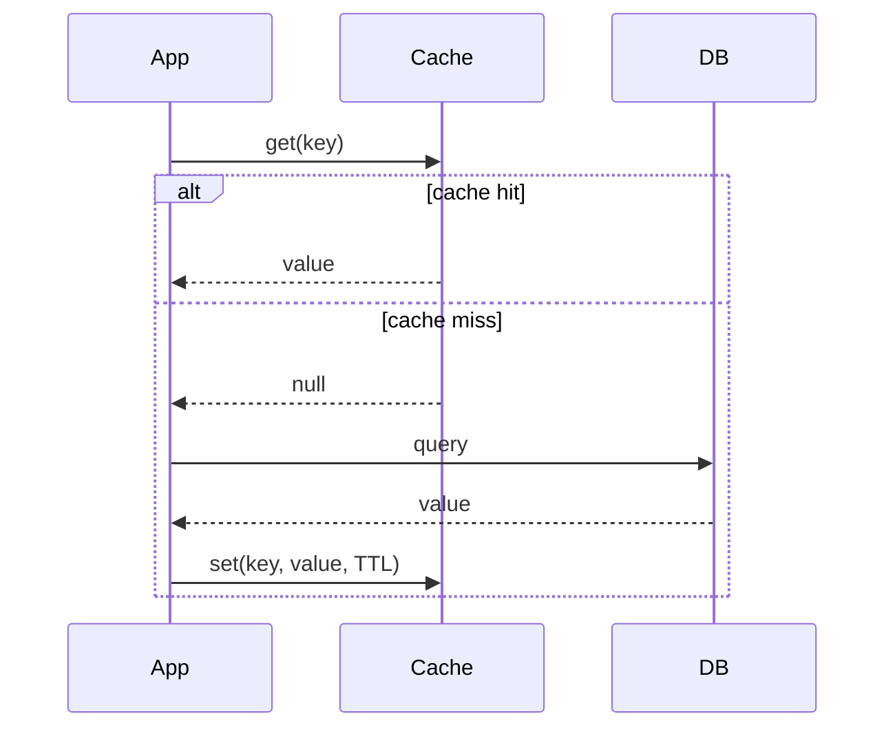
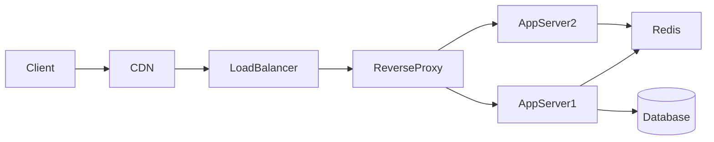

# System design — Data

Data, caching, and infrastructure building blocks.

[← Back to hub](./0_system_design.md)

### Related docs

* [System design — Core](./0_system_design_core.md) · [System design — Architecture](./0_system_design_architecture.md) · [Architecture patterns](./7_special_architecture.md) · [System design — Data](./0_system_design_data.md) · [SOLID](./7_special_engineering.md) · [DRY, KISS, YAGNI](./0_system_design_principles.md) · [GRASP](./0_system_design_grasp.md) · [System design — Patterns](./0_system_design_patterns.md) · [Design patterns](./7_special_patterns.md) · [System design — Interview](./0_system_design_interview.md)

### Sections

- [5. Data & caching](#5-data-caching)
- [6. Infrastructure](#6-infrastructure)

---

## 5. Data & caching

<details>
  <summary>SQL vs NoSQL</summary>

### SQL vs NoSQL

**Definition:**

SQL (relational) databases store structured data in tables with schemas and ACID transactions. NoSQL databases trade strict schema/transactions for flexible models and horizontal scale.

| | SQL (PostgreSQL, MySQL) | NoSQL |
|---|-------------------------|-------|
| **Schema** | Fixed, migrations | Flexible (document, key-value, column, graph) |
| **Transactions** | ACID | Often eventual (BASE) |
| **Scale** | Vertical + read replicas + sharding | Native horizontal partitioning |
| **Queries** | Complex joins, SQL | Varies; often denormalized |
| **Examples** | PostgreSQL, MySQL | MongoDB, Cassandra, Redis, Neo4j |

**When to use:**

- SQL: relational data, transactions, reporting, most business apps
- NoSQL: high-write throughput, flexible schema, caching, time-series, graph relationships

**Thoughts:** Polyglot persistence is normal — PostgreSQL for orders, Redis for cache, Elasticsearch for search. Pick per access pattern. ES depth (analyzers, mappings, Query DSL, JS client): [9_database.md — Elasticsearch](./9_database_nosql.md#elasticsearch).

</details>

<details>
  <summary>Database indexing</summary>

### Database indexing

**Definition:** Data structures (typically B-tree) that speed up row lookup at the cost of extra storage and slower writes.

**When to use:** Columns in WHERE, JOIN, ORDER BY. Analyze with `EXPLAIN ANALYZE`.

**Pluses and minuses:**

| + | − |
|------|------|
| Dramatically faster reads on indexed columns | Slower INSERT/UPDATE (index maintenance) |
| Enables efficient sorting/filtering | Wrong index = wasted space, no benefit |
| Composite indexes for multi-column queries | Too many indexes hurt write performance |

**Examples:** `CREATE INDEX idx_users_email ON users(email)` — O(log n) lookup vs full table scan O(n).

**Thoughts:** Index selectivity matters. Index on `gender` (2 values) is usually useless. Index on `email` (unique) is high value.

</details>

<details>
  <summary>Caching strategies</summary>

### Caching strategies

**Definition:**

Storing frequently accessed data in fast storage (memory) to reduce latency and database load.



**When to use:** Read-heavy workloads, expensive queries, static/semi-static data. Always set TTL.

**Pluses and minuses:**

| Strategy | How | + | − |
|----------|-----|------|------|
| **Cache-aside** | App checks cache; on miss, read DB, populate cache | Simple, cache only what's needed | Cache miss stampede possible |
| **Write-through** | Write to cache + DB synchronously | Cache always fresh | Write latency |
| **Write-back** | Write to cache; async flush to DB | Fast writes | Data loss risk on crash |
| **Read-through** | Cache fetches from DB on miss (cache manages) | App logic simpler | Cache layer complexity |

**Examples:**

```ts
async function getUserById(id: string): Promise<User> {
  const cached = await redis.get(`user:${id}`);
  if (cached) return JSON.parse(cached);

  const user = await db.users.findById(id);
  await redis.set(`user:${id}`, JSON.stringify(user), 'EX', 3600);
  return user;
}
```

**Thoughts:** Cache invalidation is hard. Prefer TTL + event-driven invalidation. Watch for thundering herd — use request coalescing or probabilistic early expiration. Function-result caching is a narrower case: [Cache vs memoization](#cache-vs-memoization).

</details>

<details>
  <summary>Cache vs memoization</summary>

### Cache vs memoization

**Definition:**

- **Cache** — general storage to avoid re-fetching or re-computing data (API responses, assets, CDN).
- **Memoization** — specific caching of **function results** keyed by arguments.

| | Cache | Memoization |
|---|-------|-------------|
| Scope | System-wide, HTTP, disk | Per-function |
| Key | URL, custom | Function arguments |
| Example | `Cache-Control`, Redis | `memoize(fn)` |

**When to use:**

- Cache: API responses, static assets, computed dashboards
- Memoization: Expensive pure functions (Fibonacci, selectors)

**Pluses and minuses:**

| + | − |
|------|------|
| Faster reads | Stale data if invalidation wrong |
| Reduced load | Memory growth without TTL/eviction |

**Examples:**

```js
function memoize(fn) {
  const cache = new Map();
  return (...args) => {
    const key = JSON.stringify(args);
    if (cache.has(key)) return cache.get(key);
    const result = fn(...args);
    cache.set(key, result);
    return result;
  };
}
```

**Thoughts:**

React `useMemo` memoizes values; `useCallback` memoizes functions. Reselect memoizes selectors. Invalidate cache on mutation. System-level strategies: [Caching strategies](#caching-strategies).

---

</details>

<details>
  <summary>CDN (Content Delivery Network)</summary>

### CDN (Content Delivery Network)

**Definition:** Geographically distributed edge servers that cache and serve static content close to users.

**When to use:** Images, JS/CSS bundles, videos, fonts, API responses with cache headers.

**Pluses and minuses:**

| + | − |
|------|------|
| Lower latency for static assets | Cache invalidation delay |
| Reduces origin server load | Cost at very high scale |
| DDoS absorption | Dynamic content needs careful cache headers |
| TLS termination at edge | Stale content if TTL too long |

**Examples:** `Cache-Control: public, max-age=31536000, immutable` for hashed build assets. `max-age=60` for semi-dynamic API responses.

**Thoughts:** CDN for static assets is table stakes. Don't CDN personalized authenticated responses without Vary headers and short TTL.

</details>

<details>
  <summary>Redis use cases</summary>

### Redis use cases

**Definition:**

In-memory data store used as cache, session store, rate limiter, pub/sub broker, and lightweight queue.

| Use case | Pattern |
|----------|---------|
| Cache | Key-value with TTL |
| Session store | `SET session:{id}` with expiry |
| Rate limiting | Sliding window counter per IP/user |
| Leaderboard | Sorted sets (`ZADD`, `ZRANGE`) |
| Pub/sub | Real-time notifications |
| Distributed lock | `SET key NX EX` (with caution) |

**When to use:** Hot data caching, rate limiting, real-time features, session storage.

**Pluses and minuses:**

| + | − |
|------|------|
| Sub-millisecond latency | Data size limited by RAM |
| Rich data structures | Persistence optional — not primary DB |
| Atomic operations | Single-threaded — hot key bottleneck |

**Thoughts:**

Redis is not a replacement for PostgreSQL. Use for ephemeral or hot data with explicit TTL and eviction policy (`allkeys-lru`).

---

</details>

<a name="6-infrastructure"></a>

## 6. Infrastructure

<details>
  <summary>Load balancing</summary>

### Load balancing

**Definition:**

Distributing incoming traffic across multiple servers to improve availability, throughput, and fault tolerance.

| Layer | Operates on | Examples |
|-------|-------------|----------|
| **L4 (transport)** | IP + port | HAProxy, AWS NLB |
| **L7 (application)** | HTTP headers, path, cookies | Nginx, AWS ALB, Envoy |

Layer numbers are **OSI names** on a TCP/IP stack: [OSI & TCP/IP models](./6_web_api_apps.md#osi--tcpip-models).

| Algorithm | Behavior |
|-----------|----------|
| Round robin | Sequential rotation |
| Least connections | Send to least busy server |
| Consistent hashing | Same key → same server (sticky, cache-friendly) |
| Weighted | More traffic to stronger servers |

**When to use:** Any multi-instance deployment. L7 when routing by URL/path matters.

**Pluses and minuses:**

| + | − |
|------|------|
| Horizontal scaling | LB itself can be SPOF (mitigate with HA pair) |
| Health checks remove bad nodes | Sticky sessions complicate stateless design |

**Thoughts:** Terminate TLS at LB. Use health checks that verify app readiness, not just TCP open port.

</details>

<details>
  <summary>Reverse proxy</summary>

### Reverse proxy

**Definition:** Server that sits in front of application servers, forwarding client requests and returning responses — handling TLS, compression, caching, routing.

**When to use:** Almost every production deployment. Nginx, Apache httpd, Envoy, Caddy, cloud ALB.

**Pluses and minuses:**

| + | − |
|------|------|
| SSL termination | Extra hop (minimal latency) |
| Request routing, path-based dispatch | Misconfiguration can block traffic |
| Static file serving | |
| Rate limiting, WAF integration | |

**Examples:** Nginx routes `/api/*` → app servers, `/static/*` → CDN/origin, `/ws` → WebSocket backend.

**Thoughts:**

Reverse proxy ≠ load balancer, but most reverse proxies do both. An **API Gateway** is a reverse proxy specialized for APIs (path routing, auth, rate limits) — see [API Gateway](./0_system_design_architecture.md#api-gateway). HTTP-layer proxy jobs (cache, filter, LB, auth, logging): [6_web_api.md — HTTP protocol](./6_web_api_http.md#http-protocol). HTTP role of a web server → [6_web_api.md — Web server](./6_web_api_http.md#web-server). Config details: [Nginx](./15_devops.md#nginx-configuration) · [Apache](./15_devops.md#apache-http-server) · [Build — nginx](./10_build.md).



</details>

<details>
  <summary>API styles</summary>

### API styles

**Definition:** Protocols and conventions for client-server communication.

**When to use:**

- REST: public APIs, CRUD, caching matters
- GraphQL: mobile clients, varied data needs, BFF alternative
- gRPC: internal service-to-service, high performance
- WebSockets: chat, live dashboards, collaborative editing
- SSE: live feeds, notifications, simpler than WebSockets

**Pluses and minuses:**

| Style | Transport | + | − |
|-------|-----------|------|------|
| **REST** | HTTP + JSON | Simple, cacheable, universal | Over/under-fetching, many endpoints |
| **GraphQL** | HTTP POST | Client specifies shape, single endpoint | Complexity, caching harder, N+1 risk |
| **gRPC** | HTTP/2 + Protobuf | Fast, typed contracts, streaming | Browser support limited (needs proxy) |
| **WebSockets** | TCP upgrade | Full-duplex real-time | Stateful connections, scaling complexity |
| **SSE** | HTTP stream | Server push, simple, auto-reconnect | Unidirectional (server → client) |

**Thoughts:** GraphQL N+1 — use DataLoader or query complexity limits. REST versioning: URL (`/v2/`) or header — pick one and stick to it. TCP vs UDP / HTTP/3 QUIC → [6_web_api.md — TCP vs UDP](./6_web_api_interview.md#tcp-vs-udp).

</details>

<details>
  <summary>Rate limiting</summary>

### Rate limiting

**Definition:**

Controlling the number of requests a client can make in a time window to protect services from abuse and overload.

| Algorithm | How |
|-----------|-----|
| **Token bucket** | Tokens refill at fixed rate; request consumes token |
| **Sliding window** | Count requests in rolling time window |
| **Fixed window** | Count per clock window (simple, boundary burst issue) |

**When to use:** Public APIs, auth endpoints, expensive operations (AI, reports).

**Pluses and minuses:**

| + | − |
|------|------|
| Protects against DDoS and bugs | Legitimate burst traffic may be throttled |
| Fair resource allocation | Distributed rate limiting needs shared store (Redis) |

**Examples:** 100 requests/minute per API key — return `429 Too Many Requests` with `Retry-After` header.

**Thoughts:** Rate limit at edge (API gateway/CDN) and app layer. Return clear error messages and retry headers. IP limits fail against large DDoS; Slowloris needs read timeouts, not only 429. See [Special — DoS](./7_special_security.md#denial-of-service-dos--ddos).

</details>

<details>
  <summary>Message queues</summary>

### Message queues

**Definition:**

Asynchronous middleware where producers send messages to a broker; consumers process them independently.

| | Kafka | RabbitMQ |
|---|-------|----------|
| **Model** | Distributed commit log | Message broker (AMQP) |
| **Throughput** | Very high | Moderate-high |
| **Ordering** | Per partition | Per queue |
| **Retention** | Configurable (days/weeks) | Until consumed (default) |
| **Use case** | Event streaming, analytics, log aggregation | Task queues, RPC-style, routing |

| Delivery guarantee | Meaning |
|--------------------|---------|
| **At-most-once** | Fire and forget — may lose messages |
| **At-least-once** | Retry on failure — may duplicate (need idempotency) |
| **Exactly-once** | Hard; usually "effectively once" with idempotent consumers |

**When to use:** Decouple services, buffer traffic spikes, async processing, event sourcing, audit logs.

**Thoughts:** Start with at-least-once + idempotent consumers. Exactly-once is expensive and often unnecessary. Broker comparison (queue vs log vs Redis jobs) → [10_build.md — Kafka vs RabbitMQ vs BullMQ](./10_build.md).

</details>

<details>
  <summary>Observability</summary>

### Observability

**Definition:**

Ability to understand system internal state from external outputs — **logs**, **metrics**, **traces** (three pillars).

| Pillar | What | Tools |
|--------|------|-------|
| **Logs** | Discrete events, errors | ELK, Loki, CloudWatch |
| **Metrics** | Aggregated numbers over time | Prometheus, Grafana, Datadog |
| **Traces** | Request path across services | Jaeger, Zipkin, OpenTelemetry |

**When to use:** Every production system. Instrument from day one — retrofitting is painful.

**Pluses and minuses:**

| + | − |
|------|------|
| Faster incident resolution | Storage cost at scale |
| SLO tracking and alerting | Instrumentation overhead |
| Performance bottleneck visibility | Cardinality explosion in metrics |

**Thoughts:**

Correlate logs with `trace_id`. Alert on SLO burn rate, not every error. High-cardinality labels (user_id) in Prometheus kill performance.

---

</details>

