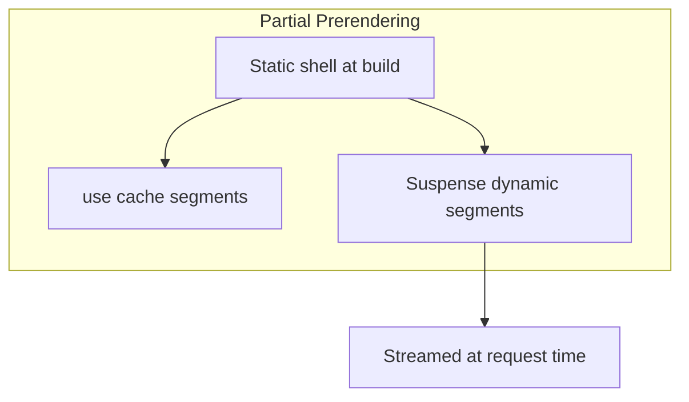

# Next.js — App Router & Rendering

Covers Next.js **16.x** App Router — routing, Server Components, caching, Server Actions, deployment on Vercel, and migration from Pages Router.

### Related docs

* [React](./4_react.md) · [TypeScript](./5_ts.md) · [Web API](./6_web_api.md) · [Core Web Vitals](./6_web_api.md#core-web-vitals) · [LCP](./6_web_api.md#lcp-largest-contentful-paint) · [FCP](./6_web_api.md#first-contentful-paint-fcp) · [TTFB](./6_web_api.md#ttfb-time-to-first-byte) · [INP](./6_web_api.md#inp-interaction-to-next-paint) · [CLS](./1_html.md#cls-cumulative-layout-shift) · [Node.js](./8_nodejs.md)
* [Interview hub](./0_interview.md) · [React Interview Practice](./4_react.md#interview-practice) · [i18n in React](./4_react.md)
* [Jest / test doubles](./7_special.md#test-doubles-stubs-mocks-spies) · [Integration / E2E](./7_special.md#integration-testing)

### Main concepts

| Area | Topics |
|------|--------|
| **Core** | Framework model, App vs Pages Router, project structure, file conventions |
| **Rendering** | CSR, SSR, SSG, ISR, PPR, streaming, hydration |
| **Data** | Server/Client boundaries, `fetch` caching, `use cache`, revalidation |
| **Mutations** | Server Actions, Route Handlers, forms, progressive enhancement |
| **Routing** | File-based routes, layouts, parallel/intercepting routes, navigation |
| **Platform** | `next/image`, `next/font`, proxy, `next.config`, Vercel deployment |
| **Security** | RSC advisories, auth patterns, CSRF on Server Actions |
| **Testing** | Vitest + React Testing Library for App Router |

### Navigation

> Theory `<details>` blocks follow: **Definition** · **How it works** · **When to use** · **Pluses and minuses** · **Examples** · **Thoughts** · **Sources**. **Definition** is required; other sections are optional.

| Part 1 | Part 2 |
|--------|--------|
| [1. Framework overview](#1-framework-overview) | [11. Special files](#11-special-files) |
| [2. App vs Pages Router](#2-app-vs-pages-router) | [12. Navigation](#12-navigation) |
| [3. Project structure](#3-project-structure) | [13. Metadata & SEO](#13-metadata--seo) |
| [4. Rendering strategies](#4-rendering-strategies) | [14. Built-in optimizations](#14-built-in-optimizations) |
| [5. Server & Client boundaries](#5-server--client-boundaries) | [15. Proxy & middleware](#15-proxy--middleware) |
| [6. Streaming & Suspense](#6-streaming--suspense) | [16. Configuration](#16-configuration) |
| [7. Data fetching](#7-data-fetching) | [17. Vercel deployment](#17-vercel-deployment) |
| [8. Caching & revalidation](#8-caching--revalidation) | [18. Migration & pitfalls](#18-migration--pitfalls) |
| [9. Server Actions vs Route Handlers](#9-server-actions-vs-route-handlers) | [19. Performance & debugging](#19-performance--debugging) |
| [10. File-based routing](#10-file-based-routing) | [20. Resources](#20-resources) |

**Also in this doc:** [cookies() & headers()](#cookies-headers) · [draftMode](#draftmode) · [Edge vs Node](#edge-vs-node-runtime) · [CSRF](#csrf-with-server-actions) · [Testing](#testing-nextjs-vitest--rtl) · [Core Web Vitals](#core-web-vitals-on-vercel) · [Interview Practice](#interview-practice)

<a name="topic-template"></a>

### Topic template

Every major topic in `<details>` sections follows:

**Definition** → **How it works** → **When to use** → **Pluses and minuses** → **Examples** → **Thoughts** → **Sources**

---

<a name="1-framework-overview"></a>

## 1. Framework overview

*Topics follow: Definition → Pros / Cons → When to use → Example → Notes → Source ([template](#topic-template)).*

<details>
  <summary>Next.js</summary>

### Next.js

**Definition:** Next.js is a **full-stack React framework** for building web applications. It extends React with file-based routing, server rendering, data caching, API endpoints, and a production build pipeline (Turbopack/webpack, compiler). The framework inverts control — you fill in conventions (`app/page.tsx`, `layout.tsx`) rather than assembling the stack yourself.

**When to use:**

- Marketing sites, blogs, documentation with SEO requirements
- E-commerce, dashboards, SaaS with authenticated + public pages
- BFF (Backend for Frontend) — colocate API with UI
- Teams deploying on Vercel or needing standalone Docker output
- Apps benefiting from RSC (smaller client bundles, server data access)

- Pure static sites with minimal JS — consider **Astro**
- Mobile apps — use **Expo / React Native**
- Heavy custom Node server (long-lived WebSockets hub) — dedicated backend + Vite SPA may fit better
- Content-only sites where React is unnecessary overhead

**Pluses and minuses:**

| + | − |
|------|------|
| Batteries-included: routing, SSR, API, image/font optimization | Opinionated — escape hatches exist but add complexity |
| React Server Components + streaming out of the box (App Router) | Steep caching mental model; easy to ship stale or over-dynamic pages |
| Excellent Vercel integration (preview deploys, CDN, analytics) | Vendor affinity when using Vercel-specific features |
| SEO-friendly by default (SSR/SSG/ISR/PPR) | Cold starts on serverless; not ideal for all workloads |
| TypeScript-first, large ecosystem, strong hiring signal | Two routers (App + Pages) — legacy codebases carry migration debt |
| Automatic code splitting per route | Build times grow with app size |

**Examples:**

```bash
npx create-next-app@latest my-app --typescript --app --turbopack
cd my-app && npm run dev
```

```tsx
// app/page.tsx — Server Component by default
export default async function HomePage() {
  const res = await fetch('https://api.example.com/posts', {
    next: { revalidate: 60 },
  });
  const posts = await res.json();

  return (
    <main>
      <h1>Posts</h1>
      <ul>
        {posts.map((p: { id: string; title: string }) => (
          <li key={p.id}>{p.title}</li>
        ))}
      </ul>
    </main>
  );
}
```

**Thoughts:** Next.js is **not** a replacement for React knowledge — it is a layer on top. Interview framing: React = library (view); Next.js = framework (routing, rendering, data, deployment). New projects should default to **App Router** (Next.js 13+). Pages Router is maintenance mode for existing apps.

**Sources:** [nextjs.org/docs](https://nextjs.org/docs)

</details>

<details>
  <summary>React vs Next.js</summary>

### React vs Next.js

**Definition:**

React renders UI; Next.js orchestrates how and where that UI is built, cached, and delivered.

| | React | Next.js |
|---|-------|---------|
| **Role** | UI library | Full-stack framework |
| **Routing** | Bring your own | File-based `app/` directory |
| **Data fetching** | Client hooks / manual SSR | Server Components, `fetch` cache, Server Actions |
| **Rendering** | CSR by default (Vite) | SSR, SSG, ISR, PPR configurable per route |
| **API** | Separate backend | Route Handlers + Server Actions |
| **Deployment** | Static CDN or custom | Optimized for Vercel; `standalone` for Docker |

**Thoughts:** For generic RSC, hydration, and hook rules see [4_react.md §8 — Server rendering & RSC](./4_react.md#8-server-rendering--rsc). This document covers **Next.js-specific** APIs and caching semantics.

**Sources:** [react.dev](https://react.dev/) · [nextjs.org/docs](https://nextjs.org/docs)

</details>

<details>
  <summary>Next.js vs alternatives</summary>

### Next.js vs alternatives

**Definition:**

Comparison of Next.js against other full-stack and meta-framework choices for React and content sites.

| Framework | Strength | Trade-off |
|-----------|----------|-----------|
| **Vite + React Router** | Maximum flexibility, fast dev, SPA-first | Manual SSR/RSC setup |
| **Remix** | Web standards, loaders/actions, forms | Smaller ecosystem than Next |
| **Astro** | Content sites, islands architecture | Less suited for heavy client interactivity |
| **SvelteKit** | Performance, simplicity | Different UI paradigm |

**How it works:** SEO, first-load performance, colocated server logic, team standardization on Vercel.

**Sources:** [nextjs.org/docs/app](https://nextjs.org/docs/app)

</details>

<details>
  <summary>History (compressed)</summary>

### History (compressed)

**Definition:**

Timeline of major Next.js releases and routing/rendering milestones.

| Version | Milestone |
|---------|-----------|
| **2016** | Next.js 1 — Pages Router, SSR |
| **v9** | API Routes (`pages/api`) |
| **v12** | Middleware, React 18 support |
| **v13** | App Router (beta), RSC, `app/` directory |
| **v14** | App Router stable, partial prerendering experimental |
| **v15** | Async request APIs (`cookies`, `headers`, `params`) |
| **v16** | Cache Components, `proxy.ts`, `use cache`, async APIs required |

---

**Sources:** [nextjs.org/blog](https://nextjs.org/blog)

</details>

<a name="2-app-vs-pages-router"></a>

## 2. App vs Pages Router

*Topics follow: Definition → Pros / Cons → When to use → Example → Notes → Source ([template](#topic-template)).*

<details>
  <summary>App Router</summary>

### App Router

**Definition:** The modern router living in `app/`. Built on React Server Components, nested layouts, streaming, and the new caching model. Default for all new projects.

**When to use:** Every new project. Greenfield apps, e-commerce, dashboards, content sites.

**Pluses and minuses:**

| + | − |
|------|------|
| RSC, streaming, nested layouts | Learning curve for caching and boundaries |
| Colocated `loading.tsx`, `error.tsx` | Cannot mix `pages/` and `app/` for same route |
| Server Actions, Metadata API | Some third-party libs still lack RSC support |
| Fine-grained caching with `use cache` | Migration from Pages requires rewrites |

**Examples:**

```tsx
// app/blog/[slug]/page.tsx — async Server Component (default)
export default async function BlogPost({
  params,
}: {
  params: Promise<{ slug: string }>;
}) {
  const { slug } = await params;
  const post = await getPost(slug);
  return <article>{post.title}</article>;
}
```

**Sources:** [nextjs.org/docs/app](https://nextjs.org/docs/app)

</details>

<details>
  <summary>Pages Router</summary>

### Pages Router

**Definition:** Legacy router in `pages/`. Uses `getServerSideProps`, `getStaticProps`, `getInitialProps`, and `pages/api` for backend endpoints.

**When to use:** Maintaining existing Pages Router apps only. Do not start new projects on Pages Router.

**Pluses and minuses:**

| + | − |
|------|------|
| Mature, well-documented patterns | No RSC, no nested layouts |
| Simpler mental model (props-based data) | `getServerSideProps` runs per page — harder to compose |
| Large existing codebase support | Not where new Next.js features land |

**Examples:**

```tsx
// pages/blog/[slug].tsx — legacy pattern
export async function getStaticProps({ params }: { params: { slug: string } }) {
  const post = await getPost(params.slug);
  return { props: { post } };
}

export default function BlogPost({ post }: { post: Post }) {
  return <article>{post.title}</article>;
}
```

**Sources:** [nextjs.org/docs/pages](https://nextjs.org/docs/pages)

</details>

<details>
  <summary>Migration mapping</summary>

### Migration mapping

**Definition:**

One-to-one mapping from Pages Router APIs to App Router equivalents for incremental migration.

| Pages Router | App Router equivalent |
|--------------|----------------------|
| `getStaticProps` | `fetch` with `cache: 'force-cache'` + `generateStaticParams` |
| `getServerSideProps` | `fetch` with `cache: 'no-store'` or dynamic route |
| `getInitialProps` | Server Component async data fetch |
| `pages/api/*.ts` | `app/**/route.ts` (Route Handlers) |
| `_app.tsx` | `app/layout.tsx` |
| `_document.tsx` | `app/layout.tsx` + Metadata API |
| `next/head` | `export const metadata` / `generateMetadata()` |
| `next/router` | `next/navigation` (`useRouter`, `usePathname`) |
| `next/link` | `next/link` (same package, App Router aware) |

**Examples:**

```tsx
// Pages Router (legacy)
export async function getServerSideProps() {
  const res = await fetch('https://api.example.com/data');
  return { props: { data: await res.json() } };
}

// App Router (modern)
async function getData() {
  const res = await fetch('https://api.example.com/data', { cache: 'no-store' });
  return res.json();
}

export default async function Page() {
  const data = await getData();
  return <pre>{JSON.stringify(data, null, 2)}</pre>;
}
```

**Thoughts:**

Both routers can coexist in one project (`pages/` + `app/`), but **not for the same URL**. App Router takes precedence. Plan incremental migration route-by-route.

---

**Sources:** [nextjs.org/docs/app/guides/migrating](https://nextjs.org/docs/app/guides/migrating)

</details>

<a name="3-project-structure"></a>

## 3. Project structure

*Topics follow: Definition → Pros / Cons → When to use → Example → Notes → Source ([template](#topic-template)).*

<details>
  <summary>Directory layout</summary>

### Directory layout

**Definition:** Next.js uses file-system conventions. The `app/` directory (or `src/app/`) defines routes; special filenames map to framework features.

**When to use:** Follow defaults unless monorepo or FSD requires `src/app/` + feature folders.

**Pluses and minuses:**

| + | − |
|------|------|
| Predictable structure — onboarding is fast | Deep nesting can mirror URL too literally |
| Colocation of route UI, loading, errors | Large `app/` trees need route groups or FSD discipline |
| `src/` option keeps root clean | Moving files changes URLs unless using groups/rewrites |

**Examples:**

```
my-app/
├── app/                    # App Router (or src/app/)
│   ├── layout.tsx          # Root layout (required)
│   ├── page.tsx            # Home route (/)
│   ├── loading.tsx         # Loading UI for segment
│   ├── error.tsx           # Error boundary for segment
│   ├── not-found.tsx       # 404 for segment
│   ├── (marketing)/        # Route group (no URL segment)
│   │   └── about/page.tsx  # /about
│   ├── blog/
│   │   ├── page.tsx        # /blog
│   │   └── [slug]/page.tsx # /blog/:slug
│   └── api/
│       └── webhook/route.ts
├── public/                 # Static assets (served as-is)
├── next.config.ts
├── package.json
└── tsconfig.json
```

**Thoughts:** Prefer `src/app/` in larger codebases to separate app code from config at root. Private folders: prefix with `_` (e.g. `_components`) — not routed.

**Sources:** [nextjs.org/docs/app/getting-started/project-structure](https://nextjs.org/docs/app/getting-started/project-structure)

</details>

<details>
  <summary>Special files</summary>

### Special files

**Definition:**

Convention filenames in `app/` that map to framework features — layouts, loading states, errors, and API routes.

| File | Purpose |
|------|---------|
| `page.tsx` | Unique UI for a route segment; makes route publicly accessible |
| `layout.tsx` | Shared UI wrapper; persists state across navigations |
| `template.tsx` | Like layout but **re-mounts** on navigation (fresh state/effects) |
| `loading.tsx` | Instant loading UI via Suspense boundary |
| `error.tsx` | Client error boundary for segment |
| `not-found.tsx` | UI when `notFound()` is called |
| `route.ts` | Route Handler (API endpoint) |
| `default.tsx` | Fallback for parallel route slots |

**Examples:**

```tsx
// app/dashboard/layout.tsx
export default function DashboardLayout({ children }: { children: React.ReactNode }) {
  return (
    <div className="flex">
      <aside>Sidebar</aside>
      <main>{children}</main>
    </div>
  );
}
```

**Thoughts:** `layout.tsx` state survives client navigations; `template.tsx` does not. Use `template` for enter animations or per-navigation analytics keys.

**Sources:** [nextjs.org/docs/app/api-reference/file-conventions](https://nextjs.org/docs/app/api-reference/file-conventions)

</details>

<details>
  <summary>Route segments</summary>

### Route segments

**Definition:**

URL path segments created by folder names in `app/` — static, dynamic, catch-all, and route groups.

| Pattern | URL | Example |
|---------|-----|---------|
| Static | `/blog` | `app/blog/page.tsx` |
| Dynamic | `/blog/hello` | `app/blog/[slug]/page.tsx` |
| Catch-all | `/docs/a/b/c` | `app/docs/[...slug]/page.tsx` |
| Optional catch-all | `/shop` or `/shop/a/b` | `app/shop/[[...slug]]/page.tsx` |
| Route group | No URL impact | `app/(auth)/login/page.tsx` → `/login` |

**Sources:**

[nextjs.org/docs/app/api-reference/file-conventions](https://nextjs.org/docs/app/api-reference/file-conventions)

---

</details>

<a name="4-rendering-strategies"></a>

## 4. Rendering strategies

*Topics follow: Definition → Pros / Cons → When to use → Example → Notes → Source ([template](#topic-template)).*

<details>
  <summary>Overview</summary>

### Overview

**Definition:**

Next.js supports multiple rendering modes per route. The App Router defaults to static where possible and opts into dynamic behavior when the route reads request-time data (`cookies`, `headers`, `searchParams`, uncached `fetch`).

| Strategy | When HTML is produced | Data freshness | SEO |
|----------|----------------------|----------------|-----|
| **CSR** | Browser (Client Components only) | Live | Weak without SSR |
| **SSR** | Server per request | Always fresh | Strong |
| **SSG** | Build time | Static until rebuild | Strong |
| **ISR** | Build + periodic revalidation | Stale-while-revalidate | Strong |
| **PPR** | Static shell + streamed dynamic holes | Mixed per segment | Strong |

**Examples:**



**Thoughts:** See [4_react.md §8 — Server rendering & RSC](./4_react.md#8-server-rendering--rsc) for SPA vs SSR vs RSC. Taxonomy (MPA vs SPA, CSR/SSR/SSG/PWA): [6_web_api.md — Types of web apps](./6_web_api.md#types-of-web-apps). Next.js implements these at the **route segment** level.

**Sources:** [nextjs.org/docs/app/getting-started/caching](https://nextjs.org/docs/app/getting-started/caching)

</details>

<details>
  <summary>Static Generation (SSG)</summary>

### Static Generation (SSG)

**Definition:** HTML generated at build time. Equivalent to `getStaticProps` or `fetch` with default `force-cache`.

**When to use:** Marketing pages, blogs, product catalogs with `generateStaticParams`.

**Pluses and minuses:**

| + | − |
|------|------|
| Fastest CDN delivery, lowest server cost | Build time grows with page count |
| Predictable performance | Not suitable for per-user content without client fetch |

**Examples:**

```tsx
export async function generateStaticParams() {
  const posts = await fetch('https://api.example.com/posts').then(r => r.json());
  return posts.map((p: { slug: string }) => ({ slug: p.slug }));
}

export default async function PostPage({ params }: { params: Promise<{ slug: string }> }) {
  const { slug } = await params;
  const post = await fetch(`https://api.example.com/posts/${slug}`).then(r => r.json());
  return <article>{post.title}</article>;
}
```

**Sources:** [nextjs.org/docs/app/building-your-application/rendering/server-components](https://nextjs.org/docs/app/building-your-application/rendering/server-components)

</details>

<details>
  <summary>Server-Side Rendering (SSR)</summary>

### Server-Side Rendering (SSR)

**Definition:** HTML generated on each request. Triggered by `cache: 'no-store'`, `dynamic = 'force-dynamic'`, or reading `cookies()` / `headers()`.

**When to use:** Authenticated dashboards, cart, real-time dashboards.

**Pluses and minuses:**

| + | − |
|------|------|
| Always fresh data | Higher TTFB, server load |
| Per-request personalization | No CDN cache for HTML by default |

**Examples:**

```tsx
import { cookies } from 'next/headers';

export const dynamic = 'force-dynamic'; // opt-in explicit SSR

export default async function Dashboard() {
  const session = (await cookies()).get('session')?.value;
  return <div>Welcome, {session}</div>;
}
```

**Sources:** [nextjs.org/docs/app/building-your-application/rendering/server-components](https://nextjs.org/docs/app/building-your-application/rendering/server-components)

</details>

<details>
  <summary>Incremental Static Regeneration (ISR)</summary>

### Incremental Static Regeneration (ISR)

**Definition:** Static pages revalidated on a timer or on-demand. `fetch` with `next: { revalidate: N }` or route `export const revalidate = N`.

**When to use:** Product listings, news, docs — content that changes but tolerates seconds/minutes delay.

**Pluses and minuses:**

| + | − |
|------|------|
| CDN-fast + eventual freshness | Users may see stale content during revalidation window |
| Scales better than pure SSR | Requires clear invalidation strategy for urgent updates |

**Examples:**

```tsx
const res = await fetch('https://api.example.com/products', {
  next: { revalidate: 3600, tags: ['products'] },
});
```

**Sources:** [nextjs.org/docs/app/building-your-application/data-fetching/incremental-static-regeneration](https://nextjs.org/docs/app/building-your-application/data-fetching/incremental-static-regeneration)

</details>

<details>
  <summary>Partial Prerendering (PPR) / Cache Components</summary>

### Partial Prerendering (PPR) / Cache Components

**Definition:** Next.js 16 model mixing static prerendered shell with cached and dynamic streamed content. Enabled via `cacheComponents: true` in `next.config.ts`.

**When to use:** Pages with mostly public content + small personalized/header regions.

**Pluses and minuses:**

| + | − |
|------|------|
| Best of static + dynamic in one route | Requires `use cache` discipline |
| Fast LCP from static shell | New API — team training needed |

**Examples:**

```tsx
// next.config.ts
const nextConfig = { cacheComponents: true };
export default nextConfig;
```

```tsx
import { Suspense } from 'react';
import { cacheTag } from 'next/cache';
import { cookies } from 'next/headers';

async function ProductsList() {
  'use cache';
  cacheTag('products-list');
  const products = await fetch('https://api.example.com/products').then(r => r.json());
  return (
    <ul>
      {products.map((p: { id: string; name: string }) => (
        <li key={p.id}>{p.name}</li>
      ))}
    </ul>
  );
}

async function Greeting() {
  const user = (await cookies()).get('user')?.value;
  return <p>Welcome back, {user ?? 'guest'}</p>;
}

export default function Page() {
  return (
    <section>
      <h1>Dashboard</h1>
      <ProductsList />
      <Suspense fallback={<p>Loading…</p>}>
        <Greeting />
      </Suspense>
    </section>
  );
}
```

**Sources:** [vercel.com/docs/partial-prerendering](https://vercel.com/docs/partial-prerendering)

</details>

<details>
  <summary>Route segment config</summary>

### Route segment config

**Definition:**

Route-level exports in `layout.tsx`, `page.tsx`, or `route.ts` that override Next.js defaults for caching, rendering, and runtime for that segment and its children (unless a child overrides).

| Export | Values | Effect |
|--------|--------|--------|
| `dynamic` | `'auto'`, `'force-static'`, `'force-dynamic'`, `'error'` | Static vs dynamic rendering for the segment |
| `dynamicParams` | `true` (default), `false` | Allow on-demand generation for unseen dynamic params vs 404 |
| `revalidate` | `false`, `0`, `number` (seconds) | ISR interval for the segment |
| `fetchCache` | `'auto'`, `'default-no-store'`, `'only-no-store'`, `'force-no-store'`, `'force-cache'` | Override default `fetch` caching in the segment |
| `runtime` | `'nodejs'` (default), `'edge'` | Execution runtime for Server Components and Route Handlers |
| `preferredRegion` | string or `string[]` | Pin serverless execution to regions |
| `maxDuration` | number (seconds) | Serverless function timeout cap |

**When to use:**

- `export const revalidate = 60` — content that changes occasionally (blog, catalog)
- `export const dynamic = 'force-static'` — legal/marketing pages that must never read request data
- `export const dynamicParams = false` — only slugs from `generateStaticParams` are valid
- `export const runtime = 'edge'` — low-latency Route Handler at the edge (see [Edge vs Node](#edge-vs-node-runtime))

- `force-dynamic` on root `layout.tsx` when only one leaf needs cookies — read request APIs in that leaf instead
- `fetchCache = 'force-no-store'` when `use cache` + `revalidateTag` already models invalidation

**Pluses and minuses:**

| + | − |
|------|------|
| Surgical control per route tree | Easy to blanket `force-dynamic` and kill CDN cache |
| Children inherit parent config | Can fight declarative `use cache` boundaries |
| No need to wrap every `fetch` | Some exports deprecated or narrowed in Next.js 16 |

**Examples:**

```tsx
// app/blog/[slug]/page.tsx
export const revalidate = 3600;
export const dynamicParams = true;

export async function generateStaticParams() {
  const slugs = await getSlugs();
  return slugs.map(slug => ({ slug }));
}

export default async function BlogPost({
  params,
}: {
  params: Promise<{ slug: string }>;
}) {
  const { slug } = await params;
  const post = await getPost(slug);
  return <article>{post.title}</article>;
}
```

```tsx
// app/dashboard/layout.tsx — authenticated subtree
export const dynamic = 'force-dynamic';

export default async function DashboardLayout({
  children,
}: {
  children: React.ReactNode;
}) {
  const session = await getSession();
  if (!session) redirect('/login');
  return <>{children}</>;
}
```

**Thoughts:**

- Reading `cookies()`, `headers()`, or `connection()` in a Server Component opts the route into **dynamic rendering** unless PPR/`use cache` provides a static shell.
- `dynamic = 'error'` — build fails if anything would make the segment dynamic (guardrail for "must be static" routes).
- Next.js 16: prefer declarative caching (`fetch` options, `use cache`, `cacheTag`) over segment-level `force-dynamic`.
- Pages Router mapping: `getStaticProps` + `revalidate` → `revalidate` export; `getServerSideProps` → dynamic via request APIs.

**Sources:** [nextjs.org/docs/app/api-reference/file-conventions/route-segment-config](https://nextjs.org/docs/app/api-reference/file-conventions/route-segment-config)

</details>

<a name="5-server--client-boundaries"></a>

## 5. Server & Client boundaries

*Topics follow: Definition → Pros / Cons → When to use → Example → Notes → Source ([template](#topic-template)).*

<details>
  <summary>Server Components (default)</summary>

### Server Components (default)

**Definition:** Components in `app/` are Server Components unless marked `"use client"`. They run on the server, can be `async`, access DB/filesystem, and ship no component JS to the client.

**How it works:**

- React hooks (`useState`, `useEffect`, etc.)
- Browser APIs (`window`, `document`, `localStorage`)
- Event handlers (`onClick`, `onChange`)

**When to use:** Data fetching, layouts, static content, passing data to interactive leaves.

**Pluses and minuses:**

| + | − |
|------|------|
| Zero client JS for server-only UI | No `useState`, `useEffect`, event handlers |
| Direct secrets and DB access | Props to Client Components must be serializable |
| Automatic code splitting at import boundary | Debugging requires server logs |

**Examples:**

```tsx
// app/products/page.tsx — no "use client" directive
export default async function ProductsPage() {
  const products = await db.product.findMany();
  return (
    <ul>
      {products.map(p => (
        <li key={p.id}>{p.name}</li>
      ))}
    </ul>
  );
}
```

**Sources:** [nextjs.org/docs/app/getting-started/server-and-client-components](https://nextjs.org/docs/app/getting-started/server-and-client-components)

</details>

<details>
  <summary>Client Components</summary>

### Client Components

**Definition:** Files with `"use client"` at the top. Hydrate in the browser; support hooks, state, and events.

**When to use:** Buttons, forms with instant validation, charts, anything with `useState` / `useEffect`.

**Pluses and minuses:**

| + | − |
|------|------|
| Full interactivity | Increases client bundle size |
| Browser APIs, third-party client libs | Cannot import server-only modules |

**Examples:**

```tsx
'use client';

import { useState } from 'react';

export function Counter() {
  const [count, setCount] = useState(0);
  return <button onClick={() => setCount(c => c + 1)}>{count}</button>;
}
```

**Thoughts:** Push `"use client"` to **leaves** — not page roots. A single `"use client"` at the top of a large tree pulls all imports into the client bundle.

**Sources:** [nextjs.org/docs/app/getting-started/server-and-client-components](https://nextjs.org/docs/app/getting-started/server-and-client-components)

</details>

<details>
  <summary>Composition pattern</summary>

### Composition pattern

**Definition:** Server Component fetches data and passes serializable props to Client Component leaves for interactivity.

**Examples:**

```tsx
// app/posts/page.tsx — Server Component
import { LikeButton } from './like-button';

export default async function PostsPage() {
  const posts = await getPosts();
  return (
    <ul>
      {posts.map(p => (
        <li key={p.id}>
          {p.title}
          <LikeButton postId={p.id} />
        </li>
      ))}
    </ul>
  );
}
```

**Sources:** [nextjs.org/docs/app/getting-started/server-and-client-components](https://nextjs.org/docs/app/getting-started/server-and-client-components)

</details>

<details>
  <summary>Next.js 16 async request APIs</summary>

### Next.js 16 async request APIs

**Definition:** In Next.js 15+, `params`, `searchParams`, `cookies()`, and `headers()` are **async** and must be awaited in Server Components.

**Examples:**

```tsx
// Next.js 16 — required pattern
export default async function Page({
  params,
  searchParams,
}: {
  params: Promise<{ id: string }>;
  searchParams: Promise<{ q?: string }>;
}) {
  const { id } = await params;
  const { q } = await searchParams;
  const cookieStore = await cookies();
  const headersList = await headers();

  return <div>ID: {id}, Query: {q}</div>;
}
```

| API | Purpose |
|-----|---------|
| `await params` | Dynamic route segments |
| `await searchParams` | URL query string |
| `await cookies()` | Read/write cookies (server) |
| `await headers()` | Request headers |

**Thoughts:** Client Components use `useParams()` and `useSearchParams()` hooks instead. Codemod: `npx @next/codemod@latest next-async-request-api`.

**Sources:** [nextjs.org/docs/app/api-reference/functions](https://nextjs.org/docs/app/api-reference/functions)

</details>

<details>
  <summary>cookies() & headers() in Server Components</summary>

<a name="cookies-headers"></a>

### cookies() & headers() in Server Components

**Definition:**

`cookies()` and `headers()` from `next/headers` read the incoming HTTP request on the server. In Next.js 15+, both return **Promises** and must be `await`ed. Using them opts the route into **dynamic rendering** (unless isolated with PPR/`use cache: private`).

| API | Read | Write | Typical use |
|-----|------|-------|-------------|
| `cookies()` | `get`, `getAll`, `has` | `set`, `delete` | Session tokens, preferences, A/B buckets |
| `headers()` | `get`, `getAll`, `has`, `entries` | Read-only | Auth bearer, `user-agent`, geo, custom proxy headers |

**When to use:**

- Session validation in Server Component before rendering protected UI
- Reading `Accept-Language` or `Authorization` for server-side personalization
- Setting auth cookies in Server Actions after login (`cookies().set(...)`)

- Reading cookies in root layout when only `/dashboard` needs auth — scope to dashboard layout
- Storing large payloads in cookies (4 KB limit, sent on every request)

**Pluses and minuses:**

| + | − |
|------|------|
| No client exposure of sensitive tokens | Forces dynamic rendering when used in page tree |
| Works in Server Components, Actions, Route Handlers | Cannot use in Client Components — use `document.cookie` sparingly or server actions |
| `httpOnly` cookies stay off `window` | Over-reading cookies in layout affects entire subtree |

**Examples:**

```tsx
import { cookies, headers } from 'next/headers';
import { redirect } from 'next/navigation';

export default async function AccountPage() {
  const cookieStore = await cookies();
  const session = cookieStore.get('session')?.value;

  if (!session) redirect('/login');

  const headersList = await headers();
  const country = headersList.get('x-vercel-ip-country') ?? 'US';

  return <p>Welcome — region: {country}</p>;
}
```

```tsx
'use server';

import { cookies } from 'next/headers';

export async function login(formData: FormData) {
  const token = await authenticate(formData);
  const cookieStore = await cookies();
  cookieStore.set('session', token, {
    httpOnly: true,
    secure: process.env.NODE_ENV === 'production',
    sameSite: 'lax',
    path: '/',
    maxAge: 60 * 60 * 24 * 7,
  });
}
```

**Thoughts:**

- Client Components: use `useSearchParams()` / `useParams()` for URL state; never import `next/headers` in `'use client'` files.
- `headers()` is read-only — set response headers in Route Handlers (`NextResponse`) or `next.config` `headers`.
- Pair with [Authentication patterns](#authentication-patterns) — validate session in the data layer, not only in proxy.

**Sources:** [nextjs.org/docs/app/api-reference/functions/cookies](https://nextjs.org/docs/app/api-reference/functions/cookies) · [headers](https://nextjs.org/docs/app/api-reference/functions/headers)

</details>

<details>
  <summary>Serialization rules</summary>

### Serialization rules

**Definition:**

Props passed from Server Components to Client Components cross the **RSC Flight boundary** — they must be JSON-serializable. Next.js serializes them into the RSC payload sent to the browser.

| Allowed | Not allowed |
|---------|-------------|
| Primitives (`string`, `number`, `boolean`, `null`) | Functions (except Server Action references) |
| Plain objects and arrays | Class instances (`new Date()` — pass ISO string instead) |
| `undefined` (omitted from payload) | `Map`, `Set`, `Symbol`, `BigInt` |
| Server Action function references | Non-enumerable or circular structures |
| React elements from Server Components as `children` | DOM nodes, refs to server-only objects |

**When to use:**

- Pass **DTOs** (plain objects) from server fetch to client UI — `{ id, title, publishedAt: post.createdAt.toISOString() }`
- Pass Server Actions as props to Client form components — `action={updateTodo}` without invoking inside cached bodies
- Use `children` composition — pass `<ClientChart data={serialized} />` from Server parent

- Passing ORM models with methods/hidden fields — map to plain objects first
- Passing callbacks from Server to Client — use Server Actions or client-side handlers instead

**Pluses and minuses:**

| + | − |
|------|------|
| Small, predictable client payloads | Easy to accidentally pass huge objects |
| Clear server/client contract | `Date`/`Map` require manual conversion |
| Server Actions passable as props | Debugging serialization errors is opaque |

**Examples:**

```tsx
// app/posts/page.tsx — Server Component
import { LikeButton } from './like-button';
import { toggleLike } from './actions';

export default async function PostsPage() {
  const posts = await db.post.findMany();
  const serialized = posts.map(p => ({
    id: p.id,
    title: p.title,
    createdAt: p.createdAt.toISOString(), // Date → string
  }));

  return (
    <ul>
      {serialized.map(p => (
        <li key={p.id}>
          {p.title}
          <LikeButton postId={p.id} onLike={toggleLike} />
        </li>
      ))}
    </ul>
  );
}
```

```tsx
// WRONG — class instance won't serialize
<ClientCard user={await db.user.findUnique({ where: { id } })} />

// RIGHT — plain DTO
<ClientCard user={{ id: user.id, name: user.name }} />
```

**Thoughts:**

- Server Actions passed as props are **references** — do not call them inside `'use cache'` cached function bodies; pass the reference through.
- RSC payload size affects TTFB — trim props to what the client actually renders.
- `children` slot pattern avoids serializing large trees as props — Server renders static shell, Client wraps interactive leaves.

**Sources:** [nextjs.org/docs/app/getting-started/server-and-client-components](https://nextjs.org/docs/app/getting-started/server-and-client-components)

</details>

<a name="6-streaming--suspense"></a>

## 6. Streaming & Suspense

*Topics follow: Definition → Pros / Cons → When to use → Example → Notes → Source ([template](#topic-template)).*

<details>
  <summary>Streaming SSR</summary>

### Streaming SSR

**Definition:** Server sends HTML in chunks as async Server Components resolve. Slow sections do not block fast sections.

**When to use:** Pages with independent slow/fast data regions.

**Pluses and minuses:**

| + | − |
|------|------|
| Better TTFB and perceived performance | More complex loading state design |
| Natural fit for nested data | Debugging streamed responses is harder |

**Examples:**

```tsx
import { Suspense } from 'react';

async function SlowData() {
  const data = await fetch('https://api.example.com/slow').then(r => r.json());
  return <div>{data.value}</div>;
}

export default function Page() {
  return (
    <div>
      <h1>Fast header</h1>
      <Suspense fallback={<p>Loading…</p>}>
        <SlowData />
      </Suspense>
    </div>
  );
}
```

**Sources:** [nextjs.org/docs/app/getting-started/linking-and-navigating](https://nextjs.org/docs/app/getting-started/linking-and-navigating)

</details>

<details>
  <summary>loading.tsx</summary>

### loading.tsx

**Definition:** Convention file that wraps the segment in Suspense with instant fallback during navigation.

**Pluses and minuses:**

| + | − |
|------|------|
| Zero boilerplate Suspense per route | Coarse-grained — one loading UI per segment |
| Instant feedback on client navigation | Does not replace in-component Suspense for partial streaming |

**Examples:**

```tsx
// app/dashboard/loading.tsx
export default function Loading() {
  return <div className="skeleton">Loading dashboard…</div>;
}
```

**Sources:** [nextjs.org/docs/app/api-reference/file-conventions/loading](https://nextjs.org/docs/app/api-reference/file-conventions/loading)

</details>

<details>
  <summary>CSR bailout</summary>

### CSR bailout

**Definition:** Some hooks (`useSearchParams`, `usePathname` in certain setups) cause the nearest Suspense boundary to bail out to client rendering if not wrapped.

**When to use:** Wrap components using `useSearchParams()` in `<Suspense>`.

**Examples:**

```tsx
import { Suspense } from 'react';
import { SearchResults } from './search-results';

export default function Page() {
  return (
    <Suspense fallback={<p>Loading search…</p>}>
      <SearchResults />
    </Suspense>
  );
}
```

**Sources:** [nextjs.org/docs/messages/missing-suspense-with-csr-bailout](https://nextjs.org/docs/messages/missing-suspense-with-csr-bailout)

</details>

<details>
  <summary>connection()</summary>

### connection()

**Definition:** API to opt a route out of static prerendering — required for WebSockets, SSE, or other request-time-only features.

**Examples:**

```tsx
import { connection } from 'next/server';

export async function GET() {
  await connection();
  // WebSocket upgrade or dynamic handler
  return new Response('OK');
}
```

**Thoughts:**

See [React Suspense SSR architecture](https://github.com/reactwg/react-18/discussions/37) for underlying React 18 streaming design.

---

**Sources:** [nextjs.org/docs/app/api-reference/functions/connection](https://nextjs.org/docs/app/api-reference/functions/connection)

</details>

<a name="7-data-fetching"></a>

## 7. Data fetching

*Topics follow: Definition → Pros / Cons → When to use → Example → Notes → Source ([template](#topic-template)).*

<details>
  <summary>Server Component fetching</summary>

### Server Component fetching

**Definition:** Server Components fetch data directly — `async` functions, `fetch()`, or database clients. No `useEffect` waterfalls on the client.

**When to use:** Default for all read operations in App Router.

**Pluses and minuses:**

| + | − |
|------|------|
| Data available on first paint | Tight coupling to server runtime |
| Secrets stay on server | Errors surface at render time |
| Automatic deduplication of identical `fetch` in one request | ORM in serverless — watch connection pooling |

**Examples:**

```tsx
async function getProducts() {
  const res = await fetch('https://api.example.com/products', {
    next: { tags: ['products'] },
  });
  if (!res.ok) throw new Error('Failed to fetch products');
  return res.json();
}

export default async function ProductsPage() {
  const products = await getProducts();
  return (
    <ul>
      {products.map((p: { id: string; name: string }) => (
        <li key={p.id}>{p.name}</li>
      ))}
    </ul>
  );
}
```

**Sources:** [nextjs.org/docs/app/getting-started/fetching-data](https://nextjs.org/docs/app/getting-started/fetching-data)

</details>

<details>
  <summary>fetch cache options</summary>

### fetch cache options

**Definition:**

Next.js extends `fetch` with caching semantics that map to SSG/SSR/ISR.

| Option | Behavior | Pages Router equivalent |
|--------|----------|------------------------|
| `cache: 'force-cache'` (default) | Cache until invalidated | `getStaticProps` |
| `cache: 'no-store'` | Fetch every request | `getServerSideProps` |
| `next: { revalidate: N }` | ISR — revalidate after N seconds | `revalidate` in `getStaticProps` |
| `next: { tags: ['tag'] }` | Tag for on-demand invalidation | N/A |

**Examples:**

```tsx
const staticData = await fetch(url, { cache: 'force-cache' });
const dynamicData = await fetch(url, { cache: 'no-store' });
const revalidatedData = await fetch(url, { next: { revalidate: 10 } });
```

**Thoughts:** `fetch` caching applies to **GET** requests extended by Next.js. Direct DB calls use `use cache` or `unstable_noStore()` for cache control.

**Sources:** [nextjs.org/docs/app/guides/caching](https://nextjs.org/docs/app/guides/caching)

</details>

<details>
  <summary>Avoiding waterfalls</summary>

### Avoiding waterfalls

**Definition:** Sequential `await` in one component creates a waterfall. Parallelize independent fetches.

**Examples:**

```tsx
export default async function Page() {
  const [user, posts] = await Promise.all([getUser(), getPosts()]);
  return <Dashboard user={user} posts={posts} />;
}
```

**Sources:** [nextjs.org/docs/app/getting-started/fetching-data](https://nextjs.org/docs/app/getting-started/fetching-data)

</details>

<details>
  <summary>Client-side fetching</summary>

### Client-side fetching

**Definition:** Fetch in Client Components via SWR or TanStack Query when data must update without navigation.

**When to use:** Infinite scroll, real-time widgets, post-hydration personalization.

**Pluses and minuses:**

| + | − |
|------|------|
| Live updates, polling, optimistic UI | Client waterfall if overused |
| Works with any REST/GraphQL client | Worse SEO for critical content |

**Examples:**

```tsx
'use client';

import useSWR from 'swr';

export function LiveMetrics() {
  const { data, isLoading } = useSWR('/api/metrics', (url) => fetch(url).then(r => r.json()), {
    refreshInterval: 5000,
  });
  if (isLoading) return <p>Loading…</p>;
  return <div>{data.value}</div>;
}
```

**Sources:** [nextjs.org/docs/app/getting-started/fetching-data](https://nextjs.org/docs/app/getting-started/fetching-data)

</details>

<details>
  <summary>draftMode</summary>

<a name="draftmode"></a>

### draftMode

**Definition:** `draftMode()` from `next/headers` enables **Preview / Draft** rendering — bypasses static generation and fetches uncached draft content from a CMS. Async in Next.js 15+.

**When to use:**

Contentful, Sanity, Strapi, or custom CMS preview URLs for editors.

Regular authenticated app previews — use session auth + dynamic rendering instead.

**Pluses and minuses:**

| + | − |
|------|------|
| Editors preview unpublished content | Must protect enable endpoint with secret |
| Works with any headless CMS | Disables static optimization while active |
| Cookie-based — no special client code | Easy to forget to disable in production tests |

**Examples:**

```tsx
// app/api/draft/route.ts
import { draftMode } from 'next/headers';
import { redirect } from 'next/navigation';

export async function GET(request: Request) {
  const { searchParams } = new URL(request.url);
  const secret = searchParams.get('secret');
  const slug = searchParams.get('slug');

  if (secret !== process.env.DRAFT_SECRET) {
    return new Response('Invalid token', { status: 401 });
  }

  const draft = await draftMode();
  draft.enable();
  redirect(slug ?? '/');
}
```

```tsx
// app/blog/[slug]/page.tsx
import { draftMode } from 'next/headers';

export default async function BlogPost({ params }: { params: Promise<{ slug: string }> }) {
  const { slug } = await params;
  const { isEnabled } = await draftMode();

  const post = isEnabled
    ? await fetchDraftPost(slug)
    : await fetchPublishedPost(slug);

  return <article>{post.body}</article>;
}
```

**Thoughts:**

- `draftMode().enable()` sets a `__prerender_bypass` cookie; `disable()` clears it.
- Route becomes dynamic while draft mode is active — expected for preview.
- Protect `/api/draft` with `DRAFT_SECRET` — never expose enable URL publicly.

**Sources:** [nextjs.org/docs/app/api-reference/functions/draft-mode](https://nextjs.org/docs/app/api-reference/functions/draft-mode)

</details>

<a name="8-caching--revalidation"></a>

## 8. Caching & revalidation

*Topics follow: Definition → Pros / Cons → When to use → Example → Notes → Source ([template](#topic-template)).*

<details>
  <summary>Caching model overview</summary>

### Caching model overview

**Definition:**

Next.js maintains **four cache layers** between your data source and the browser. Understanding which layer serves a response — and which invalidation API clears it — is the #1 source of production bugs.

| Cache | What it stores | Lifetime | Invalidation |
|-------|----------------|----------|--------------|
| **Request memoization** | Deduped `fetch` / function results within one render | Single request | Automatic — new request |
| **Data Cache** | Persistent `fetch` and `use cache` results | Until revalidate TTL or on-demand | `revalidateTag`, `revalidatePath`, `updateTag` |
| **Full Route Cache** | Rendered HTML + RSC Flight payload per route | Build or until revalidated | `revalidatePath`, `revalidateTag`, `router.refresh()` |
| **Router Cache** | RSC payload on **client-side** navigations | Session (soft) / ~30s default (static) | `router.refresh()`, full page reload |

**When to use:**

- Default static `fetch` — marketing pages, public catalogs
- `cache: 'no-store'` or `connection()` — dashboards, per-user data
- `next: { revalidate: N }` — ISR content
- `use cache` + `cacheTag` — explicit cache boundaries in Next.js 16

- Assuming `revalidatePath` clears client Router Cache instantly — pair with `router.refresh()` in Client Components when needed
- In-process `Map` caches on serverless — use `'use cache: remote'` or external store

**Pluses and minuses:**

| + | − |
|------|------|
| Massive perf wins for read-heavy apps | Stale UI after mutations if you forget invalidation |
| Request memoization prevents duplicate DB hits | Router Cache can show old RSC payload after navigation |
| CDN-friendly static shells with PPR | Mental model is harder than "always fresh SSR" |

**Examples:**

```
Browser request
  → Full Route Cache hit? → return cached HTML/RSC
  → miss → render Server Components
      → Request memoization (same fetch twice = one call)
      → Data Cache hit? → return cached data
      → miss → run fetch / use cache → store in Data Cache
  → store in Full Route Cache (if static)
Client navigation (Link)
  → Router Cache hit? → instant RSC payload
  → miss → server fetch → update Router Cache
```

```tsx
'use server';

import { revalidateTag, revalidatePath } from 'next/cache';

export async function updateProduct(id: string, data: FormData) {
  await db.product.update({ where: { id }, data: { /* ... */ } });
  revalidateTag(`product-${id}`, 'max');   // Data Cache
  revalidatePath('/products');              // Full Route Cache
}
```

**Thoughts:**

- **Static by default** in App Router — former Pages Router SSR pages may surprise you with cached output.
- `cookies()` / `headers()` / `searchParams` opt into dynamic rendering — bypasses static Full Route Cache unless PPR shell is used.
- `unstable_noStore()` / `connection()` — escape hatches for fully dynamic data reads.
- See [Common pitfall: stale UI after mutation](#common-pitfall-stale-ui-after-mutation) and [Vercel CDN cache headers](#vercel-cdn-cache-headers).

**Sources:** [nextjs.org/docs/app/guides/caching](https://nextjs.org/docs/app/guides/caching)

</details>

<details>
  <summary>use cache directive</summary>

### use cache directive

**Definition:**

Next.js 16 directive marking a function or component body as cacheable. Enables Cache Components and PPR.

| Variant | Scope |
|---------|-------|
| `'use cache'` | Default component/function cache |
| `'use cache: private'` | Per-user cache (uses cookies/headers) |
| `'use cache: remote'` | Runtime cache — shared across serverless instances |

**Examples:**

```tsx
import { cacheLife, cacheTag } from 'next/cache';

async function getProducts() {
  'use cache: remote';
  cacheTag('products-list');
  cacheLife({ expire: 3600 });

  const res = await fetch('https://api.example.com/products');
  return res.json();
}
```

```ts
// next.config.ts
const nextConfig = { cacheComponents: true };
export default nextConfig;
```

**Sources:** [nextjs.org/docs/app/api-reference/directives/use-cache](https://nextjs.org/docs/app/api-reference/directives/use-cache)

</details>

<details>
  <summary>revalidateTag</summary>

### revalidateTag

**Definition:** On-demand invalidation by tag. Next.js 16 requires a **profile** as second argument.

**Examples:**

```tsx
'use server';

import { revalidateTag } from 'next/cache';

export async function updateArticle(articleId: string) {
  await db.article.update({ where: { id: articleId }, data: {} });
  revalidateTag(`article-${articleId}`, 'max');
}
```

**Sources:** [nextjs.org/docs/app/api-reference/functions/revalidateTag](https://nextjs.org/docs/app/api-reference/functions/revalidateTag)

</details>

<details>
  <summary>revalidatePath</summary>

### revalidatePath

**Definition:** Purges the Full Route Cache for a specific path.

**Examples:**

```tsx
'use server';

import { revalidatePath } from 'next/cache';

export async function createPost(formData: FormData) {
  await db.post.create({ data: { title: formData.get('title') as string } });
  revalidatePath('/blog');
}
```

**Sources:** [nextjs.org/docs/app/api-reference/functions/revalidatePath](https://nextjs.org/docs/app/api-reference/functions/revalidatePath)

</details>

<details>
  <summary>updateTag</summary>

### updateTag

**Definition:** Immediately expires a cache tag — read-your-writes semantics.

**Examples:**

```tsx
'use server';

import { updateTag } from 'next/cache';

export async function updateProfile(userId: string, data: ProfileData) {
  await db.user.update({ where: { id: userId }, data });
  updateTag(`user-${userId}`);
}
```

**Sources:** [nextjs.org/docs/app/api-reference/functions/updateTag](https://nextjs.org/docs/app/api-reference/functions/updateTag)

</details>

<details>
  <summary>router.refresh()</summary>

### router.refresh()

**Definition:** Client-side API that re-fetches Server Components for the current route without full page reload.

**Pluses and minuses:**

| + | − |
|------|------|
| Preserves client state | Does **not** invalidate server Data Cache by itself |

**Examples:**

```tsx
'use client';

import { useRouter } from 'next/navigation';

export function RefreshButton() {
  const router = useRouter();
  return <button onClick={() => router.refresh()}>Refresh</button>;
}
```

**Sources:** [nextjs.org/docs/app/api-reference/functions/use-router](https://nextjs.org/docs/app/api-reference/functions/use-router)

</details>

<details>
  <summary>unstable_noStore</summary>

### unstable_noStore

**Definition:** Opts a Server Component or function out of static caching and prerendering — forces dynamic execution every request.

**Pluses and minuses:**

| + | − |
|------|------|
| Simple escape hatch for dynamic data | Disables static optimization for that tree |
| Works with direct DB calls (not just `fetch`) | Prefer explicit `cache: 'no-store'` when possible |

**Examples:**

```tsx
import { unstable_noStore as noStore } from 'next/cache';

export default async function LiveClock() {
  noStore();
  const now = await db.query('SELECT NOW() as time');
  return <time>{now}</time>;
}
```

**Sources:** [nextjs.org/docs/app/api-reference/functions/unstable_noStore](https://nextjs.org/docs/app/api-reference/functions/unstable_noStore)

</details>

<details>
  <summary>Common pitfall: stale UI after mutation</summary>

### Common pitfall: stale UI after mutation

**Definition:**

Calling only `router.refresh()` without `revalidatePath` / `revalidateTag` / `updateTag` often leaves cached data stale.

| Symptom | Fix |
|---------|-----|
| List doesn't update after create | `revalidatePath('/items')` or `revalidateTag('items', 'max')` in Server Action |
| User sees old profile after edit | `updateTag('user-${id}')` |
| CDN serves old HTML | Check `Cache-Control` + `revalidatePath` |

**Thoughts:** [Caching discussion #54075](https://github.com/vercel/next.js/discussions/54075). [Pre-rendering & hydration](https://www.freecodecamp.org/news/what-are-pre-rendering-and-hydration-in-web-dev/).

**Sources:** [nextjs.org/docs/app/guides/caching](https://nextjs.org/docs/app/guides/caching)

</details>

<details>
  <summary>Vercel CDN cache headers</summary>

### Vercel CDN cache headers

**Definition:** Per-response cache headers controlling browser, CDN, and Vercel edge cache layers independently.

**Examples:**

```ts
export async function GET() {
  return new Response('Cached response', {
    headers: {
      'Cache-Control': 'max-age=10',
      'CDN-Cache-Control': 'max-age=60',
      'Vercel-CDN-Cache-Control': 'max-age=3600',
    },
  });
}
```

**Sources:** [vercel.com/docs/headers/cache-control-headers](https://vercel.com/docs/headers/cache-control-headers)

</details>

<details>
  <summary>Deprecated patterns (Next.js 16)</summary>

### Deprecated patterns (Next.js 16)

**Definition:**

APIs removed or changed in Next.js 16 and their recommended replacements.

| Deprecated | Replacement |
|------------|-------------|
| `unstable_cache()` | `'use cache'` + `cacheTag` / `cacheLife` |
| `experimental.ppr` | `cacheComponents: true` |
| `revalidateTag(tag)` single arg | `revalidateTag(tag, 'max')` |
| `cacheHandler` (singular) | `cacheHandlers` (plural) |

---

**Sources:** [nextjs.org/docs/app/guides/upgrading/version-16](https://nextjs.org/docs/app/guides/upgrading/version-16)

</details>

<a name="9-server-actions-vs-route-handlers"></a>

## 9. Server Actions vs Route Handlers

*Topics follow: Definition → Pros / Cons → When to use → Example → Notes → Source ([template](#topic-template)).*

<details>
  <summary>Server Actions</summary>

### Server Actions

**Definition:** Async functions marked with `"use server"` callable from Client Components or `<form action>`. Next.js serializes them as **POST** requests — an RPC bridge between browser and server.

**When to use:** Form submissions, mutations, internal app logic.

**Pluses and minuses:**

| + | − |
|------|------|
| Colocated with UI | Not a public HTTP API |
| Progressive enhancement | POST-only under the hood |
| Type-safe with TypeScript | Must validate all input server-side |

**Examples:**

```tsx
// app/actions.ts
'use server';

import { revalidatePath } from 'next/cache';

export async function createTodo(formData: FormData) {
  const title = formData.get('title') as string;
  await db.todo.create({ data: { title } });
  revalidatePath('/todos');
}
```

**Sources:** [nextjs.org/docs/app/getting-started/mutating-data](https://nextjs.org/docs/app/getting-started/mutating-data)

</details>

<details>
  <summary>Route Handlers</summary>

### Route Handlers

**Definition:** `route.ts` files exporting HTTP method functions. Standard Web Request/Response API.

**Pluses and minuses:**

| + | − |
|------|------|
| Real HTTP — webhooks, public APIs | No progressive enhancement |
| Any HTTP method | Cannot coexist with `page.tsx` in same folder |

**Examples:**

```tsx
// app/api/webhook/route.ts
import { NextRequest } from 'next/server';

export async function POST(request: NextRequest) {
  const body = await request.json();
  return Response.json({ received: true });
}
```

**Sources:** [nextjs.org/docs/app/getting-started/route-handlers](https://nextjs.org/docs/app/getting-started/route-handlers)

</details>

<details>
  <summary>Comparison table</summary>

### Comparison table

**Definition:**

Decision matrix for choosing Server Actions vs Route Handlers based on invocation model and consumers.

| | Server Actions | Route Handlers |
|---|----------------|----------------|
| **Invocation** | RPC / `<form action>` | HTTP to URL |
| **Protocol** | POST (wrapped) | GET, POST, PUT, PATCH, DELETE |
| **Consumers** | Next.js app only | Any HTTP client |
| **Use case** | Mutations, forms | Webhooks, public APIs |

**Thoughts:** Route Handlers are **only** in `app/`. External systems use Route Handlers, not Server Actions.

**Sources:** [nextjs.org/docs/app/getting-started/route-handlers](https://nextjs.org/docs/app/getting-started/route-handlers)

</details>

<details>
  <summary>CSRF with Server Actions</summary>

<a name="csrf-with-server-actions"></a>

### CSRF with Server Actions

**Definition:**

Server Actions are invoked via **POST** with a server-generated action ID. Next.js includes **built-in CSRF protections** — Origin header validation and encrypted action IDs — so you do not manually add CSRF tokens for same-origin form posts.

| Protection | How it works |
|------------|--------------|
| **Origin check** | Request `Origin` must match `Host` (or allowed deployment host) |
| **Action ID** | Opaque encrypted ID binds POST to the correct server action |
| **POST-only** | Actions are not callable via GET — no img-tag CSRF |

**How it works:**

- Public Route Handlers (`route.ts`) — implement CSRF tokens or signed requests
- Embedding your app in third-party iframes — review `allowedOrigins` in `next.config`
- Proxy/middleware-only auth — still validate in Server Action body (see [RSC security](#rsc-security))

**When to use:** Default for all in-app mutations via Server Actions and `<form action>`.

**Pluses and minuses:**

| + | − |
|------|------|
| Zero boilerplate for same-origin forms | Cross-origin Server Action calls need explicit `allowedOrigins` |
| Progressive enhancement safe by default | Route Handlers still need your own CSRF strategy |
| Works with `<form action={...}>` | Custom `fetch` to actions must include correct headers/body |

**Examples:**

```ts
// next.config.ts — allow preview domain to invoke actions
const nextConfig = {
  experimental: {
    serverActions: {
      allowedOrigins: ['localhost:3000', 'preview.example.com'],
    },
  },
};
```

```tsx
'use server';

import { revalidatePath } from 'next/cache';
import { z } from 'zod';

const schema = z.object({ title: z.string().min(1).max(200) });

export async function createTodo(formData: FormData) {
  const parsed = schema.safeParse({ title: formData.get('title') });
  if (!parsed.success) return { error: 'Invalid title' };

  const session = await getSession(); // always re-validate auth in action
  if (!session) throw new Error('Unauthorized');

  await db.todo.create({ data: { title: parsed.data.title, userId: session.userId } });
  revalidatePath('/todos');
}
```

**Thoughts:**

- Built-in CSRF does **not** replace **authorization** — always check user permissions inside the action.
- For Route Handlers accepting browser POSTs, use double-submit cookie, SameSite cookies, or framework CSRF middleware.
- See [Web API — CSRF](./6_web_api.md#csrf-cross-site-request-forgery) and [Special — CSRF vs AuthZ](./7_special.md#csrf-cross-site-request-forgery).

**Sources:** [nextjs.org/docs/app/guides/data-security](https://nextjs.org/docs/app/guides/data-security)

</details>

<a name="10-file-based-routing"></a>

## 10. File-based routing

*Topics follow: Definition → Pros / Cons → When to use → Example → Notes → Source ([template](#topic-template)).*

<details>
  <summary>Dynamic routes</summary>

### Dynamic routes

**Definition:**

Bracket syntax in folder names creates dynamic URL segments. Access values via `params` (async in Next.js 16).

| Pattern | URL | `params` |
|---------|-----|----------|
| `[id]` | `/products/42` | `{ id: '42' }` |
| `[...slug]` | `/docs/a/b` | `{ slug: ['a', 'b'] }` |
| `[[...slug]]` | `/shop` or `/shop/a` | `{ slug: undefined }` or `{ slug: ['a'] }` |

**Examples:**

```tsx
export default async function ProductPage({
  params,
}: {
  params: Promise<{ id: string }>;
}) {
  const { id } = await params;
  const product = await getProduct(id);
  return <h1>{product.name}</h1>;
}
```

**Sources:** [nextjs.org/docs/app/api-reference/file-conventions/dynamic-routes](https://nextjs.org/docs/app/api-reference/file-conventions/dynamic-routes)

</details>

<details>
  <summary>generateStaticParams</summary>

### generateStaticParams

**Definition:** Pre-renders dynamic routes at build time. Returns list of param objects.

**Pluses and minuses:**

| + | − |
|------|------|
| SSG for dynamic paths | Build time scales with param count |
| Great for blogs, product catalogs | Must handle new slugs (fallback or on-demand) |

**Examples:**

```tsx
export async function generateStaticParams() {
  const posts = await fetch('https://api.example.com/posts').then(r => r.json());
  return posts.map((post: { slug: string }) => ({ slug: post.slug }));
}
```

**Thoughts:** Combine with `dynamicParams = false` to 404 unknown slugs, or `true` (default) to generate on first visit.

**Sources:** [nextjs.org/docs/app/api-reference/functions/generate-static-params](https://nextjs.org/docs/app/api-reference/functions/generate-static-params)

</details>

<details>
  <summary>Parallel routes</summary>

### Parallel routes

**Definition:** Named slots via `@folder` syntax render multiple pages in the same layout simultaneously.

**Pluses and minuses:**

| + | − |
|------|------|
| Independent loading/error per slot | Complex mental model |
| Dashboard layouts with side panels | Requires `default.tsx` for unmatched slots |

**Examples:**

```
app/
├── layout.tsx
├── @team/page.tsx
├── @analytics/page.tsx
└── page.tsx
```

```tsx
// app/layout.tsx
export default function Layout({
  children,
  team,
  analytics,
}: {
  children: React.ReactNode;
  team: React.ReactNode;
  analytics: React.ReactNode;
}) {
  return (
    <div>
      {children}
      <div className="grid grid-cols-2">
        {team}
        {analytics}
      </div>
    </div>
  );
}
```

**Sources:** [nextjs.org/docs/app/api-reference/file-conventions/parallel-routes](https://nextjs.org/docs/app/api-reference/file-conventions/parallel-routes)

</details>

<details>
  <summary>Intercepting routes</summary>

### Intercepting routes

**Definition:**

`(.)` convention intercepts a route to render it inside the current layout — modal pattern.

| Convention | Intercepts |
|------------|------------|
| `(.)` | Same level |
| `(..)` | One level up |
| `(..)(..)` | Two levels up |
| `(...)` | From root |

**When to use:** Photo lightboxes, quick-edit modals, share dialogs.

**Examples:**

```
app/
├── @modal/(.)photo/[id]/page.tsx  # Modal overlay
└── photo/[id]/page.tsx            # Full page on direct visit
```

**Thoughts:** Close modal with `router.back()` — not `router.push('/')` — to preserve history stack.

**Sources:** [nextjs.org/docs/app/api-reference/file-conventions/intercepting-routes](https://nextjs.org/docs/app/api-reference/file-conventions/intercepting-routes)

</details>

<details>
  <summary>URL state — array query parameters</summary>

### URL state — array query parameters

**Definition:** Filter UIs often serialize multi-select state as repeated query keys (e.g. `category_ids[]=1&category_ids[]=2`).

**When to use:** Project filters, faceted search, tag selection.

**Pluses and minuses:**

| + | − |
|------|------|
| Shareable/bookmarkable filter state | Encoding complexity (`%5B%5D` for `[]`) |
| Works without client state libs | Requires `useSearchParams` + Suspense |

**Examples:**

```tsx
'use client';

import { useRouter } from 'next/navigation';
import { useEffect, useState, type ReactNode } from 'react';

export function CategoryFilter({ filterKey }: { filterKey: string }) {
  const router = useRouter();
  const [selected, setSelected] = useState<string[]>([]);

  const onCategoryChange = (value: number) => {
    setSelected(prev =>
      prev.includes(`${value}`)
        ? prev.filter(id => id !== `${value}`)
        : [...prev, `${value}`],
    );
  };

  useEffect(() => {
    const query = selected
      .map(id => `${filterKey}%5B%5D=${id}`)
      .join('&');
    router.push(`/projects?${query}`);
  }, [selected, router, filterKey]);

  return (
  /* render checkboxes calling onCategoryChange */
    <div>{/* … */}</div>
  );
}
```

**Thoughts:** Prefer `URLSearchParams` for encoding instead of manual `%5B%5D`. For complex URL state consider `nuqs` library.

**Sources:** [nextjs.org/docs/app/api-reference/functions/use-search-params](https://nextjs.org/docs/app/api-reference/functions/use-search-params)

</details>

<details>
  <summary>Route groups</summary>

### Route groups

**Definition:** Folders wrapped in `(name)` organize routes without affecting the URL.

**When to use:** Separate marketing vs app layouts, auth vs dashboard route trees.

**Examples:**

```
app/
├── (marketing)/
│   ├── layout.tsx    # Marketing layout
│   └── about/page.tsx
└── (app)/
    ├── layout.tsx    # App shell with sidebar
    └── dashboard/page.tsx
```

**Sources:** [nextjs.org/docs/app/api-reference/file-conventions/route-groups](https://nextjs.org/docs/app/api-reference/file-conventions/route-groups)

</details>

<details>
  <summary>Linking and prefetch</summary>

### Linking and prefetch

**Definition:** `<Link>` from `next/link` enables client-side navigation with automatic prefetching of static routes.

**Examples:**

```tsx
import Link from 'next/link';

<Link href="/blog/my-post" prefetch={true}>Read post</Link>
```

**Thoughts:**

At build time, ensure trailing slash consistency via `trailingSlash` in `next.config.ts` — mismatched slashes cause 404s or duplicate routes.

---

**Sources:** [nextjs.org/docs/app/getting-started/linking-and-navigating](https://nextjs.org/docs/app/getting-started/linking-and-navigating)

</details>

<a name="11-special-files"></a>

## 11. Special files

*Topics follow: Definition → Pros / Cons → When to use → Example → Notes → Source ([template](#topic-template)).*

<details>
  <summary>error.tsx</summary>

### error.tsx

**Definition:** Client Component error boundary for a route segment. Catches errors in `page.tsx` and children during rendering.

**Pluses and minuses:**

| + | − |
|------|------|
| Granular error UI per section | Must be `'use client'` |
| `reset()` re-attempts render | Does not catch errors in same-segment `layout.tsx` |

**Examples:**

```tsx
'use client';

export default function Error({
  error,
  reset,
}: {
  error: Error & { digest?: string };
  reset: () => void;
}) {
  return (
    <div>
      <h2>Something went wrong</h2>
      <button onClick={() => reset()}>Try again</button>
    </div>
  );
}
```

**Sources:** [nextjs.org/docs/app/getting-started/error-handling](https://nextjs.org/docs/app/getting-started/error-handling)

</details>

<details>
  <summary>not-found.tsx</summary>

### not-found.tsx

**Definition:** UI shown when `notFound()` is called from a Server Component or Route Handler.

**Examples:**

```tsx
import { notFound } from 'next/navigation';

export default async function ProductPage({ params }: { params: Promise<{ id: string }> }) {
  const { id } = await params;
  const product = await getProduct(id);
  if (!product) notFound();
  return <div>{product.name}</div>;
}
```

**Sources:** [nextjs.org/docs/app/api-reference/file-conventions/not-found](https://nextjs.org/docs/app/api-reference/file-conventions/not-found)

</details>

<details>
  <summary>forbidden.tsx / unauthorized.tsx</summary>

### forbidden.tsx / unauthorized.tsx

**Definition:** Auth interrupt pages triggered by `forbidden()` and `unauthorized()` helpers (requires `authInterrupts: true` in config).

**When to use:** Role-based access — 403 vs 401 semantics.

**Examples:**

```tsx
import { unauthorized } from 'next/navigation';

export default async function AdminPage() {
  const session = await getSession();
  if (!session) unauthorized();
  return <AdminDashboard />;
}
```

**Sources:** [nextjs.org/docs/app/api-reference/functions/forbidden](https://nextjs.org/docs/app/api-reference/functions/forbidden)

</details>

<details>
  <summary>global-error.tsx</summary>

### global-error.tsx

**Definition:** Root-level error boundary wrapping the entire `html`/`body`. Last resort for root layout errors.

**Examples:**

```tsx
'use client';

export default function GlobalError({
  error,
  reset,
}: {
  error: Error & { digest?: string };
  reset: () => void;
}) {
  return (
    <html lang="en">
      <body>
        <h2>Something went wrong</h2>
        <button onClick={() => reset()}>Try again</button>
      </body>
    </html>
  );
}
```

**Thoughts:** Must include own `<html>` and `<body>` tags.

**Sources:** [nextjs.org/docs/app/api-reference/file-conventions/error](https://nextjs.org/docs/app/api-reference/file-conventions/error)

</details>

<details>
  <summary>Redirect helpers</summary>

### Redirect helpers

**Definition:**

Navigation helpers that throw special errors to trigger redirects or 404 responses during Server Component render.

| Function | HTTP | Use case |
|----------|------|----------|
| `redirect(url)` | 307 Temporary | Post-mutation redirect |
| `permanentRedirect(url)` | 308 Permanent | URL migration |
| `notFound()` | 404 | Missing resource |

**Examples:**

```tsx
import { redirect } from 'next/navigation';

export default async function Page() {
  const session = await getSession();
  if (!session) redirect('/login');
  return <Dashboard />;
}
```

**Sources:** [nextjs.org/docs/app/api-reference/functions/redirect](https://nextjs.org/docs/app/api-reference/functions/redirect)

</details>

<details>
  <summary>unstable_rethrow</summary>

### unstable_rethrow

**Definition:** Re-throws Next.js internal errors (`redirect`, `notFound`) from catch blocks — otherwise they are swallowed.

**Examples:**

```tsx
import { unstable_rethrow } from 'next/navigation';

export default async function Page() {
  try {
    const data = await fetchData();
    return <div>{data}</div>;
  } catch (error) {
    unstable_rethrow(error);
    return <div>Failed to load</div>;
  }
}
```

---

**Sources:** [nextjs.org/docs/app/api-reference/functions/unstable_rethrow](https://nextjs.org/docs/app/api-reference/functions/unstable_rethrow)

</details>

<a name="12-navigation"></a>

## 12. Navigation

*Topics follow: Definition → Pros / Cons → When to use → Example → Notes → Source ([template](#topic-template)).*

<details>
  <summary>next/link</summary>

### next/link

**Definition:** Client-side navigation component with automatic prefetch for visible links in production.

**Pluses and minuses:**

| + | − |
|------|------|
| Fast SPA-like navigation | Prefetch can increase bandwidth |
| Scroll restoration | External URLs need plain `<a>` |

**Examples:**

```tsx
import Link from 'next/link';

<Link href="/about">About</Link>
<Link href="/blog/post-1" replace>Replace history</Link>
<Link href="/docs" scroll={false}>No scroll to top</Link>
```

**Sources:** [nextjs.org/docs/app/api-reference/components/link](https://nextjs.org/docs/app/api-reference/components/link)

</details>

<details>
  <summary>Navigation hooks</summary>

### Navigation hooks

**Definition:**

Client-side hooks from `next/navigation` (App Router). Do not use `next/router` — that is Pages Router only.

| Hook | Returns |
|------|---------|
| `useRouter()` | `{ push, replace, refresh, back, forward, prefetch }` |
| `usePathname()` | Current pathname string |
| `useSearchParams()` | `URLSearchParams` — requires Suspense |
| `useParams()` | Dynamic route params object |

**Examples:**

```tsx
'use client';

import { useRouter, usePathname, useSearchParams } from 'next/navigation';

export function Nav() {
  const router = useRouter();
  const pathname = usePathname();
  const searchParams = useSearchParams();

  return (
    <nav>
      <span>Current: {pathname}?{searchParams.toString()}</span>
      <button onClick={() => router.push('/dashboard')}>Dashboard</button>
      <button onClick={() => router.refresh()}>Refresh server data</button>
    </nav>
  );
}
```

**Sources:** [nextjs.org/docs/app/api-reference/functions/use-router](https://nextjs.org/docs/app/api-reference/functions/use-router)

</details>

<details>
  <summary>Programmatic navigation</summary>

### Programmatic navigation

**Definition:** Imperative client-side navigation via `useRouter()` methods — push, replace, back, and refresh.

**Examples:**

```tsx
router.push('/projects?page=2');       // Navigate with history entry
router.replace('/login');              // Replace current entry
router.back();                         // History back
router.refresh();                      // Re-fetch RSC for current route
```

**Sources:** [nextjs.org/docs/app/api-reference/functions/use-router](https://nextjs.org/docs/app/api-reference/functions/use-router)

</details>

<details>
  <summary>trailingSlash</summary>

### trailingSlash

**Definition:** `next.config.ts` option controlling whether URLs require trailing slashes.

**Examples:**

```ts
const nextConfig = { trailingSlash: true }; // /about/ instead of /about
```

**Thoughts:**

Be consistent — mixed links (`/about` vs `/about/`) cause duplicate content and broken relative paths. When `trailingSlash: true`, always include `/` in `href` and `router.push` paths.

---

**Sources:** [nextjs.org/docs/app/api-reference/config/next-config-js/trailingSlash](https://nextjs.org/docs/app/api-reference/config/next-config-js/trailingSlash)

</details>

<a name="13-metadata--seo"></a>

## 13. Metadata & SEO

*Topics follow: Definition → Pros / Cons → When to use → Example → Notes → Source ([template](#topic-template)).*

<details>
  <summary>Static metadata</summary>

### Static metadata

**Definition:** Export a `metadata` object from `layout.tsx` or `page.tsx` for `<title>`, description, Open Graph, Twitter cards.

**Examples:**

```tsx
import type { Metadata } from 'next';

export const metadata: Metadata = {
  title: 'My App',
  description: 'Full-stack React on Next.js',
  openGraph: {
    title: 'My App',
    description: 'Full-stack React on Next.js',
    url: 'https://myapp.com',
    siteName: 'My App',
    images: [{ url: 'https://myapp.com/og.png', width: 1200, height: 630 }],
    locale: 'en_US',
    type: 'website',
  },
};
```

**Sources:** [nextjs.org/docs/app/getting-started/metadata-and-og-images](https://nextjs.org/docs/app/getting-started/metadata-and-og-images)

</details>

<details>
  <summary>generateMetadata</summary>

### generateMetadata

**Definition:** Async function for dynamic metadata based on route params or fetched data.

**Pluses and minuses:**

| + | − |
|------|------|
| Per-page SEO from CMS data | Runs on server — watch fetch caching |
| Deduplicates with page data fetch if structured well | Errors need handling |

**Examples:**

```tsx
import type { Metadata } from 'next';

export async function generateMetadata({
  params,
}: {
  params: Promise<{ slug: string }>;
}): Promise<Metadata> {
  const { slug } = await params;
  const post = await getPost(slug);
  return {
    title: post.title,
    description: post.excerpt,
    openGraph: { images: [post.coverImage] },
  };
}
```

**Sources:** [nextjs.org/docs/app/api-reference/functions/generate-metadata](https://nextjs.org/docs/app/api-reference/functions/generate-metadata)

</details>

<details>
  <summary>File-based metadata</summary>

### File-based metadata

**Definition:**

Convention files (`icon.png`, `opengraph-image.tsx`, `sitemap.ts`) that Next.js auto-discovers for SEO metadata.

| File | Purpose |
|------|---------|
| `favicon.ico` | Favicon |
| `icon.png` / `apple-icon.png` | App icons |
| `opengraph-image.tsx` | Dynamic OG image generation |
| `twitter-image.tsx` | Twitter card image |
| `robots.txt` | Crawler rules |
| `sitemap.ts` | Dynamic sitemap |

**Examples:**

```tsx
// app/opengraph-image.tsx
import { ImageResponse } from 'next/og';

export default function Image() {
  return new ImageResponse(
    <div style={{ fontSize: 64, background: '#000', color: '#fff', padding: 40 }}>
      My App
    </div>,
    { width: 1200, height: 630 },
  );
}
```

**Sources:** [nextjs.org/docs/app/api-reference/file-conventions/metadata](https://nextjs.org/docs/app/api-reference/file-conventions/metadata)

</details>

<details>
  <summary>JSON-LD</summary>

### JSON-LD

**Definition:** Structured data for rich search results. Inject via `<script type="application/ld+json">` in Server Components.

**Examples:**

```tsx
export default function ProductPage({ product }: { product: Product }) {
  const jsonLd = {
    '@context': 'https://schema.org',
    '@type': 'Product',
    name: product.name,
    offers: { '@type': 'Offer', price: product.price },
  };

  return (
    <section>
      <script
        type="application/ld+json"
        dangerouslySetInnerHTML={{ __html: JSON.stringify(jsonLd) }}
      />
      <h1>{product.name}</h1>
    </section>
  );
}
```

**Thoughts:**

SSR apps get SEO from server-rendered HTML + metadata. Client-only SPAs need extra work — Next.js handles this by default in App Router.

---

**Sources:** [nextjs.org/docs/app/guides/json-ld](https://nextjs.org/docs/app/guides/json-ld)

</details>

<a name="14-built-in-optimizations"></a>

## 14. Built-in optimizations

*Topics follow: Definition → Pros / Cons → When to use → Example → Notes → Source ([template](#topic-template)).*

<details>
  <summary>next/image</summary>

### next/image

**Definition:** Image component with automatic optimization — resizing, WebP/AVIF, lazy loading, blur placeholder.

**When to use:** Always prefer over raw `` for photos and hero images.

**Pluses and minuses:**

| + | − |
|------|------|
| Better LCP, smaller payloads | Requires config for remote domains |
| Prevents layout shift with `width`/`height` | SVG handling needs `unoptimized` or different approach |
| `priority` / `preload` for LCP images | Build-time optimization adds deploy step on Vercel |

**Examples:**

```tsx
import Image from 'next/image';

<Image
  src="/hero.jpg"
  alt="Hero"
  width={1200}
  height={630}
  priority
  sizes="(max-width: 768px) 100vw, 50vw"
/>
```

```ts
// next.config.ts — remote images
const nextConfig = {
  images: {
    remotePatterns: [{ protocol: 'https', hostname: 'cdn.example.com' }],
  },
};
```

**Thoughts:** For the LCP image, `priority` disables lazy loading and raises fetch priority. In Next.js 16 prefer `preload` (`priority` is deprecated). Breakdown → [6_web_api.md — LCP](./6_web_api.md#lcp-largest-contentful-paint).

**Sources:** [nextjs.org/docs/app/api-reference/components/image](https://nextjs.org/docs/app/api-reference/components/image)

</details>

<details>
  <summary>next/font</summary>

### next/font

**Definition:** Self-hosted font loading with zero layout shift. Fonts are downloaded at build time — no Google Fonts network request at runtime.

**Pluses and minuses:**

| + | − |
|------|------|
| Zero CLS from font swap | Subset selection affects character coverage |
| No external CDN dependency | Multiple font weights increase bundle |

**Examples:**

```tsx
import { Geist, Geist_Mono } from 'next/font/google';

const geistSans = Geist({ subsets: ['latin'], variable: '--font-geist-sans' });

export default function RootLayout({ children }: { children: React.ReactNode }) {
  return (
    <html lang="en" className={geistSans.variable}>
      <body>{children}</body>
    </html>
  );
}
```

**Thoughts:** Do not use `<link href="fonts.googleapis.com">` — use `next/font` for production apps on Vercel.

**Sources:** [nextjs.org/docs/app/api-reference/components/font](https://nextjs.org/docs/app/api-reference/components/font)

</details>

<details>
  <summary>next/script</summary>

### next/script

**Definition:**

Optimized third-party script loading with strategies to avoid blocking main thread.

| Strategy | When |
|----------|------|
| `beforeInteractive` | Critical scripts — injected into initial HTML |
| `afterInteractive` (default) | Analytics, chat widgets |
| `lazyOnload` | Low-priority trackers |
| `worker` | Experimental — run in web worker |

**Examples:**

```tsx
import Script from 'next/script';

<Script src="https://analytics.example.com/script.js" strategy="afterInteractive" />
```

**Sources:** [nextjs.org/docs/app/api-reference/components/script](https://nextjs.org/docs/app/api-reference/components/script)

</details>

<details>
  <summary>@next/third-parties</summary>

### @next/third-parties

**Definition:** Official wrappers for Google Analytics, Google Tag Manager, YouTube embeds with optimized loading.

**Examples:**

```tsx
import { GoogleAnalytics } from '@next/third-parties/google';

export default function RootLayout({ children }: { children: React.ReactNode }) {
  return (
    <html>
      <body>{children}</body>
      <GoogleAnalytics gaId="G-XXXXXXXX" />
    </html>
  );
}
```

---

**Sources:** [nextjs.org/docs/app/building-your-application/optimizing/third-party-libraries](https://nextjs.org/docs/app/building-your-application/optimizing/third-party-libraries)

</details>

<a name="15-proxy--middleware"></a>

## 15. Proxy & middleware

*Topics follow: Definition → Pros / Cons → When to use → Example → Notes → Source ([template](#topic-template)).*

<details>
  <summary>Three "middleware" concepts</summary>

### Three "middleware" concepts

**Definition:**

The Next.js/Vercel ecosystem has **three distinct request interception layers**. Confusing them causes security holes, double redirects, and "works locally, fails in prod" bugs.

| Layer | File | Runtime | Runs when | Scope |
|-------|------|---------|-----------|-------|
| **Next.js 16 Proxy** | `proxy.ts` (root or `src/`) | Node.js only | Before Next.js routing | Next.js app network boundary |
| **Vercel Routing Middleware** | `middleware.ts` (project root) | Edge / Node / Bun | Before cache, at platform edge | Any framework on Vercel |
| **Pages Router middleware (legacy)** | `middleware.ts` in Next 16 | Deprecated warning | Same as old middleware | Migrate to `proxy.ts` |

**How it works:**

```
Client
  → Vercel Routing Middleware (optional, platform)
  → Next.js proxy.ts (optional, Node)
  → Full Route Cache / CDN
  → Next.js render (RSC, Route Handlers)
  → Response
```

**When to use:**

- **proxy.ts** — Next.js-specific rewrites, admin path guards, bot filtering at app boundary
- **Vercel middleware** — cross-framework edge logic, geo headers, A/B at CDN edge
- **Neither alone for auth** — always validate in Server Components / Server Actions / Route Handlers

- Heavy DB lookups or session validation only in proxy — use server data layer
- Sole auth gate in middleware — **CVE-2025-29927** showed `x-middleware-subrequest` header could bypass middleware-only checks on affected versions

**Pluses and minuses:**

| + | − |
|------|------|
| Early redirects save render cost | Tempting to put all auth here |
| Geo/locale routing at edge | Node proxy cannot use Edge-only APIs |
| Header injection before cache | Two layers can conflict if both rewrite same path |

**Examples:**

```ts
// proxy.ts — coarse gate only
export function proxy(request: NextRequest) {
  if (request.nextUrl.pathname.startsWith('/admin')) {
    if (!request.cookies.get('session')) {
      return NextResponse.redirect(new URL('/login', request.url));
    }
  }
  return NextResponse.next();
}
```

```tsx
// app/admin/page.tsx — real authorization
export default async function AdminPage() {
  const session = await getSession();
  if (!session || session.role !== 'admin') forbidden();
  return <AdminDashboard />;
}
```

**Thoughts:**

- Keep proxy/middleware **fast** — no N+1 DB, no external API calls if avoidable.
- `matcher` config limits which paths run the interceptor — exclude `_next/static`, images, favicon.
- Patch Next.js to fixed versions for known middleware bypass advisories.

**Sources:** [nextjs.org/docs/app/api-reference/file-conventions/proxy](https://nextjs.org/docs/app/api-reference/file-conventions/proxy) · [vercel.com/docs/routing-middleware](https://vercel.com/docs/routing-middleware)

</details>

<details>
  <summary>Next.js 16 proxy.ts</summary>

### Next.js 16 proxy.ts

**Definition:** Renamed from `middleware.ts` in Next.js 16. Sits at the network boundary; exported function must be named `proxy`.

**How it works:** `npx @next/codemod@latest middleware-to-proxy`. Edge runtime is **not** supported on `proxy` (Node only). If you need Edge (e.g. some i18n middleware), keep `middleware.ts` until the framework documents an Edge path.

**When to use:** Geo redirects, A/B routing, header injection, bot filtering at edge of Next.js app.

**Pluses and minuses:**

| + | − |
|------|------|
| Full Node.js APIs | Node.js runtime only — not Edge |
| Clearer security boundary naming | Migration required from `middleware.ts` |
| Rewrites, redirects, header injection | Not for heavy business logic |

**Examples:**

```ts
// proxy.ts (project root or src/proxy.ts)
import { NextRequest, NextResponse } from 'next/server';

export function proxy(request: NextRequest) {
  if (request.nextUrl.pathname.startsWith('/admin')) {
    const token = request.cookies.get('session');
    if (!token) {
      return NextResponse.redirect(new URL('/login', request.url));
    }
  }
  return NextResponse.next();
}

export const config = {
  matcher: ['/admin/:path*'],
};
```

**Sources:** [nextjs.org/docs/app/api-reference/file-conventions/proxy](https://nextjs.org/docs/app/api-reference/file-conventions/proxy)

</details>

<details>
  <summary>Vercel Routing Middleware</summary>

### Vercel Routing Middleware

**Definition:** Platform feature running **before the cache** on matching requests. Works with Next.js, SvelteKit, Astro, or any deployed framework.

**When to use:** Cross-framework patterns, geo personalization, edge redirects when not using Next.js proxy.

**Examples:**

```ts
// middleware.ts — Vercel platform middleware
import { NextResponse } from 'next/server';
import type { NextRequest } from 'next/server';

export default function middleware(request: NextRequest) {
  const country = request.geo?.country ?? 'US';
  const response = NextResponse.next();
  response.headers.set('x-user-country', country);
  return response;
}
```

**Sources:** [vercel.com/docs/routing-middleware](https://vercel.com/docs/routing-middleware)

</details>

<details>
  <summary>Matcher config</summary>

### Matcher config

**Definition:** `config.matcher` patterns in `proxy.ts` / middleware limiting which request paths run the interceptor.

**Examples:**

```ts
export const config = {
  matcher: [
    '/dashboard/:path*',
    '/((?!api|_next/static|_next/image|favicon.ico).*)',
  ],
};
```

---

**Sources:** [nextjs.org/docs/app/api-reference/file-conventions/proxy](https://nextjs.org/docs/app/api-reference/file-conventions/proxy)

</details>

<a name="16-configuration"></a>

## 16. Configuration

*Topics follow: Definition → Pros / Cons → When to use → Example → Notes → Source ([template](#topic-template)).*

<details>
  <summary>next.config.ts</summary>

### next.config.ts

**Definition:**

Central configuration for build, routing, images, caching, and experimental features.

| Option | Purpose |
|--------|---------|
| `output: 'standalone'` | Docker-friendly self-contained build |
| `output: 'export'` | Static HTML export (no server features) |
| `cacheComponents: true` | Enable Cache Components / PPR |
| `images.remotePatterns` | Allow remote image domains |
| `rewrites` / `redirects` / `headers` | URL and header rules |
| `serverActions.bodySizeLimit` | Max Server Action payload |
| `typedRoutes: true` | Type-safe `href` in `Link` |
| `reactCompiler: true` | Enable React Compiler |
| `trailingSlash` | Enforce trailing slashes in URLs |
| `authInterrupts: true` | Enable `forbidden()` / `unauthorized()` |

**Examples:**

```ts
import type { NextConfig } from 'next';

const nextConfig: NextConfig = {
  cacheComponents: true,
  typedRoutes: true,
  images: {
    remotePatterns: [{ protocol: 'https', hostname: '**.example.com' }],
  },
  experimental: {
    reactCompiler: true,
  },
};

export default nextConfig;
```

**Sources:** [nextjs.org/docs/app/api-reference/config/next-config-js](https://nextjs.org/docs/app/api-reference/config/next-config-js)

</details>

<details>
  <summary>output modes</summary>

### output modes

**Definition:**

The `output` option in `next.config.ts` controls the **shape of the production build** — default server bundle, self-contained Docker standalone, or fully static HTML export.

| Mode | Config | Deploy target | Server features |
|------|--------|---------------|-----------------|
| **Default** | (omit `output`) | Vercel, `next start`, Node PaaS | SSR, ISR, Server Actions, Route Handlers |
| **Standalone** | `output: 'standalone'` | Docker, Kubernetes, VPS | Same as default — minimal `node server.js` bundle |
| **Export** | `output: 'export'` | S3, GitHub Pages, any static host | **None** — no SSR, no Server Actions, no dynamic Route Handlers |

**When to use:**

- **Default** — almost all App Router apps on Vercel or Node hosting
- **`standalone`** — Docker/K8s self-hosting with `output: 'standalone'` + copy `public` and `.next/static`
- **`export`** — marketing microsites with zero server logic, or pre-rendered docs only

- `export` for dashboards, auth, Server Actions, or webhooks — use default or standalone
- `standalone` when deploying to Vercel — Vercel uses its own output pipeline

**Pluses and minuses:**

| + | − |
|------|------|
| Standalone trims `node_modules` to traced deps | Standalone still needs Node process — not "static files only" |
| Export is cheapest hosting | Export cannot use `cookies()`, ISR, or most dynamic APIs |
| Default zero-config on Vercel | Wrong mode → build passes but features silently break |

**Examples:**

```ts
// next.config.ts
const nextConfig = { output: 'standalone' };
export default nextConfig;
```

```dockerfile
FROM node:20-alpine AS runner
WORKDIR /app
ENV NODE_ENV=production
COPY --from=builder /app/.next/standalone ./
COPY --from=builder /app/public ./public
COPY --from=builder /app/.next/static ./.next/static
EXPOSE 3000
CMD ["node", "server.js"]
```

```ts
const nextConfig = { output: 'export', images: { unoptimized: true } };
```

**Thoughts:**

- `next export` CLI removed — set `output: 'export'` in config and run `next build`.
- Static export requires `generateStaticParams` for all dynamic routes (or no dynamic routes).
- Multi-instance ISR on self-hosted standalone needs custom [`cacheHandlers`](#cachehandlers-nextjs-16).

**Sources:** [nextjs.org/docs/app/api-reference/config/next-config-js/output](https://nextjs.org/docs/app/api-reference/config/next-config-js/output)

</details>

<details>
  <summary>Edge vs Node runtime</summary>

<a name="edge-vs-node-runtime"></a>

### Edge vs Node runtime

**Definition:**

Next.js can run a route on **`nodejs`** (default, full Node APIs) or the **Edge runtime** (V8 isolate, Web APIs). For **new apps, do not choose Edge for SSR**. Next.js documents `export const runtime = 'edge'` as **deprecated** — delete it; Node is the default.

| | Node.js runtime | Edge runtime |
|---|-----------------|--------------|
| **Status** | Default. Recommended for SSR + DB | Deprecated for new route rendering |
| **APIs** | `fs`, `crypto`, full `node:*` | Web standard (`fetch`, `Request`, `crypto.subtle`) |
| **DB drivers** | Prisma, `pg`, most ORMs | HTTP-based only (Neon serverless, Turso HTTP) |
| **Placement** | Pin **region next to the database** | Historically "close to the user" — often slower once you round-trip to a single-region DB |
| **Still valid** | App rendering, Server Actions, Fluid compute | Vercel **Routing Middleware** (geo, auth, A/B) — not standalone Edge Functions |

**How it works:**

Server Actions, Prisma/Drizzle, file uploads, `sharp`, anything importing Node-only packages, **almost all HTML rendering**.

Static/CDN shells, PPR streaming the shell from the edge while compute runs in the DB region, Cloudflare Workers when data is globally distributed.

**Pluses and minuses:**

| + | − |
|------|------|
| Node near data — fewer ocean hops to Postgres | Historically slower cold starts (Fluid compute / bytecode cache improved this) |
| Full npm + native addons | |
| Edge middleware — cheap geo/JWT at the PoP | Edge SSR + distant DB often **worse** TTFB than regional Node |

**Examples:**

```tsx
// app/api/hello/route.ts — Node.js default
export async function GET() {
  return Response.json({ message: 'Hello' });
}
```

**Thoughts:**

- Vercel: standalone Edge Functions deprecated; use Vercel Functions (Node) + optional Routing Middleware.
- Architecture interview frame: [Edge rendering vs data locality](./0_system_design.md#edge-rendering-vs-data-locality).
- Next.js 16 `proxy.ts` runs **Node only**. Use Vercel Routing Middleware for edge interception.
- Test leftover Edge routes separately — many npm packages fail at bundle time.

**Sources:** [Edge runtime deprecated](https://nextjs.org/docs/messages/edge-runtime-deprecated) · [Vercel Functions / Edge](https://vercel.com/docs/functions/runtimes/edge)

</details>

<details>
  <summary>cacheHandlers (Next.js 16)</summary>

### cacheHandlers (Next.js 16)

**Definition:** Plural `cacheHandlers` replaces deprecated singular `cacheHandler` for custom cache storage in multi-instance deployments.

**When to use:**

Self-hosted ISR across multiple Node instances — implement shared cache backend (Redis, etc.).

---

**Sources:** [nextjs.org/docs/app/api-reference/config/next-config-js/cacheHandlers](https://nextjs.org/docs/app/api-reference/config/next-config-js/cacheHandlers)

</details>

<a name="17-vercel-deployment"></a>

## 17. Vercel deployment

*Topics follow: Definition → Pros / Cons → When to use → Example → Notes → Source ([template](#topic-template)).*

<details>
  <summary>Deployment model</summary>

### Deployment model

**Definition:**

Vercel is the **native platform** for Next.js — Git push triggers build, every PR gets a preview URL, merge to main deploys production. The framework and platform are co-designed for ISR, Edge, and RSC.

| Stage | What happens |
|-------|--------------|
| **Git push** | Webhook triggers Vercel build (`next build`) |
| **Preview** | Unique URL per branch/PR — same env vars scoped to Preview |
| **Production** | Atomic promotion on merge — CDN + serverless functions updated |
| **Rollback** | Instant revert to previous deployment in dashboard |

| Feature | Benefit |
|---------|---------|
| **Preview deployments** | QA and design review on real infrastructure before merge |
| **Git integration** | Auto-deploy; status checks on PRs |
| **Edge Network** | Global CDN for static assets and cached Full Route HTML |
| **Fluid Compute** | Shared serverless pool — reduced cold starts vs classic functions |
| **Analytics / Speed Insights** | Core Web Vitals without manual instrumentation |
| **Environment scoping** | Different `DATABASE_URL` for Preview vs Production |

**When to use:**

Default choice for Next.js teams wanting managed infra, preview URLs, and minimal DevOps.

Strict on-prem-only requirements — use [`standalone` Docker](#output-modes) + custom CDN; or regulated environments needing full infra control.

**Pluses and minuses:**

| + | − |
|------|------|
| Zero-config Next.js features (ISR, images, middleware) | Vendor affinity for advanced platform features |
| Instant rollbacks and previews | Cost scales with traffic and function duration |
| Automatic HTTPS and CDN | Self-hosting requires more ops for parity |

**Examples:**

```bash
git checkout -b feature/checkout
# push → Vercel comments preview URL on PR
# merge → production deploy at your-domain.com
```

**Thoughts:**

- Build command defaults to `next build`; output directory `.next` (Vercel handles internally).
- Server Components and Server Actions run as **serverless functions** unless configured otherwise.
- Pair with [Serverless constraints](#serverless-constraints) for DB pooling and timeout limits.
- Self-hosting parity: see [Self-hosting](#self-hosting) and [`cacheHandlers`](#cachehandlers-nextjs-16).

**Sources:** [vercel.com/docs/frameworks/full-stack/nextjs](https://vercel.com/docs/frameworks/full-stack/nextjs)

</details>

<details>
  <summary>Environment variables</summary>

### Environment variables

**Definition:** `NEXT_PUBLIC_*` exposed to browser; all others server-only.

**Examples:**

```bash
# .env.local
DATABASE_URL=postgresql://...
NEXT_PUBLIC_API_URL=https://api.example.com
```

| Scope | Access |
|-------|--------|
| Server Components, Route Handlers, Server Actions | All env vars |
| Client Components | Only `NEXT_PUBLIC_*` |

**Thoughts:** Never put secrets in `NEXT_PUBLIC_`. Use Vercel dashboard for production env vars with environment scoping (Production / Preview / Development).

**Sources:** [nextjs.org/docs/app/guides/environment-variables](https://nextjs.org/docs/app/guides/environment-variables)

</details>

<details>
  <summary>Serverless constraints</summary>

### Serverless constraints

**Definition:**

Runtime limits on Vercel/serverless — no persistent memory, timeouts, cold starts, and DB connection pooling.

| Constraint | Implication |
|------------|-------------|
| No persistent process memory | In-process LRU caches are useless — use Runtime Cache |
| Function timeout (plan-dependent) | Long jobs → background queue (Inngest, Trigger.dev) |
| Cold starts | Minimize bundle size; use Fluid Compute |
| DB connection limits | Use connection pooler (PgBouncer, Neon serverless driver) |

**How it works:** `'use cache: remote'`, Vercel Runtime Cache, or external Redis.

**Examples:**

```ts
// BAD — lost between invocations on serverless
import { LRUCache } from 'lru-cache';
const cache = new LRUCache({ max: 500 });
```

**Sources:** [vercel.com/docs/functions/runtimes](https://vercel.com/docs/functions/runtimes)

</details>

<details>
  <summary>Self-hosting</summary>

### Self-hosting

**Definition:**

Run Next.js outside Vercel with `output: 'standalone'` Docker image or `next start`.

| Works out of the box | Needs extra setup |
|---------------------|-------------------|
| SSR, SSG, API routes | Multi-instance ISR (custom `cacheHandlers`) |
| Image optimization (with sharp) | CDN cache invalidation |
| Standalone Docker | Edge middleware features |

**Examples:**

```dockerfile
FROM node:20-alpine AS runner
WORKDIR /app
COPY --from=builder /app/.next/standalone ./
COPY --from=builder /app/public ./public
COPY --from=builder /app/.next/static ./.next/static
CMD ["node", "server.js"]
```

**Sources:**

[nextjs.org/docs/app/guides/self-hosting](https://nextjs.org/docs/app/guides/self-hosting)

---

</details>

<a name="18-migration--pitfalls"></a>

## 18. Migration & pitfalls

*Topics follow: Definition → Pros / Cons → When to use → Example → Notes → Source ([template](#topic-template)).*

<details>
  <summary>Pages → App Router checklist</summary>

### Pages → App Router checklist

**Definition:**

Step-by-step migration checklist from Pages Router to App Router conventions.

1. Create `app/layout.tsx` with root HTML structure
2. Migrate pages one route at a time to `app/**/page.tsx`
3. Replace `getServerSideProps` / `getStaticProps` with Server Component `fetch`
4. Replace `pages/api` with `app/**/route.ts`
5. Replace `next/head` with Metadata API
6. Replace `next/router` with `next/navigation`
7. Add `"use client"` only where interactivity is needed
8. Audit caching — default `force-cache` may surprise former SSR pages
9. Migrate `middleware.ts` → `proxy.ts` (Next.js 16)
10. Update `revalidateTag` to two-arg form

**Sources:** [nextjs.org/docs/app/guides/migrating](https://nextjs.org/docs/app/guides/migrating)

</details>

<details>
  <summary>Deprecated APIs</summary>

### Deprecated APIs

**Definition:**

Pages Router and legacy Next.js APIs superseded by App Router patterns.

| Removed / deprecated | Migration |
|---------------------|-----------|
| `next export` CLI | `output: 'export'` in config |
| `getServerSideProps` / `getStaticProps` | Server Components + `fetch` |
| `next/head` | `metadata` / `generateMetadata` |
| `next/router` | `next/navigation` |
| `unstable_cache` | `'use cache'` |
| `revalidateTag(tag)` | `revalidateTag(tag, 'max')` |
| `middleware.ts` (Next 16) | `proxy.ts` |
| Sync `cookies()` / `headers()` / `params` | `await` all request APIs |

**Sources:** [nextjs.org/docs/app/guides/migrating](https://nextjs.org/docs/app/guides/migrating)

</details>

<details>
  <summary>Hydration errors</summary>

### Hydration errors

**Definition:**

Server HTML does not match client render — React cannot reconcile.

| Cause | Fix |
|-------|-----|
| `Date.now()` / `Math.random()` in render | Generate in `useEffect` or pass from server |
| `typeof window !== 'undefined'` branches | Use `useEffect` or Server Component only |
| Invalid HTML nesting (`<p><div>`) | Fix HTML structure |
| Browser extensions modifying DOM | Test in incognito |
| Third-party libs assuming browser | Dynamic import with `ssr: false` |

**Sources:** [nextjs.org/docs/messages/react-hydration-error](https://nextjs.org/docs/messages/react-hydration-error)

</details>

<details>
  <summary>Bundle pitfalls</summary>

### Bundle pitfalls

**Definition:**

Common mistakes that inflate client bundles or leak server code into the browser.

| Mistake | Fix |
|---------|-----|
| Importing `fs`, `db` in Client Component | Keep data access in Server Components |
| `"use client"` at page root | Push to leaf components |
| Barrel files importing server code | Direct imports or separate entry points |
| Heavy libs in layout | Dynamic `import()` with loading state |

**Sources:** [nextjs.org/docs/app/guides/lazy-loading](https://nextjs.org/docs/app/guides/lazy-loading)

</details>

<details>
  <summary>RSC security</summary>

### RSC security

**Definition:**

React Server Components use the **Flight protocol** — a serialized stream of component output and references sent from server to client. Security issues in RSC packages or misconfiguration can expose server data, enable request forgery, or allow middleware bypass.

| Risk | Mitigation |
|------|------------|
| **RSC package vulnerabilities** (Dec 2025 advisories) | Keep `react`, `react-dom`, `next` on **patched** versions — monitor [react.dev/blog](https://react.dev/blog) |
| **Middleware/proxy bypass** (CVE-2025-29927) | Patch Next.js; never rely on proxy/middleware as sole auth gate |
| **Secrets in RSC props** | Never pass API keys, tokens, or PII in props to Client Components |
| **Server Action abuse** | Validate auth + input in every action; configure `allowedOrigins` |
| **Data leaks via Flight** | Treat all Client-bound props as public — serialize DTOs only |

**How it works:**

1. Patch `next`, `react`, `react-dom` promptly on security releases
2. Auth in **Server Component / Server Action**, not proxy alone
3. Map DB entities to plain DTOs before passing to Client Components
4. Use `forbidden()` / `unauthorized()` (with `authInterrupts: true`) for auth errors
5. Audit `NEXT_PUBLIC_*` — browser-visible by definition
6. Review third-party components for `"use client"` + accidental secret imports

**When to use:** Default RSC model — validate at every trust boundary (proxy → Server Component → Server Action).

**Pluses and minuses:**

| + | − |
|------|------|
| Server secrets stay server-side by default | Flight payload is opaque — easy to over-share in props |
| Built-in Server Action CSRF checks | Ecosystem still maturing — audit third-party RSC libs |
| `httpOnly` cookies never reach client JS | Misconfigured caching can serve one user's data to another — use `use cache: private` |

**Examples:**

```tsx
// Server Component — secrets stay here
export default async function BillingPage() {
  const session = await getSession();
  if (!session) unauthorized();

  const invoice = await stripe.invoices.retrieve(session.stripeCustomerId);
  // Pass only what UI needs — not full Stripe object
  return <InvoiceSummary id={invoice.id} amount={invoice.amount_due} status={invoice.status} />;
}
```

**Thoughts:**

- RSC is **not** a security boundary by itself — authorization logic must run on the server on every request/action.
- Enable Dependabot/Renovate for `next` and `react` — RSC advisories patch quickly.
- See [CSRF with Server Actions](#csrf-with-server-actions) and [Authentication patterns](#authentication-patterns).

**Sources:** [nextjs.org/docs/app/guides/data-security](https://nextjs.org/docs/app/guides/data-security) · [react.dev/blog](https://react.dev/blog)

</details>

<details>
  <summary>Authentication patterns</summary>

### Authentication patterns

**Definition:**

App Router auth combines **session identity** (cookie or token), **route protection** (layout guards), and **authorization** (role/permission checks in data layer). Managed providers and DIY sessions both follow the same defense-in-depth shape.

| Approach | Best for | Notes |
|----------|----------|-------|
| **Clerk / Auth0 / Descope** | Fast SaaS launch, OAuth, MFA | Provider middleware + server SDK; Vercel-friendly |
| **Better Auth / Auth.js** | Self-hosted sessions, custom DB | Session in DB + `httpOnly` cookie |
| **Session in httpOnly cookie** | Full control, BFF pattern | Validate JWT/session in Server Components + Actions |
| **External IdP + Route Handlers** | Enterprise SSO | Token exchange in `route.ts`; store session cookie |

| Layer | Responsibility |
|-------|----------------|
| **proxy.ts** | Coarse redirect if no session cookie (optional) |
| **Layout / page** | `getSession()` → `redirect()` or `unauthorized()` |
| **Server Action** | Re-validate session + permissions on every mutation |
| **Route Handler** | Bearer/cookie auth for webhooks and public API |

**When to use:**

- **Managed provider** — OAuth social login, MFA, orgs/roles out of the box
- **DIY session** — full control, existing user table, BFF with Next.js only
- **`authInterrupts: true`** + `forbidden()` / `unauthorized()` — semantic 403/401 pages (Next.js 15+)

- Storing JWT in `localStorage` for SSR apps — prefer `httpOnly` cookie
- Auth check only in `proxy.ts` — bypass risk; always validate in server data layer

**Pluses and minuses:**

| + | − |
|------|------|
| httpOnly cookies resist XSS token theft | Cookie sessions need CSRF awareness on Route Handlers |
| Server-side validation on every render | JWT in cookie — must verify signature server-side |
| Managed providers reduce auth boilerplate | Vendor lock-in for advanced auth features |

**Examples:**

```tsx
// app/(dashboard)/layout.tsx
import { redirect } from 'next/navigation';
import { getSession } from '@/lib/auth';

export default async function DashboardLayout({ children }: { children: React.ReactNode }) {
  const session = await getSession();
  if (!session) redirect('/login');
  return <>{children}</>;
}
```

```tsx
// lib/auth.ts
import { cookies } from 'next/headers';
import { cache } from 'react';

export const getSession = cache(async () => {
  const token = (await cookies()).get('session')?.value;
  if (!token) return null;
  return verifySessionToken(token); // throws if invalid
});
```

```tsx
// next.config.ts
const nextConfig = { authInterrupts: true };
```

```tsx
// app/admin/page.tsx
import { forbidden, unauthorized } from 'next/navigation';

export default async function AdminPage() {
  const session = await getSession();
  if (!session) unauthorized();
  if (session.role !== 'admin') forbidden();
  return <AdminPanel />;
}
```

**Thoughts:**

- Use React `cache()` around `getSession()` — dedupe within one request.
- Server Actions must call `getSession()` again — do not trust client-sent user IDs.
- For OAuth callbacks, use Route Handler (`app/api/auth/callback/route.ts`) to set cookie and redirect.
- Cross-link: [cookies() & headers()](#cookies-headers), [RSC security](#rsc-security).

**Sources:** [nextjs.org/docs/app/guides/authentication](https://nextjs.org/docs/app/guides/authentication)

</details>

<a name="19-performance--debugging"></a>

## 19. Performance & debugging

*Topics follow: Definition → Pros / Cons → When to use → Example → Notes → Source ([template](#topic-template)).*

<details>
  <summary>Bundle analysis</summary>

### Bundle analysis

**Definition:** Identify large client bundles before they ship.

**Examples:**

```bash
# Analyze with @next/bundle-analyzer
ANALYZE=true npm run build
```

```ts
// next.config.ts
import bundleAnalyzer from '@next/bundle-analyzer';

const withBundleAnalyzer = bundleAnalyzer({ enabled: process.env.ANALYZE === 'true' });
export default withBundleAnalyzer(nextConfig);
```

**Sources:** [nextjs.org/docs/app/guides/package-bundling](https://nextjs.org/docs/app/guides/package-bundling)

</details>

<details>
  <summary>optimizePackageImports</summary>

### optimizePackageImports

**Definition:** Tree-shake heavy icon/UI libraries automatically. Barrel `index` re-exports can otherwise pull unused modules into the client bundle and hurt **INP** — [6_web_api.md](./6_web_api.md#inp-interaction-to-next-paint).

**Examples:**

```ts
const nextConfig = {
  experimental: {
    optimizePackageImports: ['lucide-react', '@mui/material', 'date-fns'],
  },
};
```

**Sources:** [nextjs.org/docs/app/api-reference/config/next-config-js/optimizePackageImports](https://nextjs.org/docs/app/api-reference/config/next-config-js/optimizePackageImports)

</details>

<details>
  <summary>Debug build paths</summary>

### Debug build paths

**Definition:** CLI flag to build a single route path for faster iteration during route-specific debugging.

**When to use:** Iterating on a single route's build without full rebuild.

**Examples:**

```bash
next build --debug-build-paths "/blog/[slug]"
```

**Sources:** [nextjs.org/docs/app/api-reference/cli/next](https://nextjs.org/docs/app/api-reference/cli/next)

</details>

<details>
  <summary>Next.js MCP server</summary>

### Next.js MCP server

**Definition:** Next.js 15+ includes an MCP endpoint for AI-assisted debugging in development.

**Thoughts:** Enable via Next.js dev tooling docs — useful with Cursor and other AI agents for route-level inspection.

**Sources:** [nextjs.org/docs/app/guides/mcp](https://nextjs.org/docs/app/guides/mcp)

</details>

<details>
  <summary>Testing Next.js (Vitest + RTL)</summary>

<a name="testing-nextjs-vitest--rtl"></a>

### Testing Next.js (Vitest + RTL)

**Definition:**

Test Next.js apps with **Vitest** (fast ESM-native runner) and **React Testing Library** (RTL) for component behavior. Why tests / AAA: [7_special.md](./7_special.md#why-write-tests-aaa). Server Components and Server Actions need separate strategies — mock `next/navigation` and test actions as plain async functions. Stub vs mock vs spy: [Test doubles](./7_special.md#test-doubles-stubs-mocks-spies).

| What to test | Tool | Approach |
|--------------|------|----------|
| Client Components | Vitest + RTL | `render()`, `userEvent`, assert DOM |
| Server Actions | Vitest | Import action; mock `db` / `cookies` |
| Route Handlers | Vitest | Call exported `GET`/`POST` with `Request` |
| E2E flows | Playwright | Real browser — login, navigation, forms |

**When to use:**

- Unit/integration: forms, hooks, Client Components, action validation logic
- E2E: auth flows, checkout, anything crossing Server Action + navigation

**Pluses and minuses:**

| + | − |
|------|------|
| Vitest — fast, Jest-compatible API | RSC cannot render in jsdom — test Client leaves or E2E |
| RTL — tests user-visible behavior | Heavy mocking of `next/*` modules |
| `next/experimental/testmode` (evolving) | Not a replacement for Playwright on critical paths |

**Examples:**

```ts
// vitest.config.ts
import { defineConfig } from 'vitest/config';
import react from '@vitejs/plugin-react';
import path from 'node:path';

export default defineConfig({
  plugins: [react()],
  test: { environment: 'jsdom', setupFiles: ['./vitest.setup.ts'] },
  resolve: { alias: { '@': path.resolve(__dirname, './src') } },
});
```

```ts
// vitest.setup.ts
import '@testing-library/jest-dom/vitest';
```

```tsx
// components/counter.test.tsx
import { render, screen } from '@testing-library/react';
import userEvent from '@testing-library/user-event';
import { Counter } from './counter';

it('increments on click', async () => {
  render(<Counter />);
  await userEvent.click(screen.getByRole('button', { name: /increment/i }));
  expect(screen.getByText('1')).toBeInTheDocument();
});
```

```tsx
// actions.test.ts — mock server deps
import { vi } from 'vitest';
vi.mock('next/cache', () => ({ revalidatePath: vi.fn() }));
vi.mock('@/lib/db', () => ({ todo: { create: vi.fn() } }));

import { createTodo } from './actions';

it('rejects empty title', async () => {
  const fd = new FormData();
  fd.set('title', '');
  const result = await createTodo(fd);
  expect(result).toEqual({ error: 'Invalid title' });
});
```

**Thoughts:**

- Mock `next/navigation`: `vi.mock('next/navigation', () => ({ redirect: vi.fn(), useRouter: () => ({ refresh: vi.fn() }) }))`.
- Prefer testing **Client Component leaves** fed with static props over rendering full RSC trees in unit tests.
- Add Playwright for Server Action form submit + `revalidatePath` visibility. Pyramid + tool map: [7_special.md — E2E](./7_special.md#e2e-testing).

**Sources:** [nextjs.org/docs/app/guides/testing](https://nextjs.org/docs/app/guides/testing) · [vitest.dev](https://vitest.dev/)

</details>

<details>
  <summary>Core Web Vitals on Vercel</summary>

### Core Web Vitals on Vercel

**Definition:** Google's field metrics for real-user experience. **Core** vitals today: **LCP**, **INP**, **CLS**. **TTFB** is a diagnostic (how fast the first byte arrives) — it influences LCP but is not itself a Core Web Vital.

**How it works:**

Chrome records the metrics; CrUX / Speed Insights aggregate them. Next.js levers:

| Metric | Good | What it measures | Next.js levers |
|--------|------|------------------|----------------|
| **LCP** | ≤ 2.5s | Largest contentful paint (hero image/text) | `next/image` `priority`, PPR static shell, `next/font` |
| **INP** | ≤ 200ms | Interaction to next paint (replaced FID) | Smaller client JS, Server Components, fewer hydration handlers |
| **CLS** | ≤ 0.1 | Layout shift | `next/font` (fallback `size-adjust`, self-hosted files), explicit image `width`/`height`/`sizes` or `fill`. Metric + HTML/CSS causes → [1_html.md — CLS](./1_html.md#cls-cumulative-layout-shift) |
| **TTFB** (diagnostic) | ≤ 0.8 s good, > 1.8 s poor | Time to first byte | CDN/SSG/ISR, streaming, avoid `force-dynamic` unless needed, regional Node vs distant Edge+DB — [full TTFB](./6_web_api.md#ttfb-time-to-first-byte) |
| **FCP** (diagnostic) | ≤ 1.8s | First contentful paint (blank screen ended) | Same early path as LCP: TTFB, blocking CSS, `next/font`, less JS before first paint — [6_web_api.md](./6_web_api.md#first-contentful-paint-fcp) |

**When to use:**

Interview “how do you make Next fast?” — name the three vitals, one lever each, and that INP replaced FID.

#### Common pitfalls

Calling FID a Core Web Vital (it is not, since 2024). Shipping a huge `'use client'` tree that wrecks INP. Images without dimensions → CLS. Putting `useReportWebVitals` in the root layout and marking the whole layout `'use client'`.

**Pluses and minuses:**

| + | − |
|------|------|
| Shared language with SEO/product | Lab Lighthouse ≠ field CrUX |
| Maps cleanly to Next primitives | Chasing TTFB on Edge while the DB is far away can *hurt* LCP |

**Examples:**

```tsx
import Image from 'next/image';

export function Hero() {
  return (
    <Image
      src="/hero.jpg"
      alt="Product"
      width={1200}
      height={630}
      priority
      sizes="100vw"
    />
  );
}
```

keep `'use client'` on a tiny reporter so `layout` stays a Server Component:

```tsx
'use client';

import { useReportWebVitals } from 'next/web-vitals';

export function WebVitals() {
  useReportWebVitals((metric) => {
    navigator.sendBeacon('/analytics', JSON.stringify(metric));
  });
  return null;
}
```

Import `<WebVitals />` from `app/layout.tsx`. Lab vs field, CrUX 28-day window, `web-vitals/attribution` → [6_web_api.md — Core Web Vitals](./6_web_api.md#core-web-vitals). LCP slices (`fetchpriority`, `picture`, Speculation Rules) → [6_web_api.md — LCP](./6_web_api.md#lcp-largest-contentful-paint).

**Thoughts:** LCP = first meaningful paint, INP = input snappiness, CLS = visual stability. TTFB is a means, not the goal.

**See also:** [TTFB](./6_web_api.md#ttfb-time-to-first-byte) · [INP](./6_web_api.md#inp-interaction-to-next-paint)

**Sources:** [web.dev/articles/vitals](https://web.dev/articles/vitals) · [next.js — useReportWebVitals](https://nextjs.org/docs/app/api-reference/functions/use-report-web-vitals) · [vercel.com/docs/speed-insights](https://vercel.com/docs/speed-insights)

</details>

<details>
  <summary>Performance checklist</summary>

### Performance checklist

**Definition:**

Production performance audit checklist for App Router applications.

1. Default to Server Components — minimize `"use client"` surface
2. Parallelize independent fetches with `Promise.all`
3. Use `loading.tsx` and Suspense for perceived speed
4. Tag and invalidate cache explicitly after mutations
5. Analyze bundle after adding any client library
6. Use `next/image` with correct `sizes`
7. Avoid `force-dynamic` unless truly needed
8. Connection pool for serverless DB (Neon, Prisma Accelerate)

---

**Sources:** [nextjs.org/docs](https://nextjs.org/docs)

</details>

<a name="20-resources"></a>

## 20. Resources

*Topics follow: Definition → Pros / Cons → When to use → Example → Notes → Source ([template](#topic-template)).*

<details>
  <summary>Primary references</summary>

### Primary references

**Definition:**

Official documentation and platform guides for Next.js and Vercel.

* [nextjs.org/docs](https://nextjs.org/docs) — official documentation
* [nextjs.org/docs/llms.txt](https://nextjs.org/docs/llms.txt) — full docs index for LLMs
* [Vercel Next.js framework guide](https://vercel.com/docs/frameworks/full-stack/nextjs)
* [Partial Prerendering on Vercel](https://vercel.com/docs/partial-prerendering)
* [Vercel Runtime Cache](https://vercel.com/docs/caching/runtime-cache)
* [Vercel Routing Middleware](https://vercel.com/docs/routing-middleware)

**Sources:** [nextjs.org/docs](https://nextjs.org/docs)

</details>

<details>
  <summary>Deep dives</summary>

### Deep dives

**Definition:**

Community articles and discussions for advanced caching, streaming, and rendering topics.

* [Caching and Revalidating — GitHub Discussion #54075](https://github.com/vercel/next.js/discussions/54075)
* [Suspense SSR Architecture — React 18 WG #37](https://github.com/reactwg/react-18/discussions/37)
* [Pre-rendering and Hydration — freeCodeCamp](https://www.freecodecamp.org/news/what-are-pre-rendering-and-hydration-in-web-dev/)
* [CSR vs SSR vs SSG vs ISR vs RSC — dev.to](https://dev.to/nextjser/how-to-understand-the-concepts-of-nextjs-such-as-csr-ssr-ssg-isr-rsc-spa-and-streaming-ssr-pl3)

**Sources:** [nextjs.org/docs](https://nextjs.org/docs)

</details>

<details>
  <summary>Example projects</summary>

### Example projects

**Definition:**

Open-source reference repositories demonstrating App Router patterns.

| Repo | Focus |
|------|-------|
| [safak/next14-tutorial](https://github.com/safak/next14-tutorial) | App Router tutorial |
| [antonioerdeljac/next13-ecommerce-admin](https://github.com/antonioerdeljac/next13-ecommerce-admin) | E-commerce admin |
| [vercel-labs/book-inventory](https://github.com/vercel-labs/book-inventory) | Vercel labs reference |
| [Blazity/enterprise-commerce](https://github.com/Blazity/enterprise-commerce) | Enterprise e-commerce |
| [AlterClassIO/ecommerce-nextjs-stripe-checkout](https://github.com/AlterClassIO/ecommerce-nextjs-stripe-checkout) | Stripe checkout |
| [bradtraversy/prostore](https://github.com/bradtraversy/prostore) | Full e-commerce store |

**Sources:** [nextjs.org/docs](https://nextjs.org/docs)

</details>

<details>
  <summary>Related docs in this repo</summary>

### Related docs in this repo

**Definition:**

Cross-links to companion documents in this knowledge base.

* [React — RSC, hooks, rendering](./4_react.md)
* [TypeScript](./5_ts.md)
* [Web API — HTTP, fetch, security](./6_web_api.md)
* [HTML — CLS](./1_html.md#cls-cumulative-layout-shift)
* [Node.js — server runtime](./8_nodejs.md)
* [React Interview Practice](./4_react.md#interview-practice) · [Interview hub](./0_interview.md)

**Sources:** [nextjs.org/docs](https://nextjs.org/docs)

</details>

<details>
  <summary>Tooling</summary>

### Tooling

**Definition:** CLI commands and codemods for scaffolding, migrating, and analyzing Next.js projects.

**Examples:**

```bash
npx create-next-app@latest          # Scaffold new project
npx @next/codemod@latest            # Run official codemods
next dev --turbopack                # Fast dev with Turbopack
next build && next start            # Production build locally
ANALYZE=true next build             # Bundle analysis
```

**Sources:** [nextjs.org/docs](https://nextjs.org/docs)

</details>

<details>
  <summary>CLI reference</summary>

### CLI reference

**Definition:**

Core `next` CLI commands for development, production build, and diagnostics.

| Command | Purpose |
|---------|---------|
| `next dev` | Development server |
| `next build` | Production build |
| `next start` | Serve production build |
| `next lint` | ESLint |
| `next info` | System info for bug reports |

---

**Sources:** [nextjs.org/docs/app/api-reference/cli/next](https://nextjs.org/docs/app/api-reference/cli/next)

</details>

<a name="interview-practice"></a>

## Interview Practice

Questions for Next.js interviews. Try answering before opening solutions.

**Definition:** Curated Q&A and coding tasks covering App Router rendering, caching, Server Actions, and deployment.

*Interview answers follow: Definition → comparison table → When to use → Example → Notes → Source.*

### Question index

| Topic | Answer |
|-------|--------|
| SSR vs SSG vs ISR vs CSR | Q&A |
| Core Web Vitals (LCP, INP, CLS, TTFB) | Q&A |
| App Router vs Pages Router | Q&A |
| Server vs Client Components | Q&A |
| Caching (`fetch`, `revalidate`) | Q&A |
| Server Actions | Q&A |
| Coding tasks 1–3 | Tasks |

---

## Questions & Answers

<details>
  <summary>SSR vs SSG vs ISR vs CSR?</summary>

### SSR vs SSG vs ISR vs CSR?

**Definition:** Four ways HTML reaches the browser — the interview tests whether you know **when** each runs and which Next.js API triggers it.

| Mode | When HTML is built | Next.js trigger | Use case |
|------|-------------------|-----------------|----------|
| **CSR** | Client after JS loads | `'use client'` + client fetch | Heavy dashboards behind auth, low SEO need |
| **SSR** | Every request on server | `cache: 'no-store'`, `cookies()`, `force-dynamic` | Personalized, always-fresh pages |
| **SSG** | Build time | Default `fetch`, `force-static` | Marketing, docs, legal |
| **ISR** | Build + periodic refresh | `next: { revalidate: N }`, `export const revalidate` | Blogs, catalogs that change occasionally |
| **PPR** (bonus) | Static shell + streamed dynamic | `cacheComponents: true`, `use cache` | Best of static + personalized |

| Pros | Cons |
|------|------|
| SSG/ISR — fastest, CDN-friendly | Stale until revalidation |
| SSR — always current | Higher TTFB, no CDN for HTML |
| CSR — rich interactivity | Poor SEO, slow first paint |
| ISR — balance for content sites | Wrong TTL → stale or wasted rebuilds |

**When to use:**

- Marketing landing → **SSG**
- Blog with 60s freshness → **ISR** (`revalidate: 60`)
- User dashboard with session → **SSR** (read `cookies()`)
- Admin chart with live polling → **CSR** leaf inside Server shell

**Examples:**

```tsx
// ISR
const posts = await fetch(url, { next: { revalidate: 60 } });

// SSR
const user = await fetch(url, { cache: 'no-store' });
```

**Thoughts:** App Router is **static by default** — former `getServerSideProps` pages may need explicit `no-store`. Mention **streaming SSR** — HTML chunks sent before slow data resolves.

**Sources:** [nextjs.org/docs/app/guides/caching](https://nextjs.org/docs/app/guides/caching)

</details>

<details>
  <summary>What are Core Web Vitals? How do you improve them in Next.js?</summary>

### What are Core Web Vitals? How do you improve them in Next.js?

**Definition:** Field metrics for real users: **LCP** (largest paint ≤ 2.5s), **INP** (interaction ≤ 200ms; replaced FID), **CLS** (layout shift ≤ 0.1). **TTFB** and **FCP** (≤ 1.8s) are diagnostics that feed LCP, not Core Vitals.

**How it works:** `next/image` + `priority` on the LCP image; Server Components / smaller client bundles for INP; `next/font` and explicit image sizes for CLS. Avoid `force-dynamic` when a static or ISR page would hit the CDN.

**Common pitfalls:** Citing FID as a current Core Web Vital. Edge SSR + far-away DB worsening TTFB.

**Thoughts:** One lever per metric — image, JS, layout.

**See also:** [Core Web Vitals on Vercel](#core-web-vitals-on-vercel) · [TTFB](./6_web_api.md#ttfb-time-to-first-byte) · [CLS](./1_html.md#cls-cumulative-layout-shift) · [FCP](./6_web_api.md#first-contentful-paint-fcp) · [lab vs field](./6_web_api.md#core-web-vitals)

</details>

<details>
  <summary>App Router vs Pages Router?</summary>

### App Router vs Pages Router?

**Definition:** Two routing systems in one framework — App Router (`app/`) is the default for new projects; Pages Router (`pages/`) is legacy maintenance mode.

| | App Router | Pages Router |
|---|------------|--------------|
| **Directory** | `app/` | `pages/` |
| **Default component** | Server Component | Client (pre-RSC model) |
| **Data fetching** | `async` Server Component, `fetch` cache | `getServerSideProps`, `getStaticProps` |
| **Layouts** | Nested `layout.tsx` | Single `_app.tsx` |
| **Loading / error** | `loading.tsx`, `error.tsx` colocated | Manual |
| **Mutations** | Server Actions | API routes + client fetch |
| **Metadata** | `metadata` export / `generateMetadata` | `next/head` |
| **Middleware** | `proxy.ts` (Next 16) | `middleware.ts` |

| Pros (App) | Cons (App) |
|------------|------------|
| RSC, streaming, nested layouts | Steeper caching learning curve |
| Server Actions, fine-grained caching | Migration cost from Pages |
| Colocated special files | Some libs still lack RSC support |

**When to use App Router:** Every greenfield project since Next.js 13+.

**When to keep Pages Router:** Large legacy app mid-migration — migrate route-by-route, not big-bang.

**Example — migration mapping:**

| Pages | App Router |
|-------|------------|
| `pages/index.tsx` | `app/page.tsx` |
| `getStaticProps` | `fetch` with default cache or `use cache` |
| `getServerSideProps` | `fetch({ cache: 'no-store' })` or `cookies()` |
| `pages/api/users.ts` | `app/api/users/route.ts` |

**Thoughts:** Cannot serve the same URL from both routers. Coexist during migration on **different paths** only.

**Sources:** [nextjs.org/docs/app/guides/migrating](https://nextjs.org/docs/app/guides/migrating)

</details>

<details>
  <summary>Server vs Client Components?</summary>

### Server vs Client Components?

**Definition:** App Router components are **Server Components by default**. `"use client"` opts into client-side hydration for interactivity.

| | Server Component | Client Component |
|---|------------------|------------------|
| **Runs on** | Server only | Server (SSR) + browser (hydration) |
| **JS shipped** | None for component logic | Yes — bundle included |
| **Can use** | `async/await`, DB, secrets | `useState`, `useEffect`, events |
| **Cannot use** | Hooks, `onClick`, browser APIs | Direct `fs`, server secrets |
| **Props** | Receives serializable props | Receives serializable props |

| Pros | Cons |
|------|------|
| Smaller client bundles | No interactivity without Client leaves |
| Secrets safe on server | Serialization limits props |
| Data fetching without waterfalls | Debugging needs server logs |

**When to use Server:** Data fetch, layouts, static content, passing data to interactive leaves.

**When to use Client:** Buttons, forms with instant validation, charts, `useEffect`, browser APIs.

**Example — composition pattern:**

```tsx
// app/posts/page.tsx — Server (no directive)
export default async function PostsPage() {
  const posts = await getPosts();
  return posts.map(p => <PostCard key={p.id} post={p} />);
}

// post-card.tsx
'use client';
export function PostCard({ post }: { post: { id: string; title: string } }) {
  const [liked, setLiked] = useState(false);
  return <button onClick={() => setLiked(!liked)}>{post.title}</button>;
}
```

**Thoughts:** Push `"use client"` to **leaves**, not page roots. Importing a Client Component into a Server Component works; the reverse does not.

**Sources:** [nextjs.org/docs/app/getting-started/server-and-client-components](https://nextjs.org/docs/app/getting-started/server-and-client-components)

</details>

<details>
  <summary>Next.js caching mental model?</summary>

### Next.js caching mental model?

**Definition:** Four cache layers — interview answer should name each, what it stores, and how to invalidate after mutations.

| Layer | Stores | Cleared by |
|-------|--------|------------|
| Request memoization | Deduped fetch per render | New request |
| Data Cache | `fetch` / `use cache` results | `revalidateTag`, TTL |
| Full Route Cache | HTML + RSC payload | `revalidatePath`, `revalidateTag` |
| Router Cache | Client navigation RSC payload | `router.refresh()`, reload |

| `fetch` option | Behavior |
|----------------|----------|
| Default (`force-cache`) | Static — cached until invalidated |
| `cache: 'no-store'` | Dynamic every request |
| `next: { revalidate: 60 }` | ISR — refresh after 60s |
| `next: { tags: ['x'] }` | Tag for `revalidateTag('x', 'max')` |

| Pros | Cons |
|------|------|
| Huge perf for read-heavy apps | #1 bug: stale UI after mutation |
| Request dedup prevents double DB hits | Router Cache surprises after `revalidatePath` |

**When to use:**

- Public catalog → default cache + tags
- User dashboard → `no-store` or `use cache: private`
- After mutation → `revalidateTag` + `revalidatePath` in Server Action

**Examples:**

```tsx
'use server';
export async function updateProduct(id: string) {
  await db.product.update({ where: { id }, data: {} });
  revalidateTag(`product-${id}`, 'max');
  revalidatePath('/products');
}
```

**Thoughts:** `cookies()` opts route dynamic. `unstable_noStore()` / `connection()` escape static cache. Next.js 16: prefer `use cache` + `cacheTag` over blanket `force-dynamic`.

**Sources:** [nextjs.org/docs/app/guides/caching](https://nextjs.org/docs/app/guides/caching)

</details>

<details>
  <summary>Server Actions vs Route Handlers?</summary>

### Server Actions vs Route Handlers?

**Definition:** Two server mutation patterns — Actions are RPC for your app; Route Handlers are real HTTP endpoints.

| | Server Actions | Route Handlers |
|---|----------------|----------------|
| **File** | `'use server'` function or file | `route.ts` |
| **Invocation** | `<form action>`, import in Client | `fetch('/api/...')` |
| **Protocol** | POST with encrypted action ID | GET, POST, PUT, PATCH, DELETE |
| **Consumers** | Next.js app only | Any HTTP client |
| **CSRF** | Built-in Origin check | You implement |
| **Progressive enhancement** | Yes — works without JS | No |

| Pros | Cons |
|------|------|
| Actions — colocated, type-safe mutations | Not a public API |
| Handlers — webhooks, mobile, third parties | No form progressive enhancement |
| Actions — built-in CSRF for same-origin | Actions POST-only under the hood |

**When to use Actions:** Form submits, in-app mutations, optimistic UI with `useActionState`.

**When to use Route Handlers:** Stripe webhooks, public REST API, OAuth callbacks, mobile app backend.

**Examples:**

```tsx
// Server Action — internal mutation
'use server';
export async function createTodo(fd: FormData) {
  await db.todo.create({ data: { title: String(fd.get('title')) } });
  revalidatePath('/todos');
}

// Route Handler — external webhook
export async function POST(req: Request) {
  const event = await req.json();
  await processWebhook(event);
  return Response.json({ ok: true });
}
```

**Thoughts:** Never expose Server Actions as a substitute for a public API. Always validate auth in both — built-in CSRF ≠ authorization.

**Sources:** [nextjs.org/docs/app/getting-started/route-handlers](https://nextjs.org/docs/app/getting-started/route-handlers)

</details>

---

## Coding tasks

<details>
  <summary>Task 1 — Fix stale cached page</summary>

### Task 1 — Fix stale cached page

**Definition:** Practice scenario — product list stays stale after admin mutation because server cache was not invalidated.

**Scenario:** `/products` uses cached `fetch` or `use cache`. Admin updates a product via Server Action but the public list still shows old data after redirect.

| Symptom | Likely cause |
|---------|--------------|
| Old data after mutation | Missing `revalidatePath` / `revalidateTag` |
| Old data only on client nav | Router Cache — add `router.refresh()` |
| Always stale | `revalidate` too high or cache never tagged |

**What to add:**

1. Tag the fetch: `next: { tags: ['products'] }` or `cacheTag('products')` in `use cache`
2. In the Server Action after DB write:

```tsx
'use server';

import { revalidatePath, revalidateTag } from 'next/cache';

export async function updateProduct(id: string, formData: FormData) {
  await db.product.update({ where: { id }, data: { /* ... */ } });
  revalidateTag('products', 'max');      // Data Cache
  revalidateTag(`product-${id}`, 'max'); // per-item tag
  revalidatePath('/products');           // Full Route Cache
}
```

3. If Client Component still shows stale list after nav: `router.refresh()` after action success.

<details>
  <summary>Answer</summary>

**Root cause:** Mutation updated the database but **Data Cache** and/or **Full Route Cache** still serve the old render.

**Fix:** Call `revalidateTag('products', 'max')` and `revalidatePath('/products')` in the Server Action immediately after the DB write. Ensure the read path uses matching tags. Alternative: lower `revalidate` interval — worse for perf, acceptable for low-traffic admin.

**Follow-up interview points:** Name all four cache layers; explain why `revalidatePath` alone may not update Router Cache on client navigation.

**Sources:** [nextjs.org/docs/app/api-reference/functions/revalidatePath](https://nextjs.org/docs/app/api-reference/functions/revalidatePath)

</details>

</details>

<details>
  <summary>Task 2 — Server Action form</summary>

### Task 2 — Server Action form

**Definition:** Practice scenario — progressive enhancement form that submits via Server Action without client-side `fetch`.

**Scenario:** Build a todo form that works with JavaScript disabled — browser native submit, server mutation, updated list on redirect/render.

| Requirement | Implementation |
|-------------|----------------|
| No `onSubmit` / client `fetch` | `<form action={addTodo}>` |
| Server mutation | `'use server'` function |
| Fresh list after add | `revalidatePath('/todos')` |
| Validation | Check `formData` in action; return errors via `useActionState` (optional) |

**Examples:**

```tsx
// actions.ts
'use server';

import { revalidatePath } from 'next/cache';

export async function addTodo(formData: FormData) {
  const title = formData.get('title');
  if (!title || String(title).trim().length === 0) {
    return { error: 'Title required' };
  }
  await db.todo.create({ data: { title: String(title).trim() } });
  revalidatePath('/todos');
}

// page.tsx — Server Component
import { addTodo } from './actions';

export default function TodosPage() {
  return (
    <form action={addTodo}>
      <input name="title" required />
      <button type="submit">Add</button>
    </form>
  );
}
```

<details>
  <summary>Answer</summary>

Use `<form action={addTodo}>` where `addTodo` is a Server Action (`'use server'`). The browser performs a native POST; Next.js invokes the action on the server, runs `revalidatePath`, and re-renders the route — **no `onSubmit`, no client `fetch`**.

**Bonus:** Wrap with `useActionState` in a Client Component for inline error display while keeping progressive enhancement.

**Security note:** Validate and authorize inside the action — CSRF is handled for same-origin posts, but auth is not automatic.

**Sources:** [nextjs.org/docs/app/getting-started/mutating-data](https://nextjs.org/docs/app/getting-started/mutating-data)

</details>

</details>

<details>
  <summary>Task 3 — loading.tsx vs Suspense</summary>

### Task 3 — loading.tsx vs Suspense

**Definition:** Practice scenario — choosing between route-level and component-level loading boundaries for streaming.

**Scenario:** Dashboard page has a fast header and a slow analytics widget. Full-page spinner feels sluggish; you want the header immediately.

| Tool | Scope | Triggers on |
|------|-------|-------------|
| `loading.tsx` | Entire route segment | Client navigation to that segment |
| `<Suspense fallback>` | Wrapped subtree only | That async child suspending |

| Pros (`loading.tsx`) | Pros (`<Suspense>`) |
|----------------------|---------------------|
| Zero boilerplate per route | Granular — fast + slow regions on same page |
| Instant skeleton on navigation | Multiple boundaries per page |
| Works with `app/router` prefetch | Compose with Server Component children |

**Examples:**

```tsx
// app/dashboard/page.tsx
import { Suspense } from 'react';
import { Analytics } from './analytics'; // async Server Component

export default function DashboardPage() {
  return (
    <div>
      <header>Dashboard</header> {/* renders immediately */}
      <Suspense fallback={<p>Loading analytics…</p>}>
        <Analytics />
      </Suspense>
    </div>
  );
}
```

```tsx
// app/dashboard/loading.tsx — shows during navigation to /dashboard/*
export default function Loading() {
  return <DashboardSkeleton />;
}
```

<details>
  <summary>Answer</summary>

Use **`loading.tsx`** when the **whole route segment** should show a fallback during client navigation (e.g. navigating from `/` to `/dashboard`).

Use **inline `<Suspense>`** when only **part** of the page is slow — header renders immediately, analytics streams in when ready. You can combine both: `loading.tsx` for route transitions, Suspense for intra-page streaming.

**Interview follow-up:** Both use React Suspense under the hood; `loading.tsx` is a file convention that auto-wraps `page.tsx`.

**Sources:** [nextjs.org/docs/app/api-reference/file-conventions/loading](https://nextjs.org/docs/app/api-reference/file-conventions/loading)

</details>

</details>

---
