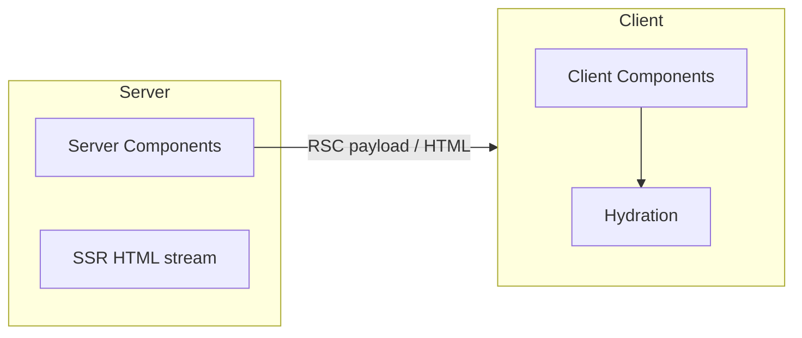

# React — Components, Hooks & Ecosystem

Covers React 19.x — components, rendering, hooks, server components, and ecosystem patterns.

[← Back to JS hub](./3_js.md)

### Related docs

- [JavaScript hub](./3_js.md) · [TypeScript](./5_ts.md) · [Web API](./6_web_api.md) · [INP](./6_web_api.md#inp-interaction-to-next-paint) · [Next.js](./4_nextjs.md)
- [SOLID (general)](./7_special.md#9-solid--principles) · [Jest (Node vs jsdom, mocks)](./7_special.md#jest--first-tests-node-vs-jsdom) · [Test doubles](./7_special.md#test-doubles-stubs-mocks-spies) · [Integration / E2E](./7_special.md#integration-testing)
- [Interview hub](./0_interview.md) · [Interview Practice](./4_react.md#interview-practice)

### Main concepts

| Area             | Topics                                                                    |
| ---------------- | ------------------------------------------------------------------------- |
| **Core**         | Components, JSX, props, state, Rules of React, rendering pipeline, reconciliation |
| **Hooks**        | `useState`, `useEffect` (deps/cleanup), refs, context, memo, concurrent, React 19 APIs |
| **Architecture** | SOLID, composition, FSD, TanStack Router, CASL, orval, Shadcn, i18n, nuqs |
| **Platform**     | SPA, SSR, RSC, hydration, frameworks (Next.js, React Router)              |
| **Quality**      | Performance, testing, a11y, error boundaries, React Compiler              |

### Sections

> Theory `<details>` blocks follow: **Definition** · **How it works** · **When to use** · **Pluses and minuses** · **Examples** · **Thoughts** · **Sources**. **Definition** is required; other sections are optional.

| Part 1                                              | Part 2                                                    |
| --------------------------------------------------- | --------------------------------------------------------- |
| [1. Library overview](#1-library-overview)          | [7. React 19](#7-react-19)                                |
| [2. Rendering model](#2-rendering-model)            | [8. Server rendering & RSC](#8-server-rendering--rsc)     |
| [3. Describing the UI](#3-describing-the-ui)        | [9. Ecosystem & architecture](#9-ecosystem--architecture) |
| [4. State & interactivity](#4-state--interactivity) | [10. Performance](#10-performance)                        |
| [5. Hooks reference](#5-hooks-reference)            | [11. Legacy & migration](#11-legacy--migration)           |
| [6. Escape hatches](#6-escape-hatches)              | [12. Resources](#12-resources)                            |
| [Interview Practice](#interview-practice)           |                                                           |

Also in [§9](#9-ecosystem--architecture): TanStack Router, Query vs RTK Query, CASL, orval, shadcn/ui, i18n, nuqs.

### React

JavaScript **library** for UI from components — `UI = f(state)`. Full notes: [React](#react) · [React vs ReactDOM](#react-vs-reactdom).

### Components & JSX

Functions return JSX. Props flow down; events flow up. Full notes: [Components](#components) · [JSX](#jsx).

### Hooks

State, effects, context, refs in function components. Custom `use*` extracts logic. Full notes: [Hooks reference](#5-hooks-reference) · [Rules of Hooks](#rules-of-hooks).

---

## 1. Library overview

React

<details>
  <summary>React</summary>

### React

**Definition:** React is a JavaScript **library** for building user interfaces from reusable components. It manages the view layer only — routing, data fetching, and global conventions come from frameworks (Next.js, React Router) or third-party libraries.

**When to use:** SPAs, design systems, widgets (`createRoot` on a node), Next.js / React Router full-stack, React Native / Expo.

**Pluses and minuses:**

| +                                                      | −                                                          |
| --------------------------------------------------------- | ------------------------------------------------------------- |
| Component model scales from widgets to full apps          | Not batteries-included — need router, data layer, build tool  |
| Huge ecosystem, hiring pool, tooling (DevTools, Compiler) | Learning curve: hooks, concurrent rendering, RSC mental model |
| Declarative UI + virtual DOM reconciliation               | Bundle size for small embeds vs vanilla JS                    |
| Cross-platform: web (React DOM), native (React Native)    | Frequent ecosystem churn (patterns, meta-frameworks)          |
| Strong TypeScript integration                             | Class → hooks migration legacy in older codebases             |

**Examples:**

```tsx
import { useState } from 'react';
import { createRoot } from 'react-dom/client';

function Counter() {
  const [count, setCount] = useState(0);
  return <button onClick={() => setCount(c => c + 1)}>{count}</button>;
}

createRoot(document.getElementById('root')!).render(<Counter />);
```

**Thoughts:** React is **not** a framework. Inversion of Control: you call React (`createRoot`, `render`); frameworks call your file conventions. Meta (now Linux Foundation) maintains React; production apps typically ship via Vite, Next.js, or Expo — not Create React App (deprecated).

**Sources:**

[react.dev](https://react.dev/)

React vs ReactDOM

</details>

<details>
  <summary>React vs ReactDOM</summary>

### React vs ReactDOM

**Definition:** `react` = core (components, hooks, reconciliation). `react-dom` = web renderer (mount, commit, portals). Separate npm packages, **same version**.

**How it works:**

Web install is **two** packages, **three** `react-dom` import paths (not three npm packages):

| | Role |
| --- | --- |
| `react` | Platform-agnostic UI |
| `react-dom` | Web renderer (replaces `react-native` on mobile) |
| `react-dom/client` | `createRoot`, `hydrateRoot` |
| `react-dom` | `createPortal`, `flushSync`, `useFormStatus` |
| `react-dom/server` | `renderToString` / streaming SSR |

`react-dom` triggers the **first** render and **commit**; `react` runs **render** + `setState`. Browser paints.

**When to use:**

Always `react` + `react-dom` on web. Native swaps the renderer. SSR via a framework, not hand-rolled `react-dom/server`.

#### Common pitfalls

Treating `/server` as a third package; importing `react-dom` in every component; mismatched versions; `react` with no renderer; `react-native` on a web app.

**Examples:**

```tsx
import { createRoot } from 'react-dom/client';
import { createPortal } from 'react-dom';
createRoot(document.getElementById('root')!).render(<App />);
createPortal(<Modal />, document.body);
```

**Thoughts:** *Two packages for web; three* `react-dom` *paths.* `react` *describes UI; the renderer commits it.*

**See also:** [Render pipeline](#render-pipeline) · [Hydration](#hydration)

**Sources:**

[react.dev/reference/react-dom](https://react.dev/reference/react-dom)

Library vs framework

</details>

<details>
  <summary>Library vs framework</summary>

### Library vs framework

**Definition:**

A **library** solves a specific problem (UI rendering); you control the architecture. A **framework** inverts control — it defines project structure, routing, and data patterns.

|               | Library (React)       | Framework (Next.js)                |
| ------------- | --------------------- | ---------------------------------- |
| Control       | You compose the stack | Framework prescribes conventions   |
| Routing       | Bring your own        | Built-in file-based routing        |
| Data fetching | Bring your own        | Server Components, `fetch` caching |

**Examples:**

```tsx
// Library — you wire routing yourself
import { BrowserRouter, Routes, Route } from 'react-router-dom';

// Framework — Next.js owns file-based routes and data loading
// app/page.tsx is a Server Component by convention
```

**Thoughts:** Interview answer: React is a library. Next.js / React Router v7 framework mode are full-stack React frameworks built on top.

**Sources:**

[react.dev/learn/start-a-new-react-project](https://react.dev/learn/start-a-new-react-project)

Philosophy

</details>

<details>
  <summary>Philosophy</summary>

### Philosophy

**Definition:**

Core design principles that shape how React apps are structured — declarative UI, composition, and unidirectional data flow.

| Principle                        | Meaning                                                                         |
| -------------------------------- | ------------------------------------------------------------------------------- |
| **Declarative**                  | Describe what the UI should look like for each state; React handles DOM updates |
| **Component-based**              | UI = tree of reusable, composable units                                         |
| **Unidirectional data flow**     | Props flow down; events flow up                                                 |
| **Composition over inheritance** | Build UIs by nesting components, not class hierarchies                          |
| **Learn once, write anywhere**   | Same component skills for web and native                                        |

**How it works:**

- **2013** — React open-sourced; JSX, virtual DOM
- **v16 (2017)** — Fiber rewrite; error boundaries
- **v16.8 (2019)** — Hooks; class components optional
- **v18 (2022)** — Concurrent rendering, `createRoot`, automatic batching, Suspense improvements
- **v19 (2024)** — Actions, `useActionState`, `useOptimistic`, React Compiler, `ref` as prop
- **v19.2** — `useEffectEvent`, Activity API, owner stack improvements

**Examples:**

```tsx
function LikeButton({ liked, onToggle }: { liked: boolean; onToggle: () => void }) {
  return <button onClick={onToggle}>{liked ? 'Unlike' : 'Like'}</button>;
}
```

Props down, event up — parent owns `liked`.

**See also:**

[Rules of React](#rules-of-react) · [SOLID in React](#solid-in-react) · [Composition patterns](#composition-patterns)

Rules of React

**Sources:** [react.dev/blog/2024/12/05/react-19](https://react.dev/blog/2024/12/05/react-19)

</details>

<details>
  <summary>Rules of React</summary>

### Rules of React

**Definition:** Idioms React assumes you follow — **rules, not style**. Break them → bugs, and Compiler/Concurrent cannot help.

**How it works:**

Three buckets. Enforce with [`<StrictMode>`](#strict-mode) + `eslint-plugin-react-hooks`.

| Bucket | Rule |
| --- | --- |
| **[Purity](#purity)** | Same props/state/context → same JSX. No `fetch` / `new Date()` / mutate-in-render. Copy, then `setState`. Don't mutate Hook args or values already in JSX. |
| **React calls you** | `<Article />`, never `Article()`. Don't pass Hooks as props or wrap them in HOFs. |
| **[Rules of Hooks](#rules-of-hooks)** | Top level only (no loops/conditions/early return). Only in components or `use*` hooks. |

Local objects created **this render** may mutate **before** JSX. Mutating props, state, module arrays, or the DOM during render is not allowed.

**When to use:**

Always.

#### Common pitfalls

Treating rules as optional; side effects in render; injecting a Hook via props; `if (loggedIn) useX()`.

**Examples:**

```tsx
return <Layout><Article /></Layout>;     // ✅
return <Layout>{Article()}</Layout>;     // 🔴 React never owns that instance

if (!id) return null;
const user = useUser(id); // 🔴 hook after return — call it first
```

**Thoughts:** *Render is a pure formula; React calls you — you don't call components or pass Hooks around.*

**See also:** [Purity](#purity) · [Rules of Hooks](#rules-of-hooks) · [Strict Mode](#strict-mode) · [Element vs component](#element-vs-component) · [React Compiler](#react-compiler) · [Thinking in React](https://react.dev/learn/thinking-in-react)

**Sources:**

[react.dev/reference/rules](https://react.dev/reference/rules)

SOLID in React

</details>

<details>
  <summary>SOLID in React</summary>

### SOLID in React

**Definition:** **SOLID** maps to **components, hooks, props, and composition** — not class inheritance. React already leans **O** and **D** ("composition over inheritance").

**How it works:**

| | Principle | In React |
| --- | --- | --- |
| **S** | Single Responsibility | One job: UI **or** data hook, not both |
| **O** | Open/Closed | Extend with `variant`, wrappers, `children` — don't fork `Button` |
| **L** | Liskov Substitution | Wrapper honors the same contract (don't ignore `disabled`) |
| **I** | Interface Segregation | Small props / split contexts — no god `Modal` props |
| **D** | Dependency Inversion | UI depends on a hook/client, not `fetch` in JSX |

**When to use:**

Large components, UI kits, reviews, interviews. Skip ceremony on a 10-line widget.

#### Common pitfalls

Over-SRP (15 one-line components); endless `variant` enums; DIP for a single prototype `fetch`. Guides, not laws.

**Examples:**

```tsx
// S + D — data hook vs UI; inject the client
type UserClient = { list(): Promise<User[]> };

function useUsers(client: UserClient) {
  const [users, setUsers] = useState<User[]>([]);
  useEffect(() => { void client.list().then(setUsers); }, [client]);
  return users;
}

function UserList({ users }: { users: User[] }) {
  return <ul>{users.map(u => <li key={u.id}>{u.name}</li>)}</ul>;
}

// O — extend Button; don't fork DangerButton
function Button({ variant = 'primary', children, ...props }: ButtonProps) {
  return <button className={styles[variant]} {...props}>{children}</button>;
}

// I — Modal is a shell, not a god component
<Modal open={open} onClose={close}>{children}</Modal>

// L — honor the contract (disabled actually disables)
function IconButton({ onClick, disabled, children }: ClickableProps) {
  return <button type="button" onClick={onClick} disabled={disabled}>{children}</button>;
}
```

**Thoughts:** *Small focused units, extend by composition, inject data — React is built for S, O, and D.*

**See also:** [Philosophy](#philosophy) · [Composition patterns](#composition-patterns) · [Custom hooks](#custom-hooks) · [7_special.md — SOLID](./7_special.md#9-solid--principles)

**Sources:**

[react.dev/learn](https://react.dev/learn) · [patterns.dev/react](https://www.patterns.dev/react/)

---

</details>

## 2. Rendering model

<details>
  <summary>Render pipeline</summary>

### Render pipeline

**Definition:** Every update is **Trigger → Render → Commit**, then the browser **paints**. React "render" = calling your functions — not painting pixels.

**How it works:**

```
Trigger   setState / parent / context / root.render()
   ↓
Render    call components → element tree → diff (memory only; may repeat)
   ↓
Commit    DOM mutations → useInsertionEffect → useLayoutEffect (blocks paint)
   ↓
Paint     browser layout + pixels
   ↓
Effects   useEffect after paint
```

| Who | Owns |
| --- | --- |
| `react` | Render, `setState` / hooks |
| `react-dom` | Initial trigger (`createRoot`), commit, portals |
| Browser | Paint |

Packages vs import paths: [React vs ReactDOM](#react-vs-reactdom). Concurrent: render may pause/restart; **commit never pauses** — [Fiber](#react-fiber).

**When to use:**

Always. Know this for "what happens on setState?" interviews.

#### Common pitfalls

Render ≠ DOM update; side effects in render; `useLayoutEffect` for everything; mixing React render with the browser HTML/CSS pipeline → [1_html.md](./1_html.md).

**Examples:**

```tsx
function Tooltip({ text }: { text: string }) {
  const ref = useRef<HTMLDivElement>(null);
  useLayoutEffect(() => { /* measure DOM before paint */ }, [text]);
  useEffect(() => { document.title = text; }, [text]); // after paint
  return <div ref={ref}>{text}</div>;
}
```

**Thoughts:** *Trigger schedules → render computes (may repeat) → commit mutates once → paint →* `useEffect`*.*

**See also:** [React vs ReactDOM](#react-vs-reactdom) · [useEffect vs useLayoutEffect?](#useeffect-vs-uselayouteffect) · [Virtual DOM & reconciliation](#virtual-dom--reconciliation) · [Concurrent rendering](#concurrent-rendering) · [Batching](#batching)

**Sources:**

[react.dev/learn/render-and-commit](https://react.dev/learn/render-and-commit) · [react.dev/reference/react/useLayoutEffect](https://react.dev/reference/react/useLayoutEffect)

Virtual DOM & reconciliation

</details>

<details>
  <summary>Virtual DOM & reconciliation</summary>

### Virtual DOM & reconciliation

**Definition:** React builds a tree of **React elements** — plain JS objects describing UI (`{ type, props, key }`). **Reconciliation** is the algorithm that diffs the new element tree against the previous one and plans minimal DOM changes. Colloquially this tree is called the "Virtual DOM," but it's **not** a full clone of the browser DOM.

**How it works:**

1. **Render** — components run and return a **new** element tree (immutable snapshots each time)
2. **Diff** — reconciler walks new vs previous tree and decides: update props, reuse DOM node, or tear down and rebuild
3. **Commit** — `react-dom` applies the recorded DOM ops (see [render pipeline](#render-pipeline))

**What a React element is** (the unit reconciliation compares):

```tsx
// JSX compiles to createElement — produces a plain object, not a DOM node
<h1 className="title">Hello</h1>
// ≈ { type: 'h1', props: { className: 'title', children: 'Hello' }, key: null }
```

See [Element vs component](#element-vs-component) — components **return** elements; reconciliation compares **elements**.

**Reconciliation rules** (diff heuristics — not deep equality):

| Compare                                                       | Result                                                                                        |
| ------------------------------------------------------------- | --------------------------------------------------------------------------------------------- |
| **Different** `type` (`div` → `span`, or `Counter` → `Timer`) | Destroy old subtree, build new from scratch — state below is lost                             |
| **Same DOM** `type` (`<div>` → `<div>`)                       | Keep the DOM node, update changed props only                                                  |
| **Same component** `type` (`<Counter />` → `<Counter />`)     | Keep instance, update props, recurse into children                                            |
| **Lists**                                                     | Match siblings by `key` across renders — without stable keys, React falls back to index order |

```tsx
// Same type → update text node only, <input> value preserved
return <h1>Hello, {name}</h1>;

// Different type → old <h1> removed, new <p> inserted
return condition ? <h1>Title</h1> : <p>Body</p>;

// Keys — stable id, not index on sortable lists
{items.map(item => <li key={item.id}>{item.name}</li>)}
```

A component can re-render and produce an element tree **identical** to the previous one — reconciliation finds no changes and **commit skips DOM mutations**. Parent re-renders often re-run child functions without touching the DOM.

The public model is element-tree diffing. Internally since React 16, **[Fiber](#react-fiber)** implements reconciliation as interruptible work units (linked list of fiber nodes) — enables concurrent rendering, priorities, and Suspense. You don't interact with Fiber directly.

**When to use:**

Always — this is how React works internally. You don't opt in.

#### Common pitfalls

- **Shadow DOM ≠ Virtual DOM** — Shadow DOM is a browser encapsulation primitive for Web Components; React's tree is JS-level
- **Deep-comparing props in your head** — React compares **element type + key**, not `JSON.stringify(props)`
- **Index as** `key` on reorderable/filterable lists — wrong instance reuse, stale state → [Keys](#keys)
- **Assuming every** `setState` **hits the DOM** — render always runs (usually); DOM updates only when diff finds changes
- `key` **on component remounts it** — intentional reset (`<Form key={userId} />`), but surprising if accidental

**Pluses and minuses:**

| +                                        | −                                                                           |
| ------------------------------------------- | ------------------------------------------------------------------------------ |
| Declarative updates — write `UI = f(state)` | Misleading name — not a full DOM clone for every node                          |
| Reuses DOM nodes when type + key match      | Diff is O(n) heuristic, not optimal — huge lists need virtualization           |
| Same model works for React Native           | "VDOM is faster than real DOM" is a myth — browsers already do partial updates |

**Thoughts:** *Reconciliation diffs element trees by type and key — same type updates props in place; different type rebuilds; lists need stable keys.*

**See also:** [Render pipeline](#render-pipeline) · [Element vs component](#element-vs-component) · [Keys](#keys) · [React Fiber](#react-fiber) · [Batching](#batching)

**Sources:**

[react.dev/learn/preserving-and-resetting-state](https://react.dev/learn/preserving-and-resetting-state) · [react.dev/learn/rendering-lists](https://react.dev/learn/rendering-lists)

React Fiber

</details>

<details>
  <summary>React Fiber</summary>

### React Fiber

**Definition:** **Fiber** is React's reconciler (since v16). One **fiber** = one **unit of work** for a component instance or host node (`div`, text). It is a **virtual stack frame** — React can pause, resume, reuse, or throw it away.

**How it works:**

~60 FPS ≈ 16ms per frame. Fiber splits render into **chunks** and **schedules** urgent work first so typing and animations are not blocked.

**Sequence** (one update):

```
1. Bootstrap   createRoot → FiberRootNode + HostRootFiber (#root)
2. Queue       setState → update on a fiber → Scheduler assigns a **lane**
3. Render      clone current → WIP; DFS work loop (memory only, no DOM)
                 beginWork ↓  (call component, reconcile children, set flags)
                 completeWork ↑ (bubble flags onto the effect list)
                 between fibers: shouldYield()? → end chunk (pause) or continue
                 urgent lane mid-WIP? → discard WIP, restart
4. Commit      sync (never pauses): Placement / Update / Deletion → flip current
               useLayoutEffect → browser paint → useEffect
```

Render ≠ paint. The screen changes only at **commit**. Reconciler (`react`) walks fibers; renderer (`react-dom`) writes the DOM.

| | current | WIP |
| --- | --- | --- |
| Tree | On screen | Draft this render |
| Link | `alternate` twin | Clone; reuse if `type` + `key` match |

Linked list (`child` = first child, `sibling` = next, `return` = parent) so React always knows the **next** fiber without the JS call stack — that is how pause/resume works.

```
App
 └─ child → Header ── sibling → Main
                                 └─ child → ItemA ── sibling → ItemB
```

Walk: App → Header → Main → ItemA → ItemB, then `completeWork` back up. Hooks live on `memoizedState` on the fiber → [Rules of Hooks](#rules-of-hooks).

One fiber (or a short burst) processed before `shouldYield()`. React **finishes the current function**, then yields — never mid-component. Typical slice ~5ms; the next frame resumes at the next fiber. **Commit never yields.**

```
[browser input]  [React chunk → yield]  [paint]
[next frame: resume from next fiber]
```

Chunks do **not** use extra CPU cores and do **not** make your own heavy JS (`array.filter` on 100k items) non-blocking — only reconciliation is sliced.

Scheduler orders *when* the callback runs. **Lanes** tag *which* updates.

| High → low | Trigger | Notes |
| ---------- | ------- | ----- |
| Sync | click, `flushSync` | Commit ASAP |
| Input | `onChange`, drag | Keep typing smooth |
| Default | normal `setState` | Standard |
| Transition | `startTransition` | Interruptible; WIP can be discarded |
| Idle | prefetch | Lowest; starved work **expires** and gets promoted |

Same lane → **batched**. Higher lane during a lower render → throw away WIP, restart.

**When to use:**

Interview "how React stays responsive"; expensive tab/list UI via transitions. Needs `createRoot` (React 18+).

#### Common pitfalls

- Fiber ≠ concurrent rendering — engine vs `createRoot` + transitions
- Conditional hooks shift the fiber's hook list
- Don't read `__reactFiber$` / internals from app code

**Pluses and minuses:**

| + | − |
| --- | --- |
| Interruptible render, priorities, Suspense | Internals unstable; commit still blocks the thread |

**Examples:**

```tsx
onClick={() => setOpen(true)}; // urgent lane
startTransition(() => setTab('analytics')); // transition lane
```

**Thoughts:** *Render prepares work in chunks; commit applies it in one atomic pass.*

**See also:** [Render pipeline](#render-pipeline) · [Virtual DOM & reconciliation](#virtual-dom--reconciliation) · [Concurrent rendering](#concurrent-rendering) · [Batching](#batching) · [Rules of Hooks](#rules-of-hooks)

**Sources:**

[github.com/acdlite/react-fiber-architecture](https://github.com/acdlite/react-fiber-architecture) · [react.dev/learn/render-and-commit](https://react.dev/learn/render-and-commit) · [react.dev/reference/react/useTransition](https://react.dev/reference/react/useTransition) · [React Scheduler docs](https://scheduler-explorer.vercel.app/)

Concurrent rendering

</details>

<details>
  <summary>Concurrent rendering</summary>

### Concurrent rendering

**Definition:** React can prepare multiple versions of the UI in memory, **interrupt** low-priority renders, and **commit urgent updates first**. Built on [Fiber](#react-fiber) — render is interruptible; commit is not.

**How it works:**

1. **Urgent update** (typing, click) — renders and commits immediately on a high-priority lane
2. **Transition update** (`startTransition`) — marked low-priority; React may keep showing the previous UI while preparing the new tree in the background
3. If a new urgent update arrives mid-transition, React **discards** stale transition work and prioritizes the urgent render
4. Still **single-threaded** — cooperative yielding, not Web Workers

| Urgent                     | Deferred (transition)                           |
| -------------------------- | ----------------------------------------------- |
| Input value, button clicks | Large list filter, tab switch, chart redraw     |
| User must see immediately  | Brief stale UI acceptable (`isPending` spinner) |

**When to use:**

Tab switches, large list filtering, chart updates while user types, Suspense boundaries for async data.

Every `setState` — measure first; default updates are already fast enough for most UIs.

#### Common pitfalls

- Wrapping all updates in `startTransition` — unnecessary; only defer expensive re-renders
- Expecting parallel JS — Fiber yields on the main thread only
- Forgetting `createRoot` — legacy `ReactDOM.render` does not enable full concurrent features

**Examples:**

```tsx
const [isPending, startTransition] = useTransition();

function handleChange(e: React.ChangeEvent<HTMLInputElement>) {
  setInput(e.target.value); // urgent — input stays in sync
  startTransition(() => setFiltered(heavyFilter(e.target.value))); // deferred
}
```

**Thoughts:** *Prepare UI in the background, commit urgent work first — stale UI briefly is the tradeoff.*

**See also:** [React Fiber](#react-fiber) · [useTransition / useDeferredValue](#usetransition--usedeferredvalue) · [Render pipeline](#render-pipeline)

**Sources:**

[react.dev/reference/react/useTransition](https://react.dev/reference/react/useTransition)

Batching

</details>

<details>
  <summary>Batching</summary>

### Batching

**Definition:** React groups multiple state updates into **one** render/commit cycle instead of re-rendering after every `setState`.

**How it works:**

1. Each `setState` / `dispatch` enqueues an update on the component's fiber
2. React processes the whole queue before the next render — multiple updates → **one** render pass
3. Inside that render, state reflects all queued updates (functional updaters run in order)
4. React 18+ batches inside promises, `setTimeout`, and native event handlers too (with `createRoot`)

| Version   | Behavior                                                                          |
| --------- | --------------------------------------------------------------------------------- |
| React 17  | Batched only inside React event handlers                                          |
| React 18+ | Automatic batching in promises, `setTimeout`, native handlers (with `createRoot`) |

`flushSync(() => setState(...))` forces immediate render + DOM commit — use when you must read DOM right after an update (rare).

**When to use:** Default — always on. You rarely think about it.

**Examples:**

```tsx
function handleClick() {
  setCount(c => c + 1);
  setFlag(f => !f);
  // React 18+: one re-render, not two
}

// Pitfall — same snapshot twice (not a batching issue)
setCount(count + 1);
setCount(count + 1); // still +1 total — use c => c + 1
```

**Thoughts:** *Batching reduces renders; functional updaters fix stale snapshot math.*

**See also:** [State as snapshot](#state-as-snapshot) · [Render pipeline](#render-pipeline)

**Sources:**

[react.dev/learn/queueing-a-series-of-state-updates](https://react.dev/learn/queueing-a-series-of-state-updates)

Keys

</details>

<details>
  <summary>Keys</summary>

### Keys

**Definition:** `key` is a special React attribute that gives a **stable identity** to a child among its siblings across renders. Reconciliation matches list items by `key`, not by array index.

**How it works:**

1. React walks sibling fibers in order
2. On re-render, it tries to match each new child to a previous child with the **same key**
3. Match found → **reuse** fiber + DOM node, update props
4. No match → mount new; leftover old keys → unmount
5. `key` is **not** passed as a prop to your component

**When to use:**

Every item in `array.map()`. Use stable IDs from data (`todo.id`). Also use `key` on a component to **force remount** when identity changes (`<Form key={userId} />`).

| Key choice                            | OK when                                          |
| ------------------------------------- | ------------------------------------------------ |
| Database `id`                         | Default — reorder, filter, insert                |
| Array index                           | Static list — never reordered/filtered/prepended |
| `Math.random()` / `uuid()` per render | **Never** — new key every render, full remount   |

#### Common pitfalls

- Index as key on sortable/filterable lists — wrong instance reuse
- Random key per render — destroys performance and state
- Changing `key` **remounts** the component — resets internal state (use intentionally)

**Examples:**

```tsx
// Good — stable id from database
{todos.map(todo => <Todo key={todo.id} todo={todo} />)}

// Bad — reorder [A,B] → [B,A]: React reuses wrong instances, stale state
{todos.map((todo, i) => <Todo key={i} todo={todo} />)}
```

**Thoughts:** *Key = identity across renders, not list position.*

**See also:** [Virtual DOM & reconciliation](#virtual-dom--reconciliation) · [Why list keys? Index as key?](#why-list-keys-index-as-key)

**Sources:**

[react.dev/learn/rendering-lists](https://react.dev/learn/rendering-lists)

Strict Mode

</details>

<details>
  <summary>Strict Mode</summary>

### Strict Mode

**Definition:** `<StrictMode>` is a dev-only wrapper that runs **extra checks** to surface bugs early. It does **not** render visible UI and has **zero** production impact.

**How it works:**

| Check                 | What happens                                                          |
| --------------------- | --------------------------------------------------------------------- |
| **Double render**     | Component function called twice — catches impure render side effects  |
| **Double effects**    | `useEffect` runs mount → cleanup → mount — catches missing cleanup    |
| **Deprecated APIs**   | Warns about legacy patterns (`findDOMNode`, old context, string refs) |
| **Unsafe lifecycles** | Class component warnings (legacy)                                     |

**When to use:**

Wrap `<App />` at the root in development. Keep enabled — it trains you to write resilient effects and pure renders.

As a fix for double-fetch — fix effect cleanup or dedupe logic instead of removing Strict Mode.

#### Common pitfalls

- Disabling Strict Mode because effects run twice — the bug is missing cleanup, not Strict Mode
- Putting side effects in render body — double render exposes them → [Rules of React](#rules-of-react)
- Assuming production behaves like dev — Strict Mode checks are stripped in prod builds

**Examples:**

```tsx
<StrictMode>
  <App />
</StrictMode>
```

**Thoughts:** *Strict Mode stress-tests your components — if it breaks in dev, it was already fragile.*

**See also:** [Rules of React](#rules-of-react) · [Purity](#purity) · [useEffect](#useeffect) · [Render pipeline](#render-pipeline)

**Sources:**

[react.dev/reference/react/StrictMode](https://react.dev/reference/react/StrictMode)

Element vs component

</details>

<details>
  <summary>Element vs component</summary>

### Element vs component

**Definition:** A **React element** is a plain object (`{ type, props, key }`) describing what to render. A **component** is a function or class that **returns** elements when React calls it.

**How it works:**

1. You write JSX → compiles to `React.createElement(type, props, ...children)`
2. `<Welcome name="Ada" />` creates an element `{ type: Welcome, props: { name: 'Ada' } }`
3. Reconciler sees `type: Welcome` → **calls** `Welcome({ name: 'Ada' })`
4. Component returns more elements (e.g. `<h1>`) → recursion continues until host DOM elements
5. New element tree every render; component **instances** (fiber + state) persist

|            | Element                          | Component                 |
| ---------- | -------------------------------- | ------------------------- |
| What       | Immutable description (snapshot) | Reusable function/class   |
| Created by | `createElement` / JSX            | You define it             |
| Per render | New object every time            | Same function, re-invoked |
| State      | None                             | Hooks live on fiber       |

**When to use:**

Elements are what reconciliation diffs. Components are how you organize logic. Capital letter = component (`<Welcome />`); lowercase = DOM (`<div />`).

#### Common pitfalls

- Confusing `<Welcome />` with a DOM node — it's an instruction to call `Welcome`
- Calling `Welcome()` as a function — [Rules of React](#rules-of-react): only JSX so React owns the call
- Lowercase JSX (`<welcome />`) — React treats it as unknown HTML tag, not your component
- Mutating element objects — always create new elements via JSX each render

**Examples:**

```tsx
// Component (function) — React CALLS this
function Welcome({ name }: { name: string }) {
  return <h1>Hello, {name}</h1>; // returns an element
}

// Element — description object, not a live DOM node
const element = <Welcome name="Ada" />;
// ≈ { type: Welcome, props: { name: 'Ada' } }
```

**Thoughts:** *Components are functions; elements are their output snapshots — reconciliation compares elements.*

**See also:** [Rules of React](#rules-of-react) · [Virtual DOM & reconciliation](#virtual-dom--reconciliation) · [Components](#components)

**Sources:**

[react.dev/learn/your-first-component](https://react.dev/learn/your-first-component)

---

</details>

## 3. Describing the UI

Components

<details>
  <summary>Components</summary>

### Components

**Definition:** A React component is a JavaScript function (or class — legacy) that returns JSX. Names **must** start with a capital letter so React distinguishes them from HTML tags.

**When to use:**

Every piece of UI. Prefer small, focused components composed upward.

#### Pitfalls

1. Lowercase names render as HTML tags: `<profile />` → DOM element, not your component
2. **Never nest component definitions** inside another component — causes remount every parent render

```tsx
// Bad — Profile recreated every Gallery render
function Gallery() {
  function Profile() { return <p>...</p>; }
  return <Profile />;
}

// Good — define at module scope
function Profile() { return <p>...</p>; }
function Gallery() { return <Profile />; }
```

**Pluses and minuses:**

| +                           | −                                        |
| ------------------------------ | ------------------------------------------- |
| Colocate markup, logic, styles | Deep trees → prop drilling without planning |
| Reusable at any granularity    | Over-fragmentation adds boilerplate         |
| Testable in isolation          |                                             |

**Examples:**

```tsx
function VideoList({ videos }: { videos: Video[] }) {
  return (
    <section>
      {videos.map(v => <Video key={v.id} video={v} />)}
    </section>
  );
}
```

**Thoughts:**

*Components are functions — capital letter = React component, lowercase = HTML.*

Single Responsibility — if a component grows, split it. Pages/widgets/features in FSD terms (see [Section 9](#9-ecosystem--architecture)).

**See also:** [Element vs component](#element-vs-component) · [Purity](#purity)

**Sources:**

[react.dev/learn/your-first-component](https://react.dev/learn/your-first-component)

JSX

</details>

<details>
  <summary>JSX</summary>

### JSX

**Definition:** JSX is a syntax extension that compiles to `React.createElement(type, props, ...children)`. It lets you write HTML-like markup inside JavaScript.

**How it works:**

- One root element or `<>...</>` Fragment
- Close all tags (``, `<br />`)
- camelCase DOM attributes: `className`, `onClick`, `tabIndex`
- Capitalized tags = components; lowercase = HTML

**Pluses and minuses:**

| +                      | −                                      |
| ------------------------- | ----------------------------------------- |
| Readable UI code          | Requires build step (Babel, SWC, esbuild) |
| Type-safe with TypeScript | `class` → `className`, `for` → `htmlFor`  |
| Expressions via `{}`      | Must return single root (or Fragment)     |

**Examples:**

```tsx
const name = 'Ada';
return (
  <>
    <h1 className="title">{name}</h1>
    {items.length > 0 && <List items={items} />}
  </>
);
```

**Thoughts:** JSX is syntactic sugar — `<>...</>` compiles to `Fragment`. Conditional rendering: prefer `condition ? <A /> : <B />` or `!!condition && <A />` — watch for `0` falsy rendering.

**Sources:**

[react.dev/learn/writing-markup-with-jsx](https://react.dev/learn/writing-markup-with-jsx)

Fragments

</details>

<details>
  <summary>Fragments</summary>

### Fragments

**Definition:** `Fragment` (or shorthand `<>...</>`) groups multiple children without adding an extra DOM node.

**How it works:** JSX requires a single root element. `Fragment` satisfies that rule while rendering nothing to the DOM — children appear as siblings of the parent's other nodes. `<>...</>` compiles to `<React.Fragment>`; use the long form when you need a `key` on the fragment itself (e.g. keyed list items that return multiple elements).

**When to use:** Table rows (`<tr>` pairs), list items with multiple nodes, layout shells where an extra wrapper would break CSS.

**Pluses and minuses:**

| +                                                   | −                                           |
| ------------------------------------------------------ | ---------------------------------------------- |
| Avoids wrapper `<div>` that breaks layout (flex/grid)  | Cannot set `className` or events on a fragment |
| Keeps semantic HTML clean                              | Shorthand `<>` does not accept `key`           |
| Required for returning multiple roots from a component |                                                |

**Examples:**

```tsx
function Row({ user }: { user: User }) {
  return (
    <>
      <td>{user.name}</td>
      <td>{user.email}</td>
    </>
  );
}

// Keyed fragment in a list
items.map(item => (
  <Fragment key={item.id}>
    <dt>{item.term}</dt>
    <dd>{item.definition}</dd>
  </Fragment>
));
```

**Sources:**

[react.dev/reference/react/Fragment](https://react.dev/reference/react/Fragment)

Props

</details>

<details>
  <summary>Props</summary>

### Props

**Definition:** Props are **read-only** inputs passed from parent to child — like function arguments. The child cannot mutate them; only the parent can change props by re-rendering with new values.

**How it works:**

1. Parent renders → passes props snapshot to child: `<Child count={count} onSave={handleSave} />`
2. Child receives props for **this render only** — frozen for that call
3. Child requests change via **callback prop** (`onIncrement`) — parent owns state and updates
4. One-way flow: data **down**, events **up**

**When to use:**

Pass data, configuration, and event handlers down the tree. Lift state up when siblings need shared data → [Lifting state up](#lifting-state-up).

#### Common pitfalls

- Mutating props inside child (`props.items.push(...)`) — breaks one-way flow
- `{...props}` on DOM elements — leaks invalid attrs (`isLoading`, `variant`)
- Creating new object/function inline every render — can break `memo` children (`onClick={() => ...}`)

**Examples:**

```tsx
function Button({ label, onClick, ...rest }: ButtonProps) {
  return <button onClick={onClick} {...rest}>{label}</button>;
}
```

**Thoughts:** *Props in, callbacks out — parent owns mutable state.*

**See also:** [State vs props](#state-vs-props) · [Composition patterns](#composition-patterns)

**Sources:**

[react.dev/learn/passing-props-to-a-component](https://react.dev/learn/passing-props-to-a-component)

Purity

</details>

<details>
  <summary>Purity</summary>

### Purity

**Definition:**

React components must be **pure** during render: same inputs → same output; no mutating external state or props. Full contract (idempotency, immutability, “React calls you”): [Rules of React](#rules-of-react).

| Allowed                         | Forbidden during render                                     |
| ------------------------------- | ----------------------------------------------------------- |
| Create local variables          | `fetch()` side effects                                      |
| Local mutation of *new* objects | Mutate props, state, context, refs                          |
| Compute derived values          | Subscribe to external stores without `useSyncExternalStore` |

**Side effects** belong in event handlers or effects — not in the render body.

**When to use:**

Every component render should be pure. Derive display values in render; fetch/subscribe in `useEffect` or event handlers.

#### Common pitfalls

- `fetch` in render — runs every re-render; use `useEffect` or framework data layer
- [Strict Mode](#strict-mode) double-calls render in dev — exposes impure code
- Reading external mutable globals during render — output varies without props/state change

**Examples:**

```tsx
// Bad — impure render
function ItemList({ items }: { items: Item[] }) {
  items.push({ id: 'new' }); // mutates prop!
  return <ul>{items.map(i => <li key={i.id}>{i.name}</li>)}</ul>;
}

// Good — local mutation of new data is fine
function FriendList({ friends }: { friends: string[] }) {
  const sorted = [...friends].sort(); // new array, local
  return <ul>{sorted.map(f => <li key={f}>{f}</li>)}</ul>;
}
```

**Thoughts:** *Render is a pure function of props, state, and context.*

**See also:** [Rules of React](#rules-of-react) · [Render pipeline](#render-pipeline) · [You might not need an effect](#you-might-not-need-an-effect)

**Sources:**

[react.dev/learn/keeping-components-pure](https://react.dev/learn/keeping-components-pure)

Conditional rendering & lists

</details>

<details>
  <summary>Conditional rendering & lists</summary>

### Conditional rendering & lists

**Definition:** JSX is JavaScript — use `if`, ternary, `&&`, and `map()` to decide what renders. No special template syntax.

**How it works:** Expressions inside `{ }` evaluate to React nodes, `null`, `undefined`, `false` (render nothing), or arrays of nodes. Early `return` before JSX is often clearest for complex branches.

**When to use:**

| Pattern                     | Use case                                            |
| --------------------------- | --------------------------------------------------- |
| `if` + early `return`       | Multiple branches, loading/error states             |
| `condition ? <A /> : <B />` | Two branches inline                                 |
| `condition && <A />`        | Single branch — **not** when left side can be `0`   |
| `items.map()`               | Lists — always provide stable `key` → [Keys](#keys) |

#### Common pitfalls

- `{count && <Badge />}` when `count === 0` — renders `0` on screen; use `count > 0 &&`
- Nested ternaries — hard to read; extract component or use early return
- `map` without `key` — reconciliation warnings and bugs on reorder

**Examples:**

```tsx
if (loading) return <Spinner />;
if (error) return <Error message={error.message} />;

{isLoggedIn ? <Dashboard /> : <Login />}
{count > 0 && <Badge count={count} />}  // not: {count && ...} when count can be 0
{items.map(item => <Row key={item.id} item={item} />)}
```

**Thoughts:** *JSX has no* `v-if` *— use JavaScript expressions and early returns.*

**See also:** [Keys](#keys) · [Component trees](#component-trees)

**Sources:**

[react.dev/learn/conditional-rendering](https://react.dev/learn/conditional-rendering)

Component trees

</details>

<details>
  <summary>Component trees</summary>

### Component trees

**Definition:** React models UI as trees. Two related views: **render tree** (runtime parent/child components) and **module tree** (static `import` graph for bundling).

**How it works:**

- Each component instance is a **node**; parent renders children as nested JSX
- React matches state to **tree position** — same component type at same place → state preserved
- Different type at same slot → old subtree **unmounted**, state lost
- Conditional rendering changes tree shape → can reset state unintentionally

| Tree       | What it shows               | Used for                        |
| ---------- | --------------------------- | ------------------------------- |
| **Render** | Who renders whom at runtime | State, reconciliation, context  |
| **Module** | File import dependencies    | Code splitting, bundle analysis |

**When to use:**

Understand render tree when debugging state resets, context scope, and error boundary placement.

#### Common pitfalls

- Swapping `<A />` for `<B />` at same position — destroys A's state
- Assuming state follows variable name — position in tree matters, not JSX label
- Nesting same component in different branches — separate state instances

**Examples:**

```tsx
// Same position → state preserved across re-renders
<Profile userId={id} />

// Different type at same slot → state reset
{showA ? <CounterA /> : <CounterB />}

// Same variable name, different position — still different state slots
{cond ? <Panel><Counter /></Panel> : <Counter />}
```

**Thoughts:** *State is tied to tree position, not to how you named the variable.*

**See also:** [Virtual DOM & reconciliation](#virtual-dom--reconciliation) · [Keys](#keys)

**Sources:**

[react.dev/learn/understanding-your-ui-as-a-tree](https://react.dev/learn/understanding-your-ui-as-a-tree)

Composition patterns

</details>

<details>
  <summary>Composition patterns</summary>

### Composition patterns

**Definition:**

Build complex UIs by nesting components and passing `children`.

| Pattern                 | Status    | Use                                         |
| ----------------------- | --------- | ------------------------------------------- |
| **Children**            | Preferred | Layout shells, generic wrappers             |
| **Slots** (named props) | Common    | `<Card header={...} footer={...} />`        |
| **HOC**                 | Legacy    | `withRouter`, `connect` — avoid in new code |
| **Render props**        | Legacy    | `<DataProvider render={data => ...} />`     |

**How it works:** Parent passes UI fragments as `children` or named props — child renders slots without knowing parent's data source. Avoids prop drilling for layout shells.

**When to use:**

| Pattern                          | Prefer when                                 |
| -------------------------------- | ------------------------------------------- |
| `children`                       | Generic wrapper (Card, Layout, Modal shell) |
| Named slots (`header`, `footer`) | Fixed regions with different types          |
| Context                          | Deep tree, stable shared data (theme, auth) |
| HOC / render props               | Legacy libs only — hooks replace most cases |

#### Common pitfalls

- Prop drilling through 5+ layers — lift, context, or colocate state
- HOC wrapper hell — hard to trace props; prefer hooks + composition
- `children` as function for everything — render props pattern; use only when needed

**Examples:**

```tsx
function Card({ children, header }: { children: React.ReactNode; header?: React.ReactNode }) {
  return (
    <article>
      {header && <header>{header}</header>}
      <main>{children}</main>
    </article>
  );
}
```

**Thoughts:** *Compose UI like nesting HTML — slots over inheritance.*

**See also:** [SOLID in React](#solid-in-react) · [Props](#props) · [Context](#context)

**Sources:**

[patterns.dev/react](https://www.patterns.dev/react/)

---

</details>

## 4. State & interactivity

State

<details>
  <summary>State</summary>

### State

**Definition:** State is component memory — data that changes over time in response to user input or async results. React holds state outside your function and gives you a snapshot per render.

**How it works:**

1. React stores state on the component's **fiber** — outside your function body
2. Each render, `useState` returns the **current snapshot** for that render
3. `setState` schedules an update — does not mutate the snapshot you're holding
4. Re-render → function runs again with the new snapshot

**When to use:**

Any UI that changes: forms, toggles, fetched data, selections.

#### Common pitfalls

- Expecting local variables to persist (`let count = 0` in function body — resets every render)
- Duplicating state that can be derived from props or other state
- Mutating state objects in place (`items.push(x); setItems(items)`) — same reference, React may skip update

**Pluses and minuses:**

| +                                       | −                                         |
| ------------------------------------------ | -------------------------------------------- |
| Local encapsulation                        | Easy to create redundant/duplicated state    |
| Triggers targeted re-renders               | Async batching can surprise (stale closures) |
| `useState` / `useReducer` cover most cases | Global state needs context or external store |

**Examples:**

```tsx
const [count, setCount] = useState(0);
// Functional update avoids stale closure
setCount(c => c + 1);
```

**Thoughts:** *State lives on the fiber; each render sees a frozen snapshot.*

**See also:** [State as snapshot](#state-as-snapshot) · [Batching](#batching) · [Reactive programming](./7_special.md#reactive-programming--reactivity)

**Sources:**

[react.dev/learn/state-a-components-memory](https://react.dev/learn/state-a-components-memory)

State vs props

</details>

<details>
  <summary>State vs props</summary>

### State vs props

**Definition:** **Props** are read-only inputs from parent; **state** is data the component (or lifted ancestor) **owns** and updates via setter.

**How it works:**

Parent holds state → passes **snapshot** as props → child displays and calls callback → parent updates state → child re-renders with new props. Child never mutates props directly.

|            | Props                   | State                                        |
| ---------- | ----------------------- | -------------------------------------------- |
| Source     | Parent                  | Local (`useState`) or global (context/store) |
| Mutability | Read-only for child     | Updated via setter                           |
| Changes    | Parent re-renders child | Self or child triggers update                |
| Question   | "What data do I get?"   | "What do I remember?"                        |

**When to use:** Props for configuration and data flow. State for interactive UI that changes over time. If two siblings need it → lift state up.

**Examples:**

```tsx
function Parent() {
  const [count, setCount] = useState(0);
  return <Child label="Clicks" count={count} onIncrement={() => setCount(c => c + 1)} />;
}
```

**Thoughts:** *Props in, events out — state lives where it's owned.*

**See also:** [Props](#props) · [Lifting state up](#lifting-state-up)

**Sources:**

[react.dev/learn/passing-props-to-a-component](https://react.dev/learn/passing-props-to-a-component)

State as snapshot

</details>

<details>
  <summary>State as snapshot</summary>

### State as snapshot

**Definition:** Calling `setState` schedules a re-render with the **next** state — it does not mutate current state in place. Event handlers close over the **render-time snapshot**, not live state.

**How it works:**

1. Render with `n = 0` → handler created, closes over `n = 0`
2. `setN(n + 1)` queues update based on snapshot `0` → next `n` is `1`
3. Two `setN(n + 1)` in same handler both read `0` → still `1`, not `2`
4. `setN(prev => prev + 1)` queues functional updaters — each sees previous queued result
5. [Batching](#batching) processes all queued updates before next render

**When to use:** Always understand this when debugging counters, async handlers, and stale closure bugs.

**Examples:**

```tsx
function Counter() {
  const [n, setN] = useState(0);
  function handleClick() {
    setN(n + 1);
    setN(n + 1);
    // After one click: n becomes 1, not 2 — both use snapshot n=0
    setN(prev => prev + 1);
    setN(prev => prev + 1);
    // After one click: n becomes 2 — functional updates queue correctly
  }
}
```

**Thoughts:** *setState schedules the future; the current render's values are frozen.*

**See also:** [Batching](#batching) · [State](#state)

**Sources:**

[react.dev/learn/state-as-a-snapshot](https://react.dev/learn/state-as-a-snapshot)

Principles for structuring state

</details>

<details>
  <summary>Principles for structuring state</summary>

### Principles for structuring state

**Definition:**

Guidelines for choosing what to store in state so updates stay predictable and components stay simple.

1. **Group related state** — merge variables always updated together
2. **Avoid contradictions** — e.g. `isSending` + `isSent` both true
3. **Avoid redundancy** — don't store what you can compute during render
4. **Avoid duplication** — same data in two state variables drifts
5. **Avoid deep nesting** — prefer flat state + IDs

**When to use:** Before adding `useState`, ask: can this be computed? Is it duplicated elsewhere? Will two flags contradict?

**Examples:**

```tsx
// Bad — redundant
const [firstName, setFirstName] = useState('');
const [lastName, setLastName] = useState('');
const [fullName, setFullName] = useState(''); // derive instead!

// Good
const fullName = `${firstName} ${lastName}`;
```

**Thoughts:** *Minimize state surface — derive during render when possible.*

**See also:** [State](#state) · [You might not need an effect](#you-might-not-need-an-effect)

**Sources:**

[react.dev/learn/choosing-the-state-structure](https://react.dev/learn/choosing-the-state-structure)

Lifting state up

</details>

<details>
  <summary>Lifting state up</summary>

### Lifting state up

**Definition:** Move shared state to the **closest common ancestor** of components that need it; pass data and callbacks down as props.

**How it works:**

1. Identify siblings that need the same data (search input + filtered list)
2. Find their nearest shared parent
3. Move `useState` to that parent
4. Pass `value` + `onChange` (or derived data) down as props

State used by one component only — keep local. Deep drilling → [Context](#context) or state library.

**When to use:** Two or more siblings share data or must stay in sync.

**Examples:**

```tsx
function Page() {
  const [query, setQuery] = useState('');
  return (
    <>
      <SearchInput value={query} onChange={setQuery} />
      <FilteredList query={query} />
    </>
  );
}
```

**Thoughts:** *Shared state lives in the lowest common ancestor.*

**See also:** [State vs props](#state-vs-props) · [Context](#context)

**Sources:**

[react.dev/learn/sharing-state-between-components](https://react.dev/learn/sharing-state-between-components)

Controlled vs uncontrolled inputs

</details>

<details>
  <summary>Controlled vs uncontrolled inputs</summary>

### Controlled vs uncontrolled inputs

**Definition:**

**Controlled** inputs get `value` from React state; **uncontrolled** inputs keep value in the DOM and are read via refs.

|              | Controlled                      | Uncontrolled                            |
| ------------ | ------------------------------- | --------------------------------------- |
| Value source | React state                     | DOM (`ref.current.value`)               |
| When         | Default for forms in React apps | File inputs, integrating non-React libs |
| API          | `value` + `onChange`            | `ref` + `defaultValue`                  |

**Examples:**

```tsx
// Controlled
<input value={email} onChange={e => setEmail(e.target.value)} />

// Uncontrolled
<input ref={inputRef} defaultValue="" />
```

**Thoughts:** React 19 form Actions reduce boilerplate for uncontrolled-style forms with server mutations.

**Sources:**

[react.dev/reference/react-dom/components/input](https://react.dev/reference/react-dom/components/input)

Context

</details>

<details>
  <summary>Context</summary>

### Context

**Definition:** `createContext` + `useContext` pass data through the tree without prop drilling.

**How it works:**

1. Pass props explicitly
2. Extract components; pass JSX as `children`
3. Use a dedicated state library for frequent updates

**When to use:** Theming, locale, auth session, router — stable or memoized values.

**Pluses and minuses:**

| +                                 | −                                       |
| ------------------------------------ | ------------------------------------------ |
| Avoids drilling theme, locale, auth  | All consumers re-render when value changes |
| Good for rarely changing global data | Easy to overuse as global store            |

**Examples:**

```tsx
const ThemeContext = createContext<'light' | 'dark'>('light');

function App() {
  const [theme, setTheme] = useState<'light' | 'dark'>('light');
  return (
    <ThemeContext value={theme}>
      <Toolbar />
    </ThemeContext>
  );
}

function Toolbar() {
  const theme = useContext(ThemeContext);
  return <div className={theme}>...</div>;
}
```

**Thoughts:** Split contexts by update frequency. Memoize `value` object or consumers re-render on every parent render.

**Sources:**

[react.dev/learn/passing-data-deeply-with-context](https://react.dev/learn/passing-data-deeply-with-context)

useReducer

</details>

<details>
  <summary>useReducer</summary>

### useReducer

**Definition:** `useReducer(reducer, initialArg)` manages complex state with an action → state transition function (Redux-like locally).

**When to use:** Multi-field forms, wizard steps, state machines — when `useState` has too many `setX` calls.

**Pluses and minuses:**

| +                                | −                                |
| ----------------------------------- | ----------------------------------- |
| Predictable state transitions       | More boilerplate for simple toggles |
| Easier to test reducer in isolation |                                     |
| Co-locate related updates           |                                     |

**Examples:**

```tsx
type Action = { type: 'increment' } | { type: 'decrement' };
function reducer(state: number, action: Action) {
  switch (action.type) {
    case 'increment': return state + 1;
    case 'decrement': return state - 1;
  }
}
const [count, dispatch] = useReducer(reducer, 0);
```

**Sources:**

[react.dev/reference/react/useReducer](https://react.dev/reference/react/useReducer)

State normalization

</details>

<details>
  <summary>State normalization</summary>

### State normalization

**Definition:** Store collections as `{ ids: Id[], entities: Record<Id, Entity> }` instead of nested arrays for O(1) lookup and targeted updates.

**How it works:** `ids` preserves order for rendering; `entities` maps id → object. Update one entity by id without scanning the whole array. Selectors derive filtered/sorted views from normalized store.

**When to use:** Large lists, frequent per-item updates, Redux/Apollo normalized caches. Skip for small static lists.

**Pluses and minuses:**

| +                                     | −                              |
| ---------------------------------------- | --------------------------------- |
| Fast lookup by id                        | More setup than plain arrays      |
| Update one entity without scanning array | Denormalized views need selectors |
| Fewer unnecessary re-renders             |                                   |

**Examples:**

```tsx
// Instead of users: User[]
type UsersState = {
  userIds: number[];
  usersById: Record<number, User>;
};

// Read
const user = state.usersById[2];

// Update one user
state.usersById[2] = { ...state.usersById[2], name: 'Ivan' };

// Render list
state.userIds.map(id => <User key={id} user={state.usersById[id]} />);
```

**Thoughts:**

*Ids for order, map for lookup — update one row without touching the whole list.*

Redux Toolkit `createEntityAdapter`, Apollo/Relay normalize GraphQL cache automatically. TanStack Query stores server shape as-is — normalize in `select` if needed. Unrelated to SQL 1NF–3NF — that is [9_database.md — Normal forms](./9_database.md#normal-forms-1nf3nf-bcnf).

**Sources:**

[redux-toolkit.js.org/api/createEntityAdapter](https://redux-toolkit.js.org/api/createEntityAdapter)

---

</details>

## 5. Hooks reference

Built-in hooks catalog

<details>
  <summary>Built-in hooks catalog</summary>

### Built-in hooks catalog

**Definition:** Index of React built-in hooks grouped by responsibility — state, effects, refs, performance, and React 19 APIs.

**How it works:**

1. **Mutable UI data?** → `useState` or `useReducer`
2. **Sync with external system?** → `useEffect` / `useLayoutEffect`
3. **DOM or value without re-render?** → `useRef`
4. **Shared data without drilling?** → `useContext`
5. **Defer expensive render?** → `useTransition` / `useDeferredValue`
6. **Cache calc or stable callback?** → `useMemo` / `useCallback` (profile first)

| Category        | Hooks                                                                                |
| --------------- | ------------------------------------------------------------------------------------ |
| **State**       | `useState`, `useReducer`, `useActionState` (R19)                                     |
| **Context**     | `useContext`                                                                         |
| **Ref**         | `useRef`, `useImperativeHandle`                                                      |
| **Effect**      | `useEffect`, `useLayoutEffect`, `useInsertionEffect`, `useEffectEvent` (R19.2)       |
| **Performance** | `useMemo`, `useCallback`, `useTransition`, `useDeferredValue`                        |
| **Other**       | `useId`, `useSyncExternalStore`, `useDebugValue`, `use` (R19), `useOptimistic` (R19) |
| **DOM**         | `useFormStatus` (react-dom)                                                          |

**Examples:**

```tsx
const [n, setN] = useState(0);           // UI data
const ref = useRef<HTMLInputElement>(null); // no re-render
useEffect(() => { document.title = String(n); }, [n]); // after paint
```

**Sources:**

[react.dev/reference/react/hooks](https://react.dev/reference/react/hooks)

Rules of Hooks

</details>

<details>
  <summary>Rules of Hooks</summary>

### Rules of Hooks

**Definition:** Two invariant rules that keep React's hook linked-list state consistent across renders. One of the three [Rules of React](#rules-of-react) buckets.

**How it works:**

React stores hooks on the fiber as a **linked list** — first `useState` is slot 0, first `useEffect` is slot 1, etc. Each render walks the list in the **same order**. Conditional hooks shift slots → state attaches to wrong hook → crashes or silent bugs.

1. Only call hooks at the **top level** — not inside conditions, loops, nested functions, `try`/`catch`/`finally`, or after an early `return`
2. Only call hooks from **React function components** or **custom hooks** (`use`*)

**When to use:** Always. Enable `eslint-plugin-react-hooks` (`rules-of-hooks` + `exhaustive-deps`). Interview follow-up: *“If I need a hook only when logged in, I still call it every render and put `if (loggedIn)` inside the effect — I never skip the hook call.”*

**Examples:**

```tsx
// Bad — conditional hook
if (loggedIn) useEffect(() => {}, []);

// Good — condition inside effect
useEffect(() => { if (loggedIn) subscribe(); }, [loggedIn]);
```

**Thoughts:** *Same hooks, same order, every render.*

**See also:** [Rules of React](#rules-of-react) · [Custom hooks](#custom-hooks) · [React Fiber](#react-fiber)

**Sources:**

[react.dev/reference/rules/rules-of-hooks](https://react.dev/reference/rules/rules-of-hooks)

useState

</details>

<details>
  <summary>useState</summary>

### useState

**Definition:** `useState(initial)` declares a state variable and a `set` function. The setter schedules a **next snapshot** — it does not mutate the value in the current render.

**How it works:**

- React stores the value on the fiber. First render uses `initial`; later renders ignore `initial`.
- Pass a **function** as initial (`useState(createTodos)`, not `createTodos()`) for **lazy init** — React calls it only on first mount. In Strict Mode (dev) the initializer may run twice; keep it **pure**.
- `setX(next)` or `setX(prev => next)`. Updaters are queued and applied in order on the next render — needed when several updates happen in **one event** (`setN(n => n + 1)` twice → +2).
- `set` does **not** change the local variable in the running handler: after `setCount(1)`, `count` is still the old snapshot until the next render.
- If `Object.is(next, current)`, React **skips** re-render. Mutating then `setItems(items)` is a no-op.
- `set` identity is **stable** (safe to omit from effect deps). React [batches](#batching) updates after event handlers.
- To **store a function** in state, wrap it: `useState(() => fn)` / `setFn(() => otherFn)` — otherwise React treats it as initializer/updater.

*“State is a snapshot per render. I update immutably so `Object.is` sees a new reference. I use an updater when the next value depends on the previous one in the same event.”*

**When to use:**

Local UI — toggles, inputs, selections, modals. **Not** derived display data (compute in render) or server cache (Query / RSC).

| API                         | Use                                         |
| --------------------------- | ------------------------------------------- |
| `useState(initial)`         | Cheap initial value                         |
| `useState(createTodos)`     | Expensive init — pass the function, no `()` |
| `setN(n => n + 1)`          | Next state from previous in same event      |
| `setN(count + 1)`           | Fine when you already have the snapshot     |

#### Common pitfalls

`onClick={fn()}` (calls during render → “Too many re-renders”). Logging `count` right after `setCount` still shows the old value. `useState(expensive())` recomputes `expensive` every render.

**Pluses and minuses:**

| +                                      | −                                              |
| ----------------------------------------- | ------------------------------------------------- |
| Simple mental model, stable setter        | Easy to mutate objects and skip updates           |
| Lazy init + updater queue                 | Many related fields → `useReducer` is clearer     |
| Batched with other `set`s in one event    | Storing functions needs extra `() =>` wrapping    |

**Examples:**

```tsx
const [user, setUser] = useState<User | null>(null);
setUser(u => (u ? { ...u, name: 'Ada' } : null));

// Interview trap — same reference, UI may not update
// items.push(x); setItems(items);
setItems(prev => [...prev, x]);
```

**Thoughts:** *`set` queues the next snapshot; the current render’s variables never change.*

**See also:** [State as snapshot](#state-as-snapshot) · [useReducer](#usereducer-1) · [Batching](#batching)

**Sources:**

[react.dev/reference/react/useState](https://react.dev/reference/react/useState)

useReducer

</details>

<details>
  <summary>useReducer</summary>

### useReducer

**Definition:** State hook driven by `(state, action) => newState`. Same fiber storage as `useState`, but **all transitions** go through one function. `dispatch` is **stable** — pass it down without `useCallback`.

**How it works:**

`dispatch(action)` queues an update; on the next render React runs `reducer(prev, action)` (pure). Lazy init: `useReducer(reducer, initArg, initFn)` — `initFn(initArg)` runs once. Prefer throwing on unknown actions so typos fail loudly.

*“`useReducer` when updates are a state machine. `useState` when it’s one value. `dispatch` is stable so children don’t need memoized callbacks just to call it.”*

**When to use:** Multi-field forms, wizards, “next state depends on several fields.” **Not** a single boolean/counter.

**Pluses and minuses:**

| +                                      | −                                  |
| ----------------------------------------- | ------------------------------------- |
| Centralized transitions, easy to test     | Boilerplate for tiny state            |
| Stable `dispatch`                         | Overkill vs two `useState`s           |
| Same idea as Redux, local to the tree     | Still not a global store              |

**Examples:**

```tsx
type Action = { type: 'increment' } | { type: 'set'; value: number };

function reducer(state: { count: number }, action: Action) {
  switch (action.type) {
    case 'increment':
      return { count: state.count + 1 };
    case 'set':
      return { count: action.value };
    default: {
      const _exhaustive: never = action;
      return _exhaustive;
    }
  }
}

const [state, dispatch] = useReducer(reducer, { count: 0 });
dispatch({ type: 'increment' });
```

**See also:** [useReducer in Section 4](#usereducer) · [useState](#usestate)

**Sources:**

[react.dev/reference/react/useReducer](https://react.dev/reference/react/useReducer)

useContext

</details>

<details>
  <summary>useContext</summary>

### useContext

**Definition:** Reads the nearest Provider value above in the tree. The component **re-renders whenever that value changes** (`Object.is`).

**How it works:**

`createContext(default)` — default is used only if **no** Provider exists. `useContext(Ctx)` walks fibers upward. React 19: `<ThemeContext value={theme}>` (no `.Provider` required). Context is **not** a high-frequency store: every consumer re-renders on value change.

*“Context for rare, tree-wide values. If many components re-render on every keystroke, the value is too hot — split or use a store.”*

**When to use:**

Theme, locale, auth session, DI of a client. **Not** a shopping cart that updates every click — use Zustand/Redux or lift state.

#### Common pitfalls

`value={{ user, theme }}` creates a new object every parent render → all consumers update. Split contexts or memoize. Don’t use Context for server data (Query/RSC).

**Pluses and minuses:**

| +                         | −                                           |
| ---------------------------- | ---------------------------------------------- |
| Avoids prop drilling         | All consumers re-render on `value` change      |
| Built-in, no extra library   | Easy to put too much in one object             |

**Examples:**

```tsx
const ThemeContext = createContext<'light' | 'dark'>('light');

function ThemedButton() {
  const theme = useContext(ThemeContext);
  return <button className={theme}>Click</button>;
}

<ThemeContext value={theme}><App /></ThemeContext>
```

**See also:** [Context](#context) · [Props](#props)

**Sources:**

[react.dev/reference/react/useContext](https://react.dev/reference/react/useContext)

useEffect

</details>

<details>
  <summary>useEffect</summary>

### useEffect

**Definition:** Declares a **synchronization** with an external system (network, DOM APIs, subscriptions, third-party widgets). React runs the setup after the component commits; it is **not** a class `componentDidMount` clone. Returns `undefined`. Effects run **on the client only** — never during SSR.

**How it works:**

1. After commit, React runs `setup`. `setup` may return a **cleanup**.
2. On the next commit, if **any** dependency changed (`Object.is`), React runs **cleanup with the old values**, then **setup with the new values**.
3. On unmount, React runs cleanup.
4. Dependencies must be an **inline array** of every **reactive** value used in setup (props, state, and locals from the component body). Omit the array → run after **every** commit. `[]` → only after the **first** commit (plus Strict Mode’s extra cycle in dev).
5. Cleanup is **not** “on unmount only.” It also runs before re-running the effect when deps change.
6. **Strict Mode (dev):** extra setup → cleanup → setup on mount. Production mounts once. If you see double fetch/subscribe, your cleanup must undo setup (disconnect, `abort()`, clear interval).
7. Default timing: after **paint** so the browser can show the UI first. Visual measure/position that would flicker → [`useLayoutEffect`](#uselayouteffect).

| You write        | When setup runs                                      |
| ---------------- | ---------------------------------------------------- |
| no 2nd argument  | After every commit                                   |
| `[]`             | After first commit (reconnect only if remounted)     |
| `[roomId, url]`  | After first commit, then when those values change    |

Missing deps → **stale closure** (effect sees old `count` / `user`). Extra object/function deps created in render → effect re-runs every time (`{} !== {}`). Fix: depend on primitives, or **create the object/function inside** the effect (preferred over wrapping everything in `useCallback`).

*“I use `useEffect` to connect to something React doesn’t own. The dependency array lists reactive values that should restart that connection. Cleanup disconnects so Strict Mode and prop changes don’t leak. If I’m only deriving UI data or handling a click, I don’t use an effect.”*

**When to use:**

Subscribe to WebSocket/`matchMedia`, start a timer, attach a non-React widget, sync `document.title`, log “page viewed.” Fetching **can** live here with an ignore flag / `AbortController`, but React docs prefer RSC, loaders, or TanStack Query.

Derived values (`fullName = first + last`), responding to a click (event handler), resetting state (`key={userId}`), notifying parent of a click (call the callback in the handler), chaining `setA` then `setB` from A.

#### Common pitfalls

- No cleanup for `setInterval` / listeners → Strict Mode double-ticks, leaks on unmount.
- Object/function in deps recreated each render → loop or reconnect storm.
- `useEffect(() => { setX(f(y)); }, [y])` when `f(y)` can be computed in render.
- Fetching in `useLayoutEffect` — blocks paint.
- Treating cleanup as “unmount only” — it also runs when `roomId` changes.

**Pluses and minuses:**

| +                                      | −                                                         |
| ----------------------------------------- | ------------------------------------------------------------ |
| Cleanup pairs with setup (no leaked subs) | Overused as a “lifecycle dump”                               |
| Deps make re-sync explicit                | Stale closures / infinite loops if deps are wrong            |
| Strict Mode surfaces missing cleanup      | Client-only; fetch-in-effect needs race handling             |

**Examples:**

```tsx
useEffect(() => {
  const conn = createConnection(serverUrl, roomId);
  conn.connect();
  return () => conn.disconnect();
}, [serverUrl, roomId]);
```

**Example — fetch without races** (docs pattern: ignore flag):

```tsx
useEffect(() => {
  let ignore = false;
  setBio(null);
  fetchBio(person).then((result) => {
    if (!ignore) setBio(result);
  });
  return () => {
    ignore = true;
  };
}, [person]);
```

Do **not** make the effect callback `async` — a returned Promise is not cleanup. Use an inner `async` function or IIFE; abort/ignore in the returned cleanup. See [Task 4](#task-4--async-fetch-in-useeffect).

**Thoughts:** *Effects sync React with the outside world. Deps = when to re-sync. Cleanup = undo the last sync.*

**See also:** [You might not need an effect](#you-might-not-need-an-effect) · [useLayoutEffect](#uselayouteffect) · [useEffectEvent](#useeffectevent-react-192) · [Strict Mode](#strict-mode)

**Sources:**

[react.dev/reference/react/useEffect](https://react.dev/reference/react/useEffect) · [You Might Not Need an Effect](https://react.dev/learn/you-might-not-need-an-effect)

useLayoutEffect

</details>

<details>
  <summary>useLayoutEffect</summary>

### useLayoutEffect

**Definition:** Same signature as `useEffect` but fires **synchronously after DOM mutations, before browser paint**.

**How it works:**

| Hook                 | When                             | Blocks paint? |
| -------------------- | -------------------------------- | ------------- |
| `useInsertionEffect` | Before DOM mutation              | Yes           |
| `useLayoutEffect`    | After DOM mutation, before paint | Yes           |
| `useEffect`          | After paint                      | No            |

**When to use:**

Measure DOM geometry, sync scroll position, focus without flash, position tooltips. Default to `useEffect` for fetch/subscriptions.

#### Common pitfalls

Data fetching in `useLayoutEffect` — blocks paint. Layout thrashing from repeated measure/write cycles.

**Examples:**

```tsx
useLayoutEffect(() => {
  const height = ref.current?.getBoundingClientRect().height;
  setTooltipTop(height);
}, [items]);
```

**Thoughts:** *Use when the user must not see a wrong frame.*

**See also:** [Render pipeline](#render-pipeline) · [useEffect](#useeffect) · [useInsertionEffect](#useinsertioneffect)

**Sources:**

[react.dev/reference/react/useLayoutEffect](https://react.dev/reference/react/useLayoutEffect)

useInsertionEffect

</details>

<details>
  <summary>useInsertionEffect</summary>

### useInsertionEffect

**Definition:** Effect hook that runs **synchronously after render, before React applies DOM mutations** — earliest of the three effect hooks.

**How it works:** Order per commit: render → `useInsertionEffect` → DOM mutations → `useLayoutEffect` → paint → `useEffect`. React runs insertion effects so style injection libraries can insert `<style>` tags before the browser reads layout from updated DOM. Cleanup runs before the next insertion effect on the same component.

**When to use:** CSS-in-JS libraries (Emotion, styled-components, vanilla-extract runtime). **Not** for app-level side effects, data fetching, or DOM measurement — use `useLayoutEffect` or `useEffect`.

**Pluses and minuses:**

| +                                          | −                                                |
| --------------------------------------------- | --------------------------------------------------- |
| Correct ordering for CSS-in-JS injection      | Blocks layout if misused in app code                |
| Dedicated API — no fighting `useLayoutEffect` | Cannot read layout from DOM (runs before mutations) |
| Cleanup pairs with style removal              | Almost never needed in application components       |

**Examples:**

```tsx
useInsertionEffect(() => {
  insertStyles(key, styles);
  return () => removeStyles(key);
}, [key, styles]);
```

**Thoughts:** Application developers should almost never use this hook. If you are not authoring a styling library, prefer `useLayoutEffect` (measure DOM) or `useEffect` (everything else).

**Sources:**

[react.dev/reference/react/useInsertionEffect](https://react.dev/reference/react/useInsertionEffect)

useEffectEvent (React 19.2)

</details>

<details>
  <summary>useEffectEvent (React 19.2)</summary>

### useEffectEvent (React 19.2)

**Definition:** `useEffectEvent(fn)` creates a stable function that always sees the latest props/state without being an effect dependency.

**How it works:** Put *reactive* values (`roomId`) in the effect deps so the effect re-subscribes when they change. Put *event* logic (`muted`, `theme`) inside `useEffectEvent` so those values stay fresh without reconnecting.

**When to use:**

Chat reconnect on `roomId` only; analytics that read latest user without re-binding listeners.

#### Common pitfalls

Putting the connection identity (`roomId`) inside the Effect Event so the effect never re-runs. Calling `useEffectEvent` conditionally (Rules of Hooks still apply).

**Pluses and minuses:**

| +                                     | −                                                    |
| ---------------------------------------- | ------------------------------------------------------- |
| Fixes stale closures without dep churn   | Still experimental in spirit — team must know the split |
| Separates reactive vs non-reactive logic | Do not call Effect Events from render                   |

**Examples:**

```tsx
const onConnected = useEffectEvent(() => {
  showNotification('Connected!', theme); // always latest theme
});

useEffect(() => {
  const conn = createConnection(roomId);
  conn.on('connected', onConnected);
  return () => conn.disconnect();
}, [roomId]); // theme not needed in deps
```

**Thoughts:** Effect deps = “when to re-subscribe.” Effect Events = “what to do with latest values.”

**Sources:**

[react.dev/reference/react/useEffectEvent](https://react.dev/reference/react/useEffectEvent)

useRef

</details>

<details>
  <summary>useRef</summary>

### useRef

**Definition:** Mutable `{ current }` box that **survives re-renders**. Writing `.current` does **not** schedule a render.

**How it works:**

Same object identity every render (unlike `createRef()` in a function body). After commit, React sets `ref.current` to the DOM node when you pass `ref={el}` on a host element. Read/write `.current` in **effects and event handlers**, not during render (except one-time lazy init of `.current`).

*“`useRef` is an instance variable. `useState` is for anything the user should see. I don’t read refs during render.”*

**When to use:**

| Case              | Pattern                                                  |
| ----------------- | -------------------------------------------------------- |
| DOM access        | `inputRef.current?.focus()` in a click handler or effect |
| Instance fields   | Timer id, WebSocket, previous prop (`prev.current = x`)  |
| Avoid re-render   | Value the UI does not display                            |

#### Common pitfalls

Using ref for displayed data. `createRef()` inside a function component (new object every render).

**Pluses and minuses:**

| +                                      | −                                      |
| ----------------------------------------- | ----------------------------------------- |
| No extra renders for timers/DOM           | Changing `.current` won’t update the UI   |
| Stable object — can omit from some deps   | Not a substitute for state                |

**Examples:**

```tsx
const inputRef = useRef<HTMLInputElement>(null);
useEffect(() => { inputRef.current?.focus(); }, []);

const prevCount = useRef<number>(undefined);
useEffect(() => { prevCount.current = count; }, [count]);
```

**See also:** [Refs (React 19: ref as prop)](#refs-react-19-ref-as-prop) · [useRef vs createRef?](#useref-vs-createref)

**Sources:**

[react.dev/reference/react/useRef](https://react.dev/reference/react/useRef)

useMemo / useCallback

</details>

<details>
  <summary>useMemo / useCallback</summary>

### useMemo / useCallback

**Definition:** Cache a **computed value** (`useMemo`) or a **function identity** (`useCallback`) between renders. `useCallback(fn, deps)` is `useMemo(() => fn, deps)` — React does **not** call `fn`.

**How it works:**

Deps compared with `Object.is`. If unchanged, return the previous cached value/function. If you omit the deps array, you get a **new** function/value every render. Cache can be discarded (HMR, suspend on first mount) — treat as a **hint**, not a store.

1. Prop to a child wrapped in `memo` — skip re-render if the prop is the same reference.
2. Dependency of another hook (`useEffect`, nested `useCallback`).
3. Expensive calculate-during-render (profile first).

Wrapping every handler “just in case.” Prefer: children as JSX, don’t lift state too high, keep render pure, **move functions inside effects** instead of memoizing them as effect deps. React Compiler can make much of this automatic.

*“I don’t wrap everything. I memoize when a measured child wrapped in `memo` re-renders because of a new function, or when a calculation is expensive. `useCallback(fn, deps)` is memoizing the function, not running it.”*

**When to use:**

Sorted/filtered lists that are proven slow; stable `onSubmit` for a memoized form; functions **returned from custom hooks** (so callers can memoize).

#### Common pitfalls

`useCallback` in a `.map` loop (Rules of Hooks — extract a child). Forgetting the deps array. Memoizing a callback but passing a new `style={{}}` beside it — child still re-renders.

**Pluses and minuses:**

| +                                      | −                                           |
| ----------------------------------------- | ---------------------------------------------- |
| Skip expensive work / keep `memo` working | Manual deps are easy to get wrong              |
| Stabilize identities for child `memo`     | Compiler / children-as-JSX often enough        |

**Examples:**

```tsx
const sorted = useMemo(() => items.slice().sort(compare), [items]);
const onSave = useCallback(() => save(user), [user]);

// Fewer deps — updater instead of closing over `todos`
const add = useCallback((text: string) => {
  setTodos(todos => [...todos, { id: nextId++, text }]);
}, []);
```

**Thoughts:** *`useMemo` caches a result; `useCallback` caches the function. Profile first; Compiler may replace both.*

**See also:** [React Compiler](#react-compiler) · [useEffect](#useeffect)

**Sources:**

[react.dev/reference/react/useMemo](https://react.dev/reference/react/useMemo) · [useCallback](https://react.dev/reference/react/useCallback)

useTransition / useDeferredValue

</details>

<details>
  <summary>useTransition / useDeferredValue</summary>

### useTransition / useDeferredValue

**Definition:** Concurrent APIs to mark updates or values as **non-urgent** so typing and clicks stay responsive during heavy renders.

**How it works:**

| Hook               | You control                   | Defers                                    |
| ------------------ | ----------------------------- | ----------------------------------------- |
| `useTransition`    | The state update itself       | `startTransition(() => setState(...))`    |
| `useDeferredValue` | Only a prop/value you receive | Re-render of children using deferred copy |

**When to use:**

`useTransition` when you own the expensive `setState`. `useDeferredValue` when parent passes fast-changing prop and child is expensive (pair with `memo`).

#### Common pitfalls

`useDeferredValue` alone without `memo` on child — child may still re-render every parent render. Requires `createRoot`.

**Examples:**

```tsx
const [query, setQuery] = useState('');
const deferredQuery = useDeferredValue(query);
const [isPending, startTransition] = useTransition();

function onChange(e: React.ChangeEvent<HTMLInputElement>) {
  setQuery(e.target.value); // urgent
  startTransition(() => setResults(filter(e.target.value))); // deferred
}

// Child receives deferredQuery — lags behind query during fast typing
<SearchResults query={deferredQuery} />
```

**Thoughts:** *Transition defers work you schedule; deferred value lags a value you pass.*

**See also:** [Concurrent rendering](#concurrent-rendering) · [React Fiber](#react-fiber)

**Sources:**

[react.dev/reference/react/useTransition](https://react.dev/reference/react/useTransition) · [useDeferredValue](https://react.dev/reference/react/useDeferredValue)

React 19 hooks

</details>

<details>
  <summary>React 19 hooks</summary>

### React 19 hooks

**Definition:** New hooks in React 19 for async mutations, optimistic UI, reading promises/context in render, and form pending state.

**How it works:**

| Need                                 | Hook             |
| ------------------------------------ | ---------------- |
| Form submit with loading/error state | `useActionState` |
| Instant UI while async action runs   | `useOptimistic`  |
| Disable submit from nested button    | `useFormStatus`  |
| Read Promise or Context in render    | `use()`          |

| Hook             | Section                                       |
| ---------------- | --------------------------------------------- |
| `useActionState` | [Section 7 — useActionState](#useactionstate) |
| `useOptimistic`  | [Section 7 — useOptimistic](#useoptimistic)   |
| `use()`          | [Section 7 — use()](#use)                     |
| `useFormStatus`  | [Section 7 — useFormStatus](#useformstatus)   |

**Examples:**

```tsx
const [error, submitAction, isPending] = useActionState(updateName, null);
return (
  <form action={submitAction}>
    <input name="name" />
    <button disabled={isPending}>Save</button>
    {error && <p role="alert">{error}</p>}
  </form>
);
```

`action` receives `(prevState, formData)` — not `formData` first.

**Thoughts:** *Actions pattern — React tracks async form/mutation lifecycle so you don't.*

**See also:** [Actions](#actions) · [Overview](#overview)

**Sources:**

[react.dev/blog/2024/12/05/react-19](https://react.dev/blog/2024/12/05/react-19)

useId

</details>

<details>
  <summary>useId</summary>

### useId

**Definition:** Generates a **stable, unique ID** per component instance that is consistent between server render and client hydration.

**How it works:** React assigns IDs using an internal counter prefixed with `:r` (e.g. `:r1:`). The same component instance gets the same ID on server and client, avoiding hydration mismatches. IDs are unique among siblings in the tree — not globally unique like UUIDs. Call `useId()` once per logical ID; derive related IDs with suffixes (`${id}-description`).

**When to use:** `htmlFor` / `id` on inputs, `aria-labelledby`, `aria-describedby`, linking error messages to fields.

**Pluses and minuses:**

| +                                    | −                                                |
| --------------------------------------- | --------------------------------------------------- |
| SSR/hydration-safe — no `Math.random()` | Not for list `key` props                            |
| Pairs labels, inputs, ARIA attributes   | IDs contain `:` — escape in CSS selectors if needed |
| One hook call per form field group      |                                                     |

**Examples:**

```tsx
function Field({ label }: { label: string }) {
  const id = useId();
  const errorId = `${id}-error`;
  return (
    <>
      <label htmlFor={id}>{label}</label>
      <input id={id} aria-describedby={errorId} />
      <span id={errorId} role="alert">Required</span>
    </>
  );
}
```

**Thoughts:** Do **not** use `useId` for `key` in lists — keys must be stable across the list's lifetime, not per render slot. Do **not** slice or hash the ID.

**Sources:**

[react.dev/reference/react/useId](https://react.dev/reference/react/useId)

useSyncExternalStore

</details>

<details>
  <summary>useSyncExternalStore</summary>

### useSyncExternalStore

**Definition:** Subscribes to an **external data source** outside React state and reads a snapshot in a way that is safe under **concurrent rendering** (no tearing).

**How it works:** You provide three functions: `subscribe(onStoreChange)` registers a callback React calls when the store changes; `getSnapshot()` returns the current value (must be immutable or cached — same reference if data unchanged); `getServerSnapshot()` returns the value during SSR (required if the store differs on server vs client, e.g. `window`). React re-renders subscribed components when the snapshot changes. Library authors (Redux, Zustand) use this internally; app code uses the library's hook.

**When to use:** Global client stores (Redux, Zustand), `window.matchMedia`, `navigator.onLine`, third-party non-React state. Required when a library integrates with React 18+ concurrent features.

**Pluses and minuses:**

| +                                           | −                                                           |
| ---------------------------------------------- | -------------------------------------------------------------- |
| Prevents tearing during concurrent updates     | Verbose API — prefer Zustand/Redux hooks in apps               |
| Official pattern for browser API subscriptions | `getSnapshot` must be referentially stable when data unchanged |
| SSR-safe with `getServerSnapshot`              | Overkill for simple `useState`                                 |

**Examples:**

```tsx
function useWindowWidth() {
  return useSyncExternalStore(
    (onChange) => {
      window.addEventListener('resize', onChange);
      return () => window.removeEventListener('resize', onChange);
    },
    () => window.innerWidth,
    () => 0, // SSR fallback
  );
}
```

**Thoughts:** `getSnapshot` must not return a new object/array reference every call unless data actually changed — React will re-render infinitely. Prefer existing library hooks over rolling your own store integration.

**Sources:**

[react.dev/reference/react/useSyncExternalStore](https://react.dev/reference/react/useSyncExternalStore)

useImperativeHandle

</details>

<details>
  <summary>useImperativeHandle</summary>

### useImperativeHandle

**Definition:** Customizes the **instance value** a parent receives when it attaches a `ref` to your component — instead of the DOM node, you expose a curated API object.

**How it works:** Pair with `ref` (React 19 prop or `forwardRef`). On commit, React calls your factory `() => ({ focus, scroll, ... })` and assigns the result to `ref.current`. The optional dependency array controls when the handle is recreated. Internal DOM refs stay private via `useRef` inside the child.

**When to use:** Focus an input inside a composite field component, expose `play()`/`pause()` on a video wrapper, integrate non-React widgets. **Prefer** declarative props (`isOpen`, `onSubmit`) and `autoFocus` first.

**Pluses and minuses:**

| +                                                | −                                                |
| --------------------------------------------------- | --------------------------------------------------- |
| Encapsulates imperative DOM ops behind a stable API | Breaks declarative React model                      |
| Useful for focus traps, media players, map widgets  | Harder to test and reason about than props          |
| Limits what parent can call (vs raw DOM ref)        | Overused when `autoFocus` or callback props suffice |

**Examples:**

```tsx
type InputHandle = { focus: () => void; clear: () => void };

function TextField({ ref, label }: { ref?: Ref<InputHandle>; label: string }) {
  const inputRef = useRef<HTMLInputElement>(null);
  useImperativeHandle(ref, () => ({
    focus: () => inputRef.current?.focus(),
    clear: () => { if (inputRef.current) inputRef.current.value = ''; },
  }), []);
  return <><label>{label}</label><input ref={inputRef} /></>;
}
```

**Sources:**

[react.dev/reference/react/useImperativeHandle](https://react.dev/reference/react/useImperativeHandle)

useDebugValue

</details>

<details>
  <summary>useDebugValue</summary>

### useDebugValue

**Definition:** Adds a **custom label** for a custom hook in React DevTools — visible when inspecting the hook in the component tree.

**How it works:** Call `useDebugValue(value)` or `useDebugValue(value, formatFn)` inside a custom hook. React DevTools shows the formatted value next to the hook name. The hook body still runs in production, but DevTools display is stripped in optimized production builds — keep the value computation cheap. Optional `formatFn` defers expensive formatting until DevTools actually inspects the hook.

**When to use:** Custom hooks returning opaque objects — show `"Online"` / `"Offline"`, cart item count, auth role. Skip for trivial one-liner hooks.

**Pluses and minuses:**

| +                                                    | −                                           |
| ------------------------------------------------------- | ---------------------------------------------- |
| Faster debugging of shared hooks (`useAuth`, `useCart`) | Dev-only benefit — no runtime user value       |
| Optional lazy formatter avoids prod cost                | Only works inside custom hooks, not components |
| Documents hook state at a glance                        |                                                |

**Examples:**

```tsx
function useOnlineStatus() {
  const online = useSyncExternalStore(subscribe, () => navigator.onLine, () => true);
  useDebugValue(online ? 'Online' : 'Offline');
  return online;
}

function useFriendStatus(friendId: string) {
  const status = useFriendStatusImpl(friendId);
  useDebugValue(status, s => s === 'online' ? '🟢 Online' : '⚫ Offline');
  return status;
}
```

**Sources:**

[react.dev/reference/react/useDebugValue](https://react.dev/reference/react/useDebugValue)

Custom hooks

</details>

<details>
  <summary>Custom hooks</summary>

### Custom hooks

**Definition:** A function whose name starts with `use` and that **calls other hooks**. It is not a React feature beyond the naming convention — ESLint uses the `use` prefix to enforce [Rules of Hooks](#rules-of-hooks).

**How it works:**

Each **call site** gets its own isolated state (two `useOnlineStatus()` calls → two subscriptions). Hooks share **logic**, never a singleton store, unless you put a store behind `useSyncExternalStore` / context on purpose. Return memoized callbacks from hooks that expose functions so consumers can depend on them.

The same `useState` + `useEffect` combo appears in 2+ components. **Not** for sharing JSX (compose components) or for helpers that never call hooks.

*“Custom hooks replace most HOCs for reusable behavior. They don’t share state between components unless I put shared state in context or an external store.”*

**Pluses and minuses:**

| +                                  | −                             |
| ------------------------------------- | -------------------------------- |
| Reuse logic without HOC wrapper hell  | `use` prefix is required         |
| Test the hook in isolation            | Over-extraction adds hops        |

**Thoughts:**

*Extract behavior, not markup. Each call has its own state.*

**Example —** `useClickOutside`**:**

```tsx
function useClickOutside<T extends HTMLElement>(
  ref: RefObject<T | null>,
  onOutside: () => void,
) {
  useEffect(() => {
    function handle(e: MouseEvent) {
      if (ref.current && !ref.current.contains(e.target as Node)) {
        onOutside();
      }
    }
    document.addEventListener('mousedown', handle);
    return () => document.removeEventListener('mousedown', handle);
  }, [ref, onOutside]);
}
```

**Sources:**

[react.dev/learn/reusing-logic-with-custom-hooks](https://react.dev/learn/reusing-logic-with-custom-hooks)

You might not need an effect

</details>

<details>
  <summary>You might not need an effect</summary>

### You might not need an effect

**Definition:** Many patterns developers reach for `useEffect` are better handled in render, event handlers, or framework data loaders. Effects are for **syncing with external systems** — not for transforming data or responding to user events.

**How it works:**

Ask: "Does this need to run *because the component was displayed* and touch something outside React?" If no → probably not an effect.

| Need                           | Do instead of effect                       |
| ------------------------------ | ------------------------------------------ |
| Transform data for display     | Compute during render                      |
| User event response            | Event handler                              |
| Cache expensive calc           | `useMemo`                                  |
| Reset all state on prop change | `key={id}` on component                    |
| Notify parent of state change  | Call parent callback in event handler      |
| Fetch data                     | Framework loader, RSC, TanStack Query      |
| Chain state updates            | One event handler with multiple `setState` |

Subscriptions, timers, third-party widgets, logging to analytics, syncing `document.title` (or use framework metadata).

**Examples:**

```tsx
// Bad — effect for derived data
useEffect(() => setFullName(first + ' ' + last), [first, last]);
// Good — compute during render
const fullName = `${first} ${last}`;
```

**Thoughts:** *Effects synchronize with the outside world — not with your own state.*

**See also:** [useEffect](#useeffect) · [Purity](#purity)

**Sources:**

[react.dev/learn/you-might-not-need-an-effect](https://react.dev/learn/you-might-not-need-an-effect)

---

</details>

## 6. Escape hatches

Refs (React 19: ref as prop)

<details>
  <summary>Refs (React 19: ref as prop)</summary>

### Refs (React 19: ref as prop)

**Definition:** A **ref** holds a mutable reference to a DOM node or imperative handle. In React 19, function components accept `ref` as a **regular prop** — no `forwardRef` wrapper required.

**How it works:** `useRef(initial)` returns `{ current }` that persists across renders; updating `.current` does not trigger re-render. Pass `ref` to a native element (`<input ref={ref} />`) or to a child component that forwards it. React 19 treats `ref` like any other prop on function components. `createRef()` creates a new ref each render in function components — use only in class components.

**When to use:** Focus input on mount, integrate jQuery/D3/chart libs, measure element size (prefer `useLayoutEffect` + ref). **Avoid** refs for data that should drive UI — use state.

**Pluses and minuses:**

| +                                                    | −                                                                   |
| ------------------------------------------------------- | ---------------------------------------------------------------------- |
| Imperative focus, scroll, measure, third-party DOM libs | Escapes declarative model — harder to test                             |
| React 19 simplifies ref forwarding                      | Reading/writing `ref.current` during render is forbidden (except init) |
| `useRef` also stores timers, previous values            | Not a substitute for state when UI must update                         |

**Examples:**

```tsx
function MyInput({ ref, ...props }: { ref?: Ref<HTMLInputElement> } & InputHTMLAttributes<HTMLInputElement>) {
  return <input ref={ref} {...props} />;
}

function Form() {
  const inputRef = useRef<HTMLInputElement>(null);
  return (
    <>
      <MyInput ref={inputRef} />
      <button type="button" onClick={() => inputRef.current?.focus()}>Focus</button>
    </>
  );
}
```

**Thoughts:** `forwardRef` still works for backward compatibility. Do not read `ref.current` during render except lazy initialization.

**Sources:**

[react.dev/reference/react/useRef](https://react.dev/reference/react/useRef) · [React 19 ref as prop](https://react.dev/blog/2024/12/05/react-19)

Portals

</details>

<details>
  <summary>Portals</summary>

### Portals

**Definition:** `createPortal(child, domNode)` renders React children into a **different DOM node** while keeping them in the same React component tree for context and event bubbling.

**How it works:** React still manages the portal's children in the virtual tree — context, state, and event handlers work normally. DOM nodes mount under `domNode` (often `document.body`). Events bubble through the **React tree** (parent handlers still fire), not only the DOM tree. Use for UI that must escape CSS `overflow: hidden`, `z-index` stacking contexts, or `position` constraints of ancestors.

**When to use:** Modal dialogs, toast notifications, floating menus, full-screen overlays. Pair with focus trap and `aria-modal` for accessibility.

**Pluses and minuses:**

| +                                                 | −                                                          |
| ---------------------------------------------------- | ------------------------------------------------------------- |
| Modals, tooltips, dropdowns render above page chrome | Need a dedicated mount point in HTML (`#modal-root`)          |
| Preserves React context from parent                  | SSR: ensure portal target exists or render null until mounted |
| Event bubbling follows React hierarchy               | Focus management and a11y require extra work (focus trap)     |

**Examples:**

```tsx
function Modal({ children, onClose }: { children: ReactNode; onClose: () => void }) {
  return createPortal(
    <div role="dialog" aria-modal="true" className="overlay" onClick={onClose}>
      <div className="modal" onClick={e => e.stopPropagation()}>
        {children}
      </div>
    </div>,
    document.getElementById('modal-root')!,
  );
}
```

**Thoughts:** Portal children still participate in reconciliation — unmounting the parent unmounts the portal. For SSR, defer portal render until `useEffect` or use a framework that handles it.

**Sources:**

[react.dev/reference/react-dom/createPortal](https://react.dev/reference/react-dom/createPortal)

Error boundaries

</details>

<details>
  <summary>Error boundaries</summary>

### Error boundaries

**Definition:**

Class components implementing `static getDerivedStateFromError` + `componentDidCatch` that catch render errors in children and show fallback UI.

| Catches            | Does NOT catch                 |
| ------------------ | ------------------------------ |
| Render errors      | Event handler errors           |
| Lifecycle errors   | Async (`setTimeout`, promises) |
| Constructor errors | Server-side rendering errors   |
|                    | Errors in the boundary itself  |

**How it works:**

1. Child throws during render → React walks up to nearest error boundary
2. `getDerivedStateFromError` returns state → boundary re-renders with fallback UI
3. `componentDidCatch(error, info)` runs for logging (side effects OK here)
4. Siblings and parent **outside** the boundary keep working

**When to use:**

Wrap route segments, risky third-party widgets, lazy-loaded chunks. Pair with logging in `componentDidCatch`.

Event handler errors (use `try/catch`), async errors (handle in promise), replacing form validation UI.

**Examples:**

```tsx
class ErrorBoundary extends React.Component<
  { fallback: ReactNode; children: ReactNode },
  { hasError: boolean }
> {
  state = { hasError: false };
  static getDerivedStateFromError() { return { hasError: true }; }
  render() {
    return this.state.hasError ? this.props.fallback : this.props.children;
  }
}
```

**Thoughts:**

No hook equivalent yet — use `react-error-boundary` library or class. React 19 doesn't change this.

*Error boundaries catch render-time failures in children — not event or async errors.*

**Sources:**

[react.dev/reference/react/Component#catching-rendering-errors-with-an-error-boundary](https://react.dev/reference/react/Component#catching-rendering-errors-with-an-error-boundary)

React.lazy + Suspense

</details>

<details>
  <summary>React.lazy + Suspense</summary>

### React.lazy + Suspense

**Definition:** `lazy(() => import('./Page'))` **code-splits** a component — loaded only when first rendered. `<Suspense fallback={...}>` shows fallback UI while the lazy chunk loads.

**How it works:**

1. `const Chart = lazy(() => import('./Chart'))` does **not** fetch yet. It registers a **load** function. React does **not** call `load` until the first time it **tries to render** that component.
2. `{show && <Chart />}` — while `show` is false, `<Chart />` is not in the tree → **no network**.
3. When `show` becomes true, React renders `<Chart />`. The loader runs `import('./Chart')` — the bundler emits a **separate JS chunk**; the browser fetches that file.
4. Until the Promise resolves, React **throws** that Promise (same channel as Suspense). The nearest `<Suspense fallback={...}>` catches it and shows `fallback`.
5. When the Promise resolves, React reads `.default` as the component, **caches** both the Promise and the module — `load` is not called again — then **retries** the render with the real component.
6. If the Promise **rejects**, React throws the error to the nearest **error boundary** (not to Suspense).

**When to use:**

Settings page, admin panel, heavy chart library, locale-specific bundles. Frameworks (Next.js) split per route automatically.

#### Common pitfalls

Assuming `lazy()` fetches at module eval time — it waits for **first render**. Missing Suspense above the lazy element. Named exports need `.then(m => ({ default: m.Foo }))`.

**Pluses and minuses:**

| +                                       | −                                       |
| ------------------------------------------ | ------------------------------------------ |
| Smaller initial bundle, faster TTI         | Loading flash if fallback not designed     |
| Route-based splitting is automatic pattern | Nested lazies without planning → waterfall |
| Integrates with Suspense for data + code   | Needs error boundary for network failures  |

**Examples:**

```tsx
const Settings = lazy(() => import('./Settings'));

function App({ openSettings }: { openSettings: boolean }) {
  return (
    <ErrorBoundary fallback={<p>Failed to load</p>}>
      <Suspense fallback={<Spinner />}>
        {openSettings ? <Settings /> : <Home />}
      </Suspense>
    </ErrorBoundary>
  );
}
```

**Thoughts:**

*The chunk loads on first render of the lazy component; Suspense shows fallback while* `import()` *is pending; React caches the module after that.*

`lazy` only supports default exports. For named exports: `lazy(() => import('./Foo').then(m => ({ default: m.Foo })))`.

**Sources:**

[react.dev/reference/react/lazy](https://react.dev/reference/react/lazy) · [Suspense](https://react.dev/reference/react/Suspense)

---

</details>

## 7. React 19

Overview

<details>
  <summary>Overview</summary>

### Overview

**Definition:** React 19 (Dec 2024) adds first-class **Actions** for async mutations, form integration, optimistic UI, the `use()` API, **React Compiler** for automatic memoization, and `ref` **as a regular prop**.

**How it works:**

| Area                    | Feature                             | Hook / API                        |
| ----------------------- | ----------------------------------- | --------------------------------- |
| Forms & mutations       | Actions with built-in pending/error | `useActionState`, `<form action>` |
| Optimistic UI           | Show result before server confirms  | `useOptimistic`                   |
| Async in render         | Read promises with Suspense         | `use()`                           |
| Form pending from child | No drilling `isPending`             | `useFormStatus`                   |
| Performance             | Auto memoization                    | React Compiler                    |
| DX                      | Ref forwarding simplified           | `ref` as prop                     |

Replace manual `isLoading` + `try/catch` + `e.preventDefault()` in forms with declarative `action` functions React tracks.

New projects on React 19; migrate forms and ref-forwarding incrementally. Enable Compiler when build pipeline supports it.

**Examples:**

```tsx
// ref is a normal prop (no forwardRef)
function Input({ ref, ...props }: Props & { ref?: React.Ref<HTMLInputElement> }) {
  return <input ref={ref} {...props} />;
}

// Action — pending comes from React
<form action={submitAction}>...</form>
```

**Thoughts:** *Less boilerplate for async UI — Actions, optimistic state, and Compiler handle what you used to wire manually.*

**See also:** [Actions](#actions) · [React Compiler](#react-compiler) · [ref as prop](#ref-as-prop)

**Sources:**

[react.dev/blog/2024/12/05/react-19](https://react.dev/blog/2024/12/05/react-19)

Actions

</details>

<details>
  <summary>Actions</summary>

### Actions

**Definition:** Functions passed to `<form action={fn}>` or wrapped in `startTransition` that handle async work. React tracks **pending**, **error**, and **result** state automatically.

**How it works:**

1. User submits form → React calls `action(prevState, formData)` (or custom payload)
2. While Promise pending → `isPending` true, UI can disable buttons
3. On success → action return value becomes new state; form may reset
4. On error → return error message or throw to error boundary
5. Pair with `useOptimistic` for instant UI before server responds

**When to use:**

Form submissions, mutations without manual `isLoading` + `try/catch` state.

Complex client-only validation flows where RHF is clearer; non-form mutations (use `useTransition` directly).

**Pluses and minuses:**

| +                               | −                                            |
| ---------------------------------- | ----------------------------------------------- |
| Built-in pending/error handling    | Requires mental shift from `e.preventDefault()` |
| Works with progressive enhancement | Server Actions are framework-specific (Next.js) |
| Auto form reset after success      |                                                 |

**Examples:**

```tsx
async function updateName(prev: string | null, formData: FormData) {
  const error = await saveName(formData.get('name') as string);
  if (error) return error;
  redirect('/profile');
  return null;
}

function ChangeName() {
  const [error, submitAction, isPending] = useActionState(updateName, null);
  return (
    <form action={submitAction}>
      <input name="name" />
      <button disabled={isPending}>Save</button>
      {error && <p role="alert">{error}</p>}
    </form>
  );
}
```

**Sources:**

[react.dev/reference/react/useActionState](https://react.dev/reference/react/useActionState)

useActionState

</details>

<details>
  <summary>useActionState</summary>

### useActionState

**Definition:** Wraps an action function; returns `[state, formAction, isPending]`. Replaces the old `useFormState` name from canary builds.

**How it works:** Action signature `(previousState, payload) => nextState | Promise<nextState>`. For forms, payload is `FormData`. `isPending` is true while the Promise resolves. Pass `formAction` to `<form action={formAction}>`.

**When to use:** Forms and mutations where you need result state (error message, success text) + pending flag without manual `useState`.

**Examples:**

```tsx
const [message, formAction, isPending] = useActionState(
  async (_prev, formData: FormData) => {
    const err = await updateUser(formData);
    return err ?? 'Saved';
  },
  null,
);

return (
  <form action={formAction}>
    <button disabled={isPending}>Save</button>
    {message && <p>{message}</p>}
  </form>
);
```

**Thoughts:** *One hook for action result + pending — no separate* `isLoading` *state.*

**See also:** [Actions](#actions) · [useFormStatus](#useformstatus)

**Sources:**

[react.dev/reference/react/useActionState](https://react.dev/reference/react/useActionState)

useOptimistic

</details>

<details>
  <summary>useOptimistic</summary>

### useOptimistic

**Definition:** Shows **optimistic UI** immediately while an async action is in flight; **reverts** to real state when the action completes or fails.

**How it works:** `useOptimistic(realState, updateFn)` returns `[optimisticState, addOptimistic]`. Call `addOptimistic` inside an action before `await` — UI updates instantly. When the action finishes and real state updates, optimistic layer discards.

**When to use:**

Like counts, cart quantity, message "sent" status, reordering lists before server confirms.

Critical data where wrong optimistic state confuses users (financial balances) without clear rollback UI.

**Examples:**

```tsx
const [optimisticCount, addOptimistic] = useOptimistic(count, (c, delta: number) => c + delta);

async function handleLike() {
  addOptimistic(1);
  await saveLike(); // on failure, count reverts when real state refreshes
}
```

**Thoughts:** *Show the future now; real state wins when the server responds.*

**See also:** [Actions](#actions) · [useActionState](#useactionstate)

**Sources:**

[react.dev/reference/react/useOptimistic](https://react.dev/reference/react/useOptimistic)

useFormStatus

</details>

<details>
  <summary>useFormStatus</summary>

### useFormStatus

**Definition:** `react-dom` hook — read **pending** state of the nearest parent `<form>` from a **child** component (e.g. submit button in a design system).

**How it works:** Must be called inside a component that is a **descendant** of `<form>`. Returns `{ pending, data, method, action }`. `pending` is true while the form's action Promise is in flight. Does not work if called in the same component that renders `<form>`.

**When to use:** Reusable `SubmitButton` without prop drilling `isPending` from parent.

**Examples:**

```tsx
function SubmitButton({ children }: { children: React.ReactNode }) {
  const { pending } = useFormStatus();
  return <button type="submit" disabled={pending}>{children}</button>;
}

function Form() {
  return (
    <form action={saveAction}>
      <input name="email" />
      <SubmitButton>Save</SubmitButton>
    </form>
  );
}
```

**Thoughts:** *Child reads parent form status — no* `isPending` *prop through the tree.*

**See also:** [useActionState](#useactionstate) · [Actions](#actions)

**Sources:**

[react.dev/reference/react-dom/hooks/useFormStatus](https://react.dev/reference/react-dom/hooks/useFormStatus)

use()

</details>

<details>
  <summary>use()</summary>

### use()

**Definition:** Reads a **Promise** or **Context** value during render. For Promises, **suspends** (throws to Suspense) until resolved.

**How it works:**

- `use(promise)` — if pending, component suspends → nearest `<Suspense>` shows fallback; on resolve, retries render with value
- `use(context)` — React 19+ reads context without `useContext` (can be conditional in some cases — check docs)
- Promise must be **cached** outside render if created per call — don't `use(fetch())` inline every render

**When to use:** Server-passed promises, async RSC boundaries, reading context in loops (React 19).

**Pluses and minuses:**

| +                                       | −                                            |
| ------------------------------------------ | ----------------------------------------------- |
| Simpler async component code with Suspense | Promise must be stable reference across renders |
| Works with `use(context)`                  | Error handling via nearest Error Boundary       |

**Examples:**

```tsx
function Message({ messagePromise }: { messagePromise: Promise<Message> }) {
  const message = use(messagePromise);
  return <p>{message.text}</p>;
}

// Parent — create/cache promise once
const promise = fetchMessage();
<Suspense fallback={<p>Loading...</p>}>
  <Message messagePromise={promise} />
</Suspense>
```

**Thoughts:** `use(promise)` *+ Suspense replaces loading state boilerplate for async render.*

**See also:** [Streaming & Suspense](#streaming--suspense) · [React 19 hooks](#react-19-hooks)

**Sources:**

[react.dev/reference/react/use](https://react.dev/reference/react/use)

React Compiler

</details>

<details>
  <summary>React Compiler</summary>

### React Compiler

**Definition:** Build-time tool that automatically memoizes components and values — reduces need for manual `useMemo`, `useCallback`, `React.memo`.

**How it works:** The compiler analyzes render functions at build time and inserts memoization where it is safe. Incremental adoption: `"use memo"` on a component or hook opts that unit in; `"use no memo"` opts out.

**When to use:**

New projects on React 19; enable when the build pipeline supports it.

#### Common pitfalls

Impure render (mutating props, reading `Date.now()` during render) breaks compiler assumptions. Compiler diagnostics surface via `eslint-plugin-react-hooks`.

**Pluses and minuses:**

| +                                   | −                                                            |
| -------------------------------------- | --------------------------------------------------------------- |
| Fewer perf footguns                    | Requires `babel-plugin-react-compiler` or framework integration |
| Focus on correct code, not memoization | Not a substitute for bad architecture                           |
| Validated on Meta-scale apps           |                                                                 |

**Examples:**

```js
// babel.config.js
module.exports = {
  plugins: [['babel-plugin-react-compiler', { target: '19' }]],
};

function TodoList({ todos }) {
  "use memo"; // opt this component into compilation
  const sorted = todos.slice().sort();
  return <ul>{sorted.map(t => <li key={t.id}>{t.title}</li>)}</ul>;
}
```

**Thoughts:**

Write correct React; let the compiler memoize. Profile before adding manual `useMemo`.

Compiler assumes [Rules of React](#rules-of-react) — pure render, React-owned component calls, proper hook usage. Still profile with DevTools.

**Sources:**

[react.dev/learn/react-compiler](https://react.dev/learn/react-compiler)

Document metadata

</details>

<details>
  <summary>Document metadata</summary>

### Document metadata

**Definition:** Render `<title>`, `<meta>`, `<link>` inside components — React **hoists** them to `<head>` automatically (React 19+).

**How it works:** Place metadata tags anywhere in the component tree. React collects them during render and moves to `document.head`. Multiple routes/components can set metadata — innermost or last wins per tag type (framework may merge).

**When to use:** Per-route SEO in SPA, blog posts, dynamic `description`/`og:` tags. In Next.js, prefer `metadata` export or `generateMetadata` for static optimization.

**Examples:**

```tsx
function BlogPost({ post }: { post: Post }) {
  return (
    <article>
      <title>{post.title}</title>
      <meta name="description" content={post.excerpt} />
      <h1>{post.title}</h1>
    </article>
  );
}
```

**Thoughts:** *Colocate SEO tags with the component that owns the content.*

**Sources:**

[react.dev/reference/react-dom/components/title](https://react.dev/reference/react-dom/components/title)

ref as prop

</details>

<details>
  <summary>ref as prop</summary>

### ref as prop

**Definition:** React 19 allows function components to accept `ref` **as a normal prop** — `forwardRef` is no longer required for new components.

**How it works:** Declare `ref` in your props type and pass it to a DOM element or child. React treats `ref` specially internally but the component API is a plain prop. Existing `forwardRef` components continue to work — migrate gradually when touching code. TypeScript: `ref?: Ref<HTMLInputElement>` or `ComponentPropsWithRef<'input'>`.

**When to use:** New design-system inputs, wrappers around native elements, any component that forwards a DOM ref to parent.

**Pluses and minuses:**

| +                         | −                                        |
| ---------------------------- | ------------------------------------------- |
| Simpler component signatures | Mixed codebases during migration            |
| Consistent with other props  | Library types may still expect `forwardRef` |
| Less HOC/wrapper boilerplate |                                             |

**Examples:**

```tsx
function TextInput({ ref, ...props }: { ref?: Ref<HTMLInputElement> } & ComponentProps<'input'>) {
  return <input ref={ref} {...props} />;
}

// Parent
const ref = useRef<HTMLInputElement>(null);
<TextInput ref={ref} placeholder="Email" />
```

**Thoughts:** `forwardRef` still works for backward compatibility. For imperative APIs beyond DOM nodes, combine with `useImperativeHandle`.

**Sources:**

[react.dev/blog/2024/12/05/react-19](https://react.dev/blog/2024/12/05/react-19)

---

</details>

## 8. Server rendering & RSC

SPA vs SSR vs RSC

<details>
  <summary>SPA vs SSR vs RSC</summary>

### SPA vs SSR vs RSC

**Definition:**

Three delivery models for React apps — client-only SPA, server-rendered HTML with hydration, and React Server Components that stream UI with minimal client JS.

|                   | SPA                    | SSR                     | RSC                            |
| ----------------- | ---------------------- | ----------------------- | ------------------------------ |
| **First paint**   | Slow (large JS bundle) | Fast (HTML from server) | Fast (streamed HTML + payload) |
| **TTI**           | After full JS parse    | After hydration         | Smaller client JS — faster TTI |
| **Data fetching** | Client after mount     | Server per request      | Server — zero client waterfall |
| **Interactivity** | Full client            | Hydrated client         | Client Components only         |
| **SEO**           | Weaker without SSR     | Strong                  | Strong                         |

**How it works:**

| Metric  | Meaning                                                                                                                     |
| ------- | --------------------------------------------------------------------------------------------------------------------------- |
| **FCP** | First content on screen (supporting vital, not Core). Full notes: [6_web_api.md](./6_web_api.md#first-contentful-paint-fcp) |
| **LCP** | Largest Contentful Paint — main content visible (Core)                                                                      |
| **INP** | Interaction to Next Paint — input snappiness (Core; replaced FID)                                                           |



| Need                                          | Pick                         |
| --------------------------------------------- | ---------------------------- |
| Simple dashboard, mostly client interactivity | SPA (Vite + React)           |
| SEO + fast first paint, traditional web app   | SSR (Next.js Pages or Remix) |
| Minimal client JS, data on server, streaming  | RSC (Next.js App Router)     |

**Thoughts:** *SPA ships JS first; SSR ships HTML first; RSC ships server components with minimal client bundle.*

**See also:**

[Types of web apps](./6_web_api.md#types-of-web-apps) (MPA vs SPA, CSR/SSR/SSG/PWA) · [FCP](./6_web_api.md#first-contentful-paint-fcp) · [Hydration](#hydration)

Server Components

**Sources:** [react.dev/learn/start-a-new-react-project](https://react.dev/learn/start-a-new-react-project)

</details>

<details>
  <summary>Server Components</summary>

### Server Components

**Definition:** React components that run **only on the server**. They can be `async`, fetch data directly, and ship **zero JavaScript** to the client for their logic.

**How it works:**

- `useState`, `useEffect`, or any hooks (except `use` with promises in some setups)
- Browser APIs (`window`, `localStorage`)
- Event handlers (`onClick`, etc.)

**When to use:** Static content, data fetching, layouts, non-interactive UI.

**Pluses and minuses:**

| +                    | −                                                  |
| ----------------------- | ----------------------------------------------------- |
| Smaller client bundles  | No interactivity — no event handlers                  |
| Direct DB/API access    | Requires framework (Next.js App Router, etc.)         |
| Streaming with Suspense | Caching/invalidation semantics are framework-specific |

**Examples:**

```tsx
// app/posts/page.tsx — Server Component by default
async function PostsPage() {
  const posts = await db.posts.findAll();
  return (
    <ul>
      {posts.map(p => (
        <li key={p.id}>
          <LikeButton postId={p.id} /> {/* Client Component */}
          {p.title}
        </li>
      ))}
    </ul>
  );
}
```

**Sources:**

[react.dev/reference/rsc/server-components](https://react.dev/reference/rsc/server-components)

Client Components

</details>

<details>
  <summary>Client Components</summary>

### Client Components

**Definition:** Components marked with `"use client"` that hydrate in the browser and support hooks, state, and events.

**How it works:** `"use client"` marks a module boundary — that file and its imports bundle for the browser. Server Components can import Client Components (as leaves). Client Components **cannot** import Server Components directly (pass as `children` props instead).

**When to use:**

Anything interactive — buttons, forms, hooks, browser APIs, third-party client libs.

Buttons, forms, hooks, `useEffect`, browser APIs (`localStorage`), third-party libs that touch `window`.

Static markup, data fetching, layouts without interactivity — keep as Server Components.

**Examples:**

```tsx
'use client';

import { useState } from 'react';

export function LikeButton({ postId }: { postId: string }) {
  const [liked, setLiked] = useState(false);
  return <button onClick={() => setLiked(!liked)}>Like</button>;
}
```

**Thoughts:** *Push* `"use client"` *to the leaves — interactive widgets, not whole pages.*

**See also:** [Server Components](#server-components) · [SPA vs SSR vs RSC](#spa-vs-ssr-vs-rsc)

**Sources:**

[react.dev/reference/rsc/use-client](https://react.dev/reference/rsc/use-client)

Hydration

</details>

<details>
  <summary>Hydration</summary>

### Hydration

**Definition:** **Hydration** attaches event listeners and reconciles **server-rendered HTML** with the client React tree — turning static HTML into a live app without re-creating the DOM from scratch.

**How it works:**

1. Server sends HTML + RSC payload (in RSC apps)
2. Browser paints HTML immediately (fast FCP/LCP)
3. Client JS loads → `hydrateRoot(domNode, <App />)`
4. React walks existing DOM, matches to component tree, attaches listeners
5. First client render **must match** server HTML — mismatch → hydration error

**When to use:**

Any SSR/RSC app. Entry: `hydrateRoot` (React 18+), not legacy `hydrate`.

#### Common pitfalls

- `typeof window` branches that change markup server vs client
- `Date.now()`, `Math.random()` for IDs — use `[useId](#useid)`
- Browser extensions modifying DOM before React hydrates
- Different locale/timezone on server vs client

**Pluses and minuses:**

| +                                  | −                                             |
| ------------------------------------- | ------------------------------------------------ |
| Fast first paint + full interactivity | Mismatch errors if server HTML ≠ client render   |
| Reuses server DOM nodes               | Hydrating large trees is expensive (main-thread) |

**Examples:**

```tsx
// Server and client must render the same initial HTML
const id = useId(); // not Math.random()

hydrateRoot(document.getElementById('root')!, <App />);
```

**Thoughts:**

*Server HTML is the contract — client first render must match byte-for-byte in structure.*

`suppressHydrationWarning` only for known benign mismatches (timestamps). Fix root cause, don't suppress broadly.

**See also:** [Render pipeline](#render-pipeline) · [Server Components](#server-components) · [useId](#useid)

**Sources:**

[react.dev/reference/react-dom/client/hydrateRoot](https://react.dev/reference/react-dom/client/hydrateRoot)

Streaming & Suspense

</details>

<details>
  <summary>Streaming & Suspense</summary>

### Streaming & Suspense

**Definition:** **Streaming SSR** sends HTML to the browser in chunks as async Server Components resolve. **Suspense** boundaries show `fallback` UI for sections still loading — on server and client.

**How it works:** Server starts rendering the shell (layout, fast components) and streams HTML. When a component `await`s data or is wrapped in Suspense, React sends the fallback first, then streams the resolved content and a small script to swap it in. On the client, Suspense coordinates async boundaries during hydration and concurrent rendering. Multiple Suspense boundaries let fast sections paint while slow ones load independently.

**When to use:** Dashboard with slow widget + fast header, product page with reviews loaded async, any page mixing fast static shell with slow data.

**Pluses and minuses:**

| +                                      | −                                         |
| ----------------------------------------- | -------------------------------------------- |
| Faster FCP/LCP — users see content sooner | More complex mental model vs single SSR blob |
| Progressive enhancement of page sections  | Fallback design and layout shift need care   |
| Pairs with RSC async components           | Framework-specific APIs (Next.js, RR v7)     |

**Examples:**

```tsx
export default function Page() {
  return (
    <>
      <Header /> {/* streams immediately */}
      <Suspense fallback={<PostsSkeleton />}>
        <SlowPosts /> {/* async Server Component */}
      </Suspense>
    </>
  );
}
```

**Thoughts:** Avoid a single Suspense boundary around the entire page — split by independent data sources. Match skeleton dimensions to final content to reduce CLS.

**Sources:**

[react.dev/reference/react/Suspense](https://react.dev/reference/react/Suspense)

Framework layer

</details>

<details>
  <summary>Framework layer</summary>

### Framework layer

**Definition:** Meta-frameworks (Next.js, React Router v7) implement **routing**, **RSC**, **SSR**, **build**, and **deployment** — React core alone provides only UI primitives.

**How it works:**

You install `react` + `react-dom`, but production apps need a framework for file-based routes, server rendering, data loaders, and bundling. Framework wires `react-dom/server`, RSC flight protocol, and caching policies.

| Framework                | RSC support                                         |
| ------------------------ | --------------------------------------------------- |
| **Next.js** (App Router) | Full RSC, Server Actions, streaming                 |
| **React Router v7**      | Framework mode with RSC                             |
| **Vite + React**         | SPA only — no RSC without plugin/experimental setup |

**When to use:** Next.js for full-stack React; Vite for SPA; React Router v7 framework mode as middle ground.

**Examples:**

```bash
npx create-next-app@latest my-app
# App Router enables RSC, Server Actions, and streaming by default
```

**Thoughts:**

*React is the UI library; frameworks own the request → HTML → hydration pipeline.*

Dec 2025 security advisories affected React Server Components packages — keep `react`, `react-dom`, and framework versions patched. RSC is an **architecture** implemented by frameworks, not something you enable with `react` alone.

**See also:** [SPA vs SSR vs RSC](#spa-vs-ssr-vs-rsc) · [Next.js](./4_nextjs.md)

**Sources:**

[react.dev/blog/2025/12/03/security-advisory-react-server-components](https://react.dev/blog/2025/12/03/security-advisory-react-server-components)

---

</details>

## 9. Ecosystem & architecture

Routing

<details>
  <summary>Routing</summary>

### Routing

**Definition:** **Client-side routing** maps URL paths to components **without** a full page reload — the browser history API updates the URL; React swaps the view.

**How it works:**

1. User clicks `<Link to="/users">` or browser back/forward
2. Router matches URL to route config (path, params, nested layouts)
3. Matching components render; others unmount
4. Optional **loader** fetches data before/during render (React Router, Remix pattern)
5. In Next.js App Router, **file system** defines routes (`app/users/page.tsx`)

| Library                | Notes                              |
| ---------------------- | ---------------------------------- |
| **Next.js App Router** | File-based routes + RSC by default |
| **React Router v7**    | SPA + framework mode with SSR/RSC  |
| **TanStack Router**    | Type-safe routes, search params    |

**When to use:** Any multi-page React app. Next.js if you want file-based routing + SSR/RSC; React Router for SPA or framework mode.

**Examples:**

```tsx
<Routes>
  <Route path="/" element={<Home />} />
  <Route path="/users/:id" element={<UserProfile />} />
</Routes>
```

**Thoughts:** *URL drives which components mount — no full document reload.*

**See also:** [React Router essentials](#react-router-essentials) · [TanStack Router](#tanstack-router)

**Sources:**

[reactrouter.com](https://reactrouter.com/)

React Router essentials

</details>

<details>
  <summary>React Router essentials</summary>

### React Router essentials

**Definition:** **React Router v7** maps URLs to UI, supports nested layouts, data **loaders**, and framework mode with SSR/RSC — the de facto client router for React SPAs.

**How it works:** Routes form a tree — parent routes render an `<Outlet />` where child routes appear. **Loaders** run before navigation/render to fetch data (parallel to route matching); results are available via `useLoaderData()`. **Actions** handle form mutations. In framework mode, file-based routes and SSR integrate like Next.js lite. SPA mode uses `<BrowserRouter>` + `<Routes>`; data APIs use `createBrowserRouter` + `RouterProvider`.

**When to use:** Dashboard with sidebar layout + nested pages, prefetch user on `/users/:id` via loader, form POST via action.

**Pluses and minuses:**

| +                                             | −                                 |
| ------------------------------------------------ | ------------------------------------ |
| Nested layouts without remounting parent         | v6→v7 migration learning curve       |
| Loaders reduce fetch-on-mount waterfalls         | Framework mode overlaps with Next.js |
| Type-safe routes via TanStack Router alternative | Client-only mode lacks RSC           |

**Examples:**

```tsx
const router = createBrowserRouter([
  {
    path: '/',
    element: <Layout />,
    loader: () => fetchRootData(),
    children: [
      { index: true, element: <Home /> },
      {
        path: 'users/:userId',
        loader: ({ params }) => fetchUser(params.userId),
        element: <UserProfile />,
      },
    ],
  },
]);

function UserProfile() {
  const user = useLoaderData() as User;
  return <h1>{user.name}</h1>;
}

function Layout() {
  return <><nav /><Outlet /><footer /></>;
}
```

**Thoughts:** Prefer loaders over `useEffect` fetch for route-bound data. Split loaders per route so slow child data does not block parent shell.

**Sources:**

[reactrouter.com](https://reactrouter.com/) · [Route loaders](https://reactrouter.com/start/framework/route-module#loader)

Accessibility in React (a11y)

</details>

<details>
  <summary>Accessibility in React (a11y)</summary>

### Accessibility in React (a11y)

**Definition:** Building UIs that work for keyboard, screen reader, and assistive-tech users — React does not change HTML semantics; you must apply **ARIA**, **focus management**, and semantic elements correctly.

**How it works:** Use native interactive elements (`<button>`, `<a href>`, `<input>`) before ARIA widgets. Pair labels with `htmlFor`/`id` or wrap inputs in `<label>`. Use `useId()` for SSR-safe ID links. Manage focus in modals: trap focus inside, restore on close, set `aria-modal="true"`. Announce dynamic updates with `role="alert"` or `aria-live` regions. Radix UI / React Aria provide accessible primitives with keyboard roving tabindex built in.

**When to use:** Form validation messages (`aria-describedby`), icon-only buttons (`aria-label`), comboboxes (use library), skip links, live regions for toast notifications.

**Pluses and minuses:**

| +                                             | −                                   |
| ------------------------------------------------ | -------------------------------------- |
| Semantic HTML covers most cases                  | Custom widgets need full keyboard spec |
| `eslint-plugin-jsx-a11y` catches common mistakes | Portals/modals need manual focus trap  |
| Libraries (Radix) handle complex patterns        | ARIA misuse can harm more than help    |

**Examples:**

```tsx
function Dialog({ title, onClose, children }: DialogProps) {
  const titleId = useId();
  const ref = useRef<HTMLDialogElement>(null);
  useEffect(() => { ref.current?.showModal(); }, []);
  return (
    <dialog ref={ref} aria-labelledby={titleId} onClose={onClose}>
      <h2 id={titleId}>{title}</h2>
      {children}
      <button type="button" onClick={onClose}>Close</button>
    </dialog>
  );
}
```

**Thoughts:** First rule of ARIA: don't use ARIA if native HTML suffices. Test with keyboard-only navigation and VoiceOver/NVDA.

**Sources:**

[react.dev/learn/accessibility](https://react.dev/learn/accessibility) · [WAI-ARIA APG](https://www.w3.org/WAI/ARIA/apg/)

Data fetching

</details>

<details>
  <summary>Data fetching</summary>

### Data fetching

**Definition:**

Patterns for loading server data in React — framework loaders, client caches, Server Components, and Suspense.

| Approach                     | When                                             |
| ---------------------------- | ------------------------------------------------ |
| **Server Component** `fetch` | Default in Next.js App Router — cached on server |
| **TanStack Query**           | Client SPAs — cache, refetch, optimistic updates |
| **RTK Query**                | Same idea inside Redux Toolkit (`createApi`)     |
| `use()` **+ Suspense**       | Async in component tree with React 19            |
| **Server Actions**           | Mutations from forms in Next.js                  |

**How it works:** Framework `fetch` / RSC cache on the **server**. Client libraries cache **JSON in memory** keyed by endpoint + args. That is **not** HTTP `Cache-Control` (browser/CDN). RTK Query: reference-counted subscriptions; unused data is removed after `keepUnusedDataFor` (default **60** seconds).

**Examples:**

```tsx
// Next.js Server Component
async function Page() {
  const res = await fetch('https://api.example.com/posts', { next: { revalidate: 60 } });
  const posts = await res.json();
  return <PostList posts={posts} />;
}
```

**Thoughts:** Don't `useEffect` + `fetch` for initial page data if RSC or router loader can provide it. HTTP headers vs client cache → [6_web_api.md — HTTP caching](./6_web_api.md).

**Sources:**

[react.dev/reference/rsc/server-components](https://react.dev/reference/rsc/server-components) · [RTK Query cache behavior](https://redux-toolkit.js.org/rtk-query/usage/cache-behavior)

State management libraries

</details>

<details>
  <summary>State management libraries</summary>

### State management libraries

**Definition:**

External libraries for shared client state and server cache — complement local `useState` and Context. **Application state** is the data at a given moment (e.g. editor blocks + timestamps), kept as objects — not mixed into HTML — so it can be processed, exported, and saved as JSON.

| Library                  | Best for                                                |
| ------------------------ | ------------------------------------------------------- |
| **Redux Toolkit**        | Large teams, time-travel debugging, normalized entities |
| **Zustand**              | Minimal boilerplate, slice-based global state           |
| **Jotai / Recoil**       | Atomic fine-grained subscriptions                       |
| **TanStack Query**       | Server/async state — not UI state                       |
| **RTK Query**            | Server cache in the Redux store (`createApi`)           |
| **Context + useReducer** | Small apps, theme/locale                                |

**How it works:**

|         | Flux                        | Redux                    |
| ------- | --------------------------- | ------------------------ |
| Stores  | Multiple                    | Single store             |
| Updates | Stores self-update          | Pure reducers only       |
| Flow    | Action → Dispatcher → Store | Action → Reducer → Store |

| State type                     | Tool                        |
| ------------------------------ | --------------------------- |
| Server/async data              | TanStack Query or RTK Query |
| Local UI state                 | `useState` / `useReducer`   |
| Shared client UI (theme, cart) | Zustand or Context          |
| Complex app state + DevTools   | Redux Toolkit               |
| Fine-grained atoms             | Jotai                       |

Complex shared client state, middleware (logging, analytics), time-travel DevTools. **When to skip:** Most state is server data (use Query) or local (`useState`).

**Examples:**

```tsx
const useStore = create(set => ({
  count: 0,
  inc: () => set(s => ({ count: s.count + 1 })),
}));
```

**Thoughts:** *Server state and UI state are different problems — don't put fetch cache in Redux unless you need RTK Query.*

**Sources:**

[redux-toolkit.js.org](https://redux-toolkit.js.org/)

Forms

</details>

<details>
  <summary>Forms</summary>

### Forms

**Definition:** Patterns for collecting and validating user input in React — from native controlled inputs to React 19 Actions and schema-driven libraries.

**How it works:**

| Approach                              | When                                                         |
| ------------------------------------- | ------------------------------------------------------------ |
| **Controlled** (`value` + `onChange`) | Full control, small forms                                    |
| **Uncontrolled + Actions**            | Simple submits, React 19, progressive enhancement            |
| **RHF + Zod**                         | Complex validation, field arrays, perf-sensitive large forms |

`<form action={fn}>` — browser collects `FormData`; React calls action with pending state. No manual `e.preventDefault()` for default submit behavior.

**When to use:**

#### Common pitfalls

- Missing field in Zod schema — RHF won't include it in submit data (add as optional)
- Controlled input without `onChange` — read-only field
- Mixing controlled and uncontrolled on same input (`value` + `defaultValue`)

**Examples:**

```tsx
const schema = z.object({ email: z.string().email() });
const { register, handleSubmit } = useForm({ resolver: zodResolver(schema) });
```

**Thoughts:** *Simple forms → Actions; complex validation → RHF + Zod.*

**See also:** [Controlled vs uncontrolled inputs](#controlled-vs-uncontrolled-inputs) · [Actions](#actions) · [useActionState](#useactionstate)

**Sources:**

[react-hook-form.com](https://react-hook-form.com/)

Styling in React

</details>

<details>
  <summary>Styling in React</summary>

### Styling in React

**Definition:**

React has no built-in styling — attach CSS via `className`, CSS Modules, utility frameworks, or CSS-in-JS.

| Approach                                   | Tradeoff                                                                  |
| ------------------------------------------ | ------------------------------------------------------------------------- |
| **Global CSS**                             | Simple; naming collisions at scale                                        |
| **CSS Modules**                            | Scoped classes; zero runtime — `import styles from './Button.module.css'` |
| **Tailwind**                               | Utility-first; fast iteration; pairs well with component libraries        |
| **CSS-in-JS** (styled-components, Emotion) | Colocated styles; runtime cost; poor RSC compatibility                    |
| **Vanilla Extract**                        | Zero-runtime, type-safe CSS files                                         |

**How it works:** Tailwind or CSS Modules for new apps. Runtime CSS-in-JS (Emotion) conflicts with RSC — use Vanilla Extract or Tailwind instead. Inline `style={{}}` for dynamic values only (position from state).

**When to use:** CSS Modules or Tailwind for most new projects. Avoid runtime CSS-in-JS in RSC-heavy apps.

**Examples:**

```tsx
import styles from './Button.module.css';

export function Button({ children }: { children: React.ReactNode }) {
  return <button className={styles.primary}>{children}</button>;
}
```

**Thoughts:** *Prefer zero-runtime CSS in RSC apps — styles must not depend on client JS injection.*

**Sources:**

[react.dev/learn](https://react.dev/learn)

Feature-Sliced Design (FSD)

</details>

<details>
  <summary>Feature-Sliced Design (FSD)</summary>

### Feature-Sliced Design (FSD)

**Definition:** Architectural methodology organizing code into layers with strict dependency rules.

**How it works:**

Each slice (e.g. `entities/product`) has segments: `ui`, `model`, `api`, `lib`. Public API is `index.ts` — other slices import that, not internals. Higher layers import lower — never reverse. `shared` has no business knowledge.

```
App → Pages → Widgets → Features → Entities → Shared
```

| Layer        | Responsibility                             |
| ------------ | ------------------------------------------ |
| **Shared**   | UI kit, utils, API client, constants       |
| **Entities** | Business models (User, Product), entity UI |
| **Features** | User actions (AddToCart, LoginForm)        |
| **Widgets**  | Composite blocks (ProductCard, Header)     |
| **Pages**    | Route screens                              |
| **App**      | Providers, router, global styles           |

**When to use:**

Medium/large teams, long-lived products. Skip for throwaway MVPs.

#### Common pitfalls

Importing `pages` from `features`; dumping everything into `shared`; skipping the public `index.ts`.

**Pluses and minuses:**

| +                                             | −                            |
| ------------------------------------------------ | ------------------------------- |
| Predictable imports; features stay isolated      | Overkill for a 3-page prototype |
| UI kit lives in `shared` / `entities`, not pages | Learning curve for layer names  |

**Examples:**

```tsx
// pages/catalog/ui/CatalogPage.tsx
import { ProductCard } from '@/widgets/product-card';
import { useProducts } from '@/entities/product';

export function CatalogPage() {
  const products = useProducts();
  return products.map(p => <ProductCard key={p.id} product={p} />);
}
```

**Thoughts:** Depend downward. Features own user actions; entities own the business model.

**Sources:**

[feature-sliced.design](https://feature-sliced.design/)

TanStack Router

</details>

<details>
  <summary>TanStack Router</summary>

### TanStack Router

**Definition:** Fully type-safe React router with first-class search params, loaders, and file-based routes — types for `params` and loader data are inferred from the route definition.

**How it works:** File routes export `Route = createFileRoute('/posts/$postId')({ loader, validateSearch, component })`. `Route.useParams()`, `Route.useLoaderData()`, and `Route.useSearch()` inherit types from that file. `validateSearch` (often Zod) parses the query string; `loaderDeps` pass validated search into the loader so cache keys stay correct.

**When to use:**

Vite/SPA apps that need typed URLs; dashboards with filter state in the query string. **Not** a replacement for Next.js App Router RSC.

#### Common pitfalls

Using Next.js `app/` file conventions inside a TanStack app. Skipping `validateSearch` so `?offset=abc` crashes the loader.

**Pluses and minuses:**

| +                                           | −                                                 |
| ---------------------------------------------- | ---------------------------------------------------- |
| Params, search, and loader data are typed      | Another router if you already use Next.js App Router |
| Search params as first-class state (nuqs-like) | File-plugin setup for `createFileRoute`              |
| Loaders avoid fetch-on-mount waterfalls        | Overlaps Next.js / React Router v7 framework mode    |

**Examples:**

```tsx
import { createFileRoute } from '@tanstack/react-router';
import { z } from 'zod';

export const Route = createFileRoute('/posts/$postId')({
  validateSearch: z.object({ tab: z.enum(['info', 'comments']).catch('info') }),
  loader: async ({ params }) => {
    const post = await fetchPost(params.postId); // params.postId: string
    return { post };
  },
  component: PostPage,
});

function PostPage() {
  const { post } = Route.useLoaderData();
  const { postId } = Route.useParams();
  const { tab } = Route.useSearch();
  return <article><h1>{post.title}</h1><p>{postId} / {tab}</p></article>;
}
```

**Thoughts:** The route module *is* the type source — hooks do not need manual generics.

**Sources:**

[tanstack.com/router](https://tanstack.com/router)

nuqs (URL search params)

</details>

<details>
  <summary>nuqs (URL search params)</summary>

### nuqs (URL search params)

**Definition:** Type-safe search-param state for React: `useQueryState` works like `useState`, but the source of truth is the URL query string. `qs` is a generic query-string parser; nuqs is the React/Next-oriented replacement for filter/pagination state.

**How it works:** Wrap the app with `NuqsAdapter` (Next.js App Router: `nuqs/adapters/next/app`). In client components, `useQueryState('name')` reads/writes `?name=`. Parsers (`parseAsInteger`, `parseAsStringLiteral`, …) coerce and default values. Share one parser map: `useQueryStates` on the client, `createLoader` / `nuqs/server` in Server Components. `setState(null)` removes the key.

**When to use:**

Faceted search, pagination, tabs in the URL. Skip when TanStack Router `validateSearch` already owns the query string, or when the param is a one-off `?ref=` you never write from UI.

#### Common pitfalls

Importing parsers from `nuqs` in Server Components — use `nuqs/server`. Forgetting `NuqsAdapter`. Treating nuqs as a cache for server data (use Query for that).

**Pluses and minuses:**

| +                                           | −                                                                            |
| ---------------------------------------------- | ------------------------------------------------------------------------------- |
| Shareable, bookmarkable filter state           | Client hook only — wrap with adapter                                            |
| Typed parsers instead of raw `URLSearchParams` | Next.js App Router already has `useSearchParams`; nuqs adds typing and batching |
| Same parsers on server and client              | Extra library if you only need one string param                                 |

**Examples:**

```tsx
// app/layout.tsx
import { NuqsAdapter } from 'nuqs/adapters/next/app';

export default function RootLayout({ children }: { children: React.ReactNode }) {
  return (
    <html>
      <body>
        <NuqsAdapter>{children}</NuqsAdapter>
      </body>
    </html>
  );
}

// client
'use client';
import { parseAsInteger, useQueryState } from 'nuqs';

function Pager() {
  const [page, setPage] = useQueryState('page', parseAsInteger.withDefault(1));
  return <button onClick={() => setPage((p) => p + 1)}>Page {page}</button>;
}
```

**Thoughts:** URL is state. Parse it; do not hand-roll `%5B%5D` encoding.

**Sources:**

[nuqs.dev](https://nuqs.dev/) · [github.com/47ng/nuqs](https://github.com/47ng/nuqs)

TanStack Query vs RTK Query

</details>

<details>
  <summary>TanStack Query vs RTK Query</summary>

### TanStack Query vs RTK Query

**Definition:** Two **server-state** caches. TanStack Query (React Query) is a standalone cache keyed by `queryKey`. RTK Query is the same idea inside Redux Toolkit (`createApi`) so server cache lives in the Redux store.

**How it works:**

Both cache JSON in memory (not HTTP `Cache-Control`). TanStack Query v5 uses a single options object: `useQuery({ queryKey, queryFn, staleTime })`. Default `staleTime` is **0** (always stale → background refetch); `gcTime` (was `cacheTime`) defaults to **5 minutes**. `invalidateQueries` marks keys stale and refetches active observers. RTK Query: `createApi` + `keepUnusedDataFor` (default **60s**); hooks are generated from endpoints.

|              | TanStack Query                                | RTK Query                      |
| ------------ | --------------------------------------------- | ------------------------------ |
| Store        | Own `QueryClient`                             | Redux store                    |
| Boilerplate  | Low                                           | Higher (`createApi`, slices)   |
| Best with    | Zustand / Context for UI state                | Existing Redux Toolkit app     |
| Invalidation | `queryClient.invalidateQueries({ queryKey })` | `invalidatesTags` on mutations |

**When to use:**

New SPA without Redux → TanStack Query. Large Redux codebase → RTK Query. RSC/Next.js server `fetch` first; add a client cache only for live client updates.

#### Common pitfalls

v4 positional args (`useQuery(key, fn)`) — v5 requires the object form. Putting form/toggle state in Query. Forgetting `queryKey` includes every input that changes the response.

**Pluses and minuses:**

| +                                             | −                                          |
| ------------------------------------------------ | --------------------------------------------- |
| Query: flexible, framework-agnostic              | Easy to treat it as a global UI store (don't) |
| RTK Query: one store, DevTools, codegen-friendly | Couples server cache to Redux                 |

**Examples:**

```tsx
import { useQuery, useMutation, useQueryClient } from '@tanstack/react-query';

function Todos() {
  const queryClient = useQueryClient();
  const { data } = useQuery({
    queryKey: ['todos'],
    queryFn: fetchTodos,
    staleTime: 30_000,
  });
  const { mutate } = useMutation({
    mutationFn: addTodo,
    onSuccess: () => queryClient.invalidateQueries({ queryKey: ['todos'] }),
  });
  return <ul>{data?.map(t => <li key={t.id}>{t.title}</li>)}</ul>;
}
```

**Thoughts:** Query caches **server** data. Redux/Zustand caches **client** data. Do not mix them.

**Sources:**

[tanstack.com/query](https://tanstack.com/query/latest) · [redux-toolkit.js.org/rtk-query](https://redux-toolkit.js.org/rtk-query/overview)

CASL (authorization)

</details>

<details>
  <summary>CASL (authorization)</summary>

### CASL (authorization)

**Definition:** Isomorphic authorization library: you define **abilities** (`can` / `cannot`) for actions on subjects, then check them in UI and on the server. Supports RBAC (roles → rules) and ABAC (rules on attributes).

**How it works:** Build an `Ability` with `AbilityBuilder` / `defineAbility`. `@casl/react` exposes `AbilityProvider`, `<Can I="update" this={article}>`, and `useAbility()`. Subject type can be a string (`'Article'`) or a class with `detectSubjectType`. Persist rules from the backend; never trust UI-only checks.

**When to use:**

Admin panels, “edit own post”, feature flags that are really permissions. Pair with NestJS guards or Next.js Server Actions that re-check `ability.can(...)`.

#### Common pitfalls

Hiding a button without repeating the check in the mutation. Using CASL as authentication (it is **authz**, not login).

**Pluses and minuses:**

| +                                   | −                                        |
| -------------------------------------- | ------------------------------------------- |
| Same rules on client and API           | Easy to forget server-side enforcement      |
| Declarative `<Can>` keeps JSX readable | Complex ABAC conditions need tests          |
| TypeScript `MongoAbility` tuples       | Mongo-style conditions are a learning curve |

**Examples:**

```tsx
import { defineAbility } from '@casl/ability';
import { Can } from '@casl/react';

const ability = defineAbility((can, cannot) => {
  can('read', 'Article');
  can('update', 'Article', { authorId: user.id });
  cannot('delete', 'Article');
});

function Editor({ article }: { article: Article }) {
  return (
    <Can I="update" this={article}>
      <button type="button">Edit</button>
    </Can>
  );
}
```

**Thoughts:** UI can hide; the server must deny.

**Sources:**

[casl.js.org](https://casl.js.org/) · [@casl/react](https://github.com/stalniy/casl/tree/master/packages/casl-react)

orval (OpenAPI codegen)

</details>

<details>
  <summary>orval (OpenAPI codegen)</summary>

### orval (OpenAPI codegen)

**Definition:** Generates TypeScript clients, models, and optional mocks from an OpenAPI/Swagger spec — typically TanStack Query hooks keyed to operations.

**How it works:** Point `orval.config.ts` at a YAML/JSON spec; set `output.client: 'react-query'`. Orval emits query functions, query keys, and `useX` hooks. Use a **mutator** for a shared Axios/`fetch` instance (auth headers). Re-run on spec change in CI so frontend types cannot drift from the contract.

**When to use:**

Backend-first teams with OpenAPI; large REST surfaces. Skip for one or two endpoints.

#### Common pitfalls

Committing generated files that nobody regenerates. Editing generated files by hand.

**Pluses and minuses:**

| +                                       | −                                           |
| ------------------------------------------ | ---------------------------------------------- |
| Spec is the source of truth                | Garbage spec → garbage hooks                   |
| Query keys + invalidation can be generated | Another build step to keep green               |
| Optional MSW mocks from the same spec      | Custom endpoints still need hand-written hooks |

**Examples:**

```ts
import { defineConfig } from 'orval';

export default defineConfig({
  petstore: {
    input: { target: './openapi.yaml' },
    output: {
      mode: 'tags-split',
      target: 'src/api/petstore.ts',
      schemas: 'src/api/model',
      client: 'react-query',
      override: {
        mutator: { path: './src/api/mutator.ts', name: 'customInstance' },
      },
    },
  },
});
```

**Thoughts:** Generate from the contract; do not hand-type DTOs that already live in OpenAPI.

**Sources:**

[orval.dev](https://orval.dev/)

shadcn/ui

</details>

<details>
  <summary>shadcn/ui</summary>

### shadcn/ui

**Definition:** Not an npm component library you import as a black box — a CLI that **copies** accessible primitives (Radix + Tailwind) into *your* repo so you own the source.

**How it works:** `npx shadcn@latest init` writes `components.json`. `npx shadcn@latest add button` drops `components/ui/button.tsx` into the project. You edit that file like any other component. Copy-paste without the CLI also works; `components.json` is only required for the CLI.

**When to use:**

Product UI that will diverge from a theme. **When NOT:** you need a locked third-party kit with semver upgrades only.

#### Common pitfalls

Calling it “a library we depend on” in interviews — interviewers want “we own the code.” Wrapping every primitive until nothing is customizable.

**Pluses and minuses:**

| +                                  | −                                             |
| ------------------------------------- | ------------------------------------------------ |
| Full ownership and customization      | You maintain the copies (a11y + updates)         |
| Works with RSC (no runtime CSS-in-JS) | Not a versioned design-system package by default |
| Accessible primitives (Radix)         | Team must agree on when to pull upstream diffs   |

**Examples:**

```bash
npx shadcn@latest add button
```

```tsx
import { Button } from '@/components/ui/button';

export function SaveBar() {
  return <Button type="submit">Save</Button>;
}
```

**Thoughts:** Copy, own, customize — it is a distribution model, not a runtime dependency.

**Sources:**

[ui.shadcn.com](https://ui.shadcn.com/)

Charts (Nivo / amCharts)

</details>

<details>
  <summary>Charts (Nivo / amCharts)</summary>

### Charts (Nivo / amCharts)

**Definition:** React charting layers over SVG/Canvas. **Nivo** is open-source, React-first, D3 under the hood. **amCharts** is a commercial-grade suite (JS + React wrapper) used when product needs polished maps/stock charts.

**How it works:** You pass data + keys; the library handles scales, axes, and animation. Keep charts in **Client Components** (`"use client"`) — they need DOM and often `ResizeObserver`. For RSC apps, fetch data on the server and pass a serializable array into the chart leaf.

**When to use:** Dashboards, analytics. Prefer **lazy** `React.lazy` / `next/dynamic` so the chart chunk is not on the landing page.

**Pluses and minuses:**

| +                                          | −                                                  |
| --------------------------------------------- | ----------------------------------------------------- |
| Nivo: composable, MIT, good defaults          | Bundle size — lazy-load chart routes                  |
| amCharts: maps, Gantt, stock, licensed polish | License cost; heavier API                             |
| Declarative React API                         | Accessibility of SVG charts needs titles/`aria-label` |

**Examples:**

```tsx
'use client';
import { ResponsiveBar } from '@nivo/bar';

export function RevenueBar({ data }: { data: { month: string; value: number }[] }) {
  return (
    <div style={{ height: 320 }} role="img" aria-label="Revenue by month">
      <ResponsiveBar data={data} keys={['value']} indexBy="month" />
    </div>
  );
}
```

**Thoughts:** Charts are client leaves. Data fetching can stay on the server.

**Sources:**

[nivo.rocks](https://nivo.rocks/) · [amcharts.com](https://www.amcharts.com/)

i18n (internationalization)

</details>

<details>
  <summary>i18n (internationalization)</summary>

### i18n (internationalization)

**Definition:** Serving UI strings, dates, and numbers per locale — plus optional locale-prefixed routing (`/en/about`, `/de/ueber-uns`).

**How it works:** Message catalogs (JSON/ICU) keyed by namespace. In Next.js App Router, **next-intl** loads messages in `i18n/request.ts` via `getRequestConfig`, wraps the tree with `NextIntlClientProvider`, and uses `useTranslations('HomePage')` in components. Format dates with `Intl` (see [3_js_core.md](./3_js_core.md)) rather than concatenating strings.

**When to use:**

Multi-language product, SEO per locale. Skip if the product is single-locale forever.

#### Common pitfalls

Hard-coded UI strings. Splitting sentences across keys (`t('hello') + name + t('excl')`) — use ICU `{name}` instead. Lazy-loading locale JSON for unused languages on the client.

**Pluses and minuses:**

| +                                                                       | −                                                                                  |
| -------------------------------------------------------------------------- | ------------------------------------------------------------------------------------- |
| ICU placeholders avoid broken grammar                                      | Routing + middleware/proxy must stay in sync                                          |
| Server Components can translate without shipping all locales to the client | Missing keys fail at runtime unless typed                                             |
| `next-intl` plugin wires `next.config`                                     | Next.js 16 `proxy.ts` is Node-only — Edge i18n middleware may stay as `middleware.ts` |

**Examples:**

```tsx
import { useTranslations } from 'next-intl';

export default function HomePage() {
  const t = useTranslations('HomePage');
  return <h1>{t('title')}</h1>;
}
```

```ts
// i18n/request.ts
import { getRequestConfig } from 'next-intl/server';

export default getRequestConfig(async () => {
  const locale = 'en';
  return { locale, messages: (await import(`../messages/${locale}.json`)).default };
});
```

**Thoughts:** Translate messages and format with `Intl`; do not concatenate locale grammar.

**Sources:**

[next-intl.dev](https://next-intl.dev/) · [MDN Intl](https://developer.mozilla.org/en-US/docs/Web/JavaScript/Reference/Global_Objects/Intl)

Testing

</details>

<details>
  <summary>Testing</summary>

### Testing

**Definition:** Test **behavior users see** — not implementation details (internal state, hook call order). RTL queries mirror how assistive tech finds elements.

**How it works:**

1. **Render** component with `render(<App />)`
2. **Query** by accessible role/label (`getByRole`, `getByLabelText`) — not `querySelector` or test IDs unless necessary
3. **Act** with `userEvent` (preferred) or `fireEvent`
4. **Assert** on visible output (`expect(screen.getByText(...))`)

User flows (login, submit form), conditional UI, error states. **What NOT to test:** Private functions, shallow snapshot of entire tree, third-party lib internals.

Why tests / AAA / pyramid: [7_special.md](./7_special.md#why-write-tests-aaa).

| Tool                      | Use                                                                                |
| ------------------------- | ---------------------------------------------------------------------------------- |
| **React Testing Library** | Render, query by role/label, fire events                                           |
| **Jest / Vitest**         | Test runner — [Jest Node vs jsdom](./7_special.md#jest--first-tests-node-vs-jsdom) |
| **MSW**                   | Mock network in integration tests                                                  |

**Examples:**

```tsx
render(<LoginForm />);
await userEvent.type(screen.getByLabelText(/email/i), 'ada@example.com');
await userEvent.click(screen.getByRole('button', { name: /sign in/i }));
expect(await screen.findByText(/welcome/i)).toBeInTheDocument();
```

**Thoughts:**

*Test like a user — roles and labels, not class names.*

Don't test state directly — test rendered output. `userEvent` over `fireEvent` for realistic interactions. RTL in jsdom is **integration**, not E2E — full user flows: [7_special.md — E2E](./7_special.md#e2e-testing).

**Sources:**

[testing-library.com/docs/react-testing-library/intro](https://testing-library.com/docs/react-testing-library/intro/)

---

</details>

## 10. Performance

Diagnosing re-renders

<details>
  <summary>Diagnosing re-renders</summary>

### Diagnosing re-renders

**Definition:** A **re-render** is React calling your component function again. Not every re-render is a problem — only fix when Profiler shows measurable cost.

**How it works:**

| Cause                                | Why child re-renders                              |
| ------------------------------------ | ------------------------------------------------- |
| Parent state changed                 | Default — children re-render unless memoized      |
| Context value changed                | All consumers re-render                           |
| New object/function prop each render | `style={{}}`, `onClick={() => ...}` breaks `memo` |
| Hook deps changed                    | `useContext`, custom hooks                        |

React DevTools **Profiler** — record interaction → "why did this render?" Highlight updates toggles flash re-renders in dev.

1. **Move state down** — only leaves that need it hold state
2. **Split context** — theme vs user vs dispatch
3. **Memoize context value** — `useMemo` on provider `value`
4. `React.memo` **/ Compiler** on expensive pure children
5. **Virtualize** long lists (`@tanstack/react-virtual`)

**Examples:**

```tsx
// New object/function every render → memo child still re-renders
<Item style={{ color }} onClick={() => save(id)} />

// Stabilize when Profiler shows cost
const style = useMemo(() => ({ color }), [color]);
const onClick = useCallback(() => save(id), [id]);
```

**Thoughts:** *Profile first — most re-renders are cheap; fix architecture before sprinkling* `memo`*.*

**See also:** [memo / useMemo / useCallback vs Compiler](#memo--usememo--usecallback-vs-compiler) · [Render pipeline](#render-pipeline)

**Sources:**

[react.dev/learn/react-developer-tools](https://react.dev/learn/react-developer-tools)

memo / useMemo / useCallback vs Compiler

</details>

<details>
  <summary>memo / useMemo / useCallback vs Compiler</summary>

### memo / useMemo / useCallback vs Compiler

**Definition:** Manual memoization (`memo`, `useMemo`, `useCallback`) skips work when deps are unchanged. **React Compiler** does this automatically at build time.

**How it works:**

| Tool          | What it caches                              |
| ------------- | ------------------------------------------- |
| `React.memo`  | Whole component if props shallow-equal      |
| `useMemo`     | Expensive computed value                    |
| `useCallback` | Function reference for stable child deps    |
| **Compiler**  | All of the above where analysis proves safe |

No Compiler yet; proven bottleneck in Profiler; third-party `memo` children need stable props.

**When to use:**

Premature optimization; mutating props in place (memo won't help).

| Without Compiler                 | With React Compiler                  |
| -------------------------------- | ------------------------------------ |
| Manual `memo` on list items      | Compiler auto-skips if props stable  |
| `useCallback` for child handlers | Usually unnecessary                  |
| Profile before memoizing         | Still profile — Compiler isn't magic |

**Examples:**

```tsx
const Row = React.memo(function Row({ item }: { item: Item }) {
  return <div>{item.name}</div>;
});
```

**Thoughts:** *Compiler replaces manual memo for most apps — profile, don't guess.*

**See also:** [React Compiler](#react-compiler) · [useMemo / useCallback](#usememo--usecallback)

**Sources:**

[react.dev/learn/react-compiler](https://react.dev/learn/react-compiler)

Code splitting

</details>

<details>
  <summary>Code splitting</summary>

### Code splitting

**Definition:** Split JavaScript into **multiple chunks** so users download only code needed for the current route or interaction — not the entire app upfront.

**How it works:** Bundlers (Vite, webpack, Rollup) create separate files per dynamic `import()`. `React.lazy` triggers a chunk load on first render; Suspense shows fallback until it arrives. Route-level splitting maps one chunk per route. Component-level splitting defers heavy libs (charts, editors). Event-handler splitting loads code on click (`import()` inside handler). Frameworks auto-split per route in file-based routers.

**When to use:** Admin panel, PDF viewer, i18n locale files, rarely used settings screens.

**Pluses and minuses:**

| +                               | −                                       |
| ---------------------------------- | ------------------------------------------ |
| Smaller initial bundle, faster TTI | More HTTP requests (mitigated by HTTP/2)   |
| Pay-for-what-you-use per route     | Waterfall if chunks chain without prefetch |
| Easy with `lazy` + dynamic import  | Load failures need error boundaries        |

**Examples:**

```tsx
// Route-level
const Settings = lazy(() => import('./Settings'));

// Interaction-level
async function exportPdf() {
  const { generatePdf } = await import('./pdf');
  generatePdf(data);
}
```

**Thoughts:** Analyze bundles with `rollup-plugin-visualizer` or Next.js bundle analyzer. Prefetch routes on hover/link visibility when latency matters.

**Sources:**

[react.dev/reference/react/lazy](https://react.dev/reference/react/lazy)

List virtualization

</details>

<details>
  <summary>List virtualization</summary>

### List virtualization

**Definition:** Render only **visible rows** (plus a small overscan buffer) in long scrollable lists — DOM node count stays constant regardless of list size.

**How it works:** A virtualizer calculates which items intersect the scroll viewport from `scrollTop`, container height, and fixed/variable row heights. Only those indices mount as DOM nodes; off-screen items are not in the document. On scroll, the virtualizer updates the visible window and repositions rows with `transform` or absolute `top` offsets. Libraries: `@tanstack/react-virtual`, `react-window`, `react-virtuoso`.

**When to use:** Data tables with thousands of rows, infinite feeds, chat message history, log viewers. Threshold: consider when **1000+ DOM nodes** in one scroll container cause jank.

**Pluses and minuses:**

| +                                | −                                                           |
| ----------------------------------- | -------------------------------------------------------------- |
| 10k+ rows without browser slowdown  | Fixed row height is simpler; variable height needs measurement |
| Constant memory and paint cost      | Breaks native find-in-page for off-screen rows                 |
| Essential for data grids, chat logs | Keyboard navigation needs extra a11y work                      |

**Examples:**

```tsx
import { useVirtualizer } from '@tanstack/react-virtual';

function VirtualList({ items }: { items: string[] }) {
  const parentRef = useRef<HTMLDivElement>(null);
  const virtualizer = useVirtualizer({
    count: items.length,
    getScrollElement: () => parentRef.current,
    estimateSize: () => 36,
  });
  return (
    <div ref={parentRef} style={{ height: 400, overflow: 'auto' }}>
      <div style={{ height: virtualizer.getTotalSize(), position: 'relative' }}>
        {virtualizer.getVirtualItems().map(row => (
          <div key={row.index} style={{ position: 'absolute', top: row.start, height: row.size }}>
            {items[row.index]}
          </div>
        ))}
      </div>
    </div>
  );
}
```

**Sources:**

[tanstack.com/virtual](https://tanstack.com/virtual)

Web Vitals in React apps

</details>

<details>
  <summary>Web Vitals in React apps</summary>

### Web Vitals in React apps

**Definition:** Core performance metrics (LCP, INP, CLS) applied to React apps — bundle size, hydration cost, and layout stability directly affect scores.

**How it works:**

| Metric  | React lever                                                                                             |
| ------- | ------------------------------------------------------------------------------------------------------- |
| **LCP** | Smaller bundle (`lazy`), RSC for static content, SSR/streaming for fast HTML                            |
| **INP** | `useTransition` for heavy updates, avoid long sync work on click handler, code-split                    |
| **CLS** | Match skeleton dimensions to final content; reserve image space; avoid inserting above existing content |

- Analyze bundle: `rollup-plugin-visualizer` / Next.js analyzer
- Prefer RSC for static, non-interactive content
- Defer non-critical JS with `lazy` + `Suspense`
- Avoid layout thrashing in `useLayoutEffect`
- INP: granular `<Suspense>`, React 19.2 `<Activity mode="hidden">` → [6_web_api.md — INP](./6_web_api.md#inp-interaction-to-next-paint)
- CLS causes in HTML/CSS → [1_html.md — CLS](./1_html.md#cls-cumulative-layout-shift)

**Examples:**

```bash
npm run build && npx @next/bundle-analyzer
```

**Thoughts:** *Vitals measure user-perceived speed — optimize bundle, hydration, and main-thread work.*

**Sources:**

[web.dev/vitals](https://web.dev/vitals/) · [react.dev — Activity](https://react.dev/reference/react/Activity)

---

</details>

## 11. Legacy & migration

Class components (legacy)

<details>
  <summary>Class components (legacy)</summary>

### Class components (legacy)

**Definition:**

ES6 classes extending `React.Component` with `render()` method. Still supported but not recommended for new code.

| Class lifecycle                | Hooks equivalent               |
| ------------------------------ | ------------------------------ |
| `constructor`                  | `useState` initial value       |
| `componentDidMount`            | `useEffect(() => {}, [])`      |
| `componentDidUpdate`           | `useEffect(() => {}, [deps])`  |
| `componentWillUnmount`         | `useEffect` cleanup            |
| `shouldComponentUpdate`        | `React.memo` + immutable props |
| `this.state` / `this.setState` | `useState` / `useReducer`      |

**How it works:**

- Error boundaries (still class-only)
- `this.forceUpdate()` (anti-pattern — use `key` remount)

**Examples:**

```tsx
class Counter extends React.Component {
  state = { count: 0 };
  render() { return <button onClick={() => this.setState(s => ({ count: s.count + 1 }))}>{this.state.count}</button>; }
}
```

**Sources:**

[react.dev/reference/react/Component](https://react.dev/reference/react/Component)

PureComponent

</details>

<details>
  <summary>PureComponent</summary>

### PureComponent

**Definition:** Legacy class component base (`extends React.PureComponent`) that **skips re-render** when props and state are **shallow-equal** to the previous render.

**How it works:** `PureComponent` implements `shouldComponentUpdate` with shallow comparison — same as `React.memo` for function components. Compares each prop/state field with `Object.is`. Nested object changes inside the same reference do **not** trigger re-render (same pitfall as `memo`). Modern equivalent: `React.memo(Component)` or automatic memoization via React Compiler.

**When to use:** Legacy class list items with primitive props, migration reference when reading old code. **New code:** `memo` + immutable updates, or React Compiler.

**Pluses and minuses:**

| +                              | −                                  |
| --------------------------------- | ------------------------------------- |
| Cheap skip for stable props       | Shallow compare misses deep mutations |
| Familiar in legacy codebases      | Class-only — not for new code         |
| Reduces unnecessary child renders | Manual — Compiler may replace need    |

**Examples:**

```tsx
// Legacy class
class Item extends React.PureComponent<{ name: string }> {
  render() { return <li>{this.props.name}</li>; }
}

// Modern equivalent
const MemoizedItem = React.memo(function Item({ name }: { name: string }) {
  return <li>{name}</li>;
});
```

**Thoughts:** Shallow equality means `{ user: { name: 'Ada' } }` with mutated `user.name` won't re-render — always treat props as immutable.

**Sources:**

[react.dev/reference/react/PureComponent](https://react.dev/reference/react/PureComponent) · [memo](https://react.dev/reference/react/memo)

Create React App

</details>

<details>
  <summary>Create React App</summary>

### Create React App

**Definition:** Former official **zero-config** React scaffold (`create-react-app`) — bundled webpack, Babel, and a single-page app template without ejecting.

**How it works:** `npx create-react-app my-app` generated a project with `react-scripts` hiding webpack config. Ejecting exposed config irreversibly. CRA supported client-only SPA — no SSR, no file-based routing, slow dev builds at scale. React team **deprecated CRA** (Feb 2025) in favor of Vite and meta-frameworks.

**When to use:** Maintaining existing CRA apps (migrate when feasible). **New projects:** Vite, Next.js, or Expo.

**Pluses and minuses:**

| +                                     | −                               |
| ---------------------------------------- | ---------------------------------- |
| Zero config for beginners (historically) | Deprecated — no longer recommended |
| Familiar to many developers              | Slow webpack dev server vs Vite    |
|                                          | No SSR/RSC out of the box          |
|                                          | Hard to customize without eject    |

**Examples:**

```bash
# Deprecated — do not start new projects
# npx create-react-app my-app

# Recommended replacements
npm create vite@latest my-app -- --template react-ts
npx create-next-app@latest my-app
```

**Thoughts:** Migration path: Vite for SPA (`@vitejs/plugin-react`), Next.js for full-stack. See [sunsetting CRA blog post](https://react.dev/blog/2025/02/14/sunsetting-create-react-app).

**Sources:**

[react.dev/blog/2025/02/14/sunsetting-create-react-app](https://react.dev/blog/2025/02/14/sunsetting-create-react-app)

forwardRef → ref prop

</details>

<details>
  <summary>forwardRef → ref prop</summary>

### forwardRef → ref prop

**Definition:** React 19 lets function components accept `ref` as a **normal prop** instead of wrapping with `forwardRef`.

**How it works:**

Declare `ref` in props type, pass to DOM element or child. `forwardRef` still works for backward compatibility — migrate when touching code. TypeScript: `ref?: Ref<HTMLInputElement>` or `ComponentPropsWithRef<'input'>`.

Design system inputs, wrappers around native elements, any component parents need to focus/measure.

**Examples:**

```tsx
// Before (React 18)
const Input = forwardRef<HTMLInputElement, Props>((props, ref) => <input ref={ref} {...props} />);

// After (React 19)
function Input({ ref, ...props }: Props & { ref?: Ref<HTMLInputElement> }) {
  return <input ref={ref} {...props} />;
}
```

**Thoughts:** `ref` *is just a prop now — no HOC wrapper.*

**See also:** [ref as prop](#ref-as-prop) · [Refs (React 19)](#refs-react-19-ref-as-prop)

**Sources:**

[react.dev/blog/2024/12/05/react-19](https://react.dev/blog/2024/12/05/react-19)

Migration checklist

</details>

<details>
  <summary>Migration checklist</summary>

### Migration checklist

**Definition:** Step-by-step upgrades when modernizing legacy React codebases to React 18/19 patterns.

**How it works:**

| Step | From                       | To                                    |
| ---- | -------------------------- | ------------------------------------- |
| 1    | `ReactDOM.render`          | `createRoot` / `hydrateRoot`          |
| 2    | Class components           | Function + hooks                      |
| 3    | `UNSAFE_*` lifecycles      | `useEffect` with cleanup              |
| 4    | `forwardRef` wrappers      | `ref` as prop (React 19)              |
| 5    | Manual `isLoading` forms   | Actions + `useActionState`            |
| 6    | `useEffect` fetch on mount | Router loaders / RSC / TanStack Query |
| 7    | Manual `memo` everywhere   | Evaluate React Compiler               |
| 8    | CRA                        | Vite (SPA) or Next.js (full-stack)    |

**Examples:**

```tsx
// React 18+ root API
import { createRoot } from 'react-dom/client';
createRoot(document.getElementById('root')!).render(<App />);
```

**Thoughts:** *Upgrade runtime first, then patterns — one breaking change at a time.*

**Sources:**

[react.dev/blog/2022/03/08/react-18-upgrade-guide](https://react.dev/blog/2022/03/08/react-18-upgrade-guide)

---

</details>

## 12. Resources

**Primary references**

<details>
  <summary>Primary references</summary>

### Primary references

**Definition:** Official and community references for React 19, the Compiler, TypeScript patterns, and architecture.

**Examples:** Start with [react.dev Learn](https://react.dev/learn) for interactive tutorials, then use Reference for hook APIs.

**Sources:**

curated list below

- [react.dev](https://react.dev/) — official docs (Learn + Reference)
- [React 19 release](https://react.dev/blog/2024/12/05/react-19)
- [React Compiler](https://react.dev/learn/react-compiler)
- [React TypeScript Cheatsheet](https://react-typescript-cheatsheet.netlify.app/)
- [patterns.dev/react](https://www.patterns.dev/react/)
- [Feature-Sliced Design](https://feature-sliced.design/)
- [TanStack Router](https://tanstack.com/router) · [TanStack Query](https://tanstack.com/query)
- [nuqs](https://nuqs.dev/)
- [CASL](https://casl.js.org/) · [orval](https://orval.dev/) · [shadcn/ui](https://ui.shadcn.com/)
- [next-intl](https://next-intl.dev/)

Related docs in this repo

</details>

<details>
  <summary>Related docs in this repo</summary>

### Related docs in this repo

**Definition:** Cross-links to other guides in this repository that pair with React development.

**Examples:** Use [5_ts.md](./5_ts.md) for component prop typing and [6_web_api.md](./6_web_api.md) for `fetch` and security.

**Sources:**

this repo

- [TypeScript](./5_ts.md)
- [Web API — HTTP, fetch, security](./6_web_api.md)
- [JavaScript](./3_js.md)
- [Interview Practice](./4_react.md#interview-practice) · [Interview hub](./0_interview.md)

Tooling

</details>

<details>
  <summary>Tooling</summary>

### Tooling

**Definition:** Browser extensions and online playgrounds for debugging and experimenting with React.

**Examples:** Install React DevTools extension → inspect component tree, props, and Profiler.

**Sources:**

[react.dev/learn/react-developer-tools](https://react.dev/learn/react-developer-tools)

- [React DevTools](https://react.dev/learn/react-developer-tools)
- [StackBlitz](https://stackblitz.com/) — online React playground
- [Babel REPL](https://babeljs.io/repl) — inspect JSX compilation

---

Interview Practice

</details>

### Interview Practice

Questions from [0_interview.md](0_interview.md). Try answering before opening solutions.

### Question index

| #             | Topic                                                | Answer |
| ------------- | ---------------------------------------------------- | ------ |
| —             | React basics (JSX, VDOM, render)                     | Q&A    |
| —             | Hooks (`useState`, `useEffect`, deps, stale closures, memo, refs) | Q&A    |
| —             | Architecture (Context, HOC, composition)             | Q&A    |
| —             | Optimization (re-renders, memoization)               | Q&A    |
| —             | `React.lazy` internals                               | Q&A    |
| 95–97         | Class vs function, state vs props, hooks             | Q&A    |
| 98–99         | Fragments, portals, refs                             | Q&A    |
| 100–102       | Lifecycle / useEffect                                | Q&A    |
| 103           | Context                                              | Q&A    |
| 107–108       | Virtual DOM, keys                                    | Q&A    |
| 109–110       | Redux, styles                                        | Q&A    |
| 111           | Library vs framework                                 | Q&A    |
| —             | TanStack Query vs RTK Query, CASL, FSD, shadcn, nuqs | Q&A    |
| Middle 98–109 | JSX, reconciliation, hooks                           | Q&A    |

---

## Questions & Answers

State vs props?

<details>
  <summary>State vs props?</summary>

### State vs props?

**Answer:** **Props** = read-only inputs from the parent. **State** = data the component owns; the setter schedules a re-render. Share across siblings → lift to the closest parent.

**See also:** [State vs props](#state-vs-props) · [Lifting state up](#lifting-state-up)

Why hooks? Custom hooks?

</details>

<details>
  <summary>Why hooks? Custom hooks?</summary>

### Why hooks? Custom hooks?

**Answer:** Hooks let function components hold state and sync with the outside world without classes or `this`. Related logic sits together (`useEffect` for a subscription) instead of being split across `componentDidMount` / `componentDidUpdate` / `componentWillUnmount`. Custom `useX` reuses **that logic**; each call has its **own** state — two `useForm()` calls are two forms, not one shared store. Call order must be stable every render → [Rules of Hooks](#rules-of-hooks) (no hooks in `if` / loops; `eslint-plugin-react-hooks`). Classes remain for error boundaries if you don’t use a library.

**See also:** [Hooks reference](#5-hooks-reference) · [Custom hooks](#custom-hooks)

Fragments and portals?

</details>

<details>
  <summary>Fragments and portals?</summary>

### Fragments and portals?

**Answer:** **Fragment** (`<>`) = extra grouping, zero DOM. **Portal** (`createPortal`) = DOM elsewhere (`document.body`) but React tree/events stay with the parent.

**See also:** [Fragments](#fragments) · [Portals](#portals)

useRef vs createRef?

</details>

<details>
  <summary>useRef vs createRef?</summary>

### useRef vs createRef?

**Answer:** `useRef` is stable across renders. `createRef()` in a function body is a **new object every render** — use it only on class instances.

**See also:** [useRef](#useref)

Virtual DOM and reconciliation?

</details>

<details>
  <summary>Virtual DOM and reconciliation?</summary>

### Virtual DOM and reconciliation?

**Answer:** Diff **element trees** (plain objects) by `type` + `key` — not a live DOM clone. Re-render ≠ DOM write. Fiber makes the walk interruptible.

**See also:** [Virtual DOM & reconciliation](#virtual-dom--reconciliation) · [React Fiber](#react-fiber)

Why list keys? Index as key?

</details>

<details>
  <summary>Why list keys? Index as key?</summary>

### Why list keys? Index as key?

**Answer:** `key` is identity across renders. Index is OK only for **static** lists. Reorder/filter + index → wrong instance reuse and stale state. Never `key={Math.random()}`.

**See also:** [Keys](#keys)

Context vs Redux vs Zustand vs React Query?

</details>

<details>
  <summary>Context vs Redux vs Zustand vs React Query?</summary>

### Context vs Redux vs Zustand vs React Query?

**Answer:** Context = rare shared values (theme/auth). Redux/Zustand = client app state. TanStack Query = server cache. URL = shareable filters. Don't put a hot cart in one Context.

**See also:** [Context](#context) · [State management libraries](#state-management-libraries) · [TanStack Query vs RTK Query](#tanstack-query-vs-rtk-query)

How does React.lazy load a component when a condition becomes true?

</details>

<details>
  <summary>How does React.lazy load a component when a condition becomes true?</summary>

### How does React.lazy load a component when a condition becomes true?

**Answer:** `lazy(() => import('./X'))` stores a loader. First render of `<X />` runs `import()`, Suspense shows fallback, React caches `default`. Later remounts reuse the chunk.

**See also:** [React.lazy + Suspense](#reactlazy--suspense)

useEffect vs useLayoutEffect?

</details>

<details>
  <summary>useEffect vs useLayoutEffect?</summary>

### useEffect vs useLayoutEffect?

**Answer:** After DOM commit: `useInsertionEffect` (CSS-in-JS) → `useLayoutEffect` (**sync, before paint**, blocks the user from seeing a wrong frame) → browser paint → `useEffect` (after paint, default). Fetch, subscriptions, analytics → `useEffect`. Measure tooltip/focus without flicker → `useLayoutEffect`. Effects are **client-only**. Don’t treat them as `componentDidMount` — cleanup also runs when **deps change**, and Strict Mode runs an extra setup/cleanup in development.

**See also:** [useEffect](#useeffect) · [useLayoutEffect](#uselayouteffect) · [Render pipeline](#render-pipeline)

React library or framework?

</details>

<details>
  <summary>React library or framework?</summary>

### React library or framework?

**Answer:** React is a **library** (you compose the stack). Next.js / React Router framework mode **invert control** (file routes, SSR/RSC).

**See also:** [Library vs framework](#library-vs-framework)

What is React?

</details>

<details>
  <summary>What is React?</summary>

### What is React?

**Answer:** JS **library** for UIs from components — describe `UI = f(state)`; React reconciles the DOM.

**See also:** [React](#react)

What is JSX? What does it compile to?

</details>

<details>
  <summary>What is JSX? What does it compile to?</summary>

### What is JSX? What does it compile to?

**Answer:** Sugar for `createElement(type, props, ...children)`. Not HTML: `className`, camelCase, `{expr}`.

**See also:** [JSX](#jsx)

What happens when a component renders?

</details>

<details>
  <summary>What happens when a component renders?</summary>

### What happens when a component renders?

**Answer:** React **calls** the function → element snapshot. Then commit may (or may not) touch the DOM. Concurrent render can repeat before one commit.

**See also:** [Render pipeline](#render-pipeline)

What is `useState`? Why not mutate state?

</details>

<details>
  <summary>What is `useState`? Why not mutate state?</summary>

### What is `useState`? Why not mutate state?

**Answer:** `useState` returns `[snapshot, set]`. `set` **queues** the next render; it does not change the variable in the current closure (`console.log(count)` after `setCount` still shows the old value). React skips the update if `Object.is(next, current)` — mutating `items.push(x)` then `setItems(items)` keeps the same reference, so the UI may not update. Copy: `setItems([...items, x])` or an updater `setItems(prev => [...prev, x])`. Lazy init: pass `useState(createTodos)` not `createTodos()`. Prefer `useReducer` when many related fields change together.

**See also:** [useState](#usestate) · [Task 2 — State mutation](#task-2--state-mutation)

`useEffect` and the dependency array?

</details>

<details>
  <summary>`useEffect` and the dependency array?</summary>

### `useEffect` and the dependency array?

**Answer:** After paint, React compares each dep with `Object.is`. **No array** = every commit. **`[]`** = first commit only (plus Strict Mode’s extra cycle in dev). **`[id, url]`** = re-run when those change: cleanup (old values) then setup (new values). List every reactive value the effect reads (`eslint` `exhaustive-deps`). Missing deps → stale closures. Object/function created in render as a dep → re-run every time. Prefer creating that object **inside** the effect; don’t make the effect callback `async`.

**See also:** [useEffect](#useeffect) · [Task 3 — Object dependency in useEffect](#task-3--object-dependency-in-useeffect)

Stale closures?

</details>

<details>
  <summary>Stale closures?</summary>

### Stale closures?

**Answer:** A function “closes over” the props/state from the render that created it. An effect with `[]` that reads `count` always sees the **first** `count`. Fix: add `count` to deps, or use a functional updater `setCount(c => c + 1)`, or React 19.2 `useEffectEvent` for “read latest without re-subscribing.” Don’t “fix” it by omitting the deps array unless you truly want to re-run after every commit.

**See also:** [useEffect](#useeffect) · [useEffectEvent](#useeffectevent-react-192)

Why does `useEffect` run twice on mount?

</details>

<details>
  <summary>Why does `useEffect` run twice on mount?</summary>

### Why does `useEffect` run twice on mount?

**Answer:** **Strict Mode, development only.** React runs setup → cleanup → setup to prove cleanup undoes setup. Production mounts once. Double network calls mean you need `AbortController` / ignore flag / real disconnect — not `useRef` to skip the second run.

**See also:** [Strict Mode](#strict-mode) · [useEffect](#useeffect)

`useState` vs `useReducer`?

</details>

<details>
  <summary>`useState` vs `useReducer`?</summary>

### `useState` vs `useReducer`?

**Answer:** Same storage. `useState` for one value or independent fields. `useReducer` when the next state is a **transition** (`action` → new state): forms, wizards, “this field depends on that.” `dispatch` is stable; `setState` is too, but you often pass many setters. Not a replacement for Redux/Zustand (those are **global**).

**See also:** [useState](#usestate) · [useReducer](#usereducer-1)

`useRef` vs `useState`?

</details>

<details>
  <summary>`useRef` vs `useState`?</summary>

### `useRef` vs `useState`?

**Answer:** Both persist across renders. `ref.current = x` does **not** re-render (DOM node, timer id, previous value). `setState` **does** — use it for anything on screen. Don’t read/write refs during render. `useRef` ≠ `createRef()` in function components (`createRef` is a new object every render).

**See also:** [useRef](#useref) · [State](#state)

`useCallback` vs `useMemo`?

</details>

<details>
  <summary>`useCallback` vs `useMemo`?</summary>

### `useCallback` vs `useMemo`?

**Answer:** `useMemo(() => compute(), deps)` **runs** `compute` and caches the **result**. `useCallback(fn, deps)` caches **`fn` itself** (equivalent to `useMemo(() => fn, deps)`). Useful when a `memo` child would re-render because of a new function, or when the function is an effect dep. Not useful on every handler. Prefer moving functions **inside** `useEffect` over memoizing them as deps. Compiler can replace a lot of this.

**See also:** [useMemo / useCallback](#usememo--usecallback)

What are custom hooks?

</details>

<details>
  <summary>What are custom hooks?</summary>

### What are custom hooks?

**Answer:** `function useX()` that calls other hooks. Share **behavior** (subscribe, form dirty-check), not JSX and not automatically shared state. Each call site is independent. The `use` prefix is how the linter applies the Rules of Hooks. Prefer hooks over HOCs for the same logic.

**See also:** [Custom hooks](#custom-hooks)

Context API — when to use?

</details>

<details>
  <summary>Context API — when to use?</summary>

### Context API — when to use?

**Answer:** Theme, locale, auth — many consumers, rare updates. Not a hot store. Else: props, composition, lift state, URL, Zustand.

**See also:** [Context](#context)

HOC — what, why less common, vs hooks?

</details>

<details>
  <summary>HOC — what, why less common, vs hooks?</summary>

### HOC — what, why less common, vs hooks?

**Answer:** `(Component) => Enhanced` injects props. Wrapper hell + prop clashes. Prefer hooks for the same logic.

**See also:** [Composition patterns](#composition-patterns)

Why did hooks replace class components?

</details>

<details>
  <summary>Why did hooks replace class components?</summary>

### Why did hooks replace class components?

**Answer:** Related logic lives in one function (`useEffect` setup + cleanup) instead of three class methods. No `this` binding. Reuse via custom hooks instead of HOCs. Classes still exist (error boundaries unless a library provides one). Hooks are not “faster” by themselves — they match the function-component model.

**See also:** [Class components (legacy)](#class-components-legacy)

Why extra re-renders? How to reduce them?

</details>

<details>
  <summary>Why extra re-renders? How to reduce them?</summary>

### Why extra re-renders? How to reduce them?

**Answer:** Parent/context/`memo` broken by new `{}`/`() =>`. Fix: move state down, split context, then `memo`/Compiler, virtualize lists. Profile first.

**See also:** [Diagnosing re-renders](#diagnosing-re-renders)

Why avoid creating objects in render?

</details>

<details>
  <summary>Why avoid creating objects in render?</summary>

### Why avoid creating objects in render?

**Answer:** `style={{}}` / `onClick={() =>}` is a new reference each time → `memo` children still re-render. Stabilize with `useMemo` / `useCallback` when it matters.

**See also:** [memo / useMemo / useCallback vs Compiler](#memo--usememo--usecallback-vs-compiler)

React Fiber and concurrent rendering?

</details>

<details>
  <summary>React Fiber and concurrent rendering?</summary>

### React Fiber and concurrent rendering?

**Sequence:** Queue update → render WIP (DFS: `beginWork` ↓ / `completeWork` ↑) → commit flags to DOM. Render is interruptible; commit is not. Render ≠ paint.

**Chunks:** Fibers until `shouldYield()` (~5ms) — pause *between* fibers, resume next; commit never yields.

**Priority:** Scheduler *when*; lanes *which* (sync > input > default > transition > idle). Urgent discards WIP. APIs: `useTransition`, `useDeferredValue`, `Suspense`, `createRoot`.

**Thoughts:** *Work loop reconciles in memory; commit flushes atomically; Scheduler decides when.*

**See also:** [React Fiber](#react-fiber) · [Concurrent rendering](#concurrent-rendering)

React and the browser DOM?

</details>

<details>
  <summary>React and the browser DOM?</summary>

### React and the browser DOM?

**Definition:** `react-dom` bridges React's element tree to real DOM nodes via `createRoot`.

**How it works:**

- Reconciliation diffs trees — only changed nodes update
- Batches multiple `setState` calls into one commit (React 18+)
- Event delegation via synthetic events
- Fiber prioritizes urgent updates

`setState` **from browser view:** Schedules render → reconcile → commit DOM mutations → layout → paint → run effects.

**Thoughts:** *React is faster than naive direct DOM not because VDOM is magic — because it batches, diffs, and minimizes writes.*

**See also:**

[Virtual DOM and reconciliation?](#virtual-dom-and-reconciliation)

SPA first render vs SSR?

</details>

<details>
  <summary>SPA first render vs SSR?</summary>

### SPA first render vs SSR?

**Definition:**

**SPA (CSR):** browser downloads JS bundle, executes, builds DOM client-side — blank/skeleton until JS runs. **SSR:** server sends HTML with content; browser hydrates.

|               | SPA (CSR)              | SSR               |
| ------------- | ---------------------- | ----------------- |
| First paint   | Slow (needs JS)        | Fast (HTML ready) |
| SEO           | Weak without prerender | Strong            |
| Interactivity | After hydration        | After hydration   |

**Thoughts:** *SPA = client builds UI; SSR = server sends HTML first.*

**See also:**

[SPA vs SSR vs RSC](#8-server-rendering--rsc) · [4_nextjs.md Interview Practice](./4_nextjs.md#interview-practice) · [Types of web apps](./6_web_api.md#types-of-web-apps)

TanStack Query vs RTK Query — when?

</details>

<details>
  <summary>TanStack Query vs RTK Query — when?</summary>

### TanStack Query vs RTK Query — when?

**Definition:** Both cache **server** state. Pick TanStack Query unless the app already lives in Redux Toolkit.

**How it works:**

Query keys identify data; mutations invalidate keys. RTK Query generates hooks from `createApi` and stores the cache in Redux. UI toggles and form drafts stay in `useState` / Zustand — not in the server cache.

| Pick               | When                                      |
| ------------------ | ----------------------------------------- |
| **TanStack Query** | New SPA, Zustand/Context for client state |
| **RTK Query**      | Existing RTK store, one DevTools tree     |
| **RSC** `fetch`    | Next.js App Router initial page data      |

**Thoughts:** Server cache ≠ client store.

**See also:**

[TanStack Query vs RTK Query](#9-ecosystem--architecture)

How do you hide an Edit button the user cannot use?

</details>

<details>
  <summary>How do you hide an Edit button the user cannot use?</summary>

### How do you hide an Edit button the user cannot use?

**Definition:** Authorization (CASL) can hide UI, but the **mutation must deny** on the server.

**How it works:** `<Can I="update" this={article}>` wraps the button. Server Action / API still calls `ability.cannot('update', article)` and returns 403. Roles map to rules; attributes (`authorId`) enable ABAC.

**Thoughts:** Hide in UI; enforce on the server.

**See also:**

[CASL](#9-ecosystem--architecture)

Is shadcn/ui an npm component library?

</details>

<details>
  <summary>Is shadcn/ui an npm component library?</summary>

### Is shadcn/ui an npm component library?

**Definition:** No — the CLI copies source into `components/ui`. You own and edit the files (Radix + Tailwind).

**When to use:** Product UI you will customize. When NOT: you need a locked third-party kit with only semver upgrades.

**Thoughts:** Distribution of source, not a black-box dependency.

**See also:**

[shadcn/ui](#9-ecosystem--architecture)

nuqs vs useSearchParams vs qs?

</details>

<details>
  <summary>nuqs vs useSearchParams vs qs?</summary>

### nuqs vs useSearchParams vs qs?

**Definition:** `useSearchParams` (Next.js) is a raw `URLSearchParams` view. **nuqs** adds typed parsers and `useState`-like setters. **qs** parses/stringifies nested objects (`a[b]=1`) — useful on the server, not a React state layer.

**How it works:** Prefer nuqs when UI writes many typed filters to the URL. Prefer `useSearchParams` + `router.push` for a single throwaway param. Prefer `qs` (or `URLSearchParams`) when you only serialize on the API, not in React.

**Thoughts:** nuqs is URL *state*. Query is server *cache*.

**See also:**

[nuqs](#9-ecosystem--architecture)

---

Junior — React

</details>

### Junior — React

1. Have you worked with class components? What are their characteristics? → [Class components (legacy)](#11-legacy--migration)
2. What data belongs in component state vs props? Give an example. → [State vs props?](#questions--answers)
3. Are you familiar with hooks? What are their advantages? Have you written custom hooks and why? → [Why hooks? Custom hooks?](#questions--answers)
4. Are you familiar with fragments and portals? What are they for? → [Fragments](#fragments) · [Fragments and portals?](#questions--answers)
5. When and why are refs used? → [useRef vs createRef?](#questions--answers)
6. What component lifecycle methods do you know? → [Section 11 — Legacy](#11-legacy--migration)
7. In which lifecycle method (or hook) should you fetch from the server? Why? → [useEffect vs useLayoutEffect?](#questions--answers)
8. In which lifecycle method should you subscribe and unsubscribe from listeners? Why unsubscribe? → [useEffect](#5-hooks-reference)
9. Have you worked with Context? When should you use it? → [Context vs Redux vs Zustand vs React Query?](#questions--answers)
10. What is special about `PureComponent`? → [PureComponent](#11-legacy--migration)
11. Have you worked with memoized selectors? What are they for and how do they work?
12. What advantages do you see in React?
13. Why is React fast? What is the Virtual DOM? → [Virtual DOM & reconciliation](#virtual-dom--reconciliation)
14. Why do lists need keys? Can array indices be keys? When is that acceptable? → [Why list keys? Index as key?](#questions--answers)
15. What is the core idea of Redux? → [State management libraries](#9-ecosystem--architecture)
16. Working with styles in React → [Styling in React](#9-ecosystem--architecture) · CSS basics: [2_css.md](2_css.md)
17. Is React a library or a framework? What is the difference? → [React library or framework?](#questions--answers)
18. Can you use jQuery together with React? Why or why not?
19. What is a codemod?
20. How do you build good architecture for a React project? → [Feature-Sliced Design (FSD)](#9-ecosystem--architecture)
21. List libraries you have used with React. → [TanStack Query vs RTK Query](#9-ecosystem--architecture) · [CASL](#9-ecosystem--architecture) · [shadcn/ui](#9-ecosystem--architecture) · [orval](#9-ecosystem--architecture)
22. What is the hardest thing you have implemented with React?

Middle — React

### Middle — React

1. What is JSX? What is it based on? → [JSX](#3-describing-the-ui)
2. How does the Virtual DOM algorithm work? → [Virtual DOM & reconciliation](#virtual-dom--reconciliation)
3. Why is the `key` property needed when rendering lists? → [Keys](#2-rendering-model)
4. What is the difference between function and class components? → [Class components (legacy)](#11-legacy--migration)
5. Why and when must you pass props to `super()` in class components?
6. Why must you use `setState()` to update internal component state?
7. What is "lifting state up"? → [Lifting state up](#4-state--interactivity)
8. What state management libraries for React do you know? Why are they needed? → [State management libraries](#9-ecosystem--architecture)
9. When should you use Redux? What are the alternatives?
10. Redux vs MobX?
11. Explain the basic principle of React Hooks. → [Hooks reference](#5-hooks-reference)
12. What is the difference between `createRef` and `useRef`? → [useRef vs createRef?](#questions--answers)
13. When should you use React refs? When should you not?
14. What disadvantages of React do you see?
15. What patterns do you use with React? → [Composition patterns](#3-describing-the-ui)
16. How do you feel about typing with React? → [TypeScript](./5_ts.md)
17. How do you build good architecture for a React project? → [Feature-Sliced Design (FSD)](#9-ecosystem--architecture)
18. How do you optimize React apps? How do you measure performance? → [Performance](#10-performance)
19. Can you embed one React app inside another React app?

Junior — Practical tasks (React project)

### Junior — Practical tasks (React project)

1. Build a mini project — user list with create/edit form (Firebase + Bootstrap).

Middle — Practical tasks (React)

### Middle — Practical tasks (React)

1. Implement a table with virtual scroll.

## Coding tasks

Task 1 — Unstable list keys

<details>
  <summary>Task 1 — Unstable list keys</summary>

### Task 1 — Unstable list keys

What happens on every render?

```tsx
const UserList = ({ users }) => {
  return users.map(user => (
    <UserCard
      key={Math.random()}
      user={user}
    />
  ));
};
```

Fix:

```tsx
const UserList = ({ users }) => {
  return users.map(user => (
    <UserCard
      key={user.id}
      user={user}
    />
  ));
};
```

Answer

`Math.random()` produces a **new key on every render**. React treats each `UserCard` as a **different element** — it unmounts the old instance and mounts a new one. That causes:

- unnecessary re-renders and DOM churn
- lost local state inside `UserCard` (inputs, expanded rows, etc.)
- broken animations and focus

Use a **stable, unique** key (`user.id`). Index is acceptable only when the list is static and never reordered.

Task 2 — State mutation

</details>

<details>
  <summary>Task 2 — State mutation</summary>

### Task 2 — State mutation

What is wrong? Why might the UI not update?

```tsx
const [user, setUser] = useState({ name: 'Anna' });

user.name = 'Kate';
console.log(user.name); // "Kate"
setUser(user);
```

Answer

`useState` compares the **previous and next state by reference** (`Object.is`). Mutating `user.name` changes the object in place but **does not change the reference**, so React skips a re-render.

Fix — return a **new object**:

```tsx
setUser({ ...user, name: 'Kate' });
// or
setUser(prev => ({ ...prev, name: 'Kate' }));
```

`console.log(user.name)` prints `"Kate"` because the mutation happened in memory; the UI simply did not get a new render cycle.

Task 3 — Object dependency in useEffect

</details>

<details>
  <summary>Task 3 — Object dependency in useEffect</summary>

### Task 3 — Object dependency in useEffect

Find the cause:

```tsx
useEffect(() => {
  loadData();
}, [filters]); // filters is an object recreated every render
```

Fix:

```tsx
const filters = useMemo(
  () => ({ name, isActive }),
  [name, isActive],
);

useEffect(() => {
  loadData();
}, [name, isActive]);
```

Answer

A **new** `filters` **object** is created on every render (`{}` !== `{}` by reference). `useEffect` sees a changed dependency each time → `loadData()` runs in a loop or far too often.

Options:

1. Depend on **primitives** (`name`, `isActive`) instead of the object.
2. Memoize the object with `useMemo` when you must pass a composite value.
3. Pass `filters` into `loadData(filters)` and list stable fields in the dependency array.

Task 4 — Async fetch in useEffect

</details>

<details>
  <summary>Task 4 — Async fetch in useEffect</summary>

### Task 4 — Async fetch in useEffect

Fix the problem:

```tsx
const fetchData = async () => {
  const data = await api.get();
  setData(data);
};

useEffect(() => {
  fetchData();
}, []);
```

Answer

Problems:

1. **Race condition** — if the component unmounts or `fetchData` runs again, a late response can call `setState` on an unmounted component.
2. **No cancellation** — stale responses can overwrite newer data.
3. `useEffect` **callback must not be** `async` — an async function returns a Promise; React ignores it and cannot treat it as a cleanup function.

Fix — inline async IIFE + `AbortController`:

```tsx
useEffect(() => {
  const controller = new AbortController();

  (async () => {
    try {
      const data = await api.get({ signal: controller.signal });
      setData(data);
    } catch (err) {
      if (err.name !== 'AbortError') {
        setError(err);
      }
    }
  })();

  return () => controller.abort();
}, []);
```

Alternatively use a data-fetching library (TanStack Query, SWR) or React 19 `use()` with Suspense — they handle abort, deduplication, and caching.
</details>

