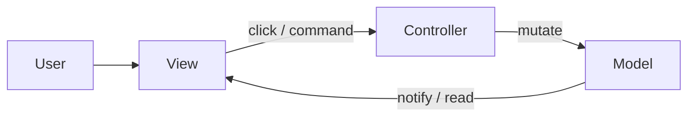
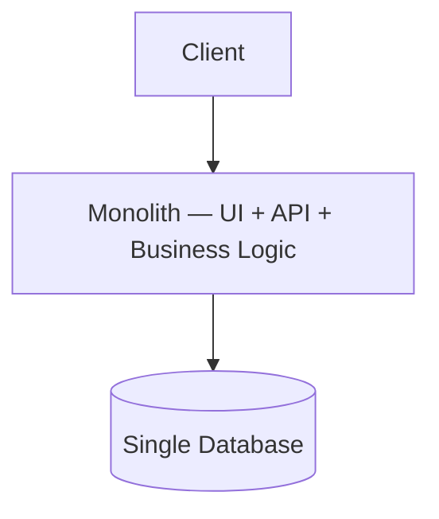
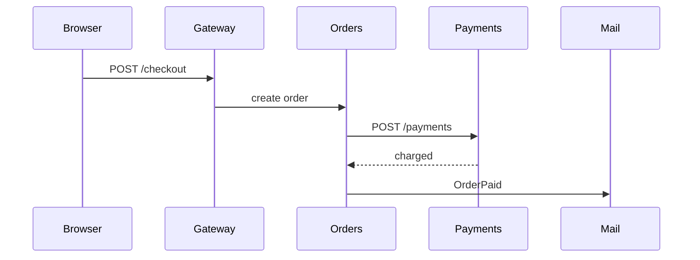
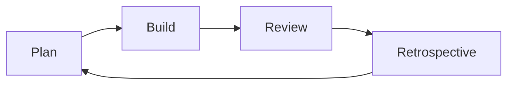
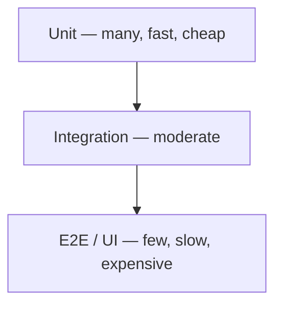

# Special Topics — Paradigms, algorithms & security

Covers programming paradigms, architecture patterns, algorithms, data structures, engineering practices, and web security.

### Related docs

* [System Design](./0_system_design.md) · [JS OOP](./3_js_oop.md) · [TypeScript classes](./5_ts.md#classes) · [Web API](./6_web_api.md) · [CORS](./6_web_api.md#cors) · [HTTPS](./6_web_api.md#https) · [TLS certificates](./6_web_api.md#tls-certificates-x509--pki) · [SSH](./15_devops.md#ssh) · [React](./4_react.md)
* [JS Browser (DOM)](./3_js_browser.md) · [JS Async (`fetch`)](./3_js_async.md) · [Build / CI](./10_build.md) · [Next.js testing](./4_nextjs.md#testing-nextjs-vitest--rtl)
* [Database — SQL injection](./9_database.md#sql-injection) · [Interview hub](./0_interview.md) · [System design Interview Practice](./0_system_design.md#interview-practice) · [Interview Practice](./7_special.md#interview-practice)
* [CI/CD loop](./10_build.md#what-is-cicd) · [SDLC & Agile](#11-sdlc--agile)

[← Back to Interview hub](./0_interview.md)

### Main concepts

| Area | Topics |
|------|--------|
| **Paradigms** | Imperative vs declarative, procedural, OOP, logic, FP (composition, purity, HOF, curry, containers), reactive programming, composition vs inheritance |
| **Architecture** | MVC/MVP/MVVM, architecture vs patterns, data flow (one-way / two-way / Flux), Clean/Hexagonal, monolith vs microservices |
| **Algorithms** | Big O, sorting, search, graphs, DP, greedy, interview patterns |
| **Data structures** | Array, Map, Set, tree, graph, heap, trie — complexity & use cases |
| **Engineering** | SOLID, design patterns (Factory, Abstract Factory, Builder, Singleton), SDLC, Waterfall vs Agile, Scrum, Kanban, why tests / AAA, TDD/BDD, test pyramid, integration & system tests (E2E, visual, perf, security), making tests easy, test doubles (stub/mock/spy), Jest (Node vs jsdom) |
| **Security** | AuthN/AuthZ, XSS, CSRF, clickjacking, SQLi, CSP, DoS/Slowloris, zip bombs, MITM, encryption (symmetric / asymmetric / hashes), TLS certificates |

### Sections

Each `<details>` topic follows: **Definition** → **How it works** → **When to use** → **Pluses and minuses** → **Examples** → **Thoughts** → **Sources**

- [1. Programming fundamentals](#1-programming-fundamentals)
- [2. OOP & FP](#2-oop--fp)
- [3. Architecture patterns](#3-architecture-patterns)
- [4. System architecture](#4-system-architecture)
- [5. Algorithms & Big O](#5-algorithms--big-o)
- [6. Common algorithms](#6-common-algorithms)
- [7. Interview patterns](#7-interview-patterns)
- [8. Data structures](#8-data-structures)
- [9. SOLID & principles](#9-solid--principles)
- [10. Design patterns](#10-design-patterns) — [creational cheat sheet](#creational-patterns--cheat-sheet)
- [11. SDLC & Agile](#11-sdlc--agile) — [methodology](#software-design-methodology), [Waterfall](#waterfall), [Agile](#agile), [Scrum](#scrum), [Kanban](#kanban), [not a silver bullet](#not-a-silver-bullet)
- [12. Testing](#12-testing) — [why tests / AAA](#why-write-tests-aaa), pyramid, [integration](#integration-testing), [system / E2E](#system-testing), TDD, BDD, [making tests easy](#making-tests-easy), [test doubles](#test-doubles-stubs-mocks-spies), [Jest first tests](#jest--first-tests-node-vs-jsdom)
- [13. Web security](#13-web-security) · [Encryption](#encryption)
- [14. Common web attacks](#14-common-web-attacks)
- [15. Tooling misc](#15-tooling-misc)
- [16. Resources](#16-resources)
- [Interview Practice](#interview-practice)

### Topic template

Every major topic follows:

**Definition** → **How it works** → **When to use** → **Pluses and minuses** → **Examples** → **Thoughts** → **Sources**

### Programming paradigms

**Definition:**

A paradigm is a set of techniques and concepts that define *how to write* — the same program can be an instruction list (**imperative**) or a description of the desired result (**declarative**).

| Style | Question it answers | Typical descendants |
|-------|---------------------|---------------------|
| **Imperative** | *How* — ordered commands that change state | Procedural, OOP |
| **Declarative** | *What* — result; hide the how | Logic, functional |

**How it works:**

Imperative mixes *purpose* with *implementation details*. Declarative states purpose and pushes details into a lower abstraction (`filter`, SQL optimizer, React reconciler). Working memory is limited — hiding the how at the business-logic layer reduces cognitive load.

Парадигма — «как писать». Императив = *как* (шаги). Декларатив = *что* (результат). Алгоритм — императивно; бизнес-логика — декларативно, детали ниже.

**When to use:** Algorithms and tight control → imperative. Business rules, UI, queries → declarative on top of well-named primitives.

**Examples:**

Odd numbers — same contract, different styles (`filter` returns a **new** array; the loop mutates `result` with `push`).

```js
function onlyOddImperative(array) {
  const result = [];
  for (const element of array) {
    if (element % 2 !== 0) result.push(element);
  }
  return result;
}

function onlyOddDeclarative(array) {
  return array.filter((element) => element % 2 !== 0);
}
```

**Thoughts:** Paradigms are lenses, not religions — JS/TS are multi-paradigm; pick per layer.

**Sources:** [Doka — programming paradigms](https://doka.guide/tools/programming-paradigms/) · [MDN `Array.prototype.filter`](https://developer.mozilla.org/en-US/docs/Web/JavaScript/Reference/Global_Objects/Array/filter) · [cs.lmu.edu paradigms](https://cs.lmu.edu/~ray/notes/paradigms/)

### Algorithms & Big O

**Definition:**

Big O describes how time or space grows relative to input size `n` — worst-case upper bound for asymptotic comparison.

| Notation | Example |
|----------|---------|
| O(1) | Array index, `Map.get` |
| O(log n) | Binary search |
| O(n) | Single pass |
| O(n log n) | Merge sort |
| O(n²) | Nested loops |

**When to use:** Choosing sort/search strategy; reviewing nested loops on large collections; system design capacity estimates.

**Sources:** [ByteByteGo Big O](https://blog.bytebytego.com/p/ep132-big-o-notation-101-the-secret)

### Web security

**Definition:**

Practices to protect confidentiality, integrity, and availability of web apps and user data — authentication, authorization, input validation, transport security, and defense in depth.

| Threat | Mitigation |
|--------|------------|
| XSS | Encode output, CSP, HttpOnly cookies |
| CSRF | CSRF tokens, SameSite cookies |
| Clickjacking | CSP `frame-ancestors`, `X-Frame-Options` |
| Injection | Parameterized queries (not a kind of XSS) |
| DoS / Slowloris | Rate limits, timeouts, capacity |
| MITM | HTTPS/TLS, HSTS |
| Stolen password DB | Slow salted hashes (Argon2id / bcrypt), not reversible encryption |

**When to use:** Always in production; threat-model before launch.

**Sources:**

[OWASP XSS](https://owasp.org/www-community/attacks/xss/)

---

<a name="1-programming-fundamentals"></a>

## 1. Programming fundamentals

<details>
  <summary>Programming</summary>

### Programming

**Definition:** Programming is composing sequences of instructions (programs) that a computer executes. A program is an algorithm expressed in a programming language; code is the text of that program.

**Thoughts:**

Think in concepts, not syntax. Language is the medium; algorithms, data structures, and architecture are the substance.

---

</details>

<details>
  <summary>Programming paradigm</summary>

### Programming paradigm

**Definition:**

A programming paradigm is a coherent style and set of ideas that shape how programs are structured — e.g. imperative, declarative, object-oriented, functional.

| Paradigm | Focus | Typical constructs |
|----------|-------|-------------------|
| **Imperative** | How to do it — step-by-step state changes | variables, assignment, loops |
| **Declarative** | What to do — describe desired result | SQL, HTML, React JSX, `filter`/`map` |
| **Procedural** | Imperative + named subroutines sharing memory | functions, modules, globals |
| **OOP** | Entities as objects (class instances) | classes, inheritance, encapsulation |
| **Logic** | Solve via facts, rules, and inference | Prolog-style models |
| **Functional** | Math-like transforms; pure functions | map/filter/reduce, immutability |
| **Structural** | Control flow via blocks (if/while), no goto spaghetti | structured programming |

**How it works:**

Same destination, different instructions — turn-by-turn directions vs an address. Declarative code is usually easier to *read* as intent; both styles can take similar time to *write*. Hide implementation behind a lower layer when you are at business-logic height.

Один адрес — два объяснения: повороты vs «дом 38». JS — мультипарадигма; линзы, не религия.

**When to use:**

- Imperative: concrete algorithms, hardware/bit-level steps, performance-critical loops
- Declarative: UI (React), queries (SQL), config, “filter this list”
- OOP: domain models with clear entity boundaries
- FP: data transforms, concurrency-friendly pipelines
- Logic: constraint / knowledge modeling (less common in typical JS apps)

**Pluses and minuses:**

| + (multi-paradigm) | − |
|-------------------------|------|
| Pick the right tool per subproblem | Mixing paradigms inconsistently confuses teams |
| Modern languages support several (JS, TS, Python) | "Paradigm wars" distract from delivery |

**Examples:**

```js
// Imperative — how
let sum = 0;
for (const n of nums) sum += n;

// Declarative / functional — what
const sum = nums.reduce((a, b) => a + b, 0);
```

**Thoughts:** JavaScript is multi-paradigm. React blends declarative UI with functional state updates. Interview answer: paradigms are lenses, not religions.

**Sources:**

[Doka — programming paradigms](https://doka.guide/tools/programming-paradigms/) · [cs.lmu.edu paradigms](https://cs.lmu.edu/~ray/notes/paradigms/)

---

</details>

<a name="reactive-programming--reactivity"></a>

<details>
  <summary>Reactive programming & reactivity</summary>

### Reactive programming & reactivity

**Definition:**

**Reactivity** is automatically updating a system when data changes. **Reactive programming** is a paradigm centered on **data streams** — time-ordered event sequences from any source — and the relationships between them.

| Perspective | Meaning |
|-------------|---------|
| **User** | UI responds instantly to input (typing, clicks, loaders) |
| **Developer** | Derived values stay in sync with sources without manual recomputation |

**How it works:**

Built on the **Observer** pattern. When the source changes, subscribers react — but *when* they react depends on push vs pull:

| Type | Mechanism | Subscribers update | JS examples |
|------|-----------|-------------------|-------------|
| **Push** | Source pushes each change immediately | On every event | `addEventListener`, RxJS `fromEvent`, WebSockets |
| **Pull** | Consumers read fresh values on demand | On next system pass (e.g. render) | React re-render, MobX `autorun` |

`const sum = a + b` is a one-time snapshot — changing `a`/`b` later does not update `sum`. Reactive systems recompute dependents when inputs change (frameworks wire this for you).

| Push | Pull |
|------|------|
| Immediate; natural for events | Deferred work — compute only when needed |
| Risk: duplicate work under heavy streams | Risk: refreshing the whole graph can be costly |

**When to use:** Live dashboards, event-heavy UIs, validation chains, syncing UI with server push. **FRP** (functional reactive programming) composes streams with `map` / `filter` / `scan` — RxJS in JS; Elm is a pure FRP language.

**Examples:**

```js
// Push — native events
document.addEventListener('click', () => console.log('clicked'));

// Push — RxJS
import { fromEvent } from 'rxjs';
fromEvent(document, 'click').subscribe(() => console.log('clicked'));
```

**Thoughts:**

Express *relationships* between data; let the runtime sync consumers (especially UI) instead of manually re-running every step.

`$name` or `clicks$` often marks Observables/streams. In practice reactive ideas mix with imperative/OOP (React hooks, Vue Proxy). Two-way binding is *UI ↔ model sync*; reactivity is *derived values recompute* — [Data flow](#data-flow--one-way-vs-two-way). See [Observer](./0_system_design.md#observer) · [React state](./4_react.md#state).

**Sources:**

[Doka — reactivity](https://doka.guide/js/reactivity/) · [RxJS overview](https://rxjs.dev/guide/overview)

---

</details>

<details>
  <summary>Imperative vs declarative</summary>

### Imperative vs declarative

**Definition:** **Imperative** code is a sequence of commands (*assign, loop, branch, mutate*). **Declarative** code states the result and lets another layer perform the steps (`array.filter`, SQL, JSX).

**How it works:**

- Imperative `onlyOdd`: `result = []` → `for…of` → `% 2` → `push` → `return` — you own every step.
- Declarative `onlyOdd`: “keep elements where the predicate is true” — `filter` hides allocation and iteration ([MDN](https://developer.mozilla.org/en-US/docs/Web/JavaScript/Reference/Global_Objects/Array/filter): new array of truthy callback results).
- Difference is **who owns implementation details**, not whether a CPU still loops underneath.

Императив — сам цикл и `push`. Декларатив — `filter`: важно *что* оставить. `filter` всё равно цикл, ты его не пишешь.

**When to use:**

Spell out an algorithm → imperative. Business logic → declarative API; put the loop in a named helper.

#### Common pitfalls

Calling `filter` “magic” — it is still a loop; you just do not reimplement it. Declarative style still needs a correct predicate.

**Pluses and minuses:**

| + | − |
|------|------|
| Declarative: intent-first, smaller working set in your head | Poor abstractions leak the how anyway |
| Imperative: full control for algorithms and side-effect order | Mixes *what* and *how*; harder to scan at scale |

**Examples:**

```js
function onlyOddImperative(array) {
  const result = [];
  for (const element of array) {
    if (element % 2 !== 0) result.push(element);
  }
  return result;
}

function onlyOddDeclarative(array) {
  return array.filter((element) => element % 2 !== 0);
}
```

**Thoughts:** *How* vs *what* — hide the how one layer below the decision you are making.

**Sources:**

[Doka — programming paradigms](https://doka.guide/tools/programming-paradigms/) · [MDN filter](https://developer.mozilla.org/en-US/docs/Web/JavaScript/Reference/Global_Objects/Array/filter)

---

</details>

<details>
  <summary>Procedural programming</summary>

### Procedural programming

**Definition:** Imperative style grouped into **subroutines** (procedures/functions) that communicate mainly through **shared memory** (globals, buffers, device state) rather than only return values.

**How it works:**

Sequential commands live in named procedures. Modules grew out of this grouping, but reuse is weak if everything depends on one mutable store. Analog in JS: functions that read/write a shared array instead of taking args and returning new data.

Процедурное = функции + общая память (глобали). Просто для железа; плохо переиспользовать и тестировать.

**When to use:** Drivers, firmware-style bit flags, scripts that step a single workspace. Prefer explicit arguments once the program is larger than a toy.

**Pluses and minuses:**

| + | − |
|------|------|
| Simple mapping to hardware / one memory image | Shared mutable state is hard to reuse and test |
| Clear call order | Race conditions if two procedures mutate the same cells |

**Examples:**

```js
let memory = [0, 0, 0, 0, 0, 0, 0, 0];

function invertSmallestBit() {
  memory[7] = Number(!memory[7]);
  return memory;
}

function invertBiggestBit() {
  memory[0] = Number(!memory[0]);
  return memory;
}

invertSmallestBit(); // [0, 0, 0, 0, 0, 0, 0, 1]
invertBiggestBit();  // [1, 0, 0, 0, 0, 0, 0, 1]
invertSmallestBit(); // [1, 0, 0, 0, 0, 0, 0, 0]
```

**Thoughts:**

Scopes matter — procedures “talk” like globals. See [JS Core — scope](./3_js_core.md) for lexical vs global memory.

Procedures + shared RAM — the ancestor of modules, not a good default for app domain logic.

**Sources:**

[Doka — programming paradigms](https://doka.guide/tools/programming-paradigms/)

---

</details>

<details>
  <summary>Logic programming</summary>

### Logic programming

**Definition:** A **declarative** paradigm: encode facts and rules; an inference engine (unification, resolution) searches for solutions — closer to applied logic than to sequential “do this then that.”

**How it works:**

Translate the business problem into predicates. The runtime proves queries (classic: Prolog). Used for process modeling, constraints, expert-style rules — not typical day-to-day JS.

Логическое: факты + правила, движок ищет ответ (Prolog). Во фронте почти не встречается.

**When to use:** Knowledge bases, constraint solvers, some AI/planning layers. Skip inventing a math model in an interview unless asked.

**Pluses and minuses:**

| + | − |
|------|------|
| Compact expression of rules and relations | Steep encoding cost; rare in frontend stacks |
| Engine searches combinations for you | Debugging search trees is unlike stepping a loop |

**Examples:** (sketch, not JS) `parent(X, Y)` + `ancestor` rules; query `ancestor(alice, Who)`.

**Thoughts:** You state *truths*; the machine derives *answers*.

**Sources:**

[Doka — programming paradigms](https://doka.guide/tools/programming-paradigms/)

---

</details>

<details>
  <summary>Statement vs expression</summary>

### Statement vs expression

**Definition:**

A **statement** performs an action (assign, loop, declare). An **expression** evaluates to a value (`42`, `a + b`, `fn()`).

| | Statement | Expression |
|---|-----------|------------|
| Returns value | No | Yes |
| Examples | `if`, `for`, `const x = 1` | `1 + 2`, ternary, arrow fn body without braces |

**When to use:** Prefer expressions in functional pipelines; statements for control flow and side effects at boundaries.

**Examples:**

```js
const doubled = items.map(x => x * 2); // expression-bodied callback
if (items.length === 0) return [];     // statement
```

**Thoughts:**

`const x = (y = 1)` — assignment inside expression is valid but hurts readability.

---

</details>

<details>
  <summary>Code refactoring</summary>

### Code refactoring

**Definition:** Refactoring improves internal structure, readability, and maintainability **without changing external behavior**.

**When to use:** After green tests; small steps; before adding features to tangled code.

**Pluses and minuses:**

| + | − |
|------|------|
| Reduces tech debt incrementally | Risky without tests |
| Enables safer feature work | Can become endless "cleanup" without product value |

**Examples:** Extract duplicated validation into `validateUser(input)` — same API, clearer modules.

**Thoughts:** "Refactor" ≠ rewrite. Boy Scout rule: leave code slightly better. Never refactor and change behavior in one commit.

**Sources:**

[refactoring.com](https://refactoring.com/)

---

</details>

<a name="2-oop--fp"></a>

## 2. OOP & FP

<details>
  <summary>Object-Oriented Programming (OOP)</summary>

### Object-Oriented Programming (OOP)

**Definition:** OOP models programs as **objects** — instances of a **class** (blueprint). Each object holds fields and methods described once on the class.

**How it works:**

| Pillar | Meaning |
|--------|---------|
| **Abstraction** | Keep the characteristics that describe behavior; omit internals |
| **Encapsulation** | Keep data next to the object that uses it; hide the rest |
| **Polymorphism** | One interface, many types |
| **Inheritance** | Take properties from a parent — prefer **composition** when “is-a” is messy |

ООП: класс = чертёж, объект = экземпляр. Столпы: абстракция, инкапсуляция, полиморфизм, наследование. Чайник с таймером — композиция, не двойное наследование. Общая память + два писателя = гонки. Код — карта бизнес-логики.

**When to use:** Rich domain models, UI component trees, SDKs with clear type hierarchies. Teapot-with-timer: inherit from teapot *or* timer? Prefer **composition** (has a kettle + has a timer).

**Pluses and minuses:**

| + | − |
|------|------|
| Modeling: components as objects; relations are easier to pin down | Shared mutable data + several writers → races (not unique to OOP) |
| Enterprise modeling (UML, ER, DFD) grew around objects | Simple inheritance rarely matches real “has both” objects |
| Well-studied: books, known failure modes | Encapsulation can block sharing; concurrent edits need extra design |

**Examples:**

```js
class User {
  constructor(name) {
    this.name = name;
    this.admin = false;
  }
  isAdmin() {
    return this.admin;
  }
  nameOf() {
    return this.name;
  }
}

const user = new User("Alex");
user.isAdmin(); // false
user.nameOf();  // 'Alex'
```

**Thoughts:**

In JS, `class` desugars to prototypes. Concurrent edits (two users, one Google Doc) need OT/CRDT or locks — encapsulation does not solve shared writes. See [3_js_oop.md](./3_js_oop.md).

Good code is a **map of the territory**: business rules, entity relations, and change axes. When the map drifts from reality, the code becomes fragile. OOP is one way to keep entities and messages aligned with that map.

**Sources:**

[Doka — OOP](https://doka.guide/tools/oop/) · [Doka — programming paradigms](https://doka.guide/tools/programming-paradigms/) · [MDN Classes](https://developer.mozilla.org/en-US/docs/Web/JavaScript/Reference/Classes)

---

</details>

<details>
  <summary>Entities, relations & design</summary>

### Entities, relations & design

**Definition:** Design decides two things: how the program talks to the outside world (data in/out), and how **entities** talk to each other. Entities are the main actors; their relations are the business rules.

**How it works:**

- Start from the **goal**, then name entities. Budget app: `Budget`, `History`, `Record` (a spend or income).
- Draw **relations** (UML): History *contains* Records; DailyAmount *depends on* Budget + History. Arrow direction = who depends on whom — keep it matching the domain, avoid cycles.
- Express entities as **objects that send and receive messages** (method calls), not as loose bags of data.
- A class that needs other objects is a **dependent**. Popular strategy: **constructor injection** — pass collaborators in, store them as fields.

Проектирование = внешний мир + общение сущностей. Стрелки UML — кто от кого зависит. Внедрение через конструктор соединяет сущности без циклов.

**When to use:** Any domain with more than one concept that must stay consistent (budget + ledger, order + lines, cart + items). Skip heavy diagrams for a one-file script.

**Pluses and minuses:**

| + | − |
|------|------|
| Code structure matches the domain | Upfront modeling cost |
| Changes stay in the entity that owns the rule | Easy to invent entities that don't exist in the business |
| Dependency arrows make cycles visible | UML can outgrow the actual problem |

**Examples:**

```js
class Budget {
  constructor(amount, daysCount) {
    this.amount = amount;
    this.startDate = Date.now();
    this.daysCount = daysCount;
  }
  get perDay() {
    return this.amount / this.daysCount;
  }
}

class History {
  records = [];
  addRecord(record) {
    this.records.push(record);
  }
  get spentToday() {
    return this.records.reduce((sum, r) => sum + r.amount, 0); // filter with isToday(r.dateTime) in real code
  }
}

class DailyAmount {
  constructor(budget, history) {
    this.budget = budget;
    this.history = history;
  }
  get valueOf() {
    return this.budget.perDay - this.history.spentToday;
  }
}
```

**Thoughts:** `DailyAmount` does not create Budget/History — it receives them. That keeps dependency direction one-way and makes tests swap fakes. Full class syntax: [3_js_oop.md](./3_js_oop.md). SOLID mapping: [§9](#9-solid--principles).

**Sources:**

[Doka — OOP](https://doka.guide/tools/oop/)

---

</details>

<details>
  <summary>Encapsulation</summary>

### Encapsulation

**Definition:** Keep knowledge about an entity **inside** that entity (or its module). Outside code talks through a small API; internals stay hidden.

**How it works:**

- Data + the operations that know how to change it live together. History knows how to add a record — callers do not `history.records.push(...)`.
- If History were a bare array, *how to add* would leak into every caller. Change storage later → rewrite the app.
- Related work in one module = **high cohesion**. Uncontrolled access from outside = low encapsulation.
- JS: hide with `#` fields, closures, or module scope. `this` lets the same method update *this* instance when several Histories exist.

Инкапсуляция — знание о сущности внутри неё. История сама знает, как добавить запись. `this` — «свой» объект, когда историй несколько.

**When to use:** Domain objects; any type with more than one instance (`this` vs a captured outer variable). Always prefer methods over poking public arrays/maps.

**Pluses and minuses:**

| + | − |
|------|------|
| One place to change storage or rules | Over-private APIs hinder testing |
| Callers stay stable when internals change | Getters/setters can leak the model |
| Prevents accidental mutation | Easy to wrap every field and call it "OOP" |

**Examples:**

```js
// Knowledge leaked — every caller must know the structure
function addRecord(history, record) {
  history.push(record);
}

class History {
  records = [];
  addRecord(record) {
    this.records.push(record); // this instance, not a captured outer `history`
  }
}

const history1 = new History();
const history2 = new History();
history1.addRecord({ amount: 100, dateTime: Date.now() });
```

**Thoughts:** `public` fields in TS/JS are convention-only unless `#` or closures enforce privacy. Chrome DevTools can read `#` fields in the console for debugging — that is **not** app-code access. See [3_js_oop.md — private fields](./3_js_oop.md).

**Sources:**

[Doka — OOP](https://doka.guide/tools/oop/) · [MDN — private elements](https://developer.mozilla.org/en-US/docs/Web/JavaScript/Reference/Classes/Private_elements)

---

</details>

<details>
  <summary>Inheritance</summary>

### Inheritance

**Definition:** A class (subclass) acquires properties and methods from a parent (superclass), enabling code reuse and specialization.

**How it works:**

Наследование = «является». Если «и чайник, и таймер» — лучше *имеет* (композиция), а не два родителя.

---

**When to use:** True "is-a" relationships with stable base behavior. Prefer shallow hierarchies (≤2 levels).

**Pluses and minuses:**

| + | − |
|------|------|
| DRY for shared behavior | Tight coupling to parent implementation |
| Natural "is-a" modeling | LSP violations when subclass breaks parent contract |

**Examples:**

```js
class Employee {
  constructor(name) { this.name = name; }
  getRole() { return 'employee'; }
}

class Manager extends Employee {
  getRole() { return 'manager'; }
}
```

**Thoughts:** Favor composition when behavior varies by combination, not taxonomy. "Prefer composition over inheritance" — Gang of Four.

</details>

<details>
  <summary>Polymorphism</summary>

### Polymorphism

**Definition:**

Use an object without knowing the concrete type — only a shared contract (methods/shape). One operation, many implementations.

| Type | Meaning |
|------|---------|
| **Subtype (inheritance)** | Subclass usable wherever parent is expected |
| **Parametric (generics)** | Same code works on many types (`T[]`) |
| **Ad-hoc (overloading)** | Same name, different signatures (limited in JS) |
| **Structural (JS/TS)** | If it has the methods, it fits — duck typing / TS structural types |

**How it works:**

Code written against one concrete type is **tightly coupled**. A shared shape (`Record` with `kind`, or `shape.area()`) lets History accept spend *and* income without changing `addRecord`. JS has no `interface` keyword — you fake the contract with duck typing, JSDoc, or TypeScript.

Полиморфизм — объект по контракту, не по конкретному классу. `addRecord` принимает трату и доход. В JS нет интерфейсов — утка / TypeScript.

**When to use:** Strategy-like swaps; plugin systems; ledger entries that are spend or income; rendering different component types from one list.

**Pluses and minuses:**

| + | − |
|------|------|
| Fewer `if/else` on concrete types | Need a real shared contract, not a random `type` string |
| Lower coupling — change one variant, not every caller | JS won't check the contract at runtime |
| Plugin lists, renderers, strategies | Fake "polymorphism" via flags can become a god `switch` |

**Examples:**

```js
class LedgerRecord {
  constructor(amount, kind) {
    this.kind = kind; // 'spending' | 'income'
    this.amount = amount;
    this.dateTime = Date.now();
  }
}

const spending = new LedgerRecord(400, 'spending');
const income = new LedgerRecord(400, 'income');
history.addRecord(spending);
history.addRecord(income); // same API — History does not care which kind
```

**Thoughts:** Prefer a real interface in TS over a string `kind` when variants diverge in behavior. Inheritance is another path — composition + a contract is usually safer. See [OOP in JavaScript](#2-oop--fp) below.

**Sources:**

[Doka — OOP](https://doka.guide/tools/oop/)

---

</details>

<details>
  <summary>Abstraction</summary>

### Abstraction

**Definition:** Exposing essential behavior while hiding implementation complexity.

**How it works:** Абстракция — поведение без внутренностей. Слишком мало или слишком много слоёв — оба вредят.

**When to use:** APIs, repositories, storage adapters, payment providers.

**Pluses and minuses:**

| + | − |
|------|------|
| Simplifies mental model | Wrong abstraction is expensive to undo |
| Enables swapping implementations | Too many layers obscure flow |

**Examples:**

```js
// Caller depends on abstraction, not fetch vs axios
async function getUser(id, client) {
  return client.request(`/users/${id}`);
}
```

**Thoughts:** Interface in TS = compile-time abstraction. In JS, document contracts via JSDoc or tests.

**Sources:**

[Doka — OOP](https://doka.guide/tools/oop/)

---

</details>

<details>
  <summary>Cohesion vs coupling</summary>

### Cohesion vs coupling

**Definition:** **Cohesion** (связность) is how closely a module's internals belong together. **Coupling** (сцепление) is how much one module knows about another. Want high cohesion, low coupling.

**How it works:**

- Encapsulation raises cohesion: spent-today lives on History, per-day on Budget — `DailyAmount` only subtracts.
- Polymorphism lowers coupling: callers depend on a contract, not on `Spending` vs `Income`.
- Duplicate "spent today" logic in three files is low cohesion spread thin — a rule change misses a copy.

| | High (good / bad) | Low |
|---|-------------------|-----|
| **Cohesion** | Good — related code in one module | Bad — a class does budget *and* HTTP *and* UI |
| **Coupling** | Bad — many modules break when one changes | Good — swap History storage without touching DailyAmount |

Связность — близкие задачи в одном модуле. Сцепление / зацепление — сколько модули знают друг о друге. Цель: высокая связность, низкое сцепление. High coupling → many mocks just to boot a unit test; see [Making tests easy](#making-tests-easy).

**When to use:** Refactor when you copy the same formula; when a UI tweak forces a domain-class edit.

**Thoughts:** Hide internals (encapsulation) + talk through contracts (polymorphism) = cohesive modules that barely know each other.

**Sources:**

[Doka — OOP](https://doka.guide/tools/oop/)

---

</details>

<details>
  <summary>Class vs prototype inheritance</summary>

### Class vs prototype inheritance

**Definition:**

**Class inheritance** uses `class extends` syntax; **prototype inheritance** links objects via `[[Prototype]]` — `Object.create`, `Object.setPrototypeOf`.

| | Class syntax | Prototype chain |
|---|--------------|-----------------|
| Readability | Familiar to OOP devs | Lower-level, flexible |
| Under the hood (JS) | Desugars to prototypes | Native mechanism |
| Constructors | `constructor()` required pattern | Factory functions + `Object.create` |

**When to use:** `class` for most app code; prototypes for libraries, mixins, or understanding JS internals.

**Pluses and minuses:**

| + (prototypes) | − |
|-------------------|------|
| Dynamic — add methods at runtime | Harder for newcomers |
| Memory-efficient shared methods | `setPrototypeOf` is slow — avoid hot paths |

**Examples:**

```js
const animal = {
  speak() { return 'sound'; },
};
const dog = Object.create(animal);
dog.speak = () => 'bark';
```

**Thoughts:** `class` methods live on `prototype`, not instance. `instanceof` walks the prototype chain.

**Sources:**

[3_js_oop.md](./3_js_oop.md)

---

</details>

<details>
  <summary>OOP in JavaScript</summary>

### OOP in JavaScript

**Definition:** JS can do objects, classes, and `this`, but classic OOP also wants **user-defined types and interfaces**. Those are missing at runtime — TypeScript adds them at compile time.

**How it works:**

| Have | Missing |
|------|---------|
| Classes, objects, prototypes, `#` private fields | Native interfaces / nominal user types |
| Duck typing, factory functions, mixins | Native abstraction checks (no `implements` at runtime) |

- `class` is sugar over prototypes — still one inheritance chain. Composition and mixins (`Object.assign`, spread) are how you mix feature sets without a hierarchy.
- Without interfaces, readable composition is harder: you cannot write `class Human implements Cardio, Immune`. TS can.
- Design-first in TS: describe `History { addRecord(record: LedgerEntry): void }` before writing the class. The compiler flags broken relations **before** you run the app.
- TS `private` is erased in emit — JS can still read the field. `#field` stays private at runtime (`SyntaxError` outside the class). Chrome's console may still show/read `#` for debugging.

В JS есть классы, нет интерфейсов. Классическое ООП удобнее на TypeScript: контракты на этапе проектирования. `private` в TS — только компилятор; `#` — и в рантайме.

**When to use:** Domain-heavy apps, DI graphs, teams that need contracts. Stay on factories + modules for tiny scripts.

**Pluses and minuses:**

| + (TS for OOP) | − |
|-------------------|------|
| Interfaces, unions, `implements` — real contracts | Still compiles to JS — no runtime types |
| Catch bad entity wiring at compile time | Extra toolchain |
| Autocomplete on domain fields | `enum` and `private` have JS pitfalls (prefer unions + `#`) |

**Examples:**

```ts
type MoneyAmount = number;
type TimeStamp = number;
type RecordKind = 'spending' | 'income';

type LedgerEntry = {
  kind: RecordKind;
  amount: MoneyAmount;
  dateTime: TimeStamp;
};

interface Ledger {
  addRecord(record: LedgerEntry): void;
}
// Implement Ledger later — the rest of the system already type-checks against the contract.
```

**Thoughts:** Do not name a type `Record` — that clashes with TS's built-in `Record<K, V>`. Prefer `LedgerEntry`. Full privacy comparison: [5_ts.md](./5_ts.md#classes). Classes: [3_js_oop.md](./3_js_oop.md).

**Sources:**

[Doka — OOP](https://doka.guide/tools/oop/) · [MDN — private elements](https://developer.mozilla.org/en-US/docs/Web/JavaScript/Reference/Classes/Private_elements) · [TS handbook — classes](https://www.typescriptlang.org/docs/handbook/2/classes.html)

---

</details>

<details>
  <summary>Functional Programming (FP)</summary>

### Functional Programming (FP)

**Definition:** A **declarative** paradigm where a **function** is the unit of composition — a math-like transform of inputs to outputs. Core rules: **pure functions** and **immutable data**.

**How it works:**

- Code should mirror business rules as accurately as a map mirrors territory — FP helps keep that map stable when requirements change.
- **Composition unit** = function. Chaining calls passes data step by step: `multiply(add(10, 5), 42)`.
- Good boundaries: single responsibility, communicate via data (Law of Demeter), separate config from logic (Twelve-Factor).
- No shared mutable memory → parallel-safe calls, easy unit tests (args only).
- Real apps need I/O — isolate effects at the edges; see [Functional core, imperative shell](#functional-core-imperative-shell).

| Concept | Definition |
|---------|------------|
| **Pure function** | Same input → same output; no side effects |
| **Immutability** | Don't mutate; return new copies |
| **Higher-order function** | Takes or returns functions |
| **Composition** | Output of one function → input of next |
| **Referential transparency** | Replace `f(x)` with its value without changing behavior |

ФП: функция = элемент композиции; чистые функции + иммутабельность. Плюс — тесты и параллельность. Минус — копии в памяти. I/O — на краю.

**When to use:** Data transforms, reducers, selectors, event streams, workers, React immutable updates. Keep `fetch`, DOM, logging in adapters.

**Pluses and minuses:**

| + | − |
|------|------|
| Predictable, testable transforms | Immutability → extra copies, memory pressure |
| Referential transparency → compiler/runtime optimizations | Pure FP alone cannot do DB/network/DOM |
| Parallel / thread-safe by default | Steep jargon (monads, functors) in strict FP |
| Composable pipelines (`map` / `filter` / `reduce`) | Awkward for some stateful algorithms |

**Examples:**

```js
function add(a, b) { return a + b; }
function multiply(a, b) { return a * b; }

const additionResult = add(10, 5);
const finalResult = multiply(additionResult, 42); // 735
```

**Thoughts:** Functions transform data; effects live at the shell — the universe is a side effect.

**Sources:**

[Doka — programming paradigms](https://doka.guide/tools/programming-paradigms/) · [javascript.info/functional-programming](https://javascript.info/functional-programming)

---

</details>

<details>
  <summary>Function composition</summary>

### Function composition

**Definition:** Building a program by passing the **output of one function as input to the next** — the core composition pattern in FP.

**How it works:**

- Sequential: `const y = f(x); const z = g(y);` — same as `g(f(x))`.
- **`compose(f, g, ...)(x)`** = `f(g(...(x)))` — applies **right to left**.
- **`pipe(f, g, ...)(x)`** = `g(f(...(x)))` — applies **left to right** (not built into JS; common in Ramda/lodash/fp-ts).
- Mathematical basis: function composition `(f ∘ g)(x) = f(g(x))`.

**When to use:**

`parse → validate → normalize → save` pipelines; middleware chains; transform utilities.

#### Common pitfalls

Confusing `compose` (RTL) with `pipe` (LTR). Forgetting that each function in the chain should ideally be pure.

**Pluses and minuses:**

| + | − |
|------|------|
| Reusable pipelines without duplicating control flow | Order of `compose` vs `pipe` is easy to confuse |
| Clear data flow | Deep nesting hurts readability without naming |

**Examples:**

```js
const compose = (...fns) => (x) =>
  fns.reduceRight((acc, fn) => fn(acc), x);

const add1 = (x) => x + 1;
const double = (x) => x * 2;

compose(add1, double)(3); // add1(double(3)) = 7
// compose(f, g)(x) === f(g(x))
```

**Thoughts:** *Small pure steps composed into one behavior — interview: `compose(...fns) => x => fns.reduceRight((acc, fn) => fn(acc), x)`.*

**Sources:**

[javascript.info/currying-partials](https://javascript.info/currying-partials)

---

</details>

<details>
  <summary>Pure functions & side effects</summary>

### Pure functions & side effects

**Definition:** A **pure** function always returns the same result for the same arguments and causes **no side effects**. A **side effect** is any observable interaction with the outside world — including **reading** unstable external state.

**How it works:**

- Pure ≈ mathematical function: input → output by fixed rules.
- **Impure reads count too:** `Date.now()`, `Math.random()`, globals — you cannot guarantee the external method doesn't mutate hidden state.
- **Impure writes:** mutating outer variables, DOM, network, DB, `console.log`, throwing based on global state.
- **Referential transparency:** `double(2)` can be replaced with `4` anywhere without changing program meaning.
- Purity is a spectrum — `console.log` at boundaries may be acceptable; core logic stays pure.

| Pure | Impure |
|------|--------|
| `(a, b) => ((a + b) * a) / b` | Uses `Math.random()` in calculation |
| `(x) => x * 2` | `Date.now()`, reads/mutates outer `counter` |
| Predictable, memoizable | I/O, DOM, logging |

**When to use:**

Reducers, selectors, pricing rules, parsers — anything TDD-friendly. Wrap I/O in thin impure shells.

#### Common pitfalls

Testing `expect(expected).toEqual(expected)` — always passes. Assuming `Date.now()` is "read-only safe" — external code may mutate state on access.

**Pluses and minuses:**

| + (pure) | − (pure) |
|-------------|-------------|
| Trivial unit tests — no mocks for world state | Cannot perform I/O inside pure core |
| Safe parallel execution | Strict purity feels verbose in UI code |
| Compiler can evaluate at compile time (referential transparency) | |

**Examples:**

```js
function pureFn(a, b) {
  return ((a + b) * a) / b; // always same for same a, b
}

function impureFn(a, b) {
  return ((a + b) * a) / Math.random(); // different every call
}

let counter = 0;
const FakeDate = {
  now() { counter++; return 42; }, // hidden mutation on read
};
function alsoImpure() { return FakeDate.now(); }
```

**Thoughts:** *Same args → same result; the outside world is untouched (including hidden reads).*

**See also:** [Interview — What is a pure function?](#interview-practice) · [3_js_core.md — Pure vs impure](./3_js_core.md)

**Sources:**

[javascript.info/functional-programming](https://javascript.info/functional-programming)

---

</details>

<details>
  <summary>Immutability</summary>

### Immutability

**Definition:** Treat every value as **unchangeable** — to "update", return a **new** value with the desired changes instead of mutating in place.

**How it works:**

- Impure style: `let a = 1; a = a * 2` — same binding, new value overwrites.
- FP style: `const changedA = update(a, 2)` — old `a` unchanged; new reference returned.
- In JS: spread (`{ ...obj, key: val }`), `map`/`filter`/`toSorted()`, `structuredClone` for deep copies when needed.
- Snapshots of immutable state enable time-travel debugging (Redux DevTools) — replay history by swapping references.

**When to use:** React state updates, Redux reducers, config objects, concurrent pipelines.

**Pluses and minuses:**

| + | − |
|------|------|
| Easy to reason about — no hidden mutations | Full copies use more memory |
| Safe sharing across threads/workers | Deep nested updates need care (immer, lenses) |
| Change detection by reference (`===`) | Shallow copy — nested objects still mutable unless handled |

**Examples:**

```js
// impure
let a = 1;
const update = (value) => { a = 2 * value; };

// immutable
const a = 1;
const update = (original, value) => original * value;
const changedA = update(a, 2); // a still 1
```

**Thoughts:**

React `setState(s => ({ ...s, count: s.count + 1 }))` is immutability in practice.

*Don't change data — produce new data.*

**Sources:**

[javascript.info/array-methods](https://javascript.info/array-methods)

---

</details>

<details>
  <summary>Recursion & declarative iteration</summary>

### Recursion & declarative iteration

**Definition:** Strict FP avoids mutable loops; iteration is expressed via **recursion**, **`map`**, or **`reduce`** — declarative over collections.

**How it works:**

- **Recursion:** base case + recursive step — mirrors math definitions (factorial, tree walk).
- **`map` / `filter` / `reduce`:** encode loops as transforms — no manual index mutation.
- Tail-call optimization (TCO) is not guaranteed in all JS engines — deep recursion can overflow stack; use iteration or trampolining for huge depths.

**When to use:** Tree/graph traversal, nested structures, functional pipelines. Prefer `map`/`filter` for flat lists.

**Pluses and minuses:**

| + | − |
|------|------|
| Matches mathematical problem statements | Stack overflow on unbounded depth without TCO |
| Declarative, composable | Some devs find recursion harder to debug |
| `reduce` can express any loop | Performance-sensitive hot paths may need imperative loops |

**Examples:**

```js
function factorial(n) {
  if (n <= 1) return 1;
  return n * factorial(n - 1);
}

const sum = nums.reduce((acc, n) => acc + n, 0); // declarative fold
```

**Thoughts:** *Repeat via recursion or higher-order array methods — not via mutating loop counters.*

**Sources:**

[javascript.info/recursion](https://javascript.info/recursion)

---

</details>

<details>
  <summary>Higher-order functions (HOF)</summary>

### Higher-order functions (HOF)

**Definition:** A function that **accepts another function as an argument** and/or **returns a function** — the main abstraction tool in FP.

**How it works:**

- Same control flow, different predicate → one `filter(list, predicate)` instead of duplicate loops.
- Returning functions → decorators (`timed(fn)`), factories (`makeAdder(x)`), React HOCs.
- Built-in HOFs: `map`, `filter`, `reduce`, `sort`, `setTimeout`, middleware `use((req,res,next) => ...)`.
- JS functions are **first-class citizens** — assign to variables, pass as args, return from functions (required for HOFs).

```js
const multipleTwo = (n) => n * 2;           // assign to variable
loadData(getData);                           // pass as argument
function makeAdder(x) { return (y) => x + y; } // return from function
```

**When to use:** Array transforms, middleware, event handlers, memoization wrappers, custom `filter`/`once`/`debounce`.

**Pluses and minuses:**

| + | − |
|------|------|
| DRY control flow | Over-nesting obscures execution order |
| Declarative data pipelines | Stack traces through wrappers |
| Basis for Strategy, Decorator patterns | |

**Examples:**

```js
function filter(list, predicate) {
  const result = [];
  list.forEach((value) => {
    if (predicate(value)) result.push(value);
  });
  return result;
}

const isNegative = (n) => n < 0;
const isEven = (n) => n % 2 === 0;
filter([-1, 2, 5, -5, 6], isNegative); // [-1, -5]
filter([-1, 2, 5, -5, 6], isEven);     // [2, 6]
```

**Thoughts:** *Functions are values — pass behavior instead of duplicating loops.*

**See also:** [3_js_core.md — HOF](./3_js_core.md)

**Sources:**

[javascript.info/functional-programming](https://javascript.info/functional-programming)

---

</details>

<details>
  <summary>Partial application & currying</summary>

### Partial application & currying

**Definition:** **Partial application** fixes some arguments ahead of time, producing a specialized function. **Currying** transforms `f(a, b, c)` into `f(a)(b)(c)` — automated partial application.

**How it works:**

- Manual partial: `multiply(2)` returns `b => 2 * b` → `const double = multiply(2)`.
- **`Function.prototype.bind`** can partial-apply: `multiply.bind(null, 2)` — less idiomatic in strict FP but practical in JS.
- **Curry** collects args until `args.length >= func.length`, then calls original.
- Curried multiply: `curriedMultiply(2)(10)` or full `curriedMultiply(2, 10)`.

| | Partial application | Currying |
|---|---------------------|----------|
| Goal | Pre-fill known args | Transform signature to unary chain |
| JS tool | `bind`, closures | `curry()` helper, lodash `_.curry` |
| Example | `const double = (x) => multiply(2, x)` | `curry(multiply)(2)(10)` |

**When to use:** Configured validators, API clients with fixed base URL, FP libraries (Ramda). Prefer plain functions when arity is small.

**Pluses and minuses:**

| + | − |
|------|------|
| Reusable configured functions (`double`, `triple`) | `multiply(5)(10)` unfamiliar to newcomers |
| Fewer parameters at call site | Extra function layers |

**Examples:**

```js
function multiply(a, b) { return a * b; }

// partial application
function multiplyBy(a) {
  return (b) => a * b;
}
const double = multiplyBy(2);

// curry
function curry(func) {
  return function curried(...args) {
    if (args.length >= func.length) {
      return func.apply(this, args);
    }
    return (...args2) => curried.apply(this, args.concat(args2));
  };
}

const curriedMultiply = curry(multiply);
curriedMultiply(2)(10);  // 20
curriedMultiply(2, 10);  // 20 — still works
```

**Thoughts:** *Fix args early → specialized reusable functions; curry automates the wrapping.*

**See also:** [3_js_core.md — Currying & composition](./3_js_core.md)

**Sources:**

[javascript.info/currying-partials](https://javascript.info/currying-partials) · [javascript.info/bind](https://javascript.info/bind)

---

</details>

<a name="functional-core-imperative-shell"></a>

<details>
  <summary>Functional core, imperative shell</summary>

### Functional core, imperative shell

**Definition:** Keep **business logic pure** (functional core) inside an **impure boundary** (imperative shell) that handles I/O — the pragmatic FP pattern for real apps.

**How it works:**

- **Sandwich pattern:** I/O → pure transform → I/O.
- Example — update DB record: (1) fetch row [effect], (2) `applyBusinessRules(row, input)` [pure], (3) persist [effect].
- Rule: **impure may call pure; pure must not call impure** — keeps core testable without DB/network mocks.
- Strict FP (Haskell, IO monads) pushes further; JS/TS typically use this lighter pattern.

**When to use:** Redux reducers (pure) + thunks (effects), service layer, React Server Actions (validate pure → DB write impure).

**Pluses and minuses:**

| + | − |
|------|------|
| Core logic unit-testable with plain inputs/outputs | Discipline required — easy to leak I/O into core |
| Clear separation of "what" vs "how to reach world" | Boilerplate adapters at boundaries |

**Examples:**

```js
// pure core
function applyDiscount(cart, coupon) {
  return { ...cart, total: cart.total * (1 - coupon.percent) };
}

// imperative shell
async function checkout(cartId, couponCode) {
  const cart = await db.cart.find(cartId);        // effect
  const coupon = await db.coupon.find(couponCode); // effect
  const updated = applyDiscount(cart, coupon);     // pure
  await db.cart.save(updated);                     // effect
  return updated;
}
```

**Thoughts:** *Effects at the edges; decisions in the middle.*

**See also:** Mark Seemann’s **impure / pure / impure** (“impureim”) sandwich — same idea. Why it lowers test friction: [Making tests easy](#making-tests-easy).

**Sources:**

[javascript.info/functional-programming](https://javascript.info/functional-programming)

---

</details>

<details>
  <summary>Result containers (Box, Ok / Error)</summary>

### Result containers (Box, Ok / Error)

**Definition:** Wrap values in **containers** so transformations compose via `.map()` without nested `try/catch` at every step — errors short-circuit the chain.

**How it works:**

- **Box:** generic wrapper — `Box(x).map(f).map(g)` threads value through transforms.
- **Ok / Error:** railway-oriented programming — `Ok(x).map(f)` runs `f`; `Error(e).map(f)` **skips** `f` and stays Error.
- Similar to `Maybe`/`Either` in Haskell, `Result` in Rust, or `fp-ts` `Either`.
- Extract final value with `.fold()`, `.getOrElse()`, or pattern match — depends on library.

**When to use:**

Chained validation, parsing pipelines, avoiding `undefined.toUpperCase()` on missing lookup.

#### Common pitfalls

Using arrays as containers (`[str].map(...)[0]`) works for demos but loses error semantics. For production, prefer typed `Result<T, E>` (TS) or `neverthrow` / `fp-ts`.

**Pluses and minuses:**

| + | − |
|------|------|
| Linear pipelines vs nested conditionals | Custom containers add abstraction overhead |
| Errors propagate without boilerplate | JS has no native `Result` — use libs or TS unions |
| Composable with `map` / `flatMap` | |

**Examples:**

```js
const Ok = (x) => ({
  map: (f) => Ok(f(x)),
  fold: (_, onOk) => onOk(x),
});

const Error = (e) => ({
  map: (_f) => Error(e),
  fold: (onErr, _onOk) => onErr(e),
});

const fromNullable = (x) => (x != null ? Ok(x) : Error('missing'));

function findName(alias) {
  return { nagibator3000: 'Mike', superUfaStar: 'Alice' }[alias];
}

// safe chain — no throw if alias missing
fromNullable(findName('missing-alias'))
  .map((v) => v.toUpperCase())
  .map((v) => `@${v}`);
// Error('missing') — subsequent maps skipped
```

**Thoughts:** *Container carries success or failure; `map` on Error is a no-op — errors flow down the track.*

**Sources:**

[Fantasy Land spec](https://github.com/fantasyland/fantasy-land) · Professor Frisby — Composable Functional JavaScript (Egghead)

---

</details>

<details>
  <summary>Pattern matching</summary>

### Pattern matching

**Definition:** Match a value against **patterns** (literals, types, predicates) and execute the corresponding branch — richer than basic `switch`.

**How it works:**

- Conceptually like `switch`, but patterns can include types, guards, destructuring (in ML, Haskell, Rust, TS 5.0+).
- JS native: limited — `switch (value)` on primitives; hack `switch (true)` with predicate cases.
- TS 5.0 **`switch (x) { case { kind: 'ok' }: ... }`** — structural pattern matching (experimental/stable per TS version).
- Libraries: `ts-pattern`, `zod` `.safeParse` + exhaustive checks.

**When to use:** Discriminated unions in TS, parsing ADTs, routing on event types.

**Pluses and minuses:**

| + | − |
|------|------|
| Exhaustiveness checking (with TS) | Verbose in plain JS without libs |
| Replaces nested if/else for unions | `switch (true)` hacks are fragile |

**Examples:**

```js
function stringifyAmount(amount) {
  switch (true) {
    case amount === 0:
      return 'Empty!';
    case amount > 0 && amount < 10:
      return 'A few';
    default:
      return 'Many';
  }
}
```

**Thoughts:** *One value, many shapes — pick the branch that matches.*

**Sources:**

[TypeScript — switch/statements](https://www.typescriptlang.org/docs/handbook/release-notes/typescript-5-0.html)

---

</details>

<details>
  <summary>FP — math foundations, pros & cons</summary>

### FP — math foundations, pros & cons

**Definition:** FP interprets functions as **mathematical mappings** — foundations in **lambda calculus** (computation) and **category theory** (composition of structures).

**How it works:**

- Math functions: one input → one output, no side effects — FP mirrors this ideal.
- **Referential transparency** → compiler can pre-evaluate pure subexpressions (constant folding, memoization at compile time).
- **No shared mutable state** → safe parallelism (workers, concurrent pipelines).
- Category theory terms in JS ecosystem: **functors** (`map`), **monads** (`flatMap` / chain), **semigroups** (`concat`) — [Fantasy Land](https://github.com/fantasyland/fantasy-land) spec.

Мат. основа — лямбда-исчисление, теория категорий. Плюсы: тесты, параллелизм, оптимизация. Минусы: память, интеграция с I/O.

**When to use:** Data-heavy backends (Clojure, Elixir), frontend transforms (React + Redux), concurrent systems. Less ideal for rapid UI prototyping where mutation is faster.

**Pluses and minuses:**

| + | − |
|------|------|
| **Reliability & testing** — pure fns need minimal test infra; static types catch more | **Memory** — immutable updates copy state |
| **Compile-time optimization** — referential transparency | **Impure reality** — DB, API, UI are all effects |
| **Parallelism / thread safety** — no races on shared vars | **Learning curve** — monad tutorials, jargon |
| **Living docs** — composed pure functions read as specs | Some algorithms unnatural without mutation |

**Thoughts:**

"Functional core, imperative shell" is the pragmatic compromise in JS/TS. React blends OOP-like components with FP state updates.

*Math-like functions at the core; effects quarantined; trade memory for predictability.*

**Sources:**

[Fantasy Land](https://github.com/fantasyland/fantasy-land) · [Doka — FP](https://doka.guide/tools/programming-paradigms/)

---

</details>

<details>
  <summary>OOP vs FP</summary>

### OOP vs FP

**Definition:**

Comparison of object-oriented and functional composition styles — objects encapsulate state vs functions transform immutable data.

| | OOP | FP |
|---|-----|-----|
| Unit of composition | Object | Function |
| State | Encapsulated in objects | Avoided or isolated |
| Extension | Inheritance / interfaces | Composition + HOFs |
| Best for | Entity-rich domains | Data pipelines, transforms |

**How it works:**

ООП — сущности со состоянием. ФП — преобразования данных. Во фронте обычно смесь (компоненты + чистые селекторы).

---

**When to use:** Hybrid is standard in modern frontend — OOP for components/classes, FP for state and selectors.

**Pluses and minuses:**

| + (combining) | − |
|------------------|------|
| React: components (OOP-like) + hooks (FP) | Inconsistent style across codebase |
| Domain objects + pure utilities | Team must agree on boundaries |

**Thoughts:** Interview: "Neither replaces the other. Use objects for nouns, functions for verbs."

</details>

<details>
  <summary>Choosing a paradigm in practice</summary>

### Choosing a paradigm in practice

**Definition:** Pure FP and pure OOP are both rare in production. Pick the style that makes **this** task cheap — team conventions, language, and habit matter; **fit to the problem** matters most.

**How it works:**

One function is enough → do not spawn a class zoo. Need I/O → do not refuse FP’s testable core; put effects at the edge. JS is **multi-paradigm** (OOP via prototypes/`class` with caveats). Same module can be a stateful `Calculator` or `add`/`subtract` of arguments.

Чистый ФП и чистый ООП редко нужны. Одна функция — не зоопарк классов. JS можно мешать. Удобство задачи важнее «чистоты» парадигмы.

**When to use:** Default to the smallest abstraction. Mix procedural glue, OOP entities, and FP transforms in one JS app.

**Examples:**

```js
class Calculator {
  constructor(initial = 0) {
    this.value = initial;
  }
  add(x) {
    this.value += x;
  }
  subtract(x) {
    this.value -= x;
  }
  valueOf() {
    return this.value;
  }
}

const calculator = new Calculator();
calculator.add(3);
calculator.add(4);
calculator.subtract(1);
calculator.valueOf(); // 6

function add(a, b) {
  return a + b;
}
function subtract(a, b) {
  return a - b;
}
subtract(add(add(0, 3), 4), 1); // 6
```

**Thoughts:** Convenience for the task beats paradigm purity — JS lets you mix.

**Sources:**

[Doka — programming paradigms](https://doka.guide/tools/programming-paradigms/)

---

</details>

<details>
  <summary>Composition vs inheritance</summary>

### Composition vs inheritance

**Definition:** **Inheritance** builds "is-a" hierarchies. **Composition** builds "has-a" by embedding objects and delegating behavior.

**How it works:**

Inheritance designs **from general to specific** (Animal → Dog). Composition designs **from parts to whole** (Human = skeleton + immune + cardio). Feature sets group into contracts; a class picks the set it needs — no single taxonomy. Biology has several overlapping trees; software usually does too.

Наследование — «является» (иерархия). Композиция — «имеет» (набор фич). Иерархий может быть несколько сразу — композиция не ломается.

**When to use:** Default to composition. Inheritance only for stable, shallow "is-a" (e.g. `Error` subclasses).

**Pluses and minuses:**

| + (composition) | − |
|------------------|------|
| Loose coupling; swap behaviors at runtime | More boilerplate wiring |
| Avoids fragile base class problem | Many small objects to track |
| Aligns with LSP and OCP | |

| + (inheritance) | − |
|--------------------|------|
| Fast to prototype shared behavior | Changes in base break subclasses |
| Clear taxonomy | Deep trees resist refactoring |

**Examples:**

```js
// Composition — mix feature objects (JS has no `implements`)
const cardio = {
  pumpBlood() {},
};
const immune = {
  fightInfection() {},
};

const human = { ...cardio, ...immune };
const worm = { ...cardio, ...immune }; // same features, no shared parent class
```

**Thoughts:** React favors composition (`children`, render props, hooks). SOLID: OCP via composition; LSP applies to inheritance. Mixins/spread work but stay untyped without TS interfaces. See [Mixins](./3_js_oop.md).

**Sources:**

[Doka — OOP](https://doka.guide/tools/oop/) · [refactoring.guru — composition over inheritance](https://refactoring.guru/design-patterns/composite)

---

</details>

<a name="3-architecture-patterns"></a>

## 3. Architecture patterns

<details>
  <summary>Architecture vs design patterns</summary>

### Architecture vs design patterns

**Definition:**

**Architecture** is the set of decisions about how modules talk to each other and to the outside world — constraints, rules, heuristics for the whole app. A **design pattern** is a named fix for a smaller, recurring problem closer to the code.

House metaphor: architecture = “how to build the house”; patterns = “how to drive piles / mix cement / run wiring.”

**How it works:**

A photo editor’s **architecture** decides who owns the canvas, who talks to the camera, whether UI may mutate pixels, and whether checkout is the same deploy. A **pattern** is a local recipe: Adapter maps a snake_case API into the shape your UI already uses. You can have layers + Redux *and* still use Adapter inside one module.

Requirements will change. A useful architecture makes that cheaper: swap a module behind a stable API; contain I/O so internals (and data) leak less; split code so tests are easier; keep layout predictable so features and bugs cost less; use a known style so onboarding is faster.

**How it works — families** (group by *goal*):

| Family | Question | Examples |
|--------|----------|----------|
| **Responsibility** | Who owns which job? | MVC / MVP / MVVM |
| **Distance from domain** | Business logic vs infrastructure? | Three-layer — photo filters vs camera API |
| **Data flow** | Direct, bus, or one-way store? | Flux / Redux; two-way / reactive — [Data flow](#data-flow--one-way-vs-two-way) |
| **Composition** | One program or many? | Monolith vs microservices / micro-frontends |

| Kind | Job | Names |
|------|-----|-------|
| **Creational** | Create entities without duplication | Factory, Factory Method, Abstract Factory, Builder |
| **Structural** | How to assemble a component | Adapter, Decorator, Facade, Proxy |
| **Behavioral** | How to organize behavior | Chain of Responsibility, Strategy, Command, Observer |

UI event → `dispatch(action)` → reducers → new state → subscribers re-render. One-way: dispatch is the only state-change API. Prefer RTK `configureStore` + `createSlice`.

**When to use:**

High-rise apps (many modules, long life). Skip ceremony on a prototype.

#### Common pitfalls

Treating architecture or a pattern as the *goal*. Gold-plating a spike.

**Pluses and minuses:**

| + | − |
|------|------|
| Change, tests, onboarding cheaper at scale | Time, money, cognitive load |
| Shared vocabulary | Wrong cut is expensive to unwind |

**Examples:**

```ts
// Layers: domain is pure; camera is I/O
type Photo = { pixels: Uint8ClampedArray };
function applySepia(photo: Photo): Photo { return photo; }
async function readCamera(): Promise<Photo> { throw new Error('device'); }

// Data flow — RTK (redux.js.org). UI cannot assign state; only dispatch
import { createSlice, configureStore } from '@reduxjs/toolkit';

const editor = createSlice({
  name: 'editor',
  initialState: { filter: 'none' as 'none' | 'sepia' },
  reducers: {
    setFilter(state, action: { payload: 'none' | 'sepia' }) {
      state.filter = action.payload;
    },
  },
});
const store = configureStore({ reducer: editor.reducer });
store.dispatch(editor.actions.setFilter('sepia'));
```

```ts
// Factory
function createFilter(id: 'sepia' | 'gray') {
  return id === 'sepia' ? { apply: applySepia } : { apply: (p: Photo) => p };
}

// Adapter (Doka)
function serverToClientAdapter(data: { some_data: string[] }) {
  return { someData: data.some_data.join(' ') };
}

// Strategy
const format = {
  usd: (cents: number) => `$${(cents / 100).toFixed(2)}`,
  eur: (cents: number) => `${(cents / 100).toFixed(2)} €`,
};

// Observer
const listeners = new Set<(p: Photo) => void>();
const subscribe = (fn: (p: Photo) => void) => {
  listeners.add(fn);
  return () => listeners.delete(fn);
};
```

**Thoughts:** Tools, not trophies. Compare cost vs benefit; bring them in when the cost of *not* having them is higher.

**See also:** [0_system_design.md — Architecture vs design patterns](./0_system_design.md#architecture-vs-design-patterns) · [MVC](#mvc-model-view-controller) · [10. Design patterns](#10-design-patterns)

**Sources:** [Doka — Architecture and design patterns](https://doka.guide/tools/architecture-and-design-patterns/) · [Redux — Getting started](https://redux.js.org/introduction/getting-started) · [Redux — data flow](https://redux.js.org/tutorials/fundamentals/part-2-concepts-data-flow)

</details>

<details>
  <summary>MVC (Model-View-Controller)</summary>

### MVC (Model-View-Controller)

**Definition:** Splits modules into **Model** (data + business logic), **View** (layout and display), and **Controller** (routes user commands to the model, and often to the view). Goal: unlike operations (API, validation, DOM, popups) do not live in one blob.

**How it works:**

- User talks only to the **View** (usually GUI; voice/gestures still count).
- **Classic loop (circle):** User → View → Controller → Model → View redraws.
- Events may hit the controller directly, or the view catches them and then calls the controller — both are used.
- **Model** is the most independent piece (like a domain layer). It does not import DOM.
- **Classic web:** Model ≈ DB, Controller ≈ server, View ≈ HTML. **Fat client:** keep document state as JS objects, not in markup.

| Piece | Owns | Does not own |
|-------|------|----------------|
| **Model** | App truth (`isOn`, orders, users) | Clicks, CSS, markup |
| **View** | How state looks; collecting events | “What delete means” |
| **Controller** | Intent → model change | Pretty rendering |

1. View shows a dark flashlight (`isOn: false`).
2. User clicks the button (view).
3. Controller runs `toggle()` — it does not paint pixels.
4. Model becomes `{ isOn: true, color: "blue" }`.
5. View reads the model and adds `is-on` + `has-color-blue`.



- **Thin mapping (preferred in the examples below):** view knows button names; controller gets a color string.
- **Fat mapping:** controller receives the DOM event and maps `daylight` → `"blue"`.

- **Fat:** controller transforms data; model is a dumb object. Risk: god object.
- **Thin:** model owns `toggle()` / `setColor()`; controller only forwards. Risk: model dumps.

**When to use:**

Rails/Django, Backbone, desktop MVC, fat-client editors. Skip for a 50-line widget.

**Example 1 — thin controller** (view maps the button; controller only writes the model):

```html
<div class="flashlight"></div>
<button type="button" name="power">On/Off</button>
<button type="button" name="daylight">Day</button>
<button type="button" name="nightlight">Night</button>
```

```js
const model = { isOn: false, color: "blue" };

const controller = {
  toggle() {
    model.isOn = !model.isOn;
  },
  updateColor(color) {
    model.color = color;
  },
};

const view = {
  el: document.querySelector(".flashlight"),
  redraw() {
    const { isOn, color } = model;
    this.el.className = `flashlight has-color-${color}${isOn ? " is-on" : ""}`;
  },
  initEvents() {
    const colors = { daylight: "blue", nightlight: "yellow" };
    document.querySelector('[name="power"]').addEventListener("click", () => {
      controller.toggle();
      view.redraw();
    });
    for (const [name, color] of Object.entries(colors)) {
      document.querySelector(`[name="${name}"]`).addEventListener("click", () => {
        controller.updateColor(color);
        view.redraw();
      });
    }
  },
};

view.initEvents();
view.redraw();
```

**Example 2 — fat controller** (same app; DOM event stays in the controller):

```js
const controller = {
  toggle() {
    model.isOn = !model.isOn;
  },
  selectColor(event) {
    const colors = { daylight: "blue", nightlight: "yellow" };
    model.color = colors[event.target.name];
  },
};

document.querySelector('[name="daylight"]').addEventListener("click", (e) => {
  controller.selectColor(e);
  view.redraw();
});
```

**Example 3 — thin controller, fat model** (knowledge of *how* to toggle lives once):

```js
const model = {
  isOn: false,
  color: "blue",
  toggle() {
    this.isOn = !this.isOn;
  },
  setColor(color) {
    this.color = color;
  },
};

const controller = {
  toggle: () => model.toggle(),
  updateColor: (color) => model.setColor(color),
};
```

**Classic MVC** would `subscribe` the view to the model instead of calling `redraw()` after every controller method:

```js
const listeners = [];
function setOn(value) {
  model.isOn = value;
  listeners.forEach((fn) => fn(model));
}
listeners.push(() => view.redraw());
```

#### Common pitfalls

Mixing DOM mapping *and* domain mutations in both layers. Letting the view write `model.isOn` directly (skips the controller). Forgetting to redraw if you are not using Observer.

**Pluses and minuses:**

| + | − |
|------|------|
| Clear roles; testable model without UI | Controller can become a god object |
| Unidirectional flow is easy to narrate | View vs controller placement is fuzzy |
| Familiar on server and early SPAs | Overkill for tiny apps; frameworks blur lines |

**Thoughts:**

Mixing inline styles into “the document” makes exports painful. JS state is usually an object you can `JSON.stringify`. Stores (Redux / Vuex / NgRx) are MVC-inspired unidirectional flow, not classic MVC — see [4_react.md](./4_react.md).

Model = truth, View = presentation + input surface, Controller = “user meant this.” The hard part is consistent boundaries, not the triangle.

**See also:** [MVC vs MVP vs MVVM](#mvc-vs-mvp-vs-mvvm) · [Data flow](#data-flow--one-way-vs-two-way)

**Sources:**

[Doka — MVC](https://doka.guide/tools/architecture-mvc/) · [MDN glossary — MVC](https://developer.mozilla.org/en-US/docs/Glossary/MVC) · [Doka — How web apps work](https://doka.guide/tools/web-app-works/)

---

</details>

<details>
  <summary>MVP (Model-View-Presenter)</summary>

### MVP (Model-View-Presenter)

**Definition:** Same three concerns as MVC, but the **Presenter** sits **in a line** between Model and View. Data does not loop View ↔ Model; everything goes through the presenter.

**How it works:**

- **View is passive:** only displays what the presenter says. Formatting that MVC might put in the view lives in the presenter.
- Presenter owns: user commands, data transforms, telling the view what to show.
- No “is `initEvents` view or controller?” debate — at the cost of a fat presenter you later split into modules.

**When to use:**

Android (classic), WinForms, test-heavy UI layers.

**Example — same flashlight, line topology.** View never reads `model`. Presenter formats and pushes strings:

```js
const model = { isOn: false, color: "blue" };

const view = {
  el: document.querySelector(".flashlight"),
  label: document.querySelector(".status"),
  show({ className, text }) {
    this.el.className = className;
    this.label.textContent = text;
  },
  bind(presenter) {
    document.querySelector('[name="power"]').onclick = () => presenter.onPower();
    document.querySelector('[name="daylight"]').onclick = () => presenter.onColor("blue");
    document.querySelector('[name="nightlight"]').onclick = () => presenter.onColor("yellow");
  },
};

const presenter = {
  paint() {
    const { isOn, color } = model;
    view.show({
      className: `flashlight has-color-${color}${isOn ? " is-on" : ""}`,
      text: isOn ? `On · ${color}` : "Off",
    });
  },
  onPower() {
    model.isOn = !model.isOn;
    this.paint();
  },
  onColor(color) {
    model.color = color;
    this.paint();
  },
};

view.bind(presenter);
presenter.paint();
```

Login variant: `view.onSubmit(email, pwd)` → `presenter.onLogin(...)` → model/API → `view.showError()` or `view.navigateHome()`.

**Pluses and minuses:**

| + | − |
|------|------|
| View is dumb — easy to mock | Presenter grows large and complex |
| Clearer placement than MVC | More ceremony than MVVM for simple UIs |

**Thoughts:** Circle (MVC) vs line (MVP) — presenter is the only brain.

**Sources:**

[Doka — MVC](https://doka.guide/tools/architecture-mvc/)

---

</details>

<details>
  <summary>MVVM (Model-View-ViewModel)</summary>

### MVVM (Model-View-ViewModel)

**Definition:** Replaces the controller with a **ViewModel** — a layer over the view that exposes bindable state. A **binder** (framework, library, or language) maps model/VM changes to UI so you do not write `redraw()` and click-routing by hand.

**How it works:**

- ViewModel = view-shaped state + commands (not raw domain objects).
- Binder syncs View ↔ ViewModel (often two-way).
- Svelte (and Vue/Angular templates) act as binders: they own the glue between state and display.

**When to use:**

Angular, Vue (Options API), WPF, Knockout. Svelte-like compilers are binders too.

**Example — Vue binder** (`v-model` is `:value` + `@input`; no `redraw()`):

```vue
<script setup>
import { reactive } from "vue";

const model = reactive({ isOn: false, color: "blue" });

function toggle() {
  model.isOn = !model.isOn;
}
</script>

<template>
  <div class="flashlight" :class="[`has-color-${model.color}`, { 'is-on': model.isOn }]" />
  <button type="button" @click="toggle">On/Off</button>
  <select v-model="model.color">
    <option value="blue">Day</option>
    <option value="yellow">Night</option>
  </select>
</template>
```

Equivalent without `v-model` (same two-way idea):

```vue-html
<input :value="text" @input="event => text = event.target.value" />
<!-- shorthand: -->
<input v-model="text" />
```

**Pluses and minuses:**

| + | − |
|------|------|
| ViewModel testable without UI | Binding magic hides data flow |
| Great for form-heavy UIs | Overkill for simple static pages |
| Declarative templates | Debugging binding issues is painful |

**Thoughts:** You stop writing update-UI loops; the binder is the missing fourth piece.

**Sources:**

[Doka — MVC](https://doka.guide/tools/architecture-mvc/) · [Vue — Form input bindings](https://vuejs.org/guide/essentials/forms.html)

---

</details>

<details>
  <summary>MVC vs MVP vs MVVM</summary>

### MVC vs MVP vs MVVM

**Definition:** Side-by-side comparison of presentation-layer patterns — who mediates between model and view, and how data flows.

**How it works:**

| | Model | View | Mediator | Topology | View knows Model? | Data flow |
|---|-------|------|----------|----------|-------------------|-----------|
| **MVC** | Data + business logic | Renders UI; may format | **Controller** | **Circle** | Often yes (observer) | User → View → Controller → Model → View |
| **MVP** | Data + logic | **Passive** | **Presenter** | **Line** | No | View ↔ Presenter ↔ Model |
| **MVVM** | Data + logic | Declarative template | **ViewModel** + binder | Binding | No | View ↔ ViewModel ↔ Model |

- **MVC:** Controller orchestrates; View may observe Model directly (classic desktop) or be driven by Controller (web variants).
- **MVP:** Presenter is the testable brain; View only forwards events and renders what Presenter says — including formatting.
- **MVVM:** ViewModel exposes bindable properties; framework (binder) syncs View automatically (Angular, Vue, Svelte-like).

| Framework | Closest pattern |
|-----------|-----------------|
| React + Redux | Unidirectional (MVC-inspired, not classic) |
| Angular | MVVM |
| Vue | MVVM |
| Backbone | MVC |

**When to use:**

- **MVC:** Server-rendered apps (Rails, Django), Backbone-style SPAs.
- **MVP:** Android (classic), test-heavy UI with passive views.
- **MVVM:** Angular, Vue (Options API), WPF — form-heavy, designer-friendly UIs.
- **React:** Unidirectional flux (Redux) — MVC-inspired but not classic; no two-way binding by design.

**Pluses and minuses:**

| + (comparison) | − |
|-------------------|------|
| All separate UI from domain logic | Strict layering debates slow small teams |
| MVP/MVVM improve testability over classic MVC | MVVM two-way binding hides data flow |
| MVC familiar on server and early SPAs | Overkill for simple CRUD or static sites |

**Examples:** User clicks login → View calls `presenter.onLogin(email, pwd)` → Presenter validates, hits Model API → Presenter calls `view.showError()` or `view.navigateHome()`.

**Thoughts:** Interview: describe **data flow direction**. React explicitly rejected two-way binding for predictability. Modern React (hooks, colocated state) often skips strict MV* in favor of feature folders.

**Sources:**

[Doka — MVC](https://doka.guide/tools/architecture-mvc/) · [patterns.dev](https://www.patterns.dev/)

---

</details>

<details>
  <summary>MV* drawbacks</summary>

### MV* drawbacks

**Definition:** MV* (MVC, MVP, MVVM) trade-offs common to all presentation-layer splits.

**How it works:** Small tools, prototypes, static sites — a single module may suffice.

**Pluses and minuses:**

| + | − |
|------|------|
| Separation aids large teams | Over-abstraction for CRUD apps |
| Testable layers | "Which layer does this go in?" debates |
| | Two-way binding → hard-to-trace updates |

**Thoughts:**

Feature-Sliced Design and colocated components often replace strict MV* in modern React codebases. Backend equivalent: [Clean Architecture & Hexagonal](./0_system_design.md) — domain inward, frameworks outward.

---

</details>

<a name="data-flow--one-way-vs-two-way"></a>
<a name="unidirectional-vs-two-way-data-binding"></a>

<details>
  <summary>Data flow — one-way vs two-way</summary>

### Data flow — one-way vs two-way

**Definition:** **Data flow** is how one part of a program receives data from and sends data to other parts. A program is a data transformer: you give it input and expect a result. Split the work across modules, and those modules cooperate by passing **intermediate results** — that path can shape the whole architecture.

**How it works:**

Same product, two rules. Example: a cart line with `qty`. User clicks “+”. Something must become `qty + 1`, and the UI must show it.

| Kind | Rule | What “+” does |
|------|------|----------------|
| **One-way** (unidirectional) | Between two modules, data either *arrives* or *leaves*. Direction does not reverse. | View sends a command. Only the store (or parent state) changes `qty`. View **reads** the new value. |
| **Two-way** (bidirectional) | The same pair can send **and** receive. | Typing in an input writes the model; writing the model rewrites the input. |

```
One-way (Redux / React):
  View  --action/event-->  reducer / setState  -->  new state  -->  View re-reads

Two-way (v-model):
  input.value  <-------->  model.email
```

#### One-way — Flux / Redux

Classic **Flux**: **store** (state), **dispatcher**, **view**. Optional **action creators** so the view does not know how to build action objects.

Redux cycle (verified): UI reads state → event → `dispatch(action)` → reducers return next state → store notifies subscribers → UI re-renders. `dispatch` is the **only** way to change store state. The store does **not** paint the UI — a listener (React, or your `render`) does.

```
click "+"  →  { type: 'cart/inc' }  →  reducer  →  { qty: 2 }  →  subscribe  →  paint "2"
```

#### Two-way binding vs reactivity

**Two-way binding** (`v-model`, `[(ngModel)]`): UI control and model field stay in sync. Less handler code; harder to debug when used beyond a form field.

derived values **recompute when sources change** (Excel: change A, sum cell updates). Not the same as binding. Binding = UI ↔ model aligned. Reactivity = when X changes, Y is recalculated.

**When to use:**

One-way for large apps / many people / time-travel. Two-way for small apps and forms.

| | One-way | Two-way |
|---|---------|---------|
| Predictability | High — one update path | Lower — implicit sync |
| Debugging | Trace dispatch → reducer → view | “Who changed this?” |
| Boilerplate | Explicit handlers / actions | Less for forms |
| Examples | React props, Redux | Vue `v-model`, Angular forms |

**Example — one-way in React** (state down, events up; you write both directions):

```jsx
function CartLine() {
  const [qty, setQty] = useState(1);
  return (
    <>
      <QtyButton qty={qty} onInc={() => setQty((q) => q + 1)} />
      <input value={qty} onChange={(e) => setQty(Number(e.target.value))} />
    </>
  );
}

function QtyButton({ qty, onInc }) {
  // Child cannot write qty; it can only ask the parent
  return <button onClick={onInc}>{qty}</button>;
}
```

**Example — one-way in Redux** (same “+”, explicit action + reducer):

```js
function qtyReducer(state = { qty: 1 }, action) {
  switch (action.type) {
    case 'cart/inc':
      return { qty: state.qty + 1 };
    default:
      return state;
  }
}

store.dispatch({ type: 'cart/inc' });
store.subscribe(() => {
  document.getElementById('qty').textContent = String(store.getState().qty);
});
```

Today’s Redux uses `configureStore` / slices; the cycle is the same (`dispatch` → reducer → subscribers).

**Example — two-way in Vue** (`v-model` is sugar for one-way in + one-way out):

```html
<input v-model="email" />
<!-- same as: -->
<input :value="email" @input="email = $event.target.value" />
```

#### Common pitfalls

Treating the store as the renderer. Using two-way binding for a non-form graph. Confusing `computed` with `v-model`. Putting server cache in Redux — [state at scale](./0_system_design.md#state-at-scale).

**Examples:**

```js
function sum(a, b) {
  return a + b;
}
let a1 = 2;
let a2 = 3;
let a3 = sum(a1, a2); // 5
a1 = 22;
a3; // still 5 — JS does not re-run the formula
```

```js
import { ref, computed } from 'vue';
const A0 = ref(2);
const A1 = ref(3);
const A2 = computed(() => A0.value + A1.value); // 5
A0.value = 22; // A2 becomes 25
```

**Thoughts:**

One-way = “ask, then re-read.” Two-way = “the field *is* the model.” Reactivity = “dependents update themselves.”

React 19 form actions blur the line; the core model stays one-way. Controlled inputs = two-way **you** write. Original Flux had a separate dispatcher; Redux folds dispatch into the store + one root reducer.

**See also:** [Reactive programming](#reactive-programming--reactivity) · [MVC vs MVP vs MVVM](#mvc-vs-mvp-vs-mvvm) · [4_react.md](./4_react.md) · [0_system_design.md — architecture vs patterns](./0_system_design.md#architecture-vs-design-patterns)

**Sources:**

[Doka — Data flow](https://doka.guide/tools/architecture-data-flow/) · [Redux — data flow](https://redux.js.org/tutorials/essentials/part-1-overview-concepts) · [Vue — v-model](https://vuejs.org/guide/components/v-model.html) · [Vue — computed](https://vuejs.org/guide/essentials/computed.html)

---

</details>

<a name="4-system-architecture"></a>

## 4. System architecture

<details>
  <summary>Monolithic architecture</summary>

### Monolithic architecture

**Definition:** Entire application — UI, business logic, data access — ships and deploys as **one unit** (single process, single artifact).

**How it works:**

- All modules live in one codebase and share memory/process.
- Requests flow: client → monolith → database(s) — no inter-service network calls.
- Scaling = replicate the whole app behind a load balancer (horizontal) or bigger machine (vertical).
- **Modular monolith** — logical service boundaries inside one deployable (packages, bounded contexts) — is a common evolution path.

**When to use:** Startups, MVPs, small teams (<10 engineers), well-understood domain, products without extreme per-component scale needs. Stay monolith until **pain** (deploy frequency, team coordination, scale hotspots) justifies microservices cost.

**Pluses and minuses:**

| + | − |
|------|------|
| Simple dev, test, deploy — one repo, one CI pipeline | Hard to scale one hot component independently |
| Single codebase, easy debugging and tracing | Large codebase → slow builds, coupling over time |
| No network between modules — low latency | One bug or memory leak can take down everything |
| Lower infra cost early | Deploy all or nothing — risky big-bang releases |

**Examples:**



**Thoughts:** Modular monolith with clear package boundaries is often the right long-term choice before splitting. Extract services when a bounded context has independent scale, team, or deploy cadence — not because Netflix uses microservices.

**Sources:**

[0_system_design.md](./0_system_design.md)

---

</details>

<details>
  <summary>Microservices architecture</summary>

### Microservices architecture

**Definition:** One application as a **suite of small services**, each in its **own process**, around a **business capability**, talking over HTTP/RPC/queues, **independently deployable**. (Fowler)

**How it works:**

- Companies leave the monolith to cut **time-to-market for one slice**, **reuse** a capability (auth, mail) across products, and **scale/staff** that slice without cloning the whole app.
- The new coupling is the **API contract** + the network. Doka size check: logic fits in **one head**. Size of the repo matters less than independent lifecycle.
- CI, Kubernetes, service discovery, Prometheus, Kafka are the **cost of many processes** (build, place, find, watch, buffer) — Fowler’s **microservice premium**.

**When to use:**

Hotspot autoscale; team ≳10–15; many autonomous modules; reuse in a new product; huge builds / uneven CPU vs I/O. **Not** for early-stage / fuzzy domain.

#### Common pitfalls

Treating “small HTTP server” as architecture; splitting without bounded contexts; believing microservices are cheaper by default (Doka oversells this). Result: **distributed monolith**.

**Pluses and minuses:**

| + | − |
|------|------|
| Independent scale and deploy | Distributed system complexity |
| Team autonomy per service | Network latency, partial failures |
| Technology diversity per service | Higher ops cost (K8s, observability) |
| Reuse a service in several products | Data consistency across services is hard |
| Fault isolation | Many services can cost **more** than one monolith |

**Examples:**

In a monolith, Pay is `payments.charge(order)` in the same process; a pay-bugfix redeploys the whole shop; Black Friday clones Catalog+Pay together. As services, browser → gateway → Orders → `POST /payments`; Mail is a **second** process (often via a queue) so the shop and a newsletter product share one mailer. Pay can scale to 20 replicas while Catalog stays at 2.



```js
import http from 'node:http';

const server = http.createServer((req, res) => {
  if (req.method === 'POST' && req.url === '/send') {
    res.writeHead(202, { 'Content-Type': 'application/json' });
    res.end(JSON.stringify({ queued: true }));
    return;
  }
  res.writeHead(404);
  res.end();
});

server.listen(8000);
```

Shop calls `POST /send` instead of importing `sendMail()`. Full walkthrough: [0_system_design.md](./0_system_design.md).

**Thoughts:**

Split for independent **scale, team, or reuse** — stay a modular monolith until that pain is real.

"Microservices too early" is a top failure mode. You need bounded contexts, CI/CD, and tracing before splitting. See [0_system_design.md](./0_system_design.md).

**Sources:**

[Fowler — Microservices](https://martinfowler.com/articles/microservices.html) · [Fowler — Monolith First](https://martinfowler.com/bliki/MonolithFirst.html) · [Doka — Микросервисы](https://doka.guide/tools/microservices/)

---

</details>

<details>
  <summary>Monolith vs microservices — decision guide</summary>

### Monolith vs microservices — decision guide

**Definition:**

Decision matrix for choosing monolithic vs microservices architecture based on team, domain, scale, and ops maturity.

| Factor | Monolith | Microservices |
|--------|----------|---------------|
| Team size | Small | Multiple teams |
| Domain clarity | Evolving | Well-bounded contexts |
| Scale needs | Uniform | Per-service hotspots |
| Ops maturity | Basic | K8s, tracing, SRE |
| Time to market | Faster initially | Slower setup |

**Thoughts:**

Extract services when **pain** justifies **cost** — not because Netflix does it. Doka lists Netflix/Amazon/Uber as proof they **use** microservices, not as proof they are cheaper for a small team.

Team, domain, per-service scale, ops maturity — if three of four still favor a monolith, stay there.

---

</details>

<a name="5-algorithms--big-o"></a>

## 5. Algorithms & Big O

<details>
  <summary>Algorithm</summary>

### Algorithm

**Definition:** An algorithm is a finite sequence of well-defined steps to solve a problem or perform a task. A **good algorithm** pairs with the right **data structure** — e.g. binary search requires sorted data; hash tables enable O(1) average lookup.

**When to use:** Whenever input size can grow — always consider time and space complexity.

**Pluses and minuses:**

| + (formal algorithms) | − |
|--------------------------|------|
| Predictable performance | Over-engineering simple problems |
| Interview and system design currency | Wrong algorithm for data shape wastes effort |

**Thoughts:** Instruction = one step; procedure = composed instructions. Know the difference between algorithm and implementation.

**Sources:**

[javascript-algorithms](https://github.com/trekhleb/javascript-algorithms)

---

</details>

<details>
  <summary>Big O notation</summary>

### Big O notation

**Definition:**

Big O describes how **time** or **space** grows relative to input size `n` — worst-case upper bound for asymptotic comparison. Not wall-clock time; ignores constants.

| Notation | Name | Example |
|----------|------|---------|
| O(1) | Constant | Array index access, Map.get |
| O(log n) | Logarithmic | Binary search |
| O(n) | Linear | Single pass, linear search |
| O(n log n) | Linearithmic | Merge sort, quick sort (avg) |
| O(n²) | Quadratic | Nested loops, bubble sort |
| O(2ⁿ) | Exponential | Naive recursive Fibonacci |
| O(n!) | Factorial | Brute-force permutations |

**When to use:** Choosing sort/search strategy; reviewing PRs with nested loops on large collections; system design capacity estimates.

**Pluses and minuses:**

| + | − |
|------|------|
| Compare algorithms independent of hardware | Hides constants — O(n) with huge constant may beat O(log n) on small n |
| Standard interview language | Worst-case may not match real data |

**Examples:**

```js
// O(n) — one pass
function sum(arr) {
  let total = 0;
  for (const x of arr) total += x;
  return total;
}

// O(n²) — nested loops
function pairs(arr) {
  const result = [];
  for (let i = 0; i < arr.length; i++)
    for (let j = i + 1; j < arr.length; j++)
      result.push([arr[i], arr[j]]);
  return result;
}
```

**Thoughts:** Also know **best** and **average** case. Quick sort: avg O(n log n), worst O(n²). Space complexity matters for recursion depth and auxiliary arrays.

**Sources:**

[ByteByteGo Big O](https://blog.bytebytego.com/p/ep132-big-o-notation-101-the-secret)

---

</details>

<details>
  <summary>Time vs space complexity</summary>

### Time vs space complexity

**Definition:**

**Time** = operations vs `n`. **Space** = extra memory vs `n` (excluding input).

| Trade-off | Example |
|-----------|---------|
| More space for less time | Hash table for O(1) lookup |
| Less space for more time | In-place sorting |

**Thoughts:**

Memoization trades space for time. Tail recursion may be optimized in some languages — not guaranteed in JS.

---

</details>

<a name="6-common-algorithms"></a>

## 6. Common algorithms

<details>
  <summary>Algorithm reference table</summary>

### Algorithm reference table

**Definition:**

Quick-reference complexity and use-case guide for common algorithms — use when picking or reviewing an approach.

| Algorithm | Time (typical) | Space | When to use |
|-----------|----------------|-------|-------------|
| **Linear search** | O(n) | O(1) | Unsorted small lists |
| **Binary search** | O(log n) | O(1) | Sorted array lookup |
| **Bubble sort** | O(n²) | O(1) | Never in production — teaching only |
| **Merge sort** | O(n log n) | O(n) | Stable sort, linked lists |
| **Quick sort** | O(n log n) avg | O(log n) stack | General in-place sort |
| **BFS** | O(V + E) | O(V) | Shortest path unweighted, level-order |
| **DFS** | O(V + E) | O(V) | Cycle detect, topological sort, maze |
| **Dijkstra** | O((V+E) log V) | O(V) | Shortest path weighted, non-negative edges |
| **Dynamic programming** | Problem-specific | Table size | Overlapping subproblems, optimal substructure |
| **Greedy** | Often O(n log n) | O(1)–O(n) | Local optimal → global optimal (when provable) |

---

</details>

<details>
  <summary>Binary search</summary>

### Binary search

**Definition:** Repeatedly halve a **sorted** array to find a target.

**When to use:** Sorted arrays, search space reduction, "find first/last position" variants.

**Pluses and minuses:**

| + | − |
|------|------|
| O(log n) lookup | Requires sorted data |
| Simple to implement | Off-by-one errors common |

**Examples:**

```js
function binarySearch(arr, target) {
  let lo = 0, hi = arr.length - 1;
  while (lo <= hi) {
    const mid = (lo + hi) >> 1;
    if (arr[mid] === target) return mid;
    if (arr[mid] < target) lo = mid + 1;
    else hi = mid - 1;
  }
  return -1;
}
```

**Thoughts:**

Template works for "minimize/maximize answer" binary search on answer space too.

---

</details>

<details>
  <summary>Merge sort</summary>

### Merge sort

**Definition:** Divide array in half, sort recursively, merge sorted halves.

**When to use:** Need stable sort; external sorting; linked lists.

**Pluses and minuses:**

| + | − |
|------|------|
| Stable O(n log n) guaranteed | O(n) extra space |
| Predictable | Slower constants than quick sort |

**Examples:**

```js
function mergeSort(arr) {
  if (arr.length <= 1) return arr;
  const mid = arr.length >> 1;
  return merge(mergeSort(arr.slice(0, mid)), mergeSort(arr.slice(mid)));
}
function merge(a, b) {
  const out = [];
  let i = 0, j = 0;
  while (i < a.length && j < b.length)
    out.push(a[i] <= b[j] ? a[i++] : b[j++]);
  return out.concat(a.slice(i), b.slice(j));
}
```

---

</details>

<details>
  <summary>Quick sort</summary>

### Quick sort

**Definition:** Divide-and-conquer sort — pick a **pivot**, partition array into elements ≤ pivot and > pivot, recurse on both partitions.

**How it works:**

1. Choose pivot (first, last, random, or median-of-three).
2. **Partition** — scan with two pointers; swap so smaller elements are left of pivot.
3. Recurse on left and right subarrays until length ≤ 1.
4. Average depth O(log n); each level does O(n) work → **O(n log n)** average.

**When to use:** General in-memory sort when stability not required; interview staple. `Array.prototype.sort` is implementation-defined (often Timsort or quicksort hybrid). Use merge sort when stability matters.

**Pluses and minuses:**

| + | − |
|------|------|
| In-place — O(log n) stack space | O(n²) worst with bad pivot (sorted input + first pivot) |
| Fast average; cache-friendly | Unstable — equal elements may reorder |
| Standard library choice in many langs | Recursion depth on huge arrays |

**Examples:**

```js
function quickSort(arr, lo = 0, hi = arr.length - 1) {
  if (lo >= hi) return arr;
  const pivot = arr[hi];
  let i = lo;
  for (let j = lo; j < hi; j++) {
    if (arr[j] <= pivot) [arr[i], arr[j]] = [arr[j], arr[i++]];
  }
  [arr[i], arr[hi]] = [arr[hi], arr[i]];
  quickSort(arr, lo, i - 1);
  quickSort(arr, i + 1, hi);
  return arr;
}
```

**Thoughts:** Random pivot or introsort (switch to heap sort at depth limit) avoids worst case. Lomuto vs Hoare partition — know one well for interviews.

**Sources:**

[javascript-algorithms](https://github.com/trekhleb/javascript-algorithms)

---

</details>

<details>
  <summary>BFS & DFS</summary>

### BFS & DFS

**Definition:**

- **BFS** — explore neighbors level by level (queue)
- **DFS** — explore depth-first (stack or recursion)

| | BFS | DFS |
|---|-----|-----|
| Structure | Queue | Stack / recursion |
| Shortest path (unweighted) | Yes | No |
| Memory | Can be high on wide graphs | O(depth) recursion |

**When to use:**

- BFS: shortest path, level-order tree traversal
- DFS: cycle detection, topological sort, path existence

**Examples:**

```js
function bfs(graph, start) {
  const visited = new Set([start]);
  const queue = [start];
  while (queue.length) {
    const node = queue.shift();
    for (const neighbor of graph[node] ?? [])
      if (!visited.has(neighbor)) {
        visited.add(neighbor);
        queue.push(neighbor);
      }
  }
  return visited;
}
```

**Thoughts:**

`queue.shift()` is O(n) in JS arrays — use index pointer or deque for production graph code.

---

</details>

<details>
  <summary>Dynamic programming</summary>

### Dynamic programming

**Definition:** Solve by breaking into overlapping subproblems, storing results to avoid recomputation. Requires **optimal substructure** and **overlapping subproblems**.

**When to use:** Knapsack, LCS, edit distance, coin change, grid paths.

**Pluses and minuses:**

| + | − |
|------|------|
| Polynomial time for hard problems | State design is non-trivial |
| Memoization / tabulation patterns | Space for DP table |

**Examples:**

```js
function fib(n, memo = {}) {
  if (n <= 1) return n;
  if (memo[n] != null) return memo[n];
  memo[n] = fib(n - 1, memo) + fib(n - 2, memo);
  return memo[n];
}
```

**Thoughts:**

Top-down (memo) vs bottom-up (tabulation). Identify state: `dp[i][j]` meaning.

---

</details>

<details>
  <summary>Greedy algorithms</summary>

### Greedy algorithms

**Definition:** At each step, pick the **locally best** option without revisiting past choices, aiming for a global optimum.

**How it works:**

1. Sort or prioritize candidates by a greedy criterion (earliest end, smallest weight, etc.).
2. Iterate — accept choice if it doesn't violate constraints.
3. Never backtrack — decision is final once made.
4. Works only when **greedy choice property** holds: local optimum leads to global optimum (prove via exchange argument or induction).

**When to use:** Activity selection, Huffman coding, interval scheduling, fractional knapsack, Dijkstra (non-negative edges), minimum spanning tree (Kruskal/Prim). **Not** for 0/1 knapsack or coin change with arbitrary denominations — use DP.

**Pluses and minuses:**

| + | − |
|------|------|
| Often O(n log n) or O(n) — simple and fast | Not always optimal — wrong criterion fails silently |
| Low memory — no DP table | Requires proof; easy to pick wrong heuristic |
| Readable code | Some problems need DP for all optimal solutions |

**Examples:**

```js
function maxActivities(intervals) {
  intervals.sort((a, b) => a.end - b.end);
  let count = 0, lastEnd = -Infinity;
  for (const { start, end } of intervals) {
    if (start >= lastEnd) { count++; lastEnd = end; }
  }
  return count;
}
```

**Thoughts:** If greedy fails, try DP. Interview: always state **why** greedy works (exchange argument: swapping greedy choice for any other doesn't worsen result).

**Sources:**

[javascript-algorithms](https://github.com/trekhleb/javascript-algorithms)

---

</details>

<a name="7-interview-patterns"></a>

## 7. Interview patterns

<details>
  <summary>Two pointers</summary>

### Two pointers

**Definition:** Two indices moving through array/string toward each other or in same direction.

**When to use:** Sorted pair sum, palindrome check, remove duplicates, merge sorted arrays.

**Pluses and minuses:**

| + | − |
|------|------|
| O(n) instead of O(n²) | Requires sorted or structured input |
| In-place | Pattern recognition needed |

**Examples:**

```js
function twoSumSorted(nums, target) {
  let lo = 0, hi = nums.length - 1;
  while (lo < hi) {
    const sum = nums[lo] + nums[hi];
    if (sum === target) return [lo, hi];
    if (sum < target) lo++;
    else hi--;
  }
  return null;
}
```

**Thoughts:**

This variant needs a **sorted** array. Unsorted Two Sum → Map of complements (next block).

---

</details>

<details>
  <summary>Two Sum with Map</summary>

### Two Sum with Map

**Definition:** Find two indices `i`, `j` such that `nums[i] + nums[j] === target` in **one pass** using a hash map of value → index.

**How it works:**

- For each `nums[i]`, look up `need = target - nums[i]` in a `Map`. If present, return `[map.get(need), i]`. Otherwise `map.set(nums[i], i)`.
- Time **O(n)**, extra space **O(n)**. Nested loops are O(n²).
- **`Map` vs object:** object keys are strings (`{1: true}` and `{"1": true}` collide). `Map` keeps number keys as numbers (`SameValueZero`). Safer for integer arrays.

**When to use:**

Classic live-coding Two Sum. Sorted-only variant → two pointers (previous block).

#### Common pitfalls

Using `{}` with numeric keys. Forgetting that the map stores *previous* indices so the same element is not paired with itself.

**Pluses and minuses:**

| + | − |
|------|------|
| One pass, O(1) amortized lookup | O(n) memory |
| Works on unsorted input | Does not find all pairs unless you keep going |

**Examples:**

```js
function twoSum(nums, target) {
  const seen = new Map(); // value → index
  for (let i = 0; i < nums.length; i++) {
    const need = target - nums[i];
    if (seen.has(need)) return [seen.get(need), i];
    seen.set(nums[i], i);
  }
  return null;
}
```

**Thoughts:** *Store what you have seen; look up the complement — `Map` keeps numeric keys, objects do not.*

**Sources:**

[MDN Map](https://developer.mozilla.org/en-US/docs/Web/JavaScript/Reference/Global_Objects/Map)

---

</details>

<details>
  <summary>Sliding window</summary>

### Sliding window

**Definition:** Maintain a window `[left, right]` over array/string; expand right, shrink left when constraint violated.

**When to use:** Max sum subarray of size k, longest substring without repeat, minimum window substring.

**Pluses and minuses:**

| + | − |
|------|------|
| O(n) for substring/subarray problems | Window invariant must be clear |
| Avoids re-scanning | |

**Examples:**

```js
function maxSumSubarray(nums, k) {
  let sum = 0, max = 0;
  for (let i = 0; i < nums.length; i++) {
    sum += nums[i];
    if (i >= k) sum -= nums[i - k];
    if (i >= k - 1) max = Math.max(max, sum);
  }
  return max;
}
```

**Thoughts:**

Fixed-size vs variable-size window. Map/set for character counts in string windows.

---

</details>

<details>
  <summary>Greedy vs DP — quick decision</summary>

### Greedy vs DP — quick decision

**Definition:**

Heuristic checklist for choosing greedy vs dynamic programming in interview and design problems.

| Question | Lean toward |
|----------|-------------|
| Optimal substructure + overlapping subproblems? | DP |
| Local choice provably safe? | Greedy |
| Count all ways / min/max with constraints? | DP |
| Scheduling / intervals with sort? | Often greedy |

---

</details>

<a name="8-data-structures"></a>

## 8. Data structures

<details>
  <summary>Choosing a data structure</summary>

### Choosing a data structure

**Definition:**

Lookup table matching common access patterns to the right abstract data structure and expected complexity.

| Need | Structure | Why |
|------|-----------|-----|
| Ordered index access | Array | O(1) index |
| Fast lookup by key | Map / Hash table | O(1) average |
| Unique values | Set | O(1) has |
| LIFO undo/history | Stack | O(1) push/pop |
| FIFO job queue | Queue | O(1) enqueue/dequeue* |
| Hierarchy | Tree | Parent-child |
| Relationships | Graph | Arbitrary edges |
| Min/max repeatedly | Heap | O(log n) insert/extract |
| Prefix search | Trie | O(m) per char |

\*Use proper queue — `array.shift()` is O(n) in JS.

---

</details>

<details>
  <summary>Array</summary>

### Array

**Definition:** Ordered collection with O(1) random access by index.

**When to use:** Lists, buffers, stack/queue (if you know shift cost).

**Pluses and minuses:**

| + | − |
|------|------|
| Cache-friendly, fast index | Insert/delete middle O(n) |
| Versatile in JS | `shift`/`unshift` are O(n) |

**Examples:**

`const arr = [1, 2, 3]; arr.push(4);`

| Operation | Time |
|-----------|------|
| Access by index | O(1) |
| Push/pop end | O(1) |
| Shift/unshift | O(n) |
| Search unsorted | O(n) |

---

</details>

<details>
  <summary>Object (plain object)</summary>

### Object (plain object)

**Definition:** Unordered key-value map (string/symbol keys). V8 may optimize as hidden class or dictionary mode.

**When to use:** Fixed-shape records, DTOs, namespaces. Prefer `Map` for dynamic keys.

**Pluses and minuses:**

| + | − |
|------|------|
| Literal syntax, JSON-like | Key order quirks (mostly insertion now) |
| Prototype chain for defaults | Not ideal for frequent add/delete keys |

**Examples:**

```js
const user = { name: 'Ada', role: 'admin' };
```

---

</details>

<details>
  <summary>Linked list</summary>

### Linked list

**Definition:** Nodes with `value` + `next` pointer. Doubly linked adds `prev`.

**When to use:** LRU cache internals, undo chains, interview problems. Rare in app JS — arrays usually win.

**Pluses and minuses:**

| + | − |
|------|------|
| O(1) insert/delete at known node | O(n) access by index |
| No reindexing on insert | Extra pointer memory |
| | Poor cache locality |

**Examples:**

```js
class Node {
  constructor(value, next = null) {
    this.value = value;
    this.next = next;
  }
}
```

---

</details>

<details>
  <summary>Stack</summary>

### Stack

**Definition:** LIFO — last in, first out.

**When to use:** Call stack, bracket matching, DFS iterative, browser history (back).

**Pluses and minuses:**

| + | − |
|------|------|
| O(1) push/pop (array end) | No random access |
| Simple undo, parsing | |

**Examples:**

```js
const stack = [];
stack.push(1);
stack.push(2);
stack.pop(); // 2
```

---

</details>

<details>
  <summary>Queue</summary>

### Queue

**Definition:** FIFO — first in, first out.

**When to use:** BFS, job queues, event loops (macro/micro task queues).

**Pluses and minuses:**

| + | − |
|------|------|
| Fair ordering | JS array `shift` is O(n) |
| BFS, task scheduling | Use ring buffer or linked list for O(1) |

**Examples:**

```js
const queue = [];
queue.push('a');
queue.push('b');
queue.shift(); // 'a' — O(n); use index for hot paths
```

---

</details>

<details>
  <summary>Set</summary>

### Set

**Definition:** Collection of **unique** values.

**When to use:** Unique tags, visited nodes in graph, permission sets.

**Pluses and minuses:**

| + | − |
|------|------|
| O(1) has/add/delete average | No index access |
| Dedup, membership | Iteration order = insertion |

**Examples:**

```js
const seen = new Set([1, 2, 2, 3]); // Set(3) {1,2,3}
seen.has(2); // true
```

---

</details>

<details>
  <summary>Map</summary>

### Map

**Definition:** Key-value store; keys can be any type (objects, primitives).

**When to use:** Dynamic keys, object keys, counting frequencies, caches.

**Pluses and minuses:**

| + | − |
|------|------|
| O(1) average get/set | More memory than object for tiny maps |
| Maintains insertion order | |
| No prototype pollution | |

**Examples:**

```js
const counts = new Map();
for (const w of words) counts.set(w, (counts.get(w) ?? 0) + 1);
```

---

</details>

<details>
  <summary>Tree</summary>

### Tree

**Definition:** Hierarchical nodes; no cycles. Binary tree: ≤2 children per node.

**When to use:** DOM, file systems, decision trees, BST maps.

**Pluses and minuses:**

| + | − |
|------|------|
| Models hierarchy (DOM, FS) | Balancing needed for performance |
| O(log n) ops if balanced BST | Unbalanced → O(n) |

**Examples:**

```js
const node = {
  value: 'root',
  children: [
    { value: 'left', children: [] },
    { value: 'right', children: [] },
  ],
};
```

**Thoughts:**

DOM is a tree. React fiber tree is a linked tree structure. Traversal → next block.

---

</details>

<details>
  <summary>Tree traversal (recursive vs iterative)</summary>

### Tree traversal (recursive vs iterative)

**Definition:** Visit every node of a tree (or forest). Depth-first uses a **stack** (call stack or explicit); breadth-first uses a **queue**.

**How it works:**

- **Recursive DFS:** visit node, then walk each child. Skip `null` / missing children so you do not push junk values.
- **Iterative DFS:** explicit `stack`. Push children in reverse if you want left-to-right order.
- **Call stack:** each recursive frame costs stack space. Deep trees (10k+ levels) can throw `RangeError: Maximum call stack size exceeded`. Production code often uses an iterative stack or a depth limit.
- **React:** nested menus, comment threads, file trees — recursion is natural for *shallow* UI trees. Prefer iteration or flattening if depth is unbounded (user-generated nesting).

**When to use:**

Interview “print all values”; React recursive `<Folder children={...} />`; DOM walk.

#### Common pitfalls

Forgetting `null` checks and collecting `undefined` in the result. Recursing on production data with unknown depth.

**Pluses and minuses:**

| + | − |
|------|------|
| Recursion matches the data shape | Stack overflow on deep trees |
| Iterative stack has heap-limited depth | More boilerplate |

**Examples:**

```js
function walk(node, visit) {
  if (node == null) return;
  visit(node.value);
  for (const child of node.children ?? []) walk(child, visit);
}

function walkIterative(root, visit) {
  const stack = [root];
  while (stack.length) {
    const node = stack.pop();
    if (node == null) continue;
    visit(node.value);
    const children = node.children ?? [];
    for (let i = children.length - 1; i >= 0; i--) stack.push(children[i]);
  }
}
```

**Thoughts:** *Recursion is the clean DFS; an explicit stack is the same algorithm without blowing the call stack.*

**Sources:**

[MDN — recursion](https://developer.mozilla.org/en-US/docs/Glossary/Recursion)

---

</details>

<details>
  <summary>Graph</summary>

### Graph

**Definition:** Vertices + edges. Directed or undirected, weighted or not.

**When to use:** Routing, dependency graphs, recommendation, state machines.

**Pluses and minuses:**

| + | − |
|------|------|
| Models networks, deps, social | More complex than trees |
| BFS/DFS foundation | Representation choice matters |

| Type | + | − |
|------|------|------|
| Adjacency list | Sparse graphs, easy iterate neighbors | Slow edge lookup |
| Adjacency matrix | O(1) edge check | O(V²) space |

**Examples:**

```js
const graph = {
  A: ['B', 'C'],
  B: ['A', 'D'],
  C: ['A'],
  D: ['B'],
};
```

---

</details>

<details>
  <summary>Hash table</summary>

### Hash table

**Definition:** Key-value store that maps keys to **buckets** via a **hash function**; collisions resolved by chaining (linked lists per bucket) or open addressing (probe for next slot).

**How it works:**

1. `hash(key) % bucketCount` → bucket index.
2. **Insert** — store at bucket; on collision, chain or probe.
3. **Lookup** — hash key, search bucket — O(1) average when load factor is low.
4. **Resize** — rehash when load factor exceeds threshold (typically 0.7) to keep O(1) average.
5. Worst case O(n) if all keys collide (adversarial or poor hash).

**When to use:** Caches, deduplication (`Set`), word counts, session stores, database indexes, `Map` for dynamic keys, object property access (V8 hidden classes optimize fixed shapes).

**Pluses and minuses:**

| + | − |
|------|------|
| O(1) average lookup, insert, delete | O(n) worst case with bad hash or attacks |
| Ideal for frequency counts, caches, indexes | No inherent ordering (use `Map` for insertion order in JS) |
| JS `Map`/`Set` are hash-based | Memory overhead for buckets + pointers |

**Examples:**

```js
// Frequency count — same pattern as hash table use
const freq = new Map();
for (const word of words) {
  freq.set(word, (freq.get(word) ?? 0) + 1);
}

// Custom hash map concept
class HashMap {
  constructor(size = 16) { this.buckets = Array.from({ length: size }, () => []); }
  _hash(key) { let h = 0; for (const c of String(key)) h = (h * 31 + c.charCodeAt(0)) | 0; return Math.abs(h) % this.buckets.length; }
  set(key, val) { const b = this.buckets[this._hash(key)]; const i = b.findIndex(([k]) => k === key); if (i >= 0) b[i][1] = val; else b.push([key, val]); }
  get(key) { return this.buckets[this._hash(key)].find(([k]) => k === key)?.[1]; }
}
```

**Thoughts:** JS `Map` and `Set` are hash-based. Plain objects use hidden classes for stable shapes; many add/delete keys → dictionary mode (slower). For interview: mention load factor and collision strategies. Table hashes are **not** cryptographic SHA — see [Encryption](#encryption).

**Sources:**

[javascript-algorithms](https://github.com/trekhleb/javascript-algorithms)

---

</details>

<details>
  <summary>Heap (priority queue)</summary>

### Heap (priority queue)

**Definition:** Complete binary tree stored in an array where **min-heap** has parent ≤ children (root = minimum) or **max-heap** has parent ≥ children (root = maximum).

**How it works:**

1. **Array representation** — parent at index `i`, children at `2i+1` and `2i+2`.
2. **Insert** — append to end, **bubble up** (swap with parent until heap property holds) — O(log n).
3. **Extract-min** — swap root with last element, remove last, **bubble down** — O(log n).
4. **Peek** — root is min/max — O(1).
5. **Heapify** — build heap from array in O(n) bottom-up.

**When to use:** Dijkstra's algorithm (priority queue), task/job schedulers, merge K sorted lists, find median from stream, event-driven simulation, A* search.

**Pluses and minuses:**

| + | − |
|------|------|
| O(log n) insert and extract-min/max | No O(1) lookup of arbitrary element |
| O(1) peek at priority element | Not built into JS — implement or use library |
| Efficient for streaming top-K | Array-based heap less intuitive than tree diagram |

**Examples:**

```js
class MinHeap {
  constructor() { this.a = []; }
  peek() { return this.a[0]; }
  push(val) {
    this.a.push(val);
    let i = this.a.length - 1;
    while (i > 0) {
      const p = (i - 1) >> 1;
      if (this.a[p] <= this.a[i]) break;
      [this.a[p], this.a[i]] = [this.a[i], this.a[p]];
      i = p;
    }
  }
  pop() {
    if (this.a.length === 1) return this.a.pop();
    const min = this.a[0];
    this.a[0] = this.a.pop();
    let i = 0;
    while (true) {
      let s = i, l = 2 * i + 1, r = 2 * i + 2;
      if (l < this.a.length && this.a[l] < this.a[s]) s = l;
      if (r < this.a.length && this.a[r] < this.a[s]) s = r;
      if (s === i) break;
      [this.a[i], this.a[s]] = [this.a[s], this.a[i]];
      i = s;
    }
    return min;
  }
}
```

**Thoughts:** For top-K largest, use min-heap of size K. `Array.prototype.sort` is O(n log n) for one-shot; heap wins for incremental inserts.

**Sources:**

[javascript-algorithms](https://github.com/trekhleb/javascript-algorithms)

---

</details>

<details>
  <summary>Trie</summary>

### Trie

**Definition:** Tree where each edge is a character; paths spell strings. Good for prefix operations.

**When to use:** Autocomplete, IP routing tables, word games.

**Pluses and minuses:**

| + | − |
|------|------|
| O(m) search prefix length m | Space-heavy for sparse alphabets |
| Autocomplete, spell check | |

**Examples:**

```js
class TrieNode {
  constructor() {
    this.children = {};
    this.isEnd = false;
  }
}
```

---

</details>

<details>
  <summary>DOM and data structures</summary>

### DOM and data structures

**Definition:**

Mapping between browser DOM concepts and classic data structures — explains traversal APIs, tree shape, and event-loop queues.

| DOM concept | Data structure |
|-------------|----------------|
| Document tree | Tree |
| Parent/child links | Linked structure |
| Attributes | Key-value (map-like) |
| childNodes | Array-like list |
| classList | Set-like |
| Event queue | Queue (event loop) |

**Thoughts:** Understanding DOM as a tree explains `querySelector`, traversal APIs, and reflow cost.

**Sources:**

[3_js_browser.md](./3_js_browser.md)

---

</details>

<a name="9-solid--principles"></a>

## 9. SOLID & principles

<details>
  <summary>SOLID (overview)</summary>

### SOLID (overview)

**Definition:** Five OOP design principles (Robert C. Martin) for maintainable, extensible systems — apply to modules and functions, not only classes.

**How it works:**

| Letter | Principle | One-liner |
|--------|-----------|-----------|
| **S** | Single Responsibility | One reason to change per module |
| **O** | Open/Closed | Open for extension, closed for modification |
| **L** | Liskov Substitution | Subtypes must honor parent contract |
| **I** | Interface Segregation | Small, focused interfaces |
| **D** | Dependency Inversion | Depend on abstractions, not concretions |

Each principle addresses a specific coupling or rigidity problem. Together they push toward small, composable units that change independently and accept extension via new code rather than edits to existing code.

**When to use:** Refactoring god classes; designing plugin systems, payment providers, data layers; code review checklist for new modules. In JS/TS: split React components, inject dependencies, use strategy objects instead of giant `switch`.

**Pluses and minuses:**

| + | − |
|------|------|
| Easier testing, refactoring, team ownership | Over-application creates abstraction sprawl |
| Shared vocabulary in code reviews | "SOLID" debates distract from shipping |
| Scales with codebase size | Subjective boundaries (especially SRP) |

**Examples:**

```ts
type Logger = { log(msg: string): void };

function processOrder(order: Order, logger: Logger) {
  logger.log(`Processing ${order.id}`);
  // business logic — no import of ConsoleLogger
}
```

**Thoughts:**

Full GOF/GRASP catalog in [0_system_design.md](./0_system_design.md). SOLID complements DRY/KISS/YAGNI — don't abstract until a second use case appears. React-specific examples (components, hooks, composition): [4_react.md — SOLID in React](./4_react.md#solid-in-react).

On a budget app: **SRP** — `perDay` on Budget, `spentToday` on History, subtract on DailyAmount. **OCP** — `LedgerEntry` with a `kind`, not a hardcoded `Spending` class. **LSP** — any `LedgerEntry` is valid wherever a record is expected. **ISP** — split feature contracts, not one fat interface. **DIP** — DailyAmount depends on Budget/History abstractions (constructor injection); JS makes this harder without interfaces.

**Sources:**

[Doka — OOP](https://doka.guide/tools/oop/) · [freecodecamp SOLID](https://www.freecodecamp.org/news/solid-principles-single-responsibility-principle-explained/)

---

</details>

<details>
  <summary>Single Responsibility (SRP)</summary>

### Single Responsibility (SRP)

**Definition:** A module (class, function, file) should have **one reason to change** — one cohesive job or axis of change.

**How it works:**

- Identify **who** would request changes: UI team, API team, billing rules, etc.
- If two unrelated stakeholders trigger edits in the same module, split it.
- SRP is about **cohesion**, not "one method per class" — a `UserValidator` with three validation methods still has one job.
- In React: separate data fetching, formatting, and presentation.

**When to use:** Split god components; `UserRepository` (DB) vs `UserPresenter` (UI); separate email template rendering from send logic; extract validation from route handlers.

**Pluses and minuses:**

| + | − |
|------|------|
| Easier test, refactor, and reason about | Over-splitting creates file sprawl |
| Clear ownership per module | "One reason" is subjective |
| Smaller diffs, fewer merge conflicts | Can feel bureaucratic for tiny scripts |

**Examples:**

```js
// ❌ Two reasons to change: DB schema AND API response shape
class UserService {
  async getUser(id) {
    const row = await db.query('SELECT * FROM users WHERE id = ?', [id]);
    return { fullName: `${row.first} ${row.last}`, avatar: row.img_url };
  }
}

// ✅ Split responsibilities
class UserRepository { findById(id) { return db.query(...); } }
class UserMapper { toDto(row) { return { fullName: `${row.first} ${row.last}`, ... }; } }
```

**Thoughts:**

Interview: SRP ≠ "one function" — it's one **axis of change**. A change in tax law shouldn't force editing UI code.

---

</details>

<details>
  <summary>Open/Closed (OCP)</summary>

### Open/Closed (OCP)

**Definition:** Software entities should be **open for extension** but **closed for modification** — add behavior via new code, not by editing stable modules.

**How it works:**

- Define **extension points**: strategy interfaces, middleware hooks, plugin registries.
- New variants implement the interface or register with the registry.
- Core logic calls the abstraction — never a growing `if/else` or `switch` on types.
- In JS: object maps, higher-order functions, and middleware pipelines achieve OCP without inheritance.

**When to use:** Payment providers, export formats (CSV/JSON/PDF), validation rules, Express/Koa middleware, ESLint rules, React render props / compound components.

**Pluses and minuses:**

| + | − |
|------|------|
| Safer additions — existing code untouched | Abstraction upfront cost |
| Plugin and middleware architectures | Wrong extension points are hard to fix |
| Fewer regression bugs on extend | Can over-engineer for one implementation |

**Examples:**

```js
const paymentStrategies = {
  stripe: (amount) => chargeStripe(amount),
  paypal: (amount) => chargePayPal(amount),
};

function checkout(provider, amount) {
  const pay = paymentStrategies[provider];
  if (!pay) throw new Error('Unknown provider');
  return pay(amount); // add new provider without editing this function
}
```

**Thoughts:**

OCP pairs with Strategy and Factory patterns. A `switch` on closed enum is fine if the set is truly fixed and owned by one team.

---

</details>

<details>
  <summary>Liskov Substitution (LSP)</summary>

### Liskov Substitution (LSP)

**Definition:** Subtypes must be **substitutable** for their base types — callers using the parent contract must not break when given a subclass.

**How it works:**

- Subclass must honor **preconditions** (not strengthen), **postconditions** (not weaken), and **invariants** of the parent.
- If code expects `Rectangle.setWidth(w)` to leave height unchanged, `Square extends Rectangle` violates LSP when `setWidth` also changes height.
- Prefer composition when "is-a" taxonomy doesn't hold behaviorally.
- In JS/TS: duck typing doesn't save you — behavioral contracts still matter.

**When to use:** Review any `extends` — does subclass throw on parent methods? Narrow input types? Return incompatible shapes? Plugin systems where plugins must not break host assumptions.

**Pluses and minuses:**

| + | − |
|------|------|
| Reliable polymorphism | Violations are subtle and discovered late |
| Safe refactoring with inheritance | Pushes toward composition (good, but more wiring) |
| Clear contracts in hierarchies | Hard to formalize in untyped JS |

**Examples:**

```js
class Bird { fly() { return 'flying'; } }
class Penguin extends Bird {
  fly() { throw new Error('Cannot fly'); } // ❌ breaks callers expecting fly()
}

// ✅ Better — separate interfaces
class Penguin { swim() { return 'swimming'; } }
```

**Thoughts:**

Classic interview trap: `Square extends Rectangle`. Fix: don't model square as rectangle subtype; use shared `Shape` with `area()`.

---

</details>

<details>
  <summary>Interface Segregation (ISP)</summary>

### Interface Segregation (ISP)

**Definition:** Clients should not be forced to depend on methods they don't use — prefer **small, focused interfaces** over fat ones.

**How it works:**

- Split large interfaces into role-specific ones (`Readable`, `Writable`, `Deletable`).
- Callers depend only on the methods they need — easier to mock and implement.
- In TS: `interface` segregation; in JS: pass minimal object shapes or use JSDoc `@typedef` for contracts.
- Fat React component props that force unused callbacks violate ISP spirit.

**When to use:** Split `File` god interface into `read()`, `write()`, `watch()`; API clients that only need `get` shouldn't require `delete`; segregate admin vs read-only service interfaces.

**Pluses and minuses:**

| + | − |
|------|------|
| Smaller, focused contracts | More types/interfaces to maintain |
| Easier mocks in tests | Can fragment APIs if overdone |
| Implementers only stub what they need | Discovery — "which interface do I need?" |

**Examples:**

```ts
type Readable = { read(id: string): Promise<Data> };
type Writable = { write(data: Data): Promise<void> };

// Report generator only needs Readable
function generateReport(source: Readable) {
  return source.read('summary');
}
```

**Thoughts:**

ISP reduces coupling between modules. In frontend, prop drilling fat objects is an ISP smell — pass only needed fields.

---

</details>

<details>
  <summary>Dependency Inversion (DIP)</summary>

### Dependency Inversion (DIP)

**Definition:** High-level modules depend on **abstractions**; low-level modules **implement** those abstractions — both depend on interfaces, not on each other directly.

**How it works:**

1. High-level policy (`OrderService`) defines what it needs (`PaymentGateway`, `OrderRepo`).
2. Low-level details (`StripeGateway`, `PostgresOrderRepo`) implement those abstractions.
3. **Inject** dependencies via constructor, factory, or DI container — don't `import` concrete implementations inside business logic.
4. Tests swap in fakes/mocks at the abstraction boundary — kinds: [Test doubles](#test-doubles-stubs-mocks-spies).

**When to use:** Inject `HttpClient`, `Storage`, `Logger`; repository pattern over raw ORM in services; React context/providers for testable dependencies; avoid `fetch` calls inside pure domain functions.

**Pluses and minuses:**

| + | − |
|------|------|
| Testable via mocks/stubs | Indirection and wiring overhead |
| Swappable implementations (DB, payment, storage) | DI containers can hide dependencies |
| Business logic isolated from frameworks | Learning curve for junior devs |

**Examples:**

```ts
type UserRepo = { findById(id: string): Promise<User> };

function getUserProfile(id: string, repo: UserRepo) {
  return repo.findById(id); // depends on abstraction
}

// Production: getUserProfile(id, new PostgresUserRepo())
// Test:       getUserProfile(id, { findById: async () => mockUser })
```

**Thoughts:** DIP ≠ every function takes 10 params. Module-level defaults with injectable overrides is idiomatic in JS. Pairs with Factory and Repository patterns. JS has no interfaces — constructor injection still helps (`new DailyAmount(budget, history)`), but the *inversion onto an abstraction* is a TypeScript/`typedef` story. See [Entities, relations & design](#2-oop--fp).

**See also:** Swappable fakes at the interface = less mock archaeology — [Making tests easy](#making-tests-easy).

**Sources:**

[Doka — OOP](https://doka.guide/tools/oop/)

---

</details>

<details>
  <summary>DRY (Don't Repeat Yourself)</summary>

### DRY (Don't Repeat Yourself)

**Definition:** Avoid duplicating knowledge/logic — single source of truth.

**When to use:** Shared validation, constants, utilities. Not for coincidental similarity.

**Pluses and minuses:**

| + | − |
|------|------|
| Fix once, fixed everywhere | Premature abstraction duplicates wrongly |
| Consistent behavior | |

**Thoughts:**

DRY is about **knowledge**, not character count. Two similar loops may be fine.

---

</details>

<details>
  <summary>KISS (Keep It Simple, Stupid)</summary>

### KISS (Keep It Simple, Stupid)

**Definition:** Prefer the simplest solution that works.

**When to use:**

Default choice. Add complexity only with measured need.

---

**Pluses and minuses:**

| + | − |
|------|------|
| Readable, maintainable | May need refactor when scale hits |
| Faster delivery | |

</details>

<details>
  <summary>YAGNI (You Aren't Gonna Need It)</summary>

### YAGNI (You Aren't Gonna Need It)

**Definition:** Don't build features until they're required.

**When to use:** Resist "future-proof" frameworks and unused abstraction layers.

**Pluses and minuses:**

| + | − |
|------|------|
| Less dead code | May refactor later |
| Focus on current value | |

**Thoughts:**

YAGNI vs extensibility — design seams (interfaces) without building unused features.

---

</details>

<a name="10-design-patterns"></a>

## 10. Design patterns

<details>
  <summary>Design pattern (general)</summary>

### Design pattern (general)

**Definition:**

A reusable solution to a recurring design problem — not copy-paste code, but a structure and collaboration pattern.

| Category | Examples |
|----------|----------|
| **Creational** | Factory, Factory Method, Abstract Factory, Builder, Singleton, Prototype |
| **Structural** | Adapter, Decorator, Facade, Proxy |
| **Behavioral** | Chain of Responsibility, Observer, Strategy, Command, Iterator |

**When to use:** When problem matches catalog; name patterns in docs and reviews.

**Pluses and minuses:**

| + | − |
|------|------|
| Shared vocabulary | Over-application ("pattern fever") |
| Battle-tested structures | Can obscure simple code |

**Thoughts:** See full catalog and frontend grouping in [0_system_design.md](./0_system_design.md#gof-design-patterns--catalog). Creational shortlist: [cheat sheet](#creational-patterns--cheat-sheet). Structural shortlist: [cheat sheet](#structural-patterns--cheat-sheet). Behavioral shortlist: [0_system_design.md](./0_system_design.md#behavioral-patterns--cheat-sheet). Patterns are not the goal of a PR.

**Sources:**

[refactoring.guru](https://refactoring.guru/design-patterns/catalog) · [Doka — Architecture and design patterns](https://doka.guide/tools/architecture-and-design-patterns/)

---

</details>

<details>
  <summary>Creational patterns — cheat sheet</summary>

<a name="creational-patterns--cheat-sheet"></a>

### Creational patterns — cheat sheet

**Definition:**

Creational patterns hide **how objects are born** — fields, defaults, extra data, which class to instantiate — so callers do not repeat construction and do not depend on concrete types.

Doka’s everyday four (not the full GoF list): **Factory** (simple), **Abstract Factory**, **Builder**, **Singleton**. GoF also has **Factory Method** and **Prototype**. Doka’s “factory” is the informal **simple factory** function — not Factory Method.

| Pattern | One line | Mental model |
|---------|----------|--------------|
| **Factory** (simple) | Function owns the recipe; caller passes intent (`createGuitar(6)`) | Guitar shop vs milling a neck |
| **Factory Method** | Creator subclasses override `createX()` — which *class* is born | Department.hire → Programmer vs Accountant |
| **Abstract Factory** | Interface that creates a **family** of related products | Orchestra reservation: instrument + musician, one API |
| **Builder** | Optional steps, then `build()`; chain returns `this` | Coffee: espresso + milk + sugar |
| **Singleton** | At most one instance; later `new` returns the first | One Sun — usually redesign instead |

**How it works:**

- **Factory vs Abstract Factory** — Factory returns **one** product. Abstract Factory is a factory of factories: same *operations*, different *families* (Violin+Violinist vs Cello+Cellist). Goal is dropping `instanceof` trees.
- **Factory vs Builder** — Factory: “give me a complete object, maybe with a couple of args.” Builder: many **optional steps**, order matters, avoid a constructor with ten booleans.
- **Simple Factory vs Factory Method** — `createX(type)` + `switch` is an idiom. Factory Method is when a *class* defers `new` to subclasses (Refactoring Guru).
- **Pattern Singleton vs DI “singleton”** — Pattern = restrict count. DI lifetime = reuse the same injected instance. Different jobs (Doka).

| Use | Pattern |
|-----|---------|
| Construction > 1–2 lines, or needs calc / extra data | Factory |
| Related products must stay compatible; client must not name classes | Abstract Factory |
| Many optional features; telescoping constructors | Builder |
| Domain truly allows only one (rare) | Singleton — prefer ESM `export const` |

```js
// Factory — recipe + a calculation. Call sites stay createGuitar(6) if fields change.
function createGuitar(stringsCount = 6, maxWeight = 5) {
  const fretBoardMaterial = maxWeight <= 5 ? 'fir' : 'cedar';
  return { stringsCount, fretsCount: 24, fretBoardMaterial };
}
createGuitar(6);
createGuitar(7, 8);
```

```js
// Abstract Factory — same two methods; violin vs cello family. reserve() never instanceofs.
const violinKit = {
  reserveInstrument: () => ({ play: (n) => `violin ${n}` }),
  notifyPlayer: () => ({ play: (piece) => piece.map((n) => `violin ${n}`) }),
};
const celloKit = {
  reserveInstrument: () => ({ play: (n) => `cello ${n}` }),
  notifyPlayer: () => ({ play: (piece) => piece.map((n) => `cello ${n}`) }),
};
function reserve(kit) {
  kit.notifyPlayer();
  return kit.reserveInstrument();
}
reserve(violinKit).play('A'); // 'violin A'
reserve(celloKit).play('A');  // 'cello A'
```

```js
// Builder — optional steps, then build(). addX returns this so you can chain.
class DrinkBuilder {
  settings = { base: 'espresso' };
  addMilk() { this.settings.milk = true; return this; }
  addSugar() { this.settings.sugar = true; return this; }
  build() { return { ...this.settings }; }
}
new DrinkBuilder().addMilk().build();           // { base: 'espresso', milk: true }
new DrinkBuilder().addSugar().addMilk().build();
```

```js
// Singleton — second new returns the first object. Prefer export const in real JS.
class Sun {
  static #instance = null;
  constructor() {
    if (Sun.#instance) return Sun.#instance;
    Sun.#instance = this;
  }
}
new Sun() === new Sun(); // true
// Idiomatic: export const sun = Object.freeze({ mass: 1.989e30 });
```

**See also:** [Factory](#factory--factory-method) · [Abstract Factory](#abstract-factory) · [Builder](#builder) · [Singleton](#singleton-caution) · [0_system_design.md catalog](./0_system_design.md#gof-design-patterns--catalog) · [JS OOP factory](./3_js_oop.md)

**Sources:**

[Doka — Creational patterns](https://doka.guide/tools/design-patterns-creational/) (Sasha Bespoyasov, updated 2024-02-29) · [Refactoring Guru — Catalog](https://refactoring.guru/design-patterns/catalog) · [Factory comparison](https://refactoring.guru/design-patterns/factory-comparison)

---

</details>

<details>
  <summary>Structural patterns — cheat sheet</summary>

<a name="structural-patterns--cheat-sheet"></a>

### Structural patterns — cheat sheet

**Definition:**

Structural patterns answer “how do we assemble a component so it can compose with others?” — they manage **object composition**, not creation (creational) or who talks to whom (behavioral).

| Pattern | One line | Mental model |
|---------|----------|--------------|
| **Adapter** | Translate incompatible API / data shape into what the client already expects | Travel plug |
| **Facade** | One simple method over many subsystem steps | “Heat water” vs 8 atomic machine calls |
| **Decorator** | Wrap to **add** behavior; keep the same interface | Phone + case; `debounce(fn)` |
| **Proxy** | Same interface; **gate** access (lazy, auth, cache, intercept) | Receptionist; JS `Proxy` |

**How they differ** (Refactoring Guru):

- **Adapter vs Decorator** — Adapter provides a *different* interface. Decorator keeps (or extends) the original and supports stacking wrappers.
- **Adapter vs Facade** — Adapter wraps *one* object to match a target interface. Facade gives a *new, simpler* interface over a *subsystem* (many objects / many calls).
- **Decorator vs Proxy** — both wrap and usually keep the same interface. Decorator *adds* responsibilities (log, retry, encrypt). Proxy *controls* access (lazy init, protection, remote stub, cache) and does not exist to enrich the public API.
- **JS `Proxy` vs the pattern** — `new Proxy(target, handler)` is a language tool that intercepts operations (`get`, `set`, …). You can implement a GoF Proxy *or* a Decorator with it. Vue 3 reactivity uses `Proxy`.

**How it works:**

| Use | Pattern |
|-----|---------|
| Server `snake_case` / nested payload ≠ app `camelCase` DTOs | Adapter |
| Hexagonal / ports: Prisma, Stripe, Express live in the outer **adapter** layer | Adapter |
| Same multi-step SDK dance copied in several places | Facade |
| Cross-cutting extras: log, metrics, cache, `throttle` / `debounce` | Decorator |
| Check / delay / deny before the real object (auth, lazy, DOM insert guard) | Proxy |

```js
// Adapter — foreign shape → our shape. Callers never see snake_case.
function toUser(dto) {
  return { id: dto.ID, name: dto.user_name };
}
toUser({ ID: '1', user_name: 'Ada' }); // { id: '1', name: 'Ada' }
```

```js
// Facade — one function runs several subsystem steps. UI calls brew(), not 4 SDK methods.
function brew(machine) {
  machine.grind();
  machine.heat();
  machine.pour();
  return machine.cup();
}
```

```js
// Decorator — same function, extra behavior before/after. update itself stays clean.
const withLog = (fn) => (...args) => {
  console.log('call', args);
  return fn(...args);
};
const save = (user) => { /* write */ };
const saveLogged = withLog(save);
saveLogged({ id: 1 }); // logs, then save
```

```js
// Proxy — same property names; trap decides what happens. original.secret stays readable.
const user = { name: 'Ada', secret: 'x' };
const gate = new Proxy(user, {
  get(t, key, r) {
    if (key === 'secret') return undefined;
    return Reflect.get(t, key, r);
  },
});
gate.name;   // 'Ada'
gate.secret; // undefined
```

**Thoughts:** Adapter **translates**. Facade **simplifies**. Decorator **adds**. Proxy **gates**.

**See also:** [Adapter](#adapter) · [Facade](#facade) · [Decorator](#decorator) · [Proxy](#proxy) · [JS `Proxy`](./3_js_core.md#proxy-and-reflect) · [Hexagonal adapters](./0_system_design.md#clean-architecture--hexagonal)

**Sources:**

[Refactoring Guru — Adapter relations](https://refactoring.guru/design-patterns/adapter) · [Decorator](https://refactoring.guru/design-patterns/decorator) · [Facade](https://refactoring.guru/design-patterns/facade) · [Proxy](https://refactoring.guru/design-patterns/proxy) · [MDN `Proxy`](https://developer.mozilla.org/en-US/docs/Web/JavaScript/Reference/Global_Objects/Proxy)

---

</details>

<details>
  <summary>Observer</summary>

### Observer

**Definition:** Subject notifies observers on state change — one-to-many dependency.

**When to use:** DOM events, Redux subscriptions, pub/sub, `EventEmitter`.

**Pluses and minuses:**

| + | − |
|------|------|
| Loose coupling | Order of notification matters |
| Event-driven UIs | Memory leaks if unsubscribe forgotten |

**Examples:**

```js
class Store {
  #listeners = new Set();
  subscribe(fn) { this.#listeners.add(fn); return () => this.#listeners.delete(fn); }
  notify(data) { this.#listeners.forEach(fn => fn(data)); }
}
```

**Thoughts:**

React's `useEffect` cleanup is observer unsubscribe.

---

</details>

<details>
  <summary>Factory / Factory Method</summary>

<a name="factory--factory-method"></a>

### Factory / Factory Method

**Definition:** Encapsulate object creation so the caller does not know field names, defaults, extra lookups, or whether the result is a plain object or `new Class()`.

**How it works:**

A **simple factory** is a function that returns same-shaped objects (`createGuitar(6)`, `createSpending(amount)`). **Factory Method** (GoF) defers `new` to a subclass. Both keep construction rules in one place — if the product schema changes, only the factory changes.

Doka: use a factory when creation is more than 1–2 lines, especially if you **compute** something first (fretboard wood from max weight). Call sites stay `createGuitar(6)` even if you later return `new Guitar(...)`.

**When to use:**

Construction logic / defaults / validation; many similar objects; `createParser('json')`; test doubles. Skip for `{ id }` literals.

#### Common pitfalls

Wrapping every object in a factory (“pattern fever”). Confusing simple factory with Factory Method / Abstract Factory.

**Pluses and minuses:**

| + | − |
|------|------|
| Hides construction complexity | Extra indirection |
| Centralizes defaults (e.g. `dateTime: Date.now()`) | Over-factorying simple DTOs |
| Fewer typos than duplicating object literals | No `instanceof` unless you share a prototype/`class` |

**Examples:**

```js
// 1) Construction logic — Doka: compute a field, hide the rest of the recipe
function createGuitar(stringsCount = 6, maxWeight = 5) {
  const fretBoardMaterial = maxWeight <= 5 ? 'fir' : 'cedar';
  return { stringsCount, fretsCount: 24, fretBoardMaterial, boardMaterial: 'maple' };
}
createGuitar(6);     // light guitar → fir
createGuitar(7, 9);  // heavy → cedar
```

```js
// 2) Many similar objects — defaults (timestamp, kind) in one place
function createSpending(amount) {
  return { amount, dateTime: Date.now(), kind: 'spending' };
}
const spending1 = createSpending(250);
const spending2 = createSpending(100);
```

```js
// 3) Pick implementation by type — simple factory (not Factory Method)
function createParser(kind) {
  if (kind === 'json') return (text) => JSON.parse(text);
  if (kind === 'csv') return (text) => text.split(',').map((s) => s.trim());
  throw new Error(`Unknown parser: ${kind}`);
}
createParser('json')('{"a":1}'); // { a: 1 }
createParser('csv')('a, b');     // ['a', 'b']
```

```js
// 4) Test double — same factory, fake in tests
function createLogger(env) {
  if (env === 'test') return { info: () => {} };
  return { info: (msg) => console.log(msg) };
}
createLogger('prod').info('up');
createLogger('test').info('silent');
```

```js
// 5) Factory Method (GoF) — subclass decides which class is born
class Department {
  hire(id) {
    const employee = this.createEmployee(id);
    employee.start();
    return employee;
  }
  createEmployee(id) { throw new Error('override me'); }
}
class ITDepartment extends Department {
  createEmployee(id) {
    return { id, role: 'programmer', start() {} };
  }
}
class AccountingDepartment extends Department {
  createEmployee(id) {
    return { id, role: 'accountant', start() {} };
  }
}
new ITDepartment().hire(1).role;          // 'programmer'
new AccountingDepartment().hire(2).role; // 'accountant'
```

**Thoughts:**

Factories are enough for small objects. Grow into a `class` when you need `this` or methods that must stay on the entity. See [3_js_oop.md — factory](./3_js_oop.md).

Knowledge of *how* to build lives in one function.

**Sources:**

[Doka — Creational patterns](https://doka.guide/tools/design-patterns-creational/) · [Doka — OOP](https://doka.guide/tools/oop/) · [Refactoring Guru — Factory comparison](https://refactoring.guru/design-patterns/factory-comparison)

---

</details>

<details>
  <summary>Abstract Factory</summary>

<a name="abstract-factory"></a>

### Abstract Factory

**Definition:** An interface for creating a **family** of related products without naming concrete classes — “a factory of factories.” It returns abstractions (`Instrument`, `Musician`), not one hardcoded type.

**How it works:**

Shared contract (`ReservationFactory { reserveInstrument(); notifyPlayer(); }`). Each family (violin, cello) implements that contract. Client `reserve(factory)` never `instanceof`s. Add a viola → new class, not a new branch in `reserve()`.

Refactoring Guru: one factory produces matching products (Windows button + Windows checkbox). Harder to add a *new product type* (every factory gains a method).

**When to use:**

Related-but-not-identical objects with the same creation steps (reserve + notify; themed UI kits).

#### Common pitfalls

Union types + `instanceof` instead of a shared factory interface — fragile when the orchestra grows.

**Pluses and minuses:**

| + | − |
|------|------|
| Compatible product families | Many interfaces / classes |
| Client code stays on abstractions | Adding a new product kind touches all factories |
| No `instanceof` trees | Overkill for one product type |

**Examples:**

```js
// 1) Orchestra family — same API, different products. Client has no instanceof.
class Violin {
  playNote(note) { return `violin ${note}`; }
}
class Cello {
  playNote(note) { return `cello ${note}`; }
}
class Violinist {
  instrument = new Violin();
  play(piece) { return piece.map((n) => this.instrument.playNote(n)); }
}
class Cellist {
  instrument = new Cello();
  play(piece) { return piece.map((n) => this.instrument.playNote(n)); }
}

class ViolinReservation {
  reserveInstrument() { return new Violin(); }
  notifyPlayer() { return new Violinist(); }
}
class CelloReservation {
  reserveInstrument() { return new Cello(); }
  notifyPlayer() { return new Cellist(); }
}

function reserve(factory) {
  const player = factory.notifyPlayer();
  factory.reserveInstrument();
  return player;
}
reserve(new ViolinReservation()).play(['A', 'C']); // ['violin A', 'violin C']
reserve(new CelloReservation()).play(['A', 'C']);  // ['cello A', 'cello C']
```

```js
// 2) Themed UI kit — button + input stay in the same family (dark vs light)
const lightUi = {
  button: (label) => ({ kind: 'button', theme: 'light', label }),
  input: (name) => ({ kind: 'input', theme: 'light', name }),
};
const darkUi = {
  button: (label) => ({ kind: 'button', theme: 'dark', label }),
  input: (name) => ({ kind: 'input', theme: 'dark', name }),
};

function loginForm(ui) {
  return { submit: ui.button('Log in'), email: ui.input('email') };
}
loginForm(lightUi).submit.theme; // 'light'
loginForm(darkUi).email.theme;   // 'dark'
```

**Thoughts:** You create *types of products*, not `new Violin()` in the client.

**Sources:**

[Doka — Creational patterns](https://doka.guide/tools/design-patterns-creational/) · [Refactoring Guru — Abstract Factory](https://refactoring.guru/design-patterns/abstract-factory)

---

</details>

<details>
  <summary>Builder</summary>

<a name="builder"></a>

### Builder

**Definition:** Construct a complex object **step by step**, with optional parts, then `build()`. Same construction process can yield different representations.

**How it works:**

Builder holds settings. Each `addX()` / `setX()` mutates and **returns `this`** (fluent chain). `build()` produces the product. Refactoring Guru: kills **telescoping constructors** (`Pizza(size)`, `Pizza(size, cheese)`, `Pizza(size, cheese, pepperoni)`…). Director (optional) runs a fixed sequence of steps.

Unlike other creational patterns, Builder can produce products that **do not share** one interface (Car vs Manual from the same steps).

**When to use:**

Many optional ingredients/fields (coffee drink, HTTP request, query, test data). Process splits into named steps.

#### Common pitfalls

Builder when a factory with two args is enough. Forgetting `return this` breaks chaining.

**Pluses and minuses:**

| + | − |
|------|------|
| Readable optional configuration | Verbose for 2-field objects |
| Avoids boolean-flag constructors | Mutable builder if reused without `reset()` |
| Same steps, different products | |

**Examples:**

```js
// 1) Coffee drink — optional ingredients, fluent chain (Doka)
class DrinkBuilder {
  settings = { base: 'espresso' };
  addMilk() { this.settings.milk = true; return this; }
  addSugar() { this.settings.sugar = true; return this; }
  addCream() { this.settings.cream = true; return this; }
  build() { return { ...this.settings }; }
}
const latte = new DrinkBuilder().addMilk().build();
const extra = new DrinkBuilder().addSugar().addCream().build();
```

```js
// 2) HTTP request — skip unused options instead of fetch(url, { method, headers, body, … })
class RequestBuilder {
  #url = '';
  #init = { method: 'GET', headers: {} };
  url(value) { this.#url = value; return this; }
  method(value) { this.#init.method = value; return this; }
  header(key, value) { this.#init.headers[key] = value; return this; }
  json(body) {
    this.#init.body = JSON.stringify(body);
    return this.header('Content-Type', 'application/json').method('POST');
  }
  build() { return { url: this.#url, ...this.#init }; }
}
new RequestBuilder().url('/api/users').json({ name: 'Ada' }).build();
// { url: '/api/users', method: 'POST', headers: { 'Content-Type': 'application/json' }, body: '{"name":"Ada"}' }
```

```js
// 3) Query / test data — named steps, no telescoping constructor
class UserBuilder {
  #user = { name: 'anon', role: 'user', active: true };
  name(value) { this.#user.name = value; return this; }
  admin() { this.#user.role = 'admin'; return this; }
  inactive() { this.#user.active = false; return this; }
  build() { return { ...this.#user }; }
}
new UserBuilder().name('Ada').admin().build();
// { name: 'Ada', role: 'admin', active: true }
```

**Thoughts:** Steps first, object last — `build()` is the only `new`.

**Sources:**

[Doka — Creational patterns](https://doka.guide/tools/design-patterns-creational/) · [Refactoring Guru — Builder](https://refactoring.guru/design-patterns/builder)

---

</details>

<details>
  <summary>Strategy</summary>

### Strategy

**Definition:** Family of interchangeable algorithms behind one interface.

**When to use:** Sort comparators, pricing rules, validation strategies, payment methods.

**Pluses and minuses:**

| + | − |
|------|------|
| Runtime algorithm swap | More classes/functions |
| OCP-friendly | |

**Examples:**

```js
const strategies = {
  stripe: (amount) => chargeStripe(amount),
  paypal: (amount) => chargePayPal(amount),
};
strategies[provider](total);
```

---

</details>

<details>
  <summary>Singleton (caution)</summary>

<a name="singleton-caution"></a>

### Singleton (caution)

**Definition:** Creational pattern ensuring **only one instance** exists; a later create-attempt returns the existing object. Provides a global access point.

**How it works:**

- Typical class form: static private `#instance`; constructor returns existing instance (Doka `Sun`) or private ctor + `getInstance()`.
- In JS, **module scope** (`export const db = createPool()`) naturally gives one instance per process — idiomatic singleton without ceremony.
- Risk: hidden global mutable state shared across tests and requests. Refactoring Guru: same drawbacks as globals — less modular, unit tests need the singleton present.

Doka: may violate **open/closed**, raise coupling — sometimes treated as an antipattern. Prefer a design that does not need it.

Pattern Singleton (limit count) vs DI **singleton lifetime** (same instance injected into dependents). Different mechanisms (Doka).

**When to use:** Rarely in frontend — prefer module scope or DI container. Server: DB pool, config, logger. **Avoid** business-logic singletons with mutable session state. Domain “only one Sun” is the textbook yes — still think twice.

**Pluses and minuses:**

| + | − |
|------|------|
| Controlled global access point | Hidden global state — hard to test |
| Lazy init saves resources | Tight coupling to concrete instance |
| One connection pool / config object | Concurrency issues in multi-threaded envs (Java) |
| | Violates DIP if callers can't inject alternatives |

**Examples:**

```js
// 1) Domain uniqueness — Doka Sun: later new returns the same object
class Sun {
  static #instance = null;
  constructor() {
    if (Sun.#instance) return Sun.#instance;
    Sun.#instance = this;
  }
}
const a = new Sun();
const b = new Sun();
a === b; // true
```

```js
// 2) Idiomatic JS — one module export per process (config / logger / pool)
// config.js
export const config = Object.freeze({ apiUrl: process.env.API_URL ?? '/api' });
// importers share the same binding — no class Singleton needed
```

```js
// 3) Logger registry — one shared object; still prefer injecting it in tests
class Logger {
  static #instance = null;
  #lines = [];
  constructor() {
    if (Logger.#instance) return Logger.#instance;
    Logger.#instance = this;
  }
  info(msg) { this.#lines.push(msg); }
  dump() { return this.#lines.slice(); }
}
new Logger().info('boot');
new Logger().dump(); // ['boot'] — same instance
```

```js
// 4) Not the same as DI singleton — container reuses one instance when injecting
function createApp({ logger = new Logger() } = {}) {
  return { log: (msg) => logger.info(msg) };
}
const logger = new Logger();
const appA = createApp({ logger });
const appB = createApp({ logger });
// both apps share logger because we passed it — not because of a global getInstance()
```

**Thoughts:**

GoF class Singleton is often an **anti-pattern** in tests — inject dependencies instead. Interview: testability is the main objection.

One instance is a last resort, not a default.

**Sources:**

[Doka — Creational patterns](https://doka.guide/tools/design-patterns-creational/) · [Refactoring Guru — Singleton](https://refactoring.guru/design-patterns/singleton)

---

</details>

<details>
  <summary>Facade</summary>

<a name="facade"></a>

### Facade

**Definition:** Structural pattern providing a **simplified interface** over a complex subsystem — one entry point hides many internal classes/APIs.

**How it works:**

- Client calls `facade.doThing()` instead of orchestrating `auth()`, `retry()`, `parse()`, `cache()` itself.
- Facade **delegates** to subsystem components — it doesn't duplicate their logic.
- Can wrap legacy APIs, third-party SDKs, or microservice calls behind one stable contract.
- Risk: facade grows into a god object if it accumulates business logic instead of delegating.

Callers write `getUser('42')` or `heatWater(machine)` instead of repeating token refresh + fetch + parse, or `turnOn` / `getWater` / heater steps. The facade **owns the sequence**; the coffee machine / HTTP stack stay dumb.

**When to use:** `apiClient.getUser()` wrapping auth refresh + fetch + retry + JSON parse; `paymentService.charge()` over Stripe; a coffee-machine `heatWater()` over `turnOn` / `getWater` / `turnOnHeater`; React hooks that bundle several context reads.

**Pluses and minuses:**

| + | − |
|------|------|
| Easier API for consumers | Can become god facade if logic creeps in |
| Hides legacy or complex internals | Extra layer to maintain |
| Stable public surface while subsystem refactors | May hide needed low-level control |

**Examples:**

```js
// Facade over fetch + auth + error handling
export async function getUser(id) {
  const token = await auth.refreshIfNeeded();
  const res = await fetch(`/api/users/${id}`, {
    headers: { Authorization: `Bearer ${token}` },
  });
  if (!res.ok) throw new ApiError(res.status);
  return res.json();
}

const user = await getUser('42');

// Same idea: many atomic SDK calls → one use case
function heatWater(machine) {
  machine.turnOn();
  while (machine.getWaterLevel() < 1000) machine.getWater();
  machine.turnOnHeater();
  if (machine.getTemperature() >= 90) machine.turnOffHeater();
}
```

**Thoughts:** Facade ≠ Adapter (changes interface to match client) or Proxy (controls access). Facade simplifies **many** calls into **one**. It can make an awkward API usable, but that is a side effect — the job is encapsulation of a repeated workflow. Don't let it become a god object.

**Sources:**

[refactoring.guru — Facade](https://refactoring.guru/design-patterns/facade)

---

</details>

<details>
  <summary>Adapter</summary>

<a name="adapter"></a>

### Adapter

**Definition:** Structural pattern that converts one interface into another **expected by the client** — wraps incompatible API so existing code works without changes.

**How it works:**

- **Target** — interface the client expects.
- **Adaptee** — legacy or third-party API with different shape.
- **Adapter** — translates calls: `target.method()` → `adaptee.oldMethod()` with arg/response mapping.
- Object adapter (composition) vs class adapter (inheritance) — composition preferred in JS.

`fakeAPI()` is the adaptee (nested `entries`, `user_name`, `ID`). `responseToWantedAdapter` is the only place that knows that mapping. The rest of the app receives `{ userName, email, id }[]` — if the server renames a field, you change the adapter, not every screen.

**When to use:** Server JSON uses `user_name` / `ID` while the UI wants `camelCase`; wrap old REST when migrating to GraphQL; adapt Node `fs` callbacks to Promises; normalize payment providers to `PaymentResult`; `axios` adapter for `fetch`-shaped code.

**Pluses and minuses:**

| + | − |
|------|------|
| Reuse existing code with new interfaces | Thin adapters can pile up |
| Integrate third-party SDKs cleanly | Mapping layer may lag API updates |
| Isolate legacy from modern modules | Extra indirection |

**Examples:**

```js
function fakeAPI() {
  return {
    entries: [
      { user_name: 'Ada', email_address: 'a@x.com', ID: '1' },
    ],
  };
}

function responseToWantedAdapter(response) {
  return response.entries.map((entry) => ({
    userName: entry.user_name,
    email: entry.email_address,
    id: entry.ID,
  }));
}

const compatible = responseToWantedAdapter(fakeAPI());
// [{ userName: 'Ada', email: 'a@x.com', id: '1' }]
```

**Thoughts:** Adapter changes **interface**; Decorator adds **behavior** on the same interface. In Clean/Hexagonal architecture, adapters occupy the outer layer (DB, HTTP, UI) so the domain never depends on third-party shapes.

**Sources:**

[refactoring.guru — Adapter](https://refactoring.guru/design-patterns/adapter)

---

</details>

<details>
  <summary>Decorator</summary>

<a name="decorator"></a>

### Decorator

**Definition:** Structural pattern that **wraps** an object to add behavior dynamically without subclassing — same interface, enhanced functionality.

**How it works:**

- Decorator implements the same interface as the wrapped object.
- Delegates to inner object, adding logic before/after (logging, caching, auth).
- Stack multiple decorators: `withAuth(withCache(withRetry(api)))`.
- In React: **Higher-Order Components (HOCs)** and wrapper components are decorator-like.

`loggingDecorator` is a HOF: it takes `update` and returns `wrapped`. `wrapped` logs, then calls the original with the same args. You did **not** edit `update`. You can stack more wrappers (`debounce(loggingDecorator(update))`) the same way.

**When to use:** Logging/metrics middleware; `memoize()`; React HOC `withAuth(Component)`; Express/Redux middleware; caching on repositories; **`throttle` / `debounce`** as function wrappers ([3_js_core.md](./3_js_core.md)).

**Pluses and minuses:**

| + | − |
|------|------|
| Open/closed — extend without modifying original | Many wrappers → hard to trace call stack |
| Compose behavior at runtime | Order of decorators matters |
| Alternative to deep inheritance trees | Can obscure what's actually running |

**Examples:**

```js
function loggingDecorator(fn) {
  return function wrapped(...args) {
    console.log(`log: ${args.join(', ')}`);
    return fn(...args);
  };
}

const user = { name: 'Ada', email: 'a@x.com' };
function update(name, email) {
  user.name = name;
  user.email = email;
}

const updateWithLogging = loggingDecorator(update);
updateWithLogging('Maria', 'm@x.com');
// console: "log: Maria, m@x.com" — then user becomes { name: 'Maria', email: 'm@x.com' }
```

**Thoughts:** TypeScript `experimentalDecorators` / stage-3 decorators formalize this for classes — the *pattern* is older and works as a HOF in JS. Decorator vs Proxy: decorator is an explicit wrapper that *adds* behavior; a GoF Proxy *gates* the original. Stacking (`EncryptionDecorator(CompressionDecorator(file))`) is the GoF picture.

**Sources:**

[refactoring.guru — Decorator](https://refactoring.guru/design-patterns/decorator)

---

</details>

<details>
  <summary>Proxy</summary>

<a name="proxy"></a>

### Proxy

**Definition:** Structural pattern that provides a **surrogate** with the **same interface** as the real object, so the client talks to the proxy and the proxy decides when (and whether) to reach the original.

**How it works:**

- Client depends on the target interface; the proxy forwards, delays, caches, or denies.
- Common kinds: **virtual** (lazy create), **protection** (auth), **remote** (RPC stub), **caching**.
- In JS, `new Proxy(target, handler)` intercepts operations via traps. `handler.get(target, property, receiver)` runs on `proxy.foo`. Use `Reflect.get(target, property, receiver)` for default `[[Get]]` behavior (MDN).
- Original object can stay untouched; only the proxy is “weird.”

Reads go through `get`. The trap blocks `ssn` on the **proxy only**. `Reflect.get` is the default `[[Get]]` (MDN) so other fields still come from `original`. That is a **protection proxy**: same keys, gated access — not a new DTO (adapter) and not extra logging wrapped around a function (decorator).

**When to use:** Hide `ssn` on a user object; lazy-init a heavy module; cache `getUser`; check conditions before inserting a DOM node; Vue reactivity.

**Pluses and minuses:**

| + | − |
|------|------|
| Lazy load, access control, cache, logging without changing the real object | Extra hop; debugging through traps is harder |
| Transparent to callers that already use the target API | `Proxy` traps have invariants (e.g. non-writable data props) |
| Native `Proxy` is how Vue 3 tracks reads | Overhead on hot paths |

**Examples:**

```js
const original = { name: 'Maria', email: 'hi@site.com', ssn: '000' };

const proxied = new Proxy(original, {
  get(target, prop, receiver) {
    if (prop === 'ssn') throw new Error('Access denied');
    console.log(`get ${String(prop)}`);
    return Reflect.get(target, prop, receiver);
  },
});

proxied.name;  // logs "get name", then 'Maria'
proxied.ssn;   // throws 'Access denied'
original.ssn;  // still '000' — the real object is not mutated
```

**Thoughts:** A GoF Proxy does not exist to *change the product’s public behavior* the way a Decorator does — it *mediates*. The article-style demo that returns `'YOU HAVE BEEN PWND!'` for every field is interception, not a typical production proxy. Language `Proxy` ≠ always the design pattern.

**Sources:**

[refactoring.guru — Proxy](https://refactoring.guru/design-patterns/proxy) · [MDN `Proxy`](https://developer.mozilla.org/en-US/docs/Web/JavaScript/Reference/Global_Objects/Proxy) · [MDN `handler.get`](https://developer.mozilla.org/en-US/docs/Web/JavaScript/Reference/Global_Objects/Proxy/Proxy/get)

---

</details>

<details>
  <summary>Repository</summary>

### Repository

**Definition:** Pattern that **mediates between domain logic and data mapping** — collection-like interface for domain objects, hiding persistence details (SQL, ORM, API).

**How it works:**

- Domain/service code calls `userRepo.findById(id)` — not raw SQL or Prisma directly.
- Repository implements CRUD + domain queries (`findByEmail`, `save`).
- Swappable backends: Postgres repo, in-memory repo for tests, mock API repo.
- Often one repository per aggregate root (User, Order).

**When to use:** Service layer in backend; frontend data access modules (`userApi` with consistent interface); testing business rules without database; Prisma/TypeORM repository wrappers.

**Pluses and minuses:**

| + | − |
|------|------|
| Testable domain logic with in-memory fakes | Extra abstraction over ORM |
| Centralized query logic | Generic repos become god objects |
| Persistence technology can change | Mapping entity ↔ DB row overhead |

**Examples:**

```ts
type User = { id: string; email: string };
type UserRepository = {
  findById(id: string): Promise<User | null>;
  save(user: User): Promise<void>;
};

class InMemoryUserRepo implements UserRepository {
  #store = new Map<string, User>();
  async findById(id) { return this.#store.get(id) ?? null; }
  async save(user) { this.#store.set(user.id, user); }
}

async function inviteUser(email: string, repo: UserRepository) {
  const existing = await repo.findById(email); // domain doesn't know storage
  if (existing) throw new Error('Already exists');
  await repo.save({ id: crypto.randomUUID(), email });
}
```

**Thoughts:** Pairs with DIP. Don't wrap every ORM call blindly — repository shines when domain logic is rich and persistence varies (tests, caching layer, multiple sources).

**Sources:**

[refactoring.guru — Repository](https://refactoring.guru/design-patterns/repository)

---

</details>

<a name="11-sdlc--agile"></a>

## 11. SDLC & Agile

<details>
  <summary>Software design methodology</summary>

### Software design methodology

**Definition:** A shared way to plan, build, ship, and improve software so the team can coordinate work, manage risk, and match how the business actually changes.

**How it works:**

Companies need to **test hypotheses fast** — drop the wrong ones and grow the ones that work. A methodology is the operating system for that: who decides priority, how work flows, when users see value, and how the team reacts when requirements move.

Requirements → Design → Implementation → Testing → Deployment → Maintenance

Same phases, different **order and feedback**. Waterfall runs them once, end-to-end. Agile repeats a short slice of the whole cycle so the product can change before years of work are wasted.

**When to use:** Any team larger than one person; interviews (“how does your team ship?”); choosing Waterfall vs Scrum vs Kanban from **business constraints**, not fashion.

**Pluses and minuses:**

| + (formal methodology) | − |
|---------------------------|------|
| Shared language for status, roles, and risk | Cargo-cult process (“we do standups”) without shipping |
| Checkpoints before irreversible spend | Overhead if the process is heavier than the product |

**Thoughts:** *Methodologies exist so delivery matches uncertainty — software changes cheaper than bridges, so process should allow change.*

**Sources:**

[Doka — Agile](https://doka.guide/tools/agile/)

---

</details>

<details>
  <summary>Waterfall</summary>

### Waterfall

**Definition:** Linear **sequential** SDLC model — each phase (requirements → design → implementation → testing → deployment → maintenance) completes before the next begins.

**How it works:**

1. **Requirements** — full spec documented upfront (often a huge TZ / contract).
2. **Design** — architecture and UI frozen.
3. **Implementation** — build to spec.
4. **Verification** — test against the requirements doc.
5. **Deployment** — release once (or rarely).
6. **Maintenance** — fixes only; new work restarts change-control.

Copied from construction / electronics / manufacturing. Software is more dynamic: changing an export format is not like changing the number of piers on a railway bridge — so a frozen multi-year spec ages badly.

**Classic failure modes** (why Agile spread in the 1990s–2000s):

- **Missed dates** — the longer the horizon, the harder to hit; slipped years become business conflict.
- **Obsolete product** — market and users move while the team is still in “implementation.”
- **Painful change** — even a small addition reopens the whole approval chain, often slower than coding the change.

**When to use:** Fixed requirements, compliance-heavy domains (medical devices, aerospace, government contracts), hardware-coupled software, **agency / fixed-price** work where the client pays for a specified result.

**Pluses and minuses:**

| + | − |
|------|------|
| Clear milestones and documentation | Late feedback — users see the product at the end |
| Works for fixed scope and budgets | Expensive to change after design |
| Traceability for regulated industries | Assumes requirements are knowable upfront |
| Predictable for contract bidding | Long time without shippable value |

**Examples:**


**Thoughts:** Rarely pure waterfall in modern **product** teams — often hybrid (iterative chunks inside phases). Still common in **outsourcing**: client pays for a result; many studios still use Agile **internally** (range estimate, bill actual time). Contrast with [Agile](#agile).

**Sources:**

[Doka — Agile](https://doka.guide/tools/agile/) · [SDLC methodologies](https://habr.com/ru/companies/edison/articles/269789/)

---

</details>

<details>
  <summary>Iterative / Incremental</summary>

### Iterative / Incremental

**Definition:** Repeated cycles of build → feedback → refine. Incremental delivers usable slices each cycle.

**When to use:**

Most modern products; foundation of Agile.

---

**Pluses and minuses:**

| + | − |
|------|------|
| Early feedback | Scope creep without discipline |
| Reduced big-bang risk | |

</details>

<details>
  <summary>Spiral model</summary>

### Spiral model

**Definition:** Cycles of plan → risk analysis → build → evaluate; risk-driven.

**When to use:**

Large, high-risk systems (aerospace, enterprise).

---

**Pluses and minuses:**

| + | − |
|------|------|
| Explicit risk management | Heavy for small projects |
| | |

</details>

<details>
  <summary>V-Model</summary>

### V-Model

**Definition:** Each development phase paired with a testing phase (requirements ↔ acceptance tests).

**When to use:**

Safety-critical, medical, embedded with strict validation.

---

**Pluses and minuses:**

| + | − |
|------|------|
| Test planning early | Rigid |
| Traceability | |

</details>

<details>
  <summary>RAD (Rapid Application Development)</summary>

### RAD (Rapid Application Development)

**Definition:** Prototype fast, iterate on user feedback, minimize upfront design.

**When to use:**

UI-heavy apps, uncertain requirements, internal tools.

---

**Pluses and minuses:**

| + | − |
|------|------|
| Fast time to demo | Can sacrifice architecture |
| User-driven | |

</details>

<details>
  <summary>Agile</summary>

### Agile

**Definition:**

A **mindset** (not a single process): values and principles from the 2001 Agile Manifesto. Frameworks like Scrum and Kanban implement them. Goal: people, working software, and **fast delivery of features** so hypotheses can be validated.

**Four values** (left side valued *more*, not “instead of” the right):

| We value more | Than |
|---------------|------|
| Individuals and interactions | Processes and tools |
| Working software | Comprehensive documentation |
| Customer collaboration | Contract negotiation |
| Responding to change | Following a plan |

**How it works:**

- Short cycles that include analysis, build, test, and a **usable** slice — not years of spec-then-code.
- **Backlog** ordered by value (and tech debt); the team pulls the top items.
- Stakeholders and developers work together continuously; change is expected, even late.
- **Working software** is the primary measure of progress; face-to-face (or equivalent) communication is preferred.
- Teams are trusted, self-organizing; they inspect how they work and adjust (retros).

**Twelve principles** (compressed from [agilemanifesto.org/principles](https://agilemanifesto.org/principles.html)):

1. Highest priority: satisfy the customer via **early and continuous** delivery of valuable software.
2. Welcome changing requirements, even late.
3. Deliver working software frequently (weeks to months; prefer shorter).
4. Business people and developers work together **daily**.
5. Build around motivated people; give support and trust.
6. Most efficient communication: conversation (face-to-face as the default).
7. Working software = primary progress metric.
8. Sustainable pace indefinitely (sponsors, developers, users).
9. Continuous attention to technical excellence and good design.
10. Simplicity — maximize the work **not** done.
11. Best designs emerge from self-organizing teams.
12. Regular reflection; tune behavior.

**When to use:** Uncertain requirements, product/SaaS, startups. Implementations: [Scrum](#scrum) (sprints), [Kanban](#kanban) (flow), XP (engineering practices). CI/CD shortens the same loop — [10_build.md — CI/CD](./10_build.md#what-is-cicd).

**Pluses and minuses:**

| + | − |
|------|------|
| Frequent value and learning | Needs an engaged product owner / customer |
| Adapts to market and user feedback | “Agile theater” = ceremonies without shipping |
| Reduces big-bang release risk | Awkward for rigid fixed-price/fixed-scope contracts |
| Continuous improvement via retros | Architecture can drift without discipline |

**Examples:**



**Thoughts:** Agile ≠ no docs — **just enough**, living docs. The word is often **marketing** on job posts; ask how the team actually ships. Not a silver bullet — see [Not a silver bullet](#not-a-silver-bullet).

**Sources:**

[Agile Manifesto](https://agilemanifesto.org/) · [Principles](https://agilemanifesto.org/principles.html) · [Doka — Agile](https://doka.guide/tools/agile/)

---

</details>

<details>
  <summary>Scrum</summary>

### Scrum

**Definition:** Lightweight Agile **framework** (Scrum Guide 2020) for complex work: a small Scrum Team delivers a usable **Increment** every **Sprint**. Empiricism + lean thinking; pillars **transparency, inspection, adaptation**. Values: **commitment, focus, openness, respect, courage**.

**How it works:**

The **Sprint** is the container for all other events — a fixed-length iteration (**one month or less**, commonly 1–4 weeks). A new Sprint starts immediately after the previous one. The Increment should be **usable** (Definition of Done); it *may* be released before the Sprint Review (the Review is not a release gate).

| Accountability | Role |
|----------------|------|
| **Product Owner** | One person (not a committee). Maximizes product value; orders the Product Backlog; Product Goal. |
| **Scrum Master** | Accountable for Scrum as defined and for team effectiveness: coach, remove impediments, keep events useful and timeboxed. |
| **Developers** | Cross-functional people who create the Increment; own Sprint Backlog and Definition of Done. |

Typical team size: **10 or fewer**, self-managing, no sub-teams.

| Artifact | Commitment |
|----------|------------|
| **Product Backlog** | Emergent ordered list of everything that might improve the product (features **and** tech debt). **Product Goal**. Refined ongoing (break down, add detail, size). |
| **Sprint Backlog** | Sprint Goal (why) + selected items (what) + plan (how). Owned by Developers; updated during the Sprint. |
| **Increment** | Additive, verified, usable. **Definition of Done** — if not Done, it is not an Increment (back to backlog). |

| Event | Purpose (Guide) |
|-------|-----------------|
| **Sprint Planning** | Why valuable → Sprint Goal; what can be Done; how. Timebox ≤ 8h for a 1-month Sprint. |
| **Daily Scrum** | 15 min, Developers: inspect progress toward Sprint Goal, adapt the plan for the next day. |
| **Sprint Review** | Inspect Increment with stakeholders; adapt Product Backlog. Working session, not a slide deck. ≤ 4h / month. |
| **Sprint Retrospective** | Inspect people, process, tools, DoD; pick improvements. Ends the Sprint. ≤ 3h / month. |

During the Sprint: do not endanger the Sprint Goal; quality does not drop; backlog can be **refined**; scope can be renegotiated with the PO as learning happens. Only the PO may **cancel** a Sprint if the Goal is obsolete.

Rugby-style “scrum” popularized in a 1986 HBR paper (Takeuchi/Nonaka). Schwaber & Sutherland developed software Scrum in the early 1990s (OOPSLA 1995); first Scrum Guide 2010, current **November 2020**. Official: [scrumguides.org](https://scrumguides.org/scrum-guide.html) / [scrum.org](https://www.scrum.org/).

**When to use:** Product squads with changing priorities and a dedicated cross-functional team. Heavy if the work is a pure interrupt queue — consider [Kanban](#kanban).

**Pluses and minuses:**

| + | − |
|------|------|
| Cadence, transparency, regular inspect/adapt | Ceremony cost; cargo-cult “Scrum” if events are skipped or empty |
| Frequent stakeholder feedback on a working Increment | Needs a real PO; PO bottleneck if they are a committee in disguise |
| Makes process problems visible | Guide: partial Scrum is **not** Scrum — many teams still tailor (Scrumban) |

**Examples:**


**Thoughts:**

Scrum is first a pattern of **interaction** aimed at regular, quality delivery — not a meeting checklist. Many teams drop events; others hire a Scrum Master to run the framework well.

*Sprint = timeboxed inspect-and-adapt loop that produces a Done Increment toward a Product Goal.*

**Sources:**

[Scrum Guide 2020](https://scrumguides.org/scrum-guide.html) · [Doka — Agile](https://doka.guide/tools/agile/)

---

</details>

<details>
  <summary>Kanban</summary>

### Kanban

**Definition:** Flow method: **visualize** the pipeline, **limit WIP**, **pull** work when a person (or column) has capacity. No required Sprint. Originated at **Toyota** (1960s, manufacturing); adapted to software in the 2000s.

**How it works:**

1. **Visualize** — columns match real handoffs (e.g. Ready for design → Ready for dev → Review → Done).
2. **Pull** — any designer takes from “ready for design”; any developer from “ready for development” — not a manager pushing a whole sprint of mixed work.
3. **Limit WIP** — cap items per person or per column so queues do not hide overload.
4. **Find bottlenecks** — if cards pile up in “Ready for development,” **dev capacity** is the constraint of the whole team; fix the bottleneck, do not start more design.
5. **Measure flow** — cycle time, throughput, cumulative flow (forecast without a Sprint Goal).

**When to use:** Work that must pass **several roles** in sequence (design → code → QA); support/on-call; DevOps/SRE; maintenance mixed with interrupts. Often combined with Scrum (**Scrumban**).

**Pluses and minuses:**

| + | − |
|------|------|
| Transparent progress; bottlenecks are visible | No built-in planning rhythm or Sprint Goal |
| Pull + WIP limits cut multitasking | Weak for a greenfield “we need a shared cadence” product |
| Fits interrupt-driven work | Dates are forecasts from flow metrics, not sprint commitments |
| Continuous delivery, no sprint boundary | Infinite WIP if limits are ignored |

**Examples:**

| Ready for design | Ready for dev | In progress (WIP ≤ 3) | Review | Done |
|------------------|---------------|----------------------|--------|------|
| Landing v2 | Auth API | Feature A | PR #101 | v2.1 |
| | Bug #42 | | | |

**Thoughts:**

Kanban ≠ “no planning.” A Jira/GitHub board is only Kanban if **WIP limits and pull** are real.

*Make the queue visible; the column that fills up is the team’s bottleneck.*

**Sources:**

[Doka — Agile](https://doka.guide/tools/agile/) · [Kanban Guide](https://kanbanguides.org/)

---

</details>

<details>
  <summary>Not a silver bullet</summary>

### Not a silver bullet

**Definition:** No methodology (including Agile) fits every company or project. Pick the process that serves **business needs and the team** — not the job-ad keyword.

**How it works:**

- Waterfall / heavy spec still fits when scope is truly fixed or legally frozen.
- Many teams use **only some** Agile principles (short demos, backlog, WIP limits) without full Scrum — that can be healthy.
- **Product** companies almost always want frequent delivery and a changeable result.
- **Agency / outsourcing** often sells a result (classic contract) but may run Scrum/Kanban **inside** (estimate range, invoice time).
- “Agile” on a vacancy ≠ inspect-and-adapt in practice (**Agile theater**).

**When to use:** Interview question “Waterfall vs Agile?” — answer with **uncertainty, feedback cost, and contract shape**, then name Scrum vs Kanban.

**Pluses and minuses:**

| + of mixing | − of dogma |
|----------------|---------------|
| Process matches risk and contract type | Forcing Scrum ceremonies on a support queue (or Waterfall on a startup) wastes time |
| Honest hybrids (Scrumban, time-and-materials) | Manifesto values without shipping working software |

**Thoughts:** *Agile is a means to validate hypotheses and ship; if it does not serve that, drop or shrink it.*

**Sources:**

[Doka — Agile](https://doka.guide/tools/agile/)

---

</details>

<details>
  <summary>DevOps</summary>

### DevOps

**Definition:** Culture and practice uniting development and operations — automation, CI/CD, shared ownership of reliability.

**When to use:** Any team shipping to production; prerequisite before microservices at scale.

**Pluses and minuses:**

| + | − |
|------|------|
| Faster, safer deploys | Tooling investment |
| Shorter feedback loops | Blurred roles need clarity |

**Thoughts:**

DevOps is not a job title only — it's how code reaches users with observability and rollback.

---

</details>

<a name="12-testing"></a>

## 12. Testing

<details>
  <summary>Why write tests (AAA)</summary>

### Why write tests (AAA)

**Definition:** A test is code that checks assumptions about other code. Tests make new code cleaner (you design the public API and edge cases first) and make old code safer to change (failures catch regressions before production).

**How it works:**

- Primitive check: call the unit, compare with an expected value (`console.assert`). That lacks a description, readable matchers, and auto-rerun on change — runners exist for that.
- Frontend runners: **Jest** (common default), **Vitest** (Jest-like API, Vite-native). Pick the runner for the layer: unit → Jest/Vitest; components / integration → RTL; E2E → Playwright / Cypress / WebdriverIO. Setup: [Jest — first tests](#jest--first-tests-node-vs-jsdom). Layers: [Integration](#integration-testing) · [E2E](#e2e-testing).
- Anatomy is **AAA** (Arrange / Act / Assert) — Russian mnemonic **ПВП**: подготовка, выполнение, проверка.
  - **Arrange** — inputs, expected value, fakes/doubles.
  - **Act** — run the scenario (one call or user flow).
  - **Assert** — compare actual vs expected. Prefer **one assertion / one assumption** per test; extra cases → extra tests.
- Ideal test: all three stages (often three lines), independent of other tests (same result anywhere), readable as an English sentence via `describe` + `it`.
- Jest: `describe(name, fn)` groups a suite; `test` / `it(name, fn)` is one case; `expect(received).toEqual(expected)` is deep equality (`Object.is` for primitives). `toBe` is reference / exact primitive identity — two equal objects fail `toBe`.

**When to use:**

Default for production code. Skip or defer for throwaway prototypes and projects that will not live long enough for tests to pay back. Treat tests as planned work, not leftover time. Make the code cheap to test: [Making tests easy](#making-tests-easy).

#### Common pitfalls

- Coupled tests — shared mutable state so order changes the result.
- Many assertions in one `it` — a failure hides which assumption broke.
- Skipping tests because “extra work” — cost is front-loaded; the suite pays back on every refactor and upgrade.
- Testing only the happy path — the point of writing tests is to hunt “what can go wrong”.

**Pluses and minuses:**

| + | − |
|---|---|
| Forces edge cases, not only the happy path | More time on a young project |
| Fewer regressions when adding features or sharing helpers | Need structure for fixtures and doubles ([Test doubles](#test-doubles-stubs-mocks-spies)) |
| Confidence to refactor (including `==` vs `=` bugs) | CI must run the suite and block bad merges |
| Catch breaking dependency upgrades | Designing fakes is an architecture skill |
| Living docs that cannot silently rot (unlike comments) | |

**Examples:**

```js
function add(a, b) {
  return a + b;
}

// Primitive — no name, no watch, manual throw
function testAdd() {
  const result = add(10, 5);
  const expected = 15;
  console.assert(result === expected, `got ${result}, expected ${expected}`);
}

// AAA — Arrange args/expected, Act call, Assert matcher
describe('When given 2 numbers', () => {
  it('returns the sum of those 2 numbers', () => {
    const expected = 15;
    const result = add(10, 5);
    expect(result).toEqual(expected);
  });
});
```

Jest install: `npm install --save-dev jest`, `"test": "jest"` in `package.json`, then `npm test`. Official first test uses `toBe` for primitives (`expect(sum(1, 2)).toBe(3)`).

**Thoughts:** Tests are a development tool and a contract that stays true; write them from day one unless the code is a short-lived prototype.

**See also:** When writing tests still feels painful — [Making tests easy](#making-tests-easy). Green units but a dead app — [Integration](#integration-testing) · [System](#system-testing).

**Sources:**

[Doka — how and why to write tests](https://doka.guide/tools/how-to-test-and-why/) · [Jest Getting Started](https://jestjs.io/docs/getting-started) · [Jest `describe` / `test`](https://jestjs.io/docs/api) · [`.toEqual`](https://jestjs.io/docs/expect#toequalvalue)

---

</details>

<details>
  <summary>Test pyramid</summary>

### Test pyramid

**Definition:**

Ideal test distribution — many fast unit tests at the base, fewer integration tests, fewest slow E2E/UI tests at the top. Why write any of them: [Why write tests (AAA)](#why-write-tests-aaa).



| Layer | Scope | Speed | Cost |
|-------|-------|-------|------|
| **Unit** | One function/module; other deps replaced with doubles | Fast, parallel-safe | Low |
| **Integration** | Two+ parts of one job — **result** of collaboration, not call order | Medium | Medium |
| **E2E** (system) | App as a user: click, fill, assert | Slow | High |
| **Acceptance** | Spec / TZ scenarios before ship; often **manual** | Slowest | High |

**How it works:**

- **Unit** — most of the suite. Isolation: if the module imports others, use fakes. TDD sits here: [TDD](#tdd-test-driven-development).
- **Integration** — slightly richer harness so several units run together. Typical target: middleware — unit tests check the middleware’s job in isolation; integration checks how it talks to real neighbors.
- **E2E** — a robot that uses the product (e.g. full signup). Tools: Playwright (preferred in this conspect), Cypress, WebdriverIO.
- **Acceptance** — rarer on the web (short delivery cycle → automate instead). Common before desktop/mobile releases with a long store cycle.

**When to use:** Default strategy. Invert pyramid (ice cream cone) = pain.

**Pluses and minuses:**

| + (pyramid shape) | − |
|----------------------|------|
| Fast CI feedback | E2E-only gives slow, flaky suite |
| Cheap maintenance at base | Under-testing integration misses contract bugs |

**Thoughts:**

Contract tests between services sit between integration and E2E. Snapshot tests are unit-ish but can be brittle. Unit tests belong on **your** code; libraries get coverage via adapters + this pyramid’s integration/E2E layers — [Making tests easy](#making-tests-easy). Depth: [Integration](#integration-testing) · [System](#system-testing) · [E2E](#e2e-testing).

---

</details>

<details>
  <summary>Integration testing</summary>

### Integration testing

**Definition:** Tests that several modules work **together** (API + controller + DB, form + store + mocked HTTP) without booting the whole product as a user would.

**How it works:**

Unit tests isolate one unit (often with doubles). Integration tests keep real seams between a **group** of units. You still stub far edges (payment vendor, email, another team's service) so the suite stays deterministic.

| Approach | How | When |
|----------|-----|------|
| **Big bang** | Wire all modules, then run scenarios | Small systems; fast to write, slow to localize failures |
| **Incremental** | Integrate closest modules first (bottom-up or top-down) | Default — a failing test points at a smaller group |

a **stub** is called *by* the group (fake neighbor on the “output” side). A **driver** *calls* the group (test harness, HTTP client, RTL `userEvent` on the “input” side). Same idea as Jest [stubs/mocks](#test-doubles-stubs-mocks-spies), but named for assembling clusters, not a single function.

Prioritize **critical features** (checkout, auth, money, permissions). Fixtures: only fields the scenario needs. Automate in CI next to units; keep the real browser for [E2E](#e2e-testing).

[Testing Library](https://testing-library.com/) — user-visible queries; unit *and* integration; no shallow render. **Enzyme** is historical (shallow render, last aimed at React 16) — do not start new suites on it. Runners: Jest / Vitest. Network: MSW. Backend: test DB + HTTP against the app.

**When to use:**

Feature slices units cannot see — registration hitting routes + DB; a React page with MSW; OpenAPI contract vs a real handler.

#### Common pitfalls

Calling a jsdom RTL test “E2E”. Hitting production APIs. Huge JSON fixtures.

**Pluses and minuses:**

| + | − |
|------|------|
| Catches wiring bugs units miss | Slower than units; needs fixtures |
| Still cheaper/stabler than full E2E | Too many real deps → flaky “mini-E2E” |
| Good CI default for critical paths | Big-bang suites hide the broken module |

**Examples:**

```tsx
import { render, screen } from '@testing-library/react';
import userEvent from '@testing-library/user-event';
import { LoginForm } from './LoginForm';

test('submit shows welcome after a successful sign-in', async () => {
  const user = userEvent.setup();
  render(<LoginForm />);
  await user.type(screen.getByLabelText(/email/i), 'ada@example.com');
  await user.click(screen.getByRole('button', { name: /sign in/i }));
  expect(await screen.findByText(/welcome/i)).toBeInTheDocument();
});
```

RTL does not shallow-render: mock I/O at the boundary (MSW/`fetch`), not child components, so the test still resembles the user ([Testing Library FAQ](https://testing-library.com/docs/react-testing-library/faq)).

**Thoughts:** Units prove pieces; integration proves the **seams** — still not the full product.

**Sources:**

[Testing Library guiding principles](https://testing-library.com/docs/guiding-principles) · [Doka — integration & system tests](https://doka.guide/tools/integration-and-system-testing/) · [React Testing](./4_react.md#testing)

---

</details>

<details>
  <summary>System testing</summary>

### System testing

**Definition:** A **class** of tests that exercise the **whole program** (or a production-like build) — not a subset of modules.

**How it works:**

After units + integration, remaining risk is “does the assembled system behave for a user / under load / under attack?” Split by **purpose**:

| Kind | Question |
|------|----------|
| **[E2E](#e2e-testing)** | Can a user complete a flow in a real browser? |
| **[Screenshot / visual](#screenshot-testing)** | Did the UI pixels regress? |
| **[Performance](#performance-testing)** | Did we get slower (Web Vitals / lab budget)? |
| **[Security tests](#security-testing)** | Can we inject, steal cookies, or call APIs unsafely? |

Automate and run in CI — usually a **separate job** (slow, browsers, secrets). See [CI](./10_build.md#continuous-integration-ci).

**When to use:** Release confidence; critical journeys; UI/perf budgets; compliance.

**Pluses and minuses:**

| + | − |
|------|------|
| Highest confidence the product works | Slow, flaky, expensive to maintain |
| Finds env/config bugs units never see | Overuse inverts the [pyramid](#test-pyramid) |

**Thoughts:** System tests answer “the app as a whole” — pick the subtype that matches the risk (flow, look, speed, attack).

**Sources:**

[Doka — integration & system testing](https://doka.guide/tools/integration-and-system-testing/)

---

</details>

<details>
  <summary>E2E testing</summary>

### E2E testing

**Definition:** End-to-end tests drive the app **as a user** (open page → click → see text) through a real browser, so the stack is exercised together.

**How it works:**

Script user actions and assert observable outcomes (URL, heading, toast). Playwright gives each test an isolated **browser context** (fresh profile) and auto-waits for actionability — avoid `sleep()`.

Playwright, Cypress, Puppeteer, Selenium, WebdriverIO, Nightwatch. Playwright/Cypress are the usual frontend default. Selenium/WebDriver is the older protocol; WebdriverIO is a runner that can sit on WebDriver *or* Playwright. RTL in jsdom is **not** E2E.

**When to use:**

Auth, checkout, navigation + Server Actions, anything that must work when units *and* integration already passed but the assembled app still failed.

#### Common pitfalls

Testing every unit path in E2E (ice-cream cone). Shared mutable test users. Asserting implementation instead of roles/text.

**Pluses and minuses:**

| + | − |
|------|------|
| Closest to real users | Slow; flake from timing, data, third parties |
| Catches CSS/JS/backend wiring | Few tests — only critical paths |

**Examples:**

```ts
import { test, expect } from '@playwright/test';

test('get started link', async ({ page }) => {
  await page.goto('https://playwright.dev/');
  await page.getByRole('link', { name: 'Get started' }).click();
  await expect(page.getByRole('heading', { name: 'Installation' })).toBeVisible();
});
```

**Thoughts:** Few, slow, valuable — describe **user** steps, not internals.

**Sources:**

[Playwright — writing tests](https://playwright.dev/docs/writing-tests) · [Next.js testing](./4_nextjs.md#testing-nextjs-vitest--rtl)

---

</details>

<details>
  <summary>Screenshot testing</summary>

### Screenshot testing

**Definition:** Visual regression — capture a **baseline** screenshot and fail CI when later pixels differ beyond a tolerance.

**How it works:**

First run stores the gold image. Later runs compare. Playwright waits until two consecutive screenshots match (animations settle), then diffs against the baseline. Mask dynamic regions (ads, dates, avatars).

Playwright `expect(page).toHaveScreenshot()`, Puppeteer + a diff lib, Chromatic/Percy. Jest/RTL **HTML snapshots** (`toMatchSnapshot`) are markup, not pixels.

**When to use:** Design-system pages, marketing layouts, “did this CSS change the dashboard?” — not business rules (assert those in E2E with text/roles).

**Pluses and minuses:**

| + | − |
|------|------|
| Catches CSS/layout surprises | Fonts, OS, DPI make baselines brittle |
| Cheap once stable | Noise from animations, clocks, A/B flags |

**Examples:**

```ts
import { test, expect } from '@playwright/test';

test('docs home visual', async ({ page }) => {
  await page.goto('https://playwright.dev');
  await expect(page).toHaveScreenshot({ maxDiffPixels: 100 });
});
```

Run baselines in the **same environment** as CI (often Docker), or diffs are meaningless.

**Thoughts:** Pixel budget on UI — update the baseline only when the change is **intended**.

**Sources:**

[Playwright — visual comparisons](https://playwright.dev/docs/test-snapshots)

---

</details>

<details>
  <summary>Performance testing</summary>

### Performance testing

**Definition:** Check that the system did **not get slower** after a change — compare metrics to a baseline (lab budget and/or field Web Vitals).

**How it works:**

Frontend usually tracks **Core Web Vitals**: LCP (load), INP (responsiveness), CLS (stability). **Lighthouse** is lab (synthetic): it scores FCP, LCP, TBT, CLS, Speed Index. Default Lighthouse has **no user**, so it reports **TBT** as a proxy — not field **INP**. Ship gates on a budget; confirm with RUM / `web-vitals`. Micro-benchmarks use `performance.now()` / User Timing — **jsPerf.com is gone**.

Lighthouse (DevTools / CLI / [LHCI](https://github.com/GoogleChrome/lighthouse-ci)), Chrome Performance panel, `performance` API, PageSpeed Insights, WebPageTest. Theory: [6_web_api.md — Core Web Vitals](./6_web_api.md#core-web-vitals) · panel: [11_vsc_browser.md](./11_vsc_browser.md#devtools--core-web-vitals).

**When to use:** Perf SLO (“LCP p75 < 2.5s”), CI Lighthouse CI, catching a huge bundle or layout shift before release.

**Pluses and minuses:**

| + | − |
|------|------|
| Numeric regression signal | Lab ≠ field (CrUX / Search Console) |
| Lighthouse CI is automatable | One-off `performance.now()` in tests is noisy |

**Examples:**

```js
performance.mark('search-start');
await search(query);
performance.mark('search-end');
performance.measure('search', 'search-start', 'search-end');
const { duration } = performance.getEntriesByName('search')[0];
expect(duration).toBeLessThan(200); // lab-only; flake-prone — prefer Lighthouse budgets
```

**Thoughts:** Baseline → change → compare Vitals/Lighthouse — do not trust a green lab score against red field data.

**Sources:**

[Lighthouse](https://github.com/GoogleChrome/lighthouse) · [web.dev / CWV](https://web.dev/articles/vitals)

---

</details>

<details>
  <summary>Security testing</summary>

### Security testing

**Definition:** Checks that the **assembled** app does not leak or execute attacker-controlled data — mostly backend, but frontend still owns output encoding, cookies, and API calls.

**How it works:** Threats live in [web attacks](#14-common-web-attacks). Frontend-focused tests often assert: user input is escaped (no `innerHTML` XSS), session cookies are `HttpOnly`/`Secure`/`SameSite`, privileged APIs reject unauthenticated calls, CSP is present.

**When to use:** Auth cookies, rich-text/markdown renderers, `postMessage`, file uploads, CORS on the API you own.

**Pluses and minuses:**

| + | − |
|------|------|
| Catches XSS/CSRF-class bugs before prod | Scanners miss logic bugs (IDOR) |
| Cookie/header checks are cheap in E2E | Not a substitute for review + OWASP |

**Examples:**

```ts
const cookies = await context.cookies();
const session = cookies.find((c) => c.name === 'session');
expect(session?.httpOnly).toBe(true);
expect(session?.secure).toBe(true);
expect(session?.sameSite).toMatch(/Lax|Strict/);
```

**Thoughts:** Frontend security tests = escape input, lock cookies, never trust the client for authz.

**See also:** [XSS](#xss-cross-site-scripting) · [CSRF](#csrf-cross-site-request-forgery)

**Sources:**

[OWASP WSTG](https://owasp.org/www-project-web-security-testing-guide/) · [Doka — integration & system testing](https://doka.guide/tools/integration-and-system-testing/)

---

</details>

<details>
  <summary>TDD (Test-Driven Development)</summary>

### TDD (Test-Driven Development)

**Definition:** A development practice where you write a **failing test first**, then the **minimum code** to pass it, then **refactor** — repeat in small cycles (~10–15 min).

**How it works:**

| Phase | Goal | Rule |
|-------|------|------|
| **Red** | Test fails for the **expected reason** | If it fails for another reason (syntax, import), fix the test before writing production code |
| **Green** | Make the test pass | Simplest implementation — even "obvious" one-liners; don't over-engineer yet |
| **Refactor** | Clean up test + production code | Safe because tests catch regressions immediately |

TDD only covers the happy path. The cycle applies to **any** case — errors, edge cases, and invalid input are just the next Red test.

**When to use:**

Core business logic, utilities, parsers, reducers — anywhere inputs/outputs and edge cases are specifiable. Less suited for UI spikes, throwaway prototypes, or exploratory research.

#### Common pitfalls

- **Fake test** — `expect(expected).toEqual(expected)` always passes; always assert the **actual result**.
- **Wrong failure in Red** — test crashes on import/type error, not on missing behavior → fix test setup first.
- **`toFixed()` returns a string** — `Number((a / b).toFixed(n))` if you need a number back.
- **Optional args** — use `settings = {}` or a shared `defaultSettings` object, not bare `settings.precision`.
- **Over-complex tests** — test code is still code; keep tests readable, no nested logic.

**Pluses and minuses:**

| + | − / costs |
|------|--------------|
| Tests woven into the workflow — not "extra work after" | Slower at first; ~6 months to feel natural |
| Forces you to design the **public API** before implementation | Requires thinking about API upfront |
| Living documentation with runnable examples | "Make tests fail first" feels awkward but is essential |
| Safer refactoring — regressions show up instantly | Not every task benefits (exploratory spikes) |

**Examples:**

```js
const defaultSettings = { precision: 1 };

function divide(a, b, settings = defaultSettings) {
  if (b === 0) {
    throw new Error("I'm sorry, Dave. I'm afraid I can't do that.");
  }
  const { precision } = settings;
  return Number((a / b).toFixed(precision));
}

// 1. Red — basic division
test('returns a / b', () => {
  expect(divide(10, 5)).toBe(2);
});

// 2. Red — decimals (default 1 digit)
test('rounds to 1 decimal by default', () => {
  expect(divide(10, 3)).toBe(3.3);
});

// 3. Red — custom precision
test('respects precision option', () => {
  expect(divide(10, 3, { precision: 2 })).toBe(3.33);
});

// 4. Red — divide by zero (wrap call so Jest catches the throw)
test('throws on divide by zero', () => {
  expect(() => divide(10, 0)).toThrow("I'm sorry, Dave. I'm afraid I can't do that.");
});
```

**Refactor tests** with table-driven cases — same assertion, many inputs:

```js
it.each([
  { a: 10, b: 5, expected: 2 },
  { a: 15, b: 5, expected: 3 },
])('divide($a, $b) → $expected', ({ a, b, expected }) => {
  expect(divide(a, b)).toBe(expected);
});
```

**Thoughts:** Small red → green → refactor loops turn big tasks into verified steps; tests are the safety net that makes refactoring cheap. TDD also keeps test doubles small: if the test needs a park of mocks, redesign the API first ([Test doubles](#test-doubles-stubs-mocks-spies)).

**Sources:**

[Jest — toThrow](https://jestjs.io/docs/expect#tothrowerror) · [Eric Elliott on TDD](https://medium.com/javascript-scene)

---

</details>

<details>
  <summary>BDD (Behavior-Driven Development)</summary>

### BDD (Behavior-Driven Development)

**Definition:** Tests describe behavior in business language (often Gherkin: Given/When/Then); extends TDD with shared vocabulary between devs and stakeholders.

**When to use:** Acceptance criteria, cross-team alignment, feature files as contract.

**Pluses and minuses:**

| + | − |
|------|------|
| Readable specs for non-devs | Gherkin ceremony can bloat |
| Focus on user outcomes | Tooling overhead (Cucumber) |

**Examples:**

```gherkin
Scenario: Successful login
  Given a registered user "ada@example.com"
  When they log in with valid credentials
  Then they see the dashboard
```

| | TDD | BDD |
|---|-----|-----|
| Focus | Code correctness | Behavior / user value |
| Language | Code tests | Often natural language |
| Audience | Developers | Devs + PM + QA |

---

</details>

<details>
  <summary>Test doubles (stubs, mocks, spies)</summary>

### Test doubles (stubs, mocks, spies)

**Definition:** Test doubles are stand-ins for real dependencies. They share the same interface but are simpler, so tests stay fast, isolated, and repeatable when the unit under test has side effects (I/O, globals, other modules).

**How it works:**

- Pure functions need no doubles: call with arguments, assert the return value.
- Impure functions (`Math.random()`, `fetch`, DOM, `void` helpers that mutate the world) are hard to assert without replacing the dependency.
- Two practical groups (Doka): **stubs** replace a dependency and do **not** assert usage; **mocks** replace it **and** let you assert calls, args, and resulting state. **Spies** sit with mocks: they wrap a real method, record calls, and optionally stub the return value.
- Classic catalog (Meszaros / Fowler): **dummy** (unused filler arg), **stub** (canned answers), **spy** (records calls, often still runs real code), **mock** (pre-programmed expectations you verify), **fake** (working but simplified, e.g. in-memory repo).
- Jest: `jest.fn()` is a mock function (`undefined` if no impl). `.mock` stores `calls`, `results`, `instances`, `contexts`, `lastCall`. Matchers: `toHaveBeenCalled`, `toHaveBeenCalledWith` (same algorithm as `toEqual`). `jest.spyOn(obj, method)` tracks `obj[method]` and **still calls the original** unless you `.mockImplementation` / `.mockReturnValue`. `mockRestore()` restores the original — it only works for `spyOn`, not for a bare `jest.fn()` you assigned yourself. Prefer `afterEach(() => jest.restoreAllMocks())` over swapping `global.Math`.
- Inject dependencies (`getUser(id, repo)`) instead of mocking globals. Shared fixtures: one valid `fakeUser`, then named variants (`fakeUserInvalidEmail`). Put project-wide stubs/mocks in a test helpers module and override per suite.

**When to use:**

Stub `random` / clock / repo when you only need a known return. Mock / spy when the unit returns `undefined` and the contract is “call `toggleClassName('dark-theme')`”. Fake in-memory DB for integration-style unit tests. Skip doubles when the function is already pure.

#### Common pitfalls

- **Mock when a stub would do** — extra assertions on call counts couple tests to internals.
- **If you can avoid mocking, do** — fewer doubles to maintain; inject deps; shrink the impure shell ([DIP](#dependency-inversion-dip), [TDD](#tdd-test-driven-development)).
- **Assigning `global.Math = stub`** without restore leaks into other files; use `spyOn` + restore.
- **`spyOn` still runs the real method** until you mock the implementation — accidental I/O.
- **Shared fixture mutation** — copy fixtures per test (`{ ...fakeUser }`) so one suite does not poison another.

**Pluses and minuses:**

| + | − |
|------|------|
| Fast, deterministic tests without DB/DOM/network | Over-mocking tests the mock, not the product |
| Assert collaboration (calls + args) for effectful APIs | Doubles drift when the real interface changes |
| Shared fixtures keep suites short | Global mocks leak between tests if not restored |

**Examples:**

```js
function addRandom(a) {
  return a + Math.random();
}

function toggleTheme(app) {
  app.toggleClassName('dark-theme');
  app.userChangedTheme = true;
}

const fakeUser = { name: 'Alex', email: 'alex@site.com', role: 'user' };
const fakeUserInvalidEmail = { ...fakeUser, email: 'not-an-email' };

afterEach(() => {
  jest.restoreAllMocks();
});

test('stub: canned return, no call assertions required', () => {
  jest.spyOn(Math, 'random').mockReturnValue(0.42);
  expect(addRandom(2)).toBe(2.42);
});

test('mock: assert how the dependency was used', () => {
  const fakeApp = { toggleClassName: jest.fn(), userChangedTheme: false };
  toggleTheme(fakeApp);
  expect(fakeApp.toggleClassName).toHaveBeenCalledWith('dark-theme');
  expect(fakeApp.userChangedTheme).toBe(true);
});

test('spy: wrap a real method; restore after', () => {
  const video = { play() { return true; } };
  const spy = jest.spyOn(video, 'play');
  expect(video.play()).toBe(true);
  expect(spy).toHaveBeenCalled();
});
```

**Thoughts:** Stub to *have* a dependency; mock/spy to *check how it was used* — and prefer no double at all if the code can stay pure or injected.

**See also:** Shared fixture store + auto-restore as infrastructure — [Making tests easy](#making-tests-easy). Group-level stubs/drivers — [Integration testing](#integration-testing).

**Sources:**

[Jest mock functions](https://jestjs.io/docs/mock-functions) · [jest.spyOn](https://jestjs.io/docs/jest-object#jestspyonobject-methodname) · [toHaveBeenCalledWith](https://jestjs.io/docs/expect#tohavebeencalledwitharg1-arg2-) · [Doka — mocks & stubs](https://doka.guide/tools/mocks-n-stubs/)

---

</details>

<details>
  <summary>Making tests easy</summary>

### Making tests easy

**Definition:** Test laziness is usually **friction**: if a test needs a forest of mocks, shared state, or a novel data shape, people skip it. Lower friction in the **product code** and in the **suite**, and writing tests stops feeling like extra work. Why tests pay off: [Why write tests (AAA)](#why-write-tests-aaa).

**How it works:**

1. **Pure core** — same args → same return, no I/O. Tests need only inputs and expected output. Put business rules here ([Pure functions](#pure-functions--side-effects)).
2. **Functional architecture (impureim sandwich)** — impure may call pure, never the reverse. Thin I/O shell: fetch/DB/UI → **pure transform** → persist/render. The “bread” sets up the call and observes the result ([Functional core, imperative shell](#functional-core-imperative-shell)).
3. **Low coupling** (зацепление / сцепление) ≠ **high cohesion** (связность / SRP). Tight coupling → mock archaeology. **DIP:** details depend on abstractions; tests swap fakes at the contract ([Cohesion vs coupling](#cohesion-vs-coupling), [DIP](#dependency-inversion-dip)).
4. **Independent tests** — any order, any machine, parallel workers. Shared DB/files/time leak into other cases and hide the real failure. Use `--randomize` to catch order bugs.
5. **Clear setup and expectations (ПВП / AAA)** — enough detail to see *what* and *under which preconditions*; not a novel. One naming style per repo. Anatomy: [Why write tests (AAA)](#why-write-tests-aaa).
6. **Unit-test your code only** — do not unit-test libraries you cannot change. Cover **adapters**. Dependency upgrades: [integration / E2E](#12-testing).
7. **Comfortable runner (Jest)** — `test.only` / `describe.only` (do not commit), `test.skip`, `test.todo` (name only — a callback is an error; use `skip` for implemented-but-disabled). Watch: `--watch` ≈ `-o` (related to **uncommitted** files); `--watchAll` reruns everything. Git: `jest -o` / `--onlyChanged`, `--lastCommit`, `--changedSince=<branch|sha>`. Filter: `jest path/pattern`, `-t` / `--testNamePattern`. `--debug` prints **config**, not a debugger — use `node --inspect-brk` + `--runInBand` to step through tests.
8. **Shared fakes** — fixtures/factories by entity; auto-reset (`--restoreMocks` / `afterEach(jest.restoreAllMocks)`). Treat test infra like product code.

**When to use:**

New module you dread testing; flaky suite that only fails in CI order; TDD skipped under deadline because setup hurts.

#### Common pitfalls

- **`--debug` ≠ debugger** — it dumps Jest config.
- **`test.todo(fn)` throws** — todo is a reminder, not a skipped implementation.
- **Leaving `test.only` in git** — CI silently drops the rest of the file.
- **Unit-testing `lodash` / React internals** — time sink; test *your* wrapper.
- **Shared mutable fixture** — clone per test (`{ ...fakeUser }`).

**Pluses and minuses:**

| + | − |
|------|------|
| Less mock theater; failures point at one unit | Upfront design (DIP, sandwich, fixture module) |
| Parallel CI; cheaper onboarding | Over-abstracted ports if every function is injected |

**Examples:**

```js
// fixtures/user.js — shared fake
export const fakeUser = { id: '1', name: 'Ada', email: 'ada@ex.com' };

// pure core
export function greeting(user) {
  return `Hello, ${user.name}`;
}

// impure shell (not unit-tested here — adapter + E2E)
export async function showGreeting(id, repo, render) {
  const user = await repo.findById(id); // impure in
  render(greeting(user));              // pure middle, impure out
}

test('greeting uses the user name', () => {
  // Arrange
  const user = { ...fakeUser, name: 'Ada' };
  // Act
  const text = greeting(user);
  // Assert
  expect(text).toBe('Hello, Ada');
});
```

```bash
npx jest -o                          # tests related to uncommitted files
npx jest --changedSince=main         # since a branch/commit
npx jest --watch                     # watch + related tests
npx jest -t greeting                 # name filter
npx jest --restoreMocks --randomize  # isolation + order bugs
```

**Thoughts:** Comfortable tests come from a pure, loosely coupled core plus independent AAA cases, your-code-only units, and shared fixtures — not from more willpower.

**Sources:**

[Doka — how to make testing easier](https://doka.guide/tools/how-to-make-testing-easier/) (Bespoiasov, 2023-01-25) · [Jest CLI](https://jestjs.io/docs/cli) · [Jest API `.only` / `.skip` / `.todo`](https://jestjs.io/docs/api)

---

</details>

<details>
  <summary>Jest — first tests (Node vs jsdom)</summary>

### Jest — first tests (Node vs jsdom)

**Definition:** Jest is a JS test runner with assertions, mocks, and two built-in environments: **`node`** (default, no `document`) and **`jsdom`** (browser APIs in Node). Use it to lock behavior of utilities, async I/O, and DOM code so refactors and CI fail loudly.

**How it works:**

- Tests document behavior, catch regressions on CI / pre-commit, and make refactors cheap.
- Pick the runner for the layer you test: unit (Jest/Vitest), component (RTL), E2E (Playwright/Cypress). Pyramid: [Test pyramid](#12-testing). Focus helpers, `-o` / `--watch`, `--restoreMocks`: [Making tests easy](#making-tests-easy).
- **Config** lives in `jest.config.js` (or `package.json`). Defaults: `testEnvironment: 'node'`. Transform with `babel-jest` so tests can use ESM and JSX. `setupFilesAfterEnv` runs after the framework loads (custom matchers, global setup).
- **Per-file env:** a JSDoc docblock overrides the global env — needed when one suite is Node (build scripts) and another needs `document`.
- Jest 28+: `jsdom` is the extra package `jest-environment-jsdom`, not bundled with `jest`.
- **`jest.fn()`** replaces a function and records calls (`mock.calls`, `toHaveBeenCalledTimes`). **`jest.mock(path, factory)`** replaces a whole module (hoisted above imports). Stub vs mock vs spy: [Test doubles](#test-doubles-stubs-mocks-spies).
- Importing a module **runs it**. If the import graph touches `document` at load time, the test fails before your `it()` — that is an import side effect, not “Jest forgot DOM”.

**When to use:**

- Node env: formatters, bundler/platform scripts, anything without DOM.
- jsdom: querySelector, `classList`, events — emulate a page in Node.
- Mock `fetch` / modules when you want offline, deterministic tests (not a live API).

#### Common pitfalls

- **Need to `export` only for tests** — either the function should already be public, or it should not be unit-tested (test through the public API).
- **Import side effects** — modules that touch DOM/globals on load are hard to test; prefer pure functions, effects at the edge ([Side effects](./3_js_async.md#side-effects)).
- **`fetch` polyfill vs mock** — real requests are integration tests; unit tests should not require the network.
- **jsdom ≠ Chrome** — no real layout, incomplete Web APIs; full pages → [E2E](#e2e-testing). Real `fetch` → [integration](#integration-testing), not a unit test.
- **`jest.mock` path** must match the module the SUT imports.

**Pluses and minuses:**

| + | − |
|------|------|
| One runner for Node + browser-like tests | jsdom is not a real browser (no layout, limited APIs) |
| Built-in mocks; `--watch` reruns related tests | Mocking `fetch` tests the mock, not the network |
| Living docs of public APIs | Import-time effects make setup painful |
| Cheap guard on tiny functions (signature changes fail CI) | Changing production code *only* for tests often means the API was wrong |

**Examples:**

```js
// jest.config.js
module.exports = {
  testEnvironment: 'node', // or 'jest-environment-node'
  setupFilesAfterEnv: ['<rootDir>/jest.setup.js'],
  transform: {
    '\\.[jt]sx?$': 'babel-jest',
  },
};
```

```json
{ "scripts": { "test": "jest" } }
```

```bash
npm test
npm test -- --watch   # rerun tests for changed files
```

```js
// title-formatter.js
function titleFormatter(segments) {
  return segments.filter(Boolean).join(' — ');
}

// __tests__/title-formatter.js
import { titleFormatter } from '../title-formatter';

describe('titleFormatter', () => {
  it('joins truthy segments with an em dash', () => {
    expect(titleFormatter(['test', 'test2'])).toEqual('test — test2');
  });
});
```

If someone swaps the signature to `titleFormatter(separator, segments)` without updating callers, the test fails instead of shipping `Cannot read properties of undefined (reading 'filter')`.

`fetch` is missing in Node unless polyfilled. A real network test couples you to the API and needs online. Stub `global.fetch` so it returns `{ json: () => Promise.resolve(data) }` — that is the `Response` shape `search()` uses.

```js
describe('searchClient', () => {
  it('returns JSON and hits the search query param', async () => {
    const expectedResult = {
      title: 'Как и зачем писать тесты',
      link: '/tools/how-to-test-and-why/',
      category: 'tools',
    };

    const json = jest.fn(() => Promise.resolve(expectedResult));
    global.fetch = jest.fn(() => Promise.resolve({ json }));

    const searchResult = await searchClient.search('test');
    expect(searchResult).toEqual(expectedResult);
    expect(global.fetch).toHaveBeenCalledTimes(1);
    expect(global.fetch.mock.calls[0][0]).toContain('search=test');
  });
});
```

A stub that resolves `42` fails with `.json is not a function`. A stub that always returns the same JSON only proves “given this fetch, search returns that value” — assert the URL/args too. Docs shorthand: `jest.fn().mockResolvedValue({ json: () => expected })`.

If `document` is undefined on import, set jsdom (config or docblock). Mock heavy `header` EventEmitter instead of running 250 lines of real header code.

```js
/**
 * @jest-environment jsdom
 */

import { init } from '../article-aside';

jest.mock('../header', () => {
  const fixed = [];
  return {
    on: (eventName, callback) => {
      if (eventName === 'fixed') fixed.push(callback);
    },
    callFixed: () => {
      fixed.forEach((callback) => callback());
    },
  };
});

import { callFixed } from '../header';

describe('articleAside', () => {
  it('adds offset class when header is fixed', () => {
    const el = document.createElement('div');
    el.className = 'article__aside';
    document.body.appendChild(el);
    init();
    expect(el.classList.contains('article__aside--offset')).toBe(false);
    callFixed();
    expect(el.classList.contains('article__aside--offset')).toBe(true);
  });
});
```

`expect(init).toBeDefined()` is a smoke test — it does not prove behavior.

**Thoughts:** Start with one test next to the code; Node for logic, jsdom + mocks for DOM/network — tests fail when the contract changes, not when the internet is down.

**Sources:**

[Jest configuration](https://jestjs.io/docs/configuration) · [Test environments](https://jestjs.io/docs/configuration#testenvironment-string) · [Mock functions](https://jestjs.io/docs/mock-functions) · [CLI `--watch`](https://jestjs.io/docs/cli#--watch) · [Doka — first tests](https://doka.guide/tools/how-to-test/)

---

</details>

<details>
  <summary>Cache vs memoization</summary>

### Cache vs memoization

**Definition:**

- **Cache** — general storage to avoid re-fetching or re-computing data (API responses, assets, CDN).
- **Memoization** — specific caching of **function results** keyed by arguments.

| | Cache | Memoization |
|---|-------|-------------|
| Scope | System-wide, HTTP, disk | Per-function |
| Key | URL, custom | Function arguments |
| Example | `Cache-Control`, Redis | `memoize(fn)` |

**When to use:**

- Cache: API responses, static assets, computed dashboards
- Memoization: Expensive pure functions (Fibonacci, selectors)

**Pluses and minuses:**

| + | − |
|------|------|
| Faster reads | Stale data if invalidation wrong |
| Reduced load | Memory growth without TTL/eviction |

**Examples:**

```js
function memoize(fn) {
  const cache = new Map();
  return (...args) => {
    const key = JSON.stringify(args);
    if (cache.has(key)) return cache.get(key);
    const result = fn(...args);
    cache.set(key, result);
    return result;
  };
}
```

**Thoughts:**

React `useMemo` memoizes values; `useCallback` memoizes functions. Reselect memoizes selectors. Invalidate cache on mutation.

---

</details>

<a name="13-web-security"></a>

## 13. Web security

<details>
  <summary>Web application security (principles)</summary>

### Web application security (principles)

**Definition:**

Practices to protect confidentiality, integrity, and availability of web apps and user data.

| Area | Key practices |
|------|---------------|
| **Authentication** | Strong passwords, MFA, OAuth; hash+salt passwords (bcrypt/argon2); rate-limit login |
| **Authorization** | RBAC/ABAC; least privilege; server-side checks on every request |
| **Input validation** | Whitelist input; encode output; parameterized queries |
| **Session management** | HttpOnly, Secure, SameSite cookies; short TTL; rotate on privilege change |
| **Transport** | HTTPS everywhere; HSTS |
| **Headers** | CSP, X-Frame-Options, X-Content-Type-Options |
| **Dependencies** | Lock files, audit (`npm audit`), minimal deps |
| **Logging** | Audit auth events; never log secrets |

**When to use:** Always in production. Threat model before launch.

**Pluses and minuses:**

| + (defense in depth) | − |
|-------------------------|------|
| Layered mitigations | Complexity and perf overhead |
| Compliance readiness | False sense if only client-side |

**Thoughts:**

Security is ongoing — not a checklist once. Transport crypto: [Encryption](#encryption) · [HTTPS](./6_web_api.md#https). HTTP-specific headers: [6_web_api.md](./6_web_api.md).

---

</details>

<details>
  <summary>Encryption (symmetric, asymmetric, hashing)</summary>

### Encryption

**Definition:** Encryption transforms data with a **cipher** and a **key** so unauthorized parties cannot read it; only someone with the matching key (or pair) can reverse the transform. **Cryptography** studies ciphers, keys, and whole cryptosystems (storage + transit). Hashing is related but is **not** encryption: it is a one-way digest.

**How it works:**

- The internet (IP/TCP) does **not** encrypt by default. Confidentiality is added by users and protocols: **TLS/HTTPS**, mail over TLS, signed APIs, tokens. IP itself never grew a built-in “privacy layer.”
- Judge an algorithm by **cryptographic strength** (resistance to cryptanalysis) and **speed** (work vs input size, ops/byte, hardware). Strength without usable speed (or vice versa) is the wrong pick.
- **Symmetric** — same secret for encrypt and decrypt (block ciphers such as AES; stream ciphers). Caesar/Atbash/Vigenère are teaching toys, not production. Fast, short keys for a given strength; key **distribution** and **N² pairwise secrets** are the pain.
- **Asymmetric (public-key)** — key **pair**. Public key encrypts (or verifies); private key decrypts (or signs). RSA, ECC. No pre-shared secret; slower, longer keys. Typical web use: handshake / wrap a **session** key, not bulk HTTP bytes. **SSH** uses the same idea for login: private key stays on the client; public key is in `authorized_keys` — [DevOps — SSH](./15_devops.md#ssh).
- **Hybrid (real TLS):** parties authenticate (certs) and **agree** a fresh **symmetric** session key (modern: **ECDHE**, not “RSA-encrypt the session token”). AES-GCM (or similar) then encrypts the session. Keys die with the session or when revoked.
- **Digital signatures** invert the “who can read” goal: **private** key signs; **public** key verifies. Anyone can check authorship/integrity; only the private-key holder could have signed. Signatures usually hash the document first, then sign the digest — they do not encrypt the whole file. **Diffie–Hellman** is **key agreement**, not a signature scheme. **ECDSA** is a signature algorithm (used in TLS and in some blockchains).
- **Cryptographic hashes** (MDN: one-way, tamper-evident, collision-resistant, fixed-length). Tiny input changes → unrelated digest. Collisions are **hard**, not impossible — do not claim “unique forever.” **MD5 / SHA-1** are broken for security. **SHA-256/512** for integrity; **Argon2id / scrypt / bcrypt / PBKDF2** for **passwords** (slow + unique **salt**). Fast SHA-256 alone is the wrong password store ([OWASP](https://cheatsheetseries.owasp.org/cheatsheets/Password_Storage_Cheat_Sheet.html)).
- **Web surface:** TLS, X.509 certs, signatures, hashes. Details of certs/handshake stay in [HTTPS](./6_web_api.md#https) and [TLS certificates](./6_web_api.md#tls-certificates-x509--pki).

**When to use:**

HTTPS sessions; encrypting a file at rest with AES; verifying a download with SHA-256; storing login secrets with Argon2id; Git content-addressing (see [Git internals](./0_git.md#git-internals--dag) — Git still uses SHA-1 for objects; that is integrity addressing, not password hashing).

| Keys | Role | Typical algorithms (status) |
|------|------|-----------------------------|
| **None (digest)** | Integrity, Git objects, **not** reversible | SHA-2/3; avoid MD5/SHA-1 for security. Passwords: Argon2id / bcrypt, not “hash = encryption” |
| **One (symmetric)** | Fast bulk data | AES (+ mode GCM/CTR); historical: DES (broken), RC4 (do not use) |
| **Two (asymmetric)** | Key agreement, encryption of small payloads, signatures | RSA, ECC/ECDH, ECDSA, DSA. DH = agreement |

| Symmetric vs asymmetric | Symmetric | Asymmetric |
|-------------------------|-----------|------------|
| Speed / bulk data | Fast | Slow; message size tied to key size |
| Key handling | Must share the secret first | Public key can travel in the open |
| Key count at scale | Many pairwise secrets | One pair per party |

#### Common pitfalls

Calling hashes “irreversible encryption.” Using MD5/SHA-1 for passwords or certs. Encrypting passwords so they can be decrypted. RSA-encrypting whole payloads. Teaching Caesar as “how HTTPS works.” Mixing **hash tables** (non-crypto bucket index — [Hash table](#hash-table)) with SHA. Assuming DH is a signature.

**Examples:**

SHA-256 digest in a secure context (`SubtleCrypto.digest` — [MDN](https://developer.mozilla.org/en-US/docs/Web/API/SubtleCrypto/digest)). Use this for integrity, not for storing passwords.

```js
async function sha256Hex(message) {
  const bytes = new TextEncoder().encode(message);
  const buf = await crypto.subtle.digest("SHA-256", bytes);
  return Array.from(new Uint8Array(buf))
    .map((b) => b.toString(16).padStart(2, "0"))
    .join("");
}
```

**Thoughts:** *TLS = public-key handshake + fast symmetric session; hashes prove integrity and (with a slow KDF) protect passwords — they do not decrypt.*

**Sources:**

[MDN — Symmetric-key cryptography](https://developer.mozilla.org/en-US/docs/Glossary/Symmetric-key_cryptography) · [MDN — Public-key cryptography](https://developer.mozilla.org/en-US/docs/Glossary/Public-key_cryptography) · [MDN — Hash function](https://developer.mozilla.org/en-US/docs/Glossary/Hash_function) · [MDN — SubtleCrypto.digest](https://developer.mozilla.org/en-US/docs/Web/API/SubtleCrypto/digest) · [OWASP Password Storage](https://cheatsheetseries.owasp.org/cheatsheets/Password_Storage_Cheat_Sheet.html) · [Doka — Encryption](https://doka.guide/tools/encryption/) (concept map; prefer MDN/OWASP for algorithm status)

---

</details>

<a name="14-common-web-attacks"></a>

## 14. Common web attacks

Using these techniques against systems you do not own is **illegal**. Study them only to defend apps you maintain.

Any place users can type, upload, or pass data is an attack surface. Harm = leaked data, actions as the victim, or taking the service down.

Catalog (Doka): [clickjacking](#clickjacking) · [XSS](#xss-cross-site-scripting) · [SQLi](#sql-injection) · [stored XSS / keylogging](#stored-xss--xss-driven-keylogging) · [CSP](#content-security-policy-csp) · [CSRF](#csrf-cross-site-request-forgery) · [DoS](#denial-of-service-dos--ddos) · [Slowloris](#slowloris-slow-http-dos) · [zip bombs](#decompression-bombs-data-bombs) · [MITM](#man-in-the-middle-mitm)

HTTP headers, cookies, CORS: [Web API — security](./6_web_api.md). SQL bind: [Database — SQL injection](./9_database.md#sql-injection). Guided labs (not exploits): [application.security](https://application.security).

<details>
  <summary>XSS (Cross-Site Scripting)</summary>

### XSS (Cross-Site Scripting)

**Definition:** Attacker injects script that runs in the victim's browser **in your origin** — so it can act as the user (cookies, DOM, requests).

**How it works:**

Untrusted string is treated as HTML/JS. Classic **reflected** XSS: search `q=` is echoed into the page; a payload in the URL runs on that response. **Stored** XSS: payload is saved (DB, file, cache) and runs later for every viewer. **DOM XSS:** client JS writes untrusted data into the DOM (`innerHTML`, `document.write`).

| Type | When it fires |
|------|--------|
| **Reflected** | Immediate, in the HTTP response (often a crafted URL) |
| **Stored** | Later, for many users — harder to clean (must purge storage) |
| **DOM-based** | No server echo required — buggy client rendering |

| Mitigation | Why |
|-----------|------|
| Encode output for the **context** (HTML / attr / URL / JS) | `<script>` becomes harmless text (`&lt;script&gt;…`) |
| `textContent` / framework text nodes | React/Svelte text is escaped; `innerHTML` / `dangerouslySetInnerHTML` are not |
| Sanitize if you must allow HTML | DOMPurify (or equivalent) — never “escape with `encodeURI`” for HTML |
| CSP (`script-src` nonce/hash) | Backup if encoding fails — unknown scripts do not run |
| HttpOnly session cookies | XSS cannot read the cookie (can still act **as** the user via the page) |

**When to use:** Search pages, comments, profiles, error messages that echo input, rich-text editors. Reflected XSS often looks like a search query echoed into “nothing found for …”.

**Examples:**

```js
// Unsafe — parses markup
el.innerHTML = userInput;

// Safer for plain text (not for a <script> element's textContent — that still runs)
el.textContent = userInput;
```

HTML encoding turns markup into text the parser will not execute:

```
<input>  <script>…</script>
output   &lt;script&gt;…&lt;/script&gt;
```

**Thoughts:**

SQL injection is **not** XSS — different channel (SQL vs HTML/JS). `encodeURI` / `encodeURIComponent` encode **URLs**, not HTML. Encode **on output** in the right context; also validate on the server. Labs: DOM XSS / reflected XSS on [application.security](https://application.security). Automated checks: [Security testing](#security-testing).

*Treat every user string as data — encode for the output context; CSP is the backup net.*

**Sources:**

[OWASP XSS](https://owasp.org/www-community/attacks/xss/) · [MDN — XSS](https://developer.mozilla.org/en-US/docs/Web/Security/Attacks/XSS) · [Doka — web security](https://doka.guide/security/web-security/)

---

</details>

<details>
  <summary>Stored XSS & XSS-driven keylogging</summary>

### Stored XSS & XSS-driven keylogging

**Definition:** Stored XSS persists in the app. A common payload class is a **keylogger**: a script that records keystrokes (and other events) and sends them to an attacker.

**How it works:**

1. Attacker posts content that the app stores unsanitized (comment, “tweet”, profile).
2. Every subscriber/viewer loads that HTML; the script runs in the site origin.
3. Listeners on `keydown` / form fields collect credentials; exfiltration often uses a request the page is allowed to make (e.g. `img`/`fetch` to an attacker host unless CSP `connect-src`/`img-src` blocks it).
4. Cleanup requires deleting or sanitizing stored records — not just a code fix.

| Pros (for attacker) | Mitigation |
|---------------------|------------|
| Hits many users over time | Encode on **store and render**; treat old DB rows as untrusted |
| Can self-spread via other bugs | CSP + no `unsafe-inline`; lock down `connect-src` |
| Steals passwords typed on your origin | HttpOnly cookies; MFA; treat XSS as full account compromise |

**When to use:** Any UGC that is rendered as HTML later. Keylogging is a **consequence** of XSS, not a separate protocol — the script runs as the site and can listen for keys, then send them out unless CSP `connect-src` / `img-src` blocks it.

**Thoughts:**

Cleanup is a **data** problem (purge or re-encode stored rows), not only a code fix. A worm can re-post itself via other bugs. Lab: stored XSS on [application.security](https://application.security).

*Stored XSS is delayed and multi-victim; encoding + CSP + purging stored HTML are all required.*

**Sources:**

[OWASP XSS](https://owasp.org/www-community/attacks/xss/) · [MDN — CSP](https://developer.mozilla.org/en-US/docs/Web/HTTP/Guides/CSP)

---

</details>

<details>
  <summary>Content-Security-Policy (CSP)</summary>

### Content-Security-Policy (CSP)

**Definition:** HTTP header listing **trusted sources** for scripts, styles, images, connections — a second line of defense if XSS encoding fails.

**How it works:** The browser blocks loads and inline script outside the policy. `default-src` fills unspecified fetch directives. `script-src` with **nonces/hashes** (not `'unsafe-inline'`) is what actually stops injected `<script>`. `frame-ancestors` is clickjacking (who may **embed you**), not `frame-src` (what **you** may iframe).

**When to use:** Every HTML response. Pair with output encoding — CSP alone is not enough if you allow `'unsafe-inline'`.

**Pluses and minuses:**

| + | − |
|------|------|
| Limits stolen-keystroke beacons and injected CDNs | Breaks inline scripts/styles until you use nonces |
| `frame-ancestors` replaces obsolete `X-Frame-Options: ALLOW-FROM` | `<meta>` CSP cannot set `frame-ancestors` |

**Examples:**

```http
Content-Security-Policy: default-src 'self' https://*.trusted.com; script-src 'self'; frame-ancestors 'self'
```

Full directive table: [Web API — CSP](./6_web_api.md#content-security-policy-csp). Header catalog: [securityheaders.com](https://securityheaders.com/).

**Thoughts:** *Allow-list origins; never treat `'unsafe-inline'` as XSS protection.*

**Sources:**

[MDN — CSP](https://developer.mozilla.org/en-US/docs/Web/HTTP/Guides/CSP) · [MDN — frame-ancestors](https://developer.mozilla.org/en-US/docs/Web/HTTP/Reference/Headers/Content-Security-Policy/frame-ancestors)

---

</details>

<details>
  <summary>CSRF (Cross-Site Request Forgery)</summary>

### CSRF (Cross-Site Request Forgery)

**Definition:** Attacker tricks an **already authenticated** browser into sending a state-changing request to your site. Session cookies are sent automatically; the server thinks the user intended the action.

**How it works:**

1. User has a session cookie on `app.com`.
2. User visits `evil.com`, which triggers a POST/GET to `app.com` (form, image, `fetch` with cookies if CORS allows).
3. Server authenticates the cookie but never checks that **this request was authorized by the user** (CSRF token / SameSite / Origin).

- **Authentication** — who is this? (session is valid).
- **Authorization** — is this request allowed **and intended**? CSRF is missing the second check for cookie-authenticated mutations.

| Defense | How |
|---------|-----|
| CSRF token in form / header | Secret the attacker cannot read (synchronizer or double-submit) |
| `SameSite=Lax` or `Strict` | Cookie not sent on most cross-site POSTs |
| `HttpOnly` | Stops JS from **reading** the cookie — does **not** stop CSRF (browser still sends it) |
| `Origin` / `Referer` check | Reject missing or foreign origin |
| CORS + no credentialed wildcards | CORS is **not** CSRF protection by itself |
| Re-auth / step-up | Transfers, password change |

**When to use:** Cookie sessions + HTML forms (e.g. “send money”); cookie SPA APIs. JWT in `Authorization` is not auto-attached by the browser.

**Examples:**

```html
<form action="/send_money/" method="POST">
  <input type="hidden" name="csrf" value="token-generated-by-server">
  <!-- rest of form -->
</form>
```

```http
Set-Cookie: sid=abc; HttpOnly; Secure; SameSite=Strict
```

AJAX: send the same secret as `X-CSRF-Token`. Full patterns: [Web API — CSRF](./6_web_api.md#csrf-cross-site-request-forgery). Lab: [application.security](https://application.security) CSRF.

**Thoughts:** Never change state on GET. `SameSite` is defense in depth, not a complete substitute for tokens on sensitive POSTs. CORS does not stop cookie CSRF. `HttpOnly` hides the cookie from JS — the browser still **sends** it.

**Sources:**

[OWASP CSRF](https://owasp.org/www-community/attacks/csrf) · [MDN — SameSite](https://developer.mozilla.org/en-US/docs/Web/HTTP/Headers/Set-Cookie/SameSite)

---

</details>

<details>
  <summary>SQL injection</summary>

### SQL injection

**Definition:** Untrusted input is concatenated into SQL so the attacker changes **query structure** (read, write, or destroy data). This is **injection into SQL**, not XSS.

**How it works:**

Login or search builds `SELECT … WHERE email = '${input}'`. Input like `' OR '1'='1` makes the predicate always true. `UNION SELECT` can append extra result sets if the app returns them. Destructive statements are possible if the DB role allows them.

| Mitigation |
|------------|
| Parameterized queries / prepared statements (bind values, never concatenate) |
| ORM APIs that bind parameters (avoid raw string SQL) |
| Least-privilege DB user (app cannot `DROP DATABASE`) |
| Never trust client-side “escaping” as the SQLi fix |

**When to use:** Any user value in a query — login, search, IDs. Same class exists for NoSQL (operator injection in JSON).

**Examples:** See [Database — SQL injection](./9_database.md#sql-injection) for parameterized `pg` / Prisma. Lab: [application.security](https://application.security) SQL injection.

**Thoughts:**

Escaping on the **frontend** does not protect the database. Validate types/length as extra defense; parameterization is the control.

*Bind values; never concatenate user input into SQL. SQLi ≠ XSS.*

**Sources:**

[OWASP SQL Injection](https://owasp.org/www-community/attacks/SQL_Injection)

---

</details>

<details>
  <summary>Clickjacking</summary>

### Clickjacking

**Definition:** UI redress — a decoy page overlays a **transparent iframe** of your site so the user's click hits **your** authenticated UI (like, pay, follow).

**How it works:**

1. Evil page shows a tempting button.
2. Transparent `<iframe src="https://yoursite.com/…">` sits on top (victim's cookies apply in the iframe).
3. Click hits the real control in the iframe.

| Header | Effect |
|--------|---------|
| `X-Frame-Options: DENY` | Never embed this document in a frame |
| `X-Frame-Options: SAMEORIGIN` | Embed only if all ancestors share this origin |
| `X-Frame-Options: ALLOW-FROM` | **Obsolete** — modern browsers **ignore the whole header** |
| CSP `frame-ancestors 'none'` / `'self'` / listed hosts | Preferred replacement; more flexible than XFO |

**When to use:** Payments, deletes, OAuth consent, social like/follow. SameSite cookies do **not** replace framing controls.

**Examples:**

```http
X-Frame-Options: SAMEORIGIN
Content-Security-Policy: frame-ancestors 'self'
```

`X-Frame-Options` must be an **HTTP header**, not `<meta>`. `SAMEORIGIN` is the usual choice when the product iframes itself (historically used by Twitter/X).

**Thoughts:**

CSP `frame-ancestors` cannot be set via `<meta http-equiv>`. Frame-busting JS is weak alone. Lab: [application.security](https://application.security) clickjacking.

*Do not allow foreign pages to frame authenticated UI — `frame-ancestors` first, XFO as fallback.*

**Sources:**

[OWASP Clickjacking](https://owasp.org/www-community/attacks/Clickjacking) · [MDN — frame-ancestors](https://developer.mozilla.org/en-US/docs/Web/HTTP/Headers/Content-Security-Policy/frame-ancestors)

---

</details>

<details>
  <summary>DoS and DDoS</summary>

### Denial of Service (DoS / DDoS)

**Definition:** Overwhelm the service so legitimate users cannot use it (availability). **DDoS** is the same idea from many sources at once.

**How it works:**

Flood HTTP (or other) so CPU, RAM, sockets, or bandwidth are exhausted. One machine can still hurt a small origin; many bots (botnets) overwhelm IP-based limits.

| Mitigation | Limit |
|------------|--------|
| Rate limiting (user, IP, key) | Helps abuse and brute force; **weak vs distributed floods** |
| Capacity + CDN / Anycast | Absorb or drop junk at the edge |
| Autoscaling / failover | Replace saturated instances; change IPs if needed |
| WAF / scrubbing | Filter known flood patterns |

**When to use:** Public APIs, login, expensive endpoints (search, reports). See [Web API — 429](./6_web_api.md#rate-limiting-429) and [System design — rate limiting](./0_system_design.md#rate-limiting).

**Thoughts:**

There is no 100% DoS shield. “Reflect DDoS back at the attacker” is not a practical or safe control — drop/filter at the edge instead.

*Availability: rate-limit + capacity at the edge; IP limits fail against a botnet.*

**Sources:**

[OWASP Denial of Service](https://owasp.org/www-community/attacks/Denial_of_Service)

---

</details>

<details>
  <summary>Slowloris</summary>

### Slowloris (slow HTTP DoS)

**Definition:** DoS by opening many connections and sending request data **extremely slowly**, so workers stay busy on incomplete requests.

**How it works:**

Server cannot finish parsing headers/body; connection stays open. When one drops, the attacker opens another. Thread/process servers (classic Apache prefork) are especially sensitive; one client can hold many slots.

| Mitigation | Why |
|------------|-----|
| Short read timeouts / min bytes per second | Close idle incomplete requests (e.g. Apache `mod_reqtimeout`) |
| Cap connections per IP | Limits one-source Slowloris |
| Event-driven servers / reverse proxy | Fewer threads blocked per slow client |
| Rate limits | Extra signal for suspicious traffic |

**When to use:** Any origin that waits a long time for incomplete HTTP. Frontend cannot fix this — it is origin/proxy config.

**Thoughts:** *Timeouts and connection limits, not “more XSS escaping.”*

**Sources:**

[Qualys — slow HTTP attacks](https://blog.qualys.com/vulnerabilities-threat-research/2011/11/02/how-to-protect-against-slow-http-attacks)

---

</details>

<details>
  <summary>Decompression / zip bombs</summary>

### Decompression bombs (data bombs)

**Definition:** A tiny upload (archive, gzip, some images) that **explodes in size** when the server decompresses it — disk, CPU, or RAM exhaustion (DoS).

**How it works:**

Nested zip layers (the well-known **42.zip** is ~42 KB and expands to a huge tree if fully unpacked). Similar pattern: gzip/deflate bombs, XML “billion laughs.” The HTTP body looks small; processing is huge.

| Layer | Control |
|-------|---------|
| Frontend | Max file size + MIME allow-list (UX only — not sufficient) |
| Server | Cap decompressed size; stream with a hard limit; refuse nested archives |
| Images | Decode with max width/height/pixels; do not unbounded inflate |

**When to use:** Avatar upload, unzip-on-server, “import zip”, image pipelines.

**Thoughts:**

Frontend MIME/size checks are bypassed by a crafted request. Limits belong on the server. Frontend can still cap size/MIME for UX.

*Bound decompressed size on the server — never unpack untrusted archives unbounded.*

**Sources:**

[OWASP — zip bombs / decompression](https://owasp.org/www-community/vulnerabilities/Unrestricted_File_Upload) · [Doka — web security](https://doka.guide/security/web-security/)

---

</details>

<details>
  <summary>MITM (Man in the Middle)</summary>

### Man in the Middle (MITM)

**Definition:** Attacker sits on the path (rogue AP, compromised router) and **reads or alters** traffic between browser and server.

**How it works:**

On open Wi-Fi, plaintext **HTTP** shows cookies and passwords. A rogue AP can impersonate the router. Homegrown “here is my public key” over HTTP can be swapped for the attacker’s key (classic RSA-over-cleartext story). **HTTPS** uses TLS with certificates from a **trusted CA**; the client already has CA roots, so a café laptop cannot silently substitute the server identity. Tampering breaks the handshake or record integrity.

| Mitigation | Why |
|------------|-----|
| HTTPS everywhere | Confidentiality + integrity on the wire |
| HSTS | Stops downgrade to HTTP after first HTTPS visit |
| Do not ignore cert warnings | User bypass re-enables MITM |
| Certificate Transparency / pinning (rare, ops) | Extra trust checks if a CA is compromised |

**When to use:** Cafés, hotels, ISP interception. See [Web API — HTTPS](./6_web_api.md#https) and [TLS certificates](./6_web_api.md#tls-certificates-x509--pki).

**Thoughts:**

Trust still depends on CAs (root store + chain). Compromised or rogue CAs are an industry-level failure, not an app bug. RSA is one algorithm family; modern TLS uses negotiated cipher suites and ephemeral key agreement — not “encrypt the first HTTP hello with RSA.”

*HTTPS/TLS + HSTS; never click through certificate warnings.*

**Sources:**

[MDN — HTTPS](https://developer.mozilla.org/en-US/docs/Glossary/HTTPS) · [MDN — TLS](https://developer.mozilla.org/en-US/docs/Glossary/TLS)

---

</details>

<details>
  <summary>IDOR (Insecure Direct Object Reference)</summary>

### IDOR (Insecure Direct Object Reference)

**Definition:** Authorization failure where changing an **object ID** in URL, body, or API call grants access to another user's resource because the server checks authentication but **not ownership**.

**How it works:**

1. User A is authenticated (`GET /api/orders/123` — their order).
2. User A changes ID to `124` — server returns User B's order.
3. Root cause: endpoint verifies "is logged in?" but not "does this resource belong to this user?"
4. UUIDs obscure IDs but **do not fix** IDOR — attacker can still enumerate or leak IDs.

| Pros (for attacker) | Mitigation |
|---------------------|------------|
| Trivial to exploit — change one parameter | **Authorize every resource access** server-side |
| Very common in API audits | Check `resource.ownerId === session.userId` (or RBAC) |
| Works with sequential and UUID IDs | Use policy layer (ABAC) — IDs are not secrets |
| | Integration tests for cross-user access (negative cases) |
| | Audit logs for suspicious ID probing |

**When to use:** Any API returning user-specific data by ID — orders, invoices, messages, files, medical records. Especially dangerous in REST where URL structure exposes resource type and ID.

**Examples:**

```js
// ❌ IDOR — only checks auth, not ownership
app.get('/api/orders/:id', async (req, res) => {
  const order = await db.orders.findById(req.params.id);
  res.json(order); // any logged-in user can read any order
});

// ✅ Authorize ownership
app.get('/api/orders/:id', async (req, res) => {
  const order = await db.orders.findById(req.params.id);
  if (!order || order.userId !== req.user.id) return res.status(404).end();
  res.json(order);
});
```

**Thoughts:** Return **404** (not 403) for missing/unauthorized resources to avoid leaking existence. Most common API bug in pentests. OWASP Top 10 category: Broken Access Control.

**Sources:**

[OWASP IDOR](https://owasp.org/www-project-web-security-testing-guide/latest/4-Web_Application_Security_Testing/05-Authorization_Testing/04-Testing_for_Insecure_Direct_Object_References)

---

</details>

<details>
  <summary>Supply chain attacks</summary>

### Supply chain attacks

**Definition:**

Compromise via malicious or hijacked dependencies (npm packages, typosquatting).

| Mitigation |
|------------|
| Lock files, `npm audit`, Dependabot |
| Pin versions; review new deps |
| Subresource Integrity (SRI) for CDN scripts |
| Minimal dependency tree |

**Thoughts:** `postinstall` scripts and abandoned packages are attack surface. Use `npm ci` in CI.

**Sources:**

[dev.to — frontend security attacks](https://dev.to/tinymce/7-common-front-end-security-attacks-372p)

---

</details>

<a name="15-tooling-misc"></a>

## 15. Tooling misc

<details>
  <summary>Polyfill</summary>

### Polyfill

**Definition:** Code that implements a modern API on older environments that lack it natively.

**When to use:** Target older browsers; fill `Promise`, `fetch`, `Array.prototype.at`, etc.

**Pluses and minuses:**

| + | − |
|------|------|
| Use new APIs with fallback | Bundle size |
| Progressive enhancement | May not match native behavior exactly |

**Examples:** `core-js` polyfills `Promise` on IE11.

**Sources:**

[learn.javascript.ru/polyfills](https://learn.javascript.ru/polyfills)

---

</details>

<details>
  <summary>Transpiler (Babel)</summary>

### Transpiler (Babel)

**Definition:** Rewrites source code to equivalent code in older syntax (ES2024 → ES5) without changing runtime semantics (mostly).

**When to use:** Any production build targeting browsers without full ES support.

**Pluses and minuses:**

| + | − |
|------|------|
| Write modern JS | Build step required |
| Tooling ecosystem (plugins) | Debug via source maps |

**Thoughts:**

Babel ≠ bundler. Babel transforms syntax; webpack/Vite bundle modules. Polyfill fills missing APIs; transpiler rewrites syntax.

---

</details>

<details>
  <summary>Structural programming</summary>

### Structural programming

**Definition:** Control flow via structured blocks (`if`, `while`, functions) — no arbitrary `goto`.

**When to use:**

Default in all modern code. Avoid spaghetti jumps.

---

**Pluses and minuses:**

| + | − |
|------|------|
| Readable control flow | |
| Foundation of modern languages | |

</details>

<a name="16-resources"></a>

## 16. Resources

<details>
  <summary>Practice</summary>

### Practice

| Resource | URL |
|----------|-----|
| LeetCode | https://leetcode.com/problemset/ |
| NeetCode roadmap | https://neetcode.io/roadmap |
| javascript-algorithms | https://github.com/trekhleb/javascript-algorithms |
| TheAlgorithms/JavaScript | https://github.com/TheAlgorithms/JavaScript |

---

</details>

<details>
  <summary>Concepts</summary>

### Concepts

| Resource | URL |
|----------|-----|
| Big O (ByteByteGo) | https://blog.bytebytego.com/p/ep132-big-o-notation-101-the-secret |
| Design patterns | https://refactoring.guru/design-patterns/catalog |
| Doka — architecture & patterns | https://doka.guide/tools/architecture-and-design-patterns/ |
| Doka — OOP | https://doka.guide/tools/oop/ |
| Doka — programming paradigms | https://doka.guide/tools/programming-paradigms/ |
| patterns.dev | https://www.patterns.dev/ |
| Paradigms comparison | https://en.wikipedia.org/wiki/Comparison_of_programming_paradigms |
| SOLID | https://www.freecodecamp.org/news/solid-principles-single-responsibility-principle-explained/ |
| SDLC methodologies | https://habr.com/ru/companies/edison/articles/269789/ |
| Doka — Agile / Scrum / Kanban | https://doka.guide/tools/agile/ |
| Agile Manifesto + principles | https://agilemanifesto.org/ · https://agilemanifesto.org/principles.html |
| Scrum Guide 2020 | https://scrumguides.org/scrum-guide.html |
| OOP fundamentals | https://blog.bytebytego.com/i/162154465/the-fundamental-pillars-of-object-oriented-programming |
| Imperative vs functional | https://www.digitalocean.com/community/tutorials/functional-imperative-object-oriented-programming-comparison |
| Doka — web security | https://doka.guide/security/web-security/ |

---

</details>

<details>
  <summary>Interview</summary>

### Interview

| Resource | URL |
|----------|-----|
| Interview handbook | https://github.com/yangshun/tech-interview-handbook |
| Frontend quiz | https://github.com/lydiahallie/advanced-web-dev-quiz |

---

</details>

<a name="interview-practice"></a>

<details>
  <summary>Interview Practice</summary>

### Interview Practice

Questions from [0_interview.md](0_interview.md). Try answering before opening solutions.

### Question index

| Topic | Answer |
|-------|--------|
| Imperative vs declarative | Q&A |
| Pure function / side effect | Q&A |
| First-class functions / compose / HOF | Q&A |
| SOLID (each letter) | Q&A |
| What are classes? | Q&A |
| Two Sum / tree walk | Q&A |
| Observer vs Pub/Sub | Q&A |
| Architecture vs patterns | Q&A |
| Design patterns summary | Q&A |
| MVC vs client–server | Q&A |
| MVC flow / fat vs thin / MV* | Q&A |
| One-way vs two-way data flow | Q&A |
| DRY, KISS, YAGNI | Q&A |
| Creational patterns (factory / AF / builder / singleton) | Q&A |
| Jest Node vs jsdom / mocks | Q&A |
| Stub vs mock vs spy | Q&A |
| Integration vs system / E2E | Q&A |
| XSS / CSRF / clickjacking / SQLi | Q&A |
| Symmetric vs asymmetric vs hash | Q&A |
| Why methodologies / Waterfall vs Agile | Q&A |
| Scrum vs Kanban | Q&A |

---

## Questions & Answers

<details>
  <summary>Imperative vs declarative — how vs what?</summary>

### Imperative vs declarative — how vs what?

**Definition:** Imperative lists *commands in order*. Declarative states *the result*; another layer (engine, `filter`, SQL optimizer) chooses the steps.

**How it works:**

Same “odd numbers in an array”: a `for` + `push` vs `array.filter`. Difference is who owns details. Use imperative for a specific algorithm; declarative at business-logic height so you do not hold *what* and *how* in working memory at once.

*Как* (команды) vs *что* (результат). Алгоритм — императивно; бизнес — декларативно.

**Thoughts:** *How* vs *what* — hide the how one layer down.

**See also:** [Imperative vs declarative](#1-programming-fundamentals)

</details>

<details>
  <summary>What is a pure function?</summary>

### What is a pure function?

**Definition:** Same arguments → same return value; **no side effects** (no writes/reads of hidden outer state, no I/O inside the function).

**How it works:**

`double(x) { return x * 2 }` is pure. Mutating a global, calling `fetch`, `Date.now()`, `Math.random()`, or depending on outer mutable state is impure — even **reading** external methods can hide mutations. Purity buys **referential transparency**, easy tests, and parallelism; copies instead of in-place updates can use more memory. Real apps isolate effects at the edges ([functional core, imperative shell](#functional-core-imperative-shell)).

- **First-class functions (JS):** assign to variable, pass as argument, return from function — enables HOFs.
- **`compose(f, g)(x) === f(g(x))`:** `(...fns) => x => fns.reduceRight((acc, fn) => fn(acc), x)`.
- **HOF:** takes and/or returns a function — `map`, `filter`, decorators.

Чистая = те же аргументы → тот же результат, без эффектов. `fetch`/DOM/глобали/`Date.now()` — нечисто. Эффекты на краю.

**Thoughts:** *Arguments in, value out — the rest of the universe stays untouched.*

**See also:** [Pure functions & side effects](#pure-functions--side-effects) · [Function composition](#function-composition) · [HOF](#higher-order-functions-hof)

</details>

<details>
  <summary>Why are JS functions first-class? Implement compose.</summary>

### Why are JS functions first-class? Implement compose.

**First-class (first-class citizen):** A function can be (1) assigned to a variable, (2) passed as an argument, (3) returned from another function.

```js
const multipleTwo = (n) => n * 2;
loadData(getData);
function makeAdder(x) { return (y) => x + y; }
```

**Compose:** `compose(f, g, ...)(x) === f(g(...(x)))` — right to left.

```js
const compose = (...fns) => (x) =>
  fns.reduceRight((acc, fn) => fn(acc), x);
```

**HOF:** Function that accepts and/or returns another function — e.g. `filter(list, predicate)`, `timed(fn)`.

**See also:** [Function composition](#function-composition) · [HOF](#higher-order-functions-hof)

</details>

<details>
  <summary>Two Sum — why Map, not a plain object?</summary>

### Two Sum — why Map, not a plain object?

**Definition:** Unsorted Two Sum is a complement lookup: for each number, ask “have I already seen `target - x`?”

**How it works:** One `Map` of value → index, one pass, O(n) time. A plain object coerces keys to strings, which collides for numbers and is wrong for non-string keys. Sorted input can drop the map and use two pointers.

**Thoughts:** *`Map` is the O(n) interview solution; objects stringify keys.*

**See also:** [Two Sum with Map](#7-interview-patterns)

</details>

<details>
  <summary>Walk a tree without overflowing the stack?</summary>

### Walk a tree without overflowing the stack?

**Definition:** DFS can be recursive (call stack) or iterative (explicit stack). Skip `null` children.

**How it works:** Recursion is fine for shallow React trees (menus). Unbounded depth (API trees, files) → `while` + array stack, or flatten first. BFS uses a queue (level order).

**Thoughts:** *Same visit order as recursion if you simulate the stack; heap memory instead of call stack.*

**See also:** [Tree traversal](#8-data-structures)

</details>

<details>
  <summary>What are classes (Classes)?</summary>

### What are classes (Classes)?

**Short answer:** A **class** is a blueprint for creating objects: fields hold data, methods hold behavior, `constructor` runs on `new`. In JS it is **syntax sugar over prototypes**.

**How it works:**

- `new History()` creates an **instance**. Methods use `this` so each instance has its own `records`.
- Same shape without `class`: a **factory** function returning object literals — fine for small DTOs.
- Classes shine when you have many instances and want knowledge (how to `addRecord`) kept on the entity.
- Not a replacement for design: still name entities, relations, and dependencies first.

```js
class History {
  records = [];
  addRecord(record) {
    this.records.push(record);
  }
}

const history = new History();
history.addRecord({ amount: 100, dateTime: Date.now() });
```

**Interview tip:** Pair with "class vs constructor function" and "composition vs inheritance". Mention JS has no interfaces — TypeScript supplies contracts. Full answer: [3_js_oop.md](./3_js_oop.md#interview-practice).

**See also:** [Object-Oriented Programming](#2-oop--fp) · [Entities, relations & design](#2-oop--fp)

</details>

<details>
  <summary>SOLID in JavaScript?</summary>

### SOLID in JavaScript?

**Short answer:** Same five principles as OOP — applied to **modules, functions, and components**, not only `class`.

| Principle | Meaning | JS/TS example |
|-----------|---------|---------------|
| **S** — Single Responsibility | One reason to change per module | Split `UserPage` into `useUser` hook (fetch), `UserCard` (render), `formatUser` (transform) |
| **O** — Open/Closed | Extend via new code, not edits | Payment strategies object map — add `applePay` without touching `checkout()` |
| **L** — Liskov Substitution | Subtypes honor parent contract | Don't `extends` in a way that breaks callers — `Penguin.fly()` throwing breaks `Bird` users |
| **I** — Interface Segregation | Small focused APIs | Pass `{ read }` not full `DbClient` when caller only reads |
| **D** — Dependency Inversion | Depend on abstractions | `function save(user, storage: Storage)` — inject `localStorage` or mock in tests |

**How it works in practice:**

- JS has no `interface` keyword (TS does) — use **duck typing**, JSDoc `@typedef`, or TS types for contracts.
- **Module singleton** and `import` graphs replace some class patterns.
- React: composition + hooks achieve SRP/OCP better than deep class hierarchies.
- DIP = pass dependencies as args, context, or constructor — avoid hardcoded `fetch` in domain logic.

**Example (DIP + SRP):**

```js
// Service depends on abstraction, not fetch
async function loadDashboard(userId, api) {
  const [user, orders] = await Promise.all([
    api.getUser(userId),
    api.getOrders(userId),
  ]);
  return { user, orders };
}

// Test: loadDashboard('1', { getUser: () => mockUser, getOrders: () => [] })
```

**Interview tip:** Mention SOLID is a **guide**, not a law — a 10-line script doesn't need five interfaces. Apply when change pain appears.

</details>

<details>
  <summary>Observer vs Pub/Sub?</summary>

### Observer vs Pub/Sub?

**Definition:**

Both are one-to-many notification patterns, but differ in **coupling** and **topology**.

| | Observer | Pub/Sub |
|---|----------|---------|
| **Coupling** | Subject **knows** observers directly | Publishers and subscribers **don't know** each other |
| **Mediator** | None — direct registration | **Broker / event bus** in between |
| **Delivery** | Synchronous callback list | Often async (message queue) |
| **Examples** | DOM `addEventListener`, Redux `subscribe`, Node `EventEmitter` | Redis pub/sub, RabbitMQ, MQTT, browser `BroadcastChannel` |

**How it works:**

- **Observer:** `subject.subscribe(observer)` → subject holds observer refs → on change, `observers.forEach(fn => fn(data))`.
- **Pub/Sub:** `publisher.emit('order.created', payload)` → broker routes to all channels named `order.created` → subscribers receive without knowing publisher.

`EventEmitter` is **observer-style** (same process, direct). Redis/RabbitMQ is **true pub/sub** across processes. Mention **unsubscribe/cleanup** — memory leaks are the #1 observer bug (React `useEffect` return cleans up).

**When to use:**

- **Observer:** In-process UI updates, state store subscriptions, component lifecycle — when all parties live in same runtime.
- **Pub/Sub:** Cross-service events, microservices decoupling, real-time fan-out at scale, offline consumers.

**Examples:**

```js
const listeners = new Set();
function subscribe(fn) { listeners.add(fn); return () => listeners.delete(fn); }
function notify(data) { listeners.forEach(fn => fn(data)); }
```

```js
// Event bus — publishers don't hold subscriber refs
const bus = {
  channels: new Map(),
  on(topic, fn) { (this.channels.get(topic) ??= new Set()).add(fn); },
  emit(topic, data) { this.channels.get(topic)?.forEach(fn => fn(data)); },
};
```

</details>

<details>
  <summary>Architecture vs design patterns?</summary>

### Architecture vs design patterns?

**Architecture** = whole-system rules for how modules talk (MVC roles, domain vs infra layers, Flux/Redux one-way flow, monolith vs many apps). **Patterns** = named local recipes (Adapter, Strategy, Observer). House plan vs how you pour concrete. Not a goal — skip on a prototype; add when change, tests, and onboarding hurt.

**See also:** [Architecture vs design patterns](#architecture-vs-design-patterns) · [0_system_design.md](./0_system_design.md#architecture-vs-design-patterns)

</details>

<details>
  <summary>MVC vs client–server?</summary>

### MVC vs client–server?

**Definition:** MVC splits **data / display / input**. Client–server splits **browser / backend / DB**. Early web: View = HTML, Controller = server, Model = DB. Modern SPAs keep MVC (or Flux) **on the client** so the document is JSON-shaped state, not HTML with inline styles.

**How it works:** [MVC](#mvc-model-view-controller) · [0_system_design.md — Client–server](./0_system_design.md#clientserver-architecture-why-a-backend)

</details>

<details>
  <summary>MVC data flow, fat vs thin controller, MVC vs MVP vs MVVM?</summary>

### MVC data flow, fat vs thin controller, MVC vs MVP vs MVVM?

**Definition:** Classic MVC is a **circle**: User → View → Controller → Model → View redraws. Model is independent; View shows it; Controller translates intent.

**How it works:**

- **View vs controller:** no universal rule — either the view binds DOM and calls `toggle()`, or the controller reads `e.target`. One convention per project.
- **Fat controller:** `selectColor(event)` maps `daylight` → `"blue"`; model is a store. Risk: god object.
- **Thin controller:** `updateColor("blue")`; model owns `toggle()`. Risk: model dumps.
- **MVP:** **line** — `presenter.onPower()` mutates **and** `view.show(...)`. View never reads the model.
- **MVVM:** ViewModel + **binder** (`v-model`) so you do not write `redraw()`.

[MVC](#mvc-model-view-controller) · [MVC vs MVP vs MVVM](#mvc-vs-mvp-vs-mvvm)

**Examples:** “Click Power → controller flips `model.isOn` → view adds class `is-on`. I put button→color mapping in the view so the controller stays `updateColor(string)`.”

**Thoughts:** Interview = name the flow, then say where *your* team put event mapping and transforms.

</details>

<details>
  <summary>One-way vs two-way data flow?</summary>

### One-way vs two-way data flow?

**Definition:** Data flow is how modules pass intermediate results. **One-way:** between two parts you only send *or* receive — direction is fixed (Flux/Redux). **Two-way:** the same pair can update each other (typical: two-way binding on a form field).

**How it works:**

Redux cycle — view reads store → user event → `dispatch(action)` → reducers return next state → subscribers re-render. The store does not paint the UI. Two-way binding skips explicit actions for a field (`v-model` = `:value` + `@input`). **Reactivity** is different: derived values recompute when sources change (`computed`); plain `let a3 = a1 + a2` does not.

Однонаправленный = труба. Двунаправленный = поле ↔ модель. Реактивность = Excel: изменил ячейку — сумма пересчиталась сама.

[Data flow](#data-flow--one-way-vs-two-way)

**Examples:** Click “+” in React: child calls `onInc`, parent `setQty`, child re-renders with new `qty` — it never writes `qty` itself. Click “+” in Redux: `{ type: 'cart/inc' }` → reducer returns `{ qty: 2 }` → UI re-reads.

**Thoughts:** Large/complex/many people → one-way (less magic). Small/forms → two-way saves boilerplate.

</details>

<details>
  <summary>DRY, KISS, YAGNI?</summary>

### DRY, KISS, YAGNI?

**Definition:**

Three complementary principles for managing complexity — reduce duplication, keep solutions simple, and avoid speculative features.

| Principle | Full name | Core idea |
|-----------|-----------|-----------|
| **DRY** | Don't Repeat Yourself | Single source of truth for **knowledge** — not character count |
| **KISS** | Keep It Simple, Stupid | Simplest solution that works; add complexity only when measured need appears |
| **YAGNI** | You Aren't Gonna Need It | Don't build features or abstractions until they're actually required |

**How it works:**

- **DRY** — extract shared validation, constants, business rules. Two similar loops with different intent? **Don't** merge — that's accidental duplication.
- **KISS** — prefer readable `if/else` over pattern framework for one case. Refactor when complexity hurts, not preemptively.
- **YAGNI** — resist "future-proof" plugin systems nobody asked for. Design **seams** (interfaces) without building unused implementations.

Duplicate twice, extract on the third occurrence — when the **pattern** is clear, not coincidental.

Balance all three — "DRY is about knowledge, KISS is default, YAGNI stops gold-plating." Mention premature abstraction is worse than duplication.

**Pluses and minuses:**

| + (together) | − / traps |
|-----------------|--------------|
| Less bug surface, faster onboarding | DRY too early → wrong abstraction |
| Focus on current user value | KISS can block needed scale prep |
| Avoid dead code maintenance | YAGNI vs "we know this is coming next sprint" — use judgment |

**Examples:**

```js
// ❌ DRY violation — same tax rule in checkout AND invoice
// ✅ Extract once
const TAX_RATE = 0.2;
function withTax(amount) { return amount * (1 + TAX_RATE); }

// ❌ YAGNI — PaymentStrategy interface for one provider
// ✅ KISS — single function until second provider is real
function charge(amount) { return stripe.charge(amount); }
```

</details>

<details>
  <summary>Creational patterns — factory vs AF vs builder vs singleton?</summary>

### Creational patterns — factory vs AF vs builder vs singleton?

**Definition:** Creational patterns hide object construction. The four you will name in interviews: **Factory** (recipe), **Abstract Factory** (family), **Builder** (steps), **Singleton** (one instance). See [Creational cheat sheet](#creational-patterns--cheat-sheet).

**How it works:**

| Problem | Pattern |
|---------|---------|
| Construction logic / defaults in many places | Factory (`createGuitar(6)`) |
| Related products + `instanceof` explosion | Abstract Factory |
| Many optional parts / telescoping ctor | Builder + `build()` |
| Must be unique in the process | Singleton — usually ESM export, not a class |

Name the *problem* first. Simple factory ≠ Factory Method ≠ Abstract Factory. Singleton pattern ≠ DI singleton scope.

```js
const guitar = createGuitar(6); // factory — recipe in one fn
reserve(violinKit);             // abstract factory — family, no instanceof
new DrinkBuilder().addMilk().build();
new Sun() === new Sun();        // singleton — usually export const instead
```

Using Singleton for convenience (global config in every module) — fails tests and OCP.

**Sources:** [Doka — Creational patterns](https://doka.guide/tools/design-patterns-creational/)

</details>

<details>
  <summary>Common patterns (interview)?</summary>

### Common patterns (interview)?

**Quick catalog** — name, category, one-line use case. Architecture (MVC, Flux, layers) is a larger cut; these are local tools. See [Architecture vs design patterns](#architecture-vs-design-patterns).

| Pattern | Category | When |
|---------|----------|------|
| **Singleton** | Creational | One shared instance (DB pool) — caution in tests |
| **Factory** | Creational | Hide recipe / `new Concrete()` behind creator |
| **Abstract Factory** | Creational | Family of products behind one interface |
| **Builder** | Creational | Optional steps, then `build()` |
| **Strategy** | Behavioral | Swap algorithms at runtime (payment, sort) |
| **Observer** | Behavioral | One-to-many notify on state change |
| **Chain of Responsibility** | Behavioral | Middleware / handler pipeline |
| **Adapter** | Structural | Wrap incompatible API to match client interface |
| **Decorator** | Structural | Add behavior via wrappers (HOCs, middleware) |
| **Facade** | Structural | Simple API over complex subsystem |
| **Proxy** | Structural | Same interface; gate access (lazy, auth, cache) |
| **Repository** | Data | Collection-like persistence abstraction |
| **Module** | Creational (JS) | `export` — encapsulation via closure/ESM |

**Interview flow:** State problem → name pattern → trade-off (pros/cons) → JS example.

**Example one-liners:**

- Factory: `createGuitar(6)` — recipe in one place
- Abstract Factory: `reserve(factory)` — no `instanceof` per instrument
- Builder: `new DrinkBuilder().addMilk().build()`
- Strategy: `strategies[type](data)` instead of giant `switch`
- Adapter: map `{ user_name }` → `{ name }` for legacy API
- Facade: `heatWater()` / `getUser()` hides many SDK calls
- Decorator: `withAuth(withLogging(Component))` or `debounce(fn)`
- Proxy: `new Proxy(obj, { get })` — auth / lazy / cache, original untouched
- Repository: `userRepo.findById()` — domain never sees SQL

**Sources:** [refactoring.guru catalog](https://refactoring.guru/design-patterns/catalog)

</details>

<details>
  <summary>Why write tests? What is AAA?</summary>

### Why write tests? What is AAA?

**Definition:** A test is code that checks assumptions about other code. It documents the contract, catches regressions, and makes refactors and dependency upgrades safer.

**How it works:** Arrange (inputs/fakes) → Act (run the scenario) → Assert (one assumption). Tests should be independent. Skip only for throwaway prototypes.

**See also:** [Why write tests (AAA)](#why-write-tests-aaa) · [Test pyramid](#12-testing)

</details>

<details>
  <summary>How do you set up Jest for Node and the browser?</summary>

### How do you set up Jest for Node and the browser?

**Definition:** Default `testEnvironment` is **`node`**. For DOM, use **`jsdom`** globally or per file via `/** @jest-environment jsdom */`. Mock `fetch` with `jest.fn` returning `{ json }`; mock modules with `jest.mock`.

**Thoughts:** Node for logic; jsdom + mocks for DOM/network — do not hit the real API in unit tests.

**See also:** [Jest — first tests](#jest--first-tests-node-vs-jsdom) · [Test doubles](#test-doubles-stubs-mocks-spies)

</details>

<details>
  <summary>Stub vs mock vs spy?</summary>

### Stub vs mock vs spy?

**Definition:** All three are **test doubles**. A **stub** replaces a dependency with a canned answer and does not check how it was used. A **mock** also records calls/args (and often resulting state) so you can assert collaboration. A **spy** wraps a real method (`jest.spyOn`) — same job as a mock, without building a fake object by hand; restore with `mockRestore` / `jest.restoreAllMocks`.

**How it works:**

`add(40, 2)` needs no double. `addRandom` needs a stubbed `Math.random`. `toggleTheme` returns nothing — assert `toHaveBeenCalledWith`. Prefer injecting the dependency over replacing globals. If the suite needs a forest of mocks, the API is too coupled.

Стаб — заглушка без проверок вызовов. Мок/шпион — замена + контроль вызовов/аргументов. Не мокай, если можно не мокать.

**Thoughts:** Stub = replace. Mock/spy = replace **and** verify usage. Don't mock if the unit can stay pure.

**See also:** [Test doubles](#test-doubles-stubs-mocks-spies)

</details>

<details>
  <summary>Unit tests passed but the app is broken — what next?</summary>

### Unit tests passed but the app is broken — what next?

**Definition:** Units never prove **wiring**. **Integration** tests a group of modules (still not the whole product). **System** tests the assembled app: E2E (user flow), screenshots (UI pixels), performance (Web Vitals / Lighthouse), security (escape, cookies, API).

**How it works:** Pyramid stays: many units, fewer integration, few E2E. Incremental integration localizes failures better than “big bang”. RTL/MSW = integration in jsdom, not E2E. Playwright/Cypress = real browser.

**Thoughts:** Green units ≠ working product — add seam tests, then a handful of real-user flows.

**See also:** [Integration](#integration-testing) · [System](#system-testing) · [E2E](#e2e-testing)

</details>

<details>
  <summary>XSS vs stored XSS — how do you mitigate?</summary>

### XSS vs stored XSS — how do you mitigate?

**Definition:** XSS runs attacker script **in your origin**. **Reflected** — in that response (often a query string). **Stored** — saved and replayed for later viewers. **DOM** — client JS writes untrusted strings into the DOM.

**How it works:** Encode output for the context (HTML entities, not `encodeURI` for markup). Use `textContent` over `innerHTML`. Sanitize if you must allow HTML. CSP `script-src` (nonces, no `'unsafe-inline'`) is backup. HttpOnly cookies stop **reading** the session cookie, not acting as the user.

**Thoughts:** *Untrusted data is never HTML/JS. Stored XSS needs a DB cleanup too.*

**See also:** [XSS](#xss-cross-site-scripting) · [Stored XSS](#stored-xss--xss-driven-keylogging) · [CSP](#content-security-policy-csp)

</details>

<details>
  <summary>CSRF vs clickjacking vs MITM?</summary>

### CSRF vs clickjacking vs MITM?

**Definition:** Three different failures. CSRF — browser **auto-sends cookies** on a forged request. Clickjacking — user clicks **your** UI inside a foreign iframe. MITM — attacker **reads/alters** the wire.

**How it works:** CSRF → token + `SameSite=Lax/Strict` + Origin check (`HttpOnly` does not stop CSRF). Clickjacking → CSP `frame-ancestors` + `X-Frame-Options` (`ALLOW-FROM` is obsolete). MITM → HTTPS/TLS + HSTS; do not ignore cert warnings.

**Thoughts:** *Cookie intent vs UI redress vs transport — different headers for each.*

**See also:** [CSRF](#csrf-cross-site-request-forgery) · [Clickjacking](#clickjacking) · [MITM](#man-in-the-middle-mitm)

</details>

<details>
  <summary>Why is SQL injection not XSS?</summary>

### Why is SQL injection not XSS?

**Definition:** SQLi changes **SQL structure** (concatenated input). XSS changes **HTML/JS** in the browser. Same class of bug (untrusted data treated as code), different language.

**How it works:** Prevent SQLi with parameterized queries / ORM bind — not frontend escaping. Prevent XSS with context encoding + CSP.

**Thoughts:** *Bind SQL parameters; encode HTML. Do not mix the two mitigations.*

**See also:** [SQL injection](#sql-injection) · [Database — SQL injection](./9_database.md#sql-injection)

</details>

<details>
  <summary>Symmetric vs asymmetric vs hash?</summary>

### Symmetric vs asymmetric vs hash?

**Definition:** **Symmetric** — one shared secret encrypts and decrypts (AES). **Asymmetric** — public encrypts / private decrypts (or private signs / public verifies). **Hash** — one-way fixed digest; you compare hashes, you do not decrypt.

**How it works:** TLS uses asymmetric (or ECDHE) only to **agree** a session key, then symmetric for the bytes. Passwords: slow KDF (Argon2id/bcrypt) + salt — not MD5, not reversible encryption.

**Thoughts:** *Fast shared-key for data; public-key for setup and signatures; hashes for integrity and password storage.*

**See also:** [Encryption](#encryption) · [HTTPS](./6_web_api.md#https)

</details>

<details>
  <summary>Why methodologies / Waterfall vs Agile?</summary>

### Why methodologies / Waterfall vs Agile?

**Definition:** A methodology is how the team coordinates delivery under uncertainty. **Waterfall** freezes a full spec and runs phases once. **Agile** repeats a short full cycle so hypotheses can be killed or grown quickly.

**How it works:** Software changes cheaper than physical engineering, so a multi-year TZ often ships late, obsolete, and hard to amend. Manifesto (2001): people, working software, customer collaboration, responding to change — *over* (not instead of) tools, docs, contracts, and plans. Scrum/Kanban are frameworks; Agile is the mindset. Not a silver bullet — match process to contract and risk.

**See also:** [Software design methodology](#software-design-methodology) · [Waterfall](#waterfall) · [Agile](#agile) · [Not a silver bullet](#not-a-silver-bullet)

</details>

<details>
  <summary>Scrum vs Kanban?</summary>

### Scrum vs Kanban?

**Definition:** **Scrum** — timeboxed Sprints (≤ 1 month), PO / SM / Developers, Increment + Definition of Done, Planning / Daily / Review / Retro. **Kanban** — pull board, WIP limits, optimize flow; no required Sprint.

**How it works:** Scrum for a product goal and shared cadence. Kanban when each item walks design → dev → QA, or interrupt-heavy queues; look at which column piles up (bottleneck). Hybrids (Scrumban) are common.

**See also:** [Scrum](#scrum) · [Kanban](#kanban)

</details>

---

<details>
  <summary>Middle — General</summary>

### Middle — General

1. Describe the testing pyramid.

2. What automated test types have you written? Which libraries did you use? What tools do you prefer and why?

3. What are unit tests? Where do they sit in the testing pyramid?

3b. How do you make tests cheap to write? (Pure core / impureim sandwich, DIP, independent AAA tests, don't unit-test libraries, shared fixtures, Jest `.only`/`.skip`/`-o`.) → [Making tests easy](#making-tests-easy)

4. What is code coverage? Is 100% coverage required?

5. How do you prevent the browser from serving a cached HTTP response?

6. What is XSS (Cross-Site Scripting)? How does stored XSS differ from reflected? How do you mitigate it?

6b. CSRF vs clickjacking vs MITM — what fails, and which headers/cookies help?

6c. Why is SQL injection not XSS? How do you prevent each?

7. Explain Observer vs Pub/Sub. What's the difference? Give examples in frameworks, libraries, or browser APIs.

8. What is `self.addEventListener('fetch', event => {})` used for in a service worker?

9. What is the event loop? Explain microtasks and macrotasks.

</details>

<details>
  <summary>General</summary>

### General

1. Describe functional programming. (Red → green: purity, immutability, composition, HOF, functional core / imperative shell.)

2. Why are JavaScript functions first-class? Implement `compose` where `compose(f, g)(x) === f(g(x))`.

3. What are higher-order functions? Give examples from JS and React.

4. What are TDD (Test-Driven Development) and BDD (Behavior-Driven Development)? Stub vs mock vs spy?

3. Explain how HTTPS works in detail.

</details>

<details>
  <summary>Middle — Practical tasks (process)</summary>

### Middle — Practical tasks (process)

148. If you have a project with tight deadlines and non-critical performance requirements...

---

</details>

</details>
