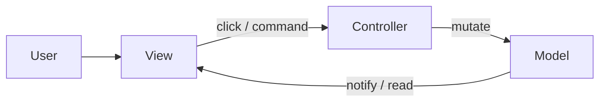
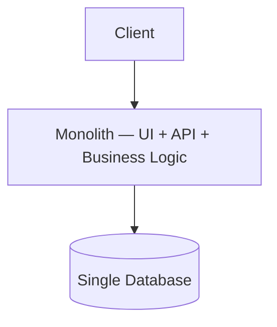
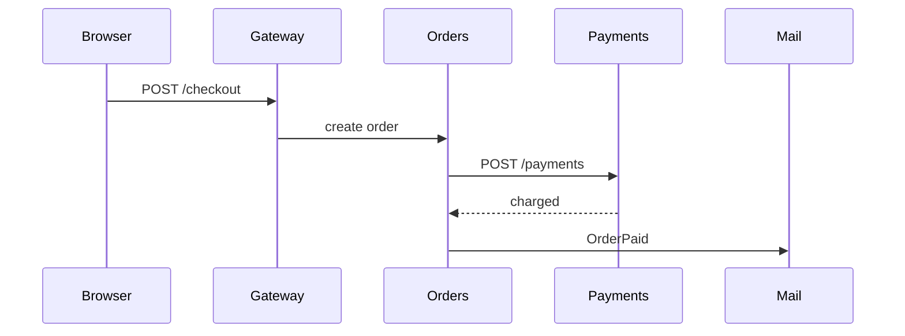

# Architecture patterns

MVC-family patterns and system architecture styles.

[← Back to hub](./7_special.md)

### Related docs

* [Paradigms](./7_special_paradigms.md) · [Architecture patterns](./7_special_architecture.md) · [Algorithms](./7_special_algorithms.md) · [Engineering](./7_special_engineering.md) · [Web security](./7_special_security.md) · [Paradigms — Interview](./7_special_interview.md)

### Sections

- [3. Architecture patterns](#3-architecture-patterns)
- [4. System architecture](#4-system-architecture)

---

## 3. Architecture patterns

<details>
  <summary>Architecture vs design patterns</summary>

### Architecture vs design patterns

**Definition:**

**Architecture** is the set of decisions about how modules talk to each other and to the outside world — constraints, rules, heuristics for the whole app. A **design pattern** is a named fix for a smaller, recurring problem closer to the code.

House metaphor: architecture = “how to build the house”; patterns = “how to drive piles / mix cement / run wiring.”

**How it works:**

A photo editor’s **architecture** decides who owns the canvas, who talks to the camera, whether UI may mutate pixels, and whether checkout is the same deploy. A **pattern** is a local recipe: Adapter maps a snake_case API into the shape your UI already uses. You can have layers + Redux *and* still use Adapter inside one module.

Requirements will change. A useful architecture makes that cheaper: swap a module behind a stable API; contain I/O so internals (and data) leak less; split code so tests are easier; keep layout predictable so features and bugs cost less; use a known style so onboarding is faster.

**How it works — families** (group by *goal*):

| Family | Question | Examples |
|--------|----------|----------|
| **Responsibility** | Who owns which job? | MVC / MVP / MVVM |
| **Distance from domain** | Business logic vs infrastructure? | Three-layer — photo filters vs camera API |
| **Data flow** | Direct, bus, or one-way store? | Flux / Redux; two-way / reactive — [Data flow](#data-flow--one-way-vs-two-way) |
| **Composition** | One program or many? | Monolith vs microservices / micro-frontends |

| Kind | Job | Names |
|------|-----|-------|
| **Creational** | Create entities without duplication | Factory, Factory Method, Abstract Factory, Builder |
| **Structural** | How to assemble a component | Adapter, Decorator, Facade, Proxy |
| **Behavioral** | How to organize behavior | Chain of Responsibility, Strategy, Command, Observer |

UI event → `dispatch(action)` → reducers → new state → subscribers re-render. One-way: dispatch is the only state-change API. Prefer RTK `configureStore` + `createSlice`.

**When to use:**

High-rise apps (many modules, long life). Skip ceremony on a prototype.

#### Common pitfalls

Treating architecture or a pattern as the *goal*. Gold-plating a spike.

**Pluses and minuses:**

| + | − |
|------|------|
| Change, tests, onboarding cheaper at scale | Time, money, cognitive load |
| Shared vocabulary | Wrong cut is expensive to unwind |

**Examples:**

```ts
// Layers: domain is pure; camera is I/O
type Photo = { pixels: Uint8ClampedArray };
function applySepia(photo: Photo): Photo { return photo; }
async function readCamera(): Promise<Photo> { throw new Error('device'); }

// Data flow — RTK (redux.js.org). UI cannot assign state; only dispatch
import { createSlice, configureStore } from '@reduxjs/toolkit';

const editor = createSlice({
  name: 'editor',
  initialState: { filter: 'none' as 'none' | 'sepia' },
  reducers: {
    setFilter(state, action: { payload: 'none' | 'sepia' }) {
      state.filter = action.payload;
    },
  },
});
const store = configureStore({ reducer: editor.reducer });
store.dispatch(editor.actions.setFilter('sepia'));
```

```ts
// Factory
function createFilter(id: 'sepia' | 'gray') {
  return id === 'sepia' ? { apply: applySepia } : { apply: (p: Photo) => p };
}

// Adapter (Doka)
function serverToClientAdapter(data: { some_data: string[] }) {
  return { someData: data.some_data.join(' ') };
}

// Strategy
const format = {
  usd: (cents: number) => `$${(cents / 100).toFixed(2)}`,
  eur: (cents: number) => `${(cents / 100).toFixed(2)} €`,
};

// Observer
const listeners = new Set<(p: Photo) => void>();
const subscribe = (fn: (p: Photo) => void) => {
  listeners.add(fn);
  return () => listeners.delete(fn);
};
```

**Thoughts:** Tools, not trophies. Compare cost vs benefit; bring them in when the cost of *not* having them is higher.

**See also:** [0_system_design.md — Architecture vs design patterns](./0_system_design_interview.md#architecture-vs-design-patterns) · [MVC](#mvc-model-view-controller) · [10. Design patterns](./7_special_engineering.md#10-design-patterns)

**Sources:** [Doka — Architecture and design patterns](https://doka.guide/tools/architecture-and-design-patterns/) · [Redux — Getting started](https://redux.js.org/introduction/getting-started) · [Redux — data flow](https://redux.js.org/tutorials/fundamentals/part-2-concepts-data-flow)

</details>

<details>
  <summary>MVC (Model-View-Controller)</summary>

### MVC (Model-View-Controller)

**Definition:** Splits modules into **Model** (data + business logic), **View** (layout and display), and **Controller** (routes user commands to the model, and often to the view). Goal: unlike operations (API, validation, DOM, popups) do not live in one blob.

**How it works:**

- User talks only to the **View** (usually GUI; voice/gestures still count).
- **Classic loop (circle):** User → View → Controller → Model → View redraws.
- Events may hit the controller directly, or the view catches them and then calls the controller — both are used.
- **Model** is the most independent piece (like a domain layer). It does not import DOM.
- **Classic web:** Model ≈ DB, Controller ≈ server, View ≈ HTML. **Fat client:** keep document state as JS objects, not in markup.

| Piece | Owns | Does not own |
|-------|------|----------------|
| **Model** | App truth (`isOn`, orders, users) | Clicks, CSS, markup |
| **View** | How state looks; collecting events | “What delete means” |
| **Controller** | Intent → model change | Pretty rendering |

1. View shows a dark flashlight (`isOn: false`).
2. User clicks the button (view).
3. Controller runs `toggle()` — it does not paint pixels.
4. Model becomes `{ isOn: true, color: "blue" }`.
5. View reads the model and adds `is-on` + `has-color-blue`.



- **Thin mapping (preferred in the examples below):** view knows button names; controller gets a color string.
- **Fat mapping:** controller receives the DOM event and maps `daylight` → `"blue"`.

- **Fat:** controller transforms data; model is a dumb object. Risk: god object.
- **Thin:** model owns `toggle()` / `setColor()`; controller only forwards. Risk: model dumps.

**When to use:**

Rails/Django, Backbone, desktop MVC, fat-client editors. Skip for a 50-line widget.

**Example 1 — thin controller** (view maps the button; controller only writes the model):

```html
<div class="flashlight"></div>
<button type="button" name="power">On/Off</button>
<button type="button" name="daylight">Day</button>
<button type="button" name="nightlight">Night</button>
```

```js
const model = { isOn: false, color: "blue" };

const controller = {
  toggle() {
    model.isOn = !model.isOn;
  },
  updateColor(color) {
    model.color = color;
  },
};

const view = {
  el: document.querySelector(".flashlight"),
  redraw() {
    const { isOn, color } = model;
    this.el.className = `flashlight has-color-${color}${isOn ? " is-on" : ""}`;
  },
  initEvents() {
    const colors = { daylight: "blue", nightlight: "yellow" };
    document.querySelector('[name="power"]').addEventListener("click", () => {
      controller.toggle();
      view.redraw();
    });
    for (const [name, color] of Object.entries(colors)) {
      document.querySelector(`[name="${name}"]`).addEventListener("click", () => {
        controller.updateColor(color);
        view.redraw();
      });
    }
  },
};

view.initEvents();
view.redraw();
```

**Example 2 — fat controller** (same app; DOM event stays in the controller):

```js
const controller = {
  toggle() {
    model.isOn = !model.isOn;
  },
  selectColor(event) {
    const colors = { daylight: "blue", nightlight: "yellow" };
    model.color = colors[event.target.name];
  },
};

document.querySelector('[name="daylight"]').addEventListener("click", (e) => {
  controller.selectColor(e);
  view.redraw();
});
```

**Example 3 — thin controller, fat model** (knowledge of *how* to toggle lives once):

```js
const model = {
  isOn: false,
  color: "blue",
  toggle() {
    this.isOn = !this.isOn;
  },
  setColor(color) {
    this.color = color;
  },
};

const controller = {
  toggle: () => model.toggle(),
  updateColor: (color) => model.setColor(color),
};
```

**Classic MVC** would `subscribe` the view to the model instead of calling `redraw()` after every controller method:

```js
const listeners = [];
function setOn(value) {
  model.isOn = value;
  listeners.forEach((fn) => fn(model));
}
listeners.push(() => view.redraw());
```

#### Common pitfalls

Mixing DOM mapping *and* domain mutations in both layers. Letting the view write `model.isOn` directly (skips the controller). Forgetting to redraw if you are not using Observer.

**Pluses and minuses:**

| + | − |
|------|------|
| Clear roles; testable model without UI | Controller can become a god object |
| Unidirectional flow is easy to narrate | View vs controller placement is fuzzy |
| Familiar on server and early SPAs | Overkill for tiny apps; frameworks blur lines |

**Thoughts:**

Mixing inline styles into “the document” makes exports painful. JS state is usually an object you can `JSON.stringify`. Stores (Redux / Vuex / NgRx) are MVC-inspired unidirectional flow, not classic MVC — see [4_react.md](./4_react.md).

Model = truth, View = presentation + input surface, Controller = “user meant this.” The hard part is consistent boundaries, not the triangle.

**See also:** [MVC vs MVP vs MVVM](#mvc-vs-mvp-vs-mvvm) · [Data flow](#data-flow--one-way-vs-two-way)

**Sources:**

[Doka — MVC](https://doka.guide/tools/architecture-mvc/) · [MDN glossary — MVC](https://developer.mozilla.org/en-US/docs/Glossary/MVC) · [Doka — How web apps work](https://doka.guide/tools/web-app-works/)

---

</details>

<details>
  <summary>MVP (Model-View-Presenter)</summary>

### MVP (Model-View-Presenter)

**Definition:** Same three concerns as MVC, but the **Presenter** sits **in a line** between Model and View. Data does not loop View ↔ Model; everything goes through the presenter.

**How it works:**

- **View is passive:** only displays what the presenter says. Formatting that MVC might put in the view lives in the presenter.
- Presenter owns: user commands, data transforms, telling the view what to show.
- No “is `initEvents` view or controller?” debate — at the cost of a fat presenter you later split into modules.

**When to use:**

Android (classic), WinForms, test-heavy UI layers.

**Example — same flashlight, line topology.** View never reads `model`. Presenter formats and pushes strings:

```js
const model = { isOn: false, color: "blue" };

const view = {
  el: document.querySelector(".flashlight"),
  label: document.querySelector(".status"),
  show({ className, text }) {
    this.el.className = className;
    this.label.textContent = text;
  },
  bind(presenter) {
    document.querySelector('[name="power"]').onclick = () => presenter.onPower();
    document.querySelector('[name="daylight"]').onclick = () => presenter.onColor("blue");
    document.querySelector('[name="nightlight"]').onclick = () => presenter.onColor("yellow");
  },
};

const presenter = {
  paint() {
    const { isOn, color } = model;
    view.show({
      className: `flashlight has-color-${color}${isOn ? " is-on" : ""}`,
      text: isOn ? `On · ${color}` : "Off",
    });
  },
  onPower() {
    model.isOn = !model.isOn;
    this.paint();
  },
  onColor(color) {
    model.color = color;
    this.paint();
  },
};

view.bind(presenter);
presenter.paint();
```

Login variant: `view.onSubmit(email, pwd)` → `presenter.onLogin(...)` → model/API → `view.showError()` or `view.navigateHome()`.

**Pluses and minuses:**

| + | − |
|------|------|
| View is dumb — easy to mock | Presenter grows large and complex |
| Clearer placement than MVC | More ceremony than MVVM for simple UIs |

**Thoughts:** Circle (MVC) vs line (MVP) — presenter is the only brain.

**Sources:**

[Doka — MVC](https://doka.guide/tools/architecture-mvc/)

---

</details>

<details>
  <summary>MVVM (Model-View-ViewModel)</summary>

### MVVM (Model-View-ViewModel)

**Definition:** Replaces the controller with a **ViewModel** — a layer over the view that exposes bindable state. A **binder** (framework, library, or language) maps model/VM changes to UI so you do not write `redraw()` and click-routing by hand.

**How it works:**

- ViewModel = view-shaped state + commands (not raw domain objects).
- Binder syncs View ↔ ViewModel (often two-way).
- Svelte (and Vue/Angular templates) act as binders: they own the glue between state and display.

**When to use:**

Angular, Vue (Options API), WPF, Knockout. Svelte-like compilers are binders too.

**Example — Vue binder** (`v-model` is `:value` + `@input`; no `redraw()`):

```vue
<script setup>
import { reactive } from "vue";

const model = reactive({ isOn: false, color: "blue" });

function toggle() {
  model.isOn = !model.isOn;
}
</script>

<template>
  <div class="flashlight" :class="[`has-color-${model.color}`, { 'is-on': model.isOn }]" />
  <button type="button" @click="toggle">On/Off</button>
  <select v-model="model.color">
    <option value="blue">Day</option>
    <option value="yellow">Night</option>
  </select>
</template>
```

Equivalent without `v-model` (same two-way idea):

```vue-html
<input :value="text" @input="event => text = event.target.value" />
<!-- shorthand: -->
<input v-model="text" />
```

**Pluses and minuses:**

| + | − |
|------|------|
| ViewModel testable without UI | Binding magic hides data flow |
| Great for form-heavy UIs | Overkill for simple static pages |
| Declarative templates | Debugging binding issues is painful |

**Thoughts:** You stop writing update-UI loops; the binder is the missing fourth piece.

**Sources:**

[Doka — MVC](https://doka.guide/tools/architecture-mvc/) · [Vue — Form input bindings](https://vuejs.org/guide/essentials/forms.html)

---

</details>

<details>
  <summary>MVC vs MVP vs MVVM</summary>

### MVC vs MVP vs MVVM

**Definition:** Side-by-side comparison of presentation-layer patterns — who mediates between model and view, and how data flows.

**How it works:**

| | Model | View | Mediator | Topology | View knows Model? | Data flow |
|---|-------|------|----------|----------|-------------------|-----------|
| **MVC** | Data + business logic | Renders UI; may format | **Controller** | **Circle** | Often yes (observer) | User → View → Controller → Model → View |
| **MVP** | Data + logic | **Passive** | **Presenter** | **Line** | No | View ↔ Presenter ↔ Model |
| **MVVM** | Data + logic | Declarative template | **ViewModel** + binder | Binding | No | View ↔ ViewModel ↔ Model |

- **MVC:** Controller orchestrates; View may observe Model directly (classic desktop) or be driven by Controller (web variants).
- **MVP:** Presenter is the testable brain; View only forwards events and renders what Presenter says — including formatting.
- **MVVM:** ViewModel exposes bindable properties; framework (binder) syncs View automatically (Angular, Vue, Svelte-like).

| Framework | Closest pattern |
|-----------|-----------------|
| React + Redux | Unidirectional (MVC-inspired, not classic) |
| Angular | MVVM |
| Vue | MVVM |
| Backbone | MVC |

**When to use:**

- **MVC:** Server-rendered apps (Rails, Django), Backbone-style SPAs.
- **MVP:** Android (classic), test-heavy UI with passive views.
- **MVVM:** Angular, Vue (Options API), WPF — form-heavy, designer-friendly UIs.
- **React:** Unidirectional flux (Redux) — MVC-inspired but not classic; no two-way binding by design.

**Pluses and minuses:**

| + (comparison) | − |
|-------------------|------|
| All separate UI from domain logic | Strict layering debates slow small teams |
| MVP/MVVM improve testability over classic MVC | MVVM two-way binding hides data flow |
| MVC familiar on server and early SPAs | Overkill for simple CRUD or static sites |

**Examples:** User clicks login → View calls `presenter.onLogin(email, pwd)` → Presenter validates, hits Model API → Presenter calls `view.showError()` or `view.navigateHome()`.

**Thoughts:** Interview: describe **data flow direction**. React explicitly rejected two-way binding for predictability. Modern React (hooks, colocated state) often skips strict MV* in favor of feature folders.

**Sources:**

[Doka — MVC](https://doka.guide/tools/architecture-mvc/) · [patterns.dev](https://www.patterns.dev/)

---

</details>

<details>
  <summary>MV* drawbacks</summary>

### MV* drawbacks

**Definition:** MV* (MVC, MVP, MVVM) trade-offs common to all presentation-layer splits.

**How it works:** Small tools, prototypes, static sites — a single module may suffice.

**Pluses and minuses:**

| + | − |
|------|------|
| Separation aids large teams | Over-abstraction for CRUD apps |
| Testable layers | "Which layer does this go in?" debates |
| | Two-way binding → hard-to-trace updates |

**Thoughts:**

Feature-Sliced Design and colocated components often replace strict MV* in modern React codebases. Backend equivalent: [Clean Architecture & Hexagonal](./0_system_design.md) — domain inward, frameworks outward.

---

</details>

<a name="data-flow--one-way-vs-two-way"></a>
<a name="unidirectional-vs-two-way-data-binding"></a>

<details>
  <summary>Data flow — one-way vs two-way</summary>

### Data flow — one-way vs two-way

**Definition:** **Data flow** is how one part of a program receives data from and sends data to other parts. A program is a data transformer: you give it input and expect a result. Split the work across modules, and those modules cooperate by passing **intermediate results** — that path can shape the whole architecture.

**How it works:**

Same product, two rules. Example: a cart line with `qty`. User clicks “+”. Something must become `qty + 1`, and the UI must show it.

| Kind | Rule | What “+” does |
|------|------|----------------|
| **One-way** (unidirectional) | Between two modules, data either *arrives* or *leaves*. Direction does not reverse. | View sends a command. Only the store (or parent state) changes `qty`. View **reads** the new value. |
| **Two-way** (bidirectional) | The same pair can send **and** receive. | Typing in an input writes the model; writing the model rewrites the input. |

```
One-way (Redux / React):
  View  --action/event-->  reducer / setState  -->  new state  -->  View re-reads

Two-way (v-model):
  input.value  <-------->  model.email
```

#### One-way — Flux / Redux

Classic **Flux**: **store** (state), **dispatcher**, **view**. Optional **action creators** so the view does not know how to build action objects.

Redux cycle (verified): UI reads state → event → `dispatch(action)` → reducers return next state → store notifies subscribers → UI re-renders. `dispatch` is the **only** way to change store state. The store does **not** paint the UI — a listener (React, or your `render`) does.

```
click "+"  →  { type: 'cart/inc' }  →  reducer  →  { qty: 2 }  →  subscribe  →  paint "2"
```

#### Two-way binding vs reactivity

**Two-way binding** (`v-model`, `[(ngModel)]`): UI control and model field stay in sync. Less handler code; harder to debug when used beyond a form field.

derived values **recompute when sources change** (Excel: change A, sum cell updates). Not the same as binding. Binding = UI ↔ model aligned. Reactivity = when X changes, Y is recalculated.

**When to use:**

One-way for large apps / many people / time-travel. Two-way for small apps and forms.

| | One-way | Two-way |
|---|---------|---------|
| Predictability | High — one update path | Lower — implicit sync |
| Debugging | Trace dispatch → reducer → view | “Who changed this?” |
| Boilerplate | Explicit handlers / actions | Less for forms |
| Examples | React props, Redux | Vue `v-model`, Angular forms |

**Example — one-way in React** (state down, events up; you write both directions):

```jsx
function CartLine() {
  const [qty, setQty] = useState(1);
  return (
    <>
      <QtyButton qty={qty} onInc={() => setQty((q) => q + 1)} />
      <input value={qty} onChange={(e) => setQty(Number(e.target.value))} />
    </>
  );
}

function QtyButton({ qty, onInc }) {
  // Child cannot write qty; it can only ask the parent
  return <button onClick={onInc}>{qty}</button>;
}
```

**Example — one-way in Redux** (same “+”, explicit action + reducer):

```js
function qtyReducer(state = { qty: 1 }, action) {
  switch (action.type) {
    case 'cart/inc':
      return { qty: state.qty + 1 };
    default:
      return state;
  }
}

store.dispatch({ type: 'cart/inc' });
store.subscribe(() => {
  document.getElementById('qty').textContent = String(store.getState().qty);
});
```

Today’s Redux uses `configureStore` / slices; the cycle is the same (`dispatch` → reducer → subscribers).

**Example — two-way in Vue** (`v-model` is sugar for one-way in + one-way out):

```html
<input v-model="email" />
<!-- same as: -->
<input :value="email" @input="email = $event.target.value" />
```

#### Common pitfalls

Treating the store as the renderer. Using two-way binding for a non-form graph. Confusing `computed` with `v-model`. Putting server cache in Redux — [state at scale](./0_system_design_architecture.md#state-at-scale).

**Examples:**

```js
function sum(a, b) {
  return a + b;
}
let a1 = 2;
let a2 = 3;
let a3 = sum(a1, a2); // 5
a1 = 22;
a3; // still 5 — JS does not re-run the formula
```

```js
import { ref, computed } from 'vue';
const A0 = ref(2);
const A1 = ref(3);
const A2 = computed(() => A0.value + A1.value); // 5
A0.value = 22; // A2 becomes 25
```

**Thoughts:**

One-way = “ask, then re-read.” Two-way = “the field *is* the model.” Reactivity = “dependents update themselves.”

React 19 form actions blur the line; the core model stays one-way. Controlled inputs = two-way **you** write. Original Flux had a separate dispatcher; Redux folds dispatch into the store + one root reducer.

**See also:** [Reactive programming](./7_special_paradigms.md#reactive-programming--reactivity) · [MVC vs MVP vs MVVM](#mvc-vs-mvp-vs-mvvm) · [4_react.md](./4_react.md) · [0_system_design.md — architecture vs patterns](./0_system_design_interview.md#architecture-vs-design-patterns)

**Sources:**

[Doka — Data flow](https://doka.guide/tools/architecture-data-flow/) · [Redux — data flow](https://redux.js.org/tutorials/essentials/part-1-overview-concepts) · [Vue — v-model](https://vuejs.org/guide/components/v-model.html) · [Vue — computed](https://vuejs.org/guide/essentials/computed.html)

---

</details>

<a name="4-system-architecture"></a>

## 4. System architecture

<details>
  <summary>Monolithic architecture</summary>

### Monolithic architecture

**Definition:** Entire application — UI, business logic, data access — ships and deploys as **one unit** (single process, single artifact).

**How it works:**

- All modules live in one codebase and share memory/process.
- Requests flow: client → monolith → database(s) — no inter-service network calls.
- Scaling = replicate the whole app behind a load balancer (horizontal) or bigger machine (vertical).
- **Modular monolith** — logical service boundaries inside one deployable (packages, bounded contexts) — is a common evolution path.

**When to use:** Startups, MVPs, small teams (<10 engineers), well-understood domain, products without extreme per-component scale needs. Stay monolith until **pain** (deploy frequency, team coordination, scale hotspots) justifies microservices cost.

**Pluses and minuses:**

| + | − |
|------|------|
| Simple dev, test, deploy — one repo, one CI pipeline | Hard to scale one hot component independently |
| Single codebase, easy debugging and tracing | Large codebase → slow builds, coupling over time |
| No network between modules — low latency | One bug or memory leak can take down everything |
| Lower infra cost early | Deploy all or nothing — risky big-bang releases |

**Examples:**



**Thoughts:** Modular monolith with clear package boundaries is often the right long-term choice before splitting. Extract services when a bounded context has independent scale, team, or deploy cadence — not because Netflix uses microservices.

**Sources:**

[0_system_design.md](./0_system_design.md)

---

</details>

<details>
  <summary>Microservices architecture</summary>

### Microservices architecture

**Definition:** One application as a **suite of small services**, each in its **own process**, around a **business capability**, talking over HTTP/RPC/queues, **independently deployable**. (Fowler)

**How it works:**

- Companies leave the monolith to cut **time-to-market for one slice**, **reuse** a capability (auth, mail) across products, and **scale/staff** that slice without cloning the whole app.
- The new coupling is the **API contract** + the network. Doka size check: logic fits in **one head**. Size of the repo matters less than independent lifecycle.
- CI, Kubernetes, service discovery, Prometheus, Kafka are the **cost of many processes** (build, place, find, watch, buffer) — Fowler’s **microservice premium**.

**When to use:**

Hotspot autoscale; team ≳10–15; many autonomous modules; reuse in a new product; huge builds / uneven CPU vs I/O. **Not** for early-stage / fuzzy domain.

#### Common pitfalls

Treating “small HTTP server” as architecture; splitting without bounded contexts; believing microservices are cheaper by default (Doka oversells this). Result: **distributed monolith**.

**Pluses and minuses:**

| + | − |
|------|------|
| Independent scale and deploy | Distributed system complexity |
| Team autonomy per service | Network latency, partial failures |
| Technology diversity per service | Higher ops cost (K8s, observability) |
| Reuse a service in several products | Data consistency across services is hard |
| Fault isolation | Many services can cost **more** than one monolith |

**Examples:**

In a monolith, Pay is `payments.charge(order)` in the same process; a pay-bugfix redeploys the whole shop; Black Friday clones Catalog+Pay together. As services, browser → gateway → Orders → `POST /payments`; Mail is a **second** process (often via a queue) so the shop and a newsletter product share one mailer. Pay can scale to 20 replicas while Catalog stays at 2.



```js
import http from 'node:http';

const server = http.createServer((req, res) => {
  if (req.method === 'POST' && req.url === '/send') {
    res.writeHead(202, { 'Content-Type': 'application/json' });
    res.end(JSON.stringify({ queued: true }));
    return;
  }
  res.writeHead(404);
  res.end();
});

server.listen(8000);
```

Shop calls `POST /send` instead of importing `sendMail()`. Full walkthrough: [0_system_design.md](./0_system_design.md).

**Thoughts:**

Split for independent **scale, team, or reuse** — stay a modular monolith until that pain is real.

"Microservices too early" is a top failure mode. You need bounded contexts, CI/CD, and tracing before splitting. See [0_system_design.md](./0_system_design.md).

**Sources:**

[Fowler — Microservices](https://martinfowler.com/articles/microservices.html) · [Fowler — Monolith First](https://martinfowler.com/bliki/MonolithFirst.html) · [Doka — Микросервисы](https://doka.guide/tools/microservices/)

---

</details>

<details>
  <summary>Monolith vs microservices — decision guide</summary>

### Monolith vs microservices — decision guide

**Definition:**

Decision matrix for choosing monolithic vs microservices architecture based on team, domain, scale, and ops maturity.

| Factor | Monolith | Microservices |
|--------|----------|---------------|
| Team size | Small | Multiple teams |
| Domain clarity | Evolving | Well-bounded contexts |
| Scale needs | Uniform | Per-service hotspots |
| Ops maturity | Basic | K8s, tracing, SRE |
| Time to market | Faster initially | Slower setup |

**Thoughts:**

Extract services when **pain** justifies **cost** — not because Netflix does it. Doka lists Netflix/Amazon/Uber as proof they **use** microservices, not as proof they are cheaper for a small team.

Team, domain, per-service scale, ops maturity — if three of four still favor a monolith, stay there.

---

</details>

<a name="5-algorithms--big-o"></a>
