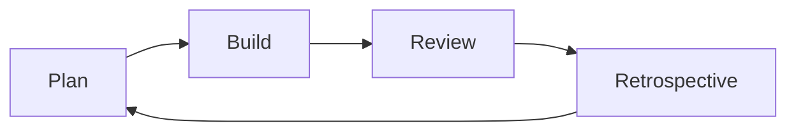
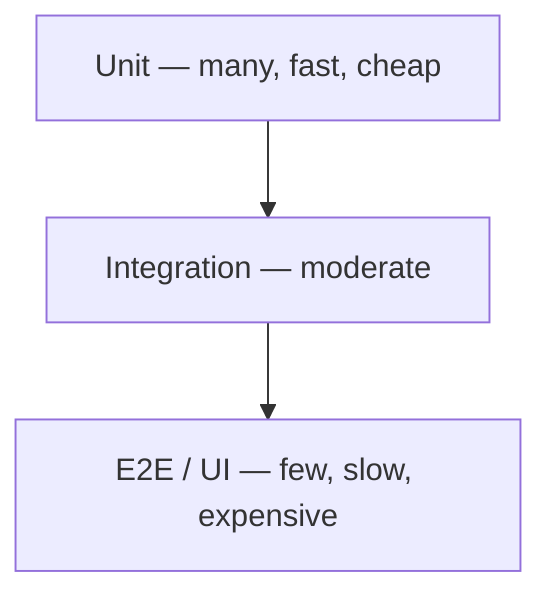

# Engineering

SOLID, design patterns, SDLC, and testing.

[← Back to hub](./7_special.md)

### Related docs

* [Paradigms](./7_special_paradigms.md) · [Architecture patterns](./7_special_architecture.md) · [Algorithms](./7_special_algorithms.md) · [Engineering](./7_special_engineering.md) · [Web security](./7_special_security.md) · [Paradigms — Interview](./7_special_interview.md)

### Sections

- [9. SOLID & principles](#9-solid-principles)
- [10. Design patterns](#10-design-patterns)
- [11. SDLC & Agile](#11-sdlc-agile)
- [12. Testing](#12-testing)

---

## 9. SOLID & principles

<details>
  <summary>SOLID (overview)</summary>

### SOLID (overview)

**Definition:** Five OOP design principles (Robert C. Martin) for maintainable, extensible systems — apply to modules and functions, not only classes.

**How it works:**

| Letter | Principle | One-liner |
|--------|-----------|-----------|
| **S** | Single Responsibility | One reason to change per module |
| **O** | Open/Closed | Open for extension, closed for modification |
| **L** | Liskov Substitution | Subtypes must honor parent contract |
| **I** | Interface Segregation | Small, focused interfaces |
| **D** | Dependency Inversion | Depend on abstractions, not concretions |

Each principle addresses a specific coupling or rigidity problem. Together they push toward small, composable units that change independently and accept extension via new code rather than edits to existing code.

**When to use:** Refactoring god classes; designing plugin systems, payment providers, data layers; code review checklist for new modules. In JS/TS: split React components, inject dependencies, use strategy objects instead of giant `switch`.

**Pluses and minuses:**

| + | − |
|------|------|
| Easier testing, refactoring, team ownership | Over-application creates abstraction sprawl |
| Shared vocabulary in code reviews | "SOLID" debates distract from shipping |
| Scales with codebase size | Subjective boundaries (especially SRP) |

**Examples:**

```ts
type Logger = { log(msg: string): void };

function processOrder(order: Order, logger: Logger) {
  logger.log(`Processing ${order.id}`);
  // business logic — no import of ConsoleLogger
}
```

**Thoughts:**

Full GOF/GRASP catalog in [0_system_design.md](./0_system_design.md). SOLID complements DRY/KISS/YAGNI — don't abstract until a second use case appears. React-specific examples (components, hooks, composition): [4_react.md — SOLID in React](./4_react_core.md#solid-in-react).

On a budget app: **SRP** — `perDay` on Budget, `spentToday` on History, subtract on DailyAmount. **OCP** — `LedgerEntry` with a `kind`, not a hardcoded `Spending` class. **LSP** — any `LedgerEntry` is valid wherever a record is expected. **ISP** — split feature contracts, not one fat interface. **DIP** — DailyAmount depends on Budget/History abstractions (constructor injection); JS makes this harder without interfaces.

**Sources:**

[Doka — OOP](https://doka.guide/tools/oop/) · [freecodecamp SOLID](https://www.freecodecamp.org/news/solid-principles-single-responsibility-principle-explained/)

---

</details>

<details>
  <summary>Single Responsibility (SRP)</summary>

### Single Responsibility (SRP)

**Definition:** A module (class, function, file) should have **one reason to change** — one cohesive job or axis of change.

**How it works:**

- Identify **who** would request changes: UI team, API team, billing rules, etc.
- If two unrelated stakeholders trigger edits in the same module, split it.
- SRP is about **cohesion**, not "one method per class" — a `UserValidator` with three validation methods still has one job.
- In React: separate data fetching, formatting, and presentation.

**When to use:** Split god components; `UserRepository` (DB) vs `UserPresenter` (UI); separate email template rendering from send logic; extract validation from route handlers.

**Pluses and minuses:**

| + | − |
|------|------|
| Easier test, refactor, and reason about | Over-splitting creates file sprawl |
| Clear ownership per module | "One reason" is subjective |
| Smaller diffs, fewer merge conflicts | Can feel bureaucratic for tiny scripts |

**Examples:**

```js
// ❌ Two reasons to change: DB schema AND API response shape
class UserService {
  async getUser(id) {
    const row = await db.query('SELECT * FROM users WHERE id = ?', [id]);
    return { fullName: `${row.first} ${row.last}`, avatar: row.img_url };
  }
}

// ✅ Split responsibilities
class UserRepository { findById(id) { return db.query(...); } }
class UserMapper { toDto(row) { return { fullName: `${row.first} ${row.last}`, ... }; } }
```

**Thoughts:**

Interview: SRP ≠ "one function" — it's one **axis of change**. A change in tax law shouldn't force editing UI code.

---

</details>

<details>
  <summary>Open/Closed (OCP)</summary>

### Open/Closed (OCP)

**Definition:** Software entities should be **open for extension** but **closed for modification** — add behavior via new code, not by editing stable modules.

**How it works:**

- Define **extension points**: strategy interfaces, middleware hooks, plugin registries.
- New variants implement the interface or register with the registry.
- Core logic calls the abstraction — never a growing `if/else` or `switch` on types.
- In JS: object maps, higher-order functions, and middleware pipelines achieve OCP without inheritance.

**When to use:** Payment providers, export formats (CSV/JSON/PDF), validation rules, Express/Koa middleware, ESLint rules, React render props / compound components.

**Pluses and minuses:**

| + | − |
|------|------|
| Safer additions — existing code untouched | Abstraction upfront cost |
| Plugin and middleware architectures | Wrong extension points are hard to fix |
| Fewer regression bugs on extend | Can over-engineer for one implementation |

**Examples:**

```js
const paymentStrategies = {
  stripe: (amount) => chargeStripe(amount),
  paypal: (amount) => chargePayPal(amount),
};

function checkout(provider, amount) {
  const pay = paymentStrategies[provider];
  if (!pay) throw new Error('Unknown provider');
  return pay(amount); // add new provider without editing this function
}
```

**Thoughts:**

OCP pairs with Strategy and Factory patterns. A `switch` on closed enum is fine if the set is truly fixed and owned by one team.

---

</details>

<details>
  <summary>Liskov Substitution (LSP)</summary>

### Liskov Substitution (LSP)

**Definition:** Subtypes must be **substitutable** for their base types — callers using the parent contract must not break when given a subclass.

**How it works:**

- Subclass must honor **preconditions** (not strengthen), **postconditions** (not weaken), and **invariants** of the parent.
- If code expects `Rectangle.setWidth(w)` to leave height unchanged, `Square extends Rectangle` violates LSP when `setWidth` also changes height.
- Prefer composition when "is-a" taxonomy doesn't hold behaviorally.
- In JS/TS: duck typing doesn't save you — behavioral contracts still matter.

**When to use:** Review any `extends` — does subclass throw on parent methods? Narrow input types? Return incompatible shapes? Plugin systems where plugins must not break host assumptions.

**Pluses and minuses:**

| + | − |
|------|------|
| Reliable polymorphism | Violations are subtle and discovered late |
| Safe refactoring with inheritance | Pushes toward composition (good, but more wiring) |
| Clear contracts in hierarchies | Hard to formalize in untyped JS |

**Examples:**

```js
class Bird { fly() { return 'flying'; } }
class Penguin extends Bird {
  fly() { throw new Error('Cannot fly'); } // ❌ breaks callers expecting fly()
}

// ✅ Better — separate interfaces
class Penguin { swim() { return 'swimming'; } }
```

**Thoughts:**

Classic interview trap: `Square extends Rectangle`. Fix: don't model square as rectangle subtype; use shared `Shape` with `area()`.

---

</details>

<details>
  <summary>Interface Segregation (ISP)</summary>

### Interface Segregation (ISP)

**Definition:** Clients should not be forced to depend on methods they don't use — prefer **small, focused interfaces** over fat ones.

**How it works:**

- Split large interfaces into role-specific ones (`Readable`, `Writable`, `Deletable`).
- Callers depend only on the methods they need — easier to mock and implement.
- In TS: `interface` segregation; in JS: pass minimal object shapes or use JSDoc `@typedef` for contracts.
- Fat React component props that force unused callbacks violate ISP spirit.

**When to use:** Split `File` god interface into `read()`, `write()`, `watch()`; API clients that only need `get` shouldn't require `delete`; segregate admin vs read-only service interfaces.

**Pluses and minuses:**

| + | − |
|------|------|
| Smaller, focused contracts | More types/interfaces to maintain |
| Easier mocks in tests | Can fragment APIs if overdone |
| Implementers only stub what they need | Discovery — "which interface do I need?" |

**Examples:**

```ts
type Readable = { read(id: string): Promise<Data> };
type Writable = { write(data: Data): Promise<void> };

// Report generator only needs Readable
function generateReport(source: Readable) {
  return source.read('summary');
}
```

**Thoughts:**

ISP reduces coupling between modules. In frontend, prop drilling fat objects is an ISP smell — pass only needed fields.

---

</details>

<details>
  <summary>Dependency Inversion (DIP)</summary>

### Dependency Inversion (DIP)

**Definition:** High-level modules depend on **abstractions**; low-level modules **implement** those abstractions — both depend on interfaces, not on each other directly.

**How it works:**

1. High-level policy (`OrderService`) defines what it needs (`PaymentGateway`, `OrderRepo`).
2. Low-level details (`StripeGateway`, `PostgresOrderRepo`) implement those abstractions.
3. **Inject** dependencies via constructor, factory, or DI container — don't `import` concrete implementations inside business logic.
4. Tests swap in fakes/mocks at the abstraction boundary — kinds: [Test doubles](#test-doubles-stubs-mocks-spies).

**When to use:** Inject `HttpClient`, `Storage`, `Logger`; repository pattern over raw ORM in services; React context/providers for testable dependencies; avoid `fetch` calls inside pure domain functions.

**Pluses and minuses:**

| + | − |
|------|------|
| Testable via mocks/stubs | Indirection and wiring overhead |
| Swappable implementations (DB, payment, storage) | DI containers can hide dependencies |
| Business logic isolated from frameworks | Learning curve for junior devs |

**Examples:**

```ts
type UserRepo = { findById(id: string): Promise<User> };

function getUserProfile(id: string, repo: UserRepo) {
  return repo.findById(id); // depends on abstraction
}

// Production: getUserProfile(id, new PostgresUserRepo())
// Test:       getUserProfile(id, { findById: async () => mockUser })
```

**Thoughts:** DIP ≠ every function takes 10 params. Module-level defaults with injectable overrides is idiomatic in JS. Pairs with Factory and Repository patterns. JS has no interfaces — constructor injection still helps (`new DailyAmount(budget, history)`), but the *inversion onto an abstraction* is a TypeScript/`typedef` story. See [Entities, relations & design](./7_special_paradigms.md#2-oop--fp).

**See also:** Swappable fakes at the interface = less mock archaeology — [Making tests easy](#making-tests-easy).

**Sources:**

[Doka — OOP](https://doka.guide/tools/oop/)

---

</details>

<details>
  <summary>DRY (Don't Repeat Yourself)</summary>

### DRY (Don't Repeat Yourself)

**Definition:** Avoid duplicating knowledge/logic — single source of truth.

**When to use:** Shared validation, constants, utilities. Not for coincidental similarity.

**Pluses and minuses:**

| + | − |
|------|------|
| Fix once, fixed everywhere | Premature abstraction duplicates wrongly |
| Consistent behavior | |

**Thoughts:**

DRY is about **knowledge**, not character count. Two similar loops may be fine.

---

</details>

<details>
  <summary>KISS (Keep It Simple, Stupid)</summary>

### KISS (Keep It Simple, Stupid)

**Definition:** Prefer the simplest solution that works.

**When to use:**

Default choice. Add complexity only with measured need.

---

**Pluses and minuses:**

| + | − |
|------|------|
| Readable, maintainable | May need refactor when scale hits |
| Faster delivery | |

</details>

<details>
  <summary>YAGNI (You Aren't Gonna Need It)</summary>

### YAGNI (You Aren't Gonna Need It)

**Definition:** Don't build features until they're required.

**When to use:** Resist "future-proof" frameworks and unused abstraction layers.

**Pluses and minuses:**

| + | − |
|------|------|
| Less dead code | May refactor later |
| Focus on current value | |

**Thoughts:**

YAGNI vs extensibility — design seams (interfaces) without building unused features.

---

</details>

<a name="10-design-patterns"></a>

## 10. Design patterns

<details>
  <summary>Design pattern (general)</summary>

### Design pattern (general)

**Definition:**

A reusable solution to a recurring design problem — not copy-paste code, but a structure and collaboration pattern.

| Category | Examples |
|----------|----------|
| **Creational** | Factory, Factory Method, Abstract Factory, Builder, Singleton, Prototype |
| **Structural** | Adapter, Decorator, Facade, Proxy |
| **Behavioral** | Chain of Responsibility, Observer, Strategy, Command, Iterator |

**When to use:** When problem matches catalog; name patterns in docs and reviews.

**Pluses and minuses:**

| + | − |
|------|------|
| Shared vocabulary | Over-application ("pattern fever") |
| Battle-tested structures | Can obscure simple code |

**Thoughts:** See full catalog and frontend grouping in [0_system_design.md](./0_system_design_patterns.md#gof-design-patterns--catalog). Creational shortlist: [cheat sheet](#creational-patterns--cheat-sheet). Structural shortlist: [cheat sheet](#structural-patterns--cheat-sheet). Behavioral shortlist: [0_system_design.md](./0_system_design_patterns.md#behavioral-patterns--cheat-sheet). Patterns are not the goal of a PR.

**Sources:**

[refactoring.guru](https://refactoring.guru/design-patterns/catalog) · [Doka — Architecture and design patterns](https://doka.guide/tools/architecture-and-design-patterns/)

---

</details>

<details>
  <summary>Creational patterns — cheat sheet</summary>

<a name="creational-patterns--cheat-sheet"></a>

### Creational patterns — cheat sheet

**Definition:**

Creational patterns hide **how objects are born** — fields, defaults, extra data, which class to instantiate — so callers do not repeat construction and do not depend on concrete types.

Doka’s everyday four (not the full GoF list): **Factory** (simple), **Abstract Factory**, **Builder**, **Singleton**. GoF also has **Factory Method** and **Prototype**. Doka’s “factory” is the informal **simple factory** function — not Factory Method.

| Pattern | One line | Mental model |
|---------|----------|--------------|
| **Factory** (simple) | Function owns the recipe; caller passes intent (`createGuitar(6)`) | Guitar shop vs milling a neck |
| **Factory Method** | Creator subclasses override `createX()` — which *class* is born | Department.hire → Programmer vs Accountant |
| **Abstract Factory** | Interface that creates a **family** of related products | Orchestra reservation: instrument + musician, one API |
| **Builder** | Optional steps, then `build()`; chain returns `this` | Coffee: espresso + milk + sugar |
| **Singleton** | At most one instance; later `new` returns the first | One Sun — usually redesign instead |

**How it works:**

- **Factory vs Abstract Factory** — Factory returns **one** product. Abstract Factory is a factory of factories: same *operations*, different *families* (Violin+Violinist vs Cello+Cellist). Goal is dropping `instanceof` trees.
- **Factory vs Builder** — Factory: “give me a complete object, maybe with a couple of args.” Builder: many **optional steps**, order matters, avoid a constructor with ten booleans.
- **Simple Factory vs Factory Method** — `createX(type)` + `switch` is an idiom. Factory Method is when a *class* defers `new` to subclasses (Refactoring Guru).
- **Pattern Singleton vs DI “singleton”** — Pattern = restrict count. DI lifetime = reuse the same injected instance. Different jobs (Doka).

| Use | Pattern |
|-----|---------|
| Construction > 1–2 lines, or needs calc / extra data | Factory |
| Related products must stay compatible; client must not name classes | Abstract Factory |
| Many optional features; telescoping constructors | Builder |
| Domain truly allows only one (rare) | Singleton — prefer ESM `export const` |

```js
// Factory — recipe + a calculation. Call sites stay createGuitar(6) if fields change.
function createGuitar(stringsCount = 6, maxWeight = 5) {
  const fretBoardMaterial = maxWeight <= 5 ? 'fir' : 'cedar';
  return { stringsCount, fretsCount: 24, fretBoardMaterial };
}
createGuitar(6);
createGuitar(7, 8);
```

```js
// Abstract Factory — same two methods; violin vs cello family. reserve() never instanceofs.
const violinKit = {
  reserveInstrument: () => ({ play: (n) => `violin ${n}` }),
  notifyPlayer: () => ({ play: (piece) => piece.map((n) => `violin ${n}`) }),
};
const celloKit = {
  reserveInstrument: () => ({ play: (n) => `cello ${n}` }),
  notifyPlayer: () => ({ play: (piece) => piece.map((n) => `cello ${n}`) }),
};
function reserve(kit) {
  kit.notifyPlayer();
  return kit.reserveInstrument();
}
reserve(violinKit).play('A'); // 'violin A'
reserve(celloKit).play('A');  // 'cello A'
```

```js
// Builder — optional steps, then build(). addX returns this so you can chain.
class DrinkBuilder {
  settings = { base: 'espresso' };
  addMilk() { this.settings.milk = true; return this; }
  addSugar() { this.settings.sugar = true; return this; }
  build() { return { ...this.settings }; }
}
new DrinkBuilder().addMilk().build();           // { base: 'espresso', milk: true }
new DrinkBuilder().addSugar().addMilk().build();
```

```js
// Singleton — second new returns the first object. Prefer export const in real JS.
class Sun {
  static #instance = null;
  constructor() {
    if (Sun.#instance) return Sun.#instance;
    Sun.#instance = this;
  }
}
new Sun() === new Sun(); // true
// Idiomatic: export const sun = Object.freeze({ mass: 1.989e30 });
```

**See also:** [Factory](#factory--factory-method) · [Abstract Factory](#abstract-factory) · [Builder](#builder) · [Singleton](#singleton-caution) · [0_system_design.md catalog](./0_system_design_patterns.md#gof-design-patterns--catalog) · [JS OOP factory](./3_js_oop.md)

**Sources:**

[Doka — Creational patterns](https://doka.guide/tools/design-patterns-creational/) (Sasha Bespoyasov, updated 2024-02-29) · [Refactoring Guru — Catalog](https://refactoring.guru/design-patterns/catalog) · [Factory comparison](https://refactoring.guru/design-patterns/factory-comparison)

---

</details>

<details>
  <summary>Structural patterns — cheat sheet</summary>

<a name="structural-patterns--cheat-sheet"></a>

### Structural patterns — cheat sheet

**Definition:**

Structural patterns answer “how do we assemble a component so it can compose with others?” — they manage **object composition**, not creation (creational) or who talks to whom (behavioral).

| Pattern | One line | Mental model |
|---------|----------|--------------|
| **Adapter** | Translate incompatible API / data shape into what the client already expects | Travel plug |
| **Facade** | One simple method over many subsystem steps | “Heat water” vs 8 atomic machine calls |
| **Decorator** | Wrap to **add** behavior; keep the same interface | Phone + case; `debounce(fn)` |
| **Proxy** | Same interface; **gate** access (lazy, auth, cache, intercept) | Receptionist; JS `Proxy` |

**How they differ** (Refactoring Guru):

- **Adapter vs Decorator** — Adapter provides a *different* interface. Decorator keeps (or extends) the original and supports stacking wrappers.
- **Adapter vs Facade** — Adapter wraps *one* object to match a target interface. Facade gives a *new, simpler* interface over a *subsystem* (many objects / many calls).
- **Decorator vs Proxy** — both wrap and usually keep the same interface. Decorator *adds* responsibilities (log, retry, encrypt). Proxy *controls* access (lazy init, protection, remote stub, cache) and does not exist to enrich the public API.
- **JS `Proxy` vs the pattern** — `new Proxy(target, handler)` is a language tool that intercepts operations (`get`, `set`, …). You can implement a GoF Proxy *or* a Decorator with it. Vue 3 reactivity uses `Proxy`.

**How it works:**

| Use | Pattern |
|-----|---------|
| Server `snake_case` / nested payload ≠ app `camelCase` DTOs | Adapter |
| Hexagonal / ports: Prisma, Stripe, Express live in the outer **adapter** layer | Adapter |
| Same multi-step SDK dance copied in several places | Facade |
| Cross-cutting extras: log, metrics, cache, `throttle` / `debounce` | Decorator |
| Check / delay / deny before the real object (auth, lazy, DOM insert guard) | Proxy |

```js
// Adapter — foreign shape → our shape. Callers never see snake_case.
function toUser(dto) {
  return { id: dto.ID, name: dto.user_name };
}
toUser({ ID: '1', user_name: 'Ada' }); // { id: '1', name: 'Ada' }
```

```js
// Facade — one function runs several subsystem steps. UI calls brew(), not 4 SDK methods.
function brew(machine) {
  machine.grind();
  machine.heat();
  machine.pour();
  return machine.cup();
}
```

```js
// Decorator — same function, extra behavior before/after. update itself stays clean.
const withLog = (fn) => (...args) => {
  console.log('call', args);
  return fn(...args);
};
const save = (user) => { /* write */ };
const saveLogged = withLog(save);
saveLogged({ id: 1 }); // logs, then save
```

```js
// Proxy — same property names; trap decides what happens. original.secret stays readable.
const user = { name: 'Ada', secret: 'x' };
const gate = new Proxy(user, {
  get(t, key, r) {
    if (key === 'secret') return undefined;
    return Reflect.get(t, key, r);
  },
});
gate.name;   // 'Ada'
gate.secret; // undefined
```

**Thoughts:** Adapter **translates**. Facade **simplifies**. Decorator **adds**. Proxy **gates**.

**See also:** [Adapter](#adapter) · [Facade](#facade) · [Decorator](#decorator) · [Proxy](#proxy) · [JS `Proxy`](./3_js_core.md#proxy-and-reflect) · [Hexagonal adapters](./0_system_design_architecture.md#clean-architecture--hexagonal)

**Sources:**

[Refactoring Guru — Adapter relations](https://refactoring.guru/design-patterns/adapter) · [Decorator](https://refactoring.guru/design-patterns/decorator) · [Facade](https://refactoring.guru/design-patterns/facade) · [Proxy](https://refactoring.guru/design-patterns/proxy) · [MDN `Proxy`](https://developer.mozilla.org/en-US/docs/Web/JavaScript/Reference/Global_Objects/Proxy)

---

</details>

<details>
  <summary>Observer</summary>

### Observer

**Definition:** Subject notifies observers on state change — one-to-many dependency.

**When to use:** DOM events, Redux subscriptions, pub/sub, `EventEmitter`.

**Pluses and minuses:**

| + | − |
|------|------|
| Loose coupling | Order of notification matters |
| Event-driven UIs | Memory leaks if unsubscribe forgotten |

**Examples:**

```js
class Store {
  #listeners = new Set();
  subscribe(fn) { this.#listeners.add(fn); return () => this.#listeners.delete(fn); }
  notify(data) { this.#listeners.forEach(fn => fn(data)); }
}
```

**Thoughts:**

React's `useEffect` cleanup is observer unsubscribe.

---

</details>

<details>
  <summary>Factory / Factory Method</summary>

<a name="factory--factory-method"></a>

### Factory / Factory Method

**Definition:** Encapsulate object creation so the caller does not know field names, defaults, extra lookups, or whether the result is a plain object or `new Class()`.

**How it works:**

A **simple factory** is a function that returns same-shaped objects (`createGuitar(6)`, `createSpending(amount)`). **Factory Method** (GoF) defers `new` to a subclass. Both keep construction rules in one place — if the product schema changes, only the factory changes.

Doka: use a factory when creation is more than 1–2 lines, especially if you **compute** something first (fretboard wood from max weight). Call sites stay `createGuitar(6)` even if you later return `new Guitar(...)`.

**When to use:**

Construction logic / defaults / validation; many similar objects; `createParser('json')`; test doubles. Skip for `{ id }` literals.

#### Common pitfalls

Wrapping every object in a factory (“pattern fever”). Confusing simple factory with Factory Method / Abstract Factory.

**Pluses and minuses:**

| + | − |
|------|------|
| Hides construction complexity | Extra indirection |
| Centralizes defaults (e.g. `dateTime: Date.now()`) | Over-factorying simple DTOs |
| Fewer typos than duplicating object literals | No `instanceof` unless you share a prototype/`class` |

**Examples:**

```js
// 1) Construction logic — Doka: compute a field, hide the rest of the recipe
function createGuitar(stringsCount = 6, maxWeight = 5) {
  const fretBoardMaterial = maxWeight <= 5 ? 'fir' : 'cedar';
  return { stringsCount, fretsCount: 24, fretBoardMaterial, boardMaterial: 'maple' };
}
createGuitar(6);     // light guitar → fir
createGuitar(7, 9);  // heavy → cedar
```

```js
// 2) Many similar objects — defaults (timestamp, kind) in one place
function createSpending(amount) {
  return { amount, dateTime: Date.now(), kind: 'spending' };
}
const spending1 = createSpending(250);
const spending2 = createSpending(100);
```

```js
// 3) Pick implementation by type — simple factory (not Factory Method)
function createParser(kind) {
  if (kind === 'json') return (text) => JSON.parse(text);
  if (kind === 'csv') return (text) => text.split(',').map((s) => s.trim());
  throw new Error(`Unknown parser: ${kind}`);
}
createParser('json')('{"a":1}'); // { a: 1 }
createParser('csv')('a, b');     // ['a', 'b']
```

```js
// 4) Test double — same factory, fake in tests
function createLogger(env) {
  if (env === 'test') return { info: () => {} };
  return { info: (msg) => console.log(msg) };
}
createLogger('prod').info('up');
createLogger('test').info('silent');
```

```js
// 5) Factory Method (GoF) — subclass decides which class is born
class Department {
  hire(id) {
    const employee = this.createEmployee(id);
    employee.start();
    return employee;
  }
  createEmployee(id) { throw new Error('override me'); }
}
class ITDepartment extends Department {
  createEmployee(id) {
    return { id, role: 'programmer', start() {} };
  }
}
class AccountingDepartment extends Department {
  createEmployee(id) {
    return { id, role: 'accountant', start() {} };
  }
}
new ITDepartment().hire(1).role;          // 'programmer'
new AccountingDepartment().hire(2).role; // 'accountant'
```

**Thoughts:**

Factories are enough for small objects. Grow into a `class` when you need `this` or methods that must stay on the entity. See [3_js_oop.md — factory](./3_js_oop.md).

Knowledge of *how* to build lives in one function.

**Sources:**

[Doka — Creational patterns](https://doka.guide/tools/design-patterns-creational/) · [Doka — OOP](https://doka.guide/tools/oop/) · [Refactoring Guru — Factory comparison](https://refactoring.guru/design-patterns/factory-comparison)

---

</details>

<details>
  <summary>Abstract Factory</summary>

<a name="abstract-factory"></a>

### Abstract Factory

**Definition:** An interface for creating a **family** of related products without naming concrete classes — “a factory of factories.” It returns abstractions (`Instrument`, `Musician`), not one hardcoded type.

**How it works:**

Shared contract (`ReservationFactory { reserveInstrument(); notifyPlayer(); }`). Each family (violin, cello) implements that contract. Client `reserve(factory)` never `instanceof`s. Add a viola → new class, not a new branch in `reserve()`.

Refactoring Guru: one factory produces matching products (Windows button + Windows checkbox). Harder to add a *new product type* (every factory gains a method).

**When to use:**

Related-but-not-identical objects with the same creation steps (reserve + notify; themed UI kits).

#### Common pitfalls

Union types + `instanceof` instead of a shared factory interface — fragile when the orchestra grows.

**Pluses and minuses:**

| + | − |
|------|------|
| Compatible product families | Many interfaces / classes |
| Client code stays on abstractions | Adding a new product kind touches all factories |
| No `instanceof` trees | Overkill for one product type |

**Examples:**

```js
// 1) Orchestra family — same API, different products. Client has no instanceof.
class Violin {
  playNote(note) { return `violin ${note}`; }
}
class Cello {
  playNote(note) { return `cello ${note}`; }
}
class Violinist {
  instrument = new Violin();
  play(piece) { return piece.map((n) => this.instrument.playNote(n)); }
}
class Cellist {
  instrument = new Cello();
  play(piece) { return piece.map((n) => this.instrument.playNote(n)); }
}

class ViolinReservation {
  reserveInstrument() { return new Violin(); }
  notifyPlayer() { return new Violinist(); }
}
class CelloReservation {
  reserveInstrument() { return new Cello(); }
  notifyPlayer() { return new Cellist(); }
}

function reserve(factory) {
  const player = factory.notifyPlayer();
  factory.reserveInstrument();
  return player;
}
reserve(new ViolinReservation()).play(['A', 'C']); // ['violin A', 'violin C']
reserve(new CelloReservation()).play(['A', 'C']);  // ['cello A', 'cello C']
```

```js
// 2) Themed UI kit — button + input stay in the same family (dark vs light)
const lightUi = {
  button: (label) => ({ kind: 'button', theme: 'light', label }),
  input: (name) => ({ kind: 'input', theme: 'light', name }),
};
const darkUi = {
  button: (label) => ({ kind: 'button', theme: 'dark', label }),
  input: (name) => ({ kind: 'input', theme: 'dark', name }),
};

function loginForm(ui) {
  return { submit: ui.button('Log in'), email: ui.input('email') };
}
loginForm(lightUi).submit.theme; // 'light'
loginForm(darkUi).email.theme;   // 'dark'
```

**Thoughts:** You create *types of products*, not `new Violin()` in the client.

**Sources:**

[Doka — Creational patterns](https://doka.guide/tools/design-patterns-creational/) · [Refactoring Guru — Abstract Factory](https://refactoring.guru/design-patterns/abstract-factory)

---

</details>

<details>
  <summary>Builder</summary>

<a name="builder"></a>

### Builder

**Definition:** Construct a complex object **step by step**, with optional parts, then `build()`. Same construction process can yield different representations.

**How it works:**

Builder holds settings. Each `addX()` / `setX()` mutates and **returns `this`** (fluent chain). `build()` produces the product. Refactoring Guru: kills **telescoping constructors** (`Pizza(size)`, `Pizza(size, cheese)`, `Pizza(size, cheese, pepperoni)`…). Director (optional) runs a fixed sequence of steps.

Unlike other creational patterns, Builder can produce products that **do not share** one interface (Car vs Manual from the same steps).

**When to use:**

Many optional ingredients/fields (coffee drink, HTTP request, query, test data). Process splits into named steps.

#### Common pitfalls

Builder when a factory with two args is enough. Forgetting `return this` breaks chaining.

**Pluses and minuses:**

| + | − |
|------|------|
| Readable optional configuration | Verbose for 2-field objects |
| Avoids boolean-flag constructors | Mutable builder if reused without `reset()` |
| Same steps, different products | |

**Examples:**

```js
// 1) Coffee drink — optional ingredients, fluent chain (Doka)
class DrinkBuilder {
  settings = { base: 'espresso' };
  addMilk() { this.settings.milk = true; return this; }
  addSugar() { this.settings.sugar = true; return this; }
  addCream() { this.settings.cream = true; return this; }
  build() { return { ...this.settings }; }
}
const latte = new DrinkBuilder().addMilk().build();
const extra = new DrinkBuilder().addSugar().addCream().build();
```

```js
// 2) HTTP request — skip unused options instead of fetch(url, { method, headers, body, … })
class RequestBuilder {
  #url = '';
  #init = { method: 'GET', headers: {} };
  url(value) { this.#url = value; return this; }
  method(value) { this.#init.method = value; return this; }
  header(key, value) { this.#init.headers[key] = value; return this; }
  json(body) {
    this.#init.body = JSON.stringify(body);
    return this.header('Content-Type', 'application/json').method('POST');
  }
  build() { return { url: this.#url, ...this.#init }; }
}
new RequestBuilder().url('/api/users').json({ name: 'Ada' }).build();
// { url: '/api/users', method: 'POST', headers: { 'Content-Type': 'application/json' }, body: '{"name":"Ada"}' }
```

```js
// 3) Query / test data — named steps, no telescoping constructor
class UserBuilder {
  #user = { name: 'anon', role: 'user', active: true };
  name(value) { this.#user.name = value; return this; }
  admin() { this.#user.role = 'admin'; return this; }
  inactive() { this.#user.active = false; return this; }
  build() { return { ...this.#user }; }
}
new UserBuilder().name('Ada').admin().build();
// { name: 'Ada', role: 'admin', active: true }
```

**Thoughts:** Steps first, object last — `build()` is the only `new`.

**Sources:**

[Doka — Creational patterns](https://doka.guide/tools/design-patterns-creational/) · [Refactoring Guru — Builder](https://refactoring.guru/design-patterns/builder)

---

</details>

<details>
  <summary>Strategy</summary>

### Strategy

**Definition:** Family of interchangeable algorithms behind one interface.

**When to use:** Sort comparators, pricing rules, validation strategies, payment methods.

**Pluses and minuses:**

| + | − |
|------|------|
| Runtime algorithm swap | More classes/functions |
| OCP-friendly | |

**Examples:**

```js
const strategies = {
  stripe: (amount) => chargeStripe(amount),
  paypal: (amount) => chargePayPal(amount),
};
strategies[provider](total);
```

---

</details>

<details>
  <summary>Singleton (caution)</summary>

<a name="singleton-caution"></a>

### Singleton (caution)

**Definition:** Creational pattern ensuring **only one instance** exists; a later create-attempt returns the existing object. Provides a global access point.

**How it works:**

- Typical class form: static private `#instance`; constructor returns existing instance (Doka `Sun`) or private ctor + `getInstance()`.
- In JS, **module scope** (`export const db = createPool()`) naturally gives one instance per process — idiomatic singleton without ceremony.
- Risk: hidden global mutable state shared across tests and requests. Refactoring Guru: same drawbacks as globals — less modular, unit tests need the singleton present.

Doka: may violate **open/closed**, raise coupling — sometimes treated as an antipattern. Prefer a design that does not need it.

Pattern Singleton (limit count) vs DI **singleton lifetime** (same instance injected into dependents). Different mechanisms (Doka).

**When to use:** Rarely in frontend — prefer module scope or DI container. Server: DB pool, config, logger. **Avoid** business-logic singletons with mutable session state. Domain “only one Sun” is the textbook yes — still think twice.

**Pluses and minuses:**

| + | − |
|------|------|
| Controlled global access point | Hidden global state — hard to test |
| Lazy init saves resources | Tight coupling to concrete instance |
| One connection pool / config object | Concurrency issues in multi-threaded envs (Java) |
| | Violates DIP if callers can't inject alternatives |

**Examples:**

```js
// 1) Domain uniqueness — Doka Sun: later new returns the same object
class Sun {
  static #instance = null;
  constructor() {
    if (Sun.#instance) return Sun.#instance;
    Sun.#instance = this;
  }
}
const a = new Sun();
const b = new Sun();
a === b; // true
```

```js
// 2) Idiomatic JS — one module export per process (config / logger / pool)
// config.js
export const config = Object.freeze({ apiUrl: process.env.API_URL ?? '/api' });
// importers share the same binding — no class Singleton needed
```

```js
// 3) Logger registry — one shared object; still prefer injecting it in tests
class Logger {
  static #instance = null;
  #lines = [];
  constructor() {
    if (Logger.#instance) return Logger.#instance;
    Logger.#instance = this;
  }
  info(msg) { this.#lines.push(msg); }
  dump() { return this.#lines.slice(); }
}
new Logger().info('boot');
new Logger().dump(); // ['boot'] — same instance
```

```js
// 4) Not the same as DI singleton — container reuses one instance when injecting
function createApp({ logger = new Logger() } = {}) {
  return { log: (msg) => logger.info(msg) };
}
const logger = new Logger();
const appA = createApp({ logger });
const appB = createApp({ logger });
// both apps share logger because we passed it — not because of a global getInstance()
```

**Thoughts:**

GoF class Singleton is often an **anti-pattern** in tests — inject dependencies instead. Interview: testability is the main objection.

One instance is a last resort, not a default.

**Sources:**

[Doka — Creational patterns](https://doka.guide/tools/design-patterns-creational/) · [Refactoring Guru — Singleton](https://refactoring.guru/design-patterns/singleton)

---

</details>

<details>
  <summary>Facade</summary>

<a name="facade"></a>

### Facade

**Definition:** Structural pattern providing a **simplified interface** over a complex subsystem — one entry point hides many internal classes/APIs.

**How it works:**

- Client calls `facade.doThing()` instead of orchestrating `auth()`, `retry()`, `parse()`, `cache()` itself.
- Facade **delegates** to subsystem components — it doesn't duplicate their logic.
- Can wrap legacy APIs, third-party SDKs, or microservice calls behind one stable contract.
- Risk: facade grows into a god object if it accumulates business logic instead of delegating.

Callers write `getUser('42')` or `heatWater(machine)` instead of repeating token refresh + fetch + parse, or `turnOn` / `getWater` / heater steps. The facade **owns the sequence**; the coffee machine / HTTP stack stay dumb.

**When to use:** `apiClient.getUser()` wrapping auth refresh + fetch + retry + JSON parse; `paymentService.charge()` over Stripe; a coffee-machine `heatWater()` over `turnOn` / `getWater` / `turnOnHeater`; React hooks that bundle several context reads.

**Pluses and minuses:**

| + | − |
|------|------|
| Easier API for consumers | Can become god facade if logic creeps in |
| Hides legacy or complex internals | Extra layer to maintain |
| Stable public surface while subsystem refactors | May hide needed low-level control |

**Examples:**

```js
// Facade over fetch + auth + error handling
export async function getUser(id) {
  const token = await auth.refreshIfNeeded();
  const res = await fetch(`/api/users/${id}`, {
    headers: { Authorization: `Bearer ${token}` },
  });
  if (!res.ok) throw new ApiError(res.status);
  return res.json();
}

const user = await getUser('42');

// Same idea: many atomic SDK calls → one use case
function heatWater(machine) {
  machine.turnOn();
  while (machine.getWaterLevel() < 1000) machine.getWater();
  machine.turnOnHeater();
  if (machine.getTemperature() >= 90) machine.turnOffHeater();
}
```

**Thoughts:** Facade ≠ Adapter (changes interface to match client) or Proxy (controls access). Facade simplifies **many** calls into **one**. It can make an awkward API usable, but that is a side effect — the job is encapsulation of a repeated workflow. Don't let it become a god object.

**Sources:**

[refactoring.guru — Facade](https://refactoring.guru/design-patterns/facade)

---

</details>

<details>
  <summary>Adapter</summary>

<a name="adapter"></a>

### Adapter

**Definition:** Structural pattern that converts one interface into another **expected by the client** — wraps incompatible API so existing code works without changes.

**How it works:**

- **Target** — interface the client expects.
- **Adaptee** — legacy or third-party API with different shape.
- **Adapter** — translates calls: `target.method()` → `adaptee.oldMethod()` with arg/response mapping.
- Object adapter (composition) vs class adapter (inheritance) — composition preferred in JS.

`fakeAPI()` is the adaptee (nested `entries`, `user_name`, `ID`). `responseToWantedAdapter` is the only place that knows that mapping. The rest of the app receives `{ userName, email, id }[]` — if the server renames a field, you change the adapter, not every screen.

**When to use:** Server JSON uses `user_name` / `ID` while the UI wants `camelCase`; wrap old REST when migrating to GraphQL; adapt Node `fs` callbacks to Promises; normalize payment providers to `PaymentResult`; `axios` adapter for `fetch`-shaped code.

**Pluses and minuses:**

| + | − |
|------|------|
| Reuse existing code with new interfaces | Thin adapters can pile up |
| Integrate third-party SDKs cleanly | Mapping layer may lag API updates |
| Isolate legacy from modern modules | Extra indirection |

**Examples:**

```js
function fakeAPI() {
  return {
    entries: [
      { user_name: 'Ada', email_address: 'a@x.com', ID: '1' },
    ],
  };
}

function responseToWantedAdapter(response) {
  return response.entries.map((entry) => ({
    userName: entry.user_name,
    email: entry.email_address,
    id: entry.ID,
  }));
}

const compatible = responseToWantedAdapter(fakeAPI());
// [{ userName: 'Ada', email: 'a@x.com', id: '1' }]
```

**Thoughts:** Adapter changes **interface**; Decorator adds **behavior** on the same interface. In Clean/Hexagonal architecture, adapters occupy the outer layer (DB, HTTP, UI) so the domain never depends on third-party shapes.

**Sources:**

[refactoring.guru — Adapter](https://refactoring.guru/design-patterns/adapter)

---

</details>

<details>
  <summary>Decorator</summary>

<a name="decorator"></a>

### Decorator

**Definition:** Structural pattern that **wraps** an object to add behavior dynamically without subclassing — same interface, enhanced functionality.

**How it works:**

- Decorator implements the same interface as the wrapped object.
- Delegates to inner object, adding logic before/after (logging, caching, auth).
- Stack multiple decorators: `withAuth(withCache(withRetry(api)))`.
- In React: **Higher-Order Components (HOCs)** and wrapper components are decorator-like.

`loggingDecorator` is a HOF: it takes `update` and returns `wrapped`. `wrapped` logs, then calls the original with the same args. You did **not** edit `update`. You can stack more wrappers (`debounce(loggingDecorator(update))`) the same way.

**When to use:** Logging/metrics middleware; `memoize()`; React HOC `withAuth(Component)`; Express/Redux middleware; caching on repositories; **`throttle` / `debounce`** as function wrappers ([JS Functions](./3_js_functions.md)).

**Pluses and minuses:**

| + | − |
|------|------|
| Open/closed — extend without modifying original | Many wrappers → hard to trace call stack |
| Compose behavior at runtime | Order of decorators matters |
| Alternative to deep inheritance trees | Can obscure what's actually running |

**Examples:**

```js
function loggingDecorator(fn) {
  return function wrapped(...args) {
    console.log(`log: ${args.join(', ')}`);
    return fn(...args);
  };
}

const user = { name: 'Ada', email: 'a@x.com' };
function update(name, email) {
  user.name = name;
  user.email = email;
}

const updateWithLogging = loggingDecorator(update);
updateWithLogging('Maria', 'm@x.com');
// console: "log: Maria, m@x.com" — then user becomes { name: 'Maria', email: 'm@x.com' }
```

**Thoughts:** TypeScript `experimentalDecorators` / stage-3 decorators formalize this for classes — the *pattern* is older and works as a HOF in JS. Decorator vs Proxy: decorator is an explicit wrapper that *adds* behavior; a GoF Proxy *gates* the original. Stacking (`EncryptionDecorator(CompressionDecorator(file))`) is the GoF picture.

**Sources:**

[refactoring.guru — Decorator](https://refactoring.guru/design-patterns/decorator)

---

</details>

<details>
  <summary>Proxy</summary>

<a name="proxy"></a>

### Proxy

**Definition:** Structural pattern that provides a **surrogate** with the **same interface** as the real object, so the client talks to the proxy and the proxy decides when (and whether) to reach the original.

**How it works:**

- Client depends on the target interface; the proxy forwards, delays, caches, or denies.
- Common kinds: **virtual** (lazy create), **protection** (auth), **remote** (RPC stub), **caching**.
- In JS, `new Proxy(target, handler)` intercepts operations via traps. `handler.get(target, property, receiver)` runs on `proxy.foo`. Use `Reflect.get(target, property, receiver)` for default `[[Get]]` behavior (MDN).
- Original object can stay untouched; only the proxy is “weird.”

Reads go through `get`. The trap blocks `ssn` on the **proxy only**. `Reflect.get` is the default `[[Get]]` (MDN) so other fields still come from `original`. That is a **protection proxy**: same keys, gated access — not a new DTO (adapter) and not extra logging wrapped around a function (decorator).

**When to use:** Hide `ssn` on a user object; lazy-init a heavy module; cache `getUser`; check conditions before inserting a DOM node; Vue reactivity.

**Pluses and minuses:**

| + | − |
|------|------|
| Lazy load, access control, cache, logging without changing the real object | Extra hop; debugging through traps is harder |
| Transparent to callers that already use the target API | `Proxy` traps have invariants (e.g. non-writable data props) |
| Native `Proxy` is how Vue 3 tracks reads | Overhead on hot paths |

**Examples:**

```js
const original = { name: 'Maria', email: 'hi@site.com', ssn: '000' };

const proxied = new Proxy(original, {
  get(target, prop, receiver) {
    if (prop === 'ssn') throw new Error('Access denied');
    console.log(`get ${String(prop)}`);
    return Reflect.get(target, prop, receiver);
  },
});

proxied.name;  // logs "get name", then 'Maria'
proxied.ssn;   // throws 'Access denied'
original.ssn;  // still '000' — the real object is not mutated
```

**Thoughts:** A GoF Proxy does not exist to *change the product’s public behavior* the way a Decorator does — it *mediates*. The article-style demo that returns `'YOU HAVE BEEN PWND!'` for every field is interception, not a typical production proxy. Language `Proxy` ≠ always the design pattern.

**Sources:**

[refactoring.guru — Proxy](https://refactoring.guru/design-patterns/proxy) · [MDN `Proxy`](https://developer.mozilla.org/en-US/docs/Web/JavaScript/Reference/Global_Objects/Proxy) · [MDN `handler.get`](https://developer.mozilla.org/en-US/docs/Web/JavaScript/Reference/Global_Objects/Proxy/Proxy/get)

---

</details>

<details>
  <summary>Repository</summary>

### Repository

**Definition:** Pattern that **mediates between domain logic and data mapping** — collection-like interface for domain objects, hiding persistence details (SQL, ORM, API).

**How it works:**

- Domain/service code calls `userRepo.findById(id)` — not raw SQL or Prisma directly.
- Repository implements CRUD + domain queries (`findByEmail`, `save`).
- Swappable backends: Postgres repo, in-memory repo for tests, mock API repo.
- Often one repository per aggregate root (User, Order).

**When to use:** Service layer in backend; frontend data access modules (`userApi` with consistent interface); testing business rules without database; Prisma/TypeORM repository wrappers.

**Pluses and minuses:**

| + | − |
|------|------|
| Testable domain logic with in-memory fakes | Extra abstraction over ORM |
| Centralized query logic | Generic repos become god objects |
| Persistence technology can change | Mapping entity ↔ DB row overhead |

**Examples:**

```ts
type User = { id: string; email: string };
type UserRepository = {
  findById(id: string): Promise<User | null>;
  save(user: User): Promise<void>;
};

class InMemoryUserRepo implements UserRepository {
  #store = new Map<string, User>();
  async findById(id) { return this.#store.get(id) ?? null; }
  async save(user) { this.#store.set(user.id, user); }
}

async function inviteUser(email: string, repo: UserRepository) {
  const existing = await repo.findById(email); // domain doesn't know storage
  if (existing) throw new Error('Already exists');
  await repo.save({ id: crypto.randomUUID(), email });
}
```

**Thoughts:** Pairs with DIP. Don't wrap every ORM call blindly — repository shines when domain logic is rich and persistence varies (tests, caching layer, multiple sources).

**Sources:**

[refactoring.guru — Repository](https://refactoring.guru/design-patterns/repository)

---

</details>

<a name="11-sdlc--agile"></a>

## 11. SDLC & Agile

<details>
  <summary>Software design methodology</summary>

### Software design methodology

**Definition:** A shared way to plan, build, ship, and improve software so the team can coordinate work, manage risk, and match how the business actually changes.

**How it works:**

Companies need to **test hypotheses fast** — drop the wrong ones and grow the ones that work. A methodology is the operating system for that: who decides priority, how work flows, when users see value, and how the team reacts when requirements move.

Requirements → Design → Implementation → Testing → Deployment → Maintenance

Same phases, different **order and feedback**. Waterfall runs them once, end-to-end. Agile repeats a short slice of the whole cycle so the product can change before years of work are wasted.

**When to use:** Any team larger than one person; interviews (“how does your team ship?”); choosing Waterfall vs Scrum vs Kanban from **business constraints**, not fashion.

**Pluses and minuses:**

| + (formal methodology) | − |
|---------------------------|------|
| Shared language for status, roles, and risk | Cargo-cult process (“we do standups”) without shipping |
| Checkpoints before irreversible spend | Overhead if the process is heavier than the product |

**Thoughts:** *Methodologies exist so delivery matches uncertainty — software changes cheaper than bridges, so process should allow change.*

**Sources:**

[Doka — Agile](https://doka.guide/tools/agile/)

---

</details>

<details>
  <summary>Waterfall</summary>

### Waterfall

**Definition:** Linear **sequential** SDLC model — each phase (requirements → design → implementation → testing → deployment → maintenance) completes before the next begins.

**How it works:**

1. **Requirements** — full spec documented upfront (often a huge TZ / contract).
2. **Design** — architecture and UI frozen.
3. **Implementation** — build to spec.
4. **Verification** — test against the requirements doc.
5. **Deployment** — release once (or rarely).
6. **Maintenance** — fixes only; new work restarts change-control.

Copied from construction / electronics / manufacturing. Software is more dynamic: changing an export format is not like changing the number of piers on a railway bridge — so a frozen multi-year spec ages badly.

**Classic failure modes** (why Agile spread in the 1990s–2000s):

- **Missed dates** — the longer the horizon, the harder to hit; slipped years become business conflict.
- **Obsolete product** — market and users move while the team is still in “implementation.”
- **Painful change** — even a small addition reopens the whole approval chain, often slower than coding the change.

**When to use:** Fixed requirements, compliance-heavy domains (medical devices, aerospace, government contracts), hardware-coupled software, **agency / fixed-price** work where the client pays for a specified result.

**Pluses and minuses:**

| + | − |
|------|------|
| Clear milestones and documentation | Late feedback — users see the product at the end |
| Works for fixed scope and budgets | Expensive to change after design |
| Traceability for regulated industries | Assumes requirements are knowable upfront |
| Predictable for contract bidding | Long time without shippable value |

**Examples:**


**Thoughts:** Rarely pure waterfall in modern **product** teams — often hybrid (iterative chunks inside phases). Still common in **outsourcing**: client pays for a result; many studios still use Agile **internally** (range estimate, bill actual time). Contrast with [Agile](#agile).

**Sources:**

[Doka — Agile](https://doka.guide/tools/agile/) · [SDLC methodologies](https://habr.com/ru/companies/edison/articles/269789/)

---

</details>

<details>
  <summary>Iterative / Incremental</summary>

### Iterative / Incremental

**Definition:** Repeated cycles of build → feedback → refine. Incremental delivers usable slices each cycle.

**When to use:**

Most modern products; foundation of Agile.

---

**Pluses and minuses:**

| + | − |
|------|------|
| Early feedback | Scope creep without discipline |
| Reduced big-bang risk | |

</details>

<details>
  <summary>Spiral model</summary>

### Spiral model

**Definition:** Cycles of plan → risk analysis → build → evaluate; risk-driven.

**When to use:**

Large, high-risk systems (aerospace, enterprise).

---

**Pluses and minuses:**

| + | − |
|------|------|
| Explicit risk management | Heavy for small projects |
| | |

</details>

<details>
  <summary>V-Model</summary>

### V-Model

**Definition:** Each development phase paired with a testing phase (requirements ↔ acceptance tests).

**When to use:**

Safety-critical, medical, embedded with strict validation.

---

**Pluses and minuses:**

| + | − |
|------|------|
| Test planning early | Rigid |
| Traceability | |

</details>

<details>
  <summary>RAD (Rapid Application Development)</summary>

### RAD (Rapid Application Development)

**Definition:** Prototype fast, iterate on user feedback, minimize upfront design.

**When to use:**

UI-heavy apps, uncertain requirements, internal tools.

---

**Pluses and minuses:**

| + | − |
|------|------|
| Fast time to demo | Can sacrifice architecture |
| User-driven | |

</details>

<details>
  <summary>Agile</summary>

### Agile

**Definition:**

A **mindset** (not a single process): values and principles from the 2001 Agile Manifesto. Frameworks like Scrum and Kanban implement them. Goal: people, working software, and **fast delivery of features** so hypotheses can be validated.

**Four values** (left side valued *more*, not “instead of” the right):

| We value more | Than |
|---------------|------|
| Individuals and interactions | Processes and tools |
| Working software | Comprehensive documentation |
| Customer collaboration | Contract negotiation |
| Responding to change | Following a plan |

**How it works:**

- Short cycles that include analysis, build, test, and a **usable** slice — not years of spec-then-code.
- **Backlog** ordered by value (and tech debt); the team pulls the top items.
- Stakeholders and developers work together continuously; change is expected, even late.
- **Working software** is the primary measure of progress; face-to-face (or equivalent) communication is preferred.
- Teams are trusted, self-organizing; they inspect how they work and adjust (retros).

**Twelve principles** (compressed from [agilemanifesto.org/principles](https://agilemanifesto.org/principles.html)):

1. Highest priority: satisfy the customer via **early and continuous** delivery of valuable software.
2. Welcome changing requirements, even late.
3. Deliver working software frequently (weeks to months; prefer shorter).
4. Business people and developers work together **daily**.
5. Build around motivated people; give support and trust.
6. Most efficient communication: conversation (face-to-face as the default).
7. Working software = primary progress metric.
8. Sustainable pace indefinitely (sponsors, developers, users).
9. Continuous attention to technical excellence and good design.
10. Simplicity — maximize the work **not** done.
11. Best designs emerge from self-organizing teams.
12. Regular reflection; tune behavior.

**When to use:** Uncertain requirements, product/SaaS, startups. Implementations: [Scrum](#scrum) (sprints), [Kanban](#kanban) (flow), XP (engineering practices). CI/CD shortens the same loop — [10_build.md — CI/CD](./10_build_interview.md#what-is-cicd).

**Pluses and minuses:**

| + | − |
|------|------|
| Frequent value and learning | Needs an engaged product owner / customer |
| Adapts to market and user feedback | “Agile theater” = ceremonies without shipping |
| Reduces big-bang release risk | Awkward for rigid fixed-price/fixed-scope contracts |
| Continuous improvement via retros | Architecture can drift without discipline |

**Examples:**



**Thoughts:** Agile ≠ no docs — **just enough**, living docs. The word is often **marketing** on job posts; ask how the team actually ships. Not a silver bullet — see [Not a silver bullet](#not-a-silver-bullet).

**Sources:**

[Agile Manifesto](https://agilemanifesto.org/) · [Principles](https://agilemanifesto.org/principles.html) · [Doka — Agile](https://doka.guide/tools/agile/)

---

</details>

<details>
  <summary>Scrum</summary>

### Scrum

**Definition:** Lightweight Agile **framework** (Scrum Guide 2020) for complex work: a small Scrum Team delivers a usable **Increment** every **Sprint**. Empiricism + lean thinking; pillars **transparency, inspection, adaptation**. Values: **commitment, focus, openness, respect, courage**.

**How it works:**

The **Sprint** is the container for all other events — a fixed-length iteration (**one month or less**, commonly 1–4 weeks). A new Sprint starts immediately after the previous one. The Increment should be **usable** (Definition of Done); it *may* be released before the Sprint Review (the Review is not a release gate).

| Accountability | Role |
|----------------|------|
| **Product Owner** | One person (not a committee). Maximizes product value; orders the Product Backlog; Product Goal. |
| **Scrum Master** | Accountable for Scrum as defined and for team effectiveness: coach, remove impediments, keep events useful and timeboxed. |
| **Developers** | Cross-functional people who create the Increment; own Sprint Backlog and Definition of Done. |

Typical team size: **10 or fewer**, self-managing, no sub-teams.

| Artifact | Commitment |
|----------|------------|
| **Product Backlog** | Emergent ordered list of everything that might improve the product (features **and** tech debt). **Product Goal**. Refined ongoing (break down, add detail, size). |
| **Sprint Backlog** | Sprint Goal (why) + selected items (what) + plan (how). Owned by Developers; updated during the Sprint. |
| **Increment** | Additive, verified, usable. **Definition of Done** — if not Done, it is not an Increment (back to backlog). |

| Event | Purpose (Guide) |
|-------|-----------------|
| **Sprint Planning** | Why valuable → Sprint Goal; what can be Done; how. Timebox ≤ 8h for a 1-month Sprint. |
| **Daily Scrum** | 15 min, Developers: inspect progress toward Sprint Goal, adapt the plan for the next day. |
| **Sprint Review** | Inspect Increment with stakeholders; adapt Product Backlog. Working session, not a slide deck. ≤ 4h / month. |
| **Sprint Retrospective** | Inspect people, process, tools, DoD; pick improvements. Ends the Sprint. ≤ 3h / month. |

During the Sprint: do not endanger the Sprint Goal; quality does not drop; backlog can be **refined**; scope can be renegotiated with the PO as learning happens. Only the PO may **cancel** a Sprint if the Goal is obsolete.

Rugby-style “scrum” popularized in a 1986 HBR paper (Takeuchi/Nonaka). Schwaber & Sutherland developed software Scrum in the early 1990s (OOPSLA 1995); first Scrum Guide 2010, current **November 2020**. Official: [scrumguides.org](https://scrumguides.org/scrum-guide.html) / [scrum.org](https://www.scrum.org/).

**When to use:** Product squads with changing priorities and a dedicated cross-functional team. Heavy if the work is a pure interrupt queue — consider [Kanban](#kanban).

**Pluses and minuses:**

| + | − |
|------|------|
| Cadence, transparency, regular inspect/adapt | Ceremony cost; cargo-cult “Scrum” if events are skipped or empty |
| Frequent stakeholder feedback on a working Increment | Needs a real PO; PO bottleneck if they are a committee in disguise |
| Makes process problems visible | Guide: partial Scrum is **not** Scrum — many teams still tailor (Scrumban) |

**Examples:**


**Thoughts:**

Scrum is first a pattern of **interaction** aimed at regular, quality delivery — not a meeting checklist. Many teams drop events; others hire a Scrum Master to run the framework well.

*Sprint = timeboxed inspect-and-adapt loop that produces a Done Increment toward a Product Goal.*

**Sources:**

[Scrum Guide 2020](https://scrumguides.org/scrum-guide.html) · [Doka — Agile](https://doka.guide/tools/agile/)

---

</details>

<details>
  <summary>Kanban</summary>

### Kanban

**Definition:** Flow method: **visualize** the pipeline, **limit WIP**, **pull** work when a person (or column) has capacity. No required Sprint. Originated at **Toyota** (1960s, manufacturing); adapted to software in the 2000s.

**How it works:**

1. **Visualize** — columns match real handoffs (e.g. Ready for design → Ready for dev → Review → Done).
2. **Pull** — any designer takes from “ready for design”; any developer from “ready for development” — not a manager pushing a whole sprint of mixed work.
3. **Limit WIP** — cap items per person or per column so queues do not hide overload.
4. **Find bottlenecks** — if cards pile up in “Ready for development,” **dev capacity** is the constraint of the whole team; fix the bottleneck, do not start more design.
5. **Measure flow** — cycle time, throughput, cumulative flow (forecast without a Sprint Goal).

**When to use:** Work that must pass **several roles** in sequence (design → code → QA); support/on-call; DevOps/SRE; maintenance mixed with interrupts. Often combined with Scrum (**Scrumban**).

**Pluses and minuses:**

| + | − |
|------|------|
| Transparent progress; bottlenecks are visible | No built-in planning rhythm or Sprint Goal |
| Pull + WIP limits cut multitasking | Weak for a greenfield “we need a shared cadence” product |
| Fits interrupt-driven work | Dates are forecasts from flow metrics, not sprint commitments |
| Continuous delivery, no sprint boundary | Infinite WIP if limits are ignored |

**Examples:**

| Ready for design | Ready for dev | In progress (WIP ≤ 3) | Review | Done |
|------------------|---------------|----------------------|--------|------|
| Landing v2 | Auth API | Feature A | PR #101 | v2.1 |
| | Bug #42 | | | |

**Thoughts:**

Kanban ≠ “no planning.” A Jira/GitHub board is only Kanban if **WIP limits and pull** are real.

*Make the queue visible; the column that fills up is the team’s bottleneck.*

**Sources:**

[Doka — Agile](https://doka.guide/tools/agile/) · [Kanban Guide](https://kanbanguides.org/)

---

</details>

<details>
  <summary>Not a silver bullet</summary>

### Not a silver bullet

**Definition:** No methodology (including Agile) fits every company or project. Pick the process that serves **business needs and the team** — not the job-ad keyword.

**How it works:**

- Waterfall / heavy spec still fits when scope is truly fixed or legally frozen.
- Many teams use **only some** Agile principles (short demos, backlog, WIP limits) without full Scrum — that can be healthy.
- **Product** companies almost always want frequent delivery and a changeable result.
- **Agency / outsourcing** often sells a result (classic contract) but may run Scrum/Kanban **inside** (estimate range, invoice time).
- “Agile” on a vacancy ≠ inspect-and-adapt in practice (**Agile theater**).

**When to use:** Interview question “Waterfall vs Agile?” — answer with **uncertainty, feedback cost, and contract shape**, then name Scrum vs Kanban.

**Pluses and minuses:**

| + of mixing | − of dogma |
|----------------|---------------|
| Process matches risk and contract type | Forcing Scrum ceremonies on a support queue (or Waterfall on a startup) wastes time |
| Honest hybrids (Scrumban, time-and-materials) | Manifesto values without shipping working software |

**Thoughts:** *Agile is a means to validate hypotheses and ship; if it does not serve that, drop or shrink it.*

**Sources:**

[Doka — Agile](https://doka.guide/tools/agile/)

---

</details>

<details>
  <summary>DevOps</summary>

### DevOps

**Definition:** Culture and practice uniting development and operations — automation, CI/CD, shared ownership of reliability.

**When to use:** Any team shipping to production; prerequisite before microservices at scale.

**Pluses and minuses:**

| + | − |
|------|------|
| Faster, safer deploys | Tooling investment |
| Shorter feedback loops | Blurred roles need clarity |

**Thoughts:**

DevOps is not a job title only — it's how code reaches users with observability and rollback.

---

</details>

<a name="12-testing"></a>

## 12. Testing

<details>
  <summary>Why write tests (AAA)</summary>

### Why write tests (AAA)

**Definition:** A test is code that checks assumptions about other code. Tests make new code cleaner (you design the public API and edge cases first) and make old code safer to change (failures catch regressions before production).

**How it works:**

- Primitive check: call the unit, compare with an expected value (`console.assert`). That lacks a description, readable matchers, and auto-rerun on change — runners exist for that.
- Frontend runners: **Jest** (common default), **Vitest** (Jest-like API, Vite-native). Pick the runner for the layer: unit → Jest/Vitest; components / integration → RTL; E2E → Playwright / Cypress / WebdriverIO. Setup: [Jest — first tests](#jest--first-tests-node-vs-jsdom). Layers: [Integration](#integration-testing) · [E2E](#e2e-testing).
- Anatomy is **AAA** (Arrange / Act / Assert) — Russian mnemonic **ПВП**: подготовка, выполнение, проверка.
  - **Arrange** — inputs, expected value, fakes/doubles.
  - **Act** — run the scenario (one call or user flow).
  - **Assert** — compare actual vs expected. Prefer **one assertion / one assumption** per test; extra cases → extra tests.
- Ideal test: all three stages (often three lines), independent of other tests (same result anywhere), readable as an English sentence via `describe` + `it`.
- Jest: `describe(name, fn)` groups a suite; `test` / `it(name, fn)` is one case; `expect(received).toEqual(expected)` is deep equality (`Object.is` for primitives). `toBe` is reference / exact primitive identity — two equal objects fail `toBe`.

**When to use:**

Default for production code. Skip or defer for throwaway prototypes and projects that will not live long enough for tests to pay back. Treat tests as planned work, not leftover time. Make the code cheap to test: [Making tests easy](#making-tests-easy).

#### Common pitfalls

- Coupled tests — shared mutable state so order changes the result.
- Many assertions in one `it` — a failure hides which assumption broke.
- Skipping tests because “extra work” — cost is front-loaded; the suite pays back on every refactor and upgrade.
- Testing only the happy path — the point of writing tests is to hunt “what can go wrong”.

**Pluses and minuses:**

| + | − |
|---|---|
| Forces edge cases, not only the happy path | More time on a young project |
| Fewer regressions when adding features or sharing helpers | Need structure for fixtures and doubles ([Test doubles](#test-doubles-stubs-mocks-spies)) |
| Confidence to refactor (including `==` vs `=` bugs) | CI must run the suite and block bad merges |
| Catch breaking dependency upgrades | Designing fakes is an architecture skill |
| Living docs that cannot silently rot (unlike comments) | |

**Examples:**

```js
function add(a, b) {
  return a + b;
}

// Primitive — no name, no watch, manual throw
function testAdd() {
  const result = add(10, 5);
  const expected = 15;
  console.assert(result === expected, `got ${result}, expected ${expected}`);
}

// AAA — Arrange args/expected, Act call, Assert matcher
describe('When given 2 numbers', () => {
  it('returns the sum of those 2 numbers', () => {
    const expected = 15;
    const result = add(10, 5);
    expect(result).toEqual(expected);
  });
});
```

Jest install: `npm install --save-dev jest`, `"test": "jest"` in `package.json`, then `npm test`. Official first test uses `toBe` for primitives (`expect(sum(1, 2)).toBe(3)`).

**Thoughts:** Tests are a development tool and a contract that stays true; write them from day one unless the code is a short-lived prototype.

**See also:** When writing tests still feels painful — [Making tests easy](#making-tests-easy). Green units but a dead app — [Integration](#integration-testing) · [System](#system-testing).

**Sources:**

[Doka — how and why to write tests](https://doka.guide/tools/how-to-test-and-why/) · [Jest Getting Started](https://jestjs.io/docs/getting-started) · [Jest `describe` / `test`](https://jestjs.io/docs/api) · [`.toEqual`](https://jestjs.io/docs/expect#toequalvalue)

---

</details>

<details>
  <summary>Test pyramid</summary>

### Test pyramid

**Definition:**

Ideal test distribution — many fast unit tests at the base, fewer integration tests, fewest slow E2E/UI tests at the top. Why write any of them: [Why write tests (AAA)](#why-write-tests-aaa).



| Layer | Scope | Speed | Cost |
|-------|-------|-------|------|
| **Unit** | One function/module; other deps replaced with doubles | Fast, parallel-safe | Low |
| **Integration** | Two+ parts of one job — **result** of collaboration, not call order | Medium | Medium |
| **E2E** (system) | App as a user: click, fill, assert | Slow | High |
| **Acceptance** | Spec / TZ scenarios before ship; often **manual** | Slowest | High |

**How it works:**

- **Unit** — most of the suite. Isolation: if the module imports others, use fakes. TDD sits here: [TDD](#tdd-test-driven-development).
- **Integration** — slightly richer harness so several units run together. Typical target: middleware — unit tests check the middleware’s job in isolation; integration checks how it talks to real neighbors.
- **E2E** — a robot that uses the product (e.g. full signup). Tools: Playwright (preferred in this conspect), Cypress, WebdriverIO.
- **Acceptance** — rarer on the web (short delivery cycle → automate instead). Common before desktop/mobile releases with a long store cycle.

**When to use:** Default strategy. Invert pyramid (ice cream cone) = pain.

**Pluses and minuses:**

| + (pyramid shape) | − |
|----------------------|------|
| Fast CI feedback | E2E-only gives slow, flaky suite |
| Cheap maintenance at base | Under-testing integration misses contract bugs |

**Thoughts:**

Contract tests between services sit between integration and E2E. Snapshot tests are unit-ish but can be brittle. Unit tests belong on **your** code; libraries get coverage via adapters + this pyramid’s integration/E2E layers — [Making tests easy](#making-tests-easy). Depth: [Integration](#integration-testing) · [System](#system-testing) · [E2E](#e2e-testing).

---

</details>

<details>
  <summary>Integration testing</summary>

### Integration testing

**Definition:** Tests that several modules work **together** (API + controller + DB, form + store + mocked HTTP) without booting the whole product as a user would.

**How it works:**

Unit tests isolate one unit (often with doubles). Integration tests keep real seams between a **group** of units. You still stub far edges (payment vendor, email, another team's service) so the suite stays deterministic.

| Approach | How | When |
|----------|-----|------|
| **Big bang** | Wire all modules, then run scenarios | Small systems; fast to write, slow to localize failures |
| **Incremental** | Integrate closest modules first (bottom-up or top-down) | Default — a failing test points at a smaller group |

a **stub** is called *by* the group (fake neighbor on the “output” side). A **driver** *calls* the group (test harness, HTTP client, RTL `userEvent` on the “input” side). Same idea as Jest [stubs/mocks](#test-doubles-stubs-mocks-spies), but named for assembling clusters, not a single function.

Prioritize **critical features** (checkout, auth, money, permissions). Fixtures: only fields the scenario needs. Automate in CI next to units; keep the real browser for [E2E](#e2e-testing).

[Testing Library](https://testing-library.com/) — user-visible queries; unit *and* integration; no shallow render. **Enzyme** is historical (shallow render, last aimed at React 16) — do not start new suites on it. Runners: Jest / Vitest. Network: MSW. Backend: test DB + HTTP against the app.

**When to use:**

Feature slices units cannot see — registration hitting routes + DB; a React page with MSW; OpenAPI contract vs a real handler.

#### Common pitfalls

Calling a jsdom RTL test “E2E”. Hitting production APIs. Huge JSON fixtures.

**Pluses and minuses:**

| + | − |
|------|------|
| Catches wiring bugs units miss | Slower than units; needs fixtures |
| Still cheaper/stabler than full E2E | Too many real deps → flaky “mini-E2E” |
| Good CI default for critical paths | Big-bang suites hide the broken module |

**Examples:**

```tsx
import { render, screen } from '@testing-library/react';
import userEvent from '@testing-library/user-event';
import { LoginForm } from './LoginForm';

test('submit shows welcome after a successful sign-in', async () => {
  const user = userEvent.setup();
  render(<LoginForm />);
  await user.type(screen.getByLabelText(/email/i), 'ada@example.com');
  await user.click(screen.getByRole('button', { name: /sign in/i }));
  expect(await screen.findByText(/welcome/i)).toBeInTheDocument();
});
```

RTL does not shallow-render: mock I/O at the boundary (MSW/`fetch`), not child components, so the test still resembles the user ([Testing Library FAQ](https://testing-library.com/docs/react-testing-library/faq)).

**Thoughts:** Units prove pieces; integration proves the **seams** — still not the full product.

**Sources:**

[Testing Library guiding principles](https://testing-library.com/docs/guiding-principles) · [Doka — integration & system tests](https://doka.guide/tools/integration-and-system-testing/) · [React Testing](./4_react_ecosystem.md#testing)

---

</details>

<details>
  <summary>System testing</summary>

### System testing

**Definition:** A **class** of tests that exercise the **whole program** (or a production-like build) — not a subset of modules.

**How it works:**

After units + integration, remaining risk is “does the assembled system behave for a user / under load / under attack?” Split by **purpose**:

| Kind | Question |
|------|----------|
| **[E2E](#e2e-testing)** | Can a user complete a flow in a real browser? |
| **[Screenshot / visual](#screenshot-testing)** | Did the UI pixels regress? |
| **[Performance](#performance-testing)** | Did we get slower (Web Vitals / lab budget)? |
| **[Security tests](#security-testing)** | Can we inject, steal cookies, or call APIs unsafely? |

Automate and run in CI — usually a **separate job** (slow, browsers, secrets). See [CI](./10_build_ci.md#continuous-integration-ci).

**When to use:** Release confidence; critical journeys; UI/perf budgets; compliance.

**Pluses and minuses:**

| + | − |
|------|------|
| Highest confidence the product works | Slow, flaky, expensive to maintain |
| Finds env/config bugs units never see | Overuse inverts the [pyramid](#test-pyramid) |

**Thoughts:** System tests answer “the app as a whole” — pick the subtype that matches the risk (flow, look, speed, attack).

**Sources:**

[Doka — integration & system testing](https://doka.guide/tools/integration-and-system-testing/)

---

</details>

<details>
  <summary>E2E testing</summary>

### E2E testing

**Definition:** End-to-end tests drive the app **as a user** (open page → click → see text) through a real browser, so the stack is exercised together.

**How it works:**

Script user actions and assert observable outcomes (URL, heading, toast). Playwright gives each test an isolated **browser context** (fresh profile) and auto-waits for actionability — avoid `sleep()`.

Playwright, Cypress, Puppeteer, Selenium, WebdriverIO, Nightwatch. Playwright/Cypress are the usual frontend default. Selenium/WebDriver is the older protocol; WebdriverIO is a runner that can sit on WebDriver *or* Playwright. RTL in jsdom is **not** E2E.

**When to use:**

Auth, checkout, navigation + Server Actions, anything that must work when units *and* integration already passed but the assembled app still failed.

#### Common pitfalls

Testing every unit path in E2E (ice-cream cone). Shared mutable test users. Asserting implementation instead of roles/text.

**Pluses and minuses:**

| + | − |
|------|------|
| Closest to real users | Slow; flake from timing, data, third parties |
| Catches CSS/JS/backend wiring | Few tests — only critical paths |

**Examples:**

```ts
import { test, expect } from '@playwright/test';

test('get started link', async ({ page }) => {
  await page.goto('https://playwright.dev/');
  await page.getByRole('link', { name: 'Get started' }).click();
  await expect(page.getByRole('heading', { name: 'Installation' })).toBeVisible();
});
```

**Thoughts:** Few, slow, valuable — describe **user** steps, not internals.

**Sources:**

[Playwright — writing tests](https://playwright.dev/docs/writing-tests) · [Next.js testing](./4_nextjs_platform.md#testing-nextjs-vitest--rtl)

---

</details>

<details>
  <summary>Screenshot testing</summary>

### Screenshot testing

**Definition:** Visual regression — capture a **baseline** screenshot and fail CI when later pixels differ beyond a tolerance.

**How it works:**

First run stores the gold image. Later runs compare. Playwright waits until two consecutive screenshots match (animations settle), then diffs against the baseline. Mask dynamic regions (ads, dates, avatars).

Playwright `expect(page).toHaveScreenshot()`, Puppeteer + a diff lib, Chromatic/Percy. Jest/RTL **HTML snapshots** (`toMatchSnapshot`) are markup, not pixels.

**When to use:** Design-system pages, marketing layouts, “did this CSS change the dashboard?” — not business rules (assert those in E2E with text/roles).

**Pluses and minuses:**

| + | − |
|------|------|
| Catches CSS/layout surprises | Fonts, OS, DPI make baselines brittle |
| Cheap once stable | Noise from animations, clocks, A/B flags |

**Examples:**

```ts
import { test, expect } from '@playwright/test';

test('docs home visual', async ({ page }) => {
  await page.goto('https://playwright.dev');
  await expect(page).toHaveScreenshot({ maxDiffPixels: 100 });
});
```

Run baselines in the **same environment** as CI (often Docker), or diffs are meaningless.

**Thoughts:** Pixel budget on UI — update the baseline only when the change is **intended**.

**Sources:**

[Playwright — visual comparisons](https://playwright.dev/docs/test-snapshots)

---

</details>

<details>
  <summary>Performance testing</summary>

### Performance testing

**Definition:** Check that the system did **not get slower** after a change — compare metrics to a baseline (lab budget and/or field Web Vitals).

**How it works:**

Frontend usually tracks **Core Web Vitals**: LCP (load), INP (responsiveness), CLS (stability). **Lighthouse** is lab (synthetic): it scores FCP, LCP, TBT, CLS, Speed Index. Default Lighthouse has **no user**, so it reports **TBT** as a proxy — not field **INP**. Ship gates on a budget; confirm with RUM / `web-vitals`. Micro-benchmarks use `performance.now()` / User Timing — **jsPerf.com is gone**.

Lighthouse (DevTools / CLI / [LHCI](https://github.com/GoogleChrome/lighthouse-ci)), Chrome Performance panel, `performance` API, PageSpeed Insights, WebPageTest. Theory: [6_web_api.md — Core Web Vitals](./6_web_api_security.md#core-web-vitals) · panel: [11_vsc_browser.md](./11_vsc_browser.md#devtools--core-web-vitals).

**When to use:** Perf SLO (“LCP p75 < 2.5s”), CI Lighthouse CI, catching a huge bundle or layout shift before release.

**Pluses and minuses:**

| + | − |
|------|------|
| Numeric regression signal | Lab ≠ field (CrUX / Search Console) |
| Lighthouse CI is automatable | One-off `performance.now()` in tests is noisy |

**Examples:**

```js
performance.mark('search-start');
await search(query);
performance.mark('search-end');
performance.measure('search', 'search-start', 'search-end');
const { duration } = performance.getEntriesByName('search')[0];
expect(duration).toBeLessThan(200); // lab-only; flake-prone — prefer Lighthouse budgets
```

**Thoughts:** Baseline → change → compare Vitals/Lighthouse — do not trust a green lab score against red field data.

**Sources:**

[Lighthouse](https://github.com/GoogleChrome/lighthouse) · [web.dev / CWV](https://web.dev/articles/vitals)

---

</details>

<details>
  <summary>Security testing</summary>

### Security testing

**Definition:** Checks that the **assembled** app does not leak or execute attacker-controlled data — mostly backend, but frontend still owns output encoding, cookies, and API calls.

**How it works:** Threats live in [web attacks](./7_special_security.md#14-common-web-attacks). Frontend-focused tests often assert: user input is escaped (no `innerHTML` XSS), session cookies are `HttpOnly`/`Secure`/`SameSite`, privileged APIs reject unauthenticated calls, CSP is present.

**When to use:** Auth cookies, rich-text/markdown renderers, `postMessage`, file uploads, CORS on the API you own.

**Pluses and minuses:**

| + | − |
|------|------|
| Catches XSS/CSRF-class bugs before prod | Scanners miss logic bugs (IDOR) |
| Cookie/header checks are cheap in E2E | Not a substitute for review + OWASP |

**Examples:**

```ts
const cookies = await context.cookies();
const session = cookies.find((c) => c.name === 'session');
expect(session?.httpOnly).toBe(true);
expect(session?.secure).toBe(true);
expect(session?.sameSite).toMatch(/Lax|Strict/);
```

**Thoughts:** Frontend security tests = escape input, lock cookies, never trust the client for authz.

**See also:** [XSS](./7_special_security.md#xss-cross-site-scripting) · [CSRF](./7_special_security.md#csrf-cross-site-request-forgery)

**Sources:**

[OWASP WSTG](https://owasp.org/www-project-web-security-testing-guide/) · [Doka — integration & system testing](https://doka.guide/tools/integration-and-system-testing/)

---

</details>

<details>
  <summary>TDD (Test-Driven Development)</summary>

### TDD (Test-Driven Development)

**Definition:** A development practice where you write a **failing test first**, then the **minimum code** to pass it, then **refactor** — repeat in small cycles (~10–15 min).

**How it works:**

| Phase | Goal | Rule |
|-------|------|------|
| **Red** | Test fails for the **expected reason** | If it fails for another reason (syntax, import), fix the test before writing production code |
| **Green** | Make the test pass | Simplest implementation — even "obvious" one-liners; don't over-engineer yet |
| **Refactor** | Clean up test + production code | Safe because tests catch regressions immediately |

TDD only covers the happy path. The cycle applies to **any** case — errors, edge cases, and invalid input are just the next Red test.

**When to use:**

Core business logic, utilities, parsers, reducers — anywhere inputs/outputs and edge cases are specifiable. Less suited for UI spikes, throwaway prototypes, or exploratory research.

#### Common pitfalls

- **Fake test** — `expect(expected).toEqual(expected)` always passes; always assert the **actual result**.
- **Wrong failure in Red** — test crashes on import/type error, not on missing behavior → fix test setup first.
- **`toFixed()` returns a string** — `Number((a / b).toFixed(n))` if you need a number back.
- **Optional args** — use `settings = {}` or a shared `defaultSettings` object, not bare `settings.precision`.
- **Over-complex tests** — test code is still code; keep tests readable, no nested logic.

**Pluses and minuses:**

| + | − / costs |
|------|--------------|
| Tests woven into the workflow — not "extra work after" | Slower at first; ~6 months to feel natural |
| Forces you to design the **public API** before implementation | Requires thinking about API upfront |
| Living documentation with runnable examples | "Make tests fail first" feels awkward but is essential |
| Safer refactoring — regressions show up instantly | Not every task benefits (exploratory spikes) |

**Examples:**

```js
const defaultSettings = { precision: 1 };

function divide(a, b, settings = defaultSettings) {
  if (b === 0) {
    throw new Error("I'm sorry, Dave. I'm afraid I can't do that.");
  }
  const { precision } = settings;
  return Number((a / b).toFixed(precision));
}

// 1. Red — basic division
test('returns a / b', () => {
  expect(divide(10, 5)).toBe(2);
});

// 2. Red — decimals (default 1 digit)
test('rounds to 1 decimal by default', () => {
  expect(divide(10, 3)).toBe(3.3);
});

// 3. Red — custom precision
test('respects precision option', () => {
  expect(divide(10, 3, { precision: 2 })).toBe(3.33);
});

// 4. Red — divide by zero (wrap call so Jest catches the throw)
test('throws on divide by zero', () => {
  expect(() => divide(10, 0)).toThrow("I'm sorry, Dave. I'm afraid I can't do that.");
});
```

**Refactor tests** with table-driven cases — same assertion, many inputs:

```js
it.each([
  { a: 10, b: 5, expected: 2 },
  { a: 15, b: 5, expected: 3 },
])('divide($a, $b) → $expected', ({ a, b, expected }) => {
  expect(divide(a, b)).toBe(expected);
});
```

**Thoughts:** Small red → green → refactor loops turn big tasks into verified steps; tests are the safety net that makes refactoring cheap. TDD also keeps test doubles small: if the test needs a park of mocks, redesign the API first ([Test doubles](#test-doubles-stubs-mocks-spies)).

**Sources:**

[Jest — toThrow](https://jestjs.io/docs/expect#tothrowerror) · [Eric Elliott on TDD](https://medium.com/javascript-scene)

---

</details>

<details>
  <summary>BDD (Behavior-Driven Development)</summary>

### BDD (Behavior-Driven Development)

**Definition:** Tests describe behavior in business language (often Gherkin: Given/When/Then); extends TDD with shared vocabulary between devs and stakeholders.

**When to use:** Acceptance criteria, cross-team alignment, feature files as contract.

**Pluses and minuses:**

| + | − |
|------|------|
| Readable specs for non-devs | Gherkin ceremony can bloat |
| Focus on user outcomes | Tooling overhead (Cucumber) |

**Examples:**

```gherkin
Scenario: Successful login
  Given a registered user "ada@example.com"
  When they log in with valid credentials
  Then they see the dashboard
```

| | TDD | BDD |
|---|-----|-----|
| Focus | Code correctness | Behavior / user value |
| Language | Code tests | Often natural language |
| Audience | Developers | Devs + PM + QA |

---

</details>

<details>
  <summary>Test doubles (stubs, mocks, spies)</summary>

### Test doubles (stubs, mocks, spies)

**Definition:** Test doubles are stand-ins for real dependencies. They share the same interface but are simpler, so tests stay fast, isolated, and repeatable when the unit under test has side effects (I/O, globals, other modules).

**How it works:**

- Pure functions need no doubles: call with arguments, assert the return value.
- Impure functions (`Math.random()`, `fetch`, DOM, `void` helpers that mutate the world) are hard to assert without replacing the dependency.
- Two practical groups (Doka): **stubs** replace a dependency and do **not** assert usage; **mocks** replace it **and** let you assert calls, args, and resulting state. **Spies** sit with mocks: they wrap a real method, record calls, and optionally stub the return value.
- Classic catalog (Meszaros / Fowler): **dummy** (unused filler arg), **stub** (canned answers), **spy** (records calls, often still runs real code), **mock** (pre-programmed expectations you verify), **fake** (working but simplified, e.g. in-memory repo).
- Jest: `jest.fn()` is a mock function (`undefined` if no impl). `.mock` stores `calls`, `results`, `instances`, `contexts`, `lastCall`. Matchers: `toHaveBeenCalled`, `toHaveBeenCalledWith` (same algorithm as `toEqual`). `jest.spyOn(obj, method)` tracks `obj[method]` and **still calls the original** unless you `.mockImplementation` / `.mockReturnValue`. `mockRestore()` restores the original — it only works for `spyOn`, not for a bare `jest.fn()` you assigned yourself. Prefer `afterEach(() => jest.restoreAllMocks())` over swapping `global.Math`.
- Inject dependencies (`getUser(id, repo)`) instead of mocking globals. Shared fixtures: one valid `fakeUser`, then named variants (`fakeUserInvalidEmail`). Put project-wide stubs/mocks in a test helpers module and override per suite.

**When to use:**

Stub `random` / clock / repo when you only need a known return. Mock / spy when the unit returns `undefined` and the contract is “call `toggleClassName('dark-theme')`”. Fake in-memory DB for integration-style unit tests. Skip doubles when the function is already pure.

#### Common pitfalls

- **Mock when a stub would do** — extra assertions on call counts couple tests to internals.
- **If you can avoid mocking, do** — fewer doubles to maintain; inject deps; shrink the impure shell ([DIP](#dependency-inversion-dip), [TDD](#tdd-test-driven-development)).
- **Assigning `global.Math = stub`** without restore leaks into other files; use `spyOn` + restore.
- **`spyOn` still runs the real method** until you mock the implementation — accidental I/O.
- **Shared fixture mutation** — copy fixtures per test (`{ ...fakeUser }`) so one suite does not poison another.

**Pluses and minuses:**

| + | − |
|------|------|
| Fast, deterministic tests without DB/DOM/network | Over-mocking tests the mock, not the product |
| Assert collaboration (calls + args) for effectful APIs | Doubles drift when the real interface changes |
| Shared fixtures keep suites short | Global mocks leak between tests if not restored |

**Examples:**

```js
function addRandom(a) {
  return a + Math.random();
}

function toggleTheme(app) {
  app.toggleClassName('dark-theme');
  app.userChangedTheme = true;
}

const fakeUser = { name: 'Alex', email: 'alex@site.com', role: 'user' };
const fakeUserInvalidEmail = { ...fakeUser, email: 'not-an-email' };

afterEach(() => {
  jest.restoreAllMocks();
});

test('stub: canned return, no call assertions required', () => {
  jest.spyOn(Math, 'random').mockReturnValue(0.42);
  expect(addRandom(2)).toBe(2.42);
});

test('mock: assert how the dependency was used', () => {
  const fakeApp = { toggleClassName: jest.fn(), userChangedTheme: false };
  toggleTheme(fakeApp);
  expect(fakeApp.toggleClassName).toHaveBeenCalledWith('dark-theme');
  expect(fakeApp.userChangedTheme).toBe(true);
});

test('spy: wrap a real method; restore after', () => {
  const video = { play() { return true; } };
  const spy = jest.spyOn(video, 'play');
  expect(video.play()).toBe(true);
  expect(spy).toHaveBeenCalled();
});
```

**Thoughts:** Stub to *have* a dependency; mock/spy to *check how it was used* — and prefer no double at all if the code can stay pure or injected.

**See also:** Shared fixture store + auto-restore as infrastructure — [Making tests easy](#making-tests-easy). Group-level stubs/drivers — [Integration testing](#integration-testing).

**Sources:**

[Jest mock functions](https://jestjs.io/docs/mock-functions) · [jest.spyOn](https://jestjs.io/docs/jest-object#jestspyonobject-methodname) · [toHaveBeenCalledWith](https://jestjs.io/docs/expect#tohavebeencalledwitharg1-arg2-) · [Doka — mocks & stubs](https://doka.guide/tools/mocks-n-stubs/)

---

</details>

<details>
  <summary>Making tests easy</summary>

### Making tests easy

**Definition:** Test laziness is usually **friction**: if a test needs a forest of mocks, shared state, or a novel data shape, people skip it. Lower friction in the **product code** and in the **suite**, and writing tests stops feeling like extra work. Why tests pay off: [Why write tests (AAA)](#why-write-tests-aaa).

**How it works:**

1. **Pure core** — same args → same return, no I/O. Tests need only inputs and expected output. Put business rules here ([Pure functions](./7_special_paradigms.md#pure-functions--side-effects)).
2. **Functional architecture (impureim sandwich)** — impure may call pure, never the reverse. Thin I/O shell: fetch/DB/UI → **pure transform** → persist/render. The “bread” sets up the call and observes the result ([Functional core, imperative shell](./7_special_paradigms.md#functional-core-imperative-shell)).
3. **Low coupling** (зацепление / сцепление) ≠ **high cohesion** (связность / SRP). Tight coupling → mock archaeology. **DIP:** details depend on abstractions; tests swap fakes at the contract ([Cohesion vs coupling](./7_special_paradigms.md#cohesion-vs-coupling), [DIP](#dependency-inversion-dip)).
4. **Independent tests** — any order, any machine, parallel workers. Shared DB/files/time leak into other cases and hide the real failure. Use `--randomize` to catch order bugs.
5. **Clear setup and expectations (ПВП / AAA)** — enough detail to see *what* and *under which preconditions*; not a novel. One naming style per repo. Anatomy: [Why write tests (AAA)](#why-write-tests-aaa).
6. **Unit-test your code only** — do not unit-test libraries you cannot change. Cover **adapters**. Dependency upgrades: [integration / E2E](#12-testing).
7. **Comfortable runner (Jest)** — `test.only` / `describe.only` (do not commit), `test.skip`, `test.todo` (name only — a callback is an error; use `skip` for implemented-but-disabled). Watch: `--watch` ≈ `-o` (related to **uncommitted** files); `--watchAll` reruns everything. Git: `jest -o` / `--onlyChanged`, `--lastCommit`, `--changedSince=<branch|sha>`. Filter: `jest path/pattern`, `-t` / `--testNamePattern`. `--debug` prints **config**, not a debugger — use `node --inspect-brk` + `--runInBand` to step through tests.
8. **Shared fakes** — fixtures/factories by entity; auto-reset (`--restoreMocks` / `afterEach(jest.restoreAllMocks)`). Treat test infra like product code.

**When to use:**

New module you dread testing; flaky suite that only fails in CI order; TDD skipped under deadline because setup hurts.

#### Common pitfalls

- **`--debug` ≠ debugger** — it dumps Jest config.
- **`test.todo(fn)` throws** — todo is a reminder, not a skipped implementation.
- **Leaving `test.only` in git** — CI silently drops the rest of the file.
- **Unit-testing `lodash` / React internals** — time sink; test *your* wrapper.
- **Shared mutable fixture** — clone per test (`{ ...fakeUser }`).

**Pluses and minuses:**

| + | − |
|------|------|
| Less mock theater; failures point at one unit | Upfront design (DIP, sandwich, fixture module) |
| Parallel CI; cheaper onboarding | Over-abstracted ports if every function is injected |

**Examples:**

```js
// fixtures/user.js — shared fake
export const fakeUser = { id: '1', name: 'Ada', email: 'ada@ex.com' };

// pure core
export function greeting(user) {
  return `Hello, ${user.name}`;
}

// impure shell (not unit-tested here — adapter + E2E)
export async function showGreeting(id, repo, render) {
  const user = await repo.findById(id); // impure in
  render(greeting(user));              // pure middle, impure out
}

test('greeting uses the user name', () => {
  // Arrange
  const user = { ...fakeUser, name: 'Ada' };
  // Act
  const text = greeting(user);
  // Assert
  expect(text).toBe('Hello, Ada');
});
```

```bash
npx jest -o                          # tests related to uncommitted files
npx jest --changedSince=main         # since a branch/commit
npx jest --watch                     # watch + related tests
npx jest -t greeting                 # name filter
npx jest --restoreMocks --randomize  # isolation + order bugs
```

**Thoughts:** Comfortable tests come from a pure, loosely coupled core plus independent AAA cases, your-code-only units, and shared fixtures — not from more willpower.

**Sources:**

[Doka — how to make testing easier](https://doka.guide/tools/how-to-make-testing-easier/) (Bespoiasov, 2023-01-25) · [Jest CLI](https://jestjs.io/docs/cli) · [Jest API `.only` / `.skip` / `.todo`](https://jestjs.io/docs/api)

---

</details>

<details>
  <summary>Jest — first tests (Node vs jsdom)</summary>

### Jest — first tests (Node vs jsdom)

**Definition:** Jest is a JS test runner with assertions, mocks, and two built-in environments: **`node`** (default, no `document`) and **`jsdom`** (browser APIs in Node). Use it to lock behavior of utilities, async I/O, and DOM code so refactors and CI fail loudly.

**How it works:**

- Tests document behavior, catch regressions on CI / pre-commit, and make refactors cheap.
- Pick the runner for the layer you test: unit (Jest/Vitest), component (RTL), E2E (Playwright/Cypress). Pyramid: [Test pyramid](#12-testing). Focus helpers, `-o` / `--watch`, `--restoreMocks`: [Making tests easy](#making-tests-easy).
- **Config** lives in `jest.config.js` (or `package.json`). Defaults: `testEnvironment: 'node'`. Transform with `babel-jest` so tests can use ESM and JSX. `setupFilesAfterEnv` runs after the framework loads (custom matchers, global setup).
- **Per-file env:** a JSDoc docblock overrides the global env — needed when one suite is Node (build scripts) and another needs `document`.
- Jest 28+: `jsdom` is the extra package `jest-environment-jsdom`, not bundled with `jest`.
- **`jest.fn()`** replaces a function and records calls (`mock.calls`, `toHaveBeenCalledTimes`). **`jest.mock(path, factory)`** replaces a whole module (hoisted above imports). Stub vs mock vs spy: [Test doubles](#test-doubles-stubs-mocks-spies).
- Importing a module **runs it**. If the import graph touches `document` at load time, the test fails before your `it()` — that is an import side effect, not “Jest forgot DOM”.

**When to use:**

- Node env: formatters, bundler/platform scripts, anything without DOM.
- jsdom: querySelector, `classList`, events — emulate a page in Node.
- Mock `fetch` / modules when you want offline, deterministic tests (not a live API).

#### Common pitfalls

- **Need to `export` only for tests** — either the function should already be public, or it should not be unit-tested (test through the public API).
- **Import side effects** — modules that touch DOM/globals on load are hard to test; prefer pure functions, effects at the edge ([Side effects](./3_js_async.md#side-effects)).
- **`fetch` polyfill vs mock** — real requests are integration tests; unit tests should not require the network.
- **jsdom ≠ Chrome** — no real layout, incomplete Web APIs; full pages → [E2E](#e2e-testing). Real `fetch` → [integration](#integration-testing), not a unit test.
- **`jest.mock` path** must match the module the SUT imports.

**Pluses and minuses:**

| + | − |
|------|------|
| One runner for Node + browser-like tests | jsdom is not a real browser (no layout, limited APIs) |
| Built-in mocks; `--watch` reruns related tests | Mocking `fetch` tests the mock, not the network |
| Living docs of public APIs | Import-time effects make setup painful |
| Cheap guard on tiny functions (signature changes fail CI) | Changing production code *only* for tests often means the API was wrong |

**Examples:**

```js
// jest.config.js
module.exports = {
  testEnvironment: 'node', // or 'jest-environment-node'
  setupFilesAfterEnv: ['<rootDir>/jest.setup.js'],
  transform: {
    '\\.[jt]sx?$': 'babel-jest',
  },
};
```

```json
{ "scripts": { "test": "jest" } }
```

```bash
npm test
npm test -- --watch   # rerun tests for changed files
```

```js
// title-formatter.js
function titleFormatter(segments) {
  return segments.filter(Boolean).join(' — ');
}

// __tests__/title-formatter.js
import { titleFormatter } from '../title-formatter';

describe('titleFormatter', () => {
  it('joins truthy segments with an em dash', () => {
    expect(titleFormatter(['test', 'test2'])).toEqual('test — test2');
  });
});
```

If someone swaps the signature to `titleFormatter(separator, segments)` without updating callers, the test fails instead of shipping `Cannot read properties of undefined (reading 'filter')`.

`fetch` is missing in Node unless polyfilled. A real network test couples you to the API and needs online. Stub `global.fetch` so it returns `{ json: () => Promise.resolve(data) }` — that is the `Response` shape `search()` uses.

```js
describe('searchClient', () => {
  it('returns JSON and hits the search query param', async () => {
    const expectedResult = {
      title: 'Как и зачем писать тесты',
      link: '/tools/how-to-test-and-why/',
      category: 'tools',
    };

    const json = jest.fn(() => Promise.resolve(expectedResult));
    global.fetch = jest.fn(() => Promise.resolve({ json }));

    const searchResult = await searchClient.search('test');
    expect(searchResult).toEqual(expectedResult);
    expect(global.fetch).toHaveBeenCalledTimes(1);
    expect(global.fetch.mock.calls[0][0]).toContain('search=test');
  });
});
```

A stub that resolves `42` fails with `.json is not a function`. A stub that always returns the same JSON only proves “given this fetch, search returns that value” — assert the URL/args too. Docs shorthand: `jest.fn().mockResolvedValue({ json: () => expected })`.

If `document` is undefined on import, set jsdom (config or docblock). Mock heavy `header` EventEmitter instead of running 250 lines of real header code.

```js
/**
 * @jest-environment jsdom
 */

import { init } from '../article-aside';

jest.mock('../header', () => {
  const fixed = [];
  return {
    on: (eventName, callback) => {
      if (eventName === 'fixed') fixed.push(callback);
    },
    callFixed: () => {
      fixed.forEach((callback) => callback());
    },
  };
});

import { callFixed } from '../header';

describe('articleAside', () => {
  it('adds offset class when header is fixed', () => {
    const el = document.createElement('div');
    el.className = 'article__aside';
    document.body.appendChild(el);
    init();
    expect(el.classList.contains('article__aside--offset')).toBe(false);
    callFixed();
    expect(el.classList.contains('article__aside--offset')).toBe(true);
  });
});
```

`expect(init).toBeDefined()` is a smoke test — it does not prove behavior.

**Thoughts:** Start with one test next to the code; Node for logic, jsdom + mocks for DOM/network — tests fail when the contract changes, not when the internet is down.

**Sources:**

[Jest configuration](https://jestjs.io/docs/configuration) · [Test environments](https://jestjs.io/docs/configuration#testenvironment-string) · [Mock functions](https://jestjs.io/docs/mock-functions) · [CLI `--watch`](https://jestjs.io/docs/cli#--watch) · [Doka — first tests](https://doka.guide/tools/how-to-test/)

---

</details>

<details>
  <summary>Cache vs memoization</summary>

### Cache vs memoization

**Definition:**

- **Cache** — general storage to avoid re-fetching or re-computing data (API responses, assets, CDN).
- **Memoization** — specific caching of **function results** keyed by arguments.

| | Cache | Memoization |
|---|-------|-------------|
| Scope | System-wide, HTTP, disk | Per-function |
| Key | URL, custom | Function arguments |
| Example | `Cache-Control`, Redis | `memoize(fn)` |

**When to use:**

- Cache: API responses, static assets, computed dashboards
- Memoization: Expensive pure functions (Fibonacci, selectors)

**Pluses and minuses:**

| + | − |
|------|------|
| Faster reads | Stale data if invalidation wrong |
| Reduced load | Memory growth without TTL/eviction |

**Examples:**

```js
function memoize(fn) {
  const cache = new Map();
  return (...args) => {
    const key = JSON.stringify(args);
    if (cache.has(key)) return cache.get(key);
    const result = fn(...args);
    cache.set(key, result);
    return result;
  };
}
```

**Thoughts:**

React `useMemo` memoizes values; `useCallback` memoizes functions. Reselect memoizes selectors. Invalidate cache on mutation.

---

</details>

<a name="13-web-security"></a>
