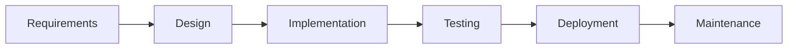
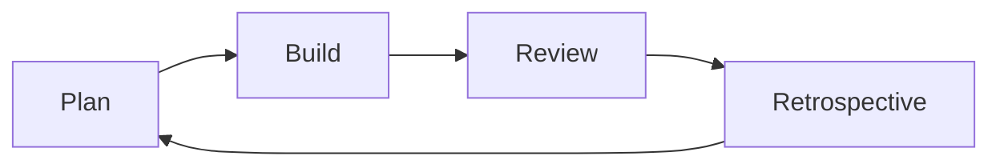
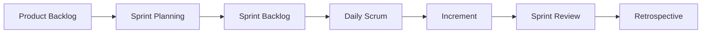

# SDLC

Waterfall, Agile, Scrum, and Kanban.

### Related docs

* [Computer science](./7_special_cs.md) · [Architecture patterns](./7_special_architecture.md) · [SOLID](./7_special_engineering.md) · [Design patterns](./7_special_patterns.md) · [SDLC](./7_special_sdlc.md) · [Testing](./7_special_testing.md) · [Web security](./7_special_security.md) · [Interview leftovers](./7_special_interview.md) · [CI/CD](./10_build_interview.md#what-is-cicd) · [DevOps](./15_devops.md)

### Sections

- [11. SDLC & Agile](#11-sdlc-agile)
- [Code refactoring](#code-refactoring)

---

## 11. SDLC & Agile

  
Software design methodology

### Software design methodology

**Definition:** A shared way to plan, build, ship, and improve software so the team can coordinate work, manage risk, and match how the business actually changes.

**How it works:**

Companies need to **test hypotheses fast** — drop the wrong ones and grow the ones that work. A methodology is the operating system for that: who decides priority, how work flows, when users see value, and how the team reacts when requirements move.

Requirements → Design → Implementation → Testing → Deployment → Maintenance

Same phases, different **order and feedback**. Waterfall runs them once, end-to-end. Agile repeats a short slice of the whole cycle so the product can change before years of work are wasted.

**When to use:** Any team larger than one person; interviews (“how does your team ship?”); choosing Waterfall vs Scrum vs Kanban from **business constraints**, not fashion.

**Pluses and minuses:**

| + (formal methodology) | − |
|---------------------------|------|
| Shared language for status, roles, and risk | Cargo-cult process (“we do standups”) without shipping |
| Checkpoints before irreversible spend | Overhead if the process is heavier than the product |

**Thoughts:** *Methodologies exist so delivery matches uncertainty — software changes cheaper than bridges, so process should allow change.*

**Sources:**

[Doka — Agile](https://doka.guide/tools/agile/)

---

  
Development methodologies

### Development methodologies

**Definition:** Methodologies are structured practices for organizing code and teams — distinct from language paradigms (how you express logic).

| Category | Examples | Notes |
| --- | --- | --- |
| CSS architecture | BEM, SMACSS, OOCSS, Atomic Design | [CSS Architecture](./2_css_architecture.md) |
| App structure | MVC, MVVM, Flux, Redux | [Architecture patterns](./7_special_architecture.md) |
| Process | TDD, BDD, DDD | [Testing](./7_special_testing.md#12-testing) |
| Principles | DRY, KISS, SOLID, YAGNI | [SOLID](./7_special_engineering.md#9-oop-and-solid) · [DRY, KISS, YAGNI](./0_system_design_principles.md) |
| Frontend | Component-driven, mobile-first, progressive enhancement | Product/UX conventions |

**How it works:** Paradigms answer *how to express logic* (FP vs OOP). Methodologies answer *how to structure a codebase and collaborate* (MVC, TDD, BEM). Use both: paradigm for the problem, methodology for maintainability at scale.

**Thoughts:** Do not file this under JavaScript language notes — JS is multi-paradigm; these practices apply across stacks. JS angle: [Programming paradigms](./3_js_core.md#programming-paradigms).

**Sources:** [Doka — programming paradigms](https://doka.guide/tools/programming-paradigms/) · [Doka — Agile](https://doka.guide/tools/agile/) · [getbem.com](http://getbem.com/)

  
Waterfall

### Waterfall

**Definition:** Linear **sequential** SDLC model — each phase (requirements → design → implementation → testing → deployment → maintenance) completes before the next begins.

**How it works:**

1. **Requirements** — full spec documented upfront (often a huge TZ / contract).
2. **Design** — architecture and UI frozen.
3. **Implementation** — build to spec.
4. **Verification** — test against the requirements doc.
5. **Deployment** — release once (or rarely).
6. **Maintenance** — fixes only; new work restarts change-control.

Copied from construction / electronics / manufacturing. Software is more dynamic: changing an export format is not like changing the number of piers on a railway bridge — so a frozen multi-year spec ages badly.

**Classic failure modes** (why Agile spread in the 1990s–2000s):

- **Missed dates** — the longer the horizon, the harder to hit; slipped years become business conflict.
- **Obsolete product** — market and users move while the team is still in “implementation.”
- **Painful change** — even a small addition reopens the whole approval chain, often slower than coding the change.

**When to use:** Fixed requirements, compliance-heavy domains (medical devices, aerospace, government contracts), hardware-coupled software, **agency / fixed-price** work where the client pays for a specified result.

**Pluses and minuses:**

| + | − |
|------|------|
| Clear milestones and documentation | Late feedback — users see the product at the end |
| Works for fixed scope and budgets | Expensive to change after design |
| Traceability for regulated industries | Assumes requirements are knowable upfront |
| Predictable for contract bidding | Long time without shippable value |

**Examples:**

**Thoughts:** Rarely pure waterfall in modern **product** teams — often hybrid (iterative chunks inside phases). Still common in **outsourcing**: client pays for a result; many studios still use Agile **internally** (range estimate, bill actual time). Contrast with [Agile](#agile).

**Sources:**

[Doka — Agile](https://doka.guide/tools/agile/) · [SDLC methodologies](https://habr.com/ru/companies/edison/articles/269789/)

---

  
Iterative / Incremental

### Iterative / Incremental

**Definition:** Repeated cycles of build → feedback → refine. Incremental delivers usable slices each cycle.

**When to use:**

Most modern products; foundation of Agile.

---

**Pluses and minuses:**

| + | − |
|------|------|
| Early feedback | Scope creep without discipline |
| Reduced big-bang risk | |

  
Spiral model

### Spiral model

**Definition:** Cycles of plan → risk analysis → build → evaluate; risk-driven.

**When to use:**

Large, high-risk systems (aerospace, enterprise).

---

**Pluses and minuses:**

| + | − |
|------|------|
| Explicit risk management | Heavy for small projects |
| | |

  
V-Model

### V-Model

**Definition:** Each development phase paired with a testing phase (requirements ↔ acceptance tests).

**When to use:**

Safety-critical, medical, embedded with strict validation.

---

**Pluses and minuses:**

| + | − |
|------|------|
| Test planning early | Rigid |
| Traceability | |

  
RAD (Rapid Application Development)

### RAD (Rapid Application Development)

**Definition:** Prototype fast, iterate on user feedback, minimize upfront design.

**When to use:**

UI-heavy apps, uncertain requirements, internal tools.

---

**Pluses and minuses:**

| + | − |
|------|------|
| Fast time to demo | Can sacrifice architecture |
| User-driven | |

  
Agile

### Agile

**Definition:**

A **mindset** (not a single process): values and principles from the 2001 Agile Manifesto. Frameworks like Scrum and Kanban implement them. Goal: people, working software, and **fast delivery of features** so hypotheses can be validated.

**Four values** (left side valued *more*, not “instead of” the right):

| We value more | Than |
|---------------|------|
| Individuals and interactions | Processes and tools |
| Working software | Comprehensive documentation |
| Customer collaboration | Contract negotiation |
| Responding to change | Following a plan |

**How it works:**

- Short cycles that include analysis, build, test, and a **usable** slice — not years of spec-then-code.
- **Backlog** ordered by value (and tech debt); the team pulls the top items.
- Stakeholders and developers work together continuously; change is expected, even late.
- **Working software** is the primary measure of progress; face-to-face (or equivalent) communication is preferred.
- Teams are trusted, self-organizing; they inspect how they work and adjust (retros).

**Twelve principles** (compressed from [agilemanifesto.org/principles](https://agilemanifesto.org/principles.html)):

1. Highest priority: satisfy the customer via **early and continuous** delivery of valuable software.
2. Welcome changing requirements, even late.
3. Deliver working software frequently (weeks to months; prefer shorter).
4. Business people and developers work together **daily**.
5. Build around motivated people; give support and trust.
6. Most efficient communication: conversation (face-to-face as the default).
7. Working software = primary progress metric.
8. Sustainable pace indefinitely (sponsors, developers, users).
9. Continuous attention to technical excellence and good design.
10. Simplicity — maximize the work **not** done.
11. Best designs emerge from self-organizing teams.
12. Regular reflection; tune behavior.

**When to use:** Uncertain requirements, product/SaaS, startups. Implementations: [Scrum](#scrum) (sprints), [Kanban](#kanban) (flow), XP (engineering practices). CI/CD shortens the same loop — [10_build.md — CI/CD](./10_build_interview.md#what-is-cicd).

**Pluses and minuses:**

| + | − |
|------|------|
| Frequent value and learning | Needs an engaged product owner / customer |
| Adapts to market and user feedback | “Agile theater” = ceremonies without shipping |
| Reduces big-bang release risk | Awkward for rigid fixed-price/fixed-scope contracts |
| Continuous improvement via retros | Architecture can drift without discipline |

**Examples:**

**Thoughts:** Agile ≠ no docs — **just enough**, living docs. The word is often **marketing** on job posts; ask how the team actually ships. Not a silver bullet — see [Not a silver bullet](#not-a-silver-bullet).

**Sources:**

[Agile Manifesto](https://agilemanifesto.org/) · [Principles](https://agilemanifesto.org/principles.html) · [Doka — Agile](https://doka.guide/tools/agile/)

---

  
Scrum

### Scrum

**Definition:** Lightweight Agile **framework** (Scrum Guide 2020) for complex work: a small Scrum Team delivers a usable **Increment** every **Sprint**. Empiricism + lean thinking; pillars **transparency, inspection, adaptation**. Values: **commitment, focus, openness, respect, courage**.

**How it works:**

The **Sprint** is the container for all other events — a fixed-length iteration (**one month or less**, commonly 1–4 weeks). A new Sprint starts immediately after the previous one. The Increment should be **usable** (Definition of Done); it *may* be released before the Sprint Review (the Review is not a release gate).

| Accountability | Role |
|----------------|------|
| **Product Owner** | One person (not a committee). Maximizes product value; orders the Product Backlog; Product Goal. |
| **Scrum Master** | Accountable for Scrum as defined and for team effectiveness: coach, remove impediments, keep events useful and timeboxed. |
| **Developers** | Cross-functional people who create the Increment; own Sprint Backlog and Definition of Done. |

Typical team size: **10 or fewer**, self-managing, no sub-teams.

| Artifact | Commitment |
|----------|------------|
| **Product Backlog** | Emergent ordered list of everything that might improve the product (features **and** tech debt). **Product Goal**. Refined ongoing (break down, add detail, size). |
| **Sprint Backlog** | Sprint Goal (why) + selected items (what) + plan (how). Owned by Developers; updated during the Sprint. |
| **Increment** | Additive, verified, usable. **Definition of Done** — if not Done, it is not an Increment (back to backlog). |

| Event | Purpose (Guide) |
|-------|-----------------|
| **Sprint Planning** | Why valuable → Sprint Goal; what can be Done; how. Timebox ≤ 8h for a 1-month Sprint. |
| **Daily Scrum** | 15 min, Developers: inspect progress toward Sprint Goal, adapt the plan for the next day. |
| **Sprint Review** | Inspect Increment with stakeholders; adapt Product Backlog. Working session, not a slide deck. ≤ 4h / month. |
| **Sprint Retrospective** | Inspect people, process, tools, DoD; pick improvements. Ends the Sprint. ≤ 3h / month. |

During the Sprint: do not endanger the Sprint Goal; quality does not drop; backlog can be **refined**; scope can be renegotiated with the PO as learning happens. Only the PO may **cancel** a Sprint if the Goal is obsolete.

Rugby-style “scrum” popularized in a 1986 HBR paper (Takeuchi/Nonaka). Schwaber & Sutherland developed software Scrum in the early 1990s (OOPSLA 1995); first Scrum Guide 2010, current **November 2020**. Official: [scrumguides.org](https://scrumguides.org/scrum-guide.html) / [scrum.org](https://www.scrum.org/).

**When to use:** Product squads with changing priorities and a dedicated cross-functional team. Heavy if the work is a pure interrupt queue — consider [Kanban](#kanban).

**Pluses and minuses:**

| + | − |
|------|------|
| Cadence, transparency, regular inspect/adapt | Ceremony cost; cargo-cult “Scrum” if events are skipped or empty |
| Frequent stakeholder feedback on a working Increment | Needs a real PO; PO bottleneck if they are a committee in disguise |
| Makes process problems visible | Guide: partial Scrum is **not** Scrum — many teams still tailor (Scrumban) |

**Examples:**

**Thoughts:**

Scrum is first a pattern of **interaction** aimed at regular, quality delivery — not a meeting checklist. Many teams drop events; others hire a Scrum Master to run the framework well.

*Sprint = timeboxed inspect-and-adapt loop that produces a Done Increment toward a Product Goal.*

**Sources:**

[Scrum Guide 2020](https://scrumguides.org/scrum-guide.html) · [Doka — Agile](https://doka.guide/tools/agile/)

---

  
Kanban

### Kanban

**Definition:** Flow method: **visualize** the pipeline, **limit WIP**, **pull** work when a person (or column) has capacity. No required Sprint. Originated at **Toyota** (1960s, manufacturing); adapted to software in the 2000s.

**How it works:**

1. **Visualize** — columns match real handoffs (e.g. Ready for design → Ready for dev → Review → Done).
2. **Pull** — any designer takes from “ready for design”; any developer from “ready for development” — not a manager pushing a whole sprint of mixed work.
3. **Limit WIP** — cap items per person or per column so queues do not hide overload.
4. **Find bottlenecks** — if cards pile up in “Ready for development,” **dev capacity** is the constraint of the whole team; fix the bottleneck, do not start more design.
5. **Measure flow** — cycle time, throughput, cumulative flow (forecast without a Sprint Goal).

**When to use:** Work that must pass **several roles** in sequence (design → code → QA); support/on-call; DevOps/SRE; maintenance mixed with interrupts. Often combined with Scrum (**Scrumban**).

**Pluses and minuses:**

| + | − |
|------|------|
| Transparent progress; bottlenecks are visible | No built-in planning rhythm or Sprint Goal |
| Pull + WIP limits cut multitasking | Weak for a greenfield “we need a shared cadence” product |
| Fits interrupt-driven work | Dates are forecasts from flow metrics, not sprint commitments |
| Continuous delivery, no sprint boundary | Infinite WIP if limits are ignored |

**Examples:**

| Ready for design | Ready for dev | In progress (WIP ≤ 3) | Review | Done |
|------------------|---------------|----------------------|--------|------|
| Landing v2 | Auth API | Feature A | PR #101 | v2.1 |
| | Bug #42 | | | |

**Thoughts:**

Kanban ≠ “no planning.” A Jira/GitHub board is only Kanban if **WIP limits and pull** are real.

*Make the queue visible; the column that fills up is the team’s bottleneck.*

**Sources:**

[Doka — Agile](https://doka.guide/tools/agile/) · [Kanban Guide](https://kanbanguides.org/)

---

  
Not a silver bullet

### Not a silver bullet

**Definition:** No methodology (including Agile) fits every company or project. Pick the process that serves **business needs and the team** — not the job-ad keyword.

**How it works:**

- Waterfall / heavy spec still fits when scope is truly fixed or legally frozen.
- Many teams use **only some** Agile principles (short demos, backlog, WIP limits) without full Scrum — that can be healthy.
- **Product** companies almost always want frequent delivery and a changeable result.
- **Agency / outsourcing** often sells a result (classic contract) but may run Scrum/Kanban **inside** (estimate range, invoice time).
- “Agile” on a vacancy ≠ inspect-and-adapt in practice (**Agile theater**).

**When to use:** Interview question “Waterfall vs Agile?” — answer with **uncertainty, feedback cost, and contract shape**, then name Scrum vs Kanban.

**Pluses and minuses:**

| + of mixing | − of dogma |
|----------------|---------------|
| Process matches risk and contract type | Forcing Scrum ceremonies on a support queue (or Waterfall on a startup) wastes time |
| Honest hybrids (Scrumban, time-and-materials) | Manifesto values without shipping working software |

**Thoughts:** *Agile is a means to validate hypotheses and ship; if it does not serve that, drop or shrink it.*

**Sources:**

[Doka — Agile](https://doka.guide/tools/agile/)

---

  
DevOps

### DevOps

**Definition:** Culture and practice uniting development and operations — automation, CI/CD, and shared ownership of reliability.

Canonical notes live in [DevOps](./15_devops.md). Pipeline tooling: [CI/CD](./10_build_interview.md#what-is-cicd).

---

  
Code refactoring

### Code refactoring

**Definition:** Refactoring improves internal structure, readability, and maintainability **without changing external behavior**.

**When to use:** After green tests; small steps; before adding features to tangled code.

**Pluses and minuses:**

| + | − |
|------|------|
| Reduces tech debt incrementally | Risky without tests |
| Enables safer feature work | Can become endless "cleanup" without product value |

**Examples:** Extract duplicated validation into `validateUser(input)` — same API, clearer modules.

**Thoughts:** "Refactor" ≠ rewrite. Boy Scout rule: leave code slightly better. Never refactor and change behavior in one commit.

**Sources:**

[refactoring.com](https://refactoring.com/)

---

