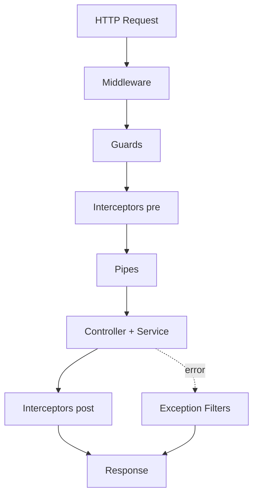

# Node.js — Runtime, I/O & Server Patterns

Server-side JavaScript runtime built on V8 and libuv. Covers non-blocking I/O, modules, HTTP, streams, Express, auth, and production patterns.

### Related docs

* [JS Async](./3_js_async.md) · [JS Core](./3_js_core.md) · [Memory: stack and heap](./3_js_core.md#memory-stack-heap) · [Web API](./6_web_api.md) · [URI / URL anatomy](./6_web_api.md#uri-url--urn) · [Web server](./6_web_api.md#web-server) · [Browser File API](./3_js_browser.md#formdata-file-api-filereader)
* [Databases](./9_database.md) · [System Design](./0_system_design.md) · [OS processes & signals](./0_system_design.md#processes-multitasking) · [DevOps — Unix processes](./15_devops.md#unix-process-management) · [Docker — container lifecycle](./10_build.md#container-lifecycle) · [Docker — bind mounts](./10_build.md#bind-mounts) · [Interview hub](./0_interview.md)

[← Back to interview hub](./0_interview.md)

### Main concepts

| Area | Topics |
|------|--------|
| **Runtime** | V8, libuv, single-threaded event loop, worker_threads, cluster |
| **Modules** | CommonJS vs ESM, `import`/`require`, package.json, npm |
| **I/O** | Streams, buffers, backpressure, [files & file systems](#files--file-systems), `fs` |
| **HTTP** | Express middleware, routing, error handling |
| **Frameworks** | NestJS (DI, guards, pipes), Express vs Fastify |
| **Security** | JWT, bcrypt, env secrets, input validation |
| **Process** | child_process, cluster, worker_threads, PM2 |
| **Runtime choice** | Node.js vs Go vs Elixir — when to pick each |

### Sections

- [Node runtime & core](#node-runtime)
- [Modules & package management](#modules-tooling)
- [Streams, buffers & I/O](#streams-io)
- [Built-in modules](#built-in-modules)
- [Express & HTTP](#express-http)
- [Auth & security](#auth-security)
- [Validation](#validation)
- [Process, cluster & real-time](#process-cluster)
- [Koa](#koa)
- [NestJS](#nestjs)
- [Choosing a backend runtime](#runtime-choice)
- [Interview Practice](#interview-practice)

### Topic template

Every major topic in `<details>` sections follows:

**Definition** → **How it works** → **Cases** → **Pros / Cons** → **Example** → **Notes** → **Source**

### Node.js runtime

**Definition:** Node.js is a cross-platform, server-side JavaScript runtime built on V8 and libuv. It runs JS outside the browser and provides APIs for files, networking, processes, and more.

| Pros | Cons |
|------|------|
| Same language on client and server | Single-threaded JS — CPU-bound work blocks the loop |
| Huge npm ecosystem | Callback/promise complexity for beginners |
| Non-blocking I/O for high concurrency | Not ideal for heavy CPU tasks without workers |

**When to use:** APIs, real-time apps, CLIs, SSR, microservices, tooling.

**When NOT to use:** CPU-intensive computation without `worker_threads` or a separate worker service.

**Example:**

<details>
  <summary>Code</summary>

```js
import { createServer } from 'node:http';

createServer((req, res) => {
  res.writeHead(200, { 'Content-Type': 'text/plain' });
  res.end('Hello from Node.js');
}).listen(3000);
```

</details>

**Source:** [nodejs.org](https://nodejs.org/en/about) · [learn.javascript.ru/nodejs](https://learn.javascript.ru/nodejs)

### Event loop & modules

**Definition:** Node.js runs JavaScript on a single thread while libuv handles async I/O via an event loop (timers, I/O callbacks, microtasks). Code is organized into modules via CommonJS (`require`) or ESM (`import`).

| Phase / queue | Examples |
|---------------|----------|
| Timers | `setTimeout`, `setInterval` |
| I/O callbacks | completed fs/network callbacks |
| Microtasks | `Promise.then`, `queueMicrotask` |
| `process.nextTick` | runs before other microtasks |

**Key idea:** I/O is non-blocking; CPU work on the main thread blocks everything. Offload with `worker_threads`, `child_process`, or cluster.

**Example:**

<details>
  <summary>Code</summary>

```js
// CommonJS
const fs = require('node:fs');
fs.readFile('./data.txt', 'utf8', (err, data) => console.log(data));

// ESM
import fs from 'node:fs/promises';
const data = await fs.readFile('./data.txt', 'utf8');
```

</details>

**Source:** [nodejs.org event loop](https://nodejs.org/en/docs/guides/event-loop-timers-and-nexttick) · [learn.javascript.ru/modules](https://learn.javascript.ru/modules)

### Express & streams

**Definition:** Express is a minimal HTTP framework for Node.js; streams are interfaces for reading/writing data in chunks instead of loading entire files into memory.

| Tool | Role |
|------|------|
| Express | routing, middleware pipeline, static files |
| Readable stream | read data in chunks (files, HTTP body) |
| Writable stream | write data in chunks (response, disk) |
| `pipe()` | connect streams with backpressure |

**When to use streams:** Large files, uploads/downloads, compression, real-time data.

**Example:**

<details>
  <summary>Code</summary>

```js
import express from 'express';
import { createReadStream } from 'node:fs';

const app = express();

app.get('/file', (req, res) => {
  createReadStream('./large.bin').pipe(res);
});

app.use((req, res, next) => {
  console.log(`${req.method} ${req.url}`);
  next();
});
```

</details>

**Source:** [expressjs.com](https://expressjs.com/) · [nodejs.org streams](https://nodejs.org/api/stream.html)

---

<a name="node-runtime"></a>

## Node runtime & core

<details>
  <summary>Node.js overview</summary>

### Node.js overview

**Definition:** Node.js is a free, open-source, cross-platform server-side runtime that lets developers build scalable applications with JavaScript.

**Capabilities:**

| Feature | Description |
|---------|-------------|
| File I/O | read/write files on disk |
| Networking | HTTP servers, TCP/UDP sockets |
| Databases | connect via drivers (see [9_database.md](./9_database.md)) |
| Code sharing | reuse JS between frontend and backend |
| Packages | npm registry with millions of modules |

**Architecture:** V8 (JS engine) + libuv (async I/O, thread pool) + Node bindings.

**Globals:**

| Global | Purpose |
|--------|---------|
| `__dirname` | directory path of current module |
| `__filename` | full path of current module file |
| `process.argv` | CLI arguments array |
| `process.env` | environment variables |

**Example:**

<details>
  <summary>Code</summary>

```js
console.log(__dirname);
console.log(process.argv.slice(2)); // user args after node script.js
```

</details>

**Source:** [nodejs.org](https://nodejs.org/en/about)

</details>

<details>
  <summary>Event loop</summary>

### Event loop

**Definition:** The event loop is Node's mechanism for scheduling async work. libuv's demultiplexer queues tasks; the loop processes macro- and micro-tasks and returns results to your application.

**How it works:**

| Phase | What runs |
|-------|-----------|
| timers | `setTimeout`, `setInterval` callbacks due |
| pending | Internal I/O callbacks |
| idle, prepare | Internal |
| poll | Retrieve new I/O events; execute I/O callbacks |
| check | `setImmediate` callbacks |
| close | `close` event callbacks |

Between phases: drain `process.nextTick` queue, then microtasks (`Promise.then`).

**Queues:**

| Type | Examples |
|------|----------|
| Macro tasks | `setTimeout`, `setInterval`, I/O callbacks |
| Micro tasks | `Promise.then`, `queueMicrotask` |
| `nextTick` | `process.nextTick` — runs before other microtasks |

| Pros | Cons |
|------|------|
| Handles thousands of concurrent I/O connections | CPU work blocks all callbacks |
| Single-threaded JS avoids locks | One slow sync loop stalls everything |

**Cases:** Never use `fs.readFileSync` on request path in production. Offload CPU to `worker_threads`.

**Flow:** App sends async task → demultiplexer → event queue → loop executes → callback runs in app.

**Example:**

<details>
  <summary>Code</summary>

```js
console.log('1');
setTimeout(() => console.log('2'), 0);
Promise.resolve().then(() => console.log('3'));
process.nextTick(() => console.log('4'));
console.log('5');
// 1, 5, 4, 3, 2
```

</details>

**Source:** [nodejs.org event loop](https://nodejs.org/en/docs/guides/event-loop-timers-and-nexttick)

</details>

<details>
  <summary>Global object</summary>

### Global object

**Definition:** In Node.js, the global object (`global`) is the top-level namespace — similar to `window` in browsers. Built-ins and user-defined top-level bindings are accessible across modules.

| Property | Purpose |
|----------|---------|
| `console` | logging and debugging |
| `process` | process info, env, exit |
| `Buffer` | binary data |
| `setTimeout` / `setInterval` | timers |
| `__dirname` / `__filename` | module paths (CommonJS) |

**Key idea:** Avoid polluting `global`; prefer explicit `require`/`import` and module exports.

**Example:**

<details>
  <summary>Code</summary>

```js
console.log(process.pid);
console.log(process.env.NODE_ENV);
```

</details>

**Source:** [nodejs.org globals](https://nodejs.org/api/globals.html)

</details>

<details>
  <summary>Core terminology</summary>

### Core terminology

**Definition:** Key concepts for understanding how Node.js applications are structured and run.

| Term | Definition |
|------|------------|
| Process | running instance of a program with its own memory and resources |
| Thread | unit of execution within a process |
| Module | self-contained unit of code with exports |
| Barrel file | re-exports multiple modules from one index file |
| Caching | storing frequently accessed data in memory |
| Dependencies | external packages required at runtime |
| DevDependencies | packages needed only during development |
| Dependency Injection | dependencies provided from outside, not created inside |
| Environment variables | OS-level config via `process.env` |
| `.env` file | local env vars (never commit secrets) |
| `nodemon` | dev tool that restarts Node on file changes |

**Note:** `process.env` is a Node global; the `dotenv` package loads `.env` files into it at startup.

**Source:** [nodejs.org process](https://nodejs.org/api/process.html#processenv)

</details>

<details>
  <summary>Single-threaded vs multi-threaded</summary>

### Single-threaded vs multi-threaded

**Definition:** Node.js runs JavaScript on **one main thread**, but libuv uses a thread pool for blocking I/O (fs, crypto, DNS). For parallelism use cluster, child processes, or worker threads.

| Approach | Use case |
|----------|----------|
| Main thread + event loop | I/O-bound servers |
| `worker_threads` | CPU-bound JS in same process |
| `child_process` / `cluster` | separate processes, fault isolation |
| Multiple servers / Docker | horizontal scaling |

**Interview answer:** Node is single-threaded for JS execution; multi-threaded for I/O via libuv.

**Source:** [nodejs.org worker_threads](https://nodejs.org/api/worker_threads.html) · [nodejs.org cluster](https://nodejs.org/api/cluster.html)

</details>

<details>
  <summary>worker_threads</summary>

### worker_threads

**Definition:** `worker_threads` runs JavaScript in parallel threads within the same process — separate V8 isolates with optional `SharedArrayBuffer` for shared memory.

**How it works:**

1. Main thread creates `new Worker('./worker.js', { workerData })`.
2. Worker runs its own event loop and JS context.
3. Communicate via `postMessage` / `on('message')` (structured clone) or `SharedArrayBuffer`.
4. Worker exits when script completes or `worker.terminate()` is called.

| vs cluster/child_process | worker_threads | cluster |
|--------------------------|----------------|---------|
| Memory | Shared process (optional shared memory) | Separate processes |
| Startup | Lighter | Heavier (new V8) |
| Fault isolation | Worker crash can take process | Process isolation |
| Use case | CPU-bound JS (hash, image) | HTTP workers per CPU |

| Pros | Cons |
|------|------|
| True parallel CPU work in Node | No DOM; message-passing overhead |
| Lighter than fork | GIL-like — one JS thread per worker |
| `workerData` passes initial state | Debugging harder |

**Cases:** Password hashing batches, image resize, PDF parsing, heavy JSON transform — not for simple I/O (event loop handles that).

**Example:**

<details>
  <summary>Code</summary>

```js
import { Worker, isMainThread, parentPort, workerData } from 'node:worker_threads';

if (isMainThread) {
  const worker = new Worker(new URL(import.meta.url), {
    workerData: { n: 40 },
  });
  worker.on('message', (result) => console.log('fib:', result));
} else {
  const fib = (n) => (n <= 1 ? n : fib(n - 1) + fib(n - 2));
  parentPort.postMessage(fib(workerData.n));
}
```

</details>

**Notes:** Do not spawn workers for every request — use a pool. Worker files can be `.js` with `type: module` in package.json.

**Source:** [nodejs.org worker_threads](https://nodejs.org/api/worker_threads.html)

</details>

---

<a name="modules-tooling"></a>

## Modules & package management

<details>
  <summary>npm, npx & nvm</summary>

### npm, npx & nvm

**Definition:** Tooling for installing packages, running binaries, and managing Node versions.

| Tool | Purpose |
|------|---------|
| `npm` | package manager — install, publish, scripts |
| `npx` | run package binaries without global install |
| `nvm` | switch between Node.js versions per project |

**SemVer:** `MAJOR.MINOR.PATCH` — breaking / feature / fix.

**Example:**

<details>
  <summary>Code</summary>

```bash
npm install express
npx create-next-app@latest my-app
nvm install 20 && nvm use 20
```

</details>

**Source:** [docs.npmjs.com](https://docs.npmjs.com/) · [github.com/nvm-sh/nvm](https://github.com/nvm-sh/nvm)

</details>

<details>
  <summary>npm vs yarn vs pnpm</summary>

### npm vs yarn vs pnpm

**Definition:** Package managers for JavaScript. All use the npm registry; differ in lockfile format, install speed, and dependency layout.

| | npm | Yarn | pnpm |
|---|-----|------|------|
| Lock file | package-lock.json | yarn.lock | pnpm-lock.yaml |
| Install speed | good | fast (parallel) | very fast (content-addressable store) |
| Disk usage | per-project copies | per-project copies | shared store, hard links |
| Default with Node | yes | no | no |

**When to use:** stick with team/project convention; pnpm for monorepos and disk efficiency.

**Source:** [pnpm.io](https://pnpm.io/) · [yarnpkg.com](https://yarnpkg.com/)

</details>

<details>
  <summary>Dependencies & package.json</summary>

### Dependencies & package.json

**Definition:** `package.json` describes the project; `node_modules` holds installed packages; `package-lock.json` pins exact versions for reproducible installs.

| Field / file | Role |
|--------------|------|
| `dependencies` | required at runtime |
| `devDependencies` | build, test, lint only |
| `node_modules` | installed package tree |
| `package-lock.json` | locked dependency graph |

**Example:**

<details>
  <summary>Code</summary>

```bash
npm install lodash          # dependencies (-S default)
npm install -D jest         # devDependencies
```

</details>

**Source:** [docs.npmjs.com package.json](https://docs.npmjs.com/cli/v10/configuring-npm/package-json)

</details>

<details>
  <summary>require & packages</summary>

### require & packages

**Definition:** A package is a distributable unit of code (library, module, or app). `require()` (CommonJS) or `import` (ESM) loads modules; metadata lives in `package.json`.

| System | Syntax | Notes |
|--------|--------|-------|
| CommonJS | `const fs = require('fs')` | synchronous load, `module.exports` |
| ESM | `import fs from 'fs'` | static analysis, `export` |

**Example:**

<details>
  <summary>Code</summary>

```js
// CommonJS
const express = require('express');
module.exports = { createApp: () => express() };

// ESM
import express from 'express';
export function createApp() { return express(); }
```

</details>

**Source:** [nodejs.org modules](https://nodejs.org/api/modules.html) · [nodejs.org esm](https://nodejs.org/api/esm.html)

</details>

<details>
  <summary>ESM vs CommonJS (deep dive)</summary>

### ESM vs CommonJS (deep dive)

**Definition:** Node supports two module systems. **CommonJS (CJS)** uses `require`/`module.exports` (synchronous load). **ESM** uses `import`/`export` (static analysis, async load).

**How it works:**

| Aspect | CommonJS | ESM |
|--------|----------|-----|
| Syntax | `require()`, `module.exports` | `import`, `export` |
| Loading | Synchronous, runtime | Asynchronous, parsed before run |
| `this` at top level | `module.exports` | `undefined` (strict) |
| `__dirname` / `__filename` | Available | Use `import.meta.url` |
| JSON import | `require('./x.json')` | `import x from './x.json' with { type: 'json' }` |
| Dynamic import | `require(dynamic)` | `await import(dynamic)` |
| Tree-shaking | Limited | Better (static imports) |
| Interop | ESM can `import` CJS default | CJS `require()` of ESM only if ESM is async |

**Enabling ESM:**

```json
{ "type": "module" }
```

or `.mjs` extension. `.cjs` forces CommonJS in `"type": "module"` projects.

**How interop works:** `import fs from 'fs'` — CJS module's `module.exports` becomes default export. Named exports from CJS may need `import pkg from 'cjs'; const { x } = pkg`.

| Pros (ESM) | Cons (ESM) |
|------------|------------|
| Standard in browsers and modern Node | Ecosystem still migrating |
| Top-level `await` | `__dirname` workaround needed |
| Static analysis, tree-shaking | Some tools expect CJS |

**Cases:** New projects → ESM (`"type": "module"`). Legacy libs → CJS. Dual packages publish both `main` and `exports`.

**Example:**

<details>
  <summary>Code</summary>

```js
// ESM — dirname equivalent
import { fileURLToPath } from 'node:url';
import { dirname, join } from 'node:path';
const __filename = fileURLToPath(import.meta.url);
const __dirname = dirname(__filename);

// Dynamic import in CJS
const { createServer } = await import('node:http');
```

</details>

**Notes:** `require` is not defined in native ESM. Use `createRequire(import.meta.url)` from `node:module` for legacy `require` in ESM files.

**Source:** [nodejs.org ESM](https://nodejs.org/api/esm.html) · [nodejs.org modules](https://nodejs.org/api/modules.html)

</details>

<details>
  <summary>CLI commands & flags</summary>

### CLI commands & flags

**Definition:** Common shell and npm commands for Node.js development.

| Command | Purpose |
|---------|---------|
| `npm i` | install dependencies from package.json |
| `npm install -S pkg` | add runtime dependency |
| `npm install -D pkg` | add dev dependency |
| `npm publish` | publish package to registry |
| `ls` / `ls -la` | list files (include hidden with `-a`) |
| `cat file` | print file contents |
| `touch file` | create empty file |
| `rm` | remove files/directories |
| `pwd` | print working directory |
| `chmod +x file` | make file executable |
| `history` | list previous shell commands |

**Example:**

<details>
  <summary>Code</summary>

```bash
npm install -D typescript
npm run build
```

</details>

**Source:** [docs.npmjs.com cli](https://docs.npmjs.com/cli/v10/commands)

</details>

<details>
  <summary>Project structure</summary>

### Project structure

**Definition:** Organizing Node.js projects for maintainability — separate routes, controllers, services, and config.

**Common layouts:**

| Pattern | Structure |
|---------|-----------|
| MVC | `routes/` → `controllers/` → `models/` |
| Feature-based | `features/users/`, `features/auth/` |
| Clean architecture | `domain/`, `use-cases/`, `infrastructure/` — [three-layer notes](./0_system_design.md#three-layer-architecture-doka) |

**Example:**

<details>
  <summary>Code</summary>

```
src/
  routes/
  controllers/
  services/
  middleware/
  config/
  index.js
```

</details>

**Source:** [nodejs.org best practices](https://github.com/goldbergyoni/nodebestpractices)

</details>

---

<a name="streams-io"></a>

## Streams, buffers & I/O

<details>
  <summary>Buffer</summary>

### Buffer

**Definition:** `Buffer` is a global Node.js class for fixed-size binary data (extends `Uint8Array`). Used for files, network packets, images, and any non-text data.

| Concept | Description |
|---------|-------------|
| Encoding | converting Buffer ↔ string (`utf8`, `hex`, `base64`) |
| Decoding | string → Buffer |
| Why not strings? | binary data corrupts in JS strings |

**Example:**

<details>
  <summary>Code</summary>

```js
const buf = Buffer.from('Hello', 'utf8');
console.log(buf);           // <Buffer 48 65 6c 6c 6f>
console.log(buf.toString('hex')); // 48656c6c6f

const fromHex = Buffer.from([0x1a, 0x1b, 0x1c]);
```

</details>

**Source:** [nodejs.org buffer](https://nodejs.org/api/buffer.html)

</details>

<details>
  <summary>Encoding & numbering systems</summary>

### Encoding & numbering systems

**Definition:** Encoding transforms data into a transmittable format. Unicode maps characters to numbers; UTF-8/UTF-16 are common encodings.

| Encoding | Description |
|----------|-------------|
| ASCII | 7-bit English characters |
| UTF-8 | variable 1–4 bytes, web standard |
| UTF-16 | 2 or 4 bytes per character |
| Base64 | binary → ASCII text |
| Hex | base-16 representation |

**Number literals in JS:**

| Base | Prefix | Example |
|------|--------|---------|
| Decimal | — | `25` |
| Binary | `0b` | `0b1011` → 11 |
| Octal | `0o` | `0o25` → 21 |
| Hex | `0x` | `0x2A` → 42 |

**Example:**

<details>
  <summary>Code</summary>

```js
(7).toString(2);  // '111'
Buffer.from('Бе', 'utf8'); // Cyrillic UTF-8 bytes
```

</details>

**Source:** [javascript.info binary-hex](https://javascript.info/binary)

</details>

<details>
  <summary>EventEmitter</summary>

### EventEmitter

**Definition:** Built-in class for the publish/subscribe event pattern. Core to Node's event-driven architecture; many modules extend it.

| Method | Purpose |
|--------|---------|
| `.on(event, fn)` | listen for event |
| `.emit(event, data)` | fire event |
| `.once(event, fn)` | listen once |
| `.off(event, fn)` | remove listener |

**Built-in users:** `http.Server`, `net.Socket`, `fs.ReadStream`, `fs.WriteStream`.

**Example:**

<details>
  <summary>Code</summary>

```js
import { EventEmitter } from 'node:events';

const emitter = new EventEmitter();
emitter.on('data', (chunk) => console.log(chunk));
emitter.emit('data', 'hello');
```

</details>

**Source:** [nodejs.org events](https://nodejs.org/api/events.html)

</details>

<details>
  <summary>Streams</summary>

### Streams

**Definition:** Abstract interface for processing data in chunks — efficient for large files and network transfers. All streams are `EventEmitter` instances.

| Type | Direction | Example |
|------|-----------|---------|
| Readable | read only | `fs.createReadStream` |
| Writable | write only | `fs.createWriteStream` |
| Duplex | read + write | `net.Socket` |
| Transform | modify while piping | `zlib.createGzip` |

**Advantages:**

| Benefit | Why |
|---------|-----|
| Separation of concerns | small composable pieces |
| Flexibility | pipe to multiple destinations |
| Memory efficiency | process chunks, not whole file |
| Time efficiency | start processing before full download |

**Example:**

<details>
  <summary>Code</summary>

```js
import { createReadStream, createWriteStream } from 'node:fs';
import { createGzip } from 'node:zlib';

createReadStream('input.txt')
  .pipe(createGzip())
  .pipe(createWriteStream('input.txt.gz'));
```

</details>

**Source:** [nodejs.org stream](https://nodejs.org/api/stream.html)

</details>

<details>
  <summary>Stream events & backpressure</summary>

### Stream events & backpressure

**Definition:** Readable streams emit `data` chunks in flowing mode. Writable streams emit `drain`, `finish`, `error`. **Backpressure:** pause reading when the writable buffer is full.

| Event | Stream | When |
|-------|--------|------|
| `data` | Readable | chunk available |
| `end` | Readable | no more data |
| `drain` | Writable | buffer emptied, safe to write |
| `finish` | Writable | all data flushed |
| `error` | both | failure |

**Example:**

<details>
  <summary>Code</summary>

```js
readStream.on('data', (chunk) => {
  const ok = writeStream.write(chunk);
  if (!ok) readStream.pause();
});
writeStream.on('drain', () => readStream.resume());
```

</details>

**Source:** [nodejs.org stream backpressure](https://nodejs.org/en/docs/guides/backpressuring-in-streams/)

</details>

---

<a name="built-in-modules"></a>

## Built-in modules

<details>
  <summary>libuv</summary>

### libuv

**Definition:** Cross-platform C library powering Node's async I/O, event loop, thread pool, networking, and file system operations.

**How it works:**

1. JavaScript calls async API (e.g. `fs.readFile`).
2. Node binding hands work to libuv.
3. **Thread pool** (default 4 threads) runs blocking OS calls — file I/O, DNS, crypto, compression.
4. Network I/O uses OS primitives (`epoll`, `kqueue`, `IOCP`) — no thread per connection.
5. Completed callback is queued; **event loop** runs it on the main JS thread.

| Feature | Description |
|---------|-------------|
| Event loop | Schedules timers, I/O callbacks, check, close callbacks |
| Thread pool | Offloads blocking work (`UV_THREADPOOL_SIZE` to tune) |
| Networking | TCP/UDP abstractions |
| File system | Async fs operations via thread pool |

| Pros | Cons |
|------|------|
| Single-threaded JS + efficient I/O | CPU-heavy JS still blocks the loop |
| Cross-platform abstraction | Thread pool size limits parallel fs/crypto |

**Cases:** Increase `UV_THREADPOOL_SIZE` for heavy crypto/fs workloads. CPU-bound JS → `worker_threads`, not bigger thread pool alone.

**Example:**

<details>
  <summary>Code</summary>

```bash
UV_THREADPOOL_SIZE=8 node server.js
```

</details>

**Notes:** libuv is why Node is fast for I/O-bound servers but poor for CPU-bound work on one thread.

**Source:** [libuv docs](http://docs.libuv.org/en/v1.x/) · [nodejs.org event loop](https://nodejs.org/en/docs/guides/event-loop-timers-and-nexttick)

</details>

<details>
  <summary>Files & file systems</summary>

### Files & file systems

**Definition:** A **file** is a named byte sequence stored on a physical medium, plus **attributes** that tell the OS how to handle it. A **file system** is the OS abstraction that allocates that storage, hides hardware differences, and resolves name collisions.

**How it works:**

- RAM holds working data as bytes. Persistence is a named file on disk/SSD (random access) — historically also tape (sequential records) or punch cards (fixed-length records).
- Session: **open** → read/write/attributes → **close**. The kernel tracks each open file with a numeric **file descriptor** (POSIX) or equivalent (Windows). Node maps both to an `fd` / `FileHandle`.
- **Buffering:** writes often land in an OS buffer first, then flush in the background — the UI can look “saved” while the file on disk is still growing.
- Typical OS APIs: `open`, `close`, `read`/`write` (relative to a cursor), `seek`, `delete`, `rename`, read/write attributes.
- **Unix:** devices, directories, and pipes are special files; programs use the same file APIs. Mount attaches another volume into one tree (`mount` / `umount`).

**File systems — models:**

| Model | Idea | Where |
|-------|------|--------|
| Flat (one level) | Unique names in a single namespace | Tiny devices (appliance firmware) |
| Fixed depth | A few hardcoded levels | Routers, TVs |
| Hierarchical | Tree: **root dir**, dirs, **files as leaves** | Desktops, servers, phones |

Collision strategy: forbid duplicate names **in the same directory**. Same basename in different dirs is unique via the **full path**. Separators: `/` (Unix) vs `\` (Windows). Relative names concatenate onto the current (or home) directory.

Unix FS strengths: simple permission model, symbolic links, dirs and devices as files, one mountable namespace.

**Paths (practice):**

- **Absolute** = from the root (`/` or `C:\…`). **Relative** = from the working directory. Relatives stay portable inside a project folder; the OS still converts them to absolute on access.
- **`.`** = current dir, **`..`** = parent, **`~`** = home (usually `/home/user`).
- Unix names are **case-sensitive** (`File1` ≠ `file1`). Windows NTFS usually **preserves case but matches case-insensitively**. Unix forbids `/` and `\0` in names.
- Windows reserved in names: `\ / : * ? " < > |`. Spaces need quotes. Legacy **MAX_PATH ≈ 260**; Windows 10+ can lift it, older clients may still fail.
- **Extension** (`.png`, `.exe`) is a hint for users and default apps. The real type lives in attributes / magic bytes. Unix binaries often have **no** extension; `.sh` / `.conf` are convention.

**Linux FHS (root, not followed 100% by every distro):**

| Dir | Role |
|-----|------|
| `/bin`, `/sbin` | Essential user / system binaries |
| `/boot` | Bootloader + kernel images |
| `/dev` | Device files |
| `/etc` | Host-specific config |
| `/home`, `/root` | User homes; root’s home |
| `/lib` | Shared libs, kernel modules |
| `/mnt`, `/opt` | Temp mounts; extra packages |
| `/proc`, `/sys` | Kernel / sysfs virtual files |
| `/tmp` | Temporary |
| `/usr` | Second-level hierarchy (shareable) |
| `/var` | Variable data (logs, spool) |

**Cases:** Node `fs` / `path`; Docker [bind mounts](./10_build.md#bind-mounts); SPA address bar vs real files ([URI](./6_web_api.md#uri-url--urn), History API); browser user files ([File API](./3_js_browser.md#formdata-file-api-filereader)).

| + | − |
| - | - |
| Hierarchy + path = unique names | Path separators and case differ by OS |
| Unix “everything is a file” unifies APIs | Must close fds or leak until crash |
| Relative project trees move easily | Buffering can delay durable write |

**Example** (Node — open / stat / close; prefer `FileHandle` so the fd is not leaked):

<details>
  <summary>Code</summary>

```js
import { open } from 'node:fs/promises';
import path from 'node:path';

const abs = path.resolve('notes', 'todo.txt'); // OS-correct join
let file;
try {
  file = await open(abs, 'r');
  const stat = await file.stat(); // size, mtime, mode, …
  console.log(stat.size);
} finally {
  await file?.close();
}
```

</details>

**Common pitfalls:** Mixing `/` and `\` by hand instead of `path.join`; assuming case-insensitive names on Linux CI; leaving `fs.open` fds open; treating `.jpg` as a guarantee of JPEG; Windows illegal chars in generated filenames.

**Key idea:** A file is a named byte stream + metadata; the file system is the tree (and APIs) that make that stream portable across disks.

**Source:** [Doka — files & file systems](https://doka.guide/tools/file/) · [nodejs.org fs — file descriptors](https://nodejs.org/api/fs.html#file-descriptors) · [FHS](https://refspecs.linuxfoundation.org/FHS_3.0/fhs/index.html)

</details>

<details>
  <summary>fs (file system)</summary>

### fs (file system)

**Definition:** Built-in module for reading, writing, and managing files and directories. OS model (paths, attributes, buffering, fds): [Files & file systems](#files--file-systems).

| API style | Methods |
|-----------|---------|
| Callback | `fs.readFile`, `fs.writeFile`, `fs.mkdir` |
| Promise | `fs.promises.readFile` |
| Sync | `fs.readFileSync` (blocks event loop) |
| Stream | `fs.createReadStream`, `fs.createWriteStream` |

**Example:**

<details>
  <summary>Code</summary>

```js
import { readFile, writeFile } from 'node:fs/promises';

const data = await readFile('./config.json', 'utf8');
await writeFile('./out.txt', data);
```

</details>

**Source:** [nodejs.org fs](https://nodejs.org/api/fs.html)

</details>

<details>
  <summary>os</summary>

### os

**Definition:** Operating system utility module — platform info, memory, CPUs, network interfaces.

| Method | Returns |
|--------|---------|
| `os.platform()` | `'darwin'`, `'linux'`, `'win32'` |
| `os.arch()` | `'x64'`, `'arm64'` |
| `os.totalmem()` / `os.freemem()` | memory in bytes |
| `os.cpus()` | CPU core info |
| `os.networkInterfaces()` | IP/MAC addresses |

**Example:**

<details>
  <summary>Code</summary>

```js
import os from 'node:os';
console.log(os.hostname(), os.freemem());
```

</details>

**Source:** [nodejs.org os](https://nodejs.org/api/os.html)

</details>

<details>
  <summary>path</summary>

### path

**Definition:** Cross-platform utilities for file and directory path manipulation. Absolute vs relative, `/` vs `\`: [Files & file systems](#files--file-systems).

| Method | Purpose |
|--------|---------|
| `path.join(...)` | join segments |
| `path.resolve(...)` | absolute path |
| `path.dirname(p)` | parent directory |
| `path.basename(p)` | filename |
| `path.extname(p)` | extension |

**Example:**

<details>
  <summary>Code</summary>

```js
import path from 'node:path';

const file = path.join(__dirname, 'data', 'users.json');
const ext = path.extname(file); // '.json'
```

</details>

**Source:** [nodejs.org path](https://nodejs.org/api/path.html)

</details>

<details>
  <summary>http</summary>

### http

**Definition:** Core module for creating HTTP servers and clients without a framework.

| Capability | API |
|------------|-----|
| Server | `http.createServer((req, res) => {})` |
| Request | `http.request(options, callback)` |
| Response | `res.writeHead`, `res.write`, `res.end` |

**Example:**

<details>
  <summary>Code</summary>

```js
import { createServer } from 'node:http';

createServer((req, res) => {
  res.writeHead(200, { 'Content-Type': 'application/json' });
  res.end(JSON.stringify({ ok: true }));
}).listen(8080);
```

</details>

**Source:** [nodejs.org http](https://nodejs.org/api/http.html) · Concept: [Web server](./6_web_api.md#web-server)

</details>

<details>
  <summary>URL & URI</summary>

### URL & URI

**Definition:** `URL` class (WHATWG) parses and builds URLs. Legacy `url` module still available; prefer `new URL()` for modern code. Address parts (scheme, authority, query, hash): [URI, URL & URN](./6_web_api.md#uri-url--urn). Browser helpers: [URL / URLSearchParams](./3_js_browser.md#url--urlsearchparams).

| Method / API | Purpose |
|--------------|---------|
| `new URL(str, base)` | parse URL into components |
| `url.pathname`, `.searchParams` | access parts |
| `url.href` | full URL string |

**Example:**

<details>
  <summary>Code</summary>

```js
const url = new URL('https://api.example.com/users?page=1');
console.log(url.hostname);              // api.example.com
console.log(url.searchParams.get('page')); // '1'
```

</details>

**Source:** [nodejs.org url](https://nodejs.org/api/url.html)

</details>

<details>
  <summary>winston (logging)</summary>

### winston (logging)

**Definition:** Popular logging library with multiple transports, levels, and custom formats.

| Feature | Description |
|---------|-------------|
| Levels | error, warn, info, verbose, debug |
| Transports | console, file, database |
| Formats | timestamps, JSON, custom |

**Example:**

<details>
  <summary>Code</summary>

```js
import winston from 'winston';

const logger = winston.createLogger({
  level: 'info',
  transports: [new winston.transports.Console()],
});
logger.info('Server started');
```

</details>

**Source:** [github.com/winstonjs/winston](https://github.com/winstonjs/winston)

</details>

<details>
  <summary>cluster</summary>

### cluster

**Definition:** Spawns multiple Node worker processes sharing the same server port — utilizes all CPU cores.

| Role | Description |
|------|-------------|
| Master | forks workers, distributes connections |
| Worker | handles requests on shared port |

**Example:**

<details>
  <summary>Code</summary>

```js
import cluster from 'node:cluster';
import { createServer } from 'node:http';

if (cluster.isPrimary) {
  for (let i = 0; i < 4; i++) cluster.fork();
} else {
  createServer((req, res) => res.end('ok')).listen(3000);
}
```

</details>

**Source:** [nodejs.org cluster](https://nodejs.org/api/cluster.html)

</details>

---

<a name="express-http"></a>

## Express & HTTP

<details>
  <summary>Express overview</summary>

### Express overview

**Definition:** Minimal, unopinionated web framework for Node.js — routing, middleware, templating, static files, error handling.

| Feature | Description |
|---------|-------------|
| Routing | `app.get`, `app.post`, `app.use` |
| Middleware | functions in request pipeline |
| Static files | `express.static('public')` |
| Error middleware | 4-arg `(err, req, res, next)` |

**Example:**

<details>
  <summary>Code</summary>

```js
import express from 'express';

const app = express();
app.use(express.json());

app.get('/api/health', (req, res) => res.json({ status: 'ok' }));
app.listen(3000);
```

</details>

**Source:** [expressjs.com](https://expressjs.com/)

</details>

<details>
  <summary>Middleware</summary>

### Middleware

**Definition:** Functions `(req, res, next) => {}` that run in order during a request. Call `next()` to continue or send a response to end the chain.

| Use case | Example |
|----------|---------|
| Logging | log method + URL |
| Body parsing | `express.json()` |
| Auth | verify JWT, attach `req.user` |
| Errors | catch and format errors |

**Example:**

<details>
  <summary>Code</summary>

```js
app.use((req, res, next) => {
  console.log(`${req.method} ${req.url}`);
  next();
});

app.use((err, req, res, next) => {
  res.status(500).json({ error: err.message });
});
```

</details>

**Source:** [expressjs.com middleware](https://expressjs.com/en/guide/using-middleware.html)

</details>

<details>
  <summary>Error handling middleware</summary>

### Error handling middleware

**Definition:** Express error middleware has **four arguments** `(err, req, res, next)` and catches errors passed to `next(err)` or thrown in async handlers (with wrapper).

**How it works:**

1. Regular middleware runs in order.
2. On error, call `next(err)` — skips remaining regular middleware.
3. Express jumps to the **first error middleware** (4-arg function).
4. Error handler formats response (JSON, status code) and logs.

| Pattern | Purpose |
|---------|---------|
| `next(err)` | Explicit error propagation |
| `express-async-errors` / wrapper | Catches rejected promises in async routes |
| Central error handler | Consistent `{ error, code }` shape |
| 404 handler | `app.use((req,res) => res.status(404).json(...))` after routes |

| Pros | Cons |
|------|------|
| Single place for logging and mapping errors | Must register after all routes |
| Hides stack traces in production | Easy to forget async error forwarding |

**Cases:** Map `ValidationError` → 422, `UnauthorizedError` → 401, unknown → 500 without leaking internals.

**Example:**

<details>
  <summary>Code</summary>

```js
// Async wrapper — no extra dependency
const asyncHandler = (fn) => (req, res, next) =>
  Promise.resolve(fn(req, res, next)).catch(next);

app.post('/users', asyncHandler(async (req, res) => {
  const user = await db.createUser(req.body);
  res.status(201).json(user);
}));

// Error middleware — MUST be last
app.use((err, req, res, next) => {
  const status = err.status ?? 500;
  console.error(err);
  res.status(status).json({
    error: status === 500 ? 'Internal server error' : err.message,
  });
});
```

</details>

**Notes:** Unhandled promise rejection in a route without `try/catch` or wrapper crashes Node or hangs the request. Always forward errors with `next(err)`.

**Source:** [expressjs.com error handling](https://expressjs.com/en/guide/error-handling.html)

</details>

<details>
  <summary>Route & query params</summary>

### Route & query params

**Definition:** Route params are path segments (`:id`); query params are key/value pairs after `?` in the URL.

| Type | Pattern | Access |
|------|---------|--------|
| Route param | `/users/:id` | `req.params.id` |
| Query string | `/users?lang=en` | `req.query.lang` |

**Example:**

<details>
  <summary>Code</summary>

```js
app.get('/users/:id', (req, res) => {
  const { id } = req.params;
  const { lang } = req.query;
  res.json({ id, lang });
});
```

</details>

**Source:** [expressjs.com routing](https://expressjs.com/en/guide/routing.html)

</details>

<details>
  <summary>res.json vs res.send</summary>

### res.json vs res.send

**Definition:** Both send HTTP responses; `res.json()` sets `Content-Type: application/json` and serializes objects.

| Method | Behavior |
|--------|----------|
| `res.send(data)` | auto-detects type (string, buffer, object) |
| `res.json(obj)` | always JSON, sets header explicitly |

**Example:**

<details>
  <summary>Code</summary>

```js
res.json({ users: [] });     // preferred for APIs
res.send('plain text');      // text/html or text/plain
```

</details>

**Source:** [expressjs.com response](https://expressjs.com/en/4x/api.html#res)

</details>

---

<a name="auth-security"></a>

## Auth & security

<details>
  <summary>Authentication, identification & authorization</summary>

### Authentication, identification & authorization

**Definition:** Three distinct security steps in most auth flows.

| Step | Question | Examples |
|------|----------|----------|
| Authentication | Who are you? | password, OTP, OAuth, passkeys |
| Identification | Which account? | user id, email, username (`sub` claim) |
| Authorization | What can you do? | roles, permissions, scopes |

**How it works:**

1. **Register** — identify (unique email) → hash password (bcrypt) → store user.
2. **Login** — authenticate credentials → issue session cookie or JWT.
3. **Request** — middleware verifies session/JWT → attach `req.user`.
4. **Authorize** — check role/permission before handler (`if (!req.user.can('delete'))` → 403).

| Pattern | Storage | Revocation |
|---------|---------|------------|
| Session + Redis | Server-side session | Delete session key |
| JWT access + refresh | Client cookie/header | Short TTL + refresh rotation |
| API key | DB hash | Rotate key in dashboard |

| Pros (layered auth) | Cons |
|---------------------|------|
| Clear separation of concerns | Easy to confuse 401 vs 403 |
| Middleware reusable across routes | OAuth adds complexity |

**Cases:** Return **401** when not authenticated; **403** when authenticated but forbidden. Never expose whether email exists on login (timing-safe compare). HTTP Basic vs sessions → [6_web_api.md — Basic](./6_web_api.md#identification-authentication-authorization--http-basic).

**Registration flow:** identify → verify email uniqueness → create account (minimal auth).

**Login flow:** authenticate credentials → identify user → authorize access.

**Source:** [OWASP authentication](https://cheatsheetseries.owasp.org/cheatsheets/Authentication_Cheat_Sheet.html)

</details>

<details>
  <summary>JWT</summary>

### JWT

**Definition:** JSON Web Token — compact, signed string (`header.payload.signature`) for stateless authentication between client and server.

**Flow:**

1. User authenticates with credentials.
2. Auth server issues JWT.
3. Client sends JWT on each API request (usually `Authorization: Bearer <token>`).
4. API verifies signature and expiry.

| Part | Content |
|------|---------|
| Header | algorithm (`alg`), type |
| Payload | `sub`, `iat`, `exp`, custom claims |
| Signature | verifies integrity |

**Refresh tokens:** short-lived access token + long-lived refresh token stored securely; refresh endpoint issues new access token.

**Example:**

<details>
  <summary>Code</summary>

```js
import jwt from 'jsonwebtoken';

const token = jwt.sign({ sub: userId, role: 'user' }, process.env.JWT_SECRET, {
  expiresIn: '30m',
});
const payload = jwt.verify(token, process.env.JWT_SECRET);
```

</details>

**Source:** [jwt.io](https://jwt.io/) · [RFC 7519](https://datatracker.ietf.org/doc/html/rfc7519)

</details>

<details>
  <summary>bcrypt & password hashing</summary>

### bcrypt & password hashing

**Definition:** bcrypt is a slow, adaptive hash for passwords. Never store plain passwords — compare with `bcrypt.compare()`.

| Practice | Why |
|----------|-----|
| Hash with salt | resists rainbow tables |
| Slow algorithm | limits brute force |
| Never log passwords | security leak |

**Example:**

<details>
  <summary>Code</summary>

```js
import bcrypt from 'bcrypt';

const hash = await bcrypt.hash(password, 12);
const valid = await bcrypt.compare(password, hash);
```

</details>

**Source:** [npm bcrypt](https://www.npmjs.com/package/bcrypt)

</details>

<details>
  <summary>Passport.js</summary>

### Passport.js

**Definition:** Authentication middleware for Express — supports 500+ strategies (local, OAuth, JWT).

**Example:**

<details>
  <summary>Code</summary>

```js
import passport from 'passport';
import { Strategy as LocalStrategy } from 'passport-local';

passport.use(new LocalStrategy(async (username, password, done) => {
  const user = await findUser(username);
  if (!user || !await bcrypt.compare(password, user.hash)) {
    return done(null, false);
  }
  return done(null, user);
}));
```

</details>

**Source:** [passportjs.org](http://www.passportjs.org/)

</details>

<details>
  <summary>Environment variables & secrets</summary>

### Environment variables & secrets

**Definition:** Config and secrets stored in `process.env`, loaded from OS or `.env` files. Never commit secrets to git.

| Practice | Description |
|----------|-------------|
| `.env` in `.gitignore` | keep local secrets out of repo |
| `dotenv` package | load `.env` at startup |
| Different envs | dev/staging/prod separate values |

**Example:**

<details>
  <summary>Code</summary>

```js
import 'dotenv/config';
const dbUrl = process.env.DATABASE_URL;
```

</details>

**Source:** [12factor.net config](https://12factor.net/config)

</details>

---

<a name="validation"></a>

## Validation

<details>
  <summary>Joi</summary>

### Joi

**Definition:** Schema description language and validator for JavaScript objects — declarative rules for request bodies, config, and API payloads.

| Feature | Description |
|---------|-------------|
| Schema types | string, number, array, object, date |
| Rules | `.required()`, `.min()`, `.email()`, `.pattern()` |
| Sanitization | `.trim()`, `.lowercase()` |
| Errors | detailed validation messages |

**Example:**

<details>
  <summary>Code</summary>

```js
import Joi from 'joi';

const schema = Joi.object({
  email: Joi.string().email().required(),
  age: Joi.number().integer().min(18),
});

const { error, value } = schema.validate(req.body);
```

</details>

**Source:** [joi.dev](https://joi.dev/)

</details>

<details>
  <summary>Ajv</summary>

### Ajv

**Definition:** Fast JSON Schema validator — compiles schemas to efficient validation functions.

| Feature | Description |
|---------|-------------|
| JSON Schema | draft-07, 2019-09, 2020-12 |
| Performance | compiled validators, very fast |
| Custom keywords | extend with plugins |

**Example:**

<details>
  <summary>Code</summary>

```js
import Ajv from 'ajv';

const ajv = new Ajv();
const validate = ajv.compile({
  type: 'object',
  properties: { name: { type: 'string' } },
  required: ['name'],
});

if (!validate(data)) console.log(validate.errors);
```

</details>

**Source:** [ajv.js.org](https://ajv.js.org/)

</details>

---

<a name="process-cluster"></a>

## Process, cluster & real-time

<details>
  <summary>Process & threads</summary>

### Process & threads

**Definition:** A process is a running program with its own isolated virtual address space (PID). A thread is a unit of execution within a process (typically its own stack). Node's main JS runs on one thread; libuv uses a thread pool for I/O. OS scheduling, context, interrupts, POSIX signals: [Processes, multitasking & interrupts](./0_system_design.md#processes-multitasking). Stack vs heap inside that space: [Memory: stack and heap](./3_js_core.md#memory-stack-heap).

| Concept | Node.js |
|---------|---------|
| Main process | one V8 instance, one event loop |
| Child process | separate memory, own V8 |
| Worker thread | shared memory option, separate JS context |

**Source:** [nodejs.org process](https://nodejs.org/api/process.html)

</details>

<details>
  <summary>child_process</summary>

### child_process

**Definition:** Module to spawn child processes and communicate via stdio or IPC.

| Method | Use case |
|--------|----------|
| `spawn(cmd, args)` | streaming I/O, long-running commands |
| `exec(cmd)` | shell command, buffered output |
| `execFile(file, args)` | run executable directly (no shell) |
| `fork(modulePath)` | spawn Node module with IPC channel |

**Example:**

<details>
  <summary>Code</summary>

```js
import { spawn, fork } from 'node:child_process';

const ls = spawn('ls', ['-la']);
ls.stdout.on('data', (data) => console.log(data.toString()));

const worker = fork('./worker.js');
worker.send({ task: 'compute' });
```

</details>

**fork vs spawn:** `fork` is specialized `spawn` for Node with `process.send` IPC — ideal for cluster workers.

**Source:** [nodejs.org child_process](https://nodejs.org/api/child_process.html)

</details>

<details>
  <summary>Socket.IO</summary>

### Socket.IO

**Definition:** Library for low-latency, bidirectional, event-based communication between client and server over WebSocket (with fallbacks).

| Layer | Role |
|-------|------|
| Engine.IO | low-level connection, transport negotiation |
| Socket.IO | high-level events, rooms, namespaces |

**React cleanup:** unsubscribe in `useEffect` return to avoid duplicate listeners on reconnect.

**Example:**

<details>
  <summary>Code</summary>

```js
// server
import { Server } from 'socket.io';
const io = new Server(httpServer);
io.on('connection', (socket) => {
  socket.on('message', (msg) => io.emit('message', msg));
});

// client
import { io } from 'socket.io-client';
const socket = io();
socket.emit('message', 'hello');
```

</details>

**Source:** [socket.io](https://socket.io/docs/v4/)

</details>

<details>
  <summary>grep & shell tools</summary>

### grep & shell tools

**Definition:** `grep` searches text in files/streams. `ripgrep` (`rg`) is a faster alternative.

**Example:**

<details>
  <summary>Code</summary>

```bash
grep "error" app.log
docker ps | grep redis
rg "createUser" src/
```

</details>

**Source:** [gnu.org grep](https://www.gnu.org/software/grep/)

</details>

<details>
  <summary>Linux basics</summary>

### Linux basics

**Definition:** Core OS components relevant to Node deployment.

| Component | Role |
|-----------|------|
| Boot loader | starts the system |
| Kernel | manages CPU, memory, devices |
| Init system | starts daemons |
| Daemons | background services |
| Shell (CLI) | command-line interface |

**POSIX:** portable Unix standard — Node and most server tools target POSIX-like systems.

**Files:** named byte streams, hierarchical dirs, FHS (`/etc`, `/var`, …): [Files & file systems](#files--file-systems).

**Common commands:** `cp`, `ps`, `cat` (Linux) / `type` (Windows equivalent for file display). PID, jobs, `nice`, `top`/`htop`, `kill`: [Unix process management](./15_devops.md#unix-process-management).

**Source:** [linuxfoundation.org](https://www.linuxfoundation.org/)

</details>

<details>
  <summary>sudo</summary>

### sudo

**Definition:** Runs commands with elevated privileges (superuser) on Unix-like systems. On Windows, use `gsudo` for similar UX.

**Example:**

<details>
  <summary>Code</summary>

```bash
sudo npm install -g pm2   # avoid global npm with sudo when possible
```

</details>

**Source:** [sudo.ws](https://www.sudo.ws/)

</details>

<details>
  <summary>Graceful shutdown & SIGTERM</summary>

### Graceful shutdown & SIGTERM

**Definition:** Graceful shutdown stops accepting new work, finishes in-flight requests, closes connections and resources, then exits — triggered by **SIGTERM** (Docker/K8s) or **SIGINT** (Ctrl+C).

**How it works:**

1. Orchestrator sends **SIGTERM** (Kubernetes gives ~30s grace period).
2. App sets `server.close()` — stops accepting new connections.
3. Drain in-flight HTTP requests and background jobs.
4. Close DB pool, Redis, message consumers.
5. `process.exit(0)` or let process exit naturally.

| Signal | Source | Typical action |
|--------|--------|----------------|
| SIGTERM | `docker stop`, K8s pod delete | Graceful shutdown |
| SIGINT | Ctrl+C in terminal | Same handler in dev |
| SIGKILL | `kill -9` | Cannot catch — hard kill |

| Pros | Cons |
|------|------|
| No dropped requests during deploy | Must implement; default is abrupt exit |
| Clean resource release | Long requests may need timeout + force exit |

**Cases:** K8s rolling deploy — old pod gets SIGTERM; new pod receives traffic. PM2 `kill_timeout` configures grace period.

**Example:**

<details>
  <summary>Code</summary>

```js
import { createServer } from 'node:http';

const server = createServer(app);
const dbPool = await createPool();

server.listen(3000);

function shutdown(signal) {
  console.log(`${signal} received — closing server`);
  server.close(async () => {
    await dbPool.end();
    console.log('clean exit');
    process.exit(0);
  });
  // Force exit if drain takes too long
  setTimeout(() => {
    console.error('forced shutdown');
    process.exit(1);
  }, 25_000).unref();
}

process.on('SIGTERM', () => shutdown('SIGTERM'));
process.on('SIGINT', () => shutdown('SIGINT'));
```

</details>

**Notes:** `server.close()` waits for existing connections — use `closeIdleConnections()` (Node 18+) or track active requests. Health check should fail when shutting down so load balancer stops sending traffic. From the shell: `kill PID` is SIGTERM; `kill -9` is SIGKILL — [Unix process management](./15_devops.md#unix-process-management).

**Source:** [nodejs.org process signals](https://nodejs.org/api/process.html#signal-events) · [Kubernetes pod termination](https://kubernetes.io/docs/concepts/workloads/pods/pod-lifecycle/#pod-termination)

</details>

---

<a name="koa"></a>

## Koa

<details>
  <summary>Koa overview</summary>

### Koa overview

**Definition:** Modern, lightweight HTTP framework by the Express team — uses async/await middleware and a context object (`ctx`) instead of Node's `req`/`res` directly.

| vs Express | Koa |
|------------|-----|
| Callback middleware | async functions |
| `req` / `res` | unified `ctx` |
| Batteries included | minimal core, add middleware |

**Example:**

<details>
  <summary>Code</summary>

```js
import Koa from 'koa';

const app = new Koa();
app.use(async (ctx) => {
  ctx.body = { message: 'Hello Koa' };
});
app.listen(3000);
```

</details>

**Source:** [koajs.com](https://koajs.com/)

</details>

<details>
  <summary>ctx (context)</summary>

### ctx (context)

**Definition:** Koa's context object encapsulates request and response for each HTTP call.

| Property | Maps to |
|----------|---------|
| `ctx.request` | incoming request |
| `ctx.response` | outgoing response |
| `ctx.body` | response body shorthand |
| `ctx.state` | middleware-shared data |

**Example:**

<details>
  <summary>Code</summary>

```js
app.use(async (ctx, next) => {
  console.log(ctx.method, ctx.url);
  ctx.state.user = await getUser(ctx);
  await next();
});
```

</details>

**Source:** [koajs.com context](https://koajs.com/#context)

</details>

---

<a name="nestjs"></a>

## NestJS

<details>
  <summary>NestJS overview</summary>

### NestJS overview

**Definition:** NestJS is a progressive Node.js framework for building scalable server-side apps with TypeScript — opinionated structure, Dependency Injection, and decorators on top of Express or Fastify.

| Pros | Cons |
|------|------|
| Modular architecture out of the box | More boilerplate than raw Express |
| DI + testability | Learning curve (decorators, modules) |
| Unified patterns (guards, pipes, interceptors) | Heavier for tiny APIs |
| TypeScript-first | Framework lock-in vs minimal libs |

**How it works:**

- App bootstraps from `@Module` graph — imports, controllers, providers.
- HTTP adapter (Express/Fastify) handles raw request; Nest wraps it in execution context.
- **Providers** (`@Injectable`) are registered in module and injected via constructor.
- **Controllers** map routes to handler methods; business logic lives in services.

**Cases:** Enterprise APIs, microservices, teams that need consistent backend structure, GraphQL/gRPC/WebSocket in one framework.

**Example:**

<details>
  <summary>Code</summary>

```ts
@Module({
  imports: [UsersModule],
  controllers: [AppController],
  providers: [AppService],
})
export class AppModule {}
```

</details>

**Source:** [docs.nestjs.com](https://docs.nestjs.com/)

</details>

<details>
  <summary>Request lifecycle — full path</summary>

### Request lifecycle — full path

**Definition:** Every HTTP request in NestJS passes through a fixed pipeline before a response is sent. Order is documented in the official request lifecycle FAQ.

**How it works (in order):**

1. **Incoming request** hits HTTP adapter (Express/Fastify).
2. **Middleware** — global, then module-bound (`app.use`, `@Module` consumer). Logging, CORS, raw body. Can end request or call `next()`.
3. **Guards** — global → controller → route (`@UseGuards`). Return `true` or throw (`CanActivate`). Auth and roles live here.
4. **Interceptors (pre-controller)** — global → controller → route. Logging, timeout, cache, transform incoming context.
5. **Pipes** — global → controller → route → **route params** (params processed last-to-first among decorated args). Validation (`ValidationPipe`), parsing (`ParseIntPipe`), transformation.
6. **Controller handler** — your `@Get()` / `@Post()` method runs.
7. **Service layer** — injected providers (DB, external APIs).
8. **Interceptors (post-controller)** — map/transform response, wrap in `{ data, meta }`.
9. **Exception filters** — if uncaught error: route → controller → global (lowest level first). Format error response.
10. **Response** sent to client.



| Layer | Question it answers | Nest vs Express |
|-------|---------------------|-----------------|
| Middleware | Cross-cutting, any route? | Same idea as Express |
| Guard | Is caller allowed? | Nest-specific |
| Pipe | Is input valid/transformed? | Nest-specific |
| Interceptor | Before/after handler logic? | Nest-specific |
| Filter | How to format errors? | Like Express error middleware |

**Guard order example** — `@UseGuards(Guard1, Guard2)` on controller, `@UseGuards(Guard3)` on route → `Guard1 → Guard2 → Guard3`.

**Key idea:** Guards = authorization gate; Pipes = input; Interceptors = AOP around handler; Filters = errors only when thrown.

**Source:** [NestJS — Request lifecycle](https://docs.nestjs.com/faq/request-lifecycle)

</details>

<details>
  <summary>Decorators cheat sheet</summary>

### Decorators cheat sheet

**Definition:** Decorators attach metadata and wire Nest's DI and routing. TypeScript `experimentalDecorators` or TS 5+ stage 3 decorators required.

| Decorator | Level | Purpose |
|-----------|-------|---------|
| `@Module()` | App | Bundle controllers, providers, imports, exports |
| `@Controller('path')` | Class | Route prefix |
| `@Get()`, `@Post()`, `@Patch()`, `@Delete()` | Method | HTTP verb + path |
| `@Injectable()` | Class | Registerable provider for DI |
| `@Inject(token)` | Param | Custom provider token |
| `@Body()`, `@Param()`, `@Query()`, `@Headers()` | Param | Extract request parts |
| `@UseGuards()` | Class/method | Auth / roles |
| `@UsePipes()` | Class/method | Validation on route |
| `@UseInterceptors()` | Class/method | Logging, mapping, cache |
| `@Catch()` | Class | Exception filter for specific errors |

**Parameter decorators** (`@Body('email')`, `@Param('id')`) tell Nest what to inject into handler arguments — combined with pipes for validation.

**Example — typical protected endpoint:**

```ts
@Controller('users')
@UseGuards(JwtAuthGuard)
export class UsersController {
  constructor(private readonly users: UsersService) {}

  @Get(':id')
  @UseGuards(RolesGuard)
  @Roles('admin')
  findOne(@Param('id', ParseIntPipe) id: number) {
    return this.users.findOne(id);
  }

  @Post()
  @UsePipes(new ValidationPipe({ whitelist: true }))
  create(@Body() dto: CreateUserDto) {
    return this.users.create(dto);
  }
}
```

**Source:** [NestJS — Controllers](https://docs.nestjs.com/controllers) · [NestJS — Custom decorators](https://docs.nestjs.com/custom-decorators)

</details>

<details>
  <summary>Guards vs middleware vs pipes</summary>

### Guards vs middleware vs pipes

**Definition:** Three different extension points — easy to confuse on interviews.

| | Middleware | Guard | Pipe |
|---|------------|-------|------|
| **Runs when** | Early in pipeline | After middleware, before handler | Before handler args are passed |
| **Access** | `req`, `res`, `next` | `ExecutionContext` | `ArgumentMetadata` + value |
| **Typical use** | Logger, helmet, cookie-parser | JWT verify, RBAC | `class-validator`, `ParseUUIDPipe` |
| **Can block route** | Yes (don't call `next`) | Yes (`return false` / throw) | Yes (throw `BadRequestException`) |
| **Knows handler** | No | Yes (reflector metadata) | Yes (param type) |

**Guards** implement `CanActivate` — check roles from `@Roles()` via `Reflector`, verify JWT, API keys.

**Pipes** implement `PipeTransform` — `ValidationPipe` uses `class-validator` on DTOs; built-in pipes coerce types.

**Interceptors** sit around handler execution — `map` operator on RxJS `Observable` return values, add timing headers, cache responses.

**Common pitfalls:**

- Putting auth in middleware when you need route-level roles → use Guards.
- Validating in controller manually → use `ValidationPipe` + DTO.
- Forgetting global `ValidationPipe` in `main.ts`.

**Source:** [NestJS — Guards](https://docs.nestjs.com/guards) · [NestJS — Pipes](https://docs.nestjs.com/pipes)

</details>

<details>
  <summary>Data layer in NestJS</summary>

### Data layer in NestJS

**Definition:** Nest does not ship an ORM — you integrate Prisma, TypeORM, Sequelize, Drizzle, or raw `pg` via providers and modules.

**How it works:**

1. **Database module** exports `PrismaService` / `TypeOrmModule` configured once.
2. **Feature module** (e.g. `UsersModule`) imports DB module, declares `UsersService` + `UsersController`.
3. **Service** encapsulates queries — controller stays thin.
4. **Transactions** — `prisma.$transaction([...])` or `@Transactional()` (TypeORM).
5. **Migrations** — ORM CLI or Prisma Migrate, run in CI/CD before deploy.

| Approach | Nest integration |
|----------|------------------|
| Prisma | `PrismaService` extends `PrismaClient`, `onModuleInit` connects |
| TypeORM | `@nestjs/typeorm`, entities, `Repository<T>` injection |
| Raw SQL | Custom provider wrapping `pg.Pool` |

**Example (Prisma module pattern):**

```ts
@Injectable()
export class PrismaService extends PrismaClient implements OnModuleInit {
  async onModuleInit() {
    await this.$connect();
  }
  async onModuleDestroy() {
    await this.$disconnect();
  }
}

@Injectable()
export class UsersService {
  constructor(private prisma: PrismaService) {}

  findByEmail(email: string) {
    return this.prisma.user.findUnique({ where: { email } });
  }
}
```

**Cases:** Repository pattern for testability (mock service in unit tests). CQRS module for read/write split at scale.

**Source:** [NestJS — Database](https://docs.nestjs.com/techniques/database) · [9_database.md](./9_database.md)

</details>

<details>
  <summary>NestJS vs Express vs Fastify</summary>

### NestJS vs Express vs Fastify

**Definition:** Express and Fastify are minimal HTTP servers; NestJS is a full application framework that can use either as its HTTP engine.

| | Express | Fastify | NestJS |
|---|---------|---------|--------|
| **Type** | Minimal router + middleware | Fast HTTP framework + schema validation | Opinionated framework (modules, DI) |
| **Structure** | You design | You design | Modules, controllers, services |
| **Performance** | Baseline | Often 2×+ RPS vs Express | Depends on adapter (Fastify faster) |
| **TypeScript** | Community types | Strong native support | First-class |
| **Validation** | Manual / middleware | `@fastify/*` plugins | `ValidationPipe` + DTO |
| **Auth** | Passport, custom middleware | Plugins | Guards + Passport module |
| **Learning curve** | Low | Low–medium | Medium–high |
| **Best for** | Small APIs, legacy, flexibility | High-throughput APIs | Teams, microservices, long-lived products |

**Nest advantages for interviews:**

- **Dependency Injection** — testable, swappable implementations.
- **Consistent boundaries** — guards/pipes/interceptors instead of ad-hoc middleware chains.
- **Microservices transport** — TCP, Redis, RabbitMQ, Kafka via `@nestjs/microservices`.
- **WebSockets / GraphQL** — first-party modules.

**When to skip Nest:** Serverless one-off functions, 3-endpoint prototypes, team allergic to decorators.

**Switch HTTP engine:**

```ts
// main.ts — Fastify adapter for better throughput
const app = await NestFactory.create<NestFastifyApplication>(
  AppModule,
  new FastifyAdapter(),
);
```

**Source:** [NestJS — Performance (Fastify)](https://docs.nestjs.com/techniques/performance) · [fastify.io](https://fastify.dev/)

</details>

---

<a name="runtime-choice"></a>

## Choosing a backend runtime

<details>
  <summary>Node.js vs Go vs Elixir</summary>

### Node.js vs Go vs Elixir

**Definition:** Three common backend choices with different concurrency models and ecosystems — pick based on workload, team skills, and operational needs.

| | **Node.js** | **Go** | **Elixir (BEAM)** |
|---|-------------|--------|-------------------|
| **Concurrency** | Single-threaded JS + event loop; `worker_threads` / cluster | Goroutines (cheap threads), CSP channels | Actor processes, preemptive scheduler |
| **Strength** | I/O-bound APIs, real-time, fullstack TS | CPU + I/O, simple deploy (static binary) | Fault tolerance, millions of connections |
| **Weakness** | CPU on main thread blocks loop | Verbose error handling, fewer web libs | Smaller hiring pool, niche ecosystem |
| **Typical stack** | Nest/Express + Postgres + Redis | Gin/Fiber + Postgres | Phoenix + Postgres |
| **JSON/HTTP APIs** | Excellent | Excellent | Excellent |
| **WebSocket / chat** | Socket.IO, ws | Good | Phoenix Channels — industry strength |

**When Node.js:**

- Team already writes TypeScript on frontend.
- BFF, REST/GraphQL, SSR (Next.js), many npm packages needed.
- Workload is I/O-bound (DB, HTTP, queues).

**When Go:**

- High RPS microservices, CLI tools, infrastructure components.
- Need predictable memory and native concurrency without event-loop mental model.
- Small container images, fast cold start (also good for Lambda).

**When Elixir:**

- Soft real-time (chat, notifications, presence).
- "Let it crash" + OTP supervision for 99.99% uptime.
- Telecom-grade connection counts on one node.

**Interview answer template:** *"We chose Node because the team is fullstack TypeScript, the product is I/O-heavy CRUD and integrations, and time-to-market mattered. I'd consider Go for a CPU-bound worker service if profiling showed event-loop blocking, or Elixir if we built a real-time collaboration core."*

**Source:** [Node.js event loop](https://nodejs.org/en/docs/guides/event-loop-timers-and-nexttick) · [Go concurrency](https://go.dev/doc/effective_go#concurrency)

</details>

---

<a name="interview-practice"></a>

<details>
  <summary>Interview Practice</summary>

### Interview Practice

Questions from [0_interview.md](0_interview.md). Try answering before opening solutions.

### Question index

| # | Topic | Answer |
|---|-------|--------|
| 117 | REPL | Q&A |
| 118 | Streams | Q&A |
| — | File vs file system | Q&A |
| 119 | Middleware | Q&A |
| 120 | setImmediate vs nextTick | Q&A |
| — | ESM vs CJS | Q&A |
| — | worker_threads | Q&A |
| — | Graceful shutdown | Q&A |
| — | NestJS request lifecycle | Q&A |
| — | Guards vs middleware vs pipes | Q&A |
| — | NestJS vs Express vs Fastify | Q&A |
| — | Node.js vs Go vs Elixir | Q&A |
| Middle | Single-threaded, fork/spawn, JWT, bcrypt | Q&A |

---

## Questions & Answers

<details>
  <summary>What is REPL?</summary>

### What is REPL?

**Definition:** Read-Eval-Print-Loop — interactive Node shell (`node` without a file). Evaluates JS expressions immediately.

**Example:**

<details>
  <summary>Code</summary>

```bash
$ node
> 2 + 2
4
> const fs = require('fs')
```

</details>

Useful for quick experiments and debugging snippets.

</details>

<details>
  <summary>What is a file vs a file system?</summary>

### What is a file vs a file system?

**Definition:** A **file** is a named byte sequence plus attributes (permissions, owner, size, timestamps, read/write cursor). A **file system** maps that abstraction onto disks so programs do not care about hardware, and unique **paths** avoid name collisions.

**How it works:** Hierarchical trees (root, directories, files as leaves) won over flat namespaces. Unix treats devices and dirs as files; open → read/write → close, with kernel **file descriptors**. Full notes: [Files & file systems](#files--file-systems).

</details>

<details>
  <summary>What are streams in Node.js?</summary>

### What are streams in Node.js?

**Definition:** Interfaces for reading/writing data in chunks — `Readable`, `Writable`, `Duplex`, `Transform`. Handle large files without loading all into memory.

**Backpressure:** pause readable when writable buffer is full.

**Example:**

<details>
  <summary>Code</summary>

```js
createReadStream('./large.bin').pipe(res);
```

</details>

</details>

<details>
  <summary>What is middleware?</summary>

### What is middleware?

**Definition:** Functions `(req, res, next) => {}` in the Express pipeline executed in registration order.

**How it works:** Call `next()` to pass control; call `next(err)` for errors; send response (`res.json`) to end chain. Error middleware has 4 args `(err, req, res, next)`.

**Cases:** Logging, `express.json()`, auth (`req.user`), validation, 404, central error handler (last).

**Source:** [expressjs.com middleware](https://expressjs.com/en/guide/using-middleware.html)

</details>

<details>
  <summary>setImmediate vs setTimeout vs process.nextTick?</summary>

### setImmediate vs setTimeout vs process.nextTick?

**Definition:** Node schedules async callbacks in different queues/phases. Order matters for performance and correctness.

**How it works (simplified order per tick):**

1. Execute synchronous code.
2. Drain **`process.nextTick`** queue (all of it — can starve I/O).
3. Drain **microtasks** (`Promise.then`, `queueMicrotask`).
4. Event loop phase (timers → pending → idle → **poll** → **check** → close).
5. **`setImmediate`** runs in the **check** phase (after poll I/O).
6. **`setTimeout(fn, 0)`** runs in **timers** phase (next loop iteration if I/O pending).

| API | Queue / phase | When |
|-----|---------------|------|
| `process.nextTick` | nextTick queue | Before microtasks and I/O |
| `Promise.then` | microtask | After nextTick, before next macrotask |
| `setImmediate` | check phase | After I/O callbacks in poll |
| `setTimeout(0)` | timers phase | After minimum delay (≥1ms) |

**Example output:**

```js
console.log('1');
setTimeout(() => console.log('2'), 0);
setImmediate(() => console.log('3'));
Promise.resolve().then(() => console.log('4'));
process.nextTick(() => console.log('5'));
console.log('6');
// 1, 6, 5, 4, 2, 3 (2 vs 3 order can vary at top level)
```

| Pros | Cons |
|------|------|
| `setImmediate` defers without blocking I/O | Mental model is complex |
| `nextTick` runs before continuation | Infinite `nextTick` starves the loop |

**Cases:** Use `setImmediate` to defer work after I/O; avoid recursive `nextTick`. Prefer `queueMicrotask` over `nextTick` for promise-like deferral in new code.

**Source:** [nodejs.org event loop](https://nodejs.org/en/docs/guides/event-loop-timers-and-nexttick)

</details>

<details>
  <summary>ESM vs CommonJS?</summary>

### ESM vs CommonJS?

See **Modules → ESM vs CommonJS (deep dive)**.

**Short answer:** CJS = `require`/`module.exports`, synchronous. ESM = `import`/`export`, static, `"type": "module"` or `.mjs`. ESM is the standard for new Node and browser code; use `import.meta.url` for `__dirname`.

**Source:** [nodejs.org ESM](https://nodejs.org/api/esm.html)

</details>

<details>
  <summary>What are worker_threads?</summary>

### What are worker_threads?

**Definition:** Parallel JavaScript threads in one process for **CPU-bound** work — separate V8 isolate, `postMessage` IPC, optional `SharedArrayBuffer`.

**Cases:** Image processing, crypto, heavy computation — not for I/O (event loop already handles that). Use a worker pool, not one worker per request.

**Source:** [nodejs.org worker_threads](https://nodejs.org/api/worker_threads.html)

</details>

<details>
  <summary>Graceful shutdown — SIGTERM?</summary>

### Graceful shutdown — SIGTERM?

**Definition:** On deploy/stop, catch **SIGTERM** → `server.close()` → finish in-flight requests → close DB pool → exit.

**Cases:** Kubernetes sends SIGTERM before SIGKILL (~30s grace). Fail health checks when draining so traffic moves to new pods.

**Source:** [nodejs.org process signals](https://nodejs.org/api/process.html#signal-events)

</details>

<details>
  <summary>Why is Node.js single-threaded?</summary>

### Why is Node.js single-threaded?

**Definition:** JavaScript runs on one thread; libuv thread pool handles blocking I/O (fs, crypto). CPU-bound work blocks the event loop.

**Solution:** `worker_threads`, child processes, or offload to a queue/worker service.

</details>

<details>
  <summary>fork() vs spawn()?</summary>

### fork() vs spawn()?

Both from `child_process`.

| Method | Purpose |
|--------|---------|
| `spawn` | generic process with streaming stdio |
| `fork` | spawn Node module with IPC (`process.send`) |

Use `fork` for cluster workers and inter-process messaging.

</details>

<details>
  <summary>JWT and bcrypt?</summary>

### JWT and bcrypt?

| Tool | Role |
|------|------|
| **JWT** | Signed token (`header.payload.signature`) for stateless auth; verify signature + `exp` server-side; short TTL + refresh for revocation |
| **bcrypt** | Slow adaptive hash for passwords; `bcrypt.hash(plain, rounds)` store hash; `bcrypt.compare(plain, hash)` — never store or log plain passwords |

**How it works:** Login → `bcrypt.compare` → issue JWT with `sub`, `role`, `exp`. Middleware `jwt.verify` on protected routes.

**Cases:** bcrypt rounds 10–12; JWT secret in env; HttpOnly cookie or `Authorization: Bearer` header.

**Source:** [jwt.io](https://jwt.io/) · [npm bcrypt](https://www.npmjs.com/package/bcrypt)

</details>

<details>
  <summary>What is Node.js? What is libuv?</summary>

### What is Node.js? What is libuv?

**Definition:** Node.js is a server-side JavaScript runtime built on **V8** (executes JS) and **libuv** (async platform layer).

**libuv provides:**

- **Event loop** — schedules timers, I/O callbacks, `setImmediate`, close handlers.
- **Thread pool** (default 4) — blocking work: file system, DNS, crypto (`UV_THREADPOOL_SIZE` to tune).
- **Network I/O** — `epoll` / `kqueue` / IOCP — one thread handles many connections.

**Interview one-liner:** *"JS runs on one thread; libuv handles async I/O and offloads blocking ops to a thread pool."*

**Source:** [nodejs.org — About](https://nodejs.org/en/about) · [libuv docs](http://docs.libuv.org/en/v1.x/)

</details>

<details>
  <summary>How does the event loop work?</summary>

### How does the event loop work?

**Definition:** Mechanism that runs JS callbacks when async operations complete.

**Phase order:** timers → pending → idle/prepare → **poll** (I/O) → check (`setImmediate`) → close.

**Between phases:** drain `process.nextTick`, then microtasks (`Promise.then`).

| Queue | Examples |
|-------|----------|
| `nextTick` | Runs before other microtasks — can starve I/O if recursive |
| Microtasks | `Promise.then`, `queueMicrotask` |
| Macrotasks | `setTimeout`, I/O callbacks, `setImmediate` |

**Pitfall:** Long synchronous loop on main thread blocks all clients — offload CPU to `worker_threads`.

**Source:** [nodejs.org — Event loop](https://nodejs.org/en/docs/guides/event-loop-timers-and-nexttick)

</details>

<details>
  <summary>cluster vs worker_threads?</summary>

### cluster vs worker_threads?

| | **cluster** | **worker_threads** |
|---|-------------|-------------------|
| Unit | Separate **process** (own V8) | **Thread** in same process |
| Use case | Scale HTTP server across CPU cores | CPU-bound JS (hash, parse, image) |
| Communication | IPC (`process.send`) | `postMessage`, `SharedArrayBuffer` |
| Crash isolation | Worker crash ≠ always kill all | Worker error can affect process |

**Rule:** cluster for multi-core HTTP; worker_threads for parallel computation — not one worker per request.

**Source:** [nodejs.org cluster](https://nodejs.org/api/cluster.html) · [worker_threads](https://nodejs.org/api/worker_threads.html)

</details>

<details>
  <summary>NestJS — full request path and decorators?</summary>

### NestJS — full request path and decorators?

**Path:** Middleware → Guards → Interceptors (pre) → Pipes → Controller → Service → Interceptors (post) → Exception filters (on error).

**Key decorators:**

- `@Module`, `@Controller`, `@Injectable` — structure + DI
- `@Get` / `@Post`, `@Body`, `@Param` — routing
- `@UseGuards` — auth/roles (`CanActivate`)
- `@UsePipes(ValidationPipe)` — DTO validation
- `@UseInterceptors` — logging, response mapping
- `@Catch()` — exception filters

Guards run global → controller → route; order within `@UseGuards(A, B)` is left to right.

**Source:** [NestJS — Request lifecycle](https://docs.nestjs.com/faq/request-lifecycle)

</details>

<details>
  <summary>NestJS vs Express vs Fastify?</summary>

### NestJS vs Express vs Fastify?

Express/Fastify = HTTP layer. Nest = framework (modules, DI, guards, pipes) on top of either adapter.

**Pick Nest** for team consistency, testing, microservices. **Pick Express** for minimal APIs. **Pick Fastify** for raw speed + schema validation. Nest + Fastify adapter combines structure with throughput.

**Source:** [NestJS — First steps](https://docs.nestjs.com/first-steps)

</details>

<details>
  <summary>Node.js vs Go vs Elixir?</summary>

### Node.js vs Go vs Elixir?

**Node** — I/O APIs, fullstack TS, npm, event loop. **Go** — goroutines, static binaries, CPU+I/O services. **Elixir** — actors, fault tolerance, real-time (Phoenix Channels).

Choose Node for typical web backends with JS team; Go for performance-critical workers; Elixir for always-on real-time systems.

See [Choosing a backend runtime](#runtime-choice).

</details>

---

### Tasks

### Task 1 — Fix async route error

```js
router.post('/users', async (req, res) => {
  const user = await db.createUser(req.body);
  res.json(user);
});
```

What's missing?

<details><summary>Answer</summary>

`try/catch` or `express-async-errors` — unhandled rejection crashes the process or hangs without a response.

</details>

### Task 2 — Readable stream pipe

Pipe large file to HTTP response with backpressure.

<details><summary>Solution</summary>

```js
import { createReadStream } from 'fs';
app.get('/file', (req, res) => {
  createReadStream('./large.bin').pipe(res);
});
```

</details>

---

<details>
  <summary>Junior — Back-end</summary>

### Junior — Back-end

117. What is REPL?

118. What are streams in Node.js?

119. What is middleware?

120. What is `setImmediate` used for?

121. What is `app.param()` in Express?

122. What is token-based authentication?

</details>

<details>
  <summary>Middle — Back-end</summary>

### Middle — Back-end

117. Why is Node.js single-threaded, not multi-threaded?

118. What is event-driven development?

119. Compare `fork()` and `spawn()`.

120. Which Node.js frameworks have you used? What are the differences?

121. Describe an endpoint that saves a 4 GB file from the client to S3 or another CDN.

122. What are microservices and why use them?

123. When would you choose a monolith vs microservices?

124. How do you know an application is healthy right now?

125. How do you know an application was healthy over the last three days?

126. How does bcrypt verify a password?

127. What is JWT?

128. Junior submitted this code for review. What's wrong? How to fix?

```js
router.post('/users', async (req, res, next) => {
  const user = await db.createUser(req);
  if (user) {
    return res.json(users);
  }
  res.json({ error: 'can not create user' });
});
```

</details>

<details>
  <summary>Back-end</summary>

### Back-end

25. Compare CommonJS, AMD Modules, and ES6 Imports.

26. Which backend framework would you choose and why?

27. Describe how OAuth v2 works in your own words.

28. A project has memory leaks — how do you find, fix, and prevent them?

29. A project has performance issues — how do you find, fix, and prevent them?

</details>

<details>
  <summary>General</summary>

### General

7. What is the V8 Engine?

</details>

</details>
