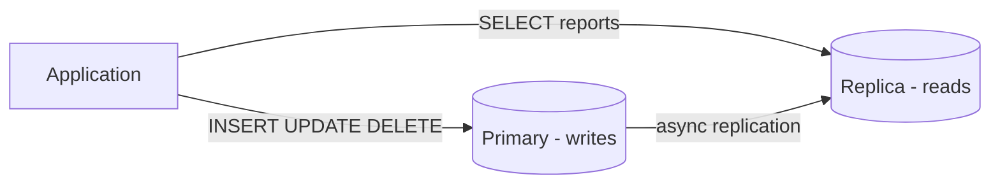
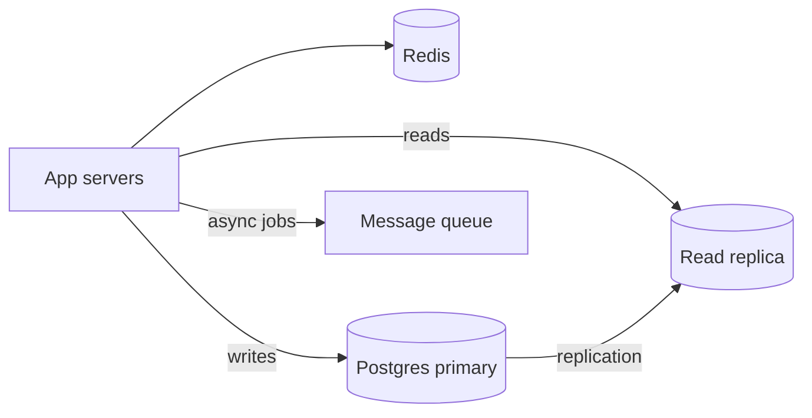

# Databases — SQL, ORM & Production Patterns

Covers relational and NoSQL stores, query layers, ORMs, and production data patterns. Assumes Node.js/TypeScript backends and real trade-offs beyond CRUD.

### Resources

interview-questions - https://sql-academy.org/ru/interview-questions

### Related docs

- [Node.js](./8_nodejs.md) · [System Design](./0_system_design.md) · [CQRS read models](./0_system_design.md#cqrs) · [Build & Tooling](./10_build.md)
- [Web API](./6_web_api.md) · [Special — SQL injection](./7_special.md#sql-injection) · [Interview hub](./0_interview.md) · [Interview Practice](#interview-practice)

### Main concepts

| Area            | Topics                                                               |
| --------------- | -------------------------------------------------------------------- |
| **Foundations** | ACID, CAP/PACELC, BASE, transactions, 1NF–3NF/BCNF, denormalization, migrations |
| **SQL**         | Joins, indexes, EXPLAIN, constraints, upsert, window functions, CTEs |
| **NoSQL**       | MongoDB, Redis, Elasticsearch, document vs KV, selection matrix      |
| **App layer**   | Prisma, Sequelize, Knex, Drizzle, ORM vs raw SQL, N+1, pooling       |
| **Production**  | Replication, sharding, caching, backups/PITR, queues, outbox pattern |

### Sections

- [Core foundations](#core)
- [SQL & PostgreSQL](#sql)
- [NoSQL](#nosql) · [Elasticsearch](#elasticsearch)
- [ORM & application layer](#orm)
- [Query builder](#query-builder)
- [Production patterns](#production)
- [Scaling OLTP](#scaling-oltp)
- [Interview Practice](#interview-practice)

### Topic template

Every major topic in `<details>` sections follows:

**Definition** → **How it works** → **When to use** → **Pluses and minuses** → **Examples** → **Thoughts** → **Sources**

### SQL (relational queries)

**Definition:** Structured Query Language — declarative language for defining schemas and querying relational data. You describe _what_ you want; the optimizer decides _how_.

**When to use:**

Structured data with relationships, reporting, financial transactions, ad-hoc analytics.

Unbounded nested documents with no joins — consider document stores or Postgres JSONB.

**Pluses and minuses:**

| +                               | −                                       |
| ---------------------------------- | ------------------------------------------ |
| Declarative, portable across RDBMS | Dialect differences (Postgres vs MySQL)    |
| Mature ecosystem, strong joins     | Complex queries need careful indexing      |
| ACID transactions                  | Single-node write ceiling without sharding |

**Examples:**

```sql
SELECT u.email, COUNT(o.id) AS order_count
FROM users u
LEFT JOIN orders o ON o.user_id = u.id
GROUP BY u.id, u.email
HAVING COUNT(o.id) > 5;
```

**Sources:** [PostgreSQL — SQL commands](https://www.postgresql.org/docs/current/sql-commands.html)

### ORM (application layer)

**Definition:** Object-Relational Mapping maps database tables to application objects and generates SQL from method calls — Prisma, Sequelize, TypeORM, Drizzle.

**When to use:**

Standard REST/GraphQL APIs, teams wanting schema-as-code, TypeScript backends.

Heavy analytics, bulk ETL, performance-critical batch jobs — use raw SQL or a query builder.

**Pluses and minuses:**

| +                               | −                                     |
| ---------------------------------- | ---------------------------------------- |
| Less boilerplate, type-safe models | Abstraction leaks — know SQL anyway      |
| Integrated migrations              | N+1 queries if relations are lazy-loaded |
| Rapid CRUD development             | Complex reports may need raw SQL         |

**Examples:**

```ts
const users = await prisma.user.findMany({
  where: { email: { contains: "@acme.com" } },
  include: { posts: { take: 5, orderBy: { createdAt: "desc" } } },
});
```

**Sources:** [Prisma documentation](https://www.prisma.io/docs)

### NoSQL (document & key-value)

**Definition:** Non-relational databases optimized for flexible schemas, horizontal scale, or specialized access patterns — document (MongoDB), key-value (Redis), column, graph.

**When to use:** Caching (Redis), flexible catalogs (MongoDB), sessions, rate limits — usually **alongside** Postgres, not instead of it.

**Pluses and minuses:**

| +                               | −                                   |
| ---------------------------------- | -------------------------------------- |
| Schema flexibility, fast iteration | Weaker default consistency             |
| Horizontal scaling built-in        | No universal query language            |
| Great for cache and nested docs    | Cross-document transactions are harder |

**Examples:**

```js
// Redis cache-aside
const cached = await redis.get(`user:${id}`);
if (cached) return JSON.parse(cached);
const user = await prisma.user.findUnique({ where: { id } });
await redis.setex(`user:${id}`, 3600, JSON.stringify(user));
```

**Sources:**

[MongoDB — Data modeling](https://www.mongodb.com/docs/manual/core/data-modeling-introduction/) · [Redis docs](https://redis.io/docs/)

---

<a name="core"></a>

## Core foundations

<details>
  <summary>Database</summary>

### Database

**Definition:** A structured system for storing, retrieving, and managing data with defined access patterns, integrity rules, and concurrency control.

**How it works:** Client sends query via driver → connection pool → DB parses SQL → planner chooses index/seq scan → executor returns rows → transaction log ensures durability on commit.

**When to use:**

OLTP (Postgres) for users/orders; Redis for cache; queue for async — polyglot persistence when measured need exists.

Any app that must persist state beyond a single request — users, orders, sessions, analytics.

**Pluses and minuses:**

| +                       | −                                                  |
| -------------------------- | ----------------------------------------------------- |
| Central source of truth    | Operational complexity (backups, migrations, scaling) |
| Queryable, auditable data  | Schema and access patterns must be designed upfront   |
| ACID / consistency options | Wrong store choice is expensive to reverse            |

**Examples:**

```sql
-- Relational: structured, joinable
CREATE TABLE users (
  id         SERIAL PRIMARY KEY,
  email      TEXT NOT NULL UNIQUE,
  created_at TIMESTAMPTZ NOT NULL DEFAULT now()
);
```

**Thoughts:** A database is not just storage — it is a concurrency coordinator. Choose based on access patterns, consistency needs, and team expertise, not hype.

**Sources:**

[PostgreSQL — Introduction](https://www.postgresql.org/docs/current/tutorial.html)

---

</details>

<details>
  <summary>Database taxonomy</summary>

### Database taxonomy

**Definition:**

Databases group by data model and consistency guarantees — not by a single "SQL vs NoSQL" axis.

| Type                   | Examples                        | Best for                                   |
| ---------------------- | ------------------------------- | ------------------------------------------ |
| **Relational (RDBMS)** | PostgreSQL, MySQL, SQL Server   | Structured data, joins, transactions       |
| **Document**           | MongoDB, CouchDB                | Flexible schemas, nested JSON documents    |
| **Key-value**          | Redis, DynamoDB                 | Caching, sessions, simple lookups          |
| **Column-family**      | Cassandra, HBase                | Wide rows, high write throughput           |
| **Graph**              | Neo4j                           | Relationship-heavy queries (social, fraud) |
| **Time-series**        | TimescaleDB, InfluxDB           | Metrics, IoT, monitoring                   |
| **Search**             | [Elasticsearch](#elasticsearch) | Full-text search, log analytics            |

**When to use:** Start with one primary store (usually PostgreSQL). Add Redis/Mongo/queue only when measured pain justifies it.

**Pluses and minuses:**

| + (polyglot persistence)  | −                              |
| ---------------------------- | --------------------------------- |
| Right tool per workload      | More ops, sync, and failure modes |
| Optimize read vs write paths | Data duplication across stores    |

**Thoughts:** "NoSQL" means **Not Only SQL** — many teams run Postgres + Redis + a queue. See [DB selection matrix](#db-selection-matrix).

**Sources:**

[ByteByteGo — Database types](https://blog.bytebytego.com/p/understanding-database-types)

---

</details>

<details>
  <summary>ACID</summary>

### ACID

**Definition:** Four transactional guarantees — **Atomicity**, **Consistency**, **Isolation**, **Durability**.

**When to use:** Financial transfers, inventory, booking systems — anywhere partial updates are unacceptable.

**Pluses and minuses:**

| +                                 | −                                         |
| ------------------------------------ | -------------------------------------------- |
| Predictable state after failures     | Higher write latency vs eventual consistency |
| Strong integrity for money/inventory | Harder to scale writes across regions        |
| Familiar mental model for OLTP       | Long transactions block other work           |

**Examples:**

```sql
BEGIN;
  UPDATE accounts SET balance = balance - 100 WHERE id = 1;
  UPDATE accounts SET balance = balance + 100 WHERE id = 2;
COMMIT;
-- ROLLBACK on any error — neither update persists alone
```

**Thoughts:**

- **Consistency** in ACID = constraints hold (FK, CHECK), not CAP consistency.
- NoSQL systems often relax **I** (isolation) or **D** (durability) for scale — see BASE.
- Keep transactions short; hold locks for milliseconds, not seconds.

**Sources:**

[PostgreSQL — Transactions](https://www.postgresql.org/docs/current/tutorial-transactions.html)

---

</details>

<details>
  <summary>CAP theorem</summary>

### CAP theorem

**Definition:**

In a distributed data store, you can guarantee at most **two** of three properties under network partition:

1. **Consistency** — every read returns the latest write (or errors)
2. **Availability** — every request gets a non-error response
3. **Partition tolerance** — system works when nodes cannot talk

**How it works:**

| System                   | Under partition | Trade-off                        |
| ------------------------ | --------------- | -------------------------------- |
| PostgreSQL (single node) | N/A             | Full ACID                        |
| MongoDB (default)        | AP              | Eventual consistency on replicas |
| etcd / ZooKeeper         | CP              | Consistency over availability    |
| Cassandra                | AP              | Tunable consistency per query    |

**When to use:** Designing multi-region or multi-node data layers — pick CP (strong consistency, may reject reads) or AP (always respond, may be stale).

**Pluses and minuses:**

| + (explicit trade-off)      | −                                        |
| ------------------------------ | ------------------------------------------- |
| Forces architectural honesty   | Oversimplified for real systems             |
| Guides CP vs AP product choice | Partitions are rare but inevitable at scale |

**Thoughts:** CAP assumes partition happens — the real question is behavior **during** and **after** recovery. See PACELC.

**Sources:**

[CAP theorem (Wikipedia)](https://en.wikipedia.org/wiki/CAP_theorem)

---

</details>

<details>
  <summary>PACELC theorem</summary>

### PACELC theorem

**Definition:** Extension of CAP — **if Partition**, choose **A** or **C**; **Else** (normal operation), choose **L**atency or **C**onsistency.

**When to use:** Explaining why read replicas return stale data even without network splits.

**Pluses and minuses:**

| +                                   | −                                         |
| -------------------------------------- | -------------------------------------------- |
| Models everyday latency vs consistency | Less famous than CAP — explain in interviews |
| Explains async replication behavior    | Not a formal proof like CAP                  |

**Examples:** Postgres primary + async replica — no partition, but replica lag means reads can be **eventually consistent** (lower latency on replica) or you read from primary (higher latency, strong consistency).

**Thoughts:** Most production incidents are "PACELC without P" — replica lag, not split brain.

**Sources:**

[PACELC (Daniel Abadi)](https://dbmsmusings.blogspot.com/2010/04/problems-with-cap-and-yahoos-little.html)

---

</details>

<details>
  <summary>BASE</summary>

### BASE

**Definition:** Alternative to strict ACID for distributed systems — **Basically Available**, **Soft state**, **Eventually consistent**.

**When to use:** Social feeds, analytics counters, shopping carts at scale, cache layers — where brief inconsistency is acceptable.

**Pluses and minuses:**

| +                                   | −                                            |
| -------------------------------------- | ----------------------------------------------- |
| High availability and write throughput | Stale reads, conflict resolution needed         |
| Scales horizontally easier             | Application must tolerate inconsistency windows |
| Fits agile schema evolution            | Debugging "wrong" data is harder                |

**Examples:**

```js
// Eventually consistent counter — two nodes may diverge briefly
await redis.incr("page:views:home");
// Different readers may see different counts for milliseconds
```

**Thoughts:** BASE is a design choice, not a database feature. You can run "BASE-style" reads on top of ACID Postgres via read replicas.

**Sources:**

[ACID vs BASE](https://www.ibm.com/think/topics/acid-vs-base)

---

</details>

<details>
  <summary>Transactions & isolation levels</summary>

### Transactions & isolation levels

**Definition:**

A transaction groups operations into one atomic unit. **Isolation levels** control what concurrent transactions can see from each other.

| Level            | Dirty read | Non-repeatable read | Phantom read      |
| ---------------- | ---------- | ------------------- | ----------------- |
| READ UNCOMMITTED | Possible   | Possible            | Possible          |
| READ COMMITTED   | No         | Possible            | Possible          |
| REPEATABLE READ  | No         | No                  | Possible (PG: no) |
| SERIALIZABLE     | No         | No                  | No                |

**When to use:**

- **READ COMMITTED** — Postgres default; good for most OLTP.
- **SERIALIZABLE** — financial invariants, seat booking when race conditions matter.

**Pluses and minuses:**

| + (higher isolation) | −                              |
| ----------------------- | --------------------------------- |
| Fewer anomalies         | More locking, retries, deadlocks  |
| Easier reasoning        | Lower throughput under contention |

**Examples:**

```sql
-- Postgres: explicit transaction
BEGIN ISOLATION LEVEL REPEATABLE READ;
  SELECT balance FROM accounts WHERE id = 1;
  UPDATE accounts SET balance = balance - 50 WHERE id = 1;
COMMIT;
```

**Thoughts:** Postgres uses **MVCC** (Multi-Version Concurrency Control) — readers don't block writers. Watch for **deadlocks** (`deadlock_detected`) and **serialization failures** (retry with backoff).

**Sources:**

[PostgreSQL — Transaction isolation](https://www.postgresql.org/docs/current/transaction-iso.html)

---

</details>

<details>
  <summary>Normal forms (1NF–3NF, BCNF)</summary>

### Normal forms (1NF–3NF, BCNF)

**Definition:** Normalization organizes relations so each fact is stored once, reducing redundancy and insert/update/delete anomalies. Codd defined 1NF (1970) then 2NF/3NF (1971); Boyce–Codd (BCNF) followed in 1974. Informal target for OLTP: **3NF**.

**How it works:**

A **functional dependency** `X → Y` means the values of `X` determine `Y`. **Prime** attributes belong to some candidate key. Each form is stricter than the previous.

| Form     | Informal rule                                                                 | Typical fix                                      |
| -------- | ----------------------------------------------------------------------------- | ------------------------------------------------ |
| **1NF**  | Atomic cells — no repeating groups, no nested tables in a column              | One value per cell; extra rows or child table    |
| **2NF**  | 1NF + every non-key column depends on the **whole** candidate key             | Split partial deps (composite key → subset)      |
| **3NF**  | 2NF + non-key columns do not depend on other non-key columns (no transitive)  | Move `instructor_office` off the course row      |
| **BCNF** | Every non-trivial FD `X → Y` has `X` as a **superkey** (stricter 3NF)         | Split overlapping composite keys                 |

Kent (interview mnemonic): *each non-key field is a fact about the key, the whole key, and nothing but the key.*

update the same city in many rows and miss one; cannot insert a course until a student enrolls; deleting the last student also deletes the course.

**When to use:**

Schema design and “why so many tables?” interviews. Stop at 3NF for most apps. BCNF when overlapping keys still allow contradictory facts. 4NF+ (independent multi-valued facts) is rare in interviews.

OLTP writes, money/inventory, shared reference data (`users`, `products`).

Read models, checkout snapshots, caches — see [Normalization vs denormalization](#normalization-vs-denormalization). Postgres `ARRAY` / `JSONB` are valid when the value is a document, not a disguised 1:N table.

**Pluses and minuses:**

| +                              | −                                           |
| --------------------------------- | ---------------------------------------------- |
| One place to update a fact        | More JOINs and FKs at read time                |
| Clear entities (user, order, sku) | SQL still allows arrays/JSONB that skip 1NF    |
| Integrity via keys, not copies    | Over-normalize (6NF-style) explodes table count |

**Examples:**

```sql
-- UNF: repeating group in one cell
-- orders(id, products)  -- 'Book, Pen'

-- 1NF: atomic, but product_name depends only on product_id (partial of composite key)
-- order_lines(order_id, product_id, product_name, qty)  PK (order_id, product_id)

-- 2NF: product facts in their own table
CREATE TABLE products (
  id SERIAL PRIMARY KEY,
  name TEXT NOT NULL
);
CREATE TABLE order_items (
  order_id INT REFERENCES orders(id),
  product_id INT REFERENCES products(id),
  qty INT NOT NULL,
  PRIMARY KEY (order_id, product_id)
);

-- 3NF: city depends on customer, not on order_id
CREATE TABLE customers (
  id SERIAL PRIMARY KEY,
  city TEXT NOT NULL
);
CREATE TABLE orders (
  id SERIAL PRIMARY KEY,
  customer_id INT REFERENCES customers(id)
);
```

**Thoughts:**

- 2NF is automatic if every table has a **single-column** primary key — partial dependency needs a composite key.
- BCNF ⊂ 3NF: a table can be 3NF (all non-prime attrs depend only on keys) but not BCNF if a **non-superkey** determines part of a key. Decomposition to BCNF is not always dependency-preserving.
- “Normalized” in conversation usually means **3NF**, not 6NF.

**Sources:**

[Database normalization (Wikipedia)](https://en.wikipedia.org/wiki/Database_normalization) · [First normal form](https://en.wikipedia.org/wiki/First_normal_form) · [BCNF](https://en.wikipedia.org/wiki/Boyce%E2%80%93Codd_normal_form) · Codd, *A Relational Model of Data for Large Shared Data Banks* (1970)

---

</details>

<details>
  <summary>Normalization vs denormalization</summary>

### Normalization vs denormalization

**Definition:** **Normalization** splits data into related tables to reduce redundancy (forms: [1NF–3NF, BCNF](#normal-forms-1nf3nf-bcnf)). **Denormalization** duplicates data for faster reads.

**How it works:**

OLTP, frequently updated entities, strong integrity (users, orders, payments).

Read-heavy analytics, embedded documents (order snapshot at checkout), cache tables, CQRS read models.

**Pluses and minuses:**

| + (normalized)         | − (normalized)              |
| ------------------------- | ------------------------------ |
| No update anomalies       | More JOINs at read time        |
| Smaller storage footprint | Complex queries for dashboards |

| + (denormalized)           | − (denormalized)                    |
| ----------------------------- | -------------------------------------- |
| Faster reads, fewer JOINs     | Update anomalies — must sync copies    |
| Better for read-heavy reports | More application logic for consistency |

**Examples:**

```sql
-- 3NF — name lives once in products
CREATE TABLE products (id SERIAL PRIMARY KEY, name TEXT, price NUMERIC(10,2));
CREATE TABLE order_items (
  id SERIAL PRIMARY KEY,
  order_id INT REFERENCES orders(id),
  product_id INT REFERENCES products(id),
  qty INT
);

-- Denormalized snapshot — freeze name/price at purchase (catalog can change later)
CREATE TABLE order_items (
  id SERIAL PRIMARY KEY,
  order_id INT,
  product_id INT,
  product_name TEXT,
  unit_price NUMERIC(10,2),
  qty INT
);
```

**Thoughts:** Target 3NF for writes. Denormalize **after** measuring slow queries, not upfront. Copies must be updated together or treated as immutable history.

**Sources:**

[Use The Index, Luke — Analyzing](https://use-the-index-luke.com/sql/anatomy) · [Database normalization](https://en.wikipedia.org/wiki/Database_normalization)

---

</details>

<details>
  <summary>CRUD</summary>

### CRUD

**Definition:** **Create, Read, Update, Delete** — the four basic persistence operations every data-backed API implements.

**When to use:** REST resources, admin panels, simple entity management.

**Pluses and minuses:**

| +                                       | −                                                 |
| ------------------------------------------ | ---------------------------------------------------- |
| Universal vocabulary across stacks         | Hides complex domain operations behind generic verbs |
| Maps cleanly to HTTP (POST/GET/PUT/DELETE) | Bulk/batch operations don't fit neatly               |

**Examples:**

```ts
// Repository pattern — one place for CRUD
type UserRepo = {
  create(data: CreateUserDto): Promise<User>;
  findById(id: string): Promise<User | null>;
  update(id: string, data: UpdateUserDto): Promise<User>;
  delete(id: string): Promise<void>;
};
```

**Thoughts:** Domain actions (`placeOrder`, `refundPayment`) often span multiple tables — don't force everything into generic CRUD controllers.

**Sources:**

[MDN — HTTP methods](https://developer.mozilla.org/en-US/docs/Web/HTTP/Methods)

---

</details>

<details>
  <summary>Migrations & seeds</summary>

### Migrations & seeds

**Definition:** **Migrations** version schema changes (up/down). **Seeds** insert reference or test data.

**When to use:** Every team project with a shared database. Never alter production schema by hand.

**Pluses and minuses:**

| +                                     | −                                               |
| ---------------------------------------- | -------------------------------------------------- |
| Schema in version control alongside code | Bad migrations can lock large tables in production |
| Reproducible environments                | Rollback complexity on data migrations             |
| Team sync on schema changes              | Requires discipline in CI/CD                       |

**Examples:**

```prisma
// schema.prisma
model User {
  id        String   @id @default(cuid())
  email     String   @unique
  createdAt DateTime @default(now())
}
```

```bash
npx prisma migrate dev --name init
npx prisma db seed
```

#### Sequelize migration & seed commands

### Sequelize migration & seed commands

```bash
npx sequelize-cli migration:generate --name create-users
npx sequelize-cli db:migrate
npx sequelize-cli db:migrate:undo
npx sequelize-cli seed:generate --name demo-users
npx sequelize-cli db:seed:all
```

Migration file shape:

```js
module.exports = {
  async up(queryInterface, Sequelize) {
    await queryInterface.createTable("Users", {
      /* ... */
    });
  },
  async down(queryInterface) {
    await queryInterface.dropTable("Users");
  },
};
```

**Thoughts:**

- Prefer **backward-compatible** migrations (add column nullable → backfill → add NOT NULL).
- Large table changes: use `CONCURRENTLY` indexes in Postgres, avoid blocking `ALTER` in peak hours.
- Seeds are for dev/staging — never run destructive seeds in production.

**Sources:** [Prisma Migrate](https://www.prisma.io/docs/orm/prisma-migrate)

---

</details>

<a name="sql"></a>

## SQL & PostgreSQL

<details>
  <summary>SQL</summary>

### SQL

**Definition:** **Structured Query Language** — declarative language for defining and querying relational data. You describe _what_ data you want; the optimizer decides _how_.

**When to use:** Structured data with relationships, reporting, transactions, ad-hoc analytics.

**Pluses and minuses:**

| +                               | −                                    |
| ---------------------------------- | --------------------------------------- |
| Declarative, portable across RDBMS | Dialect differences (Postgres vs MySQL) |
| Mature ecosystem, tooling          | Complex queries become hard to maintain |
| Strong consistency and joins       | Vertical scaling limits on single node  |

**Examples:**

```sql
SELECT u.email, COUNT(o.id) AS order_count
FROM users u
LEFT JOIN orders o ON o.user_id = u.id
WHERE u.created_at >= '2025-01-01'
GROUP BY u.id, u.email
HAVING COUNT(o.id) > 5
ORDER BY order_count DESC
LIMIT 10;
```

**Thoughts:** Apps connect via **drivers** (`pg`, `mysql2`). The query planner uses statistics — stale stats = bad plans. Always parameterize user input.

**Sources:**

[PostgreSQL — SQL commands](https://www.postgresql.org/docs/current/sql-commands.html)

---

</details>

<details>
  <summary>Joins</summary>

### Joins

**Definition:** Combine rows from multiple tables based on related columns.

**How it works:**

Optimizer picks nested loop, hash join, or merge join based on stats and indexes. Join condition in `ON` filters matches; `WHERE` filters after join.

| Join type      | Returns                                           |
| -------------- | ------------------------------------------------- |
| **INNER**      | Rows with matches in both tables                  |
| **LEFT**       | All left rows + matching right (NULL if no match) |
| **RIGHT**      | Mirror of LEFT                                    |
| **FULL OUTER** | All rows from both, NULLs where no match          |
| **CROSS**      | Cartesian product — every left × every right      |

**When to use:**

INNER for required relationships; LEFT when optional related data (e.g. user without orders). `EXISTS` often beats `IN` for large subqueries.

INNER for required relationships; LEFT when optional related data (e.g. user without orders).

**Pluses and minuses:**

| +                              | −                                               |
| --------------------------------- | -------------------------------------------------- |
| Normalized schema, no duplication | Expensive on large tables without indexes          |
| Single query for related data     | Wrong join type = silent data loss (INNER vs LEFT) |

**Examples:**

```sql
-- Users with at least one order (INNER)
SELECT u.id, u.email, o.total
FROM users u
INNER JOIN orders o ON o.user_id = u.id;

-- All users, order total or NULL (LEFT)
SELECT u.id, u.email, o.total
FROM users u
LEFT JOIN orders o ON o.user_id = u.id;

-- EXISTS — often faster than IN for large subqueries
SELECT u.id FROM users u
WHERE EXISTS (SELECT 1 FROM orders o WHERE o.user_id = u.id);
```

**Thoughts:** Prefer `EXISTS` over `IN (SELECT ...)` for correlated checks. Avoid `SELECT *` in JOINs — fetch only needed columns.

**Sources:**

[Use The Index, Luke — Joins](https://use-the-index-luke.com/sql/join)

---

</details>

<details>
  <summary>Schema constraints (FK, CHECK, UNIQUE)</summary>

### Schema constraints (FK, CHECK, UNIQUE)

**Definition:** Constraints enforce data integrity at the database layer — not only in application code.

**How it works:**

| Constraint           | Purpose                                                                 |
| -------------------- | ----------------------------------------------------------------------- |
| **PRIMARY KEY**      | Unique row identifier                                                   |
| **FOREIGN KEY (FK)** | Child column must reference existing parent row (or NULL if allowed)    |
| **UNIQUE**           | No duplicate values in column(s)                                        |
| **NOT NULL**         | Column required                                                         |
| **CHECK**            | Boolean expression per row (`price > 0`, `status IN ('open','closed')`) |
| **DEFAULT**          | Value when insert omits column                                          |

| On delete/update         | Effect                               |
| ------------------------ | ------------------------------------ |
| `RESTRICT` / `NO ACTION` | Block if children exist              |
| `CASCADE`                | Delete/update children automatically |
| `SET NULL`               | Nullify FK in children               |

**When to use:** Always FK `orders.user_id → users.id`. Use `CHECK` for enums and positive amounts. `ON DELETE CASCADE` for join tables; `RESTRICT` for orders referencing users.

**Pluses and minuses:**

| +                              | −                                          |
| --------------------------------- | --------------------------------------------- |
| Integrity even if app has bugs    | Migration order matters (parent before child) |
| Self-documenting relationships    | `CASCADE` deletes can surprise                |
| DB rejects bad data at write time | ORM may fight FK during bulk loads            |

**Examples:**

```sql
CREATE TABLE orders (
  id         SERIAL PRIMARY KEY,
  user_id    INT NOT NULL REFERENCES users(id) ON DELETE RESTRICT,
  total      NUMERIC(10,2) NOT NULL CHECK (total >= 0),
  status     TEXT NOT NULL CHECK (status IN ('pending', 'paid', 'shipped')),
  created_at TIMESTAMPTZ NOT NULL DEFAULT now()
);

CREATE UNIQUE INDEX idx_users_email_lower ON users (lower(email));
```

**Thoughts:** Prisma maps `@relation` to FK. Add indexes on FK columns — Postgres does not auto-index FKs.

**Sources:**

[PostgreSQL — Constraints](https://www.postgresql.org/docs/current/ddl-constraints.html)

---

</details>

<details>
  <summary>Upsert (ON CONFLICT)</summary>

### Upsert (ON CONFLICT)

**Definition:** **Upsert** inserts a row or updates it if a unique constraint conflicts — atomic "create or update".

**How it works:**

```sql
INSERT INTO users (email, name, updated_at)
VALUES ($1, $2, now())
ON CONFLICT (email)          -- unique index / constraint
DO UPDATE SET
  name = EXCLUDED.name,
  updated_at = now()
RETURNING *;
```

- `ON CONFLICT (columns)` targets a unique constraint.
- `DO NOTHING` — skip silently (idempotent insert).
- `DO UPDATE` — merge; `EXCLUDED` refers to the row that would have been inserted.

**When to use:** Sync external IDs, login "create if not exists", settings row per user, deduplicated event ingestion.

**Pluses and minuses:**

| +                                           | −                                     |
| ---------------------------------------------- | ---------------------------------------- |
| One round trip, race-safe vs check-then-insert | Must have matching unique index          |
| Idempotent sync/import jobs                    | Easy to overwrite fields unintentionally |

**Examples:**

```ts
await prisma.user.upsert({
  where: { email: "a@b.com" },
  create: { email: "a@b.com", name: "Ada" },
  update: { name: "Ada Lovelace" },
});
```

**Thoughts:** MySQL uses `ON DUPLICATE KEY UPDATE`. SQLite supports `ON CONFLICT` similarly. Without unique constraint, upsert is not available — add one first.

**Sources:**

[PostgreSQL — INSERT ON CONFLICT](https://www.postgresql.org/docs/current/sql-insert.html#SQL-ON-CONFLICT)

---

</details>

<details>
  <summary>Aggregations & window functions</summary>

### Aggregations & window functions

**Definition:** **Aggregations** collapse rows (`COUNT`, `SUM`, `AVG`). **Window functions** compute across related rows without collapsing the result set.

**When to use:** Rankings, running totals, deduplication, pagination with stable sort.

**Pluses and minuses:**

| +                           | −                                                              |
| ------------------------------ | ----------------------------------------------------------------- |
| Powerful analytics in SQL      | Window functions are Postgres/SQL Server territory — know your DB |
| Offloads work from application | Harder to read than imperative code                               |

**Examples:**

```sql
-- Rank orders per user by amount
SELECT
  user_id,
  id,
  total,
  ROW_NUMBER() OVER (PARTITION BY user_id ORDER BY total DESC) AS rank
FROM orders;

-- Running total
SELECT
  created_at,
  amount,
  SUM(amount) OVER (ORDER BY created_at) AS running_total
FROM payments;
```

**Thoughts:** `GROUP BY` requires all non-aggregated SELECT columns to be in GROUP BY (or wrapped in aggregate). Window functions run **after** WHERE/GROUP BY.

**Sources:**

[PostgreSQL — Window functions](https://www.postgresql.org/docs/current/tutorial-window.html)

---

</details>

<details>
  <summary>Indexes</summary>

### Indexes

**Definition:**

Data structures (usually **B-tree** in Postgres) that speed up lookups at the cost of write overhead and storage.

| Index type           | Use case                                     |
| -------------------- | -------------------------------------------- |
| **B-tree** (default) | `=`, `<`, `>`, `BETWEEN`, `ORDER BY`         |
| **Hash**             | Equality only (rare in Postgres)             |
| **GIN**              | JSONB, arrays, full-text                     |
| **GiST**             | Geospatial, range types                      |
| **Partial**          | Index subset of rows (`WHERE active = true`) |
| **Composite**        | Multi-column (`user_id, created_at`)         |
| **Covering**         | INCLUDE columns to avoid table lookup        |

**When to use:** Columns in `WHERE`, `JOIN`, `ORDER BY` on large tables. Don't index low-cardinality columns alone (e.g. boolean `is_active`).

**Pluses and minuses:**

| +                                | −                                           |
| ----------------------------------- | ---------------------------------------------- |
| Dramatic read speedups              | Slow INSERT/UPDATE/DELETE on indexed columns   |
| Enables efficient sorting/filtering | Wrong index = wasted space, planner may ignore |
| Unique indexes enforce constraints  | Too many indexes confuse the optimizer         |

**Examples:**

```sql
CREATE INDEX idx_orders_user_created ON orders (user_id, created_at DESC);
CREATE INDEX idx_users_active_email ON users (email) WHERE deleted_at IS NULL;
```

**Thoughts:** Indexes don't help `LIKE '%foo%'` (leading wildcard). Use `EXPLAIN ANALYZE` to verify index usage. Drop unused indexes found in `pg_stat_user_indexes`.

**Sources:**

[Use The Index, Luke](https://use-the-index-luke.com/)

---

</details>

<details>
  <summary>Query optimization & EXPLAIN</summary>

### Query optimization & EXPLAIN

**Definition:** Analyze how the database executes a query — scan type, index usage, row estimates, actual timing.

**When to use:** Slow endpoints, before adding indexes, after large data growth or schema change.

**Pluses and minuses:**

| +                                | −                                       |
| ----------------------------------- | ------------------------------------------ |
| Finds missing indexes and bad plans | Output requires practice to read           |
| Cheaper than guessing in production | `ANALYZE` adds load — use on staging first |

**Examples:**

```sql
EXPLAIN (ANALYZE, BUFFERS, FORMAT TEXT)
SELECT * FROM orders WHERE user_id = 42 AND status = 'pending';
```

Look for: `Seq Scan` on large tables (bad), `Index Scan` / `Index Only Scan` (good), large `rows` mismatch between estimate and actual (run `ANALYZE`).

**Thoughts:**

- **N+1 at SQL level** — app runs 1 query + N queries in a loop. Fix with JOIN or `WHERE id IN (...)`.
- Avoid `SELECT *`; fetch columns you need.
- Pagination: `OFFSET` is slow at depth — use keyset (`WHERE id > $cursor ORDER BY id LIMIT 20`).

**Sources:**

[PostgreSQL — EXPLAIN](https://www.postgresql.org/docs/current/sql-explain.html)

---

</details>

<details>
  <summary>SQL injection</summary>

### SQL injection

**Definition:** Attacker injects malicious SQL through unsanitized user input, bypassing auth or exfiltrating data.

**When to use:** Always — any user-controlled value in a query.

**Pluses and minuses:**

| + (of prevention)                  | −                                              |
| ------------------------------------- | ------------------------------------------------- |
| Eliminates entire vulnerability class | Requires discipline — one raw string concat fails |
| Parameterized queries are standard    | ORMs can still be misused (`$queryRaw` unsafe)    |

**Examples:**

```js
// VULNERABLE — never do this
const q = `SELECT * FROM users WHERE email = '${email}'`;

// SAFE — parameterized (node-postgres)
await pool.query("SELECT * FROM users WHERE email = $1", [email]);

// SAFE — Prisma
await prisma.user.findUnique({ where: { email } });
```

Attack payload: `email = "' OR '1'='1' --"` turns WHERE into always-true.

**Thoughts:** Also validate input type/length, use least-privilege DB roles (app user cannot `DROP TABLE`), and never expose raw SQL errors to clients. SQL injection is **not** XSS (SQL vs HTML/JS). Frontend escaping does not bind SQL parameters. See [Special — SQL injection](./7_special.md#sql-injection).

**Sources:**

[OWASP — SQL Injection](https://owasp.org/www-community/attacks/SQL_Injection)

---

</details>

<details>
  <summary>Subqueries & CTEs</summary>

### Subqueries & CTEs

**Definition:**

A **subquery** nests a SELECT inside another query. A **CTE** (Common Table Expression) names a subquery with `WITH` for readability and reuse.

| Feature        | Subquery        | CTE (`WITH`)                 |
| -------------- | --------------- | ---------------------------- |
| Readability    | Can nest deeply | Named, linear                |
| Reuse in query | Limited         | Can reference multiple times |
| Recursion      | No              | Yes (`WITH RECURSIVE`)       |

**When to use:** CTEs for multi-step reports, org trees, readable pipelines. Subqueries for simple filters and `EXISTS` checks.

**Examples:**

```sql
WITH totals AS (
  SELECT user_id, SUM(amount) AS total
  FROM orders GROUP BY user_id
)
SELECT u.email, t.total
FROM users u JOIN totals t ON t.user_id = u.id
WHERE t.total > 1000;

SELECT u.id FROM users u
WHERE EXISTS (SELECT 1 FROM orders o WHERE o.user_id = u.id);
```

**Sources:** [PostgreSQL — WITH queries](https://www.postgresql.org/docs/current/queries-with.html)

</details>

<details>
  <summary>Prepared statements & placeholders</summary>

### Prepared statements & placeholders

**Definition:**

A **prepared statement** sends SQL with placeholders (`$1`, `?`) once; values are bound separately — preventing SQL injection.

| Approach                    | Safe? | Notes                              |
| --------------------------- | ----- | ---------------------------------- |
| Parameterized query         | Yes   | `$1`, `?` placeholders             |
| ORM methods                 | Yes   | Prisma `findUnique`, Knex bindings |
| String concatenation        | No    | `'${email}'` is vulnerable         |
| `$queryRaw` tagged template | Yes   | Prisma tagged templates            |

**When to use:** Every query with user-controlled values.

**Examples:**

```ts
await pool.query("SELECT * FROM users WHERE email = $1", [email]);
await prisma.$queryRaw`SELECT * FROM users WHERE email = ${email}`;
```

**Thoughts:** Placeholders handle values only — never parameterize table or column names.

**Sources:** [OWASP — SQL Injection Prevention](https://cheatsheetseries.owasp.org/cheatsheets/SQL_Injection_Prevention_Cheat_Sheet.html)

</details>

<details>
  <summary>PostgreSQL</summary>

### PostgreSQL

**Definition:** Open-source RDBMS with strong ACID, extensibility (JSONB, PostGIS, pgvector), and advanced SQL (CTEs, window functions, advisory locks).

**When to use:** Default choice for new backend projects — OLTP, mixed relational + JSON, full-text search (with extensions).

**Pluses and minuses:**

| +                                 | −                                                               |
| ------------------------------------ | ------------------------------------------------------------------ |
| Rich feature set, excellent JSONB    | Single-writer primary — write scaling needs sharding/read replicas |
| Mature extensions ecosystem          | Tuning requires DBA knowledge at scale                             |
| Strong community and hosting options | Connection limits — use pooling (PgBouncer)                        |

**Examples:**

```sql
-- JSONB query
SELECT data->>'name' AS name
FROM products
WHERE data @> '{"category": "electronics"}';

-- Recursive CTE — org tree
WITH RECURSIVE tree AS (
  SELECT id, parent_id, name FROM nodes WHERE parent_id IS NULL
  UNION ALL
  SELECT n.id, n.parent_id, n.name
  FROM nodes n JOIN tree t ON n.parent_id = t.id
)
SELECT * FROM tree;
```

**Thoughts:**

- **Advisory locks** — app-level mutex: `SELECT pg_advisory_lock(123)`.
- **LISTEN/NOTIFY** — lightweight pub/sub inside Postgres (not a replacement for Redis/Kafka).
- **pgvector** — vector similarity search without a separate vector DB for moderate scale.

#### PostgreSQL ops cheatsheet

### PostgreSQL ops cheatsheet

```bash
# macOS (Homebrew)
brew services start postgresql@16
psql -U postgres

# Common psql commands
\l          -- list databases
\dt         -- list tables
\d users    -- describe table
\q          -- quit
```

```sql
CREATE DATABASE myapp;
GRANT ALL PRIVILEGES ON SCHEMA public TO myapp_user;
```

**Sources:** [PostgreSQL documentation](https://www.postgresql.org/docs/current/)

---

</details>

<a name="nosql"></a>

## NoSQL

<details>
  <summary>NoSQL (concept)</summary>

### NoSQL (concept)

**Definition:** Non-relational databases optimized for flexible schemas, horizontal scale, or specialized access patterns — document, key-value, column, graph.

**When to use:** Rapidly evolving documents, high write throughput, embedded data, cache/session layers — not as default replacement for Postgres.

**Pluses and minuses:**

| +                                  | −                                             |
| ------------------------------------- | ------------------------------------------------ |
| Schema flexibility, fast iteration    | Weaker default consistency guarantees            |
| Horizontal scaling built-in           | No universal query language                      |
| Good fit for nested/hierarchical data | Joins and cross-document transactions are harder |

**Examples:** E-commerce product catalog with varying attributes per category — document store avoids sparse columns.

**Thoughts:** "Schema-less" means schema is **in application code** — undocumented and harder to enforce. Define schemas (Mongoose, Zod) anyway.

**Sources:**

[MongoDB — Data modeling](https://www.mongodb.com/docs/manual/core/data-modeling-introduction/)

---

</details>

<details>
  <summary>MongoDB</summary>

### MongoDB

**Definition:** Document-oriented database storing BSON (binary JSON) documents in collections.

**When to use:** Content management, catalogs with variable fields, real-time analytics pipelines, mobile sync with embedded documents.

**Pluses and minuses:**

| +                              | −                                              |
| --------------------------------- | ------------------------------------------------- |
| Flexible nested documents         | Document size limit (16 MB)                       |
| Horizontal sharding, replica sets | Multi-document ACID only since 4.0 (with caveats) |
| Rich aggregation pipeline         | Memory usage for large aggregations               |

**Examples:**

```js
// Aggregation pipeline
db.orders.aggregate([
  {
    $match: { status: "completed", createdAt: { $gte: ISODate("2025-01-01") } },
  },
  {
    $group: { _id: "$userId", total: { $sum: "$amount" }, count: { $sum: 1 } },
  },
  { $sort: { total: -1 } },
  { $limit: 10 },
]);
```

**Thoughts:**

- **Replica set** — primary + secondaries, automatic failover.
- **Sharding** — partition by shard key; choose key carefully (avoid monotonic `_id` hot spots).
- Embed vs reference: embed for data read together; reference for unbounded growth.

**Sources:**

[MongoDB manual](https://www.mongodb.com/docs/manual/)

---

</details>

<details>
  <summary>Mongoose</summary>

### Mongoose

**Definition:** ODM (Object Document Mapper) for MongoDB in Node.js — schemas, validation, middleware, population.

**When to use:** Node.js apps with MongoDB needing validation, hooks, and typed models.

**Pluses and minuses:**

| +                              | −                                            |
| --------------------------------- | ----------------------------------------------- |
| Schema enforcement on flexible DB | Abstraction leaks — know MongoDB query language |
| Middleware hooks (pre/post save)  | `populate()` can cause N+1                      |
| TypeScript support via generics   | Heavy models for simple CRUD                    |

**Examples:**

```ts
const userSchema = new Schema(
  {
    email: { type: String, required: true, unique: true },
    name: String,
  },
  { timestamps: true },
);

userSchema.pre("save", async function () {
  // hash password, normalize email, etc.
});

const User = model("User", userSchema);
await User.findOne({ email }).populate("orders");
```

**Thoughts:** Use `.lean()` for read-only queries (plain objects, faster). Index fields used in `find()` and `sort()`.

**Sources:**

[Mongoose docs](https://mongoosejs.com/docs/guide.html)

---

</details>

<details>
  <summary>Redis</summary>

### Redis

**Definition:** In-memory data structure store — strings, hashes, lists, sets, sorted sets, streams — with optional persistence and clustering.

**When to use:** Cache, session store, rate limiting, pub/sub, job queues (with Bull/BullMQ), real-time leaderboards.

**Pluses and minuses:**

| +                                         | −                                             |
| -------------------------------------------- | ------------------------------------------------ |
| Sub-millisecond latency                      | Data primarily in RAM — cost at scale            |
| Rich primitives (TTL, pub/sub, leaderboards) | Not a primary database for durable business data |
| Simple replication and clustering            | Persistence modes trade durability vs speed      |

**Examples:**

```js
async function getUser(id) {
  const cached = await redis.get(`user:${id}`);
  if (cached) return JSON.parse(cached);

  const user = await db.user.findUnique({ where: { id } });
  await redis.setex(`user:${id}`, 3600, JSON.stringify(user));
  return user;
}
```

**Thoughts:**

- Set TTL on cache keys — unbounded keys = memory exhaustion.
- `KEYS *` blocks production — use `SCAN`.
- `FLUSHALL` in production = incident. Restrict CLI access.

#### Redis CLI commands

### Redis CLI commands

```
TTL mykey          -- seconds until expiry (-1 = no expiry, -2 = missing)
SCAN 0 MATCH user:* COUNT 100
DEL mykey
```

```bash
docker exec -it <container> redis-cli
```

**Sources:** [Redis documentation](https://redis.io/docs/)

---

</details>

<a name="elasticsearch"></a>

<details>
  <summary>Elasticsearch</summary>

### Elasticsearch

**Definition:** Distributed search/analytics engine (Lucene + JSON REST). Index JSON docs, then query with relevance, filters, and analyzers. Grouped with NoSQL, but the job is **search**, not OLTP.

**How it works:**

- **Cluster / node / index / shard.** An index splits into **primary shards**; **replicas** copy them. Coordinators route; the cluster rebalances. `GET http://localhost:9200` (HTTPS if security is on).
- **Near real-time.** Searchable after refresh (default ~1s). Force `refresh` in tests only.
- **Analyzer** (index + search): character filters → **tokenizer** → token filters (`lowercase`, stop, stemmer, shingle n-grams).
- **Mapping:** `text` = analyzed full-text; `keyword` = exact (ids, filters, sorts). Multi-fields can be both.

`match` (analyzed); `match_phrase` + **`slop`**; `bool` (`must` / `should` / `filter` / `must_not`); **`boost`**; `function_score` only if you need scoring functions. Bulk: `client.bulk`.

**When to use:**

Catalog search, ELK logs, autocomplete, geo + full-text — when Postgres `LIKE '%x%'` / FTS is too weak.

**Example** (`@elastic/elasticsearch` v8 — `mappings` / `document` at top level, not nested `body`):

```js
import { Client } from "@elastic/elasticsearch";

const client = new Client({
  node: "https://localhost:9200",
  auth: { username: "elastic", password: process.env.ES_PASSWORD },
});

await client.indices.create({
  index: "products",
  mappings: {
    properties: {
      id: { type: "keyword" },
      name: { type: "text" },
    },
  },
});

await client.index({
  index: "products",
  refresh: true, // tests only
  document: { id: "1", name: "Apple iPhone 12" },
});

const { hits } = await client.search({
  index: "products",
  query: {
    bool: {
      should: [
        { match: { name: "iPhone" } },
        { match_phrase: { name: { query: "iPhone Pro", slop: 3, boost: 10 } } },
      ],
    },
  },
});
console.log(hits.hits); // [{ _id, _score, _source }]
```

#### Common pitfalls

v7 `body: { query }` vs v8 flattened fields. Mapping is sticky — plan `text` vs `keyword`. Search before refresh → 0 hits. Dual-write/outbox from Postgres/Mongo; ES is a **search replica**.

**Pluses and minuses:**

| + | − |
| --- | --- |
| Relevance, morphology, scale, replicas | Eventual consistency vs primary DB |
| Query DSL + official JS client | Ops, mapping changes, not a money SoT |

**Thoughts:** Tokenize at index time, score against the inverted index — keep money/orders in OLTP.

**Sources:**

[Elasticsearch 8.19 — text analysis](https://www.elastic.co/guide/en/elasticsearch/reference/8.19/analysis.html) · [match_phrase](https://www.elastic.co/guide/en/elasticsearch/reference/8.19/query-dsl-match-query-phrase.html) · [elasticsearch-js](https://www.elastic.co/guide/en/elasticsearch/client/javascript-api/current/index.html)

---

</details>
<details>
  <summary>DB selection matrix</summary>

### DB selection matrix

**Definition:**

Decision guide for picking a data store per workload.

| Need                                  | Choose                                             | Avoid                                 |
| ------------------------------------- | -------------------------------------------------- | ------------------------------------- |
| Transactions, joins, reporting        | **PostgreSQL**                                     | Mongo for relational data             |
| Flexible nested documents             | **MongoDB**                                        | Postgres JSONB if queries stay simple |
| Cache, sessions, rate limits          | **Redis**                                          | Postgres for hot ephemeral data       |
| Full-text search at scale             | **[Elasticsearch](#elasticsearch)** / Postgres FTS | `LIKE '%x%'` on millions of rows      |
| Async service communication           | **Kafka** / **RabbitMQ**                           | Database as message bus               |
| Graph traversals (friends-of-friends) | **Neo4j**                                          | Recursive SQL on deep trees           |
| Time-series metrics                   | **TimescaleDB** / **InfluxDB**                     | Plain Postgres without partitioning   |

**Thoughts:** Default stack for most Node apps: **Postgres + Redis + (optional) queue**. Add Mongo only when document model wins measurably.

**Sources:**

[ByteByteGo — Database types](https://blog.bytebytego.com/p/understanding-database-types)

---

</details>

<a name="orm"></a>

## ORM & application layer

<details>
  <summary>ORM (concept)</summary>

### ORM (concept)

**Definition:** **Object-Relational Mapping** — maps database tables to application objects, generating SQL from method calls.

**How it works:** Heavy reporting, bulk ETL, performance-critical analytics — use raw SQL or query builder.

**When to use:** Standard CRUD APIs, rapid development, teams that benefit from schema-as-code.

**Pluses and minuses:**

| +                             | −                                            |
| -------------------------------- | ----------------------------------------------- |
| Less boilerplate SQL             | Abstraction leaks — must know SQL anyway        |
| Type-safe models (with TS)       | N+1 queries, inefficient generated SQL          |
| Migrations integrated            | Hard to optimize complex reports                |
| Database portability (in theory) | Portability breaks on dialect-specific features |

**Examples:**

```ts
// TypeORM / Sequelize / Prisma — same idea
const user = await prisma.user.create({
  data: { email: "a@b.com", posts: { create: [{ title: "Hello" }] } },
  include: { posts: true },
});
```

**Thoughts:** ORM is a **productivity tool**, not a performance guarantee. Profile queries in staging with real data volume.

**Sources:**

[Prisma — Data model](https://www.prisma.io/docs/orm/prisma-schema/data-model)

---

</details>

<details>
  <summary>Prisma</summary>

### Prisma

**Definition:** Next-gen ORM for Node.js/TypeScript — schema-first, type-safe client, migrations, and Prisma Studio.

**When to use:** New TypeScript backends, teams wanting schema-as-single-source-of-truth.

**Pluses and minuses:**

| +                                     | −                                         |
| ---------------------------------------- | -------------------------------------------- |
| Excellent TypeScript inference           | Raw SQL escape hatches needed for edge cases |
| Declarative schema, clean migrations     | Cold start / bundle size in serverless       |
| Relation queries with `include`/`select` | Not ideal for very dynamic schemas           |
| Active ecosystem and docs                | Vendor coupling (mitigated by SQL export)    |

**Examples:**

```prisma
model User {
  id        String   @id @default(cuid())
  email     String   @unique
  posts     Post[]
  createdAt DateTime @default(now())
  updatedAt DateTime @updatedAt

  @@index([email])
}

model Post {
  id       String @id @default(cuid())
  title    String
  author   User   @relation(fields: [authorId], references: [id])
  authorId String
}
```

```ts
const users = await prisma.user.findMany({
  where: { email: { contains: "@acme.com" } },
  include: { posts: { take: 5, orderBy: { createdAt: "desc" } } },
});
```

**Thoughts:**

- Use `prisma.$transaction([...])` for multi-step atomicity.
- `$queryRaw` with tagged template for safe parameterized raw SQL.
- Connection pooling: use PgBouncer in transaction mode or Prisma Accelerate for serverless.

**Sources:**

[Prisma documentation](https://www.prisma.io/docs)

---

</details>

<details>
  <summary>Sequelize</summary>

### Sequelize

**Definition:** Promise-based ORM for Node.js supporting Postgres, MySQL, SQLite, MSSQL — models, migrations, associations.

**When to use:** Legacy Node projects, teams already on Sequelize, multi-DB portability requirements.

**Pluses and minuses:**

| +                      | −                                  |
| ------------------------- | ------------------------------------- |
| Mature, wide DB support   | Verbose API vs Prisma                 |
| CLI for migrations/seeds  | TypeScript support weaker than Prisma |
| Flexible hooks and scopes | Easy to write N+1 queries             |

**Examples:**

```js
const User = sequelize.define("User", { email: DataTypes.STRING });
const Post = sequelize.define("Post", { title: DataTypes.STRING });
User.hasMany(Post);
Post.belongsTo(User);

const users = await User.findAll({ include: Post });
```

#### Sequelize CLI commands

### Sequelize CLI commands

```bash
npx sequelize-cli model:generate --name User --attributes email:string
npx sequelize-cli db:migrate
npx sequelize-cli db:migrate:undo
npx sequelize-cli migration:generate --name add-index-to-users
npx sequelize-cli db:migrate:status
```

**Thoughts:** Prefer `include` with `attributes` limit. Use `sequelize.transaction()` for multi-table updates.

**Sources:** [Sequelize docs](https://sequelize.org/docs/v6/)

---

</details>

<details>
  <summary>Drizzle ORM</summary>

### Drizzle ORM

**Definition:**

Lightweight TypeScript ORM with SQL-like schema and queries, minimal runtime, and excellent type inference.

|             | Prisma        | Drizzle            |
| ----------- | ------------- | ------------------ |
| Schema      | `.prisma` DSL | TypeScript tables  |
| SQL control | Generated     | Explicit, SQL-like |
| Bundle size | Larger        | Smaller            |

**When to use:** TypeScript backends needing type safety with SQL transparency; serverless with tight bundle limits.

**Examples:**

```ts
import { drizzle } from "drizzle-orm/node-postgres";
import { pgTable, text } from "drizzle-orm/pg-core";

export const users = pgTable("users", {
  id: text("id").primaryKey(),
  email: text("email").notNullable().unique(),
});

const rows = await db.select().from(users).where(eq(users.email, "a@b.com"));
```

**Sources:** [Drizzle ORM docs](https://orm.drizzle.team/docs/overview)

</details>

<details>
  <summary>Raw SQL vs ORM vs Query Builder</summary>

### Raw SQL vs ORM vs Query Builder

**Definition:**

Three ways to talk to the database from application code.

| Approach                    | Best for                                 | Watch out for                               |
| --------------------------- | ---------------------------------------- | ------------------------------------------- |
| **Raw SQL**                 | Reports, bulk ops, DB-specific features  | SQL strings, injection if not parameterized |
| **ORM** (Prisma, Sequelize) | CRUD, relations, rapid delivery          | N+1, opaque generated SQL                   |
| **Query builder** (Knex)    | Dynamic filters, migrations, SQL control | Still string-building if careless           |

| Pros (ORM)              | Pros (raw SQL)                       |
| ----------------------- | ------------------------------------ |
| Type safety, migrations | Full optimizer control               |
| Less SQL boilerplate    | Best performance for complex queries |

**When to use:** ORM for 80% of app code; raw SQL for the 20% that profiles slow; Knex when you need programmatic query composition without full ORM.

**Thoughts:** Hybrid is normal — Prisma for CRUD + `$queryRaw` for reports. Never choose "ORM only" or "SQL only" as ideology.

**Sources:**

[Prisma — Raw queries](https://www.prisma.io/docs/orm/prisma-client/using-raw-sql)

---

</details>

<details>
  <summary>N+1 problem</summary>

### N+1 problem

**Definition:** One query loads N parent records, then N additional queries load each child — 1 + N round trips.

**When to use:** Always fix when listing entities with relations (users + posts, orders + items).

**Pluses and minuses:**

| + (of fixing it)       | −                              |
| ------------------------- | --------------------------------- |
| Massive latency reduction | Eager loading can over-fetch data |
| Fewer DB connections used | JOIN queries can be complex       |

**Examples:**

```ts
// BAD — N+1
const users = await prisma.user.findMany();
for (const u of users) {
  u.posts = await prisma.post.findMany({ where: { authorId: u.id } });
}

// GOOD — single query with JOIN
const users = await prisma.user.findMany({ include: { posts: true } });

// GOOD — raw SQL
// SELECT u.*, p.* FROM users u LEFT JOIN posts p ON p.author_id = u.id
```

**Thoughts:** Enable query logging in dev (`prisma.$on('query')`, Sequelize `logging: console.log`). One `include` with deep nesting can fetch too much — use `select` to limit columns.

**Sources:**

[Prisma — Relation queries](https://www.prisma.io/docs/orm/prisma-client/queries/relation-queries)

---

</details>

<details>
  <summary>Connection pooling</summary>

### Connection pooling

**Definition:** Reuse open database connections instead of opening a new TCP + auth handshake per request.

**When to use:** Every production Node app. Postgres default `max_connections` (~100) is easily exhausted without pooling.

**Pluses and minuses:**

| +                                | −                                         |
| ----------------------------------- | -------------------------------------------- |
| Lower latency, fewer DB connections | Pool misconfiguration = timeouts             |
| Protects DB from connection storms  | Serverless needs external pooler (PgBouncer) |

**Examples:**

```ts
// node-postgres Pool
import { Pool } from "pg";
const pool = new Pool({ max: 20, connectionString: process.env.DATABASE_URL });

// Prisma — set connection_limit in URL or use PgBouncer
// DATABASE_URL="postgresql://...?connection_limit=10"
```

**Thoughts:**

- **PgBouncer** in transaction pooling mode for serverless/high-instance count.
- Pool size ≈ `(CPU cores * 2) + spindle count` rule of thumb — measure, don't guess.
- Always close pool on graceful shutdown.

**Sources:**

[node-postgres — Pooling](https://node-postgres.com/features/pooling)

---

</details>

<a name="query-builder"></a>

## Query builder

<details>
  <summary>Knex.js</summary>

### Knex.js

**Definition:** SQL query builder for Node.js — fluent API, migrations, and seed support without full ORM mapping.

**When to use:** Admin dashboards with dynamic filters, projects needing SQL transparency, legacy codebases between raw SQL and ORM.

**Pluses and minuses:**

| +                               | −                                  |
| ---------------------------------- | ------------------------------------- |
| Control over generated SQL         | No automatic relation mapping         |
| Database-agnostic queries (mostly) | Migrations less ergonomic than Prisma |
| Great for dynamic filters          | You manage models/types yourself      |

**Examples:**

```js
const rows = await knex("orders")
  .join("users", "orders.user_id", "users.id")
  .where("orders.status", "pending")
  .where("users.email", "like", "%@acme.com")
  .select("orders.id", "orders.total", "users.email")
  .orderBy("orders.created_at", "desc")
  .limit(20);
```

```js
// Migration
exports.up = (knex) =>
  knex.schema.createTable("users", (t) => {
    t.increments("id").primary();
    t.string("email").notNullable().unique();
    t.timestamps(true, true);
  });
```

**Thoughts:** Knex uses parameterized bindings by default — safe from injection. Pair with `objection.js` if you want ORM on top of Knex.

**Sources:**

[Knex.js documentation](https://knexjs.org/)

---

</details>

<a name="production"></a>

## Production patterns

<details>
  <summary>Replication & read replicas</summary>

### Replication & read replicas

**Definition:**

Copy data from a **primary** (writer) to one or more **replicas** (readers) for scale and availability.

| Sync replication               | Async replication                         |
| ------------------------------ | ----------------------------------------- |
| Replica confirms before commit | Primary commits, replica catches up later |
| Stronger durability            | Possible replica lag (stale reads)        |
| Higher write latency           | Better write performance                  |

**When to use:** Read-heavy apps (feeds, dashboards), reporting off replica to protect primary.

**Pluses and minuses:**

| +                            | −                                              |
| ------------------------------- | ------------------------------------------------- |
| Scale read traffic horizontally | Replication lag — read-your-writes not guaranteed |
| Failover for high availability  | Split-brain risk without proper tooling           |
| Geographic read locality        | Replication is not backup — need separate backups |

**Examples:**



**Thoughts:** After write, don't assume replica has data — use primary for critical reads or session stickiness. Tools: Patroni, AWS RDS Multi-AZ, MongoDB replica sets.

**Sources:**

[PostgreSQL — Replication](https://www.postgresql.org/docs/current/high-availability.html)

---

</details>

<details>
  <summary>Sharding vs partitioning</summary>

### Sharding vs partitioning

**Definition:**

- **Partitioning** — split one logical table into segments within one database (by range, list, hash).
- **Sharding** — split data across **multiple independent databases** (shards), each holding a subset. Elasticsearch does this inside the cluster (index → primary shards + replicas) — [Elasticsearch](#elasticsearch).

| Pros (partitioning)         | Pros (sharding)                  |
| --------------------------- | -------------------------------- |
| Transparent to app (mostly) | Unlimited horizontal write scale |
| Easier ops than sharding    | Isolate noisy tenants            |

| Cons (partitioning)              | Cons (sharding)                 |
| -------------------------------- | ------------------------------- |
| Single writer bottleneck remains | Cross-shard queries are painful |
| Limited by single machine        | Rebalancing shards is complex   |

**How it works:**

Time-series (by month), archival of old data, very large single-table maintenance.

Write throughput exceeds single node, multi-tenant isolation by `tenant_id`, global scale (Instagram, Uber scale).

**Thoughts:** Choose **shard key** carefully — even distribution, locality for common queries. Most apps never need sharding; partitioning + read replicas + caching go far.

**Sources:**

[MongoDB — Sharding](https://www.mongodb.com/docs/manual/sharding/)

---

</details>

<details>
  <summary>Caching strategies</summary>

### Caching strategies

**Definition:**

Patterns for placing a fast cache layer (usually Redis) between app and database.

| Pattern           | Flow                                       | Best for                      |
| ----------------- | ------------------------------------------ | ----------------------------- |
| **Cache-aside**   | App checks cache → miss → DB → write cache | General purpose reads         |
| **Read-through**  | Cache library loads from DB on miss        | Simpler app code              |
| **Write-through** | Write to cache and DB synchronously        | Strong cache consistency      |
| **Write-behind**  | Write to cache, async flush to DB          | High write throughput (risky) |

**When to use:** Hot keys (user profile, product page), expensive aggregations, session data.

**Pluses and minuses:**

| +                         | −                                 |
| ---------------------------- | ------------------------------------ |
| Dramatically reduces DB load | Cache invalidation is hard           |
| Lower p99 latency            | Stale data if TTL/invalidation wrong |

**Examples:**

```js
async function updateUser(id, data) {
  const user = await prisma.user.update({ where: { id }, data });
  await redis.del(`user:${id}`);
  return user;
}
```

**Thoughts:** Cache stampede — use locking or probabilistic early expiry for hot keys. Never cache without TTL unless you have reliable invalidation.

**Sources:**

[Redis — Caching patterns](https://redis.io/docs/manual/patterns/)

---

</details>

<details>
  <summary>Message queues (Kafka / RabbitMQ)</summary>

### Message queues (Kafka / RabbitMQ)

**Definition:**

Async middleware for decoupling services — producers publish events; consumers process at their own pace.

| Kafka                           | RabbitMQ                                |
| ------------------------------- | --------------------------------------- |
| Distributed log, replay events  | Traditional broker, routing flexibility |
| High throughput, event sourcing | Task queues, RPC patterns               |
| Complex ops                     | Simpler for moderate scale              |

**When to use:** Microservice communication, background jobs (email, image processing), event notifications — **not** as primary data store.

**Pluses and minuses:**

| +                              | −                                                  |
| --------------------------------- | ----------------------------------------------------- |
| Decouples services in time        | At-least-once delivery — consumers must be idempotent |
| Absorbs traffic spikes            | Operational overhead (cluster, monitoring)            |
| Enables event-driven architecture | Debugging async flows is harder                       |

**Examples:**

```
Order Service → [order.created] → Kafka → Inventory Service (reserve stock)
                                      → Email Service (send confirmation)
```

**Thoughts:** Prefer queues over "database as message bus" (polling tables). Combine with **outbox pattern** for reliable delivery. See [System Design](./0_system_design.md).

**Sources:**

[Kafka documentation](https://kafka.apache.org/documentation/)

---

</details>

<details>
  <summary>Outbox pattern</summary>

### Outbox pattern

**Definition:** Write business data and an **outbox event** in the same DB transaction; a separate process publishes events to the queue — guarantees at-least-once delivery without dual-write inconsistency.

**When to use:** Microservices where DB write must reliably trigger downstream actions (payment → send email → update analytics).

**Pluses and minuses:**

| +                                         | −                              |
| -------------------------------------------- | --------------------------------- |
| Atomic: DB + event intent in one transaction | Extra table and publisher process |
| No lost events on crash after commit         | Consumers still need idempotency  |
| Works with any message broker                | Slight delivery delay             |

**Examples:**

```sql
BEGIN;
  INSERT INTO orders (id, user_id, total) VALUES (...);
  INSERT INTO outbox (id, aggregate_type, payload, created_at)
    VALUES (gen_random_uuid(), 'Order', '{"orderId":"..."}', now());
COMMIT;
-- Outbox worker polls outbox, publishes to Kafka, marks published
```

**Thoughts:** Alternative: **Transactional outbox** with Debezium (CDC from outbox table). Don't call HTTP APIs inside DB transactions.

**Sources:**

[Microservices.io — Transactional outbox](https://microservices.io/patterns/data/transactional-outbox.html)

---

</details>

<details>
  <summary>Backup & PITR (ops note)</summary>

### Backup & PITR (ops note)

**Definition:** **Backups** protect against data loss; **Point-In-Time Recovery (PITR)** restores to any moment between backups using WAL (write-ahead log) archives.

**How it works:**

| Method                       | What it captures                       | Recovery                                |
| ---------------------------- | -------------------------------------- | --------------------------------------- |
| **Logical dump** (`pg_dump`) | SQL or custom format snapshot          | Restore to dump time only               |
| **Physical base backup**     | Data directory copy                    | Base + WAL replay                       |
| **PITR**                     | Base backup + continuous WAL archiving | Any timestamp in retention window       |
| **Replica**                  | Live copy                              | Failover — not a substitute for backups |

1. Enable automated daily snapshots + WAL archiving.
2. Test restore quarterly on staging (untested backup = no backup).
3. On incident: restore to new instance → verify → cut over DNS/connection string.
4. PITR: `recovery_target_time = '2026-07-14 10:00:00'` for accidental `DELETE`.

**When to use:** `DROP TABLE` mistake → PITR to 5 minutes ago. Region outage → restore snapshot in another region. Replication lag ≠ backup — replica can propagate bad writes.

**Pluses and minuses:**

| +                                 | −                                 |
| ------------------------------------ | ------------------------------------ |
| PITR recovers from "oops" deletes    | WAL storage cost and complexity      |
| Managed RDS/Cloud SQL simplify ops   | Restore time proportional to DB size |
| Off-site backups survive region loss | RPO/RTO must be defined upfront      |

**Examples:**

```bash
# Logical backup (small/medium DBs)
pg_dump -Fc -h localhost -U app mydb > mydb.dump
pg_restore -d mydb_restored mydb.dump

# RDS — enable automated backups + PITR in console; restore creates new instance
```

**Thoughts:** Define **RPO** (max acceptable data loss) and **RTO** (max downtime). Encrypt backups at rest. Secrets in dumps — treat backups as sensitive.

**Sources:**

[PostgreSQL — Backup and Restore](https://www.postgresql.org/docs/current/backup.html) · [PostgreSQL — Continuous archiving](https://www.postgresql.org/docs/current/continuous-archiving.html)

---

</details>

<a name="scaling-oltp"></a>

## Scaling OLTP

<details>
  <summary>Scaling PostgreSQL to millions of users (roadmap)</summary>

### Scaling PostgreSQL to millions of users (roadmap)

**Definition:**

Incremental scaling path from small OLTP to millions of users — interview and production planning.

See full version with diagram in [Interview Practice — Scaling PostgreSQL](#scaling-postgresql-to-millions-of-users).

**How it works:** indexes → query tuning → PgBouncer → Redis → read replicas → denormalize → partition → async queue → shard last.

</details>

<a name="interview-practice"></a>

<details>
  <summary>Interview Practice</summary>

### Interview Practice

Questions from [0_interview.md](0_interview.md). Try answering before opening solutions.

### Question index

| #       | Topic                        | Answer |
| ------- | ---------------------------- | ------ |
| 123     | Top 3 authors SQL            | Task 1 |
| 124     | Last 3 comments              | Task 2 |
| 125     | Library schema               | Task 3 |
| 126     | HAVING                       | Q&A    |
| 127     | LEFT JOIN                    | Q&A    |
| —       | 1NF / 2NF / 3NF / BCNF       | Q&A    |
| 128–130 | MongoDB embed vs ref         | Q&A    |
| —       | N+1 problem                  | Q&A    |
| —       | ACID                         | Q&A    |
| —       | ON CONFLICT upsert           | Q&A    |
| —       | FK constraints               | Q&A    |
| —       | Backup vs PITR               | Q&A    |
| —       | Indexes — daily patterns     | Q&A    |
| —       | Scale to millions of users   | Q&A    |
| —       | Redis — what and how         | Q&A    |
| —       | Elasticsearch — what and how | Q&A    |
| —       | RabbitMQ — what and how      | Q&A    |

---

## Questions & Answers

<details>
  <summary>HAVING vs WHERE?</summary>

### HAVING vs WHERE?

**Definition:** `WHERE` filters **rows** before aggregation; `HAVING` filters **groups** after `GROUP BY`.

**How it works:**

SQL execution order — `FROM` → `WHERE` → `GROUP BY` → `HAVING` → `SELECT` → `ORDER BY` → `LIMIT`.

| Clause   | Filters         | Can use aggregates?         |
| -------- | --------------- | --------------------------- |
| `WHERE`  | Individual rows | No (`COUNT(*)` invalid)     |
| `HAVING` | Groups          | Yes (`HAVING COUNT(*) > 5`) |

**When to use:** "Authors with more than 5 books" → `HAVING`. "Books from 2020+" → `WHERE`.

**Examples:**

```sql
SELECT author_id, COUNT(*) AS cnt
FROM books
WHERE published_at >= '2020-01-01'   -- row filter first
GROUP BY author_id
HAVING COUNT(*) > 5;                -- group filter after
```

**Sources:** [PostgreSQL — SELECT](https://www.postgresql.org/docs/current/sql-select.html)

</details>

<details>
  <summary>LEFT JOIN vs INNER JOIN?</summary>

### LEFT JOIN vs INNER JOIN?

**Definition:** **INNER JOIN** returns only rows with matches in both tables. **LEFT JOIN** returns all left-table rows; right side is NULL when no match.

**How it works:**

Join condition in `ON` — `FROM users u LEFT JOIN orders o ON o.user_id = u.id` keeps every user even with zero orders.

| Join  | Use when                                               |
| ----- | ------------------------------------------------------ |
| INNER | Relationship required (only users with orders)         |
| LEFT  | Optional relationship (all users, order total or NULL) |

**When to use:** Wrong join type silently drops data — INNER when you meant LEFT loses users without orders.

**Sources:** [Use The Index, Luke — Joins](https://use-the-index-luke.com/sql/join)

</details>

<details>
  <summary>1NF vs 2NF vs 3NF vs BCNF?</summary>

### 1NF vs 2NF vs 3NF vs BCNF?

**Definition:**

Normal forms are stacked rules that remove redundancy. Target for OLTP is **3NF**. Theory: [Normal forms (1NF–3NF, BCNF)](#normal-forms-1nf3nf-bcnf).

| Form     | Extra rule over the previous                                      |
| -------- | ----------------------------------------------------------------- |
| **1NF**  | Atomic values — no lists/nested tables in a cell                  |
| **2NF**  | Non-key columns depend on the **entire** candidate key            |
| **3NF**  | Non-key columns depend **only** on keys (no A → B → C via non-key) |
| **BCNF** | Every determinant of a non-trivial FD is a **superkey**           |

**How it works:** 2NF only bites on **composite** keys. Single-column PK tables that are 1NF are already 2NF. BCNF is 3NF plus “no leftover FDs from a non-key into a key.”

**When to use:** “Why split `products` from `order_items`?” → 2NF/3NF. Checkout still copies `unit_price` → intentional denormalization, not a failed 3NF.

**Sources:** [Database normalization](https://en.wikipedia.org/wiki/Database_normalization)

</details>

<details>
  <summary>MongoDB embed vs reference?</summary>

### MongoDB embed vs reference?

**Definition:**

**Embed** nests related documents inside parent; **reference** stores `ObjectId` pointing to another collection.

| Pattern   | Best for                         | Avoid when                                |
| --------- | -------------------------------- | ----------------------------------------- |
| Embed     | One-to-few, always read together | Unbounded arrays (comments on viral post) |
| Reference | One-to-many, shared entities     | Need atomic update across many parents    |

**How it works:** Embedded doc updates with parent in one read; reference needs second query or `$lookup` (like JOIN).

**When to use:** User address embedded; product category referenced. 16 MB document limit caps embedding.

**Sources:** [MongoDB — Data modeling](https://www.mongodb.com/docs/manual/core/data-modeling-introduction/)

</details>

<details>
  <summary>N+1 problem?</summary>

### N+1 problem?

**Definition:** One query loads N parents, then N separate queries load children — 1 + N round trips.

**How it works:**

ORM lazy-loading triggers query per row in a loop. Fix with eager `include`, JOIN, or `WHERE id IN (...)`.

| Fix        | Approach                            |
| ---------- | ----------------------------------- |
| ORM        | `include: { posts: true }`          |
| SQL        | `LEFT JOIN` or batch `IN`           |
| DataLoader | Batch + cache per request (GraphQL) |

**Examples:**

```ts
// BAD
const users = await prisma.user.findMany();
for (const u of users)
  u.posts = await prisma.post.findMany({ where: { authorId: u.id } });

// GOOD
const users = await prisma.user.findMany({ include: { posts: true } });
```

**Sources:** [Prisma — Relation queries](https://www.prisma.io/docs/orm/prisma-client/queries/relation-queries)

</details>

<details>
  <summary>What is ACID?</summary>

### What is ACID?

**Definition:** Transaction guarantees — **Atomicity** (all or nothing), **Consistency** (constraints hold), **Isolation** (concurrent txs don't corrupt), **Durability** (committed survives crash).

**When to use:** Bank transfer — debit and credit in one transaction; `ROLLBACK` on any failure.

**Thoughts:** Postgres default isolation is READ COMMITTED. Keep transactions short.

**Sources:** [PostgreSQL — Transactions](https://www.postgresql.org/docs/current/tutorial-transactions.html)

</details>

<details>
  <summary>Upsert — ON CONFLICT?</summary>

### Upsert — ON CONFLICT?

**Definition:** `INSERT ... ON CONFLICT (unique_col) DO UPDATE` — insert or update atomically in PostgreSQL.

**When to use:** Idempotent webhooks, sync user profile by email, settings row per user.

**Examples:**

```sql
INSERT INTO settings (user_id, theme) VALUES (1, 'dark')
ON CONFLICT (user_id) DO UPDATE SET theme = EXCLUDED.theme;
```

**Sources:** [PostgreSQL — ON CONFLICT](https://www.postgresql.org/docs/current/sql-insert.html#SQL-ON-CONFLICT)

</details>

<details>
  <summary>Foreign keys — why use them?</summary>

### Foreign keys — why use them?

**Definition:** FK ensures referential integrity — cannot insert `orders.user_id = 999` if user 999 does not exist.

**When to use:** `ON DELETE RESTRICT` prevents deleting user with orders; `CASCADE` deletes children with parent (use carefully).

**Sources:** [PostgreSQL — Constraints](https://www.postgresql.org/docs/current/ddl-constraints.html)

</details>

<details>
  <summary>Backup vs PITR?</summary>

### Backup vs PITR?

**Definition:** **Snapshot backup** restores to backup time. **PITR** replays WAL logs to recover to any second within retention.

**When to use:** Accidental `DELETE` → PITR to minute before. Daily snapshot alone cannot recover midday mistake.

**Thoughts:** Test restores regularly. Replication is not backup.

**Sources:** [PostgreSQL — Backup](https://www.postgresql.org/docs/current/backup.html)

</details>

<details>
  <summary>Scaling PostgreSQL to millions of users</summary>

### Scaling PostgreSQL to millions of users

**Definition:** Growing from a small OLTP database to millions of users is a **sequence of measured steps** — not immediate sharding.

**How it works:**

| Stage | Action                                                                    | What it fixes                     |
| ----- | ------------------------------------------------------------------------- | --------------------------------- |
| 1     | **Indexes** on `WHERE`, `JOIN`, `ORDER BY` columns                        | Slow queries, seq scans           |
| 2     | **Query tuning** — fix N+1, avoid `SELECT *`, keyset pagination           | App-level round trips             |
| 3     | **Connection pooling** (PgBouncer)                                        | `max_connections` exhaustion      |
| 4     | **Redis cache** — cache-aside for hot keys (profile, config)              | Repeated identical reads          |
| 5     | **Read replicas** — reports and read-heavy endpoints off replica          | Primary CPU / I/O                 |
| 6     | **Denormalize** — snapshots for dashboards (order line items at checkout) | Expensive JOINs at read time      |
| 7     | **Partitioning** — by date or `tenant_id` inside one DB                   | Large table maintenance, archival |
| 8     | **Async work** — email, analytics, search indexing via queue              | Write path bloat                  |
| 9     | **Sharding** — split by `user_id` / `tenant_id` across DBs                | Single-writer ceiling             |



**When to use:**

1M users ≠ 1M QPS — clarify read/write ratio and hot paths in interview. Start with `EXPLAIN ANALYZE` and connection pool metrics.

#### Common pitfalls

- Sharding before indexing — operational nightmare for little gain.
- Reading replica right after write — stale data (read-your-writes violation).
- `OFFSET 100000` pagination — use keyset (`WHERE id > $cursor`).

**Pluses and minuses:**

| + (incremental scale)               | −                                     |
| -------------------------------------- | ---------------------------------------- |
| Each step is reversible and measurable | Sharding adds cross-shard query pain     |
| Most apps never need step 9            | Cache invalidation bugs cause stale data |

**Thoughts:** _"Indexes, pool, cache, replicas — sharding last."_

**Sources:** [PostgreSQL — High availability](https://www.postgresql.org/docs/current/high-availability.html) · [Use The Index, Luke](https://use-the-index-luke.com/)

</details>

<details>
  <summary>Indexes you use every day (interview answer)</summary>

### Indexes you use every day (interview answer)

**Definition:**

Practical index patterns for typical Node/Postgres apps — what to say when asked "which indexes do you use daily?"

| Pattern             | SQL                                              | Why                        |
| ------------------- | ------------------------------------------------ | -------------------------- |
| Unique login        | `UNIQUE INDEX ON users(email)`                   | Fast lookup + constraint   |
| FK + sort           | `INDEX ON orders(user_id, created_at DESC)`      | User's orders list         |
| Partial active rows | `INDEX ON users(email) WHERE deleted_at IS NULL` | Smaller index, soft-delete |
| JSONB field         | `GIN INDEX ON products USING gin(data)`          | `@>` / `?` queries on JSON |
| Full-text           | `GIN ON to_tsvector('english', title)`           | Search, not `LIKE '%x%'`   |

**How it works:**

`EXPLAIN (ANALYZE, BUFFERS)` — want `Index Scan` or `Index Only Scan`, not `Seq Scan` on large tables.

Every index slows `INSERT`/`UPDATE` — don't index low-cardinality columns alone (`status` with 3 values) unless partial.

**Examples:**

```sql
CREATE UNIQUE INDEX idx_users_email ON users (lower(email));
CREATE INDEX idx_orders_user_created ON orders (user_id, created_at DESC);
CREATE INDEX idx_users_active_email ON users (email) WHERE deleted_at IS NULL;
```

**Sources:** [PostgreSQL — Indexes](https://www.postgresql.org/docs/current/indexes.html)

</details>

<details>
  <summary>What is Redis and how does it work?</summary>

### What is Redis and how does it work?

**Definition:** In-memory data structure server — sub-ms latency for strings, hashes, lists, sets, sorted sets, streams.

**How it works:**

Key-value in RAM; optional RDB/AOF persistence; TTL auto-expires keys; single-threaded command processing (hot key = bottleneck).

```js
const hit = await redis.get(`user:${id}`);
if (hit) return JSON.parse(hit);
const user = await db.user.findUnique({ where: { id } });
await redis.setex(`user:${id}`, 3600, JSON.stringify(user));
```

Primary durable store for financial data without careful persistence config.

**When to use:** Cache-aside, sessions, rate limiting (`INCR` + TTL), pub/sub, Bull/BullMQ job queues, leaderboards (`ZADD`).

**Sources:** [Redis docs](https://redis.io/docs/)

</details>

<details>
  <summary>What is Elasticsearch and how does it work?</summary>

### What is Elasticsearch and how does it work?

**Definition:** Lucene-based distributed search engine — JSON documents in **indexes**, split into **shards** across **nodes**.

**How it works:**

Analyzer (char filter → tokenizer → token filters) builds an inverted index. Query DSL (`match`, `match_phrase`, `bool`) scores hits. Replicas give HA; coordinating nodes route.

Primary transactional store.

**When to use:** Full-text product search, logs. Keep Postgres/Mongo as source of truth; sync into ES.

**Sources:** [9_database.md — Elasticsearch](#elasticsearch)

</details>

<details>
  <summary>What is RabbitMQ and how does it work?</summary>

### What is RabbitMQ and how does it work?

**Definition:** Message broker (AMQP) — producers publish to **exchanges**, exchanges route to **queues**, consumers process messages asynchronously.

**How it works:**

- **Exchange types:** direct (routing key), fanout (broadcast), topic (`order.*`), headers.
- **Ack/nack** — consumer confirms processing; unacked messages redelivered.
- **Dead letter queue (DLQ)** — failed messages for inspection/retry.
- Delivery: **at-least-once** by default — consumers must be **idempotent**.

RabbitMQ — task queues and routing; Kafka — high-throughput event log with replay.

**When to use:** Email sending, order processing, decouple microservices, absorb traffic spikes.

**Sources:** [RabbitMQ tutorials](https://www.rabbitmq.com/tutorials)

</details>

---

### Tasks

### Task 1 — Top 3 authors by book count

<details><summary>Solution</summary>

```sql
SELECT a.name, COUNT(b.id) AS book_count
FROM authors a
JOIN books b ON b.author_id = a.id
GROUP BY a.id, a.name
ORDER BY book_count DESC LIMIT 3;
```

</details>

### Task 2 — Last 3 comments per user

<details><summary>Pattern</summary>

`ROW_NUMBER() OVER (PARTITION BY user_id ORDER BY created_at DESC) <= 3`, or lateral subquery with `LIMIT 3` per user.

</details>

### Task 3 — Library schema

Tables: `books`, `authors`, `members`, `loans`. Normalize authors; index `loans(book_id)`, `loans(member_id)`.

### Task 4 — Fix N+1 with Prisma

```ts
prisma.user.findMany({
  include: { comments: { take: 3, orderBy: { createdAt: "desc" } } },
});
```

---

<details>
  <summary>Junior — Databases</summary>

### Junior — Databases

123. Write a query to find the three authors with the most books.

124. Write a query that selects the last three comments for a specific user.

125. Design a simple database schema for a library.

126. What is the SQL `HAVING` clause used for?

127. What is `LEFT JOIN` used for?

128. What is the difference between embed and reference relationships in MongoDB?

129. Comments store `author_id` as a plain string instead of `ObjectId` — what is wrong?

130. How do you apply schema changes in production?

</details>

<details>
  <summary>Middle — Databases</summary>

### Middle — Databases

129. What is Redis and what is it used for?

129b. What is Elasticsearch? Index vs shard vs analyzer? Why not use it as the source of truth?

130. Which databases have you used? SQL vs NoSQL?

131. Write a query returning the last three comments **per user**.

132. A client asks you to choose a database for a new project. Your process?

133. What is `package-lock.json` for? → [10_build.md — npm](#packages)

134. `npm install` vs `npm ci`? → [10_build.md — npm](#packages)

135. What are bundlers for? → [10_build.md — Bundling](#bundling)

136. Modular script loading and bundler loaders. → [10_build.md — Webpack](#bundlers)

See also (git, not databases): [0_git.md — Interview Practice](0_git.md#interview-practice) — merge vs rebase, staging area, code review.

</details>

<details>
  <summary>Databases (general)</summary>

### Databases (general)

30. What alternative database types do you use?

31. What is RDS and when is it not a good fit?

32. What are SQL injections and how do you prevent them?

33. Why use placeholders for database queries?

34. How do you design a MongoDB cluster?

35. What is the MongoDB Aggregation framework used for?

36. Describe GraphQL.

</details>

</details>
