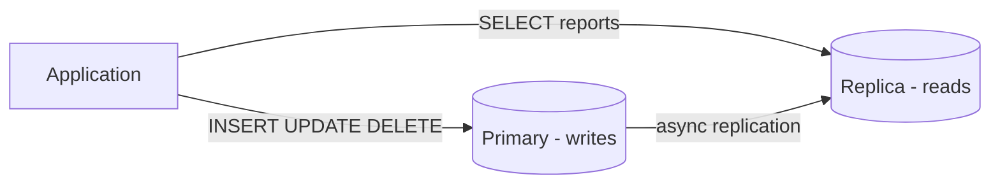

# Database — Production

Replication, sharding, caching, and OLTP scaling.

[← Back to hub](./9_database.md)

### Related docs

* [DB — Foundations](./9_database_core.md) · [DB — SQL](./9_database_sql.md) · [DB — NoSQL](./9_database_nosql.md) · [DB — ORM](./9_database_orm.md) · [DB — Production](./9_database_production.md) · [DB — Interview](./9_database_interview.md)

### Sections

- [Production patterns](#production-patterns)
- [Scaling OLTP](#scaling-oltp)

---

## Production patterns

<details>
  <summary>Replication & read replicas</summary>

### Replication & read replicas

**Definition:**

Copy data from a **primary** (writer) to one or more **replicas** (readers) for scale and availability.

| Sync replication               | Async replication                         |
| ------------------------------ | ----------------------------------------- |
| Replica confirms before commit | Primary commits, replica catches up later |
| Stronger durability            | Possible replica lag (stale reads)        |
| Higher write latency           | Better write performance                  |

**When to use:** Read-heavy apps (feeds, dashboards), reporting off replica to protect primary.

**Pluses and minuses:**

| +                            | −                                              |
| ------------------------------- | ------------------------------------------------- |
| Scale read traffic horizontally | Replication lag — read-your-writes not guaranteed |
| Failover for high availability  | Split-brain risk without proper tooling           |
| Geographic read locality        | Replication is not backup — need separate backups |

**Examples:**



**Thoughts:** After write, don't assume replica has data — use primary for critical reads or session stickiness. Tools: Patroni, AWS RDS Multi-AZ, MongoDB replica sets.

**Sources:**

[PostgreSQL — Replication](https://www.postgresql.org/docs/current/high-availability.html)

---

</details>

<details>
  <summary>Sharding vs partitioning</summary>

### Sharding vs partitioning

**Definition:**

- **Partitioning** — split one logical table into segments within one database (by range, list, hash).
- **Sharding** — split data across **multiple independent databases** (shards), each holding a subset. Elasticsearch does this inside the cluster (index → primary shards + replicas) — [Elasticsearch](./9_database_nosql.md#elasticsearch).

| Pros (partitioning)         | Pros (sharding)                  |
| --------------------------- | -------------------------------- |
| Transparent to app (mostly) | Unlimited horizontal write scale |
| Easier ops than sharding    | Isolate noisy tenants            |

| Cons (partitioning)              | Cons (sharding)                 |
| -------------------------------- | ------------------------------- |
| Single writer bottleneck remains | Cross-shard queries are painful |
| Limited by single machine        | Rebalancing shards is complex   |

**How it works:**

Time-series (by month), archival of old data, very large single-table maintenance.

Write throughput exceeds single node, multi-tenant isolation by `tenant_id`, global scale (Instagram, Uber scale).

**Thoughts:** Choose **shard key** carefully — even distribution, locality for common queries. Most apps never need sharding; partitioning + read replicas + caching go far.

**Sources:**

[MongoDB — Sharding](https://www.mongodb.com/docs/manual/sharding/)

---

</details>

<details>
  <summary>Caching strategies</summary>

### Caching strategies

**Definition:**

Patterns for placing a fast cache layer (usually Redis) between app and database.

| Pattern           | Flow                                       | Best for                      |
| ----------------- | ------------------------------------------ | ----------------------------- |
| **Cache-aside**   | App checks cache → miss → DB → write cache | General purpose reads         |
| **Read-through**  | Cache library loads from DB on miss        | Simpler app code              |
| **Write-through** | Write to cache and DB synchronously        | Strong cache consistency      |
| **Write-behind**  | Write to cache, async flush to DB          | High write throughput (risky) |

**When to use:** Hot keys (user profile, product page), expensive aggregations, session data.

**Pluses and minuses:**

| +                         | −                                 |
| ---------------------------- | ------------------------------------ |
| Dramatically reduces DB load | Cache invalidation is hard           |
| Lower p99 latency            | Stale data if TTL/invalidation wrong |

**Examples:**

```js
async function updateUser(id, data) {
  const user = await prisma.user.update({ where: { id }, data });
  await redis.del(`user:${id}`);
  return user;
}
```

**Thoughts:** Cache stampede — use locking or probabilistic early expiry for hot keys. Never cache without TTL unless you have reliable invalidation.

**Sources:**

[Redis — Caching patterns](https://redis.io/docs/manual/patterns/)

---

</details>

<details>
  <summary>Message queues (Kafka / RabbitMQ)</summary>

### Message queues (Kafka / RabbitMQ)

**Definition:**

Async middleware for decoupling services — producers publish events; consumers process at their own pace.

| Kafka                           | RabbitMQ                                |
| ------------------------------- | --------------------------------------- |
| Distributed log, replay events  | Traditional broker, routing flexibility |
| High throughput, event sourcing | Task queues, RPC patterns               |
| Complex ops                     | Simpler for moderate scale              |

**When to use:** Microservice communication, background jobs (email, image processing), event notifications — **not** as primary data store.

**Pluses and minuses:**

| +                              | −                                                  |
| --------------------------------- | ----------------------------------------------------- |
| Decouples services in time        | At-least-once delivery — consumers must be idempotent |
| Absorbs traffic spikes            | Operational overhead (cluster, monitoring)            |
| Enables event-driven architecture | Debugging async flows is harder                       |

**Examples:**

```
Order Service → [order.created] → Kafka → Inventory Service (reserve stock)
                                      → Email Service (send confirmation)
```

**Thoughts:** Prefer queues over "database as message bus" (polling tables). Combine with **outbox pattern** for reliable delivery. See [System Design](./0_system_design.md).

**Sources:**

[Kafka documentation](https://kafka.apache.org/documentation/)

---

</details>

<details>
  <summary>Outbox pattern</summary>

### Outbox pattern

**Definition:** Write business data and an **outbox event** in the same DB transaction; a separate process publishes events to the queue — guarantees at-least-once delivery without dual-write inconsistency.

**When to use:** Microservices where DB write must reliably trigger downstream actions (payment → send email → update analytics).

**Pluses and minuses:**

| +                                         | −                              |
| -------------------------------------------- | --------------------------------- |
| Atomic: DB + event intent in one transaction | Extra table and publisher process |
| No lost events on crash after commit         | Consumers still need idempotency  |
| Works with any message broker                | Slight delivery delay             |

**Examples:**

```sql
BEGIN;
  INSERT INTO orders (id, user_id, total) VALUES (...);
  INSERT INTO outbox (id, aggregate_type, payload, created_at)
    VALUES (gen_random_uuid(), 'Order', '{"orderId":"..."}', now());
COMMIT;
-- Outbox worker polls outbox, publishes to Kafka, marks published
```

**Thoughts:** Alternative: **Transactional outbox** with Debezium (CDC from outbox table). Don't call HTTP APIs inside DB transactions.

**Sources:**

[Microservices.io — Transactional outbox](https://microservices.io/patterns/data/transactional-outbox.html)

---

</details>

<details>
  <summary>Backup & PITR (ops note)</summary>

### Backup & PITR (ops note)

**Definition:** **Backups** protect against data loss; **Point-In-Time Recovery (PITR)** restores to any moment between backups using WAL (write-ahead log) archives.

**How it works:**

| Method                       | What it captures                       | Recovery                                |
| ---------------------------- | -------------------------------------- | --------------------------------------- |
| **Logical dump** (`pg_dump`) | SQL or custom format snapshot          | Restore to dump time only               |
| **Physical base backup**     | Data directory copy                    | Base + WAL replay                       |
| **PITR**                     | Base backup + continuous WAL archiving | Any timestamp in retention window       |
| **Replica**                  | Live copy                              | Failover — not a substitute for backups |

1. Enable automated daily snapshots + WAL archiving.
2. Test restore quarterly on staging (untested backup = no backup).
3. On incident: restore to new instance → verify → cut over DNS/connection string.
4. PITR: `recovery_target_time = '2026-07-14 10:00:00'` for accidental `DELETE`.

**When to use:** `DROP TABLE` mistake → PITR to 5 minutes ago. Region outage → restore snapshot in another region. Replication lag ≠ backup — replica can propagate bad writes.

**Pluses and minuses:**

| +                                 | −                                 |
| ------------------------------------ | ------------------------------------ |
| PITR recovers from "oops" deletes    | WAL storage cost and complexity      |
| Managed RDS/Cloud SQL simplify ops   | Restore time proportional to DB size |
| Off-site backups survive region loss | RPO/RTO must be defined upfront      |

**Examples:**

```bash
# Logical backup (small/medium DBs)
pg_dump -Fc -h localhost -U app mydb > mydb.dump
pg_restore -d mydb_restored mydb.dump

# RDS — enable automated backups + PITR in console; restore creates new instance
```

**Thoughts:** Define **RPO** (max acceptable data loss) and **RTO** (max downtime). Encrypt backups at rest. Secrets in dumps — treat backups as sensitive. SQL dump commands: [Backup and restore](./9_database_sql.md#backup-and-restore).

**Sources:**

[PostgreSQL — Backup and Restore](https://www.postgresql.org/docs/current/backup.html) · [PostgreSQL — Continuous archiving](https://www.postgresql.org/docs/current/continuous-archiving.html)

---

</details>

<a name="scaling-oltp"></a>

## Scaling OLTP

<details>
  <summary>Scaling PostgreSQL to millions of users (roadmap)</summary>

### Scaling PostgreSQL to millions of users (roadmap)

**Definition:**

Incremental scaling path from small OLTP to millions of users — interview and production planning.

See full version with diagram in [Interview Practice — Scaling PostgreSQL](./9_database_interview.md#scaling-postgresql-to-millions-of-users).

**How it works:** indexes → query tuning → PgBouncer → Redis → read replicas → denormalize → partition → async queue → shard last.

</details>

<a name="interview-practice"></a>

<details>
  <summary>Interview Practice</summary>

### Interview Practice

Questions from [0_interview.md](0_interview.md). Try answering before opening solutions.

### Question index

| #       | Topic                        | Answer |
| ------- | ---------------------------- | ------ |
| 123     | Top 3 authors SQL            | Task 1 |
| 124     | Last 3 comments              | Task 2 |
| 125     | Library schema               | Task 3 |
| 126     | HAVING                       | Q&A    |
| 127     | LEFT JOIN                    | Q&A    |
| —       | 1NF / 2NF / 3NF / BCNF       | Q&A    |
| 128–130 | MongoDB embed vs ref         | Q&A    |
| —       | N+1 problem                  | Q&A    |
| —       | ACID                         | Q&A    |
| —       | ON CONFLICT upsert           | Q&A    |
| —       | FK constraints               | Q&A    |
| —       | Backup vs PITR               | Q&A    |
| —       | Indexes — daily patterns     | Q&A    |
| —       | Scale to millions of users   | Q&A    |
| —       | Redis — what and how         | Q&A    |
| —       | Elasticsearch — what and how | Q&A    |
| —       | RabbitMQ — what and how      | Q&A    |

---
