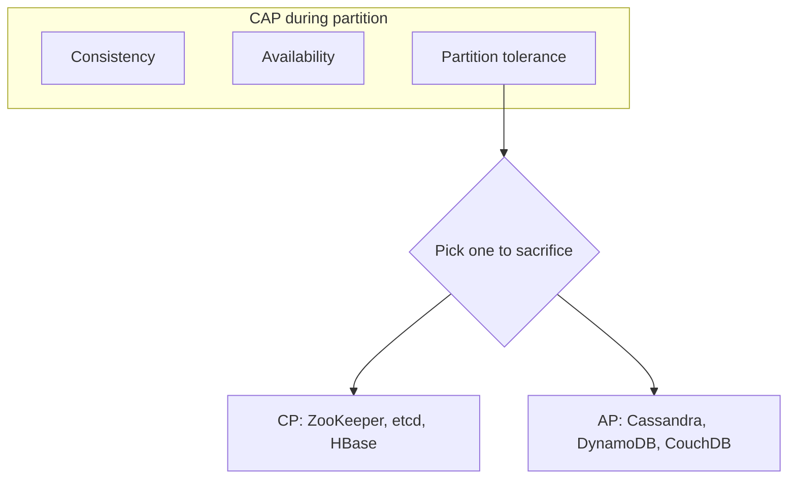

# System design — Core

Foundations and distributed-systems basics.

[← Back to hub](./0_system_design.md)

### Related docs

- [System design — Core](./0_system_design_core.md) · [System design — Architecture](./0_system_design_architecture.md) · [Architecture patterns](./7_special_architecture.md) · [System design — Data](./0_system_design_data.md) · [SOLID](./7_special_engineering.md) · [DRY, KISS, YAGNI](./0_system_design_principles.md) · [GRASP](./0_system_design_grasp.md) · [Design patterns](./7_special_patterns.md) · [System design — Interview](./0_system_design_interview.md)

### Sections

- [1. Foundations](#1-foundations)
- [2. Distributed systems](#2-distributed-systems)

---

## 1. Foundations

<details>
  <summary>System design overview</summary>

### System design overview

**Definition:** System design is the process of defining architecture, components, modules, interfaces, and data flows to satisfy functional and non-functional requirements at scale.

**When to use:** Greenfield products, scaling existing systems, architecture reviews, incident post-mortems, technical interviews.

**Pluses and minuses:**

| + (structured approach)     | −                                        |
| --------------------------- | ---------------------------------------- |
| Surfaces tradeoffs early    | Easy to over-engineer on paper           |
| Aligns teams on constraints | Requirements change — design must evolve |
| Interview signal            | Diagrams ≠ working production system     |

**Examples:**

1. **Clarify requirements** — features, scale (DAU, QPS), latency, consistency needs
2. **Back-of-envelope estimation** — storage, bandwidth, servers
3. **High-level design** — clients, LB, app servers, DB, cache, queue
4. **Deep dive** — bottlenecks, failure modes, tradeoffs
5. **Wrap up** — monitoring, rollout, future scaling

**Thoughts:** Start with constraints, not technology. "We'll use Kafka" before knowing throughput is a red flag. Good answers narrate tradeoffs.

**Sources:** [ByteByteGo — Top 20 System Design Concepts](https://blog.bytebytego.com/p/ep160-top-20-system-design-concepts)

</details>

<details>
  <summary>Client–server architecture</summary>

### Client–server architecture

**Definition:** Architecture is a high-level contract for how parts of a system interact. **Client–server** is the usual web contract: a **client** (browser / frontend) sends requests; a **server** (backend) applies rules and talks to **storage**.

**How it works:**

A browser UI is HTML, CSS, and JS (WASM exists; ignore it at this level). Anything users create or reuse must be stored, authorized, and processed — that work lives on the server.

| Role         | Job                                                                                                                                                  |
| ------------ | ---------------------------------------------------------------------------------------------------------------------------------------------------- |
| **Client**   | Ask the server to read, transform, or save data. For the user: render data and collect updates. Almost always the browser.                           |
| **Server**   | Accept requests, persist via the DB, apply **business logic**, expose data under those rules. May also run background jobs (search indexing, email). |
| **Database** | Durable store for user and system data — fast, reliable access (often several stores: primary, replicas, backups).                                   |

```
Browser  --HTTP request-->  App server  -->  Database
         <--JSON / HTML--              <--rows--
```

**When to use:** Any product with accounts, documents, feeds, payments. Static marketing HTML can skip a custom backend; as soon as data is shared or must survive a refresh, you need a server.

**Pluses and minuses:**

| +                                                  | −                                                      |
| -------------------------------------------------- | ------------------------------------------------------ |
| Shared data, auth, and jobs off the user’s machine | Extra hop, ops, and failure modes                      |
| Many clients (web, mobile) can share one API       | Tight coupling if HTML is generated only on the server |

**Examples:** Client = HTML/CSS/JS UI. Server = APIs that read/write stores. Databases = persistence, replication, failover.

**Thoughts:** The picture in the browser is not the product — durable data and rules are why a backend exists.

**Sources:** [Doka — How web apps work](https://doka.guide/tools/web-app-works/) · HTTP/REST details: [6_web_api.md — HTTP protocol](./6_web_api_http.md#http-protocol)

</details>

<details>
  <summary>Functional vs non-functional requirements</summary>

### Functional vs non-functional requirements

**Definition:**

Functional requirements describe _what_ the system does (features). Non-functional requirements (NFRs) describe _how well_ it does it — performance, availability, security, maintainability.

| NFR category | Examples                                |
| ------------ | --------------------------------------- |
| Performance  | p99 latency < 200ms, 10k QPS            |
| Availability | 99.9% uptime (8.7 h downtime/year)      |
| Scalability  | 10× traffic growth without rewrite      |
| Consistency  | Strong for payments, eventual for feeds |
| Security     | Auth, encryption, audit logs            |

**When to use:** Every design session. NFRs drive technology choices more than feature lists.

**Examples:** URL shortener — functional: shorten/redirect URLs. NFR: redirect < 50ms, 100M URLs stored, 99.99% availability for redirects.

**Thoughts:** Translate vague NFRs to numbers. "Fast" → p99 latency target. "Highly available" → nines + acceptable data loss window.

</details>

<details>
  <summary>Scalability</summary>

### Scalability

**Definition:** Scalability is the ability of a system to handle increased load by adding resources.

**When to use:**

- Vertical: early stage, databases (often first step), low traffic
- Horizontal: web/app tier, stateless services, read replicas

**Pluses and minuses:**

| Type           | How                           | +                                     | −                                    |
| -------------- | ----------------------------- | ------------------------------------- | ------------------------------------ |
| **Vertical**   | Bigger machine (more CPU/RAM) | Simple, no distributed complexity     | Hardware ceiling, downtime to resize |
| **Horizontal** | More machines                 | Near-unlimited scale, fault isolation | Distributed systems complexity       |

**Examples:**

```
100M DAU × 2 redirects/day = 200M redirects/day
200M / 86,400 ≈ 2,300 QPS average
Peak (3×) ≈ 7,000 QPS → plan for ~10k QPS
```

**Thoughts:** Scale stateless tiers first. Stateful tiers (DB) need replication, sharding, or caching. "Just add servers" fails when session/state is pinned to one node.

</details>

<details>
  <summary>Latency vs throughput vs concurrency</summary>

### Latency vs throughput vs concurrency

**Definition:**

- **Latency** — time for one operation (ms)
- **Throughput** — operations per second (QPS/TPS)
- **Concurrency** — simultaneous in-flight operations

| Tradeoff                          | Insight                                           |
| --------------------------------- | ------------------------------------------------- |
| Low latency + high throughput     | Need parallelism, efficient I/O, minimal blocking |
| Optimizing one can hurt the other | Batching ↑ throughput, may ↑ latency              |

**When to use:** Capacity planning, SLA definition, choosing sync vs async processing.

**Examples:** Payment API — low latency critical (user waits). Analytics pipeline — high throughput, latency tolerant (batch OK).

**Thoughts:** Report percentiles (p50, p95, p99), not averages. Tail latency dominates user experience at scale.

</details>

<a name="processes-multitasking"></a>

<details>
  <summary>Processes, multitasking & interrupts</summary>

### Processes, multitasking & interrupts

**Definition:** A **process** is the OS abstraction that gives a running program CPU time and its own memory. The OS (scheduler / dispatcher) runs ready processes in short turns so many programs and users share one machine.

**How it works:**

- **Not always true parallelism.** One core still runs **one** instruction stream at a time. “Several apps at once” is **time-sharing**: each process gets a short slice, then the scheduler switches. Several cores / CPUs can run processes **in parallel**.
- **Why multitasking exists.** Early single-task OS: one program owns the machine until it exits. While it waits on disk, keyboard, or a user, the CPU idles. The OS started overlapping **wait** of one program with **work** of another (I/O overlap), then a **dispatcher** that picks the next ready process so the CPU stays busy.
- **Ready queue.** Runnable processes sit in a **ready queue**. Priority decides who runs next. On Linux the user-visible **nice** value is **−20** (most CPU-favored) … **19** (least); default **0**. A normal user can _raise_ niceness (be nicer / lower priority); lowering niceness (higher priority) needs privilege (`CAP_SYS_NICE` / root). `nice` / `renice` at start or while running. (Linux autogroup can weaken classic nice effects — see `sched(7)`.)
- **Wait queues.** Devices take different time (keyboard vs disk vs GPU). Processes **blocked** on I/O sit on **wait / device queues**, not on the CPU ready queue, until the device is ready — then they become ready again.
- **What a process is.** Not only code. The OS keeps: **program** (instructions in RAM), **data** (variables; must be in RAM before the CPU uses them), **context** so it can pause and resume — CPU registers, user stack, kernel stack, memory mappings. Saving/restoring context is a **context switch**. Context also enables IPC and talking to the kernel.
- **Priority queue.** The scheduler’s model is a **priority queue**: highest-priority ready process first. System processes often outrank user apps. Chrome-style **one process per tab / site** isolates crashes and sandboxing — one app, many processes.
- **Classic states:** **new** → **ready** → **running** → **terminated**. **Blocked / waiting** = waiting on I/O or a lock (not on the CPU). Optional **suspended** (swapped / paused) while ready or blocked: extra “frozen” states.

**Interrupts**

- An **interrupt** stops the current process so the CPU/OS can handle an event (timer tick → preemption; disk ready; move a process between queues). Some interrupts are kernel-only; others user programs can handle (like DOM events).
- **Hardware interrupts** (CPU / devices). OS can enable/disable classes; programs see them as events with a handler.
  - **External, asynchronous** — timer, NIC, disk ready, keyboard, mouse.
  - **Internal, synchronous** (exceptions/faults) — divide by zero, illegal opcode, bad memory access, stack overflow.
- **Software interrupts** — a program instruction (syscall) to talk to the kernel, drivers, or other processes.
- **Windows:** mostly a **message** model (window UI, some IPC). Messages do **not** replace kill/stop/restart of a process.
- **Unix / POSIX:** **signals**. Delivery interrupts the process and runs a handler (or the default action). Signals come from the **tty** (keys), the **kernel**, or **kill** from another process (or `raise` to self). POSIX lists standard names; apps can also use **real-time** signals (`SIGRTMIN`+n) — those **queue**; ordinary signals **do not**.

| Signal                | Role                    | Notes                                                        |
| --------------------- | ----------------------- | ------------------------------------------------------------ |
| `SIGINT`              | Interrupt (job control) | Terminal **Ctrl+C**. Catchable. Default: terminate.          |
| `SIGQUIT`             | Quit from keyboard      | **Ctrl+\\**. Default: terminate + core.                      |
| `SIGTSTP`             | Terminal stop           | **Ctrl+Z**. Catchable. Default: stop. Resume with `SIGCONT`. |
| `SIGSTOP`             | Stop                    | Kernel/job control. **Cannot** catch, block, or ignore.      |
| `SIGCONT`             | Continue                | Resume a stopped process.                                    |
| `SIGKILL`             | Kill                    | Immediate terminate. **Cannot** catch, block, or ignore.     |
| `SIGTRAP`             | Trace / breakpoint      | Debugger / `ptrace`. Default: core.                          |
| `SIGUSR1` / `SIGUSR2` | App-defined             | POSIX “user” signals.                                        |

**When to use:**

Explain concurrency vs parallelism in interviews. Isolate browser tabs. Handle Ctrl+C / deploy **SIGTERM** in Node. `kill -9` vs graceful shutdown. Why one spinning loop does not freeze the whole OS (preemption).

#### Common pitfalls

- Calling time-sharing **multithreading**. A process may have many threads; the OS still schedules **threads**. Node’s JS is one thread; that is a different layer — [Process & threads](./8_nodejs_process.md#process--threads).
- Confusing **Ctrl+Z** (`SIGTSTP`) with **`SIGSTOP`**. Only `SIGKILL` and `SIGSTOP` are uncatchable (`signal(7)`).
- Assuming Windows process control works like POSIX signals (Node emulates a few `kill` names).
- Treating “dispatcher queues every CPU _instruction_” as literal — teaching model; real CPUs run until a **timer interrupt**, syscall, or I/O interrupt, then the scheduler picks the next thread.

**Pluses and minuses:**

| +                                                     | −                                                       |
| ----------------------------------------------------- | ------------------------------------------------------- |
| CPU used during I/O waits; many users/apps on one box | Context-switch cost; isolation is not free (Chrome RAM) |
| Signals: simple Unix control + IPC                    | Standard signals do not queue; `SIGKILL` skips cleanup  |
| Priority / nice for batch vs interactive              | Unprivileged users cannot steal CPU with nicer values   |

**Examples:**

```js
import process from "node:process";

process.stdin.resume(); // keep the process alive

process.on("SIGINT", () => {
  console.log("Received SIGINT. Press Control-D to exit.");
});

// SIGKILL / SIGSTOP: listeners are ignored — process is killed / stopped anyway
```

**Thoughts:** Multitasking is the scheduler + interrupts + saved **context**. Signals are POSIX’s user-visible interrupts for process control.

**Sources:** [Doka — Multitasking and processes](https://doka.guide/tools/multitasking-and-processes/) · [Linux `signal(7)`](https://man7.org/linux/man-pages/man7/signal.7.html) · [Linux `getpriority(2)` nice −20…19](https://man7.org/linux/man-pages/man2/getpriority.2.html) · [Node.js signal events](https://nodejs.org/api/process.html#signal-events)

</details>

<details>
  <summary>Reliability, availability, fault tolerance</summary>

### Reliability, availability, fault tolerance

**Definition:**

- **Reliability** — system works correctly over time
- **Availability** — system is operational when needed (uptime %)
- **Fault tolerance** — system continues operating when components fail

| Term | Formula / meaning                     |
| ---- | ------------------------------------- |
| SLA  | Contract with users (e.g. 99.9%)      |
| SLO  | Internal target (e.g. p99 < 300ms)    |
| SLI  | Measured metric (error rate, latency) |

**When to use:** Defining on-call expectations, redundancy decisions, multi-AZ deployment.

**Examples:** 99.9% = ~43 min downtime/month. 99.99% = ~4.3 min/month. Each nine is an order of magnitude harder.

**Thoughts:** Availability ≠ correctness. A system returning stale data is "available" but unreliable. Define both.

</details>

<details>
  <summary>Single point of failure (SPOF)</summary>

### Single point of failure (SPOF)

**Definition:** A SPOF is any component whose failure takes down the entire system or critical path.

**When to use:** Identify SPOFs in every diagram. Eliminate or mitigate (replicas, failover, circuit breakers).

**Pluses and minuses:**

| + (accepting SPOF)         | −                               |
| -------------------------- | ------------------------------- |
| Simpler architecture early | Outage affects all users        |
| Lower operational cost     | Harder to hit high availability |

**Examples:** Single database with no replica = SPOF. Single load balancer = SPOF → use active-passive pair or cloud-managed LB.

**Thoughts:**

Draw the request path and ask "what breaks if this box dies?" for every node.

---

</details>

<a name="2-distributed-systems"></a>

### Topic template

Every major topic follows:

**Definition** → **How it works** → **When to use** → **Pluses and minuses** → **Examples** → **Thoughts** → **Sources**

---

<a name="1-foundations"></a>

## 2. Distributed systems

<details>
  <summary>CAP theorem</summary>

### CAP theorem

**Definition:**

In a distributed data store, during a network **partition**, you can guarantee at most two of: **Consistency**, **Availability**, **Partition tolerance**.

| Guarantee                   | Meaning                                              |
| --------------------------- | ---------------------------------------------------- |
| **C** — Consistency         | Every read returns the latest write or an error      |
| **A** — Availability        | Every request gets a non-error response              |
| **P** — Partition tolerance | System operates despite network splits between nodes |



| CP (consistency + partition tolerance)                   | AP (availability + partition tolerance) |
| -------------------------------------------------------- | --------------------------------------- |
| Strong consistency during partition                      | May return stale data                   |
| Some requests may fail/timeout                           | System stays responsive                 |
| ZooKeeper, etcd, traditional RDBMS with sync replication | Cassandra, DynamoDB, Riak               |

**When to use:**

- CP: financial ledgers, distributed locks, config management
- AP: social feeds, shopping carts, metrics, session data with TTL

**Examples:** Two data centers lose network link. CP system rejects writes on minority partition. AP system accepts writes on both sides — resolves conflicts later.

**Thoughts:** Partition tolerance is not optional in real distributed systems — networks fail. The real choice is C vs A _during_ a partition. Outside partitions, you can have both. CAP is often misquoted as "pick any two forever."

**Sources:** [ByteByteGo — CAP](https://blog.bytebytego.com/p/ep160-top-20-system-design-concepts)

</details>

<details>
  <summary>PACELC</summary>

### PACELC

**Definition:**

Extension of CAP: if **P**artition, choose **A** or **C**; **E**lse (normal operation), choose **L**atency or **C**onsistency.

| System                    | PACELC profile                               |
| ------------------------- | -------------------------------------------- |
| DynamoDB / Cassandra      | PA/EL — available + low latency              |
| PostgreSQL (sync replica) | PC/EC — consistent, higher latency on writes |

**When to use:** Explaining why systems behave differently under normal load vs during failures.

**Thoughts:** More accurate than CAP alone for comparing databases in interviews.

</details>

<details>
  <summary>ACID vs BASE</summary>

### ACID vs BASE

**Definition:**

- **ACID** — Atomicity, Consistency, Isolation, Durability (traditional RDBMS transactions)
- **BASE** — Basically Available, Soft state, Eventually consistent (NoSQL flexibility)

| ACID                     | BASE                                        |
| ------------------------ | ------------------------------------------- |
| Strong guarantees        | High availability, partition tolerance      |
| Transactions across rows | Optimistic concurrency, conflict resolution |
| PostgreSQL, MySQL        | Cassandra, DynamoDB, Couchbase              |

**When to use:**

- ACID: money transfers, inventory, booking systems
- BASE: activity feeds, analytics, caching layers, high-write social data

**Examples:** Bank transfer — debit + credit must be atomic (ACID). Like count on a post — eventual consistency acceptable (BASE).

**Thoughts:** BASE is not "no consistency" — it's eventual consistency with explicit conflict handling.

</details>

<details>
  <summary>Consistency models</summary>

### Consistency models

**Definition:**

Rules governing when a write becomes visible to reads in distributed storage.

| Model                | Guarantee                             |
| -------------------- | ------------------------------------- |
| **Strong**           | Read always returns latest write      |
| **Eventual**         | Replicas converge given no new writes |
| **Causal**           | Causally related ops seen in order    |
| **Read-your-writes** | User sees own updates immediately     |

**When to use:**

- Strong: account balances, inventory counts
- Eventual: CDN cache, search indexes, social timelines
- Read-your-writes: user profile edits (session stickiness or routing)

**Examples:** User updates avatar → CDN may serve old image for minutes (eventual). User must not see old avatar on own profile page (read-your-writes).

**Thoughts:** Pick consistency per operation, not per system. Payment = strong; notification badge = eventual.

</details>

<details>
  <summary>Replication</summary>

### Replication

**Definition:** Copying data across multiple nodes for availability, durability, and read scaling.

**When to use:**

- Leader-follower: most OLTP (PostgreSQL replicas)
- Multi-leader: multi-region active-active
- Leaderless: Cassandra-style high-write availability

**Pluses and minuses:**

| Strategy            | How                                             | +                                 | −                             |
| ------------------- | ----------------------------------------------- | --------------------------------- | ----------------------------- |
| **Leader-follower** | Writes to leader, async/sync to followers       | Simple, strong consistency option | Leader is bottleneck/SPOF     |
| **Multi-leader**    | Writes to any leader, replicate bidirectionally | Write locality, multi-region      | Conflict resolution needed    |
| **Leaderless**      | Quorum reads/writes (e.g. W=2, R=2 of N=3)      | High availability                 | Complex, stale reads possible |

**Thoughts:** Sync replication = CP (write waits for replicas). Async = faster writes, risk of data loss on leader crash.

</details>

<details>
  <summary>Partitioning / sharding</summary>

### Partitioning / sharding

**Definition:** Splitting data across multiple nodes so each node holds a subset (shard).

**When to use:** Single DB node exceeds storage or write throughput. Sharding is hard to undo — plan key choice carefully.

**Pluses and minuses:**

| Strategy               | How                                                  | +                       | −                                              |
| ---------------------- | ---------------------------------------------------- | ----------------------- | ---------------------------------------------- |
| **Hash-based**         | `shard = hash(key) % N`                              | Even distribution       | Resharding painful when N changes              |
| **Range-based**        | Keys A–M on shard 1, N–Z on shard 2                  | Range queries efficient | Hot spots (e.g. all recent data on last shard) |
| **Consistent hashing** | Keys map to ring; add/remove nodes move minimal data | Elastic scaling         | Implementation complexity                      |

**Examples:** User data sharded by `user_id`. Hot celebrity account = hot shard. Mitigate: sub-shard, cache, dedicated partition.

**Thoughts:** Prefer vertical partitioning or read replicas before horizontal sharding. Sharding adds operational burden forever.

</details>

<details>
  <summary>Idempotency</summary>

### Idempotency

**Definition:** An operation is idempotent if performing it multiple times has the same effect as performing it once.

**When to use:** Payment APIs, webhooks, message queues (at-least-once delivery), any retry logic.

**Pluses and minuses:**

| +                                | −                                          |
| -------------------------------- | ------------------------------------------ |
| Safe retries on network failure  | Requires design upfront (idempotency keys) |
| Critical for distributed systems | Storage for dedup keys                     |

**Examples:**

```ts
// Client sends idempotency key with payment
POST /payments
Headers: Idempotency-Key: "pay_abc123"
Body: { amount: 100, currency: "USD" }

// Server: if key exists, return cached result; else process and store
```

**Thoughts:** At-least-once delivery + non-idempotent consumer = duplicate charges. Always pair retries with idempotency keys or dedup.

</details>

<details>
  <summary>Distributed transactions & Saga</summary>

### Distributed transactions & Saga

**Definition:** Coordinating transactions across multiple services without a single ACID database.

**How it works:**

- **Orchestration** — central coordinator tells each service what to do
- **Choreography** — services react to events, no central coordinator

1. Orchestrator receives `PlaceOrder` command.
2. Calls OrderService → local tx creates order `PENDING`.
3. Calls PaymentService → on success continues; on fail → `CancelOrder` compensating call.
4. Calls InventoryService → on fail → `RefundPayment` + `CancelOrder`.
5. Calls OrderService → `CONFIRMED`.

OrderService emits `OrderCreated` → PaymentService listens and emits `PaymentCompleted` or `PaymentFailed` → Inventory reacts — no central coordinator, but harder to debug.

| Saga concern     | Mitigation                                    |
| ---------------- | --------------------------------------------- |
| Partial failure  | Compensating transactions + idempotency keys  |
| Duplicate events | Idempotent handlers, dedup table              |
| Visibility       | Saga log / outbox pattern for reliable events |

**When to use:** Saga for multi-service workflows (order → payment → inventory → shipping). Avoid 2PC across microservices in production.

**Pluses and minuses:**

| Approach                   | How                                                   | +                          | −                                         |
| -------------------------- | ----------------------------------------------------- | -------------------------- | ----------------------------------------- |
| **2PC (two-phase commit)** | Coordinator: prepare → commit/abort all               | Strong atomicity           | Blocking, coordinator SPOF, doesn't scale |
| **Saga**                   | Sequence of local transactions + compensating actions | Scales, fits microservices | No isolation, complex rollback            |

**Examples:**

```
1. Create order (pending)
2. Charge payment → fail → compensate: cancel order
3. Reserve inventory → fail → compensate: refund payment, cancel order
4. Confirm order
```

**Thoughts:**

Compensating transactions are business logic, not automatic rollbacks. "Refund" may not fully undo "ship."

Prefer saga over 2PC in microservices; design compensations explicitly in domain language.

**Sources:** [Microservices.io — Saga](https://microservices.io/patterns/data/saga.html)

</details>

<a name="3-architecture-styles"></a>
