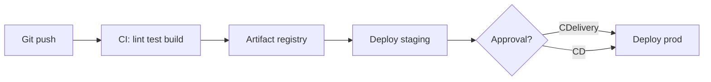

# Build — CI

CI/CD, package managers, and task runners.

[← Back to hub](./10_build.md)

### Related docs

* [Build — CI](./10_build_ci.md) · [Build — Bundlers](./10_build_bundlers.md) · [Build — Docker](./10_build_docker.md) · [Build — Infra](./10_build_infra.md) · [Build — Interview](./10_build_interview.md)

### Sections

- [CI/CD](#cicd)
- [Package management](#package-management)
- [Task runners](#task-runners)

---

## CI/CD

<details>
  <summary>CI/CD</summary>

### CI/CD
**Definition:** **CI/CD** means **Continuous Integration / Continuous Delivery** — a way of working where build, test, and publish (and often deploy) are automated so every change can be integrated and shipped with a short feedback loop. **Continuous Deployment** is a stricter variant: passing CI ships to production with no human gate. See [CI vs CD](#ci-vs-cd--comparison).

**How it works:**

Agile iterations get faster when each slice of the cycle is automated (process: [7_special.md — Agile](./7_special_sdlc.md#agile)). Tooling sits on **Git**, server/container infra, and team chat/PRs. Solo projects benefit too — not only large product teams.

Principles:

- **Split responsibility** — product, design, engineering, QA, and infra own different sides; pipelines hand work between them (built artifact → tests → release).
- **Reduce risk** — automate checks so broken builds and regressions surface before users.
- **Short feedback loop** — lint/test/build on every PR; users and owners see working software sooner.
- **Shared environment** — same Node/npm versions, lockfile (`npm ci`), and test runner locally and on CI so “works on my machine” is rare.

Product loop (stages can be skipped or merged):

| Stage | What happens |
|-------|----------------|
| **Code** | Git workflow (often [GitHub Flow](./0_git_branching.md#github-flow--trunk-based): branch → PR → review → merge). Git Flow is heavier — better for versioned releases than for many-deploys-per-day. |
| **Build** | After local checks, CI builds on a runner — often in **Docker** for a repeatable image. Platforms: GitHub Actions, GitLab CI/CD, Jenkins, Bitbucket Pipelines, TeamCity; hosts like Netlify/Vercel run build+deploy. Comparison: [15_devops.md — CI systems](./15_devops.md#ci-systems). |
| **Test** | Automated unit/integration/E2E first; manual QA still used for UX and exploratory work. Pre-release builds may be versioned (`v.2.4.5-1`). Jest, Playwright/Puppeteer, Selenium — [7_special.md — tests](./7_special_testing_fundamentals.md#tests-and-aaa). |
| **Release** | Cadence depends on the product. CI’s job is a **promotable artifact**, not Jira/analytics. Product metrics (GA, Metrika) and task trackers sit next to the loop. |
| **Deploy** | Deliver to users. Simple SPAs need little infra; shops/search/streaming compete on caching, CDNs, and server architecture. |
| **Operate** | Support and monitoring. Helpdesk/chatbots are not CI tools; they often expose APIs. Observability: [15_devops.md](./15_devops.md). |
| **Plan** | Feedback → backlog → next iteration. The loop closes. |

**When to use:**

Every production app; also useful for one-person repos (PR checks, preview deploys).

#### Common pitfalls

Treating CI/CD as a Swiss army knife for every process; skipping a shared lockfile/image so local and CI diverge; calling “CD” without saying **delivery** vs **deployment**.

**Pluses and minuses:**

| + | − |
|------|------|
| Faster ship and fix cycle | Over-engineering pipelines if the team is inexperienced |
| Less manual toil; fewer integration bugs | Tools do not fix team communication |
| Fast feedback (PR red/green) | Everyone must share the same toolchain and secrets model |
| Easy to re-prioritize when the plan is flexible | Flaky tests and slow jobs become a bottleneck |

**Examples:**

GitHub Actions is a CI/CD platform: an **event** (push, PR, schedule, `workflow_dispatch`) starts a **workflow** (YAML in `.github/workflows/`). **Jobs** run on **runners** (hosted Ubuntu/Windows/macOS or self-hosted); **steps** run scripts or reusable **actions**.

```yaml
# .github/workflows/ci.yml
name: CI
on: [push, pull_request]
jobs:
  test:
    runs-on: ubuntu-latest
    steps:
      - uses: actions/checkout@v6
      - uses: actions/setup-node@v7
        with: { node-version: 24, cache: npm }
      - run: npm ci
      - run: npm run lint && npm test && npm run build
```

**Thoughts:** Automate the path from commit to a known-good artifact (and optionally to prod) so the Agile loop stays short and repeatable.

**Sources:** [GitHub Actions — Understanding GitHub Actions](https://docs.github.com/en/actions/get-started/understand-github-actions) · [Doka — CI/CD](https://doka.guide/tools/ci-cd/)

</details>

<details>
  <summary>Continuous Integration (CI)</summary>

### Continuous Integration (CI)

**Definition:** Automated process that builds, tests, and validates every code change merged into a shared repository — catching integration errors early. Full loop: [What is CI/CD](#cicd).

**When to use:** Every team with more than one developer; mandatory for production apps.

**Pluses and minuses:**

| + | − |
|------|------|
| Detects broken builds before merge | Initial pipeline setup cost |
| Enforces test coverage and lint gates | Flaky tests block the team |
| Enables trunk-based development | Requires discipline around small PRs |

**Examples:**

```yaml
# .github/workflows/ci.yml
name: CI
on: [push, pull_request]
jobs:
  test:
    runs-on: ubuntu-latest
    steps:
      - uses: actions/checkout@v4
      - uses: actions/setup-node@v4
        with: { node-version: 20, cache: npm }
      - run: npm ci
      - run: npm run lint
      - run: npm test -- --coverage
      - run: npm run build
```

**Thoughts:** CI scope = build + test + lint. It does **not** necessarily deploy. Keep pipelines fast (< 10 min); split slow E2E / visual / Lighthouse into a separate job — [system tests](./7_special_testing_layers.md#system-testing).

**Sources:** [ByteByteGo — CI/CD crash course](https://blog.bytebytego.com/p/a-crash-course-in-cicd)

</details>

<details>
  <summary>Continuous Delivery</summary>

### Continuous Delivery
**Definition:** Every change that passes CI produces a **deployable artifact**; production release is a manual (or approval-gated) step.

**When to use:** Regulated industries, staged rollouts, teams that want automation but retain release control.

**Pluses and minuses:**

| + | − |
|------|------|
| Always-ready release candidate | Still requires human gate for prod |
| Reduces release-day surprises | Artifact storage and versioning needed |

**Examples:**

```yaml
# Deploy to staging automatically; prod requires manual approval
jobs:
  deploy-staging:
    needs: test
    runs-on: ubuntu-latest
    steps:
      - run: npx vercel deploy --token=${{ secrets.VERCEL_TOKEN }}
```

**Thoughts:** CDelivery ≠ CDployment. The artifact (Docker image, static bundle, npm package) should be immutable — promote the same artifact through environments.

**Sources:** [ByteByteGo — CI/CD](https://blog.bytebytego.com/p/a-crash-course-in-cicd)

</details>

<details>
  <summary>Continuous Deployment (CD)</summary>

### Continuous Deployment (CD)

**Definition:** Every change that passes CI is **automatically deployed to production** without manual intervention.

**When to use:** Mature teams with strong test coverage, feature flags, and automated rollback (canary, blue-green).

**Pluses and minuses:**

| + | − |
|------|------|
| Fastest time-to-market | Requires high test confidence |
| Small, low-risk incremental changes | Rollback strategy must be automated |
| Eliminates release bottlenecks | Feature flags often required for incomplete work |

**Thoughts:** CD extends CI. Many teams say "CD" but mean CDelivery. Clarify in architecture docs which model you use.

**Sources:** [ByteByteGo — CI/CD](https://blog.bytebytego.com/p/a-crash-course-in-cicd)

</details>

<details>
  <summary>CI vs CD — comparison</summary>

### CI vs CD — comparison

| Aspect | CI | CDelivery | CD |
|--------|----|-----------|-----|
| **Scope** | Build + test | + deployable artifact | + auto prod deploy |
| **Goal** | Catch integration errors | Always releasable | Ship continuously |
| **Deployment** | None | Manual / gated | Automatic |
| **Risk** | Low | Medium | High without safeguards |

**Sources:** [ByteByteGo — CI/CD](https://blog.bytebytego.com/p/a-crash-course-in-cicd)

</details>

<details>
  <summary>CI/CD pipeline stages</summary>

### CI/CD pipeline stages

**Definition:**

The **machine** path from git event to artifact/deploy. The wider **product** loop (plan → code → operate) is in [What is CI/CD](#cicd).



**How it works:** Typical frontend pipeline: `install → lint → typecheck → unit tests → build → (E2E) → deploy`. Cache `node_modules` and build output between runs. Keep the PR job fast (`< 10 min`); park slow E2E/visual in a separate job.

**When to use:** PR checks on every change; staging on `main`; production on tag or after approval (CDelivery) vs auto (CD).

**Thoughts:** One immutable artifact promoted through environments — do not rebuild differently for prod.

**Sources:** [GitHub Actions — Workflows](https://docs.github.com/en/actions/using-workflows/workflow-syntax-for-github-actions)

</details>

<details>
  <summary>GitHub Actions</summary>

### GitHub Actions

**Definition:** GitHub’s CI/CD platform — YAML workflows in `.github/workflows/` that lint, test, build, and deploy on repository events. Concept: [What is CI/CD](#cicd). YAML: [YAML](#yaml). Competitors: [15_devops.md](./15_devops.md#github-actions-vs-gitlab-ci-vs-circleci).

**How it works:**

- Any `*.yml` / `*.yaml` in `.github/workflows/` is a **workflow**. Optional `name:` is the Actions-tab label. Results appear under **Actions**.
- `on:` lists **triggers** (`push`, `pull_request`, `schedule`, `workflow_dispatch`). Filter with `branches` / `tags` (or `*-ignore`). Do not mix `branches` and `branches-ignore` on the same event.
- `schedule` is **POSIX cron in UTC**, five fields. Scheduled workflows run from the **default branch**.
- `jobs:` is a map of IDs (letter/`_` first). `needs:` waits for listed jobs to **succeed**; failed/skipped deps skip downstream unless `if: always()`. `job3: needs: [job1, job2]` runs after both.
- `runs-on:` picks the runner (`ubuntu-latest` / `windows-latest` / `macos-latest` track current GA images — pin `ubuntu-24.04` for a fixed OS). Jobs run on hosted VMs (or **in** a container).
- **Matrix** (`strategy.matrix`) fans one job into combinations. Keep keys consistent with `${{ matrix.* }}`.
- `${{ }}` is **not** YAML — GitHub substitutes after parse. Contexts: `github`, `env`, `vars`, `secrets`, `matrix`, `needs` (outputs of **this** job’s `needs:`), `inputs`. Runner env (`$GITHUB_REF`) exists only after dispatch; use contexts in `if:` **before** the runner starts.
- `steps:` run in order. `uses:` calls an action (pin SHA for supply-chain safety). `run:` is a shell; `|` for multi-line.

**When to use:**

PR gates on `main`. Matrix Node versions. Cron. Checkout → `npm ci` → test → build → deploy.

#### Common pitfalls

- Retired runner labels (`ubuntu-18.04`, `windows-2016`, `macos-10.15`) and Node 10/12/14 — use current images and LTS Node.
- Matrix key mismatch (`matrix.node` vs `node-version` in `with:`).
- `needs` context is outputs of **prerequisite** jobs, not dependents.
- `npm install` in CI → `npm ci` with a lockfile.
- Cron treated as local time (it is UTC).

**Pluses and minuses:**

| + | − |
|------|------|
| Native GitHub PRs, secrets, environments | Minutes + YAML lock-in |
| Matrix + reusable actions | `-latest` OS labels move; pin when needed |
| Same repo as the code | Public actions are a supply-chain surface — pin versions/SHAs |

**Examples:**

Node CI on push/PR to `main`, matrix OS + Node:

```yaml
# .github/workflows/test.yml
name: Test

on:
  push:
    branches: [main]
  pull_request:
    branches: [main]

jobs:
  test:
    runs-on: ${{ matrix.os }}
    strategy:
      matrix:
        os: [ubuntu-latest, windows-latest]
        node: [20, 22]
    steps:
      - uses: actions/checkout@v6
      - uses: actions/setup-node@v7
        with:
          node-version: ${{ matrix.node }}
          cache: npm
      - run: npm ci
      - run: |
          npm run build
          npm test
```

Split deploy with `needs: [test]` on another job. Secrets: `${{ secrets.* }}`, never in the repo.

**Thoughts:** Event → jobs (`needs`, matrix, `runs-on`) → ordered `uses`/`run` steps; `${{ }}` reads contexts GitHub fills in.

**Sources:** [Workflow syntax](https://docs.github.com/en/actions/reference/workflows-and-actions/workflow-syntax) · [Events / cron](https://docs.github.com/en/actions/reference/workflows-and-actions/events-that-trigger-workflows) · [Contexts](https://docs.github.com/en/actions/reference/workflows-and-actions/contexts) · [Runner images](https://github.com/actions/runner-images)

</details>

<details>
  <summary>YAML</summary>

### YAML

**Definition:** YAML (YAML Ain’t Markup Language) is a human-readable serialization language for structured data — configs, CI, Compose, Kubernetes, OpenAPI, linters. File extension: `.yaml` or `.yml`.

**How it works:**

- Three primitives: **mappings** (key/value), **sequences** (lists), **scalars** (strings, numbers, booleans, `null`).
- Block style: indent with **spaces only** (tabs are invalid). Nested nodes must be more indented than the parent; siblings share the same indent. **2 spaces** is the usual convention — the spec does not require exactly two.
- `key: value` — colon + space. Comments: `# …` (not allowed inside scalars).
- Sequences: block (`- item`) or flow (`[a, b]`). Mappings can also use flow `{ k: v }`.
- Strings: unquoted, `'single'`, or `"double"`. Quote when the value looks like a type (`true`, `null`, `2.99`) or contains `:`, `#`, or leading `*`.
- Numbers: integers and floats with a **dot** (`9.99`). A comma is not a decimal separator — `2,99` is a string (or a flow-list fragment).
- Anchors `&name` mark a node; aliases `*name` reuse it (like a named copy / JS spread of a value). Merge key `<<: *name` copies mapping keys; later keys override. `<<` is a **YAML 1.1** feature (dropped in 1.2); GitHub Actions, Compose, and many parsers still support it.
- A document root may be a mapping, sequence, or scalar.

YAML allows comments; JSON does not. YAML strings may be unquoted; JSON strings must use double quotes. JSON (RFC 8259) also allows a scalar root; YAML is still preferred for human-edited configs. JSON is the interchange format for APIs (`JSON.parse` / `stringify`) — see [JSON](./3_js_variables.md#json).

**When to use:**

GitHub Actions / GitLab CI; Docker Compose; ESLint/Prettier config; Kubernetes manifests; OpenAPI specs.

#### Common pitfalls

- Tabs for indent → parse error. Configure the editor / a YAML linter.
- Inconsistent indent between siblings.
- Unquoted `true` / `false` / `null` / numbers become typed values, not strings.
- YAML 1.1: `yes`, `no`, `on`, `off`, `NO` may parse as booleans.
- Forgetting the space after `-` or `:`.

**Pluses and minuses:**

| + | − |
|------|------|
| Comments; unquoted strings; readable nesting | Indent errors fail the whole file; tabs vs spaces |
| Anchors cut duplication | YAML 1.1 vs 1.2 type surprises (`yes`/`NO` as bools in 1.1) |
| Root can be any node type | Merge `<<` not in YAML 1.2 core — parser-dependent |

**Examples:**

```yaml
# pet config — mapping + sequence + scalars
bestCat:
  name: mittens          # unquoted string
  isFluffy: true
  sounds:
    - mur
    - pur
  paws: 4
  lunchTime: 9.99        # float — use a dot, not a comma

# anchors + merge (YAML 1.1 / many CI parsers)
base: &base
  name: cool cat
  age: 2

cat1:
  <<: *base              # name + age from base

cat2:
  <<: *base
  age: 7                 # overrides base.age
```

Equivalent after merge: `cat1` → `{ name: cool cat, age: 2 }`; `cat2` → `{ name: cool cat, age: 7 }`.

GitHub Actions (minimal workflow — `.github/workflows/*.yml` or `*.yaml`):

```yaml
name: CI
on: [pull_request]
jobs:
  test:
    runs-on: ubuntu-latest
    steps:
      - run: echo "event ${{ github.event_name }}"
      - run: echo "os ${{ runner.os }}"
```

`${{ }}` is **GitHub expression syntax**, not YAML — the runner substitutes it after the file is parsed.

**Thoughts:** YAML is indented JSON-with-comments for humans — spaces, not tabs; quote anything that looks like a type.

**Sources:** [YAML 1.2.2 spec](https://yaml.org/spec/1.2.2/) · [GitHub Actions — YAML syntax](https://docs.github.com/en/actions/using-workflows/workflow-syntax-for-github-actions#about-yaml-syntax-for-workflows) · [GitHub Actions — anchors](https://docs.github.com/en/actions/how-tos/reuse-automations/reuse-workflows#yaml-anchors-and-aliases) · [eemeli/yaml — 1.1 vs 1.2](https://eemeli.org/yaml/#version-differences)

</details>

<a name="packages"></a>

### Vite & Webpack (bundlers)

**Definition:**

**Webpack** is a mature, highly configurable module bundler with loaders and plugins. **Vite** uses native ESM in dev (esbuild) and Rollup for production — default for modern React/Vue/Svelte apps.

| | Webpack | Vite |
|---|---------|------|
| Dev speed | Slower HMR | Instant cold start |
| Config | High | Low (sensible defaults) |
| Best for | Legacy apps, Module Federation | Greenfield SPAs, CRA migration |
| Ecosystem | Largest plugin set | Growing; covers most apps |

**When to use:** Vite for new projects; Webpack for legacy codebases or Module Federation micro-frontends.

**Examples:**

```ts
// vite.config.ts
import { defineConfig } from 'vite';
import react from '@vitejs/plugin-react';

export default defineConfig({
  plugins: [react()],
  server: { host: '0.0.0.0', port: 3000 },
  build: { sourcemap: 'hidden' },
});
```

**Sources:** [vite.dev](https://vite.dev/) · [webpack.js.org](https://webpack.js.org/)

### Docker (containers)

**Definition:** Platform for developing, shipping, and running applications in lightweight, isolated **containers** — packaging code, runtime, and dependencies into reproducible images.

**When to use:** Microservices, CI/CD pipelines, local dev parity, cloud deployment.

**Pluses and minuses:**

| + | − |
|------|------|
| Consistent dev/staging/prod | Learning curve (networking, volumes) |
| Fast startup vs VMs | Native modules must match container arch |
| Portable deployments | Image bloat without multi-stage builds |

**Examples:**

```dockerfile
FROM node:20-alpine AS builder
WORKDIR /app
COPY package*.json ./
RUN npm ci
COPY . .
RUN npm run build

FROM node:20-alpine
WORKDIR /app
COPY --from=builder /app/dist ./dist
CMD ["node", "dist/index.js"]
```

**Sources:**

[docs.docker.com](https://docs.docker.com/)

---

<a name="ci-cd"></a>

## Package management

<details>
  <summary>npm</summary>

### npm

**Definition:** Default package manager for Node.js. Manages dependencies via `package.json` and `package-lock.json`.

**When to use:** Default choice; required when tooling only documents npm workflows.

**Pluses and minuses:**

| + | − |
|------|------|
| Universal, ships with Node | Slower installs than pnpm on large monorepos |
| Massive registry (npmjs.com) | Flat `node_modules` can cause phantom deps |
| `npm ci` for reproducible CI | Breaking changes in npm major versions |

**Examples:**

```json
{
  "dependencies": { "react": "^19.0.0" },
  "devDependencies": { "vite": "^6.0.0", "typescript": "^5.0.0" },
  "scripts": { "dev": "vite", "build": "tsc -b && vite build" }
}
```

```bash
npm install          # update lockfile (local dev)
npm ci               # clean install from lockfile (CI)
npm install -D eslint  # add devDependency (-D = --save-dev)
```

**Thoughts:**

| Field | Purpose |
|-------|---------|
| `dependencies` | Required at runtime; shipped in production bundle |
| `devDependencies` | Build, test, lint only; not in prod bundle |
| `peerDependencies` | Expected to be provided by the host app (libraries) |
| `optionalDependencies` | Installed if possible; failure is non-fatal |

Use `npm ci` in CI — never `npm install`. Never commit `node_modules`.

**Sources:** [npm docs](https://docs.npmjs.com/)

</details>

<details>
  <summary>Yarn (Classic & Berry)</summary>

### Yarn (Classic & Berry)

**Definition:** Alternative package manager by Meta. Yarn Classic (v1) uses `yarn.lock`; Yarn Berry (v2+) uses Plug'n'Play (PnP) optionally.

**When to use:** Existing Yarn monorepos; teams standardized on Yarn workspaces.

**Pluses and minuses:**

| + | − |
|------|------|
| Deterministic installs via lockfile | Berry PnP breaks some tools expecting `node_modules` |
| Workspaces for monorepos | Two major versions (Classic vs Berry) cause confusion |
| `yarn dlx` for one-off commands | Smaller default mindshare than npm |

**Examples:**

```json
// package.json — workspaces
{
  "private": true,
  "workspaces": ["packages/*", "apps/*"]
}
```

```bash
yarn install
yarn workspace @myapp/web build
```

**Thoughts:** Most new projects choose pnpm over Yarn Classic. If starting fresh with Yarn, use Berry (v4) with `nodeLinker: node-modules` unless you want PnP.

**Sources:** [yarnpkg.com](https://yarnpkg.com/)

</details>

<details>
  <summary>pnpm</summary>

### pnpm

**Definition:** Fast, disk-efficient package manager using a content-addressable global store and hard-linked `node_modules`.

**When to use:** New monorepos, large teams, when phantom dependency bugs are a concern.

**Pluses and minuses:**

| + | − |
|------|------|
| Fastest installs; saves disk space | Some tools assume npm flat layout |
| Strict dependency resolution (no phantom deps) | Occasional peer-dep resolution quirks |
| First-class monorepo workspaces | Less universal in legacy CI templates |

**Examples:**

```bash
pnpm install
pnpm add -D vitest
pnpm --filter @myapp/web dev   # run script in one workspace package
```

```yaml
# .npmrc
strict-peer-dependencies=true
auto-install-peers=true
```

**Thoughts:** pnpm's strictness catches bugs npm silently allows — e.g. importing a package you didn't declare. Prefer pnpm for Turborepo / Nx monorepos.

**Sources:** [pnpm.io](https://pnpm.io/)

</details>

<details>
  <summary>npm vs Yarn vs pnpm</summary>

### npm vs Yarn vs pnpm

| | npm | Yarn | pnpm |
|---|-----|------|------|
| **Lockfile** | `package-lock.json` | `yarn.lock` | `pnpm-lock.yaml` |
| **CI command** | `npm ci` | `yarn install --frozen-lockfile` | `pnpm install --frozen-lockfile` |
| **Monorepo** | workspaces | workspaces | workspaces (best DX) |
| **Disk usage** | High (per project) | High | Low (shared store) |
| **Strict deps** | No | No | Yes |

**When to use:** Pick one per org and enforce via `packageManager` field in `package.json` + Corepack.

```json
{ "packageManager": "pnpm@9.15.0" }
```

---

**Sources:** [pnpm — Feature comparison](https://pnpm.io/feature-comparison)

</details>

<a name="task-runners"></a>

## Task runners

<details>
  <summary>npm scripts</summary>

### npm scripts

**Definition:** Commands defined in `package.json` `scripts` field, executed via `npm run <name>`. The modern default for automating dev workflows.

**When to use:** Always — primary task runner for JS projects.

**Pluses and minuses:**

| + | − |
|------|------|
| Zero extra dependencies | Complex orchestration gets verbose |
| Cross-platform with `cross-env`, `rimraf` | No built-in streaming/file watching |
| `pre`/`post` hooks for lifecycle | `pre` hooks can surprise newcomers |

**Examples:**

```json
{
  "scripts": {
    "dev": "vite",
    "build": "tsc -b && vite build",
    "lint": "eslint .",
    "format": "prettier --write .",
    "test": "vitest",
    "prepare": "husky"
  }
}
```

```bash
npm run dev          # runs "dev" script
npm test             # "test" is special — no "run" needed
npm run lint -- --fix  # pass args after --
```

**Thoughts:** `prepare` runs after `npm install` — use for git hooks (husky), not heavy builds. Prefer dedicated tools (Vite, Turborepo) over chaining many shell commands.

**Sources:** [npm — scripts](https://docs.npmjs.com/cli/v10/using-npm/scripts)

</details>

<details>
  <summary>Gulp</summary>

### Gulp

**Definition:** Legacy streaming task runner that pipes files through plugins (SCSS → CSS, image optimization).

**When to use:** Maintaining legacy codebases only. New projects: use npm scripts + bundler plugins.

**Pluses and minuses:**

| + | − |
|------|------|
| Fine-grained file stream control | Largely superseded by bundler plugins |
| Large plugin ecosystem (legacy) | Imperative task files age poorly |

**Thoughts:**

If you see a `gulpfile.js`, plan migration to Vite/Webpack loaders rather than extending Gulp.

---

**Sources:** [gulpjs.com](https://gulpjs.com/)

</details>

<a name="transpilers"></a>
