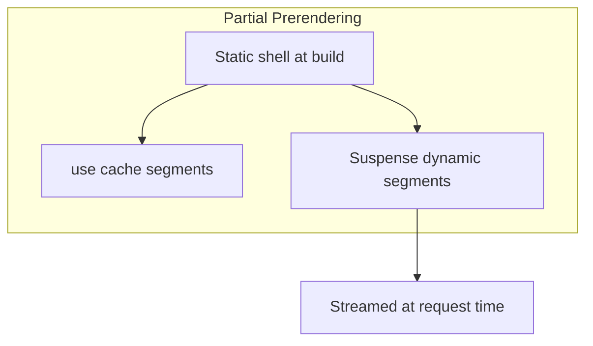

# Next.js — Core

Framework model, App Router, rendering, and streaming.

[← Back to hub](./4_nextjs.md)

### Related docs

- [Next.js — Core](./4_nextjs_core.md) · [Next.js — Data](./4_nextjs_data.md) · [Next.js — Routing](./4_nextjs_routing.md) · [Next.js — Platform](./4_nextjs_platform.md) · [Next.js — Interview](./4_nextjs_interview.md)

### Sections

- [1. Framework overview](#1-framework-overview)
- [2. App vs Pages Router](#2-app-vs-pages-router)
- [3. Project structure](#3-project-structure)
- [4. Rendering strategies](#4-rendering-strategies)
- [5. Server & Client boundaries](#5-server-client-boundaries)
- [6. Streaming & Suspense](#6-streaming-suspense)
- [7. Design principles](#7-design-principles)

---

## 1. Framework overview

_Topics follow: Definition → Pros / Cons → When to use → Example → Notes → Source ([template](#topic-template))._

<details>
  <summary>Next.js overview</summary>

### Next.js overview

**Definition:** Next.js is a **React framework** for building full-stack web applications. You build the UI with React components; Next.js adds routing, rendering, data fetching, and production tooling — bundlers and compilers configured so you focus on the product, not the stack.

**When to use:**

- Marketing sites, blogs, and documentation with SEO requirements
- E-commerce, dashboards, and SaaS with authenticated and public pages
- BFF (Backend for Frontend) — colocate API with UI
- Teams deploying on Vercel or needing standalone Docker output
- Apps benefiting from RSC (smaller client bundles, server data access)

**When not to use:**

- Pure static sites with minimal JS — consider **Astro**
- Mobile apps — use **Expo / React Native**
- Heavy custom Node server (long-lived WebSockets hub) — dedicated backend + Vite SPA may fit better
- Content-only sites where React is unnecessary overhead

**Pluses and minuses:**

| +                                                               | −                                                                    |
| --------------------------------------------------------------- | -------------------------------------------------------------------- |
| Batteries-included: routing, SSR, API, image/font optimization  | Opinionated — escape hatches exist but add complexity                |
| React Server Components + streaming out of the box (App Router) | Steep caching mental model; easy to ship stale or over-dynamic pages |
| Excellent Vercel integration (preview deploys, CDN, analytics)  | Vendor affinity when using Vercel-specific features                  |
| SEO-friendly by default (SSR/SSG/ISR/PPR)                       | Cold starts on serverless; not ideal for all workloads               |
| TypeScript-first, large ecosystem, strong hiring signal         | Two routers (App + Pages) — legacy codebases carry migration debt    |
| Automatic code splitting per route                              | Build times grow with app size                                       |

**Examples:**

```bash
npx create-next-app@latest my-app --typescript --app --turbopack
cd my-app && npm run dev
```

```tsx
// app/page.tsx — Server Component by default
export default async function HomePage() {
  const res = await fetch("https://api.example.com/posts", {
    next: { revalidate: 60 },
  });
  const posts = await res.json();

  return (
    <main>
      <h1>Posts</h1>
      <ul>
        {posts.map((p: { id: string; title: string }) => (
          <li key={p.id}>{p.title}</li>
        ))}
      </ul>
    </main>
  );
}
```

**Thoughts:** Next.js is **not** a replacement for React knowledge — it is a layer on top. Interview framing: React = library (view); Next.js = framework (routing, rendering, data, deployment). New projects should default to **App Router** (Next.js 13+). Pages Router is maintenance mode for existing apps.

**Sources:** [nextjs.org/docs](https://nextjs.org/docs)

</details>

<details>
  <summary>React vs Next.js</summary>

### React vs Next.js

**Definition:**

React renders UI; Next.js orchestrates how and where that UI is built, cached, and delivered.

|                   | React                     | Next.js                                          |
| ----------------- | ------------------------- | ------------------------------------------------ |
| **Role**          | UI library                | Full-stack framework                             |
| **Routing**       | Bring your own            | File-based `app/` directory                      |
| **Data fetching** | Client hooks / manual SSR | Server Components, `fetch` cache, Server Actions |
| **Rendering**     | CSR by default (Vite)     | SSR, SSG, ISR, PPR configurable per route        |
| **API**           | Separate backend          | Route Handlers + Server Actions                  |
| **Deployment**    | Static CDN or custom      | Optimized for Vercel; `standalone` for Docker    |

**Thoughts:** For generic RSC, hydration, and hook rules see [4_react.md §8 — Server rendering & RSC](./4_react_server.md#8-server-rendering--rsc). This document covers **Next.js-specific** APIs and caching semantics.

**Sources:** [react.dev](https://react.dev/) · [nextjs.org/docs](https://nextjs.org/docs)

</details>

<details>
  <summary>Next.js vs alternatives</summary>

### Next.js vs alternatives

**Definition:**

Comparison of Next.js against other full-stack and meta-framework choices for React and content sites.

| Framework               | Strength                                 | Trade-off                                  |
| ----------------------- | ---------------------------------------- | ------------------------------------------ |
| **Vite + React Router** | Maximum flexibility, fast dev, SPA-first | Manual SSR/RSC setup                       |
| **Remix**               | Web standards, loaders/actions, forms    | Smaller ecosystem than Next                |
| **Astro**               | Content sites, islands architecture      | Less suited for heavy client interactivity |
| **SvelteKit**           | Performance, simplicity                  | Different UI paradigm                      |

**How it works:** SEO, first-load performance, colocated server logic, team standardization on Vercel.

**Sources:** [nextjs.org/docs/app](https://nextjs.org/docs/app)

</details>

<details>
  <summary>History (compressed)</summary>

### History (compressed)

**Definition:**

Timeline of major Next.js releases and routing/rendering milestones.

| Version  | Milestone                                                      |
| -------- | -------------------------------------------------------------- |
| **2016** | Next.js 1 — Pages Router, SSR                                  |
| **v9**   | API Routes (`pages/api`)                                       |
| **v12**  | Middleware, React 18 support                                   |
| **v13**  | App Router (beta), RSC, `app/` directory                       |
| **v14**  | App Router stable, partial prerendering experimental           |
| **v15**  | Async request APIs (`cookies`, `headers`, `params`)            |
| **v16**  | Cache Components, `proxy.ts`, `use cache`, async APIs required |

---

**Sources:** [nextjs.org/blog](https://nextjs.org/blog)

</details>

<a name="2-app-vs-pages-router"></a>

### Topic template

Every major topic in `<details>` sections follows:

**Definition** → **How it works** → **When to use** → **Pluses and minuses** → **Examples** → **Thoughts** → **Sources**

---

<a name="1-framework-overview"></a>

### Primary references

**Definition:**

Official documentation and platform guides for Next.js and Vercel.

- [nextjs.org/docs](https://nextjs.org/docs) — official documentation
- [nextjs.org/docs/llms.txt](https://nextjs.org/docs/llms.txt) — full docs index for LLMs
- [Vercel Next.js framework guide](https://vercel.com/docs/frameworks/full-stack/nextjs)
- [Partial Prerendering on Vercel](https://vercel.com/docs/partial-prerendering)
- [Vercel Runtime Cache](https://vercel.com/docs/caching/runtime-cache)
- [Vercel Routing Middleware](https://vercel.com/docs/routing-middleware)

**Sources:** [nextjs.org/docs](https://nextjs.org/docs)

</details>

<details>
  <summary>Deep dives</summary>

## 2. App vs Pages Router

_Topics follow: Definition → Pros / Cons → When to use → Example → Notes → Source ([template](#topic-template))._

<details>
  <summary>App Router</summary>

### App Router

**Definition:** The modern router living in `app/`. Built on React Server Components, nested layouts, streaming, and the new caching model. Default for all new projects.

**When to use:** Every new project. Greenfield apps, e-commerce, dashboards, content sites.

**Pluses and minuses:**

| +                                     | −                                             |
| ------------------------------------- | --------------------------------------------- |
| RSC, streaming, nested layouts        | Learning curve for caching and boundaries     |
| Colocated `loading.tsx`, `error.tsx`  | Cannot mix `pages/` and `app/` for same route |
| Server Actions, Metadata API          | Some third-party libs still lack RSC support  |
| Fine-grained caching with `use cache` | Migration from Pages requires rewrites        |

**Examples:**

```tsx
// app/blog/[slug]/page.tsx — async Server Component (default)
export default async function BlogPost({
  params,
}: {
  params: Promise<{ slug: string }>;
}) {
  const { slug } = await params;
  const post = await getPost(slug);
  return <article>{post.title}</article>;
}
```

**Sources:** [nextjs.org/docs/app](https://nextjs.org/docs/app)

</details>

<details>
  <summary>Pages Router</summary>

### Pages Router

**Definition:** Legacy router in `pages/`. Uses `getServerSideProps`, `getStaticProps`, `getInitialProps`, and `pages/api` for backend endpoints.

**When to use:** Maintaining existing Pages Router apps only. Do not start new projects on Pages Router.

**Pluses and minuses:**

| +                                       | −                                                      |
| --------------------------------------- | ------------------------------------------------------ |
| Mature, well-documented patterns        | No RSC, no nested layouts                              |
| Simpler mental model (props-based data) | `getServerSideProps` runs per page — harder to compose |
| Large existing codebase support         | Not where new Next.js features land                    |

**Examples:**

```tsx
// pages/blog/[slug].tsx — legacy pattern
export async function getStaticProps({ params }: { params: { slug: string } }) {
  const post = await getPost(params.slug);
  return { props: { post } };
}

export default function BlogPost({ post }: { post: Post }) {
  return <article>{post.title}</article>;
}
```

**Sources:** [nextjs.org/docs/pages](https://nextjs.org/docs/pages)

</details>

<details>
  <summary>Migration mapping</summary>

### Migration mapping

**Definition:**

One-to-one mapping from Pages Router APIs to App Router equivalents for incremental migration.

| Pages Router         | App Router equivalent                                        |
| -------------------- | ------------------------------------------------------------ |
| `getStaticProps`     | `fetch` with `cache: 'force-cache'` + `generateStaticParams` |
| `getServerSideProps` | `fetch` with `cache: 'no-store'` or dynamic route            |
| `getInitialProps`    | Server Component async data fetch                            |
| `pages/api/*.ts`     | `app/**/route.ts` (Route Handlers)                           |
| `_app.tsx`           | `app/layout.tsx`                                             |
| `_document.tsx`      | `app/layout.tsx` + Metadata API                              |
| `next/head`          | `export const metadata` / `generateMetadata()`               |
| `next/router`        | `next/navigation` (`useRouter`, `usePathname`)               |
| `next/link`          | `next/link` (same package, App Router aware)                 |

**Examples:**

```tsx
// Pages Router (legacy)
export async function getServerSideProps() {
  const res = await fetch("https://api.example.com/data");
  return { props: { data: await res.json() } };
}

// App Router (modern)
async function getData() {
  const res = await fetch("https://api.example.com/data", {
    cache: "no-store",
  });
  return res.json();
}

export default async function Page() {
  const data = await getData();
  return <pre>{JSON.stringify(data, null, 2)}</pre>;
}
```

**Thoughts:**

Both routers can coexist in one project (`pages/` + `app/`), but **not for the same URL**. App Router takes precedence. Plan incremental migration route-by-route.

---

**Sources:** [nextjs.org/docs/app/guides/migrating](https://nextjs.org/docs/app/guides/migrating)

</details>

<a name="3-project-structure"></a>

## 3. Project structure

_Topics follow: Definition → Pros / Cons → When to use → Example → Notes → Source ([template](#topic-template))._

<details>
  <summary>Directory layout</summary>

### Directory layout

**Definition:** Next.js uses file-system conventions. The `app/` directory (or `src/app/`) defines routes; special filenames map to framework features.

**When to use:** Follow defaults unless monorepo or FSD requires `src/app/` + feature folders.

**Pluses and minuses:**

| +                                          | −                                                      |
| ------------------------------------------ | ------------------------------------------------------ |
| Predictable structure — onboarding is fast | Deep nesting can mirror URL too literally              |
| Colocation of route UI, loading, errors    | Large `app/` trees need route groups or FSD discipline |
| `src/` option keeps root clean             | Moving files changes URLs unless using groups/rewrites |

**Examples:**

```
my-app/
├── app/                    # App Router (or src/app/)
│   ├── layout.tsx          # Root layout (required)
│   ├── page.tsx            # Home route (/)
│   ├── loading.tsx         # Loading UI for segment
│   ├── error.tsx           # Error boundary for segment
│   ├── not-found.tsx       # 404 for segment
│   ├── (marketing)/        # Route group (no URL segment)
│   │   └── about/page.tsx  # /about
│   ├── blog/
│   │   ├── page.tsx        # /blog
│   │   └── [slug]/page.tsx # /blog/:slug
│   └── api/
│       └── webhook/route.ts
├── public/                 # Static assets (served as-is)
├── next.config.ts
├── package.json
└── tsconfig.json
```

**Thoughts:** Prefer `src/app/` in larger codebases to separate app code from config at root. Private folders: prefix with `_` (e.g. `_components`) — not routed.

**Sources:** [nextjs.org/docs/app/getting-started/project-structure](https://nextjs.org/docs/app/getting-started/project-structure)

</details>

<details>
  <summary>Special files</summary>

### Special files

**Definition:**

Convention filenames in `app/` that map to framework features — layouts, loading states, errors, and API routes.

| File            | Purpose                                                           |
| --------------- | ----------------------------------------------------------------- |
| `page.tsx`      | Unique UI for a route segment; makes route publicly accessible    |
| `layout.tsx`    | Shared UI wrapper; persists state across navigations              |
| `template.tsx`  | Like layout but **re-mounts** on navigation (fresh state/effects) |
| `loading.tsx`   | Instant loading UI via Suspense boundary                          |
| `error.tsx`     | Client error boundary for segment                                 |
| `not-found.tsx` | UI when `notFound()` is called                                    |
| `route.ts`      | Route Handler (API endpoint)                                      |
| `default.tsx`   | Fallback for parallel route slots                                 |

**Examples:**

```tsx
// app/dashboard/layout.tsx
export default function DashboardLayout({
  children,
}: {
  children: React.ReactNode;
}) {
  return (
    <div className="flex">
      <aside>Sidebar</aside>
      <main>{children}</main>
    </div>
  );
}
```

**Thoughts:** `layout.tsx` state survives client navigations; `template.tsx` does not. Use `template` for enter animations or per-navigation analytics keys.

**Sources:** [nextjs.org/docs/app/api-reference/file-conventions](https://nextjs.org/docs/app/api-reference/file-conventions)

</details>

<details>
  <summary>Route segments</summary>

### Route segments

**Definition:**

URL path segments created by folder names in `app/` — static, dynamic, catch-all, and route groups.

| Pattern            | URL                    | Example                                |
| ------------------ | ---------------------- | -------------------------------------- |
| Static             | `/blog`                | `app/blog/page.tsx`                    |
| Dynamic            | `/blog/hello`          | `app/blog/[slug]/page.tsx`             |
| Catch-all          | `/docs/a/b/c`          | `app/docs/[...slug]/page.tsx`          |
| Optional catch-all | `/shop` or `/shop/a/b` | `app/shop/[[...slug]]/page.tsx`        |
| Route group        | No URL impact          | `app/(auth)/login/page.tsx` → `/login` |

**Sources:**

[nextjs.org/docs/app/api-reference/file-conventions](https://nextjs.org/docs/app/api-reference/file-conventions)

---

</details>

<a name="4-rendering-strategies"></a>

## 4. Rendering strategies

_Topics follow: Definition → Pros / Cons → When to use → Example → Notes → Source ([template](#topic-template))._

<details>
  <summary>Overview</summary>

### Overview

**Definition:**

Next.js supports multiple rendering modes per route. The App Router defaults to static where possible and opts into dynamic behavior when the route reads request-time data (`cookies`, `headers`, `searchParams`, uncached `fetch`).

| Strategy | When HTML is produced                 | Data freshness         | SEO              |
| -------- | ------------------------------------- | ---------------------- | ---------------- |
| **CSR**  | Browser (Client Components only)      | Live                   | Weak without SSR |
| **SSR**  | Server per request                    | Always fresh           | Strong           |
| **SSG**  | Build time                            | Static until rebuild   | Strong           |
| **ISR**  | Build + periodic revalidation         | Stale-while-revalidate | Strong           |
| **PPR**  | Static shell + streamed dynamic holes | Mixed per segment      | Strong           |

**Examples:**



**Thoughts:** See [4_react.md §8 — Server rendering & RSC](./4_react_server.md#8-server-rendering--rsc) for SPA vs SSR vs RSC. Taxonomy (MPA vs SPA, CSR/SSR/SSG/PWA): [6_web_api.md — Types of web apps](./6_web_api_apps.md#types-of-web-apps). Next.js implements these at the **route segment** level.

**Sources:** [nextjs.org/docs/app/getting-started/caching](https://nextjs.org/docs/app/getting-started/caching)

</details>

<details>
  <summary>Static Generation (SSG)</summary>

### Static Generation (SSG)

**Definition:** HTML generated at build time. Equivalent to `getStaticProps` or `fetch` with default `force-cache`.

**When to use:** Marketing pages, blogs, product catalogs with `generateStaticParams`.

**Pluses and minuses:**

| +                                        | −                                                      |
| ---------------------------------------- | ------------------------------------------------------ |
| Fastest CDN delivery, lowest server cost | Build time grows with page count                       |
| Predictable performance                  | Not suitable for per-user content without client fetch |

**Examples:**

```tsx
export async function generateStaticParams() {
  const posts = await fetch("https://api.example.com/posts").then((r) =>
    r.json(),
  );
  return posts.map((p: { slug: string }) => ({ slug: p.slug }));
}

export default async function PostPage({
  params,
}: {
  params: Promise<{ slug: string }>;
}) {
  const { slug } = await params;
  const post = await fetch(`https://api.example.com/posts/${slug}`).then((r) =>
    r.json(),
  );
  return <article>{post.title}</article>;
}
```

**Sources:** [nextjs.org/docs/app/building-your-application/rendering/server-components](https://nextjs.org/docs/app/building-your-application/rendering/server-components)

</details>

<details>
  <summary>Server-Side Rendering (SSR)</summary>

### Server-Side Rendering (SSR)

**Definition:** HTML generated on each request. Triggered by `cache: 'no-store'`, `dynamic = 'force-dynamic'`, or reading `cookies()` / `headers()`.

**When to use:** Authenticated dashboards, cart, real-time dashboards.

**Pluses and minuses:**

| +                           | −                                |
| --------------------------- | -------------------------------- |
| Always fresh data           | Higher TTFB, server load         |
| Per-request personalization | No CDN cache for HTML by default |

**Examples:**

```tsx
import { cookies } from "next/headers";

export const dynamic = "force-dynamic"; // opt-in explicit SSR

export default async function Dashboard() {
  const session = (await cookies()).get("session")?.value;
  return <div>Welcome, {session}</div>;
}
```

**Sources:** [nextjs.org/docs/app/building-your-application/rendering/server-components](https://nextjs.org/docs/app/building-your-application/rendering/server-components)

</details>

<details>
  <summary>Incremental Static Regeneration (ISR)</summary>

### Incremental Static Regeneration (ISR)

**Definition:** Static pages revalidated on a timer or on-demand. `fetch` with `next: { revalidate: N }` or route `export const revalidate = N`.

**When to use:** Product listings, news, docs — content that changes but tolerates seconds/minutes delay.

**Pluses and minuses:**

| +                             | −                                                       |
| ----------------------------- | ------------------------------------------------------- |
| CDN-fast + eventual freshness | Users may see stale content during revalidation window  |
| Scales better than pure SSR   | Requires clear invalidation strategy for urgent updates |

**Examples:**

```tsx
const res = await fetch("https://api.example.com/products", {
  next: { revalidate: 3600, tags: ["products"] },
});
```

**Sources:** [nextjs.org/docs/app/building-your-application/data-fetching/incremental-static-regeneration](https://nextjs.org/docs/app/building-your-application/data-fetching/incremental-static-regeneration)

</details>

<details>
  <summary>Partial Prerendering (PPR) / Cache Components</summary>

### Partial Prerendering (PPR) / Cache Components

**Definition:** Next.js 16 model mixing static prerendered shell with cached and dynamic streamed content. Enabled via `cacheComponents: true` in `next.config.ts`.

**When to use:** Pages with mostly public content + small personalized/header regions.

**Pluses and minuses:**

| +                                     | −                               |
| ------------------------------------- | ------------------------------- |
| Best of static + dynamic in one route | Requires `use cache` discipline |
| Fast LCP from static shell            | New API — team training needed  |

**Examples:**

```tsx
// next.config.ts
const nextConfig = { cacheComponents: true };
export default nextConfig;
```

```tsx
import { Suspense } from "react";
import { cacheTag } from "next/cache";
import { cookies } from "next/headers";

async function ProductsList() {
  "use cache";
  cacheTag("products-list");
  const products = await fetch("https://api.example.com/products").then((r) =>
    r.json(),
  );
  return (
    <ul>
      {products.map((p: { id: string; name: string }) => (
        <li key={p.id}>{p.name}</li>
      ))}
    </ul>
  );
}

async function Greeting() {
  const user = (await cookies()).get("user")?.value;
  return <p>Welcome back, {user ?? "guest"}</p>;
}

export default function Page() {
  return (
    <section>
      <h1>Dashboard</h1>
      <ProductsList />
      <Suspense fallback={<p>Loading…</p>}>
        <Greeting />
      </Suspense>
    </section>
  );
}
```

**Sources:** [vercel.com/docs/partial-prerendering](https://vercel.com/docs/partial-prerendering)

</details>

<details>
  <summary>Route segment config</summary>

### Route segment config

**Definition:**

Route-level exports in `layout.tsx`, `page.tsx`, or `route.ts` that override Next.js defaults for caching, rendering, and runtime for that segment and its children (unless a child overrides).

| Export            | Values                                                                                 | Effect                                                      |
| ----------------- | -------------------------------------------------------------------------------------- | ----------------------------------------------------------- |
| `dynamic`         | `'auto'`, `'force-static'`, `'force-dynamic'`, `'error'`                               | Static vs dynamic rendering for the segment                 |
| `dynamicParams`   | `true` (default), `false`                                                              | Allow on-demand generation for unseen dynamic params vs 404 |
| `revalidate`      | `false`, `0`, `number` (seconds)                                                       | ISR interval for the segment                                |
| `fetchCache`      | `'auto'`, `'default-no-store'`, `'only-no-store'`, `'force-no-store'`, `'force-cache'` | Override default `fetch` caching in the segment             |
| `runtime`         | `'nodejs'` (default), `'edge'`                                                         | Execution runtime for Server Components and Route Handlers  |
| `preferredRegion` | string or `string[]`                                                                   | Pin serverless execution to regions                         |
| `maxDuration`     | number (seconds)                                                                       | Serverless function timeout cap                             |

**When to use:**

- `export const revalidate = 60` — content that changes occasionally (blog, catalog)
- `export const dynamic = 'force-static'` — legal/marketing pages that must never read request data
- `export const dynamicParams = false` — only slugs from `generateStaticParams` are valid
- `export const runtime = 'edge'` — low-latency Route Handler at the edge (see [Edge vs Node](./4_nextjs_platform.md#edge-vs-node-runtime))

**When not to use:**

- `force-dynamic` on root `layout.tsx` when only one leaf needs cookies — read request APIs in that leaf instead
- `fetchCache = 'force-no-store'` when `use cache` + `revalidateTag` already models invalidation

**Pluses and minuses:**

| +                               | −                                                  |
| ------------------------------- | -------------------------------------------------- |
| Surgical control per route tree | Easy to blanket `force-dynamic` and kill CDN cache |
| Children inherit parent config  | Can fight declarative `use cache` boundaries       |
| No need to wrap every `fetch`   | Some exports deprecated or narrowed in Next.js 16  |

**Examples:**

```tsx
// app/blog/[slug]/page.tsx
export const revalidate = 3600;
export const dynamicParams = true;

export async function generateStaticParams() {
  const slugs = await getSlugs();
  return slugs.map((slug) => ({ slug }));
}

export default async function BlogPost({
  params,
}: {
  params: Promise<{ slug: string }>;
}) {
  const { slug } = await params;
  const post = await getPost(slug);
  return <article>{post.title}</article>;
}
```

```tsx
// app/dashboard/layout.tsx — authenticated subtree
export const dynamic = "force-dynamic";

export default async function DashboardLayout({
  children,
}: {
  children: React.ReactNode;
}) {
  const session = await getSession();
  if (!session) redirect("/login");
  return <>{children}</>;
}
```

**Thoughts:**

- Reading `cookies()`, `headers()`, or `connection()` in a Server Component opts the route into **dynamic rendering** unless PPR/`use cache` provides a static shell.
- `dynamic = 'error'` — build fails if anything would make the segment dynamic (guardrail for "must be static" routes).
- Next.js 16: prefer declarative caching (`fetch` options, `use cache`, `cacheTag`) over segment-level `force-dynamic`.
- Pages Router mapping: `getStaticProps` + `revalidate` → `revalidate` export; `getServerSideProps` → dynamic via request APIs.

**Sources:** [nextjs.org/docs/app/api-reference/file-conventions/route-segment-config](https://nextjs.org/docs/app/api-reference/file-conventions/route-segment-config)

</details>

<a name="5-server--client-boundaries"></a>

## 5. Server & Client boundaries

_Topics follow: Definition → Pros / Cons → When to use → Example → Notes → Source ([template](#topic-template))._

<details>
  <summary>Server Components (default)</summary>

### Server Components (default)

**Definition:** Components in `app/` are Server Components unless marked `"use client"`. They run on the server, can be `async`, access DB/filesystem, and ship no component JS to the client.

**How it works:**

- React hooks (`useState`, `useEffect`, etc.)
- Browser APIs (`window`, `document`, `localStorage`)
- Event handlers (`onClick`, `onChange`)

**When to use:** Data fetching, layouts, static content, passing data to interactive leaves.

**Pluses and minuses:**

| +                                           | −                                               |
| ------------------------------------------- | ----------------------------------------------- |
| Zero client JS for server-only UI           | No `useState`, `useEffect`, event handlers      |
| Direct secrets and DB access                | Props to Client Components must be serializable |
| Automatic code splitting at import boundary | Debugging requires server logs                  |

**Examples:**

```tsx
// app/products/page.tsx — no "use client" directive
export default async function ProductsPage() {
  const products = await db.product.findMany();
  return (
    <ul>
      {products.map((p) => (
        <li key={p.id}>{p.name}</li>
      ))}
    </ul>
  );
}
```

**Sources:** [nextjs.org/docs/app/getting-started/server-and-client-components](https://nextjs.org/docs/app/getting-started/server-and-client-components)

</details>

<details>
  <summary>Client Components</summary>

### Client Components

**Definition:** Files with `"use client"` at the top. Hydrate in the browser; support hooks, state, and events.

**When to use:** Buttons, forms with instant validation, charts, anything with `useState` / `useEffect`.

**Pluses and minuses:**

| +                                     | −                                 |
| ------------------------------------- | --------------------------------- |
| Full interactivity                    | Increases client bundle size      |
| Browser APIs, third-party client libs | Cannot import server-only modules |

**Examples:**

```tsx
"use client";

import { useState } from "react";

export function Counter() {
  const [count, setCount] = useState(0);
  return <button onClick={() => setCount((c) => c + 1)}>{count}</button>;
}
```

**Thoughts:** Push `"use client"` to **leaves** — not page roots. A single `"use client"` at the top of a large tree pulls all imports into the client bundle.

**Sources:** [nextjs.org/docs/app/getting-started/server-and-client-components](https://nextjs.org/docs/app/getting-started/server-and-client-components)

</details>

<details>
  <summary>Composition pattern</summary>

### Composition pattern

**Definition:** Server Component fetches data and passes serializable props to Client Component leaves for interactivity.

**Examples:**

```tsx
// app/posts/page.tsx — Server Component
import { LikeButton } from "./like-button";

export default async function PostsPage() {
  const posts = await getPosts();
  return (
    <ul>
      {posts.map((p) => (
        <li key={p.id}>
          {p.title}
          <LikeButton postId={p.id} />
        </li>
      ))}
    </ul>
  );
}
```

**Sources:** [nextjs.org/docs/app/getting-started/server-and-client-components](https://nextjs.org/docs/app/getting-started/server-and-client-components)

</details>

<details>
  <summary>Next.js 16 async request APIs</summary>

### Next.js 16 async request APIs

**Definition:** In Next.js 15+, `params`, `searchParams`, `cookies()`, and `headers()` are **async** and must be awaited in Server Components.

**Examples:**

```tsx
// Next.js 16 — required pattern
export default async function Page({
  params,
  searchParams,
}: {
  params: Promise<{ id: string }>;
  searchParams: Promise<{ q?: string }>;
}) {
  const { id } = await params;
  const { q } = await searchParams;
  const cookieStore = await cookies();
  const headersList = await headers();

  return (
    <div>
      ID: {id}, Query: {q}
    </div>
  );
}
```

| API                  | Purpose                     |
| -------------------- | --------------------------- |
| `await params`       | Dynamic route segments      |
| `await searchParams` | URL query string            |
| `await cookies()`    | Read/write cookies (server) |
| `await headers()`    | Request headers             |

**Thoughts:** Client Components use `useParams()` and `useSearchParams()` hooks instead. Codemod: `npx @next/codemod@latest next-async-request-api`.

**Sources:** [nextjs.org/docs/app/api-reference/functions](https://nextjs.org/docs/app/api-reference/functions)

</details>

<details>
  <summary>cookies() & headers() in Server Components</summary>

<a name="cookies-headers"></a>

### cookies() & headers() in Server Components

**Definition:**

`cookies()` and `headers()` from `next/headers` read the incoming HTTP request on the server. In Next.js 15+, both return **Promises** and must be `await`ed. Using them opts the route into **dynamic rendering** (unless isolated with PPR/`use cache: private`).

| API         | Read                              | Write           | Typical use                                          |
| ----------- | --------------------------------- | --------------- | ---------------------------------------------------- |
| `cookies()` | `get`, `getAll`, `has`            | `set`, `delete` | Session tokens, preferences, A/B buckets             |
| `headers()` | `get`, `getAll`, `has`, `entries` | Read-only       | Auth bearer, `user-agent`, geo, custom proxy headers |

**When to use:**

- Session validation in Server Component before rendering protected UI
- Reading `Accept-Language` or `Authorization` for server-side personalization
- Setting auth cookies in Server Actions after login (`cookies().set(...)`)

**When not to use:**

- Reading cookies in root layout when only `/dashboard` needs auth — scope to dashboard layout
- Storing large payloads in cookies (4 KB limit, sent on every request)

**Pluses and minuses:**

| +                                                   | −                                                                                   |
| --------------------------------------------------- | ----------------------------------------------------------------------------------- |
| No client exposure of sensitive tokens              | Forces dynamic rendering when used in page tree                                     |
| Works in Server Components, Actions, Route Handlers | Cannot use in Client Components — use `document.cookie` sparingly or server actions |
| `httpOnly` cookies stay off `window`                | Over-reading cookies in layout affects entire subtree                               |

**Examples:**

```tsx
import { cookies, headers } from "next/headers";
import { redirect } from "next/navigation";

export default async function AccountPage() {
  const cookieStore = await cookies();
  const session = cookieStore.get("session")?.value;

  if (!session) redirect("/login");

  const headersList = await headers();
  const country = headersList.get("x-vercel-ip-country") ?? "US";

  return <p>Welcome — region: {country}</p>;
}
```

```tsx
"use server";

import { cookies } from "next/headers";

export async function login(formData: FormData) {
  const token = await authenticate(formData);
  const cookieStore = await cookies();
  cookieStore.set("session", token, {
    httpOnly: true,
    secure: process.env.NODE_ENV === "production",
    sameSite: "lax",
    path: "/",
    maxAge: 60 * 60 * 24 * 7,
  });
}
```

**Thoughts:**

- Client Components: use `useSearchParams()` / `useParams()` for URL state; never import `next/headers` in `'use client'` files.
- `headers()` is read-only — set response headers in Route Handlers (`NextResponse`) or `next.config` `headers`.
- Pair with [Authentication patterns](./4_nextjs_platform.md#authentication-patterns) — validate session in the data layer, not only in proxy.

**Sources:** [nextjs.org/docs/app/api-reference/functions/cookies](https://nextjs.org/docs/app/api-reference/functions/cookies) · [headers](https://nextjs.org/docs/app/api-reference/functions/headers)

</details>

<details>
  <summary>Serialization rules</summary>

### Serialization rules

**Definition:**

Props passed from Server Components to Client Components cross the **RSC Flight boundary** — they must be JSON-serializable. Next.js serializes them into the RSC payload sent to the browser.

| Allowed                                             | Not allowed                                              |
| --------------------------------------------------- | -------------------------------------------------------- |
| Primitives (`string`, `number`, `boolean`, `null`)  | Functions (except Server Action references)              |
| Plain objects and arrays                            | Class instances (`new Date()` — pass ISO string instead) |
| `undefined` (omitted from payload)                  | `Map`, `Set`, `Symbol`, `BigInt`                         |
| Server Action function references                   | Non-enumerable or circular structures                    |
| React elements from Server Components as `children` | DOM nodes, refs to server-only objects                   |

**When to use:**

- Pass **DTOs** (plain objects) from server fetch to client UI — `{ id, title, publishedAt: post.createdAt.toISOString() }`
- Pass Server Actions as props to Client form components — `action={updateTodo}` without invoking inside cached bodies
- Use `children` composition — pass `<ClientChart data={serialized} />` from Server parent

**When not to use:**

- Passing ORM models with methods/hidden fields — map to plain objects first
- Passing callbacks from Server to Client — use Server Actions or client-side handlers instead

**Pluses and minuses:**

| +                                  | −                                        |
| ---------------------------------- | ---------------------------------------- |
| Small, predictable client payloads | Easy to accidentally pass huge objects   |
| Clear server/client contract       | `Date`/`Map` require manual conversion   |
| Server Actions passable as props   | Debugging serialization errors is opaque |

**Examples:**

```tsx
// app/posts/page.tsx — Server Component
import { LikeButton } from "./like-button";
import { toggleLike } from "./actions";

export default async function PostsPage() {
  const posts = await db.post.findMany();
  const serialized = posts.map((p) => ({
    id: p.id,
    title: p.title,
    createdAt: p.createdAt.toISOString(), // Date → string
  }));

  return (
    <ul>
      {serialized.map((p) => (
        <li key={p.id}>
          {p.title}
          <LikeButton postId={p.id} onLike={toggleLike} />
        </li>
      ))}
    </ul>
  );
}
```

```tsx
// WRONG — class instance won't serialize
<ClientCard user={await db.user.findUnique({ where: { id } })} />

// RIGHT — plain DTO
<ClientCard user={{ id: user.id, name: user.name }} />
```

**Thoughts:**

- Server Actions passed as props are **references** — do not call them inside `'use cache'` cached function bodies; pass the reference through.
- RSC payload size affects TTFB — trim props to what the client actually renders.
- `children` slot pattern avoids serializing large trees as props — Server renders static shell, Client wraps interactive leaves.

**Sources:** [nextjs.org/docs/app/getting-started/server-and-client-components](https://nextjs.org/docs/app/getting-started/server-and-client-components)

</details>

<a name="6-streaming--suspense"></a>

## 6. Streaming & Suspense

_Topics follow: Definition → Pros / Cons → When to use → Example → Notes → Source ([template](#topic-template))._

<details>
  <summary>Streaming SSR</summary>

### Streaming SSR

**Definition:** Server sends HTML in chunks as async Server Components resolve. Slow sections do not block fast sections.

**When to use:** Pages with independent slow/fast data regions.

**Pluses and minuses:**

| +                                     | −                                      |
| ------------------------------------- | -------------------------------------- |
| Better TTFB and perceived performance | More complex loading state design      |
| Natural fit for nested data           | Debugging streamed responses is harder |

**Examples:**

```tsx
import { Suspense } from "react";

async function SlowData() {
  const data = await fetch("https://api.example.com/slow").then((r) =>
    r.json(),
  );
  return <div>{data.value}</div>;
}

export default function Page() {
  return (
    <div>
      <h1>Fast header</h1>
      <Suspense fallback={<p>Loading…</p>}>
        <SlowData />
      </Suspense>
    </div>
  );
}
```

**Sources:** [nextjs.org/docs/app/getting-started/linking-and-navigating](https://nextjs.org/docs/app/getting-started/linking-and-navigating)

</details>

<details>
  <summary>loading.tsx</summary>

### loading.tsx

**Definition:** Convention file that wraps the segment in Suspense with instant fallback during navigation.

**Pluses and minuses:**

| +                                     | −                                                            |
| ------------------------------------- | ------------------------------------------------------------ |
| Zero boilerplate Suspense per route   | Coarse-grained — one loading UI per segment                  |
| Instant feedback on client navigation | Does not replace in-component Suspense for partial streaming |

**Examples:**

```tsx
// app/dashboard/loading.tsx
export default function Loading() {
  return <div className="skeleton">Loading dashboard…</div>;
}
```

**Sources:** [nextjs.org/docs/app/api-reference/file-conventions/loading](https://nextjs.org/docs/app/api-reference/file-conventions/loading)

</details>

<details>
  <summary>CSR bailout</summary>

### CSR bailout

**Definition:** Some hooks (`useSearchParams`, `usePathname` in certain setups) cause the nearest Suspense boundary to bail out to client rendering if not wrapped.

**When to use:** Wrap components using `useSearchParams()` in `<Suspense>`.

**Examples:**

```tsx
import { Suspense } from "react";
import { SearchResults } from "./search-results";

export default function Page() {
  return (
    <Suspense fallback={<p>Loading search…</p>}>
      <SearchResults />
    </Suspense>
  );
}
```

**Sources:** [nextjs.org/docs/messages/missing-suspense-with-csr-bailout](https://nextjs.org/docs/messages/missing-suspense-with-csr-bailout)

</details>

<details>
  <summary>connection()</summary>

### connection()

**Definition:** API to opt a route out of static prerendering — required for WebSockets, SSE, or other request-time-only features.

**Examples:**

```tsx
import { connection } from "next/server";

export async function GET() {
  await connection();
  // WebSocket upgrade or dynamic handler
  return new Response("OK");
}
```

**Thoughts:**

See [React Suspense SSR architecture](https://github.com/reactwg/react-18/discussions/37) for underlying React 18 streaming design.

---

**Sources:** [nextjs.org/docs/app/api-reference/functions/connection](https://nextjs.org/docs/app/api-reference/functions/connection)

</details>

## 7. Design principles

<details>
  <summary>SOLID in Next.js</summary>

### SOLID in Next.js

**Definition:** The five **SOLID** principles applied to **Next.js modules, Server/Client components, Route Handlers, and `lib/` helpers** — not only `class`.

| Principle                     | Meaning                         | Next.js example                                                                                |
| ----------------------------- | ------------------------------- | ---------------------------------------------------------------------------------------------- |
| **S** — Single Responsibility | One reason to change per module | `page.tsx` composes · `queries.ts` reads · `actions.ts` mutates                                |
| **O** — Open/Closed           | Extend via new code, not edits  | Add `applePay` provider — don't edit `checkout()` for every payment type                       |
| **L** — Liskov Substitution   | Subtypes honor parent contract  | Shared layout/page props work for every variant — no sneaky client-only fields on server types |
| **I** — Interface Segregation | Small focused APIs              | Pass `{ readUser }` — not the whole DB client when only reads are needed                       |
| **D** — Dependency Inversion  | Depend on abstractions          | `placeOrder(input, store)` — inject repository; test with a fake `store`                       |

**How it works:**

Each letter matches the **Examples** below — look for `// good` and `// bad`:

1. **S** — split `page.tsx`, `queries.ts`, `actions.ts` — not one file that fetches, validates, emails, and renders.
2. **O** — new payment provider = new function in a map — not a new `if` in `checkout()`.
3. **L** — any layout wrapper must accept the same `children` contract — no variant that breaks streaming or RSC rules.
4. **I** — `loadCheckout()` takes `{ readCart }` — not the entire `db` module.
5. **D** — domain in `lib/` receives `store` / `fetch` — Route Handler wires concrete adapters.

**When to use:** Refactoring fat `page.tsx` files; plugin-style providers (auth, payments, CMS); code review for new App Router features.

**Examples:**

```ts
type OrderInput = { sku: string; qty: number };
type Order = OrderInput & { id: string };
type OrderStore = { save(order: Order): Promise<void> };

// S — good: domain validation separate from route wiring
export function validateOrder(input: OrderInput): Order {
  return { ...input, id: crypto.randomUUID() };
}

export async function placeOrder(input: OrderInput, store: OrderStore) {
  await store.save(validateOrder(input));
}

// S — bad: page.tsx fetches, validates, saves, sends email, renders form
// export default async function CheckoutPage() {
//   const cart = await db.cart.find(...);
//   await sendReceiptEmail(...);
//   return <form>...</form>;
// }

// O — good: add provider without editing checkout
const payProviders = {
  stripe: (amount: number) => ({ ok: true, provider: "stripe", amount }),
  paypal: (amount: number) => ({ ok: true, provider: "paypal", amount }),
};

function checkout(provider: keyof typeof payProviders, amount: number) {
  return payProviders[provider](amount);
}

// O — bad: edit checkout() for every new provider
// function checkout(provider: string, amount: number) {
//   if (provider === "stripe") return payStripe(amount);
//   if (provider === "paypal") return payPaypal(amount);
// }

// L — good: layout always renders children the same way
export default function AppLayout({ children }: { children: React.ReactNode }) {
  return (
    <html lang="en">
      <body>{children}</body>
    </html>
  );
}

// L — bad: "layout" that sometimes omits children or throws for certain routes
// export default function BrokenLayout({ children, variant }) {
//   if (variant === "marketing") throw new Error("No layout");
//   return <div>{children}</div>;
// }

// I — good: query helper needs only readUser
type UserReader = { readUser(id: string): Promise<{ id: string; name: string }> };

export async function loadProfile(id: string, users: UserReader) {
  return users.readUser(id);
}

// I — bad: pass whole db client into a function that only reads one row
// export async function loadProfile(id: string, db: DbClient) {
//   return db.user.findUnique({ where: { id } });
// }

// D — good: inject store in lib/ — test with fake
export async function placeOrder(input: OrderInput, store: OrderStore) {
  await store.save(validateOrder(input));
}
// placeOrder(input, { save: async () => {} });

// D — bad: lib/ imports Prisma directly — hard to test, locked to one DB
// import { prisma } from "@/lib/prisma";
// export async function placeOrder(input: OrderInput) {
//   await prisma.order.create({ data: validateOrder(input) });
// }
```

```tsx
// S — good: page composes; queries live elsewhere
import { CheckoutForm } from "./checkout-form";
import { loadCheckout } from "./queries";

export default async function CheckoutPage() {
  const checkout = await loadCheckout();
  return <CheckoutForm initial={checkout} />;
}
```

**Thoughts:** SOLID is a **guide**, not a law — a one-off marketing page does not need five interfaces. Apply when change pain or test pain appears. React mapping: [SOLID in React](./4_react_core.md#solid-in-react). Express mapping: [SOLID in Express](./8_nodejs_http.md#solid-in-express) · [SOLID in TypeScript](./5_ts_objects.md#solid-in-typescript). Full reference: [OOP & SOLID](./7_special_engineering.md#solid-overview).

**Sources:** [freecodecamp — SOLID](https://www.freecodecamp.org/news/solid-principles-single-responsibility-principle-explained/) · [SOLID (overview)](./7_special_engineering.md#solid-overview) · [JS — SOLID in Classes](./3_js_core.md#solid-in-classes) · [JS — SOLID in Functions](./3_js_core.md#solid-in-functions) · [SOLID in React](./4_react_core.md#solid-in-react) · [SOLID in Express](./8_nodejs_http.md#solid-in-express) · [SOLID in TypeScript](./5_ts_objects.md#solid-in-typescript)

</details>
