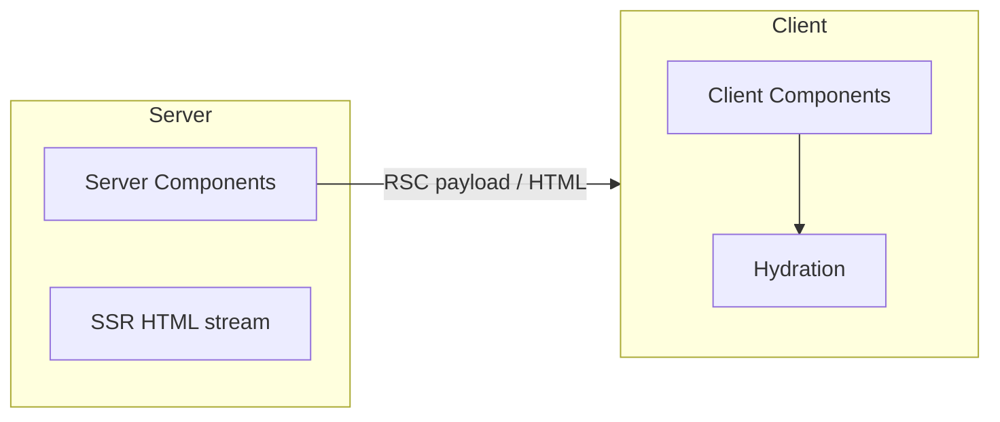

# React — React 19

React 19 APIs, SSR, and React Server Components.

[← Back to hub](./4_react.md)

### Related docs

- [React — Core](./4_react_core.md) · [React — Hooks](./4_react_hooks.md) · [React — Components](./4_react_components.md) · [React — APIs](./4_react_apis.md) · [React — React 19](./4_react_server.md) · [React — Ecosystem](./4_react_ecosystem.md) · [React — Interview](./4_react_interview.md)

### Sections

- [7. React 19](#7-react-19)
- [8. Server rendering & RSC](#8-server-rendering-rsc)

---

## 7. React 19

Overview

<details>
  <summary>Overview</summary>

### Overview

**Definition:** React 19 (Dec 2024) adds first-class **Actions** for async mutations and forms, **React Compiler** for automatic memoization, and **document metadata** hoisted from components to `<head>`.

**How it works:**

| Area              | Feature                             | Where to read                           |
| ----------------- | ----------------------------------- | --------------------------------------- |
| Forms & mutations | Actions with built-in pending/error | [Actions](#actions)                     |
| Performance       | Auto memoization                    | [React Compiler](#react-compiler)       |
| DX                | Metadata in components              | [Document metadata](#document-metadata) |

Replace manual `isLoading` + `try/catch` + `e.preventDefault()` in forms with declarative `action` functions React tracks.

New projects on React 19; migrate forms incrementally. Enable Compiler when the build pipeline supports it.

**Examples:**

```tsx
// Action — pending comes from React
<form action={submitAction}>...</form>
```

**Thoughts:** _Less boilerplate for async UI — Actions and Compiler handle what you used to wire manually._

**See also:** [Actions](#actions) · [React Compiler](#react-compiler) · [Document metadata](#document-metadata)

**Sources:**

[react.dev/blog/2024/12/05/react-19](https://react.dev/blog/2024/12/05/react-19)

Actions

</details>

<details>
  <summary>Actions</summary>

### Actions

**Definition:** Functions passed to `<form action={fn}>` or wrapped in `startTransition` that handle async work. React tracks **pending**, **error**, and **result** state automatically.

**How it works:**

1. User submits form → React calls `action(prevState, formData)` (or custom payload)
2. While Promise pending → `isPending` true, UI can disable buttons
3. On success → action return value becomes new state; form may reset
4. On error → return error message or throw to error boundary
5. Pair with optimistic UI before the server responds when the UX needs instant feedback

**When to use:**

Form submissions, mutations without manual `isLoading` + `try/catch` state.

Complex client-only validation flows where RHF is clearer; non-form mutations (wrap the update in `startTransition`).

**Pluses and minuses:**

| +                                  | −                                               |
| ---------------------------------- | ----------------------------------------------- |
| Built-in pending/error handling    | Requires mental shift from `e.preventDefault()` |
| Works with progressive enhancement | Server Actions are framework-specific (Next.js) |
| Auto form reset after success      |                                                 |

**Examples:**

```tsx
async function updateName(prev: string | null, formData: FormData) {
  const error = await saveName(formData.get("name") as string);
  if (error) return error;
  redirect("/profile");
  return null;
}

function ChangeName() {
  const [error, submitAction, isPending] = useActionState(updateName, null);
  return (
    <form action={submitAction}>
      <input name="name" />
      <button disabled={isPending}>Save</button>
      {error && <p role="alert">{error}</p>}
    </form>
  );
}
```

**Sources:**

[react.dev/reference/react/useActionState](https://react.dev/reference/react/useActionState) · [react.dev/reference/react-dom/components/form](https://react.dev/reference/react-dom/components/form)

React Compiler

</details>

<details>
  <summary>React Compiler</summary>

### React Compiler

**Definition:** Build-time tool that automatically memoizes components and values — reduces need for manual `useMemo`, `useCallback`, `React.memo`.

**How it works:** The compiler analyzes render functions at build time and inserts memoization where it is safe. Incremental adoption: `"use memo"` on a component or hook opts that unit in; `"use no memo"` opts out.

**When to use:**

New projects on React 19; enable when the build pipeline supports it.

#### Common pitfalls

Impure render (mutating props, reading `Date.now()` during render) breaks compiler assumptions. Compiler diagnostics surface via `eslint-plugin-react-hooks`.

**Pluses and minuses:**

| +                                      | −                                                               |
| -------------------------------------- | --------------------------------------------------------------- |
| Fewer perf footguns                    | Requires `babel-plugin-react-compiler` or framework integration |
| Focus on correct code, not memoization | Not a substitute for bad architecture                           |
| Validated on Meta-scale apps           |                                                                 |

**Examples:**

```js
// babel.config.js
module.exports = {
  plugins: [["babel-plugin-react-compiler", { target: "19" }]],
};

function TodoList({ todos }) {
  "use memo"; // opt this component into compilation
  const sorted = todos.slice().sort();
  return (
    <ul>
      {sorted.map((t) => (
        <li key={t.id}>{t.title}</li>
      ))}
    </ul>
  );
}
```

**Thoughts:**

Write correct React; let the compiler memoize. Profile before adding manual `useMemo`.

Compiler assumes [Rules of React](./4_react_core.md#rules-of-react-catalog) — pure render, React-owned component calls, proper hook usage. Still profile with DevTools.

**Sources:**

[react.dev/learn/react-compiler](https://react.dev/learn/react-compiler)

Document metadata

</details>

<details>
  <summary>Document metadata</summary>

### Document metadata

**Definition:** Render `<title>`, `<meta>`, `<link>` inside components — React **hoists** them to `<head>` automatically (React 19+).

**How it works:** Place metadata tags anywhere in the component tree. React collects them during render and moves to `document.head`. Multiple routes/components can set metadata — innermost or last wins per tag type (framework may merge).

**When to use:** Per-route SEO in SPA, blog posts, dynamic `description`/`og:` tags. In Next.js, prefer `metadata` export or `generateMetadata` for static optimization.

**Examples:**

```tsx
function BlogPost({ post }: { post: Post }) {
  return (
    <article>
      <title>{post.title}</title>
      <meta name="description" content={post.excerpt} />
      <h1>{post.title}</h1>
    </article>
  );
}
```

**Thoughts:** _Colocate SEO tags with the component that owns the content._

**Sources:**

[react.dev/reference/react-dom/components/title](https://react.dev/reference/react-dom/components/title)

---

</details>

## 8. Server rendering & RSC

SPA vs SSR vs RSC

<details>
  <summary>SPA vs SSR vs RSC</summary>

### SPA vs SSR vs RSC

**Definition:**

Three delivery models for React apps — client-only SPA, server-rendered HTML with hydration, and React Server Components that stream UI with minimal client JS.

|                   | SPA                    | SSR                     | RSC                            |
| ----------------- | ---------------------- | ----------------------- | ------------------------------ |
| **First paint**   | Slow (large JS bundle) | Fast (HTML from server) | Fast (streamed HTML + payload) |
| **TTI**           | After full JS parse    | After hydration         | Smaller client JS — faster TTI |
| **Data fetching** | Client after mount     | Server per request      | Server — zero client waterfall |
| **Interactivity** | Full client            | Hydrated client         | Client Components only         |
| **SEO**           | Weaker without SSR     | Strong                  | Strong                         |

**How it works:**

| Metric  | Meaning                                                                                                                              |
| ------- | ------------------------------------------------------------------------------------------------------------------------------------ |
| **FCP** | First content on screen (supporting vital, not Core). Full notes: [6_web_api.md](./6_web_api_security.md#first-contentful-paint-fcp) |
| **LCP** | Largest Contentful Paint — main content visible (Core)                                                                               |
| **INP** | Interaction to Next Paint — input snappiness (Core; replaced FID)                                                                    |



| Need                                          | Pick                         |
| --------------------------------------------- | ---------------------------- |
| Simple dashboard, mostly client interactivity | SPA (Vite + React)           |
| SEO + fast first paint, traditional web app   | SSR (Next.js Pages or Remix) |
| Minimal client JS, data on server, streaming  | RSC (Next.js App Router)     |

**Thoughts:** _SPA ships JS first; SSR ships HTML first; RSC ships server components with minimal client bundle._

**See also:**

[Types of web apps](./6_web_api_apps.md#types-of-web-apps) (MPA vs SPA, CSR/SSR/SSG/PWA) · [FCP](./6_web_api_security.md#first-contentful-paint-fcp) · [Hydration](#hydration)

Server Components

**Sources:** [react.dev/learn/start-a-new-react-project](https://react.dev/learn/start-a-new-react-project)

</details>

<details>
  <summary>Server Components</summary>

### Server Components

**Definition:** React components that run **only on the server**. They can be `async`, fetch data directly, and ship **zero JavaScript** to the client for their logic.

**How it works:**

- `useState`, `useEffect`, or any hooks (except `use` with promises in some setups)
- Browser APIs (`window`, `localStorage`)
- Event handlers (`onClick`, etc.)

**When to use:** Static content, data fetching, layouts, non-interactive UI.

**Pluses and minuses:**

| +                       | −                                                     |
| ----------------------- | ----------------------------------------------------- |
| Smaller client bundles  | No interactivity — no event handlers                  |
| Direct DB/API access    | Requires framework (Next.js App Router, etc.)         |
| Streaming with Suspense | Caching/invalidation semantics are framework-specific |

**Examples:**

```tsx
// app/posts/page.tsx — Server Component by default
async function PostsPage() {
  const posts = await db.posts.findAll();
  return (
    <ul>
      {posts.map((p) => (
        <li key={p.id}>
          <LikeButton postId={p.id} /> {/* Client Component */}
          {p.title}
        </li>
      ))}
    </ul>
  );
}
```

**Sources:**

[react.dev/reference/rsc/server-components](https://react.dev/reference/rsc/server-components)

Client Components

</details>

<details>
  <summary>Client Components</summary>

### Client Components

**Definition:** Components marked with `"use client"` that hydrate in the browser and support hooks, state, and events.

**How it works:** `"use client"` marks a module boundary — that file and its imports bundle for the browser. Server Components can import Client Components (as leaves). Client Components **cannot** import Server Components directly (pass as `children` props instead).

**When to use:**

Anything interactive — buttons, forms, hooks, browser APIs, third-party client libs.

Buttons, forms, hooks, `useEffect`, browser APIs (`localStorage`), third-party libs that touch `window`.

Static markup, data fetching, layouts without interactivity — keep as Server Components.

**Examples:**

```tsx
"use client";

import { useState } from "react";

export function LikeButton({ postId }: { postId: string }) {
  const [liked, setLiked] = useState(false);
  return <button onClick={() => setLiked(!liked)}>Like</button>;
}
```

**Thoughts:** _Push_ `"use client"` _to the leaves — interactive widgets, not whole pages._

**See also:** [Server Components](#server-components) · [SPA vs SSR vs RSC](#spa-vs-ssr-vs-rsc)

**Sources:**

[react.dev/reference/rsc/use-client](https://react.dev/reference/rsc/use-client)

Hydration

</details>

<details>
  <summary>Hydration</summary>

### Hydration

**Definition:** **Hydration** attaches event listeners and reconciles **server-rendered HTML** with the client React tree — turning static HTML into a live app without re-creating the DOM from scratch.

**How it works:**

1. Server sends HTML + RSC payload (in RSC apps) — wire format: [Next.js — RSC payload](./4_nextjs_rendering.md#rsc-payload)
2. Browser paints HTML immediately (fast FCP/LCP)
3. Client JS loads → `hydrateRoot(domNode, <App />)`
4. React walks existing DOM, matches to component tree, attaches listeners
5. First client render **must match** server HTML — mismatch → hydration error

**When to use:**

Any SSR/RSC app. Entry: `hydrateRoot` (React 18+), not legacy `hydrate`.

#### Common pitfalls

- `typeof window` branches that change markup server vs client
- `Date.now()`, `Math.random()` for IDs — use stable IDs (`useId` on the client)
- Browser extensions modifying DOM before React hydrates
- Different locale/timezone on server vs client

**Pluses and minuses:**

| +                                     | −                                                |
| ------------------------------------- | ------------------------------------------------ |
| Fast first paint + full interactivity | Mismatch errors if server HTML ≠ client render   |
| Reuses server DOM nodes               | Hydrating large trees is expensive (main-thread) |

**Examples:**

```tsx
// Server and client must render the same initial HTML
const id = useId(); // not Math.random()

hydrateRoot(document.getElementById("root")!, <App />);
```

**Thoughts:**

_Server HTML is the contract — client first render must match byte-for-byte in structure._

`suppressHydrationWarning` only for known benign mismatches (timestamps). Fix root cause, don't suppress broadly.

**See also:** [Render pipeline](./4_react_core.md#render-pipeline) · [Server Components](#server-components)

**Sources:**

[react.dev/reference/react-dom/client/hydrateRoot](https://react.dev/reference/react-dom/client/hydrateRoot)

Streaming & Suspense

</details>

<details>
  <summary>Streaming & Suspense</summary>

### Streaming & Suspense

**Definition:** **Streaming SSR** sends HTML to the browser in chunks as async Server Components resolve. **Suspense** boundaries show `fallback` UI for sections still loading — on server and client.

**How it works:** Server starts rendering the shell (layout, fast components) and streams HTML. When a component `await`s data or is wrapped in Suspense, React sends the fallback first, then streams the resolved content and a small script to swap it in. On the client, Suspense coordinates async boundaries during hydration and concurrent rendering. Multiple Suspense boundaries let fast sections paint while slow ones load independently.

**When to use:** Dashboard with slow widget + fast header, product page with reviews loaded async, any page mixing fast static shell with slow data.

**Pluses and minuses:**

| +                                         | −                                            |
| ----------------------------------------- | -------------------------------------------- |
| Faster FCP/LCP — users see content sooner | More complex mental model vs single SSR blob |
| Progressive enhancement of page sections  | Fallback design and layout shift need care   |
| Pairs with RSC async components           | Framework-specific APIs (Next.js, RR v7)     |

**Examples:**

```tsx
export default function Page() {
  return (
    <>
      <Header /> {/* streams immediately */}
      <Suspense fallback={<PostsSkeleton />}>
        <SlowPosts /> {/* async Server Component */}
      </Suspense>
    </>
  );
}
```

**Thoughts:** Avoid a single Suspense boundary around the entire page — split by independent data sources. Match skeleton dimensions to final content to reduce CLS.

**See also:** [Suspense (Components)](./4_react_components.md#suspense)

**Sources:**

[react.dev/reference/react/Suspense](https://react.dev/reference/react/Suspense)

Framework layer

</details>

<details>
  <summary>Framework layer</summary>

### Framework layer

**Definition:** Meta-frameworks (Next.js, React Router v7) implement **routing**, **RSC**, **SSR**, **build**, and **deployment** — React core alone provides only UI primitives.

**How it works:**

You install `react` + `react-dom`, but production apps need a framework for file-based routes, server rendering, data loaders, and bundling. Framework wires `react-dom/server`, RSC flight protocol, and caching policies.

| Framework                | RSC support                                         |
| ------------------------ | --------------------------------------------------- |
| **Next.js** (App Router) | Full RSC, Server Actions, streaming                 |
| **React Router v7**      | Framework mode with RSC                             |
| **Vite + React**         | SPA only — no RSC without plugin/experimental setup |

**When to use:** Next.js for full-stack React; Vite for SPA; React Router v7 framework mode as middle ground.

**Examples:**

```bash
npx create-next-app@latest my-app
# App Router enables RSC, Server Actions, and streaming by default
```

**Thoughts:**

_React is the UI library; frameworks own the request → HTML → hydration pipeline._

Dec 2025 security advisories affected React Server Components packages — keep `react`, `react-dom`, and framework versions patched. RSC is an **architecture** implemented by frameworks, not something you enable with `react` alone.

**See also:** [SPA vs SSR vs RSC](#spa-vs-ssr-vs-rsc) · [Next.js](./4_nextjs.md)

**Sources:**

[react.dev/blog/2025/12/03/security-advisory-react-server-components](https://react.dev/blog/2025/12/03/security-advisory-react-server-components)

---

</details>
