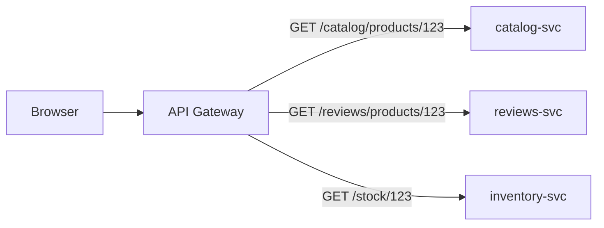
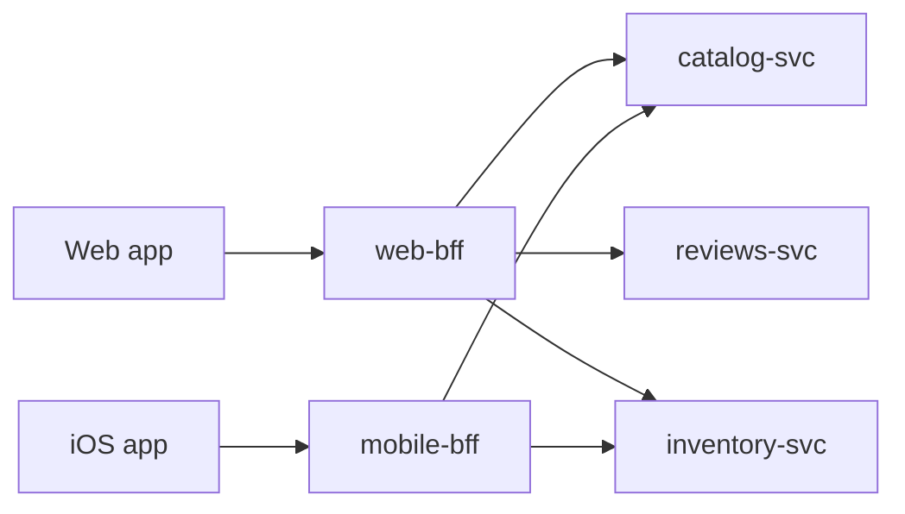
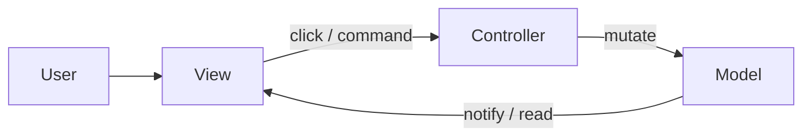

# Architecture patterns

Named ways to cut a system: composition (modular monolith, events, gateways), MVC family, layers/DDD, data flow, and frontend structure.

[← Back to hub](./0_system_design.md)

### Related docs

- [System design — Core](./0_system_design_core.md) · [System design — Architecture](./0_system_design_architecture.md) · [Architecture patterns](./7_special_architecture.md) · [System design — Data](./0_system_design_data.md) · [SOLID](./7_special_engineering.md) · [DRY, KISS, YAGNI](./0_system_design_principles.md) · [GRASP](./0_system_design_grasp.md) · [Design patterns](./7_special_patterns.md) · [System design — Interview](./0_system_design_interview.md) · [JS Functions](./3_js_functions.md) · [React — Ecosystem](./4_react_ecosystem.md)

### Sections

- [3. Architecture patterns](#3-architecture-patterns)
- [Composition & integration](#composition-and-integration)
- [Layers & domain](#layers--domain)
- [MVC family](#mvc-family)
- [Reactive programming](#reactive-programming--reactivity)
- [Functional core, imperative shell](#functional-core-imperative-shell)
- [Frontend structure](#frontend-structure)

---

## 3. Architecture patterns

<details>
  <summary>Architecture vs design patterns</summary>

### Architecture vs design patterns

**Definition:**

**Architecture** is the set of decisions about how modules talk to each other and to the outside world — constraints, rules, and heuristics for the whole system. A **design pattern** is a named template for a smaller, recurring problem closer to the code. Architecture covers the project; patterns cover local jobs.

House metaphor (Doka): architecture is “how to build the house”; patterns are “how to drive piles / mix cement / run wiring.”

**How it works:**

Imagine a photo editor.

- **Architecture** answers: Who owns the canvas? Who talks to the camera? Does UI mutate pixels, or only send “apply sepia”? Is this one deployable app or a checkout widget loaded from another team? Those rules apply to _every_ feature.
- **A pattern** answers a _local_ mismatch: the camera SDK returns `{ some_data: ["Name", "Lastname"] }` but your UI wants `{ someData: "Name Lastname" }` → **Adapter**. You do not need a new architecture for that one mapping.

Same product can use **both**: layers + one-way store (architecture) _and_ Adapter / Strategy / Observer inside a module (patterns).

Every extra line loads the reader; too few details hide meaning. Community-standard cuts (MVC, layers, Flux) and named patterns help hold that balance.

Requirements will change; people cannot forecast the future well. A useful architecture makes change cheaper:

- Regulated module APIs → swap implementations.
- Regulated I/O → fewer accidental leaks of internals (and of data).
- Clear splits → easier tests.
- Predictable layout → faster features and bug hunts.
- Known style → faster onboarding.

**How it works — families of approaches** (group by _goal_, not by brand name):

| Family                   | Question it answers                       | Frontend examples                                                                                                            |
| ------------------------ | ----------------------------------------- | ---------------------------------------------------------------------------------------------------------------------------- |
| **Responsibility**       | Which module owns which job?              | MVC / MVP / MVVM — [MVC family](#mvc-model-view-controller) · Doka “Model View Whatever”                                     |
| **Distance from domain** | What is business logic vs infrastructure? | Three-layer / Clean / Hexagonal — photo **filters** (domain) vs **camera API** (infra)                                       |
| **Data flow**            | Direct calls, bus, or one-way store?      | Flux / Redux (unidirectional); two-way / reactive — [Data flow](#data-flow--one-way-vs-two-way)                              |
| **Composition**          | One program or many?                      | [Monolith vs microservices](./0_system_design_architecture.md#monolithic-architecture) / [micro-frontends](#micro-frontends) |

one-way process — UI event → `dispatch(action)` → store runs reducers → new state → `subscribe` / `useSelector` → UI re-renders. State in, view out; dispatch is the only state-change API. Prefer `configureStore` + `createSlice` (RTK); legacy `createStore` still works but is deprecated. Notes: [Data flow](#data-flow--one-way-vs-two-way).

**When to use:**

Use a named architecture when the app is already a “high-rise” — many modules, many people, long life. Skip heavy architecture on a throwaway prototype (YAGNI). Pick an approach after comparing **cost vs benefit**.

#### Common pitfalls

Treating MVC or Redux as the _goal_. Shipping layers nobody needs. Copying a pattern because it is famous.

**Pluses and minuses:**

| +                                      | −                                                     |
| -------------------------------------- | ----------------------------------------------------- |
| Change, test, onboard cheaper at scale | Time, money, cognitive load to invent _and_ follow it |
| Shared vocabulary in interviews        | Wrong architecture is expensive to unwind             |
|                                        | Over-architecture on a 2-week spike                   |

**Examples:**

```ts
// 1) Responsibility (MVC-shaped): controller never paints pixels; view never talks to camera
type Photo = { pixels: Uint8ClampedArray };
const model = { photo: null as Photo | null };
function controllerCapture() {
  /* I/O */ model.photo = { pixels: new Uint8ClampedArray() };
  viewRender();
}
function viewRender() {
  /* DOM only reads model.photo */
}

// 2) Distance from domain: filters are testable without a phone
function applySepia(photo: Photo): Photo {
  /* pure domain */ return photo;
}
async function readCamera(): Promise<Photo> {
  /* infrastructure */ throw new Error("device");
}

// 3) Data flow — Redux Toolkit (redux.js.org getting-started). One-way: UI → dispatch → reducer → new state → subscribe
import { createSlice, configureStore } from "@reduxjs/toolkit";

const editor = createSlice({
  name: "editor",
  initialState: { filter: "none" as "none" | "sepia" },
  reducers: {
    setFilter(state, action: { payload: "none" | "sepia" }) {
      state.filter = action.payload; // Immer draft; store still immutable
    },
  },
});
const store = configureStore({ reducer: editor.reducer });
store.subscribe(() => console.log(store.getState()));
store.dispatch(editor.actions.setFilter("sepia"));
// UI may only change state through dispatch — not store.getState().filter = 'sepia'

// 4) Composition: one Next.js app vs a separately deployed checkout remote (micro-frontend)
```

**How it works — pattern groups** (too small for an architecture, too common to invent each time):

| Kind           | Job                                         | Doka shortlist                                                |
| -------------- | ------------------------------------------- | ------------------------------------------------------------- |
| **Creational** | Create objects / families; less duplication | Factory (informal), Factory Method, Abstract Factory, Builder |
| **Structural** | How to assemble a component                 | Adapter, Decorator, Facade, Proxy                             |
| **Behavioral** | How to organize behavior / talk             | Chain of Responsibility, Strategy, Command, Observer          |

```ts
// Creational — Factory: hide `new` / format choice
type Filter = { id: string; apply: (p: Photo) => Photo };
function createFilter(id: "sepia" | "gray"): Filter {
  if (id === "sepia") return { id, apply: applySepia };
  return { id, apply: (p) => p };
}

// Structural — Adapter: foreign API → app shape (Doka)
function serverToClientAdapter(data: { some_data: string[] }) {
  return { someData: data.some_data.join(" ") };
}

// Behavioral — Strategy: same call site, swap algorithm
const price: Record<"usd" | "eur", (cents: number) => string> = {
  usd: (c) => `$${(c / 100).toFixed(2)}`,
  eur: (c) => `${(c / 100).toFixed(2)} €`,
};
function formatPrice(cents: number, currency: "usd" | "eur") {
  return price[currency](cents);
}

// Behavioral — Observer: subject notifies whoever subscribed
type Listener = (photo: Photo) => void;
const listeners = new Set<Listener>();
function subscribe(fn: Listener) {
  listeners.add(fn);
  return () => listeners.delete(fn);
}
function notify(photo: Photo) {
  listeners.forEach((fn) => fn(photo));
}
```

**Thoughts:** Architecture and patterns are tools. Add them when benefits beat cost — they are not a scorecard.

**See also:** [Clean / Hexagonal](#clean-architecture--hexagonal) · [State at scale](#state-at-scale) · [GOF catalog](./7_special_patterns.md#gof-design-patterns--catalog) · [Adapter](./7_special_patterns.md#adapter)

**Sources:** [Doka — Architecture and design patterns](https://doka.guide/tools/architecture-and-design-patterns/) (Bespoiasov, updated 2023-01-25) · [Doka — Data flow](https://doka.guide/tools/architecture-data-flow/) · [Redux — Getting started (RTK counter)](https://redux.js.org/introduction/getting-started) · [Redux — data flow](https://redux.js.org/tutorials/fundamentals/part-2-concepts-data-flow) · [Refactoring Guru — catalog](https://refactoring.guru/design-patterns/catalog)

</details>

## Composition & integration

<details>
  <summary>Modular monolith</summary>

### Modular monolith

**Definition:** Single deployable unit with strict internal module boundaries (by domain/feature), enforcing dependency rules between modules.

**How it works:** One app, two ownership layers — a **platform** slice (design system, shared hooks, logging) owned by a platform team, and **domain** folders (`user/`, `payments/`) owned by feature teams. Same instinct as hexagonal/clean architecture, without three layers between a button and a `fetch`. Full clean architecture is usually overkill on the client.

**When to use:** Recommended default for most teams. Split to microservices only when module boundaries and team structure justify it.

**Pluses and minuses:**

| +                                      | −                                                      |
| -------------------------------------- | ------------------------------------------------------ |
| Simple deployment like monolith        | Requires discipline to maintain boundaries             |
| ACID transactions within monolith      | All modules scale together                             |
| Easier refactor to microservices later | Can decay into big ball of mud without linting/reviews |
| One repo, one CI pipeline              |                                                        |

**Examples:** Modules `billing/`, `auth/`, `catalog/` — each exposes a public API; no cross-module internal imports.

**Thoughts:** "Modular monolith first" is increasingly the staff-engineer recommendation. Extract services (or micro-frontends) when a module needs independent scale, independent deploys, or team ownership — not because the codebase got large. See [Micro-frontends](#micro-frontends).

</details>

<details>
  <summary>Event-driven architecture</summary>

### Event-driven architecture

**Definition:** Components communicate by producing and consuming events asynchronously, decoupling producers from consumers.

**How it works:**

1. Producer publishes domain event (`UserRegistered`, `OrderPlaced`) to broker or event bus.
2. Broker persists and delivers to N subscribers (at-least-once typical).
3. Each consumer processes independently — may publish new events (choreography).
4. Failures retried; dead-letter queue for poison messages.

Kafka/RabbitMQ/SNS+SQS, schema registry (Avro/JSON Schema), outbox pattern for reliable publish-after-DB-write.

**When to use:**

Order pipelines, notifications, analytics, integrations, microservices communication, [CQRS](#cqrs) projections.

User waiting for synchronous result that depends on all steps — use request/response or saga orchestrator with polling/WebSocket.

**Pluses and minuses:**

| +                                        | −                                  |
| ---------------------------------------- | ---------------------------------- |
| Loose coupling                           | Eventual consistency               |
| Easy to add new consumers                | Debugging distributed flows harder |
| Natural audit trail                      | Schema evolution / versioning      |
| Handles traffic spikes (buffer in queue) | Ordering guarantees vary by broker |

**Examples:** `OrderPlaced` event → inventory service reserves stock, payment service charges, email service sends confirmation — independently.

**Thoughts:** Define event contracts (versioned schemas). Idempotent consumers are mandatory with at-least-once delivery. Correlate with `trace_id` in OpenTelemetry.

**See also:** [CQRS](#cqrs)

**Sources:** [Microservices.io — Event-driven architecture](https://microservices.io/patterns/data/event-driven-architecture.html)

</details>

<details>
  <summary>API Gateway</summary>

### API Gateway

**Definition:** A single public entry point (usually a reverse proxy) that routes client requests to the right backend service and hides the service map from the UI.

**How it works:**

Microservices each expose their own API. If the frontend calls them directly, it must know addresses, auth, and shapes for every service — tight coupling. A gateway gives **one contract**: protocols, hosts/ports, request rules, response rules. Internals can change without rewriting the client.

Walk one product page:

1. Browser talks only to `https://api.shop.com` (one host, one TLS cert, one auth cookie).
2. Gateway matches the path and **forwards** the request. It does not assemble a page model.
3. `catalog-svc` / `reviews-svc` still return _their_ JSON. The UI still makes **one round trip per service** unless you add a BFF.



Microsoft’s **Gateway Routing** pattern: L7 path/host routing; the gateway also often owns **cross-cutting** work (auth, TLS, rate limits, logging). Typical products: Kong, NGINX, Envoy, AWS/Azure API Gateway.

**When to use:**

Microservice (or many) backends, many clients sharing similar request shapes, need a stable public API. **When NOT:** one frontend + one backend — you already have a single door.

#### Common pitfalls

Treating the gateway as a second checkout service. Letting the browser keep hard-coded internal hostnames (`catalog-svc:8080`). Forgetting HA on the gateway.

**Pluses and minuses:**

| +                                      | −                                             |
| -------------------------------------- | --------------------------------------------- |
| One URL / contract for many services   | Extra hop; gateway is a **SPOF** unless HA    |
| UI decoupled from service split/rename | Fat gateway if you dump domain logic here     |
| Cache, auth, rate-limit at the edge    | Versioning and routing config become ops work |

**Examples:**

```nginx
server {
    listen 80;
    location /catalog/ { proxy_pass http://catalog-svc; }
    location /reviews/ { proxy_pass http://reviews-svc; }
    location /stock/   { proxy_pass http://inventory-svc; }
}
```

Same idea as Node if you only **proxy** (still not a BFF — no aggregation):

```js
// Express 5: res.json(obj) only — set status separately. Catch async errors with next(err).
import express from "express";

const app = express();
const SVC = {
  catalog: "http://catalog-svc",
  reviews: "http://reviews-svc",
};

app.get("/catalog/products/:id", async (req, res, next) => {
  try {
    const upstream = await fetch(`${SVC.catalog}/products/${req.params.id}`);
    const body = await upstream.json();
    res.status(upstream.status).json(body); // same payload, new public URL
  } catch (err) {
    next(err);
  }
});

app.use((err, req, res, next) => {
  res.status(err.status || 500).json({ error: err.message });
});
```

**What the UI still sees** (three calls, three shapes):

```http
GET /catalog/products/123  →  { "id":"123", "title":"Mug", "priceCents":1299, "warehouseSku":"W-9" }
GET /reviews/products/123  →  { "items":[{ "stars":5, "text":"…" }], "average":4.6 }
GET /stock/123             →  { "sku":"W-9", "qty":14 }
```

**Thoughts:**

Shared door. Route + policy, not a page-shaped JSON.

Doka: cache hot paths; light shaping is OK. When each _client_ needs a different payload, add a [BFF](#bff-backend-for-frontend).

**Sources:** [Azure — What is an API gateway](https://learn.microsoft.com/azure/architecture/microservices/design/gateway) · [Azure — Gateway Routing](https://learn.microsoft.com/azure/architecture/patterns/gateway-routing) · [Express — async errors / `res.json`](https://expressjs.com/) · [Doka — Gateway and BFF](https://doka.guide/tools/gateway-bff/)

</details>

<details>
  <summary>BFF (Backend for Frontend)</summary>

### BFF (Backend for Frontend)

**Definition:** A thin server layer **owned by the frontend team** that sits between one UI and domain backends, reshaping data into exactly what that client needs. Doka’s framing: BFF **includes a Gateway** (one contract) **plus** response preparation for that frontend.

**How it works:**

Named at SoundCloud (~2013) while splitting a monolith: web, iOS, and Android fought over one shared API that fit nobody. Phil Calçado documented the pattern; Sam Newman popularized the write-up. Each client gets its own BFF (or one BFF per _class_ of UI — e.g. iOS + Android listener apps sharing one BFF). Netflix used per-device adapters (smart TV vs phone). Azure: a **separate BFF per interface** (desktop vs mobile) so one backend is not torn between conflicting payload/latency needs.

Walk the same product page:

1. Web UI makes **one** call: `GET /bff/pdp/123`.
2. Web BFF, **on the server**, fans out to catalog + reviews + stock (parallel `fetch`).
3. It maps those three JSON blobs into **the web PDP shape** (trim fields, rename, nest). Domain services stay unchanged.
4. Mobile BFF is a **different process** with a smaller mapper — not query-params on a shared mega-endpoint.



The shared-API failure mode: mobile needs name, price, thumbnail; web also needs reviews, stock, related items. One endpoint over-fetches for mobile or under-fetches for web — then you chase `?include=` forever.

REST backends change rarely, so responses often include fields a given UI never uses. Dropping fields breaks old clients; cloning near-identical endpoints is expensive. A BFF or **GraphQL** returns only what that client asked for.

|             | API Gateway                   | BFF                                                        |
| ----------- | ----------------------------- | ---------------------------------------------------------- |
| Who owns it | Platform / backend            | Frontend team for that client                              |
| Clients     | Often many, same-ish API      | One UI (or one _class_: iOS+Android)                       |
| Job         | Route, auth, cache, translate | Aggregate + **shape the screen payload**                   |
| Stack       | NGINX/Kong/cloud GW           | Often Node (I/O-heavy; Doka: Deno/GraalVM as alternatives) |

A company-wide Kong is not a BFF. A `web-bff` that fans out to ten services and returns one home-page JSON is. You can stack them: UI → BFF → shared gateway → services.

shared templates (e.g. JSX) on client and BFF; same language so code can be reused; speed from cache **and** preparing data for the next client request. Node fits lots of I/O, not CPU-heavy work.

keep it a **thin facade** — domain rules stay in real backends.

| Approach                                      | Fit for BFF                                                                                                                                        |
| --------------------------------------------- | -------------------------------------------------------------------------------------------------------------------------------------------------- |
| **Classic 3-tier** (client / business / data) | Weak — upper layers glued to DB/API shape. Not the same as Doka’s [three-layer](#three-layer-architecture-doka) (domain-first).                    |
| **Full DDD** (UI / app / domain / infra)      | Too heavy if product domain already lives downstream; **leaky abstraction** if app code must see infra                                             |
| **Clean / hexagonal**                         | Outer ring = HTTP + fetch adapters; inward = BFF DTOs. Don’t grow a second domain model. See [Clean Architecture](#clean-architecture--hexagonal). |

Doka’s “how to start” stack: Node + Express, often with NestJS — still follow the product, not the framework.

**Example — web BFF aggregates; mobile BFF trims** (Express 5: `try/catch` + `next(err)`; `res.status(n).json(obj)`):

```js
import express from "express";

const app = express();
const CATALOG = "http://catalog-svc";
const REVIEWS = "http://reviews-svc";
const STOCK = "http://inventory-svc";

async function loadProductGraph(id) {
  const [catalogRes, reviewsRes, stockRes] = await Promise.all([
    fetch(`${CATALOG}/products/${id}`),
    fetch(`${REVIEWS}/products/${id}`),
    fetch(`${STOCK}/${id}`),
  ]);
  if (!catalogRes.ok) {
    const err = new Error("product not found");
    err.status = catalogRes.status;
    throw err;
  }
  const [catalog, reviews, stock] = await Promise.all([
    catalogRes.json(),
    reviewsRes.json(),
    stockRes.json(),
  ]);
  return { catalog, reviews, stock };
}

// Pick one mapper per deployed BFF (Azure: separate service per interface).
function toWebPdp({ catalog, reviews, stock }) {
  return {
    id: catalog.id,
    title: catalog.title,
    price: catalog.priceCents / 100,
    inStock: stock.qty > 0,
    reviewAverage: reviews.average,
    reviews: reviews.items.slice(0, 3),
  };
}

function toMobilePdp({ catalog, stock }) {
  return {
    id: catalog.id,
    name: catalog.title,
    price: catalog.priceCents / 100,
    thumbnail: catalog.images[0],
    inStock: stock.qty > 0,
  };
}

const toPdp = toWebPdp; // mobile-bff: toMobilePdp

app.get("/bff/pdp/:id", async (req, res, next) => {
  try {
    const graph = await loadProductGraph(req.params.id);
    res.json(toPdp(graph));
  } catch (err) {
    next(err);
  }
});

app.use((err, req, res, next) => {
  res.status(err.status || 500).json({ error: err.message });
});

app.listen(4000);
```

**Web response** vs **mobile response** (same product `123`):

```json
{
  "id": "123",
  "title": "Mug",
  "price": 12.99,
  "inStock": true,
  "reviewAverage": 4.6,
  "reviews": [{ "stars": 5, "text": "…" }]
}
```

```json
{
  "id": "123",
  "name": "Mug",
  "price": 12.99,
  "thumbnail": "https://cdn/…",
  "inStock": true
}
```

The UI never sees `warehouseSku` or three URLs. Checkout/discount rules stay in domain services — the BFF only **maps**.

**When to use:**

Multiple clients (web, mobile, partner API) needing **meaningfully different** shapes from the same backends. Microservices backend. GraphQL alternative when the team prefers REST + ownership.

A single frontend talking to one API — you mostly add a network hop. Microsoft: skip BFF if all UIs make the same calls, or only one interface talks to the backend. GraphQL with per-client resolvers or a shared API gateway can be enough.

#### Common pitfalls

Putting “apply coupon” in the BFF. One BFF for web+mobile that grows `if (isMobile)` forever (Azure: conflicting requirements). No timeout/`Promise.all` failure handling — one slow review service hangs the whole PDP. Skipping SLOs: if the BFF is down, the UI is down even when catalog is healthy.

**Pluses and minuses:**

| +                                                     | −                                                                                                 |
| ----------------------------------------------------- | ------------------------------------------------------------------------------------------------- |
| Tailored payloads (no over-fetch / extra round trips) | Extra service to run, monitor, and keep alive                                                     |
| Frontend team owns its data shape                     | **SPOF:** if the BFF is down, the UI is down even if domain APIs are fine                         |
| Shields UI from microservice churn                    | Duplication across BFFs (SoundCloud later extracted Value-Added Services for shared domain logic) |
| Client-specific auth, caching, rate limits            | Can become a god-service if domain logic leaks in                                                 |

**Thoughts:**

Aggregate, transform, cache. Microsoft: keep **client-specific** logic in the BFF; put shared auth/monitoring in other patterns (often the gateway). Duplication across BFFs is expected; SoundCloud later extracted Value-Added Services for shared domain work.

One round trip, one screen-shaped JSON, one BFF per client class — domain rules stay downstream.

**Sources:** [Phil Calçado — BFF](https://philcalcado.com/2015/09/18/the_back_end_for_front_end_pattern_bff.html) · [Sam Newman — Backends For Frontends](https://samnewman.io/patterns/architectural/bff/) · [Azure — Backends for Frontends](https://learn.microsoft.com/azure/architecture/patterns/backends-for-frontends) · [Doka — Gateway and BFF](https://doka.guide/tools/gateway-bff/) · [Doka — How web apps work](https://doka.guide/tools/web-app-works/) (middle-end / GraphQL)

</details>

<details>
  <summary>Micro-frontends</summary>

### Micro-frontends

**Definition:**

Frontend architecture where independently deployable frontend applications compose into a single user-facing product — usually a **shell** loading remotes at runtime (e.g. Webpack Module Federation).

**The failure that actually burns teams** is not "mixing React and Vue." It is **shared dependency drift**: one remote upgrades React, another does not, two copies fight over one DOM.

**How it works:**

| Headcount / pain                              | Typical fit                                                                                  |
| --------------------------------------------- | -------------------------------------------------------------------------------------------- |
| Under ~15 engineers                           | Modular monolith almost always wins — not enough people for N deploy pipelines               |
| ~15–50, clear domains                         | BFFs + a well-owned modular monolith; micro-frontends still premature                        |
| 50+ and teams **block each other on deploys** | Micro-frontends start paying — because the _organization_ scaled, not because the bundle did |

**When to use:** The bottleneck is **deploy coordination between teams**, not app complexity. Zalando, IKEA, DAZN and others have written about this at large org size with heavy shared tooling. Reference: [micro-frontends.org](https://micro-frontends.org/).

**Pluses and minuses:**

| Composition                     | How                            | +                               | −                                                                                                                           |
| ------------------------------- | ------------------------------ | ------------------------------- | --------------------------------------------------------------------------------------------------------------------------- |
| **Build-time**                  | npm packages imported at build | Simple                          | Coupled release cycle                                                                                                       |
| **Runtime — iframe**            | Each MFE in iframe             | Strong isolation                | UX/performance; Spotify later consolidated a desktop iframe setup partly because seams cost more than independence returned |
| **Runtime — Module Federation** | Webpack/Vite federated modules | Independent deploy, shared deps | Complex setup; **dependency drift**                                                                                         |
| **Runtime — Web Components**    | Custom elements as boundary    | Framework-agnostic              | Tooling immature in places                                                                                                  |

**Examples:** Shell app loads `header`, `checkout`, `catalog` as federated modules from different teams/deploys. Pin a **single** shared React version in the shell; treat version skew as an incident.

**Thoughts:** Micro-frontends solve _organizational_ scaling. Shared design system, routing conventions, and a dependency contract are mandatory. Mixing frameworks is possible but rarely the reason to adopt the pattern.

**Sources:** [micro-frontends.org](https://micro-frontends.org/)

</details>

## Layers & domain

<details>
  <summary>CQRS</summary>

### CQRS

**Definition:** Command Query Responsibility Segregation — separate models and paths for writes (commands) and reads (queries).

**When to use:** Read-heavy apps with complex queries, different scaling needs for reads vs writes, event sourcing companion.

**Pluses and minuses:**

| +                                                          | −                                              |
| ---------------------------------------------------------- | ---------------------------------------------- |
| Optimize read and write independently                      | Increased complexity                           |
| Scale reads separately (read replicas, denormalized views) | Eventual consistency between read/write models |
| Simpler write model, rich read model                       | Overkill for simple CRUD                       |

**Examples:** Write: normalized `orders` table. Read: denormalized `order_summaries` materialized view updated by events. Forms: [9_database.md — Normal forms](./9_database_core.md#normal-forms-1nf3nf-bcnf); snapshots: [Normalize vs denormalize](./9_database_core.md#normalization-vs-denormalization).

**Thoughts:** Don't apply CQRS everywhere. Use when read patterns genuinely differ from write patterns and justify the sync cost. Fowler: apply per bounded context, not the whole system; most CRUD domains should not use it.

**Sources:** [Martin Fowler — CQRS](https://martinfowler.com/bliki/CQRS.html)

</details>

<details>
  <summary>DDD (Domain-Driven Design)</summary>

### DDD (Domain-Driven Design)

**Definition:**

Software design approach centered on the business domain, using a ubiquitous language and bounded contexts to model complex domains.

| Concept                   | Meaning                                                 |
| ------------------------- | ------------------------------------------------------- |
| **Bounded context**       | Explicit boundary where a domain model applies          |
| **Ubiquitous language**   | Shared vocabulary between devs and domain experts       |
| **Aggregate**             | Cluster of entities treated as one unit for consistency |
| **Entity / Value object** | Identity vs defined-by-attributes                       |

**When to use:** Complex business domains (finance, logistics, healthcare). Less valuable for simple CRUD apps.

**Pluses and minuses:**

| +                                          | −                             |
| ------------------------------------------ | ----------------------------- |
| Aligns code with business                  | Steep learning curve          |
| Clear service boundaries for microservices | Over-modeling slows delivery  |
| Reduces mismatched assumptions             | Requires domain expert access |

**Examples:** "Customer" in Sales context ≠ "Customer" in Support context — different models, different bounded contexts, integrate via APIs/events.

**Thoughts:** DDD is strategic (bounded contexts) and tactical (aggregates, entities). Interviews often focus on bounded contexts as microservice boundaries. A model is a ubiquitous language; large domains need several models, not one enterprise-wide Customer.

**Sources:** [Martin Fowler — Bounded Context](https://martinfowler.com/bliki/BoundedContext.html)

</details>

<details>
  <summary>Clean Architecture & Hexagonal</summary>

### Clean Architecture & Hexagonal

**Definition:** Family of architectures with the same interview idea: **business rules do not depend on frameworks, DBs, or UI**. Hexagonal (ports & adapters, Cockburn) draws a domain hexagon with inbound/outbound ports. Onion (Palermo) is the same instinct with slightly different rings. Clean Architecture (Uncle Bob) draws concentric rings: **entities → use cases → interface adapters → frameworks & drivers**. Doka’s **three-layer** cut (domain / application / ports-and-adapters) is the same idea for small apps — treat the names as synonyms until the project is large enough that the extra rings matter. See [Three-layer architecture](#three-layer-architecture-doka).

**How it works:**

Inner circles are **policies**; outer circles are **mechanisms**. **The Dependency Rule:** source-code dependencies only point **inward**. An inner circle must not name anything declared in an outer circle (class, function, type, or a framework row/DTO). Data that crosses a boundary is a simple structure convenient for the **inner** circle — not a Prisma row or an Express `Request`.

| Ring                     | Owns                                                          | Independent of                            |
| ------------------------ | ------------------------------------------------------------- | ----------------------------------------- |
| **Entities**             | Enterprise / app business rules (objects or data + functions) | UI, DB, navigation, auth flavor           |
| **Use cases**            | Application-specific scenarios; orchestrate entities          | DB, UI, frameworks                        |
| **Interface adapters**   | MVC, presenters, controllers, SQL, API mappers                | — converts inner shapes ↔ outer shapes    |
| **Frameworks & drivers** | HTTP framework, ORM, DB, glue                                 | Details live here so they can be replaced |

Uncle Bob’s goals (all of these architectures): independent of frameworks, UI, DB, and external agencies; **testable** business rules without those.

Domain defines **ports** (interfaces): `OrderRepository`, `PaymentGateway`. **Adapters** implement them: Prisma, Stripe SDK, Express/React. Use cases orchestrate entities and ports. UI and Nest/Express are **outer** — replaceable.

```
Frameworks (HTTP, ORM, queue)
        ↓ adapters
Use cases / application
        ↓
Entities / domain
```

Flow of control can go **outward** (use case → presenter) while **source** dependencies still point **inward**: the use case calls an **output port** interface it owns; the presenter in the outer ring implements it (**Dependency Inversion**).

**When to use:**

Long-lived backends with real domain rules. **When NOT:** a weekend MVP — a modular monolith with clear modules is enough. See [0_mvp.md](./0_mvp.md).

#### Common pitfalls

Putting Prisma calls in React components. Calling it Hexagonal while importing `pg` from the domain folder. Passing ORM row types into entities.

**Pluses and minuses:**

| +                                        | −                                         |
| ---------------------------------------- | ----------------------------------------- |
| Test domain without a database           | Extra interfaces on a 4-endpoint CRUD app |
| Swap Postgres for a fake in tests        | "Use case class per button" cargo cult    |
| Same story as FSD layers on the frontend | Teams argue about folder names            |

**Examples:**

```ts
// port (owned inward — application/domain)
export type ChargeCard = (input: {
  orderId: string;
  cents: number;
}) => Promise<void>;

// use case — no Express, no Prisma
export function completeCheckout(charge: ChargeCard) {
  return async (orderId: string, cents: number) => {
    await charge({ orderId, cents });
  };
}
```

**Thoughts:** Dependencies point inward. The domain does not know Nest or Next.

**See also:** [Three-layer architecture](#three-layer-architecture-doka) · [Architecture vs design patterns](#architecture-vs-design-patterns) · [DDD](#ddd-domain-driven-design) · [FSD](#feature-sliced-design-fsd) · [Message broker](./12_message_broker.md) · [Kafka vs RabbitMQ vs BullMQ](./10_build_infra.md#kafka-vs-rabbitmq-vs-bullmq)

**Sources:** [Alistair Cockburn — Hexagonal](https://alistair.cockburn.us/hexagonal-architecture/) · [Robert C. Martin — The Clean Architecture (2012)](https://blog.cleancoder.com/uncle-bob/2012/08/13/the-clean-architecture.html) · [Doka — Three-layer architecture](https://doka.guide/tools/clean-architecture/)

</details>

<a name="three-layer-architecture-doka"></a>

<details>
  <summary>Three-layer architecture (Doka)</summary>

### Three-layer architecture (Doka)

**Definition:** Split the app into **domain**, **application**, and **ports & adapters**, with a hard rule: **every dependency points toward the domain**. The rest of the code exists to feed the domain the shapes it wants, call its functions, and persist or display the result. Goal: cheaper features and cheaper bug hunts because you know which layer owns the mistake.

**How it works:**

Draw three rings. Center = **what the business is** (cart rules). Middle = **what the user is doing** (checkout). Outer = **how we talk to the world** (button click, HTTP, Postgres). A bug in “10% off is wrong” is domain. A bug in “we forgot to save after checkout” is application. A bug in “snake_case from the API” is an adapter.

```
     ┌─────────────────────────────────────────┐
     │  ports & adapters  (UI, fetch, DB)      │  ← world
     │   ┌─────────────────────────────────┐   │
     │   │  application  (use cases)       │   │
     │   │   ┌─────────────────────────┐   │   │
     │   │   │  domain (pure rules)    │   │   │
     │   │   └─────────────────────────┘   │   │
     │   └─────────────────────────────────┘   │
     └─────────────────────────────────────────┘
              arrows of *imports* only go inward
```

| Layer                | Question it answers                   | Allowed to do                                     | Forbidden                          |
| -------------------- | ------------------------------------- | ------------------------------------------------- | ---------------------------------- |
| **Domain**           | What are the rules of _this_ product? | Types + **pure** functions (same in → same out)   | `fetch`, React, Prisma, `window`   |
| **Application**      | What happens in this **scenario**?    | Load via **port**, call domain, save via **port** | Import Stripe SDK / `fetch` / JSX  |
| **Ports & adapters** | How do we plug into the real world?   | Implement ports; map DTO ↔ domain                 | Business rules (discounts, totals) |

| Code                                         | Layer           | Why                            |
| -------------------------------------------- | --------------- | ------------------------------ |
| `type Cart = { items: CartItem[] }`          | Domain          | Subject data                   |
| `cartTotal(cart)` / `addItem(cart, product)` | Domain          | Rule, no I/O                   |
| `interface CartStorage { load(); save() }`   | Application     | Contract we wish the world had |
| `checkout(userId, storage)`                  | Application     | Scenario: load → domain → save |
| `fetch('/cart').then(fromApi)`               | Driven adapter  | Real HTTP + field mapping      |
| `onClick={() => checkout(...)}`              | Driving adapter | User signal in                 |
| Express `POST /checkout`                     | Driving adapter | Same idea on the server        |

Domain imports nothing outer. Application imports domain + **port types**. Outer **implements** ports and is passed in (DI). JS has no native DI — pass functions as arguments, or Inversify (`container.bind(id).to(Impl)`).

a **port** is the _wish_: “give me `saveCart(cart)`.” An **adapter** makes a messy API look like that wish. Mapping `product_id` → `productId` is adapter work. `function saveCart(c) { return api.save(c) }` is **not** an adapter until you can swap the backend **without editing application code**.

**Driving** (left) — world tells the app: UI, HTTP, CLI. **Driven** (right) — app tells the world: storage, email, payments. Both live in the outer ring.

**Infrastructure** = real DB, SMS, payment APIs. **Shared kernel** = cheap globals (`window`, language). Browser + Node shared code → those globals become adapters.

```ts
// WRONG — domain + HTTP + UI glued; cannot test total without fetch
async function onAddClickedWrong(userId: string, item: CartItem) {
  const res = await fetch(`/api/carts/${userId}`);
  const cart = await res.json();
  cart.items.push(item);
  await fetch(`/api/carts/${userId}`, {
    method: "PUT",
    body: JSON.stringify(cart),
  });
}

// RIGHT — same click, but rules are testable:
//   expect(cartTotalCents(addItem(empty, item))).toBe(500)
```

**When to use:**

Real domain rules; browser + SSR + RN; swap backends. **Minimum:** extract **domain** first. Full three layers when I/O and use cases actually hurt.

#### Common pitfalls

Domain that `fetch`es. Application that imports Stripe. Adapter that only renames a method. Port **implementations** sitting next to use cases. Putting `%` discount logic in JSX.

**Pluses and minuses:**

| +                                       | −                                    |
| --------------------------------------- | ------------------------------------ |
| Bug hunt: rule vs scenario vs glue      | Design time, onboarding              |
| Domain unit-tests with no mocks         | Extra files; more JS to parse        |
| Swap UI or API without rewriting totals | Overkill for a 3-page marketing site |

**Examples:**

```ts
// --- domain/cart.ts  (pure; test with plain objects) ---
export type CartItem = { productId: string; priceCents: number; qty: number };
export type Cart = { items: CartItem[] };

export function addItem(cart: Cart, item: CartItem): Cart {
  const i = cart.items.findIndex((x) => x.productId === item.productId);
  if (i === -1) return { items: [...cart.items, item] };
  const items = cart.items.map((x, n) =>
    n === i ? { ...x, qty: x.qty + item.qty } : x,
  );
  return { items };
}

export function cartTotalCents(cart: Cart): number {
  return cart.items.reduce((sum, x) => sum + x.priceCents * x.qty, 0);
}

export function applyPercentOff(totalCents: number, percent: number): number {
  return Math.round(totalCents * (1 - percent / 100));
}

// --- application/ports.ts + addToCart.ts ---
export interface CartStorage {
  load(userId: string): Promise<Cart>;
  save(userId: string, cart: Cart): Promise<void>;
}

import {
  addItem,
  cartTotalCents,
  type Cart,
  type CartItem,
} from "../domain/cart";

export async function addToCartUseCase(
  userId: string,
  item: CartItem,
  storage: CartStorage, // port — not fetch
): Promise<{ cart: Cart; totalCents: number }> {
  const cart = await storage.load(userId);
  const next = addItem(cart, item);
  await storage.save(userId, next);
  return { cart: next, totalCents: cartTotalCents(next) };
}

// --- adapters/httpCartStorage.ts  (driven) ---
import type { CartItem } from "../domain/cart";
import type { CartStorage } from "../application/ports";

function fromApi(row: {
  product_id: string;
  price_cents: number;
  qty: number;
}): CartItem {
  return {
    productId: row.product_id,
    priceCents: row.price_cents,
    qty: row.qty,
  };
}

export const httpCartStorage: CartStorage = {
  async load(userId) {
    const res = await fetch(`/api/carts/${userId}`);
    const body: {
      items: { product_id: string; price_cents: number; qty: number }[];
    } = await res.json();
    return { items: body.items.map(fromApi) };
  },
  async save(userId, cart) {
    await fetch(`/api/carts/${userId}`, {
      method: "PUT",
      headers: { "Content-Type": "application/json" },
      body: JSON.stringify({
        items: cart.items.map((i) => ({
          product_id: i.productId,
          price_cents: i.priceCents,
          qty: i.qty,
        })),
      }),
    });
  },
};

// --- adapters/AddToCartButton.tsx  (driving) ---
// onClick is the adapter; it must not compute discounts itself
async function onAddClicked(userId: string, item: CartItem) {
  await addToCartUseCase(userId, item, httpCartStorage);
}
```

load → pure update → save.

```ts
type Product = { id: string; name: string };

interface ProductsStorage {
  getProductById(id: string): Product;
  saveProduct(product: Product): void;
}

function updateProduct(product: Product, patch: { name: string }): Product {
  return { ...product, name: patch.name };
}

function renameProductHandler(
  command: { productId: string; name: string },
  storage: ProductsStorage,
) {
  const product = storage.getProductById(command.productId);
  const updated = updateProduct(product, { name: command.name });
  storage.saveProduct(updated);
}
```

domain = fractal + 2D math; application = fractal → draw commands; outer = DOM/Canvas. Same split: geometry is not mixed with `canvas.getContext('2d')`.

**Thoughts:** Program _to the domain_. Outer layers serve it; adapters make the world compatible — ports make the app reachable.

**See also:** [Clean Architecture & Hexagonal](#clean-architecture--hexagonal) · [Architecture vs design patterns](#architecture-vs-design-patterns) · [Modular monolith](#modular-monolith)

**Sources:** [Doka — Three-layer architecture](https://doka.guide/tools/clean-architecture/) (Bespoiasov, updated 2023-01-27) · [Martin — Dependency Rule](https://blog.cleancoder.com/uncle-bob/2012/08/13/the-clean-architecture.html) · [InversifyJS — bind / inject](https://github.com/inversify/InversifyJS)

</details>

## MVC family

<details>
  <summary>MVC (Model-View-Controller)</summary>

### MVC (Model-View-Controller)

**Definition:** Splits modules into **Model** (data + business logic), **View** (layout and display), and **Controller** (routes user commands to the model, and often to the view). Goal: unlike operations (API, validation, DOM, popups) do not live in one blob.

**How it works:**

- User talks only to the **View** (usually GUI; voice/gestures still count).
- **Classic loop (circle):** User → View → Controller → Model → View redraws.
- Events may hit the controller directly, or the view catches them and then calls the controller — both are used.
- **Model** is the most independent piece (like a domain layer). It does not import DOM.
- **Classic web:** Model ≈ DB, Controller ≈ server, View ≈ HTML. **Fat client:** keep document state as JS objects, not in markup.

| Piece          | Owns                               | Does not own        |
| -------------- | ---------------------------------- | ------------------- |
| **Model**      | App truth (`isOn`, orders, users)  | Clicks, CSS, markup |
| **View**       | How state looks; collecting events | “What delete means” |
| **Controller** | Intent → model change              | Pretty rendering    |

1. View shows a dark flashlight (`isOn: false`).
2. User clicks the button (view).
3. Controller runs `toggle()` — it does not paint pixels.
4. Model becomes `{ isOn: true, color: "blue" }`.
5. View reads the model and adds `is-on` + `has-color-blue`.



- **Thin mapping (preferred in the examples below):** view knows button names; controller gets a color string.
- **Fat mapping:** controller receives the DOM event and maps `daylight` → `"blue"`.

- **Fat:** controller transforms data; model is a dumb object. Risk: god object.
- **Thin:** model owns `toggle()` / `setColor()`; controller only forwards. Risk: model dumps.

**When to use:**

Rails/Django, Backbone, desktop MVC, fat-client editors. Skip for a 50-line widget.

**Example 1 — thin controller** (view maps the button; controller only writes the model):

```html
<div class="flashlight"></div>
<button type="button" name="power">On/Off</button>
<button type="button" name="daylight">Day</button>
<button type="button" name="nightlight">Night</button>
```

```js
const model = { isOn: false, color: "blue" };

const controller = {
  toggle() {
    model.isOn = !model.isOn;
  },
  updateColor(color) {
    model.color = color;
  },
};

const view = {
  el: document.querySelector(".flashlight"),
  redraw() {
    const { isOn, color } = model;
    this.el.className = `flashlight has-color-${color}${isOn ? " is-on" : ""}`;
  },
  initEvents() {
    const colors = { daylight: "blue", nightlight: "yellow" };
    document.querySelector('[name="power"]').addEventListener("click", () => {
      controller.toggle();
      view.redraw();
    });
    for (const [name, color] of Object.entries(colors)) {
      document
        .querySelector(`[name="${name}"]`)
        .addEventListener("click", () => {
          controller.updateColor(color);
          view.redraw();
        });
    }
  },
};

view.initEvents();
view.redraw();
```

**Example 2 — fat controller** (same app; DOM event stays in the controller):

```js
const controller = {
  toggle() {
    model.isOn = !model.isOn;
  },
  selectColor(event) {
    const colors = { daylight: "blue", nightlight: "yellow" };
    model.color = colors[event.target.name];
  },
};

document.querySelector('[name="daylight"]').addEventListener("click", (e) => {
  controller.selectColor(e);
  view.redraw();
});
```

**Example 3 — thin controller, fat model** (knowledge of _how_ to toggle lives once):

```js
const model = {
  isOn: false,
  color: "blue",
  toggle() {
    this.isOn = !this.isOn;
  },
  setColor(color) {
    this.color = color;
  },
};

const controller = {
  toggle: () => model.toggle(),
  updateColor: (color) => model.setColor(color),
};
```

**Classic MVC** would `subscribe` the view to the model instead of calling `redraw()` after every controller method:

```js
const listeners = [];
function setOn(value) {
  model.isOn = value;
  listeners.forEach((fn) => fn(model));
}
listeners.push(() => view.redraw());
```

#### Common pitfalls

Mixing DOM mapping _and_ domain mutations in both layers. Letting the view write `model.isOn` directly (skips the controller). Forgetting to redraw if you are not using Observer.

**Pluses and minuses:**

| +                                      | −                                             |
| -------------------------------------- | --------------------------------------------- |
| Clear roles; testable model without UI | Controller can become a god object            |
| Unidirectional flow is easy to narrate | View vs controller placement is fuzzy         |
| Familiar on server and early SPAs      | Overkill for tiny apps; frameworks blur lines |

**Thoughts:**

Mixing inline styles into “the document” makes exports painful. JS state is usually an object you can `JSON.stringify`. Stores (Redux / Vuex / NgRx) are MVC-inspired unidirectional flow, not classic MVC — see [4_react.md](./4_react.md).

Model = truth, View = presentation + input surface, Controller = “user meant this.” The hard part is consistent boundaries, not the triangle.

**See also:** [MVC vs MVP vs MVVM](#mvc-vs-mvp-vs-mvvm) · [Data flow](#data-flow--one-way-vs-two-way)

**Sources:**

[Doka — MVC](https://doka.guide/tools/architecture-mvc/) · [MDN glossary — MVC](https://developer.mozilla.org/en-US/docs/Glossary/MVC) · [Doka — How web apps work](https://doka.guide/tools/web-app-works/)

---

</details>

<details>
  <summary>MVP (Model-View-Presenter)</summary>

### MVP (Model-View-Presenter)

**Definition:** Same three concerns as MVC, but the **Presenter** sits **in a line** between Model and View. Data does not loop View ↔ Model; everything goes through the presenter.

**How it works:**

- **View is passive:** only displays what the presenter says. Formatting that MVC might put in the view lives in the presenter.
- Presenter owns: user commands, data transforms, telling the view what to show.
- No “is `initEvents` view or controller?” debate — at the cost of a fat presenter you later split into modules.

**When to use:**

Android (classic), WinForms, test-heavy UI layers.

**Example — same flashlight, line topology.** View never reads `model`. Presenter formats and pushes strings:

```js
const model = { isOn: false, color: "blue" };

const view = {
  el: document.querySelector(".flashlight"),
  label: document.querySelector(".status"),
  show({ className, text }) {
    this.el.className = className;
    this.label.textContent = text;
  },
  bind(presenter) {
    document.querySelector('[name="power"]').onclick = () =>
      presenter.onPower();
    document.querySelector('[name="daylight"]').onclick = () =>
      presenter.onColor("blue");
    document.querySelector('[name="nightlight"]').onclick = () =>
      presenter.onColor("yellow");
  },
};

const presenter = {
  paint() {
    const { isOn, color } = model;
    view.show({
      className: `flashlight has-color-${color}${isOn ? " is-on" : ""}`,
      text: isOn ? `On · ${color}` : "Off",
    });
  },
  onPower() {
    model.isOn = !model.isOn;
    this.paint();
  },
  onColor(color) {
    model.color = color;
    this.paint();
  },
};

view.bind(presenter);
presenter.paint();
```

Login variant: `view.onSubmit(email, pwd)` → `presenter.onLogin(...)` → model/API → `view.showError()` or `view.navigateHome()`.

**Pluses and minuses:**

| +                           | −                                      |
| --------------------------- | -------------------------------------- |
| View is dumb — easy to mock | Presenter grows large and complex      |
| Clearer placement than MVC  | More ceremony than MVVM for simple UIs |

**Thoughts:** Circle (MVC) vs line (MVP) — presenter is the only brain.

**Sources:**

[Doka — MVC](https://doka.guide/tools/architecture-mvc/)

---

</details>

<details>
  <summary>MVVM (Model-View-ViewModel)</summary>

### MVVM (Model-View-ViewModel)

**Definition:** Replaces the controller with a **ViewModel** — a layer over the view that exposes bindable state. A **binder** (framework, library, or language) maps model/VM changes to UI so you do not write `redraw()` and click-routing by hand.

**How it works:**

- ViewModel = view-shaped state + commands (not raw domain objects).
- Binder syncs View ↔ ViewModel (often two-way).
- Svelte (and Vue/Angular templates) act as binders: they own the glue between state and display.

**When to use:**

Angular, Vue (Options API), WPF, Knockout. Svelte-like compilers are binders too.

**Example — Vue binder** (`v-model` is `:value` + `@input`; no `redraw()`):

```vue
<script setup>
import { reactive } from "vue";

const model = reactive({ isOn: false, color: "blue" });

function toggle() {
  model.isOn = !model.isOn;
}
</script>

<template>
  <div
    class="flashlight"
    :class="[`has-color-${model.color}`, { 'is-on': model.isOn }]"
  />
  <button type="button" @click="toggle">On/Off</button>
  <select v-model="model.color">
    <option value="blue">Day</option>
    <option value="yellow">Night</option>
  </select>
</template>
```

Equivalent without `v-model` (same two-way idea):

```vue-html
<input :value="text" @input="event => text = event.target.value" />
<!-- shorthand: -->
<input v-model="text" />
```

**Pluses and minuses:**

| +                             | −                                   |
| ----------------------------- | ----------------------------------- |
| ViewModel testable without UI | Binding magic hides data flow       |
| Great for form-heavy UIs      | Overkill for simple static pages    |
| Declarative templates         | Debugging binding issues is painful |

**Thoughts:** You stop writing update-UI loops; the binder is the missing fourth piece.

**Sources:**

[Doka — MVC](https://doka.guide/tools/architecture-mvc/) · [Vue — Form input bindings](https://vuejs.org/guide/essentials/forms.html)

---

</details>

<details>
  <summary>MVC vs MVP vs MVVM</summary>

### MVC vs MVP vs MVVM

**Definition:** Side-by-side comparison of presentation-layer patterns — who mediates between model and view, and how data flows.

**How it works:**

|          | Model                 | View                   | Mediator               | Topology   | View knows Model?    | Data flow                               |
| -------- | --------------------- | ---------------------- | ---------------------- | ---------- | -------------------- | --------------------------------------- |
| **MVC**  | Data + business logic | Renders UI; may format | **Controller**         | **Circle** | Often yes (observer) | User → View → Controller → Model → View |
| **MVP**  | Data + logic          | **Passive**            | **Presenter**          | **Line**   | No                   | View ↔ Presenter ↔ Model                |
| **MVVM** | Data + logic          | Declarative template   | **ViewModel** + binder | Binding    | No                   | View ↔ ViewModel ↔ Model                |

- **MVC:** Controller orchestrates; View may observe Model directly (classic desktop) or be driven by Controller (web variants).
- **MVP:** Presenter is the testable brain; View only forwards events and renders what Presenter says — including formatting.
- **MVVM:** ViewModel exposes bindable properties; framework (binder) syncs View automatically (Angular, Vue, Svelte-like).

| Framework     | Closest pattern                            |
| ------------- | ------------------------------------------ |
| React + Redux | Unidirectional (MVC-inspired, not classic) |
| Angular       | MVVM                                       |
| Vue           | MVVM                                       |
| Backbone      | MVC                                        |

**When to use:**

- **MVC:** Server-rendered apps (Rails, Django), Backbone-style SPAs.
- **MVP:** Android (classic), test-heavy UI with passive views.
- **MVVM:** Angular, Vue (Options API), WPF — form-heavy, designer-friendly UIs.
- **React:** Unidirectional flux (Redux) — MVC-inspired but not classic; no two-way binding by design.

**Pluses and minuses:**

| + (comparison)                                | −                                        |
| --------------------------------------------- | ---------------------------------------- |
| All separate UI from domain logic             | Strict layering debates slow small teams |
| MVP/MVVM improve testability over classic MVC | MVVM two-way binding hides data flow     |
| MVC familiar on server and early SPAs         | Overkill for simple CRUD or static sites |

**Examples:** User clicks login → View calls `presenter.onLogin(email, pwd)` → Presenter validates, hits Model API → Presenter calls `view.showError()` or `view.navigateHome()`.

**Thoughts:** Interview: describe **data flow direction**. React explicitly rejected two-way binding for predictability. Modern React (hooks, colocated state) often skips strict MV\* in favor of feature folders.

**Sources:**

[Doka — MVC](https://doka.guide/tools/architecture-mvc/) · [patterns.dev](https://www.patterns.dev/)

---

</details>

<details>
  <summary>MV* drawbacks</summary>

### MV\* drawbacks

**Definition:** MV\* (MVC, MVP, MVVM) trade-offs common to all presentation-layer splits.

**How it works:** Small tools, prototypes, static sites — a single module may suffice.

**Pluses and minuses:**

| +                           | −                                       |
| --------------------------- | --------------------------------------- |
| Separation aids large teams | Over-abstraction for CRUD apps          |
| Testable layers             | "Which layer does this go in?" debates  |
|                             | Two-way binding → hard-to-trace updates |

**Thoughts:**

Feature-Sliced Design and colocated components often replace strict MV\* in modern React codebases. Backend equivalent: [Clean Architecture & Hexagonal](./0_system_design.md) — domain inward, frameworks outward.

---

</details>

<a name="data-flow--one-way-vs-two-way"></a>
<a name="unidirectional-vs-two-way-data-binding"></a>

<details>
  <summary>Data flow — one-way vs two-way</summary>

### Data flow — one-way vs two-way

**Definition:** **Data flow** is how one part of a program receives data from and sends data to other parts. A program is a data transformer: you give it input and expect a result. Split the work across modules, and those modules cooperate by passing **intermediate results** — that path can shape the whole architecture.

**How it works:**

Same product, two rules. Example: a cart line with `qty`. User clicks “+”. Something must become `qty + 1`, and the UI must show it.

| Kind                         | Rule                                                                                | What “+” does                                                                                       |
| ---------------------------- | ----------------------------------------------------------------------------------- | --------------------------------------------------------------------------------------------------- |
| **One-way** (unidirectional) | Between two modules, data either _arrives_ or _leaves_. Direction does not reverse. | View sends a command. Only the store (or parent state) changes `qty`. View **reads** the new value. |
| **Two-way** (bidirectional)  | The same pair can send **and** receive.                                             | Typing in an input writes the model; writing the model rewrites the input.                          |

```
One-way (Redux / React):
  View  --action/event-->  reducer / setState  -->  new state  -->  View re-reads

Two-way (v-model):
  input.value  <-------->  model.email
```

#### One-way — Flux / Redux

Classic **Flux**: **store** (state), **dispatcher**, **view**. Optional **action creators** so the view does not know how to build action objects.

Redux cycle (verified): UI reads state → event → `dispatch(action)` → reducers return next state → store notifies subscribers → UI re-renders. `dispatch` is the **only** way to change store state. The store does **not** paint the UI — a listener (React, or your `render`) does.

```
click "+"  →  { type: 'cart/inc' }  →  reducer  →  { qty: 2 }  →  subscribe  →  paint "2"
```

#### Two-way binding vs reactivity

**Two-way binding** (`v-model`, `[(ngModel)]`): UI control and model field stay in sync. Less handler code; harder to debug when used beyond a form field.

derived values **recompute when sources change** (Excel: change A, sum cell updates). Not the same as binding. Binding = UI ↔ model aligned. Reactivity = when X changes, Y is recalculated.

**When to use:**

One-way for large apps / many people / time-travel. Two-way for small apps and forms.

|                | One-way                         | Two-way                      |
| -------------- | ------------------------------- | ---------------------------- |
| Predictability | High — one update path          | Lower — implicit sync        |
| Debugging      | Trace dispatch → reducer → view | “Who changed this?”          |
| Boilerplate    | Explicit handlers / actions     | Less for forms               |
| Examples       | React props, Redux              | Vue `v-model`, Angular forms |

**Example — one-way in React** (state down, events up; you write both directions):

```jsx
function CartLine() {
  const [qty, setQty] = useState(1);
  return (
    <>
      <QtyButton qty={qty} onInc={() => setQty((q) => q + 1)} />
      <input value={qty} onChange={(e) => setQty(Number(e.target.value))} />
    </>
  );
}

function QtyButton({ qty, onInc }) {
  // Child cannot write qty; it can only ask the parent
  return <button onClick={onInc}>{qty}</button>;
}
```

**Example — one-way in Redux** (same “+”, explicit action + reducer):

```js
function qtyReducer(state = { qty: 1 }, action) {
  switch (action.type) {
    case "cart/inc":
      return { qty: state.qty + 1 };
    default:
      return state;
  }
}

store.dispatch({ type: "cart/inc" });
store.subscribe(() => {
  document.getElementById("qty").textContent = String(store.getState().qty);
});
```

Today’s Redux uses `configureStore` / slices; the cycle is the same (`dispatch` → reducer → subscribers).

**Example — two-way in Vue** (`v-model` is sugar for one-way in + one-way out):

```html
<input v-model="email" />
<!-- same as: -->
<input :value="email" @input="email = $event.target.value" />
```

#### Common pitfalls

Treating the store as the renderer. Using two-way binding for a non-form graph. Confusing `computed` with `v-model`. Putting server cache in Redux — [state at scale](#state-at-scale).

**Examples:**

```js
function sum(a, b) {
  return a + b;
}
let a1 = 2;
let a2 = 3;
let a3 = sum(a1, a2); // 5
a1 = 22;
a3; // still 5 — JS does not re-run the formula
```

```js
import { ref, computed } from "vue";
const A0 = ref(2);
const A1 = ref(3);
const A2 = computed(() => A0.value + A1.value); // 5
A0.value = 22; // A2 becomes 25
```

**Thoughts:**

One-way = “ask, then re-read.” Two-way = “the field _is_ the model.” Reactivity = “dependents update themselves.”

React 19 form actions blur the line; the core model stays one-way. Controlled inputs = two-way **you** write. Original Flux had a separate dispatcher; Redux folds dispatch into the store + one root reducer.

**See also:** [Reactive programming](#reactive-programming--reactivity) · [MVC vs MVP vs MVVM](#mvc-vs-mvp-vs-mvvm) · [React](./4_react.md) · [Architecture vs design patterns](#architecture-vs-design-patterns)

**Sources:**

[Doka — Data flow](https://doka.guide/tools/architecture-data-flow/) · [Redux — data flow](https://redux.js.org/tutorials/essentials/part-1-overview-concepts) · [Vue — v-model](https://vuejs.org/guide/components/v-model.html) · [Vue — computed](https://vuejs.org/guide/essentials/computed.html)

---

</details>

## Reactive programming

<details>
  <summary>Reactive programming & reactivity</summary>

### Reactive programming & reactivity

**Definition:**

**Reactivity** is automatically updating a system when data changes. **Reactive programming** is a paradigm centered on **data streams** — time-ordered event sequences from any source — and the relationships between them.

| Perspective   | Meaning                                                               |
| ------------- | --------------------------------------------------------------------- |
| **User**      | UI responds instantly to input (typing, clicks, loaders)              |
| **Developer** | Derived values stay in sync with sources without manual recomputation |

**How it works:**

Built on the **Observer** pattern. When the source changes, subscribers react — but _when_ they react depends on push vs pull:

| Type     | Mechanism                             | Subscribers update                | JS examples                                      |
| -------- | ------------------------------------- | --------------------------------- | ------------------------------------------------ |
| **Push** | Source pushes each change immediately | On every event                    | `addEventListener`, RxJS `fromEvent`, WebSockets |
| **Pull** | Consumers read fresh values on demand | On next system pass (e.g. render) | React re-render, MobX `autorun`                  |

`const sum = a + b` is a one-time snapshot — changing `a`/`b` later does not update `sum`. Reactive systems recompute dependents when inputs change (frameworks wire this for you).

| Push                                     | Pull                                           |
| ---------------------------------------- | ---------------------------------------------- |
| Immediate; natural for events            | Deferred work — compute only when needed       |
| Risk: duplicate work under heavy streams | Risk: refreshing the whole graph can be costly |

**When to use:** Live dashboards, event-heavy UIs, validation chains, syncing UI with server push. **FRP** (functional reactive programming) composes streams with `map` / `filter` / `scan` — RxJS in JS; Elm is a pure FRP language.

**Examples:**

```js
// Push — native events
document.addEventListener("click", () => console.log("clicked"));

// Push — RxJS
import { fromEvent } from "rxjs";
fromEvent(document, "click").subscribe(() => console.log("clicked"));
```

**Thoughts:**

Express _relationships_ between data; let the runtime sync consumers (especially UI) instead of manually re-running every step.

`$name` or `clicks$` often marks Observables/streams. In practice reactive ideas mix with imperative/OOP (React hooks, Vue Proxy). Two-way binding is _UI ↔ model sync_; reactivity is _derived values recompute_ — [Data flow](#data-flow--one-way-vs-two-way). See [Observer](./7_special_patterns.md#observer) · [React state](./4_react_core.md#state).

**Sources:**

[Doka — reactivity](https://doka.guide/js/reactivity/) · [RxJS overview](https://rxjs.dev/guide/overview)

---

</details>

## Functional core, imperative shell

<details>
  <summary>Functional core, imperative shell</summary>

### Functional core, imperative shell

**Definition:** Keep **business logic pure** (functional core) inside an **impure boundary** (imperative shell) that handles I/O — the pragmatic FP pattern for real apps.

**How it works:**

- **Sandwich pattern:** I/O → pure transform → I/O.
- Example — update DB record: (1) fetch row [effect], (2) `applyBusinessRules(row, input)` [pure], (3) persist [effect].
- Rule: **impure may call pure; pure must not call impure** — keeps core testable without DB/network mocks.
- Strict FP (Haskell, IO monads) pushes further; JS/TS typically use this lighter pattern.

**When to use:** Redux reducers (pure) + thunks (effects), service layer, React Server Actions (validate pure → DB write impure).

**Pluses and minuses:**

| +                                                  | −                                                |
| -------------------------------------------------- | ------------------------------------------------ |
| Core logic unit-testable with plain inputs/outputs | Discipline required — easy to leak I/O into core |
| Clear separation of "what" vs "how to reach world" | Boilerplate adapters at boundaries               |

**Examples:**

```js
// pure core
function applyDiscount(cart, coupon) {
  return { ...cart, total: cart.total * (1 - coupon.percent) };
}

// imperative shell
async function checkout(cartId, couponCode) {
  const cart = await db.cart.find(cartId); // effect
  const coupon = await db.coupon.find(couponCode); // effect
  const updated = applyDiscount(cart, coupon); // pure
  await db.cart.save(updated); // effect
  return updated;
}
```

**Thoughts:** _Effects at the edges; decisions in the middle._

**See also:** Mark Seemann’s **impure / pure / impure** (“impureim”) sandwich — same idea. Why it lowers test friction: [Making tests easy](./7_special_testing.md#making-tests-easy).

**Sources:**

[javascript.info/functional-programming](https://javascript.info/functional-programming)

---

</details>

## Frontend structure

<details>
  <summary>Feature-Sliced Design (FSD)</summary>

### Feature-Sliced Design (FSD)

**Definition:**

Frontend architecture methodology organizing code into **layers** (app, pages, widgets, features, entities, shared) and **slices** by business domain, with a strict public API rule per slice.

| Layer      | Responsibility                                |
| ---------- | --------------------------------------------- |
| `app`      | Providers, router, global styles, entry       |
| `pages`    | Full pages, route composition                 |
| `widgets`  | Composite UI blocks (header, sidebar)         |
| `features` | User actions (login, add-to-cart)             |
| `entities` | Business nouns (user, product)                |
| `shared`   | UI kit, API client, utils — no business logic |

**When to use:** Medium-to-large SPAs, multiple teams, long-lived products.

**Pluses and minuses:**

| +                                          | −                                             |
| ------------------------------------------ | --------------------------------------------- |
| Predictable structure at scale             | Learning curve, can feel heavy for small apps |
| Enforced dependency direction (top → down) | Migration cost from flat structure            |
| Team ownership per slice                   | Over-segmentation if slices too granular      |

**Examples:**

```
src/
  app/
  pages/cart/
  widgets/header/
  features/add-to-cart/
  entities/product/
  shared/ui/
```

Import rule: `features/cart` can import `entities/product` and `shared/*`, never another feature's internals.

**Thoughts:** Public API = `index.ts` barrel per slice. Cross-slice imports only through public API — enforce with ESLint `boundaries` plugin.

**Sources:** [feature-sliced.design](https://feature-sliced.design/)

</details>

<details>
  <summary>Atomic Design</summary>

### Atomic Design

**Definition:**

UI methodology building interfaces from five levels: Atoms → Molecules → Organisms → Templates → Pages.

| Level         | Examples                                                         |
| ------------- | ---------------------------------------------------------------- |
| **Atoms**     | Button, Input, Label, Icon                                       |
| **Molecules** | Search form (input + button), Form field (label + input + error) |
| **Organisms** | Header, Product card, Login form                                 |
| **Templates** | Page layout without real data                                    |
| **Pages**     | Templates with real content                                      |

**When to use:** Design systems, component libraries, teams with designers using shared vocabulary.

**Pluses and minuses:**

| +                            | −                                             |
| ---------------------------- | --------------------------------------------- |
| Reusable component hierarchy | Can be rigid — not everything fits neatly     |
| Shared design language       | Atoms/molecules distinction can be subjective |
| Works well with Storybook    | Doesn't address data/state architecture       |

**Thoughts:** Atomic Design complements (not replaces) FSD. Atoms/molecules live in `shared/ui`; organisms may be widgets or features.

**Sources:** [Brad Frost — Atomic Design](https://atomicdesign.bradfrost.com/)

</details>

<details>
  <summary>Module / package boundaries</summary>

### Module / package boundaries

**Definition:** Encapsulation rules defining what code is public vs internal within a module, and which direction dependencies may flow.

**When to use:** Monorepos, large codebases, libraries consumed by multiple apps.

**Pluses and minuses:**

| +                                       | −                                        |
| --------------------------------------- | ---------------------------------------- |
| Prevents spaghetti imports              | Requires tooling (ESLint, Nx, Turborepo) |
| Enables safe refactoring inside modules | Wrong boundaries are expensive to fix    |
| Clear ownership                         |                                          |

**Examples:**

```ts
// packages/billing/src/index.ts — public API only
export { createInvoice } from "./api";
export type { Invoice } from "./types";
// ./internal/* never exported
```

**Thoughts:** Dependency direction: features → entities → shared. Never shared → features. Cyclic deps = boundary smell.

</details>

<details>
  <summary>State at scale</summary>

### State at scale

**Definition:**

Decision framework for where to store UI and server state in large frontend applications.

| State type          | Where                       | When                          |
| ------------------- | --------------------------- | ----------------------------- |
| **Local component** | `useState`                  | UI-only, not shared           |
| **Shared client**   | Context, Zustand, Jotai     | Cross-component, client-only  |
| **Server**          | React Query, SWR, RTK Query | Remote data, caching, sync    |
| **URL**             | Router search params        | Shareable, bookmarkable state |
| **Form**            | React Hook Form             | Complex forms, validation     |

**When to use:** Default local → lift or URL → server cache → global store only when truly cross-cutting.

**Pluses and minuses:**

| + (right placement) | − (wrong placement)                          |
| ------------------- | -------------------------------------------- |
| Minimal re-renders  | Global store for everything = unmaintainable |
| Clear data flow     | Server state in Redux = manual cache hell    |

**Thoughts:**

"Server state is not client state." Don't put API responses in Redux/Zustand — use a server-state library. See [React — Ecosystem](./4_react_ecosystem.md).

---

</details>
