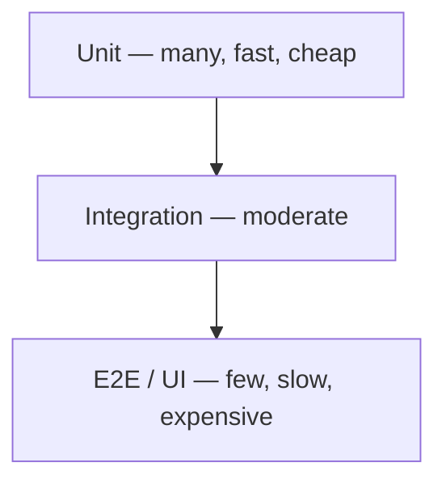

# Testing — Fundamentals

AAA, the test pyramid, and why tests pay off.

[← Back to hub](./7_special_testing.md)

### Related docs

- [Fundamentals](./7_special_testing_fundamentals.md) · [Layers](./7_special_testing_layers.md) · [Practices](./7_special_testing_practices.md) · [Tooling](./7_special_testing_tooling.md) · [React — Testing](./4_react_ecosystem.md#testing) · [Next.js — Vitest + RTL](./4_nextjs_platform.md#testing-nextjs-vitest--rtl) · [CI/CD](./10_build_ci.md#continuous-integration-ci) · [Interview leftovers](./7_special_interview.md)

### Sections

- [Fundamentals](#fundamentals)
- [Tests and AAA](#tests-and-aaa)
- [Test pyramid](#test-pyramid)

---

<a name="fundamentals"></a>

## Fundamentals

<details>
  <summary>Tests and AAA</summary>

### Tests and AAA

**Definition:** A test is code that checks assumptions about other code. Tests make new code cleaner (you design the public API and edge cases first) and make old code safer to change (failures catch regressions before production).

**How it works:**

- Primitive check: call the unit, compare with an expected value (`console.assert`). That lacks a description, readable matchers, and auto-rerun on change — runners exist for that.
- Frontend runners: **Jest** (common default), **Vitest** (Jest-like API, Vite-native). Pick the runner for the layer: unit → Jest/Vitest; components / integration → RTL; E2E → Playwright / Cypress / WebdriverIO. Vue: [Vue Test Utils](./4_vue_ecosystem.md#testing) · Nuxt: [@nuxt/test-utils](./4_nuxt_platform.md#nuxt-test-utils). Setup: [Jest — first tests](./7_special_testing_tooling.md#jest--first-tests-node-vs-jsdom). Layers: [Integration](./7_special_testing_layers.md#integration-testing) · [E2E](./7_special_testing_layers.md#e2e-testing).
- Anatomy is **AAA** (Arrange / Act / Assert) — Russian mnemonic **ПВП**: подготовка, выполнение, проверка.
  - **Arrange** — inputs, expected value, fakes/doubles.
  - **Act** — run the scenario (one call or user flow).
  - **Assert** — compare actual vs expected. Prefer **one assertion / one assumption** per test; extra cases → extra tests.
- Ideal test: all three stages (often three lines), independent of other tests (same result anywhere), readable as an English sentence via `describe` + `it`.
- Jest: `describe(name, fn)` groups a suite; `test` / `it(name, fn)` is one case; `expect(received).toEqual(expected)` is deep equality (`Object.is` for primitives). `toBe` is reference / exact primitive identity — two equal objects fail `toBe`.

**When to use:**

Default for production code. Skip or defer for throwaway prototypes and projects that will not live long enough for tests to pay back. Treat tests as planned work, not leftover time. Make the code cheap to test: [Making tests easy](./7_special_testing_practices.md#making-tests-easy).

#### Common pitfalls

- Coupled tests — shared mutable state so order changes the result.
- Many assertions in one `it` — a failure hides which assumption broke.
- Skipping tests because “extra work” — cost is front-loaded; the suite pays back on every refactor and upgrade.
- Testing only the happy path — the point of writing tests is to hunt “what can go wrong”.

**Pluses and minuses:**

| +                                                         | −                                                                                                                         |
| --------------------------------------------------------- | ------------------------------------------------------------------------------------------------------------------------- |
| Forces edge cases, not only the happy path                | More time on a young project                                                                                              |
| Fewer regressions when adding features or sharing helpers | Need structure for fixtures and doubles ([Test doubles](./7_special_testing_practices.md#test-doubles-stubs-mocks-spies)) |
| Confidence to refactor (including `==` vs `=` bugs)       | CI must run the suite and block bad merges                                                                                |
| Catch breaking dependency upgrades                        | Designing fakes is an architecture skill                                                                                  |
| Living docs that cannot silently rot (unlike comments)    |                                                                                                                           |

**Examples:**

```js
function add(a, b) {
  return a + b;
}

// Primitive — no name, no watch, manual throw
function testAdd() {
  const result = add(10, 5);
  const expected = 15;
  console.assert(result === expected, `got ${result}, expected ${expected}`);
}

// AAA — Arrange args/expected, Act call, Assert matcher
describe("When given 2 numbers", () => {
  it("returns the sum of those 2 numbers", () => {
    const expected = 15;
    const result = add(10, 5);
    expect(result).toEqual(expected);
  });
});
```

Jest install: `npm install --save-dev jest`, `"test": "jest"` in `package.json`, then `npm test`. Official first test uses `toBe` for primitives (`expect(sum(1, 2)).toBe(3)`).

**Thoughts:** Tests are a development tool and a contract that stays true; write them from day one unless the code is a short-lived prototype.

**See also:** When writing tests still feels painful — [Making tests easy](./7_special_testing_practices.md#making-tests-easy). Green units but a dead app — [Integration](./7_special_testing_layers.md#integration-testing) · [System](./7_special_testing_layers.md#system-testing).

**Sources:**

[Doka — how and why to write tests](https://doka.guide/tools/how-to-test-and-why/) · [Jest Getting Started](https://jestjs.io/docs/getting-started) · [Jest `describe` / `test`](https://jestjs.io/docs/api) · [`.toEqual`](https://jestjs.io/docs/expect#toequalvalue)

---

</details>

<details>
  <summary>Test pyramid</summary>

### Test pyramid

**Definition:**

Ideal test distribution — many fast unit tests at the base, fewer integration tests, fewest slow E2E/UI tests at the top. Why write any of them: [Why write tests (AAA)](#tests-and-aaa).



| Layer            | Scope                                                               | Speed               | Cost   |
| ---------------- | ------------------------------------------------------------------- | ------------------- | ------ |
| **Unit**         | One function/module; other deps replaced with doubles               | Fast, parallel-safe | Low    |
| **Integration**  | Two+ parts of one job — **result** of collaboration, not call order | Medium              | Medium |
| **E2E** (system) | App as a user: click, fill, assert                                  | Slow                | High   |
| **Acceptance**   | Spec / TZ scenarios before ship; often **manual**                   | Slowest             | High   |

**How it works:**

- **Unit** — most of the suite. Isolation: if the module imports others, use fakes. TDD sits here: [TDD](./7_special_testing_practices.md#tdd-test-driven-development).
- **Integration** — slightly richer harness so several units run together. Typical target: middleware — unit tests check the middleware’s job in isolation; integration checks how it talks to real neighbors.
- **E2E** — a robot that uses the product (e.g. full signup). Tools: Playwright (preferred in this conspect), Cypress, WebdriverIO.
- **Acceptance** — rarer on the web (short delivery cycle → automate instead). Common before desktop/mobile releases with a long store cycle.

**When to use:** Default strategy. Invert pyramid (ice cream cone) = pain.

**Pluses and minuses:**

| + (pyramid shape)         | −                                              |
| ------------------------- | ---------------------------------------------- |
| Fast CI feedback          | E2E-only gives slow, flaky suite               |
| Cheap maintenance at base | Under-testing integration misses contract bugs |

**Thoughts:**

Contract tests between services sit between integration and E2E. Snapshot tests are unit-ish but can be brittle. Unit tests belong on **your** code; libraries get coverage via adapters + this pyramid’s integration/E2E layers — [Making tests easy](./7_special_testing_practices.md#making-tests-easy). Depth: [Integration](./7_special_testing_layers.md#integration-testing) · [System](./7_special_testing_layers.md#system-testing) · [E2E](./7_special_testing_layers.md#e2e-testing).

---

</details>
