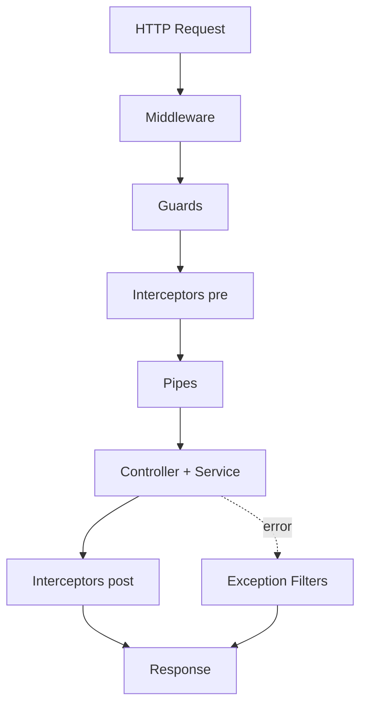

# Node.js — HTTP

Express, auth, validation, Koa, NestJS, and runtime choice.

[← Back to hub](./8_nodejs.md)

### Related docs

- [Node.js — Core](./8_nodejs_core.md) · [Node.js — Modules](./8_nodejs_modules.md) · [Node.js — HTTP](./8_nodejs_http.md) · [Node.js — Additional](./8_nodejs_process.md) · [Node.js — Interview](./8_nodejs_interview.md)

### Sections

- [Express & HTTP](#express-http)
- [Auth & security](#auth-security)
- [Validation](#validation)
- [Koa](#koa)
- [NestJS](#nestjs)
- [Design principles](#design-principles)
- [Choosing a backend runtime](#choosing-a-backend-runtime)

---

## Express & HTTP

<details>
  <summary>Express overview</summary>

### Express overview

**Definition:**

Minimal, unopinionated web framework for Node.js — routing, middleware, templating, static files, error handling.

| Feature          | Description                      |
| ---------------- | -------------------------------- |
| Routing          | `app.get`, `app.post`, `app.use` |
| Middleware       | functions in request pipeline    |
| Static files     | `express.static('public')`       |
| Error middleware | 4-arg `(err, req, res, next)`    |

**Examples:**

```js
import express from "express";

const app = express();
app.use(express.json());

app.get("/api/health", (req, res) => res.json({ status: "ok" }));
app.listen(3000);
```

**Sources:** [expressjs.com](https://expressjs.com/)

</details>

<details>
  <summary>Middleware</summary>

### Middleware

**Definition:**

Functions `(req, res, next) => {}` that run in order during a request. Call `next()` to continue or send a response to end the chain.

| Use case     | Example                       |
| ------------ | ----------------------------- |
| Logging      | log method + URL              |
| Body parsing | `express.json()`              |
| Auth         | verify JWT, attach `req.user` |
| Errors       | catch and format errors       |

**Examples:**

```js
app.use((req, res, next) => {
  console.log(`${req.method} ${req.url}`);
  next();
});

app.use((err, req, res, next) => {
  res.status(500).json({ error: err.message });
});
```

**Sources:** [expressjs.com middleware](https://expressjs.com/en/guide/using-middleware.html)

</details>

<details>
  <summary>Error handling middleware</summary>

### Error handling middleware

**Definition:** Express error middleware has **four arguments** `(err, req, res, next)` and catches errors passed to `next(err)` or thrown in async handlers (with wrapper).

**How it works:**

1. Regular middleware runs in order.
2. On error, call `next(err)` — skips remaining regular middleware.
3. Express jumps to the **first error middleware** (4-arg function).
4. Error handler formats response (JSON, status code) and logs.

| Pattern                          | Purpose                                                        |
| -------------------------------- | -------------------------------------------------------------- |
| `next(err)`                      | Explicit error propagation                                     |
| `express-async-errors` / wrapper | Catches rejected promises in async routes                      |
| Central error handler            | Consistent `{ error, code }` shape                             |
| 404 handler                      | `app.use((req,res) => res.status(404).json(...))` after routes |

**When to use:** Map `ValidationError` → 422, `UnauthorizedError` → 401, unknown → 500 without leaking internals.

**Pluses and minuses:**

| +                                           | −                                     |
| ------------------------------------------- | ------------------------------------- |
| Single place for logging and mapping errors | Must register after all routes        |
| Hides stack traces in production            | Easy to forget async error forwarding |

**Examples:**

```js
// Async wrapper — no extra dependency
const asyncHandler = (fn) => (req, res, next) =>
  Promise.resolve(fn(req, res, next)).catch(next);

app.post(
  "/users",
  asyncHandler(async (req, res) => {
    const user = await db.createUser(req.body);
    res.status(201).json(user);
  }),
);

// Error middleware — MUST be last
app.use((err, req, res, next) => {
  const status = err.status ?? 500;
  console.error(err);
  res.status(status).json({
    error: status === 500 ? "Internal server error" : err.message,
  });
});
```

**Thoughts:** Unhandled promise rejection in a route without `try/catch` or wrapper crashes Node or hangs the request. Always forward errors with `next(err)`.

**Sources:** [expressjs.com error handling](https://expressjs.com/en/guide/error-handling.html)

</details>

<details>
  <summary>Route & query params</summary>

### Route & query params

**Definition:**

Route params are path segments (`:id`); query params are key/value pairs after `?` in the URL.

| Type         | Pattern          | Access           |
| ------------ | ---------------- | ---------------- |
| Route param  | `/users/:id`     | `req.params.id`  |
| Query string | `/users?lang=en` | `req.query.lang` |

**Examples:**

```js
app.get("/users/:id", (req, res) => {
  const { id } = req.params;
  const { lang } = req.query;
  res.json({ id, lang });
});
```

**Sources:** [expressjs.com routing](https://expressjs.com/en/guide/routing.html)

</details>

<details>
  <summary>res.json vs res.send</summary>

### res.json vs res.send

**Definition:**

Both send HTTP responses; `res.json()` sets `Content-Type: application/json` and serializes objects.

| Method           | Behavior                                   |
| ---------------- | ------------------------------------------ |
| `res.send(data)` | auto-detects type (string, buffer, object) |
| `res.json(obj)`  | always JSON, sets header explicitly        |

**Examples:**

```js
res.json({ users: [] }); // preferred for APIs
res.send("plain text"); // text/html or text/plain
```

**Sources:** [expressjs.com response](https://expressjs.com/en/4x/api.html#res)

</details>

---

<a name="auth-security"></a>

## Auth & security

<details>
  <summary>Authentication, identification & authorization</summary>

### Authentication, identification & authorization

**Definition:**

Three distinct security steps in most auth flows.

| Step           | Question         | Examples                               |
| -------------- | ---------------- | -------------------------------------- |
| Authentication | Who are you?     | password, OTP, OAuth, passkeys         |
| Identification | Which account?   | user id, email, username (`sub` claim) |
| Authorization  | What can you do? | roles, permissions, scopes             |

**How it works:**

1. **Register** — identify (unique email) → hash password (bcrypt) → store user.
2. **Login** — authenticate credentials → issue session cookie or JWT.
3. **Request** — middleware verifies session/JWT → attach `req.user`.
4. **Authorize** — check role/permission before handler (`if (!req.user.can('delete'))` → 403).

| Pattern              | Storage              | Revocation                   |
| -------------------- | -------------------- | ---------------------------- |
| Session + Redis      | Server-side session  | Delete session key           |
| JWT access + refresh | Client cookie/header | Short TTL + refresh rotation |
| API key              | DB hash              | Rotate key in dashboard      |

identify → verify email uniqueness → create account (minimal auth).

authenticate credentials → identify user → authorize access.

**When to use:** Return **401** when not authenticated; **403** when authenticated but forbidden. Never expose whether email exists on login (timing-safe compare). HTTP Basic vs sessions → [6_web_api.md — Basic](./6_web_api_auth.md#identification-authentication-authorization--http-basic).

**Pluses and minuses:**

| + (layered auth)                  | −                          |
| --------------------------------- | -------------------------- |
| Clear separation of concerns      | Easy to confuse 401 vs 403 |
| Middleware reusable across routes | OAuth adds complexity      |

**Sources:** [OWASP authentication](https://cheatsheetseries.owasp.org/cheatsheets/Authentication_Cheat_Sheet.html)

</details>

<details>
  <summary>JWT</summary>

### JWT

**Definition:** JSON Web Token — compact, signed string (`header.payload.signature`) for stateless authentication between client and server.

**How it works:**

1. User authenticates with credentials.
2. Auth server issues JWT.
3. Client sends JWT on each API request (usually `Authorization: Bearer <token>`).
4. API verifies signature and expiry.

| Part      | Content                            |
| --------- | ---------------------------------- |
| Header    | algorithm (`alg`), type            |
| Payload   | `sub`, `iat`, `exp`, custom claims |
| Signature | verifies integrity                 |

short-lived access token + long-lived refresh token stored securely; refresh endpoint issues new access token.

**Examples:**

```js
import jwt from "jsonwebtoken";

const token = jwt.sign({ sub: userId, role: "user" }, process.env.JWT_SECRET, {
  expiresIn: "30m",
});
const payload = jwt.verify(token, process.env.JWT_SECRET);
```

**Sources:** [jwt.io](https://jwt.io/) · [RFC 7519](https://datatracker.ietf.org/doc/html/rfc7519)

</details>

<details>
  <summary>bcrypt & password hashing</summary>

### bcrypt & password hashing

**Definition:**

bcrypt is a slow, adaptive hash for passwords. Never store plain passwords — compare with `bcrypt.compare()`.

| Practice            | Why                    |
| ------------------- | ---------------------- |
| Hash with salt      | resists rainbow tables |
| Slow algorithm      | limits brute force     |
| Never log passwords | security leak          |

**Examples:**

```js
import bcrypt from "bcrypt";

const hash = await bcrypt.hash(password, 12);
const valid = await bcrypt.compare(password, hash);
```

**Sources:** [npm bcrypt](https://www.npmjs.com/package/bcrypt)

</details>

<details>
  <summary>Passport.js</summary>

### Passport.js

**Definition:** Authentication middleware for Express — supports 500+ strategies (local, OAuth, JWT).

**Examples:**

```js
import passport from "passport";
import { Strategy as LocalStrategy } from "passport-local";

passport.use(
  new LocalStrategy(async (username, password, done) => {
    const user = await findUser(username);
    if (!user || !(await bcrypt.compare(password, user.hash))) {
      return done(null, false);
    }
    return done(null, user);
  }),
);
```

**Sources:** [passportjs.org](http://www.passportjs.org/)

</details>

<details>
  <summary>Environment variables & secrets</summary>

### Environment variables & secrets

**Definition:**

Config and secrets stored in `process.env`, loaded from OS or `.env` files. Never commit secrets to git.

| Practice               | Description                      |
| ---------------------- | -------------------------------- |
| `.env` in `.gitignore` | keep local secrets out of repo   |
| `dotenv` package       | load `.env` at startup           |
| Different envs         | dev/staging/prod separate values |

**Examples:**

```js
import "dotenv/config";
const dbUrl = process.env.DATABASE_URL;
```

**Sources:** [12factor.net config](https://12factor.net/config)

</details>

---

<a name="validation"></a>

## Validation

<details>
  <summary>Joi</summary>

### Joi

**Definition:**

Schema description language and validator for JavaScript objects — declarative rules for request bodies, config, and API payloads.

| Feature      | Description                                       |
| ------------ | ------------------------------------------------- |
| Schema types | string, number, array, object, date               |
| Rules        | `.required()`, `.min()`, `.email()`, `.pattern()` |
| Sanitization | `.trim()`, `.lowercase()`                         |
| Errors       | detailed validation messages                      |

**Examples:**

```js
import Joi from "joi";

const schema = Joi.object({
  email: Joi.string().email().required(),
  age: Joi.number().integer().min(18),
});

const { error, value } = schema.validate(req.body);
```

**Sources:** [joi.dev](https://joi.dev/)

</details>

<details>
  <summary>Ajv</summary>

### Ajv

**Definition:**

Fast JSON Schema validator — compiles schemas to efficient validation functions.

| Feature         | Description                    |
| --------------- | ------------------------------ |
| JSON Schema     | draft-07, 2019-09, 2020-12     |
| Performance     | compiled validators, very fast |
| Custom keywords | extend with plugins            |

**Examples:**

```js
import Ajv from "ajv";

const ajv = new Ajv();
const validate = ajv.compile({
  type: "object",
  properties: { name: { type: "string" } },
  required: ["name"],
});

if (!validate(data)) console.log(validate.errors);
```

**Sources:** [ajv.js.org](https://ajv.js.org/)

</details>

---

<a name="process-cluster"></a>

## Koa

<details>
  <summary>Koa overview</summary>

### Koa overview

**Definition:**

Modern, lightweight HTTP framework by the Express team — uses async/await middleware and a context object (`ctx`) instead of Node's `req`/`res` directly.

| vs Express          | Koa                          |
| ------------------- | ---------------------------- |
| Callback middleware | async functions              |
| `req` / `res`       | unified `ctx`                |
| Batteries included  | minimal core, add middleware |

**Examples:**

```js
import Koa from "koa";

const app = new Koa();
app.use(async (ctx) => {
  ctx.body = { message: "Hello Koa" };
});
app.listen(3000);
```

**Sources:** [koajs.com](https://koajs.com/)

</details>

<details>
  <summary>ctx (context)</summary>

### ctx (context)

**Definition:**

Koa's context object encapsulates request and response for each HTTP call.

| Property       | Maps to                 |
| -------------- | ----------------------- |
| `ctx.request`  | incoming request        |
| `ctx.response` | outgoing response       |
| `ctx.body`     | response body shorthand |
| `ctx.state`    | middleware-shared data  |

**Examples:**

```js
app.use(async (ctx, next) => {
  console.log(ctx.method, ctx.url);
  ctx.state.user = await getUser(ctx);
  await next();
});
```

**Sources:** [koajs.com context](https://koajs.com/#context)

</details>

---

<a name="nestjs"></a>

## NestJS

<details>
  <summary>NestJS overview</summary>

### NestJS overview

**Definition:** NestJS is a progressive Node.js framework for building scalable server-side apps with TypeScript — opinionated structure, Dependency Injection, and decorators on top of Express or Fastify.

**How it works:**

- App bootstraps from `@Module` graph — imports, controllers, providers.
- HTTP adapter (Express/Fastify) handles raw request; Nest wraps it in execution context.
- **Providers** (`@Injectable`) are registered in module and injected via constructor.
- **Controllers** map routes to handler methods; business logic lives in services.

**When to use:** Enterprise APIs, microservices, teams that need consistent backend structure, GraphQL/gRPC/WebSocket in one framework.

**Pluses and minuses:**

| +                                              | −                                    |
| ---------------------------------------------- | ------------------------------------ |
| Modular architecture out of the box            | More boilerplate than raw Express    |
| DI + testability                               | Learning curve (decorators, modules) |
| Unified patterns (guards, pipes, interceptors) | Heavier for tiny APIs                |
| TypeScript-first                               | Framework lock-in vs minimal libs    |

**Examples:**

```ts
@Module({
  imports: [UsersModule],
  controllers: [AppController],
  providers: [AppService],
})
export class AppModule {}
```

**Sources:** [docs.nestjs.com](https://docs.nestjs.com/)

</details>

<details>
  <summary>Request lifecycle — full path</summary>

### Request lifecycle — full path

**Definition:** Every HTTP request in NestJS passes through a fixed pipeline before a response is sent. Order is documented in the official request lifecycle FAQ.

**How it works:**

1. **Incoming request** hits HTTP adapter (Express/Fastify).
2. **Middleware** — global, then module-bound (`app.use`, `@Module` consumer). Logging, CORS, raw body. Can end request or call `next()`.
3. **Guards** — global → controller → route (`@UseGuards`). Return `true` or throw (`CanActivate`). Auth and roles live here.
4. **Interceptors (pre-controller)** — global → controller → route. Logging, timeout, cache, transform incoming context.
5. **Pipes** — global → controller → route → **route params** (params processed last-to-first among decorated args). Validation (`ValidationPipe`), parsing (`ParseIntPipe`), transformation.
6. **Controller handler** — your `@Get()` / `@Post()` method runs.
7. **Service layer** — injected providers (DB, external APIs).
8. **Interceptors (post-controller)** — map/transform response, wrap in `{ data, meta }`.
9. **Exception filters** — if uncaught error: route → controller → global (lowest level first). Format error response.
10. **Response** sent to client.



| Layer       | Question it answers         | Nest vs Express               |
| ----------- | --------------------------- | ----------------------------- |
| Middleware  | Cross-cutting, any route?   | Same idea as Express          |
| Guard       | Is caller allowed?          | Nest-specific                 |
| Pipe        | Is input valid/transformed? | Nest-specific                 |
| Interceptor | Before/after handler logic? | Nest-specific                 |
| Filter      | How to format errors?       | Like Express error middleware |

**Guard order example** — `@UseGuards(Guard1, Guard2)` on controller, `@UseGuards(Guard3)` on route → `Guard1 → Guard2 → Guard3`.

**Thoughts:** Guards = authorization gate; Pipes = input; Interceptors = AOP around handler; Filters = errors only when thrown.

**Sources:** [NestJS — Request lifecycle](https://docs.nestjs.com/faq/request-lifecycle)

</details>

<details>
  <summary>Decorators cheat sheet</summary>

### Decorators cheat sheet

**Definition:**

Decorators attach metadata and wire Nest's DI and routing. TypeScript `experimentalDecorators` or TS 5+ stage 3 decorators required.

| Decorator                                       | Level        | Purpose                                         |
| ----------------------------------------------- | ------------ | ----------------------------------------------- |
| `@Module()`                                     | App          | Bundle controllers, providers, imports, exports |
| `@Controller('path')`                           | Class        | Route prefix                                    |
| `@Get()`, `@Post()`, `@Patch()`, `@Delete()`    | Method       | HTTP verb + path                                |
| `@Injectable()`                                 | Class        | Registerable provider for DI                    |
| `@Inject(token)`                                | Param        | Custom provider token                           |
| `@Body()`, `@Param()`, `@Query()`, `@Headers()` | Param        | Extract request parts                           |
| `@UseGuards()`                                  | Class/method | Auth / roles                                    |
| `@UsePipes()`                                   | Class/method | Validation on route                             |
| `@UseInterceptors()`                            | Class/method | Logging, mapping, cache                         |
| `@Catch()`                                      | Class        | Exception filter for specific errors            |

**Parameter decorators** (`@Body('email')`, `@Param('id')`) tell Nest what to inject into handler arguments — combined with pipes for validation.

**Examples:**

```ts
@Controller("users")
@UseGuards(JwtAuthGuard)
export class UsersController {
  constructor(private readonly users: UsersService) {}

  @Get(":id")
  @UseGuards(RolesGuard)
  @Roles("admin")
  findOne(@Param("id", ParseIntPipe) id: number) {
    return this.users.findOne(id);
  }

  @Post()
  @UsePipes(new ValidationPipe({ whitelist: true }))
  create(@Body() dto: CreateUserDto) {
    return this.users.create(dto);
  }
}
```

**Sources:** [NestJS — Controllers](https://docs.nestjs.com/controllers) · [NestJS — Custom decorators](https://docs.nestjs.com/custom-decorators)

</details>

<details>
  <summary>Guards vs middleware vs pipes</summary>

### Guards vs middleware vs pipes

**Definition:**

Three different extension points — easy to confuse on interviews.

|                     | Middleware                    | Guard                            | Pipe                               |
| ------------------- | ----------------------------- | -------------------------------- | ---------------------------------- |
| **Runs when**       | Early in pipeline             | After middleware, before handler | Before handler args are passed     |
| **Access**          | `req`, `res`, `next`          | `ExecutionContext`               | `ArgumentMetadata` + value         |
| **Typical use**     | Logger, helmet, cookie-parser | JWT verify, RBAC                 | `class-validator`, `ParseUUIDPipe` |
| **Can block route** | Yes (don't call `next`)       | Yes (`return false` / throw)     | Yes (throw `BadRequestException`)  |
| **Knows handler**   | No                            | Yes (reflector metadata)         | Yes (param type)                   |

**Guards** implement `CanActivate` — check roles from `@Roles()` via `Reflector`, verify JWT, API keys.

**Pipes** implement `PipeTransform` — `ValidationPipe` uses `class-validator` on DTOs; built-in pipes coerce types.

**Interceptors** sit around handler execution — `map` operator on RxJS `Observable` return values, add timing headers, cache responses.

**When to use:**

#### Common pitfalls

- Putting auth in middleware when you need route-level roles → use Guards.
- Validating in controller manually → use `ValidationPipe` + DTO.
- Forgetting global `ValidationPipe` in `main.ts`.

**Sources:** [NestJS — Guards](https://docs.nestjs.com/guards) · [NestJS — Pipes](https://docs.nestjs.com/pipes)

</details>

<details>
  <summary>Data layer in NestJS</summary>

### Data layer in NestJS

**Definition:** Nest does not ship an ORM — you integrate Prisma, TypeORM, Sequelize, Drizzle, or raw `pg` via providers and modules.

**How it works:**

1. **Database module** exports `PrismaService` / `TypeOrmModule` configured once.
2. **Feature module** (e.g. `UsersModule`) imports DB module, declares `UsersService` + `UsersController`.
3. **Service** encapsulates queries — controller stays thin.
4. **Transactions** — `prisma.$transaction([...])` or `@Transactional()` (TypeORM).
5. **Migrations** — ORM CLI or Prisma Migrate, run in CI/CD before deploy.

| Approach | Nest integration                                                |
| -------- | --------------------------------------------------------------- |
| Prisma   | `PrismaService` extends `PrismaClient`, `onModuleInit` connects |
| TypeORM  | `@nestjs/typeorm`, entities, `Repository<T>` injection          |
| Raw SQL  | Custom provider wrapping `pg.Pool`                              |

**When to use:** Repository pattern for testability (mock service in unit tests). CQRS module for read/write split at scale.

**Examples:**

```ts
@Injectable()
export class PrismaService extends PrismaClient implements OnModuleInit {
  async onModuleInit() {
    await this.$connect();
  }
  async onModuleDestroy() {
    await this.$disconnect();
  }
}

@Injectable()
export class UsersService {
  constructor(private prisma: PrismaService) {}

  findByEmail(email: string) {
    return this.prisma.user.findUnique({ where: { email } });
  }
}
```

**Sources:** [NestJS — Database](https://docs.nestjs.com/techniques/database) · [9_database.md](./9_database.md)

</details>

<details>
  <summary>NestJS vs Express vs Fastify</summary>

### NestJS vs Express vs Fastify

**Definition:**

Express and Fastify are minimal HTTP servers; NestJS is a full application framework that can use either as its HTTP engine.

|                    | Express                         | Fastify                                 | NestJS                                    |
| ------------------ | ------------------------------- | --------------------------------------- | ----------------------------------------- |
| **Type**           | Minimal router + middleware     | Fast HTTP framework + schema validation | Opinionated framework (modules, DI)       |
| **Structure**      | You design                      | You design                              | Modules, controllers, services            |
| **Performance**    | Baseline                        | Often 2×+ RPS vs Express                | Depends on adapter (Fastify faster)       |
| **TypeScript**     | Community types                 | Strong native support                   | First-class                               |
| **Validation**     | Manual / middleware             | `@fastify/*` plugins                    | `ValidationPipe` + DTO                    |
| **Auth**           | Passport, custom middleware     | Plugins                                 | Guards + Passport module                  |
| **Learning curve** | Low                             | Low–medium                              | Medium–high                               |
| **Best for**       | Small APIs, legacy, flexibility | High-throughput APIs                    | Teams, microservices, long-lived products |

**How it works:**

- **Dependency Injection** — testable, swappable implementations.
- **Consistent boundaries** — guards/pipes/interceptors instead of ad-hoc middleware chains.
- **Microservices transport** — TCP, Redis, RabbitMQ, Kafka via `@nestjs/microservices`.
- **WebSockets / GraphQL** — first-party modules.

Serverless one-off functions, 3-endpoint prototypes, team allergic to decorators.

```ts
// main.ts — Fastify adapter for better throughput
const app = await NestFactory.create<NestFastifyApplication>(
  AppModule,
  new FastifyAdapter(),
);
```

**Sources:** [NestJS — Performance (Fastify)](https://docs.nestjs.com/techniques/performance) · [fastify.io](https://fastify.dev/)

</details>

---

<a name="design-principles"></a>

## Design principles

<details>
  <summary>SOLID in Express</summary>

### SOLID in Express

**Definition:** The five **SOLID** principles applied to **Express routes, middleware, controllers, and services** — typical Node.js HTTP APIs.

| Principle                     | Meaning                         | Express example                                                                                       |
| ----------------------------- | ------------------------------- | ----------------------------------------------------------------------------------------------------- |
| **S** — Single Responsibility | One reason to change per module | `users.routes.js` wires HTTP · `users.controller.js` handles req/res · `users.service.js` talks to DB |
| **O** — Open/Closed           | Extend via new code, not edits  | Add OAuth provider middleware — don't edit `auth.js` with another `if (provider)`                     |
| **L** — Liskov Substitution   | Subtypes honor parent contract  | Every auth middleware must call `next()` or send a response — same contract                           |
| **I** — Interface Segregation | Small focused APIs              | `usersRouter` exposes CRUD — don't force admin-only handlers on public routes                         |
| **D** — Dependency Inversion  | Depend on abstractions          | `createUserService({ db, mailer })` — not `require('pg')` inside the service                          |

**How it works:**

Each letter matches the **Examples** below — look for `// good` and `// bad`:

1. **S** — routes → controller → service — not one `app.js` with SQL and JSON parsing.
2. **O** — new auth strategy = new middleware function — not editing a giant `auth()` switch.
3. **L** — middleware always ends with `next()` or `res.status(...)` — no silent hang.
4. **I** — `usersRouter` vs `adminRouter` — not one router exporting everything.
5. **D** — inject `db` / `mailer` into services — Route Handler wires concrete adapters.

**When to use:** Refactoring monolithic Express apps; plugin-style auth/payments; code review before adding routes.

**Examples:**

```js
import express from "express";

// S — good: route wires HTTP; service owns business logic
export function createUsersRouter(userService) {
  const router = express.Router();

  router.get("/", async (req, res, next) => {
    try {
      const users = await userService.list();
      res.json(users);
    } catch (error) {
      next(error);
    }
  });

  return router;
}

export function createUserService(db) {
  return {
    list: () => db.query("SELECT id, name FROM users"),
  };
}

// S — bad: route file runs SQL, sends email, validates — everything inline
// app.get("/users", async (req, res) => {
//   const rows = await pool.query("SELECT * FROM users");
//   await sendDigestEmail(rows);
//   res.json(rows);
// });

// O — good: add provider without editing core auth
const authProviders = {
  jwt: (req) => verifyJwt(req.headers.authorization),
  apiKey: (req) => verifyApiKey(req.headers["x-api-key"]),
};

function auth(provider) {
  const verify = authProviders[provider];
  return (req, res, next) => {
    if (!verify(req)) return res.status(401).json({ error: "Unauthorized" });
    next();
  };
}

// O — bad: edit auth middleware for every new provider
// function auth(req, res, next) {
//   if (req.headers.authorization) return verifyJwt(req, res, next);
//   if (req.headers["x-api-key"]) return verifyApiKey(req, res, next);
//   res.status(401).end();
// }

// L — good: middleware always continues or responds
function requireJson(req, res, next) {
  if (!req.is("application/json")) {
    return res.status(415).json({ error: "Expected JSON" });
  }
  next();
}

// L — bad: sometimes calls next(), sometimes hangs — breaks Express pipeline
// function brokenAuth(req, res, next) {
//   if (!req.headers.authorization) return; // forgot next() and res — request hangs
//   next();
// }

// I — good: public users router — only list/create
export function createPublicUsersRouter(userService) {
  const router = express.Router();
  router.get("/", async (req, res, next) => {
    try {
      res.json(await userService.list());
    } catch (error) {
      next(error);
    }
  });
  return router;
}

// I — bad: one router mixes public list + admin delete + internal metrics
// router.get("/", listUsers);
// router.delete("/:id", adminOnly, deleteUser);
// router.get("/metrics", internalOnly, metrics);

// D — good: service receives db — swap fake in tests
export function createUserService(db) {
  return {
    async create(input) {
      return db.query("INSERT INTO users(name) VALUES($1) RETURNING *", [
        input.name,
      ]);
    },
  };
}
// createUserService({ query: async () => [{ id: "1", name: "Ada" }] });

// D — bad: service imports pg pool directly — locked to Postgres, hard to test
// import { pool } from "./db.js";
// export async function createUser(input) {
//   return pool.query("INSERT INTO users(name) VALUES($1) RETURNING *", [input.name]);
// }
```

**Thoughts:** SOLID is a **guide**, not a law — a 30-line API does not need five folders. Apply when the Express app becomes painful to change or test. Frontend mapping: [SOLID in React](./4_react_core.md#solid-in-react) · [SOLID in Next.js](./4_nextjs_core.md#solid-in-nextjs) · [SOLID in TypeScript](./5_ts_objects.md#solid-in-typescript). JS fundamentals: [SOLID in Classes](./3_js_core.md#solid-in-classes) · [SOLID in Functions](./3_js_core.md#solid-in-functions). Full reference: [OOP & SOLID](./7_special_engineering.md#solid-overview).

**Sources:** [Express — Routing guide](https://expressjs.com/en/guide/routing.html) · [Express — Writing middleware](https://expressjs.com/en/guide/writing-middleware.html) · [SOLID (overview)](./7_special_engineering.md#solid-overview) · [JS — SOLID in Classes](./3_js_core.md#solid-in-classes) · [JS — SOLID in Functions](./3_js_core.md#solid-in-functions) · [SOLID in React](./4_react_core.md#solid-in-react) · [SOLID in Next.js](./4_nextjs_core.md#solid-in-nextjs) · [SOLID in TypeScript](./5_ts_objects.md#solid-in-typescript)

</details>

---

<a name="runtime-choice"></a>

## Choosing a backend runtime

<details>
  <summary>Node.js vs Go vs Elixir</summary>

### Node.js vs Go vs Elixir

**Definition:**

Three common backend choices with different concurrency models and ecosystems — pick based on workload, team skills, and operational needs.

|                      | **Node.js**                                                 | **Go**                                   | **Elixir (BEAM)**                        |
| -------------------- | ----------------------------------------------------------- | ---------------------------------------- | ---------------------------------------- |
| **Concurrency**      | Single-threaded JS + event loop; `worker_threads` / cluster | Goroutines (cheap threads), CSP channels | Actor processes, preemptive scheduler    |
| **Strength**         | I/O-bound APIs, real-time, fullstack TS                     | CPU + I/O, simple deploy (static binary) | Fault tolerance, millions of connections |
| **Weakness**         | CPU on main thread blocks loop                              | Verbose error handling, fewer web libs   | Smaller hiring pool, niche ecosystem     |
| **Typical stack**    | Nest/Express + Postgres + Redis                             | Gin/Fiber + Postgres                     | Phoenix + Postgres                       |
| **JSON/HTTP APIs**   | Excellent                                                   | Excellent                                | Excellent                                |
| **WebSocket / chat** | Socket.IO, ws                                               | Good                                     | Phoenix Channels — industry strength     |

**How it works:**

- Team already writes TypeScript on frontend.
- BFF, REST/GraphQL, SSR (Next.js), many npm packages needed.
- Workload is I/O-bound (DB, HTTP, queues).

- High RPS microservices, CLI tools, infrastructure components.
- Need predictable memory and native concurrency without event-loop mental model.
- Small container images, fast cold start (also good for Lambda).

- Soft real-time (chat, notifications, presence).
- "Let it crash" + OTP supervision for 99.99% uptime.
- Telecom-grade connection counts on one node.

_"We chose Node because the team is fullstack TypeScript, the product is I/O-heavy CRUD and integrations, and time-to-market mattered. I'd consider Go for a CPU-bound worker service if profiling showed event-loop blocking, or Elixir if we built a real-time collaboration core."_

**Sources:** [Node.js event loop](https://nodejs.org/en/docs/guides/event-loop-timers-and-nexttick) · [Go concurrency](https://go.dev/doc/effective_go#concurrency)

</details>

---

<a name="interview-practice"></a>

<details>
  <summary>Interview Practice</summary>

### Interview Practice

Questions from [0_interview.md](0_interview.md). Try answering before opening solutions.

### Question index

| #      | Topic                                    | Answer |
| ------ | ---------------------------------------- | ------ |
| 117    | REPL                                     | Q&A    |
| 118    | Streams                                  | Q&A    |
| —      | File vs file system                      | Q&A    |
| 119    | Middleware                               | Q&A    |
| 120    | setImmediate vs nextTick                 | Q&A    |
| —      | ESM vs CJS                               | Q&A    |
| —      | worker_threads                           | Q&A    |
| —      | Graceful shutdown                        | Q&A    |
| —      | NestJS request lifecycle                 | Q&A    |
| —      | Guards vs middleware vs pipes            | Q&A    |
| —      | NestJS vs Express vs Fastify             | Q&A    |
| —      | Node.js vs Go vs Elixir                  | Q&A    |
| Middle | Single-threaded, fork/spawn, JWT, bcrypt | Q&A    |

---
