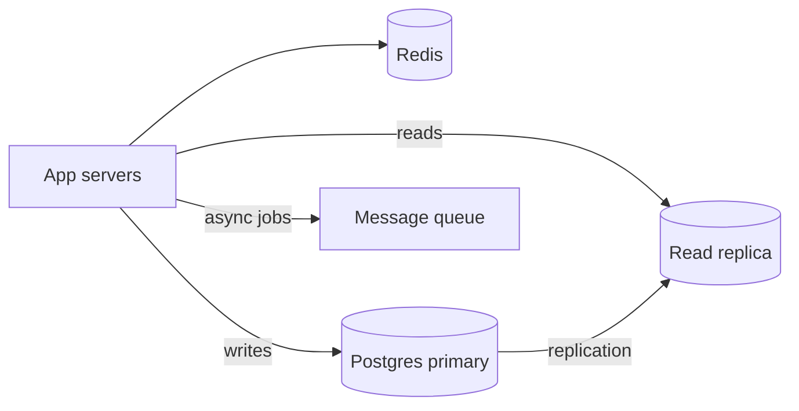

# Database — Interview

Interview Q&A for databases.

[← Back to hub](./9_database.md)

### Related docs

- [DB — Foundations](./9_database_core.md) · [DB — SQL](./9_database_sql.md) · [DB — NoSQL](./9_database_nosql.md) · [DB — ORM](./9_database_orm.md) · [DB — Production](./9_database_production.md) · [DB — Interview](./9_database_interview.md)

### Sections

- [Questions & Answers](#questions-answers)

---

## Questions & Answers

<details>
  <summary>HAVING vs WHERE?</summary>

### HAVING vs WHERE?

**Definition:** `WHERE` filters **rows** before aggregation; `HAVING` filters **groups** after `GROUP BY`.

**How it works:**

SQL execution order — `FROM` → `WHERE` → `GROUP BY` → `HAVING` → `SELECT` → `ORDER BY` → `LIMIT`.

| Clause   | Filters         | Can use aggregates?         |
| -------- | --------------- | --------------------------- |
| `WHERE`  | Individual rows | No (`COUNT(*)` invalid)     |
| `HAVING` | Groups          | Yes (`HAVING COUNT(*) > 5`) |

**When to use:** "Authors with more than 5 books" → `HAVING`. "Books from 2020+" → `WHERE`. Topic: [WHERE vs HAVING](./9_database_sql.md#where-vs-having).

**Examples:**

```sql
SELECT author_id, COUNT(*) AS cnt
FROM books
WHERE published_at >= '2020-01-01'   -- row filter first
GROUP BY author_id
HAVING COUNT(*) > 5;                -- group filter after
```

**Sources:** [PostgreSQL — SELECT](https://www.postgresql.org/docs/current/sql-select.html)

</details>

<details>
  <summary>LEFT JOIN vs INNER JOIN?</summary>

### LEFT JOIN vs INNER JOIN?

**Definition:** **INNER JOIN** returns only rows with matches in both tables. **LEFT JOIN** returns all left-table rows; right side is NULL when no match.

**How it works:**

Join condition in `ON` — `FROM users u LEFT JOIN orders o ON o.user_id = u.id` keeps every user even with zero orders.

| Join  | Use when                                               |
| ----- | ------------------------------------------------------ |
| INNER | Relationship required (only users with orders)         |
| LEFT  | Optional relationship (all users, order total or NULL) |

**When to use:** Wrong join type silently drops data — INNER when you meant LEFT loses users without orders. Topic: [Joins](./9_database_sql.md#joins).

**Sources:** [PostgreSQL — Joins](https://www.postgresql.org/docs/current/queries-table-expressions.html#QUERIES-JOIN) · [Use The Index, Luke — Joins](https://use-the-index-luke.com/sql/join)

</details>

<details>
  <summary>1NF vs 2NF vs 3NF vs BCNF?</summary>

### 1NF vs 2NF vs 3NF vs BCNF?

**Definition:**

Normal forms are stacked rules that remove redundancy. Target for OLTP is **3NF**. Theory: [Normal forms (1NF–3NF, BCNF)](./9_database_core.md#normal-forms-1nf3nf-bcnf).

| Form     | Extra rule over the previous                                       |
| -------- | ------------------------------------------------------------------ |
| **1NF**  | Atomic values — no lists/nested tables in a cell                   |
| **2NF**  | Non-key columns depend on the **entire** candidate key             |
| **3NF**  | Non-key columns depend **only** on keys (no A → B → C via non-key) |
| **BCNF** | Every determinant of a non-trivial FD is a **superkey**            |

**How it works:** 2NF only bites on **composite** keys. Single-column PK tables that are 1NF are already 2NF. BCNF is 3NF plus “no leftover FDs from a non-key into a key.”

**When to use:** “Why split `products` from `order_items`?” → 2NF/3NF. Checkout still copies `unit_price` → intentional denormalization, not a failed 3NF.

**Sources:** [Database normalization](https://en.wikipedia.org/wiki/Database_normalization)

</details>

<details>
  <summary>MongoDB embed vs reference?</summary>

### MongoDB embed vs reference?

**Definition:**

**Embed** nests related documents inside parent; **reference** stores `ObjectId` pointing to another collection.

| Pattern   | Best for                         | Avoid when                                |
| --------- | -------------------------------- | ----------------------------------------- |
| Embed     | One-to-few, always read together | Unbounded arrays (comments on viral post) |
| Reference | One-to-many, shared entities     | Need atomic update across many parents    |

**How it works:** Embedded doc updates with parent in one read; reference needs second query or `$lookup` (like JOIN).

**When to use:** User address embedded; product category referenced. 16 MB document limit caps embedding.

**Sources:** [MongoDB — Data modeling](https://www.mongodb.com/docs/manual/core/data-modeling-introduction/)

</details>

<details>
  <summary>N+1 problem?</summary>

### N+1 problem?

**Definition:** One query loads N parents, then N separate queries load children — 1 + N round trips.

**How it works:**

ORM lazy-loading triggers query per row in a loop. Fix with eager `include`, JOIN, or `WHERE id IN (...)`.

| Fix        | Approach                            |
| ---------- | ----------------------------------- |
| ORM        | `include: { posts: true }`          |
| SQL        | `LEFT JOIN` or batch `IN`           |
| DataLoader | Batch + cache per request (GraphQL) |

**Examples:**

```ts
// BAD
const users = await prisma.user.findMany();
for (const u of users)
  u.posts = await prisma.post.findMany({ where: { authorId: u.id } });

// GOOD
const users = await prisma.user.findMany({ include: { posts: true } });
```

**Sources:** [Prisma — Relation queries](https://www.prisma.io/docs/orm/prisma-client/queries/relation-queries)

</details>

<details>
  <summary>What is ACID?</summary>

### What is ACID?

**Definition:** Transaction guarantees — **Atomicity** (all or nothing), **Consistency** (constraints hold), **Isolation** (concurrent txs don't corrupt), **Durability** (committed survives crash).

**When to use:** Bank transfer — debit and credit in one transaction; `ROLLBACK` on any failure.

**Thoughts:** Postgres default isolation is READ COMMITTED. Keep transactions short. Topics: [ACID](./9_database_core.md#acid), [COMMIT and ROLLBACK](./9_database_sql.md#commit-and-rollback).

**Sources:** [PostgreSQL — Transactions](https://www.postgresql.org/docs/current/tutorial-transactions.html)

</details>

<details>
  <summary>Upsert — ON CONFLICT?</summary>

### Upsert — ON CONFLICT?

**Definition:** `INSERT ... ON CONFLICT (unique_col) DO UPDATE` — insert or update atomically in PostgreSQL.

**When to use:** Idempotent webhooks, sync user profile by email, settings row per user. Topic: [Upsert](./9_database_sql.md#upsert-on-conflict).

**Examples:**

```sql
INSERT INTO settings (user_id, theme) VALUES (1, 'dark')
ON CONFLICT (user_id) DO UPDATE SET theme = EXCLUDED.theme;
```

**Sources:** [PostgreSQL — ON CONFLICT](https://www.postgresql.org/docs/current/sql-insert.html#SQL-ON-CONFLICT)

</details>

<details>
  <summary>Foreign keys — why use them?</summary>

### Foreign keys — why use them?

**Definition:** FK ensures referential integrity — cannot insert `orders.user_id = 999` if user 999 does not exist.

**When to use:** `ON DELETE RESTRICT` prevents deleting user with orders; `CASCADE` deletes children with parent (use carefully). Topics: [Primary key](./9_database_sql.md#primary-key), [Foreign key](./9_database_sql.md#foreign-key).

**Sources:** [PostgreSQL — Constraints](https://www.postgresql.org/docs/current/ddl-constraints.html)

</details>

<details>
  <summary>Backup vs PITR?</summary>

### Backup vs PITR?

**Definition:** **Snapshot backup** restores to backup time. **PITR** replays WAL logs to recover to any second within retention.

**When to use:** Accidental `DELETE` → PITR to minute before. Daily snapshot alone cannot recover midday mistake.

**Thoughts:** Test restores regularly. Replication is not backup.

**Sources:** [PostgreSQL — Backup](https://www.postgresql.org/docs/current/backup.html)

</details>

<details>
  <summary>Scaling PostgreSQL to millions of users</summary>

### Scaling PostgreSQL to millions of users

**Definition:** Growing from a small OLTP database to millions of users is a **sequence of measured steps** — not immediate sharding.

**How it works:**

| Stage | Action                                                                    | What it fixes                     |
| ----- | ------------------------------------------------------------------------- | --------------------------------- |
| 1     | **Indexes** on `WHERE`, `JOIN`, `ORDER BY` columns                        | Slow queries, seq scans           |
| 2     | **Query tuning** — fix N+1, avoid `SELECT *`, keyset pagination           | App-level round trips             |
| 3     | **Connection pooling** (PgBouncer)                                        | `max_connections` exhaustion      |
| 4     | **Redis cache** — cache-aside for hot keys (profile, config)              | Repeated identical reads          |
| 5     | **Read replicas** — reports and read-heavy endpoints off replica          | Primary CPU / I/O                 |
| 6     | **Denormalize** — snapshots for dashboards (order line items at checkout) | Expensive JOINs at read time      |
| 7     | **Partitioning** — by date or `tenant_id` inside one DB                   | Large table maintenance, archival |
| 8     | **Async work** — email, analytics, search indexing via queue              | Write path bloat                  |
| 9     | **Sharding** — split by `user_id` / `tenant_id` across DBs                | Single-writer ceiling             |



**When to use:**

1M users ≠ 1M QPS — clarify read/write ratio and hot paths in interview. Start with `EXPLAIN ANALYZE` and connection pool metrics.

#### Common pitfalls

- Sharding before indexing — operational nightmare for little gain.
- Reading replica right after write — stale data (read-your-writes violation).
- `OFFSET 100000` pagination — use keyset (`WHERE id > $cursor`).

**Pluses and minuses:**

| + (incremental scale)                  | −                                        |
| -------------------------------------- | ---------------------------------------- |
| Each step is reversible and measurable | Sharding adds cross-shard query pain     |
| Most apps never need step 9            | Cache invalidation bugs cause stale data |

**Thoughts:** _"Indexes, pool, cache, replicas — sharding last."_

**Sources:** [PostgreSQL — High availability](https://www.postgresql.org/docs/current/high-availability.html) · [Use The Index, Luke](https://use-the-index-luke.com/)

</details>

<details>
  <summary>Indexes you use every day (interview answer)</summary>

### Indexes you use every day (interview answer)

**Definition:**

Practical index patterns for typical Node/Postgres apps — what to say when asked "which indexes do you use daily?"

| Pattern             | SQL                                              | Why                        |
| ------------------- | ------------------------------------------------ | -------------------------- |
| Unique login        | `UNIQUE INDEX ON users(email)`                   | Fast lookup + constraint   |
| FK + sort           | `INDEX ON orders(user_id, created_at DESC)`      | User's orders list         |
| Partial active rows | `INDEX ON users(email) WHERE deleted_at IS NULL` | Smaller index, soft-delete |
| JSONB field         | `GIN INDEX ON products USING gin(data)`          | `@>` / `?` queries on JSON |
| Full-text           | `GIN ON to_tsvector('english', title)`           | Search, not `LIKE '%x%'`   |

**How it works:**

`EXPLAIN (ANALYZE, BUFFERS)` — want `Index Scan` or `Index Only Scan`, not `Seq Scan` on large tables.

Every index slows `INSERT`/`UPDATE` — don't index low-cardinality columns alone (`status` with 3 values) unless partial.

**Examples:**

```sql
CREATE UNIQUE INDEX idx_users_email ON users (lower(email));
CREATE INDEX idx_orders_user_created ON orders (user_id, created_at DESC);
CREATE INDEX idx_users_active_email ON users (email) WHERE deleted_at IS NULL;
```

**Sources:** [PostgreSQL — Indexes](https://www.postgresql.org/docs/current/indexes.html)

</details>

<details>
  <summary>What is Redis and how does it work?</summary>

### What is Redis and how does it work?

**Definition:** In-memory data structure server — sub-ms latency for strings, hashes, lists, sets, sorted sets, streams.

**How it works:**

Key-value in RAM; optional RDB/AOF persistence; TTL auto-expires keys; single-threaded command processing (hot key = bottleneck).

```js
const hit = await redis.get(`user:${id}`);
if (hit) return JSON.parse(hit);
const user = await db.user.findUnique({ where: { id } });
await redis.setex(`user:${id}`, 3600, JSON.stringify(user));
```

Primary durable store for financial data without careful persistence config.

**When to use:** Cache-aside, sessions, rate limiting (`INCR` + TTL), pub/sub, Bull/BullMQ job queues, leaderboards (`ZADD`).

**Sources:** [Redis docs](https://redis.io/docs/)

</details>

<details>
  <summary>What is Elasticsearch and how does it work?</summary>

### What is Elasticsearch and how does it work?

**Definition:** Lucene-based distributed search engine — JSON documents in **indexes**, split into **shards** across **nodes**.

**How it works:**

Analyzer (char filter → tokenizer → token filters) builds an inverted index. Query DSL (`match`, `match_phrase`, `bool`) scores hits. Replicas give HA; coordinating nodes route.

Primary transactional store.

**When to use:** Full-text product search, logs. Keep Postgres/Mongo as source of truth; sync into ES.

**Sources:** [NoSQL — Elasticsearch](./9_database_nosql_core.md#elasticsearch)

</details>

<details>
  <summary>What is RabbitMQ and how does it work?</summary>

### What is RabbitMQ and how does it work?

**Definition:** Message broker (AMQP) — producers publish to **exchanges**, exchanges route to **queues**, consumers process messages asynchronously.

**How it works:**

- **Exchange types:** direct (routing key), fanout (broadcast), topic (`order.*`), headers.
- **Ack/nack** — consumer confirms processing; unacked messages redelivered.
- **Dead letter queue (DLQ)** — failed messages for inspection/retry.
- Delivery: **at-least-once** by default — consumers must be **idempotent**.

RabbitMQ — task queues and routing; Kafka — high-throughput event log with replay.

**When to use:** Email sending, order processing, decouple microservices, absorb traffic spikes.

**Sources:** [RabbitMQ tutorials](https://www.rabbitmq.com/tutorials)

</details>

---

### Tasks

### Task 1 — Top 3 authors by book count

<details><summary>Solution</summary>

```sql
SELECT a.name, COUNT(b.id) AS book_count
FROM authors a
JOIN books b ON b.author_id = a.id
GROUP BY a.id, a.name
ORDER BY book_count DESC LIMIT 3;
```

</details>

### Task 2 — Last 3 comments per user

<details><summary>Pattern</summary>

`ROW_NUMBER() OVER (PARTITION BY user_id ORDER BY created_at DESC) <= 3`, or lateral subquery with `LIMIT 3` per user.

</details>

### Task 3 — Library schema

Tables: `books`, `authors`, `members`, `loans`. Normalize authors; index `loans(book_id)`, `loans(member_id)`.

### Task 4 — Fix N+1 with Prisma

```ts
prisma.user.findMany({
  include: { comments: { take: 3, orderBy: { createdAt: "desc" } } },
});
```

---

<details>
  <summary>Junior — DB</summary>

### Junior — DB

123. Write a query to find the three authors with the most books.

124. Write a query that selects the last three comments for a specific user.

125. Design a simple database schema for a library.

126. What is the SQL `HAVING` clause used for?

127. What is `LEFT JOIN` used for?

128. What is the difference between embed and reference relationships in MongoDB?

129. Comments store `author_id` as a plain string instead of `ObjectId` — what is wrong?

130. How do you apply schema changes in production?

</details>

<details>
  <summary>Middle — DB</summary>

### Middle — DB

129. What is Redis and what is it used for?

129b. What is Elasticsearch? Index vs shard vs analyzer? Why not use it as the source of truth?

130. Which databases have you used? SQL vs NoSQL?

131. Write a query returning the last three comments **per user**.

132. A client asks you to choose a database for a new project. Your process?

133. What is `package-lock.json` for? → [10_build.md — npm](#packages)

134. `npm install` vs `npm ci`? → [10_build.md — npm](#packages)

135. What are bundlers for? → [10_build.md — Bundling](#bundling)

136. Modular script loading and bundler loaders. → [10_build.md — Webpack](#bundlers)

See also (git, not databases): [0_git.md — Interview Practice](0_git_interview.md#interview-practice) — merge vs rebase, staging area, code review.

</details>

<details>
  <summary>DB (general)</summary>

### DB (general)

30. What alternative database types do you use?

31. What is RDS and when is it not a good fit?

32. What are SQL injections and how do you prevent them?

33. Why use placeholders for database queries?

34. How do you design a MongoDB cluster?

35. What is the MongoDB Aggregation framework used for?

36. Describe GraphQL.

</details>

</details>
