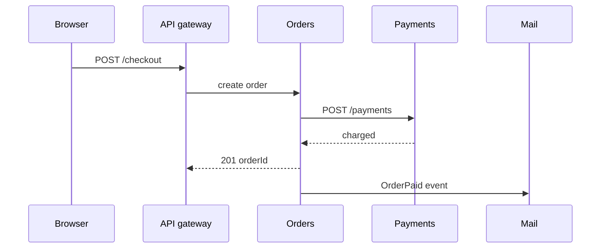

# System design — Architecture

*Стили* архитектуры: как создается и развертывается система, а также где создается HTML.

[ ← Вернуться в хаб](./0_system_design.md)

### Related docs

* [Проектирование системы — Ядро](./0_system_design_core.md) · [Проектирование системы — Архитектура](./0_system_design_architecture.md) · [Шаблоны архитектуры](./7_special_architecture.md) · [Проектирование системы — Данные](./0_system_design_data.md) · [SOLID](./7_special_engineering.md) · [DRY, KISS, YAGNI](./0_system_design_principles.md) · [GRASP](./0_system_design_grasp.md) · [Шаблоны проектирования](./7_special_patterns.md) · [Проектирование системы —Интервью](./0_system_design_interview.md)

### Sections

- [3. Architecture styles](#3-architecture-styles)
- [4. Frontend architecture](#4-frontend-architecture)

Именованные шаблоны композиции (модульный монолит, события, шлюз, BFF, микроинтерфейсы), слои, DDD, CQRS, FSD и атомарный дизайн: [Шаблоны архитектуры](./7_special_architecture.md). Рецепты GoF: [Шаблоны проектирования](./7_special_patterns.md).

---

## 3. Architecture styles

<details>
  <summary>Monolithic architecture</summary>

### Monolithic architecture

**Definition:** Все приложение — пользовательский интерфейс, бизнес-логика, доступ к данным — создается и развертывается как единое целое.

**When to use:** Стартапы, MVP, небольшие команды, области низкой сложности. Выбор по умолчанию, пока боль не будет доказана.

**Pluses and minuses:**

| + | − |
|------|------|
| Простота разработки, тестирования и первоначального развертывания | Становится сложно масштабировать команды и кодовую базу |
| Нет сетевых вызовов между модулями | Все приложение должно масштабироваться вместе |
| ACID-транзакции между модулями легко | Одна ошибка может привести к сбою всего |
| Снижение операционных накладных расходов | Блокировка технологий для всего приложения |

**Examples:** Одно приложение Node.js/Next.js с маршрутами API + БД — одно репозиторий, одно развертывание.

**Thoughts:** Монолит ≠ плохо. Хорошо структурированный модульный монолит побеждает плохо структурированный беспорядок микросервисов.

**Sources:** [Сборка и развертывание — монолит против микросервисов](./10_build.md)

</details>

<details>
  <summary>Microservices architecture</summary>

### Microservices architecture

**Definition:** Один продукт как **набор небольших сервисов**, каждый в своем **собственном процессе**, вокруг **бизнес-возможностей**, работающих через HTTP/RPC/очереди, **развертываемых независимо**. Языки и хранилища данных могут различаться; централизованный контроль остается небольшим. (Фаулер)

**How it works:**

Монолит — это один исполняемый файл — `charge()` это вызов функции; исправление ошибки оплаты перераспределяет весь магазин. Служба имеет узкую работу; повторное использование — это **API**, а не общая папка (`POST /payments`). Дока: логика умещается в **одной голове**. Фаулер: независимый жизненный цикл превосходит LOC. Новая связь = **сеть + контракт**. CI, K8s, Discovery, Prometheus, Kafka — это **микросервисы премиум-класса** (сборка, размещение, поиск, просмотр, буферизация).

| | Монолит | Микросервисы |
|--|----------|---------------|
| Оплата | в процессе `payments.charge` | `POST /payments` (or `OrderPlaced`) |
| Платное исправление | перестроить весь магазин | развернуть **только** Платежи |
| Черная пятница | клонировать все приложение | 20 Платных реплик, 2 Каталога |
| Отключение почты | часто убивает запрос | pay может добиться успеха, если почта асинхронна |



**When to use:**

автомасштабирование точки доступа; команда ≳10–15; повторно использовать аутентификацию/почту в **новом продукте**; огромные сборки/неравномерность процессора и ввода-вывода. **Нет:** небольшая команда, неясный домен, отсутствие CI/CD/отслеживания. Фаулер **монолит прежде всего** — успешные разделения обычно начинались с того, что монолит становился слишком большим. Дока «дешевле в обслуживании» актуальна только после того, как монолит уже дорог.

#### Common pitfalls

Разделение по техническому уровню, а не по возможностям. Общая БД. Новый пакет микросервисов без зрелости операционной деятельности.

**Pluses and minuses:**

| + | − |
| --- | --- |
| Независимое масштабирование/развертывание; автономность команды; повторное использование; изоляция неисправностей | Распределенные отказы; управление версиями контракта; никакой дешевой КИСЛОТЫ; стоимость операций |

**Examples:**

Почта как отдельный процесс. Звонки в магазин (или на доску вакансий) `POST http://mail:8000/send` вместо `import sendMail`. Кандидаты: авторизация, массовая рассылка по электронной почте, отслеживание активности, изменение размера изображения.

```js
import http from 'node:http';

const server = http.createServer((req, res) => {
  if (req.method === 'POST' && req.url === '/send') {
    res.writeHead(202, { 'Content-Type': 'application/json' });
    res.end(JSON.stringify({ queued: true }));
    return;
  }
  res.writeHead(404);
  res.end();
});
server.listen(8000);
```

**Thoughts:** Разделите его, когда для возможности требуется собственное **масштабирование, команда или повторное использование** — и вы можете позволить себе использовать сеть в качестве связующего элемента. В противном случае останьтесь [модульным монолитом](./7_special_architecture.md#modular-monolith).

**See also:** [Монолит против микросервисов — руководство для принятия решений](#monolith-vs-microservices--decision-guide)

**Sources:** [Фаулер — Микросервисы](https://martinfowler.com/articles/microservices.html) · [Monolith First](https://martinfowler.com/bliki/MonolithFirst.html) · [Microservice Premium](https://martinfowler.com/bliki/MicroservicePremium.html) · [Doka — Микросервисы](https://doka.guide/tools/microservices/)

</details>

<details>
  <summary>Monolith vs microservices — decision guide</summary>

### Monolith vs microservices — decision guide

**Definition:**

Матрица решений для выбора монолитной или микросервисной архитектуры на основе команды, домена, масштаба и зрелости операций.

| Фактор | Монолит | Микросервисы |
|--------|----------|---------------|
| Размер команды | Маленький | Несколько команд |
| Ясность домена | Развивается | Хорошо ограниченные контексты |
| Масштаб потребности | Униформа | Точки доступа для каждой услуги |
| Операционная зрелость | Базовый | K8s, трассировка, SRE || Время выхода на рынок | Изначально быстрее | Медленная установка |

**Thoughts:**

Извлекайте услуги, когда **боль** оправдывает **затраты**, а не потому, что так поступает Netflix. Doka называет Netflix/Amazon/Uber доказательством того, что они **используют** микросервисы, а не доказательством того, что они дешевле для небольшой команды.

Команда, домен, масштаб обслуживания, зрелость операций — если трое из четырех по-прежнему предпочитают монолит, оставайтесь там.

**See also:** [Монолитная архитектура](#monolithic-architecture) · [Микросервисная архитектура](#microservices-architecture) · [Модульная монолитная](./7_special_architecture.md#modular-monolith)

</details>

## 4. Frontend architecture

Где выполняются маршрутизация, данные и HTML, а не структура папок. Методологии папок находятся в [Шаблонах архитектуры](./7_special_architecture.md#frontend-structure).

<details>
  <summary>Work placement — thin vs thick clients</summary>

### Work placement — thin vs thick clients

**Definition:** Архитектура внешнего интерфейса — это распределение маршрутизации, выборки данных, генерации HTML, проверки и интерактивности на **время сборки**, **сервере** и **браузере**.

**How it works:**

1. **Статический HTML** — файлы на диске. Мгновенно, ничего не ломается, никаких динамических данных.
2. **Сервер MVC** (Django, Rails, ASP.NET) — HTML для каждого запроса. Динамическая, полная перезагрузка при каждом нажатии.
3. **SPA** (React, Vue, Angular) — браузер владеет маршрутизацией, состоянием, часто проверкой/аутентификацией. Пользовательский интерфейс ощущается мгновенно *после* загрузки. Стоимость: большой JS, медленная первая отрисовка. Google может выполнять JS, но индексирование на больших сайтах может задерживаться;многие сканеры предварительного просмотра/ИИ никогда не запускают JS — если они не видят HTML, контент для них не существует.
4. **Гибрид** (SSR + гидратация, RSC, острова) — перенос HTML и данных обратно на сервер/сборку; отправьте JS только для интерактивных островов.

| Клиент | Кто выполняет работу | Типичная стоимость |
|--------|-------------------|--------------|| **Тонкий** | Сервер/CDN | Быстрая первая отрисовка, большая нагрузка на сервер, меньшая гибкость клиента |
| **Толстый** | Браузер | Богатый UX после загрузки, худший TTFB/LCP, риск SEO/сканера |

**When to use:** Относитесь к этому как к рамке интервью. Выбирайте микс для каждой поверхности (маркетинг или информационная панель), а не один слоган для всей компании.

**Thoughts:** «Это то, что у команды уже было» — это не ответ архитектуры. Назовите линию, которую вы провели, и компромисс, который вы приняли.

**Sources:** [React — серверные компоненты](https://react.dev/reference/rsc/server-comComponents) · [рендеринг Next.js](./4_nextjs.md)

</details>

<details>
  <summary>Rendering strategies (when HTML is built)</summary>

### Rendering strategies (when HTML is built)

**Definition:**

Стратегии различаются в зависимости от того, **когда** создается HTML. Все остальное (кэш, персонализация, стоимость JS) вытекает из этого.

| Стратегия | Когда HTML построен | Свежесть | Стоимость JS |
|----------|--------------------|-----------|---------|
| **ССГ** | Время сборки, файлы CDN | Заморожено до следующего развертывания | Самый низкий, если статический |
| **ИСР** | Сборка + восстановление фона после `revalidate` | Устарело при повторной проверке | Как SSG между ребилдами |
| **ССР (классика)** | Каждый запрос, целое дерево, а затем увлажнить | Живой / персонализированный | Полная разметка гидратов |
| **Потоковая передача SSR** | Кусочки уже готовы(`renderToPipeableStream`) | То же, что и SSR, но быстрее TTFB | Гидратация все еще необходима |
| **RSC + острова** | Сервер для статики/данных; JS только для интерактивных листьев | Микс | Самый маленький клиент JS |
| **Возобновляемость (Qwik)** | Сериализация состояния в HTML; пропустить повтор гидратации | Микс | Загрузчик + фрагменты взаимодействия |

**How it works:**

SSR создает HTML для каждого запроса (оперативные данные). SSG собирается один раз при сборке (самый быстрый, дешевый, свежий с момента последнего развертывания). ISR разделяет разницу с помощью таймера (или повторной проверки по требованию).

`params` это **Обещание** — ждите его. Получение данных выполняется на сервере. Только клиентские компоненты (`AddToCartButton`) отправить JS.

```tsx
// app/products/[id]/page.tsx — Next.js 15+
import { fetchProduct } from '@/lib/api';

export default async function ProductPage({
  params,
}: {
  params: Promise<{ id: string }>;
}) {
  const { id } = await params;
  const product = await fetchProduct(id); // server

  return (
    <main>
      <h1>{product.name}</h1>
      <p>${product.price}</p>
      <AddToCartButton productId={product.id} />
    </main>
  );
}
```

Страница представляет собой статический HTML; `client:*` директивы гидратируют только отмеченные виджеты. **PPR (Next.js):** статическая оболочка из периферии/CDN, динамические дыры, передаваемые из вычислений рядом с данными.

**When to use:** Маркетинг/документы → SSG. Каталог, который меняется ежечасно → ISR. Пользовательская информационная панель → SSR/RSC. Контентные сайты с несколькими виджетами → острова. MPA против SPA (полная перезагрузка против маршрутизации JS): [6_web_api.md — Типы веб-приложений](./6_web_api_apps.md#types-of-web-apps).

**Thoughts:** Детали реализации находятся в [4_nextjs.md](./4_nextjs.md) (ISR, PPR, `revalidate`) и [4_react.md §8](./4_react_server.md#8-server-rendering--rsc) (RSC, потоковая передача). Потоковая SSR улучшает TTFB за счет ранней отправки фрагментов HTML — [TTFB](./6_web_api_security.md#ttfb-time-to-first-byte). Здесь навык проведения собеседования заключается в выборе *когда* создания HTML.

**Sources:** [Next.js ISR](https://nextjs.org/docs/app/guides/incremental-static-regeneration) · [renderToPipeableStream](https://react.dev/reference/react-dom/server/renderToPipeableStream) · [Астроострова](https://docs.astro.build/en/concepts/islands/) · [Qwik возобновляемый](https://www.qwik.dev/docs/concepts/resumable/)

</details>

<details>
  <summary>Edge rendering vs data locality</summary>

### Edge rendering vs data locality

**Definition:** Запуск SSR в PoP **рядом с пользователем** (Cloudflare Workers, бывшие Vercel Edge Functions) вместо запуска Node **близко к базе данных**.

**How it works:**

Шаг 2021–2023 — меньше расстояние до посетителя, страницы быстрее. Режим отказа: большинство баз данных находятся в **одном регионе**. Изолят в Токио, называющий Вирджинию, часто проигрывает рендерингу в Вирджинии. Ли Робинсон (тогдашний вице-президент Vercel по продуктам) писал, что вычисления должны располагаться рядом с данными; Тестирование v0 показало, что Node.js SSR + потоковая передача превосходят рендеринг по краям для этой рабочей нагрузки.Частичный предварительный рендеринг сохраняет скромную победу: **статическая оболочка с края**, динамические части с региональных вычислений.

- Vercel: автономная версия **Функции Edge устарели** для новых проектов. Отдайте предпочтение **Vercel Functions + Node.js** (по умолчанию), закрепите функцию **region в базе данных**. Next.js `export const runtime = 'edge'` **устарело** — удалите его. Программное обеспечение промежуточного слоя маршрутизации может по-прежнему использовать среду выполнения Edge.
- Cloudflare Workers остается реальным вариантом Edge SSR, когда **данные также распространяются глобально** (или доступны через HTTP на периферии).

Локализация данных превосходит локальность пользователя. Знание того, почему* индустрия развернулась, стоит большего, чем просто модное словечко.

**When to use:** Промежуточное ПО для аутентификации/географии, статические оболочки, глобально реплицированные данные. **По умолчанию для SSR + DB:** Узел в том же регионе, что и база данных.

**Pluses and minuses:**

| + (периферийные вычисления) | − |
|-----|----------------------|
| Статическая/CDN и географическая маршрутизация по-прежнему остаются на периферии | Болтливая Б. Путешествие туда и обратно через океан |
| Быстро изолирует, когда данные локальны или похожи на KV/D1 | Ограниченные API-интерфейсы узлов; ORM/родные дополнения часто терпят неудачу |
| | Путаница в именах: *расположение на краю* ≠ *время выполнения на краю* |

**Sources:** [Vercel — не используйте Edge Functions](https://vercel.com/docs/functions/runtimes/edge/edge-functions) · [Next.js — среда выполнения Edge устарела](https://nextjs.org/docs/messages/edge-runtime-deprecated) · [Частичный предварительный рендеринг](https://vercel.com/docs/partial-prerendering) · [4_nextjs.md — Edge vs Node](./4_nextjs_platform.md#edge-vs-node-runtime)

</details>

<details>
  <summary>Talking about architecture in an interview</summary>

### Talking about architecture in an interview

**Definition:** Старший ответ — это **выбор с компромиссами**, а не каталог шаблонов.

**How it works:**

1. **Чем вы управляете**: «Маркетинг — это SSG, информационные панели — это SSR/RSC, у мобильных устройств есть лучший друг».
2. **Почему** — «SSG для первой отрисовки менее секунды, при которой содержимое почти не меняется. SSR, чтобы имя пользователя никогда не отображало неправильный контент».
3. **Компромисс, который вы приняли** — «BFF добавляет переход и SPOF, но полезная нагрузка принадлежит команде внешнего интерфейса. Оно того стоит».
4. **Что вы не выбрали** — «Мы рассмотрели микро-фронтенды.При нашей численности персонала затраты на координацию еще не оправдали себя».

В этом последнем пункте заключается разница между чтением диаграммы и принятием решения. Разворот края Vercel — это готовый пример: платформа, которая продавала Edge SSR, изменила значение по умолчанию, когда измерения показали, что узел рядом с базой данных работает быстрее.

**When to use:** Каждая подсказка «как бы вы спроектировали X». Начните с ограничений (размер команды, расположение данных, сложность развертывания, SEO/сканеры), затем назовите грань между браузером/сервером/сборкой.

</details>
