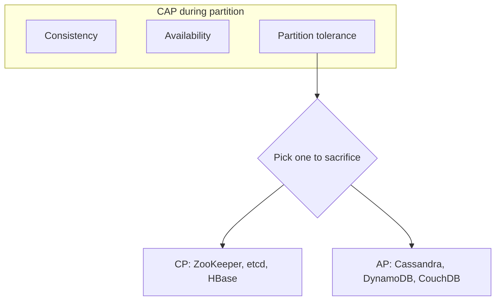

# System design — Core

Основы и основы распределенных систем.

[ ← Вернуться в хаб](./0_system_design.md)

### Related docs

- [Проектирование системы — Ядро](./0_system_design_core.md) · [Проектирование системы — Архитектура](./0_system_design_architecture.md) · [Шаблоны архитектуры](./7_special_architecture.md) · [Проектирование системы — Данные](./0_system_design_data.md) · [SOLID](./7_special_engineering.md) · [DRY, KISS, YAGNI](./0_system_design_principles.md) · [GRASP](./0_system_design_grasp.md) · [Шаблоны проектирования](./7_special_patterns.md) · [Проектирование системы —Интервью](./0_system_design_interview.md)

### Sections

- [1. Foundations](#1-foundations)
- [2. Distributed systems](#2-distributed-systems)

---

## 1. Foundations

<details>
  <summary>System design overview</summary>

### System design overview

**Definition:** Проектирование системы — это процесс определения архитектуры, компонентов, модулей, интерфейсов и потоков данных для удовлетворения функциональных и нефункциональных требований в любом масштабе.

**When to use:** Новые продукты, масштабирование существующих систем, обзоры архитектуры, анализ инцидентов, технические интервью.

**Pluses and minuses:**

| + (структурированный подход)         | −                                                |
| ------------------------------------ | ------------------------------------------------ |
| Поверхности компромиссы рано         | Легко перепроектировать на бумаге                |
| Координирует команды по ограничениям | Требования меняются — дизайн должен развиваться  |
| Сигнал интервью                      | Диаграммы ≠ действующая производственная система |

**Examples:**

1. **Уточните требования** — функции, масштаб (DAU, QPS), задержка, требования к согласованности.
2. **Предварительная оценка** — хранилище, пропускная способность, серверы.
3. **Проектирование высокого уровня** — клиенты, LB, серверы приложений, БД, кеш, очередь.
4. **Глубокое погружение** — узкие места, виды сбоев, компромиссы
5. **Подведение итогов** — мониторинг, внедрение, будущее масштабирование.

**Thoughts:** Начните с ограничений, а не с технологий. «Мы будем использовать Kafka», прежде чем осознаем, что пропускная способность — это красный флаг. Хорошие ответы рассказывают о компромиссах.

**Sources:** [ByteByteGo — 20 лучших концепций системного проектирования] (https://blog.bytebytego.com/p/ep160-top-20-system-design-concepts)

</details>

<details>
  <summary>Client–server architecture</summary>

### Client–server architecture

**Definition:** Архитектура — это высокоуровневый контракт о том, как взаимодействуют части системы. **Клиент-сервер** — обычный веб-контракт: **клиент** (браузер/интерфейс) отправляет запросы; **сервер** (бэкэнд) применяет правила и обращается к **хранилищу**.

**How it works:**

Пользовательский интерфейс браузера состоит из HTML, CSS и JS (существует WASM; игнорируйте его на этом уровне). Все, что пользователи создают или повторно используют, должно храниться, авторизоваться и обрабатываться — эта работа хранится на сервере.

| Роль            | Работа                                                                                                                                                |
| --------------- | ----------------------------------------------------------------------------------------------------------------------------------------------------- | --- | ---------- | ------------------------------------------------------------------------------------------------------------------------------------------------------------------------------------------------------------------- |
| **Клиент**      | Попросите сервер прочитать, преобразовать или сохранить данные. Для пользователя: визуализировать данные и собирать обновления. Почти всегда браузер. |     | **Сервер** | Принимайте запросы, сохраняйте их через БД, применяйте **бизнес-логику**, предоставляйте данные в соответствии с этими правилами. Также может запускать фоновые задания (индексирование поиска, электронная почта). |
| **База данных** | Долговечное хранилище пользовательских и системных данных — быстрый и надежный доступ (часто несколько хранилищ: основное, реплики, резервные).       |

```
Browser  --HTTP request-->  App server  -->  Database
         <--JSON / HTML--              <--rows--
```

**When to use:** Любой продукт со счетами, документами, фидами, платежами. Статический маркетинговый HTML может пропускать пользовательский сервер; как только данные будут переданы в общий доступ или должны пережить обновление, вам понадобится сервер.

**Pluses and minuses:**

| +                                                                | −                                                      |
| ---------------------------------------------------------------- | ------------------------------------------------------ |
| Общие данные, аутентификация и задания с компьютера пользователя | Дополнительные переходы, операции и режимы отказа      |
| Многие клиенты (веб- и мобильные) могут использовать один API    | Тесная связь, если HTML генерируется только на сервере |

**Examples:** Клиент = пользовательский интерфейс HTML/CSS/JS. Сервер = API, которые читают/записывают хранилища. Базы данных = сохранение, репликация, отработка отказа.

**Thoughts:** Картинка в браузере — это не продукт. Для существования бэкэнда необходимы надежные данные и правила.

**Sources:** [Doka — Как работают веб-приложения](https://doka.guide/tools/web-app-works/) · Подробности HTTP/REST: [6_web_api.md — протокол HTTP](./6_web_api_http.md#http-protocol)

</details>

<details>
  <summary>Functional vs non-functional requirements</summary>

### Functional vs non-functional requirements

**Definition:**

Функциональные требования описывают _что_ система делает (функции). Нефункциональные требования (NFR) описывают, _насколько хорошо_ он это делает — производительность, доступность, безопасность, ремонтопригодность.

| Категория НФР      | Примеры                                                        |
| ------------------ | -------------------------------------------------------------- | --- | ------------------ | -------------------------------------------------- |
| Производительность | Задержка p99 < 200 мс, 10 тыс. запросов в секунду              |
| Наличие            | Время безотказной работы 99,9% (время простоя 8,7 часов в год) |
| Масштабируемость   | 10-кратный рост трафика без перезаписи                         |     | Последовательность | Сильный для платежей, в конечном итоге для каналов |
| Безопасность       | Аутентификация, шифрование, журналы аудита                     |

**When to use:** Каждая сессия дизайна. NFR определяют выбор технологий больше, чем списки функций.

**Examples:** Сокращатель URL-адресов — функция: сокращать/перенаправлять URL-адреса. NFR: перенаправление < 50 мс, сохранено 100 млн URL-адресов, доступность перенаправлений 99,99%.

**Thoughts:** Переведите расплывчатые НФР в цифры. «Быстро» → целевое значение задержки p99. «Высокодоступность» → девятки + допустимое окно потери данных.

</details>

<details>
  <summary>Scalability</summary>

### Scalability

**Definition:** Масштабируемость — это способность системы справляться с возросшей нагрузкой за счет добавления ресурсов.

**When to use:**

- Вертикаль: ранняя стадия, базы данных (часто первый шаг), низкий трафик.
- Горизонтально: уровень веб-сайтов/приложений, службы без отслеживания состояния, реплики чтения.

**Pluses and minuses:**

| Тип               | Как                            | +                                                           | −                                                       |
| ----------------- | ------------------------------ | ----------------------------------------------------------- | ------------------------------------------------------- |
| **Вертикально**   | Большая машина (больше ЦП/ОЗУ) | Просто, без распределенной сложности                        | Аппаратный потолок, время простоя для изменения размера |
| **Горизонтально** | Больше машин                   | Практически неограниченный масштаб, изоляция неисправностей | Сложность распределенных систем                         |

**Examples:**

```
100M DAU × 2 redirects/day = 200M redirects/day
200M / 86,400 ≈ 2,300 QPS average
Peak (3×) ≈ 7,000 QPS → plan for ~10k QPS
```

**Thoughts:** Сначала масштабируйте уровни без сохранения состояния. Уровни с отслеживанием состояния (БД) требуют репликации, сегментирования или кэширования. «Просто добавьте серверы» не удается, когда сеанс/состояние закреплено за одним узлом.

</details>

<details>
  <summary>Latency vs throughput vs concurrency</summary>

### Latency vs throughput vs concurrency

**Definition:**

- **Задержка** — время выполнения одной операции (мс)
- **Пропускная способность** — операций в секунду (QPS/TPS)
- **Параллелизм** — одновременные операции в полете.

| Компромисс                                       | Понимание                                                           |
| ------------------------------------------------ | ------------------------------------------------------------------- |
| Низкая задержка + высокая пропускная способность | Нужен параллелизм, эффективный ввод-вывод, минимальное блокирование |
| Оптимизация одного может повредить другому       | Пакетная обработка ↑ пропускная способность, может ↑ задержка       |

**When to use:** Планирование мощности, определение соглашения об уровне обслуживания, выбор синхронной или асинхронной обработки.

**Examples:** Платежный API — критическая низкая задержка (пользователь ждет). Конвейер аналитики — высокая пропускная способность, устойчивость к задержкам (пакетная обработка в порядке).

**Thoughts:** Укажите процентили (p50, p95, p99), а не средние значения. Задержка хвоста доминирует над пользовательским опытом в масштабе.

</details>

<a name="processes-multitasking"></a>

<details>
  <summary>Processes, multitasking & interrupts</summary>

### Processes, multitasking & interrupts

**Definition:** **Процесс** — это абстракция ОС, которая предоставляет работающей программе процессорное время и собственную память. ОС (планировщик/диспетчер) запускает готовые процессы короткими ходами, поэтому на одной машине находится много программ и пользователей.

**How it works:**

- **Не всегда настоящий параллелизм.** Одно ядро ​​по-прежнему выполняет **один** поток инструкций за раз. «Несколько приложений одновременно» — это **разделение времени**: каждый процесс получает небольшой фрагмент, затем планировщик переключается. Несколько ядер/процессоров могут запускать процессы **параллельно**.
- **Почему существует многозадачность.** Ранние однозадачные ОС: одна программа владеет машиной до ее выхода. Пока он ожидает на диске, клавиатуре или у пользователя, процессор простаивает.ОС начала перекрывать **ожидание** одной программы **работой** другой (перекрытие ввода-вывода), а затем **диспетчер**, который выбирает следующий готовый процесс, чтобы процессор оставался занятым.
- **Очередь готовности.** Выполняемые процессы находятся в **очереди готовности**. Приоритет решает, кто будет баллотироваться следующим. В Linux видимое пользователю значение **nice** составляет **-20** (наиболее благоприятное для ЦП)… **19** (наименьшее); по умолчанию **0**.Обычный пользователь может _повысить_ вежливость (быть приятнее/понизить приоритет); понижение вежливости (более высокий приоритет) требует привилегий (`CAP_SYS_NICE` / корень). `nice` / `renice` при старте или во время бега. (Автогруппировка Linux может ослабить классические эффекты nice — см. `sched(7)`.)
- **Очереди ожидания.** Устройства занимают разное время (клавиатура, диск или графический процессор). Процессы, **заблокированные** при вводе-выводе, находятся в **очередях ожидания/устройства**, а не в очереди готовности ЦП, пока устройство не будет готово — тогда они снова становятся готовыми.
- **Что такое процесс.** Не только код. ОС хранит: **программу** (инструкции в оперативной памяти), **данные** (переменные;должны находиться в ОЗУ, прежде чем ЦП их использует), **контекст**, чтобы он мог приостанавливаться и возобновляться — регистры ЦП, пользовательский стек, стек ядра, сопоставления памяти. Сохранение/восстановление контекста — это **переключение контекста**. Контекст также обеспечивает IPC и общение с ядром.
- **Очередь с приоритетом.** Модель планировщика представляет собой **очередь с приоритетом**: сначала идет готовый процесс с наивысшим приоритетом. Системные процессы часто превосходят пользовательские приложения.В стиле Chrome **один процесс на вкладку/сайт** изолирует сбои и изолированную программную среду — одно приложение, множество процессов.
- **Классические состояния:** **новое** → **готово** → **работает** → **завершено**. **Блокировано/ожидание** = ожидание ввода-вывода или блокировка (не на ЦП). Необязательно **приостановлено** (заменено/приостановлено) при готовности или блокировке: дополнительные «замороженные» состояния.

**Прерывания**- **Прерывание** останавливает текущий процесс, чтобы ЦП/ОС мог обработать событие (тик таймера → вытеснение; диск готов; перемещение процесса между очередями). Некоторые прерывания доступны только для ядра; другие пользовательские программы могут обрабатывать (например, события DOM).

- **Аппаратные прерывания** (ЦП/устройства). ОС может включать/отключать классы; программы видят их как события с обработчиком.- **Внешний, асинхронный** — таймер, сетевой адаптер, готовность диска, клавиатура, мышь.
  - **Внутренний, синхронный** (исключения/ошибки) — деление на ноль, недопустимый код операции, плохой доступ к памяти, переполнение стека.
- **Программные прерывания** — инструкция программы (системный вызов) для взаимодействия с ядром, драйверами или другими процессами.
- **Windows**: в основном модель **сообщений** (оконный пользовательский интерфейс, некоторые IPC).Сообщения **не** заменяют уничтожение/остановку/перезапуск процесса.
- **Unix/POSIX:** **сигналы**. Доставка прерывает процесс и запускает обработчик (или действие по умолчанию). Сигналы поступают от **tty** (ключей), **ядра** или **kill** от другого процесса (или `raise` себе). POSIX перечисляет стандартные имена; приложения также могут использовать сигналы **реального времени** (`SIGRTMIN`+n) — те **очередь**; обычные сигналы **нет**.

| Сигнал                | Роль                              | Заметки                                                                                |
| --------------------- | --------------------------------- | -------------------------------------------------------------------------------------- |
| `SIGINT`              | Прерывание (управление заданиями) | Терминал **Ctrl+C**. Уловимый. По умолчанию: прекратить.                               |
| `SIGQUIT`             | Выйти с клавиатуры                | **Ctrl+\\**. По умолчанию: завершение + ядро.                                          |
| `SIGTSTP`             | Конечная остановка                | **Ctrl+Z**. Уловимый. По умолчанию: стоп. Возобновить с `SIGCONT`.                     |
| `SIGSTOP`             | Стоп                              | Управление ядром/работами. **Невозможно** перехватить, заблокировать или игнорировать. |
| `SIGCONT`             | Продолжить                        | Возобновить остановленный процесс.                                                     |
| `SIGKILL`             | Убить                             | Немедленное прекращение. **Невозможно** перехватить, заблокировать или игнорировать.   |
| `SIGTRAP`             | Трассировка/точка останова        | Отладчик / `ptrace`. По умолчанию: ядро.                                               |
| `SIGUSR1` / `SIGUSR2` | Определяется приложением          | «Пользовательские» сигналы POSIX.                                                      |

**When to use:**

Объясните параллелизм и параллелизм на собеседованиях. Изолируйте вкладки браузера. Обработка Ctrl+C/развертывание **SIGTERM** в Node. `kill -9` против корректного завершения работы. Почему один вращающийся цикл не замораживает всю ОС (вытеснение).

#### Common pitfalls

- Вызов разделения времени **многопоточность**. Процесс может иметь много потоков; ОС по-прежнему планирует **потоки**. JS Node — это один поток; это другой уровень — [Процесс и потоки](./8_nodejs_process.md#process--threads).
- Сбивает с толку **Ctrl+Z** (`SIGTSTP`) с **`SIGSTOP`**. Только `SIGKILL` и `SIGSTOP` их невозможно поймать(`signal(7)`).
- Предполагая, что управление процессами Windows работает как сигналы POSIX (Node эмулирует несколько `kill` имена).
- Рассматривать «диспетчер ставит в очередь каждую _инструкцию_ ЦП» как буквальную — модель обучения; реальные процессоры работают до тех пор, пока не произойдет **прерывание по таймеру**, системный вызов или прерывание ввода-вывода, после чего планировщик выбирает следующий поток.

**Pluses and minuses:**

| +                                                                                                      | −                                                                                 |
| ------------------------------------------------------------------------------------------------------ | --------------------------------------------------------------------------------- |
| ЦП, используемый во время ожидания ввода-вывода; множество пользователей/приложений в одном устройстве | Стоимость переключения контекста; изоляция не является бесплатной (Chrome RAM)    |
| Сигналы: простое управление Unix + IPC                                                                 | Стандартные сигналы не ставятся в очередь; `SIGKILL` пропускает очистку           |
| Приоритет/приятно для пакетной обработки или интерактивной                                             | Непривилегированные пользователи не могут украсть ЦП с более приятными значениями |

**Examples:**

```js
import process from "node:process";

process.stdin.resume(); // keep the process alive

process.on("SIGINT", () => {
  console.log("Received SIGINT. Press Control-D to exit.");
});

// SIGKILL / SIGSTOP: listeners are ignored — process is killed / stopped anyway
```

**Thoughts:** Многозадачность — это планировщик + прерывания + сохраненный **контекст**. Сигналы — это видимые пользователю прерывания POSIX для управления процессом.

**Sources:** [Doka — Многозадачность и процессы](https://doka.guide/tools/multitasking-and-processes/) · [Linux `signal(7)`](https://man7.org/linux/man-pages/man7/signal.7.html) · [Linux `getpriority(2)` приятно -20…19](https://man7.org/linux/man-pages/man2/getpriority.2.html) · [сигнальные события Node.js](https://nodejs.org/api/process.html#signal-events)

</details>

<details>
  <summary>Reliability, availability, fault tolerance</summary>

### Reliability, availability, fault tolerance

**Definition:**

- **Надежность** — система работает корректно с течением времени.
- **Доступность** — система работает при необходимости (время безотказной работы %)
- **Отказоустойчивость** — система продолжает работать даже при выходе из строя компонентов.

| Срок                              | Формула/значение                                     |
| --------------------------------- | ---------------------------------------------------- |
| соглашение об уровне обслуживания | Договор с пользователями (например, 99,9%)           |
| СЛО                               | Внутренняя цель (например, p99 < 300 мс)             |
| СЛИ                               | Измеряемый показатель (коэффициент ошибок, задержка) |

**When to use:** Определение ожиданий по вызову, решения по резервированию, развертывание в нескольких зонах доступности.

**Examples:** 99,9 % = время простоя ~43 минуты в месяц. 99,99% = ~4,3 мин/мес. Каждая девятка на порядок сложнее.

**Thoughts:** Доступность ≠ корректность. Система, возвращающая устаревшие данные, «доступна», но ненадежна. Определите оба.

</details>

<details>
  <summary>Single point of failure (SPOF)</summary>

### Single point of failure (SPOF)

**Definition:** SPOF — это любой компонент, сбой которого приводит к сбою всей системы или критического пути.

**When to use:** Определите SPOF на каждой диаграмме. Устранить или смягчить последствия (реплики, аварийное переключение, автоматические выключатели).

**Pluses and minuses:**

| + (принимаем SPOF)                      | −                                       |
| --------------------------------------- | --------------------------------------- |
| Упрощенная архитектура на ранней стадии | Отключение затронуло всех пользователей |
| Снижение эксплуатационных расходов      | Сложнее добиться высокой доступности    |

**Examples:** Одна база данных без реплики = SPOF. Одиночный балансировщик нагрузки = SPOF → используйте активную-пассивную пару или LB с облачным управлением.

**Thoughts:**

Нарисуйте путь запроса и спросите «что сломается, если этот ящик умрет?» для каждого узла.

---

</details>

<a name="2-distributed-systems"></a>

### Topic template

За каждой основной темой следует:

**Определение** → **Как это работает** → **Когда использовать** → **Плюсы и минусы** → **Примеры** → **Мысли** → **Источники**

---

<a name="1-foundations"></a>

## 2. Distributed systems

<details>
  <summary>CAP theorem</summary>

### CAP theorem

**Definition:**

В распределенном хранилище данных при **разделении** сети вы можете гарантировать не более двух из следующих условий: **Согласованность**, **Доступность**, **Допуск на разделение**.

| Гарантия                | Значение                                             |
| ----------------------- | ---------------------------------------------------- | --- | ------------------------- | ---------------------------------------------------------- |
| **C** — Согласованность | Каждое чтение возвращает последнюю запись или ошибку |
| **А** — Наличие         | Каждый запрос получает ответ без ошибок              |     | **P** — Допуск разделения | Система работает, несмотря на разделение сети между узлами |



| CP (согласованность + допуск разделов)                       | AP (доступность + устойчивость к разделам) |
| ------------------------------------------------------------ | ------------------------------------------ |
| Сильная согласованность во время разделения                  | Может возвращать устаревшие данные         |
| Некоторые запросы могут завершиться неудачей или тайм-аутом  | Система остается отзывчивой                |
| ZooKeeper и etcd, традиционная СУБД с синхронной репликацией | Кассандра, DynamoDB, Риак                  |

**When to use:**

- CP: финансовые реестры, распределенные блокировки, управление конфигурациями.
- AP: каналы социальных сетей, корзины покупок, метрики, данные сеансов с TTL.

**Examples:** Два центра обработки данных потеряли сетевое соединение. Система CP отклоняет запись в миноритарный раздел. Система AP принимает записи с обеих сторон — конфликты разрешаются позже.

**Thoughts:** Толерантность к разделам не является обязательной в реальных распределенных системах — сети выходят из строя. Реальный выбор — C против A _во время_ раздела. Внешние разделы могут иметь и то, и другое. CAP часто ошибочно трактуют как «выберите любые два навсегда».

**Sources:** [ByteByteGo — CAP](https://blog.bytebytego.com/p/ep160-top-20-system-design-concepts)

</details>

<details>
  <summary>PACELC</summary>

### PACELC

**Definition:**

Расширение CAP: если раздел **P**, выберите **A** или **C**; **E**lse (нормальная работа), выберите **L**atency или **C**consistency.

| Система                            | Профиль PACELC                                               |
| ---------------------------------- | ------------------------------------------------------------ |
| DynamoDB / Кассандра               | PA/EL — доступно + низкая задержка                           |
| PostgreSQL (реплика синхронизации) | PC/EC — стабильная работа, более высокая задержка при записи |

**When to use:** Объясняем, почему системы ведут себя по-разному при нормальной нагрузке и во время сбоев.

**Thoughts:** Более точный, чем один CAP, для сравнения баз данных во время интервью.

</details>

<details>
  <summary>ACID vs BASE</summary>

### ACID vs BASE

**Definition:**

- **ACID** — атомарность, согласованность, изоляция, долговечность (традиционные транзакции РСУБД).
- **BASE** — в основном доступно, мягкое состояние, в конечном итоге согласованное (гибкость NoSQL).

| КИСЛОТА                   | БАЗА                                               |
| ------------------------- | -------------------------------------------------- |
| Надежные гарантии         | Высокая доступность, устойчивость к разделам       |
| Транзакции между строками | Оптимистическое параллелизм, разрешение конфликтов |
| PostgreSQL, MySQL         | Кассандра, DynamoDB, Couchbase                     |

**When to use:**

- ACID: денежные переводы, инвентарь, системы бронирования
- БАЗА: каналы активности, аналитика, уровни кэширования, социальные данные с большим объемом записи.

**Examples:** Банковский перевод — дебет + кредит должен быть атомарным (ACID). Нравится рассчитывать на пост — конечная согласованность приемлема (BASE).

**Thoughts:** BASE — это не «отсутствие согласованности» — это конечная согласованность с явной обработкой конфликтов.

</details>

<details>
  <summary>Consistency models</summary>

### Consistency models

**Definition:**

Правила, определяющие, когда запись становится видимой для чтения в распределенном хранилище.

| Модель                          | Гарантия                                               |
| ------------------------------- | ------------------------------------------------------ |
| **Сильный**                     | Чтение всегда возвращает последнюю запись              |
| **Событие**                     | Реплики сходятся при отсутствии новых записей          |
| **Причинно-следственная связь** | Причинно связанные операции рассматриваются по порядку |
| **Читайте, что пишете**         | Пользователь сразу видит свои обновления               |

**When to use:**

- Сильные: остатки на счетах, инвентаризация.
- Возможно: кеш CDN, поисковые индексы, социальные ленты.
- Чтение ваших записей: редактирование профиля пользователя (привязка сеанса или маршрутизация)

**Examples:** Пользователь обновляет аватар → CDN может обслуживать старое изображение в течение нескольких минут (со временем). Пользователь не должен видеть старый аватар на странице своего профиля (читай-пиши).

**Thoughts:** Выбирайте согласованность для каждой операции, а не для каждой системы. Оплата = сильная; значок уведомления = возможно.

</details>

<details>
  <summary>Replication</summary>

### Replication

**Definition:** Копирование данных между несколькими узлами для обеспечения доступности, надежности и масштабирования чтения.

**When to use:**

- Лидер-последователь: большинство OLTP (реплики PostgreSQL)
- Мультилидер: мультирегион активный-активный
- Без лидера: высокая доступность записи в стиле Cassandra.

**Pluses and minuses:**

| Стратегия               | Как                                            | +                                          | −                                   |
| ----------------------- | ---------------------------------------------- | ------------------------------------------ | ----------------------------------- |
| **Лидер-последователь** | Пишет лидеру, асинхронно/синхронно подписчикам | Простой и надежный вариант согласованности | Лидер является узким местом/SPOF    |
| **Мультилидер**         | Пишет любому лидеру, двусторонняя репликация   | Напишите населенный пункт, мультирегион    | Необходимо разрешение конфликтов    |
| **Без лидера**          | Кворум читает/пишет (например.W=2, R=2 из N=3) | Высокая доступность                        | Возможно сложное, устаревшее чтение |

**Thoughts:** Синхронная репликация = CP (ожидание записи реплик). Async = более быстрая запись, риск потери данных при сбое лидера.

</details>

<details>
  <summary>Partitioning / sharding</summary>

### Partitioning / sharding

**Definition:** Разделение данных по нескольким узлам, чтобы каждый узел содержал подмножество (осколок).

**When to use:** Один узел БД превышает пропускную способность хранилища или записи. Шардинг трудно отменить — тщательно планируйте выбор ключа.

**Pluses and minuses:**

| Стратегия                        | Как                                                                            | +                             | −                                                                     |
| -------------------------------- | ------------------------------------------------------------------------------ | ----------------------------- | --------------------------------------------------------------------- |
| **На основе хеша**               | `shard = hash(key) % N`                                                        | Равномерное распределение     | Перешардинг болезненный при изменении N                               |
| **На основе диапазона**          | Ключи A–M на сегменте 1, N–Z на сегменте 2                                     | Диапазон запросов эффективный | Горячие точки (например, все последние данные по последнему сегменту) |
| **Последовательное хеширование** | Карта ключей для звонка; добавить/удалить узлы, переместить минимальные данные | Эластичное масштабирование    | Сложность реализации                                                  |

**Examples:** Пользовательские данные, сегментированные `user_id`. Популярный аккаунт знаменитости = горячий осколок. Смягчение: суб-осколок, кеш, выделенный раздел.

**Thoughts:** Отдавайте предпочтение вертикальному секционированию или репликам чтения перед горизонтальным сегментированием. Шардинг навсегда увеличивает операционную нагрузку.

</details>

<details>
  <summary>Idempotency</summary>

### Idempotency

**Definition:** Операция является идемпотентной, если ее многократное выполнение дает тот же эффект, что и однократное выполнение.

**When to use:** Платежные API, веб-перехватчики, очереди сообщений (доставка «хотя бы один раз»), любая логика повторных попыток.

**Pluses and minuses:**

| +                                          | −                                                                |
| ------------------------------------------ | ---------------------------------------------------------------- |
| Безопасные повторные попытки при сбое сети | Требуется предварительное проектирование (ключи идемпотентности) |
| Критично для распределенных систем         | Хранилище ключей дедупликации                                    |

**Examples:**

```ts
// Client sends idempotency key with payment
POST /payments
Headers: Idempotency-Key: "pay_abc123"
Body: { amount: 100, currency: "USD" }

// Server: if key exists, return cached result; else process and store
```

**Thoughts:** Доставка хотя бы один раз + неидемпотентный потребитель = двойные платежи. Всегда связывайте повторные попытки с ключами идемпотентности или дедупликацией.

</details>

<details>
  <summary>Distributed transactions & Saga</summary>

### Distributed transactions & Saga

**Definition:** Координация транзакций между несколькими сервисами без единой базы данных ACID.

**How it works:**

- **Оркестровка** — центральный координатор сообщает каждой службе, что делать.
- **Хореография** — службы реагируют на события, нет центрального координатора.

1. Оркестратор получает `PlaceOrder` команда.
2. Вызывает OrderService → локальный tx создает заказ `PENDING`.
3. Вызывает PaymentService → в случае успеха продолжается; при неудаче → `CancelOrder` компенсационный звонок.
4. Вызывает InventoryService → при сбое → `RefundPayment` + `CancelOrder`.
5. Вызывает OrderService → `CONFIRMED`.

OrderService выдает `OrderCreated` → PaymentService слушает и отправляет `PaymentCompleted` or `PaymentFailed` → Инвентарь реагирует — нет центрального координатора, но сложнее отлаживать.

| концерн Сага          | смягчение последствий                                        |
| --------------------- | ------------------------------------------------------------ |
| Частичный отказ       | Компенсирующие транзакции + ключи идемпотентности            |
| Дублирующиеся события | Идемпотентные обработчики, таблица дедупликации              |
| Видимость             | Шаблон журнала/исходящих сообщений Saga для надежных событий |

**When to use:** Saga для мультисервисных рабочих процессов (заказ → оплата → инвентарь → доставка). Избегайте использования двух компьютеров в микросервисах в рабочей среде.

**Pluses and minuses:**

| Подход                        | Как                                                               | +                                           | −                                               |
| ----------------------------- | ----------------------------------------------------------------- | ------------------------------------------- | ----------------------------------------------- |
| **2ПК (двухфазная фиксация)** | Координатор: подготовить → зафиксировать/отменить все             | Сильная атомарность                         | Блокировка, координатор SPOF, не масштабируется |
| **Сага**                      | Последовательность локальных транзакций + компенсирующие действия | Масштабируется и подходит для микросервисов | Никакой изоляции, сложный откат                 |

**Examples:**

```
1. Create order (pending)
2. Charge payment → fail → compensate: cancel order
3. Reserve inventory → fail → compensate: refund payment, cancel order
4. Confirm order
```

**Thoughts:**

Компенсирующие транзакции — это бизнес-логика, а не автоматические откаты. «Возврат» не может полностью отменить «отправку».

Предпочитайте сагу 2PC в микросервисах; спроектируйте компенсации явно на языке предметной области.

**Sources:** [Microservices.io — Saga](https://microservices.io/patterns/data/saga.html)

</details>

<a name="3-architecture-styles"></a>
