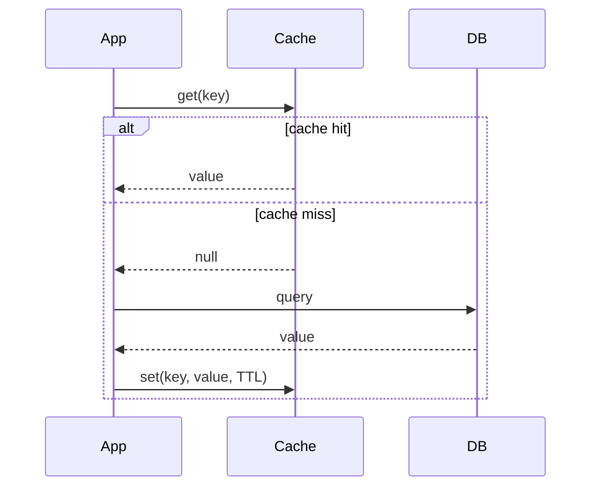
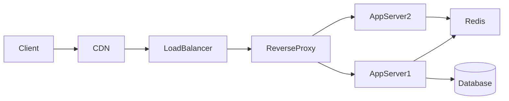

# System design — Data

Строительные блоки данных, кэширования и инфраструктуры.

[ ← Вернуться в хаб](./0_system_design.md)

### Related docs

- [Проектирование системы — Ядро](./0_system_design_core.md) · [Проектирование системы — Архитектура](./0_system_design_architecture.md) · [Шаблоны архитектуры](./7_special_architecture.md) · [Проектирование системы — Данные](./0_system_design_data.md) · [SOLID](./7_special_engineering.md) · [DRY, KISS, YAGNI](./0_system_design_principles.md) · [GRASP](./0_system_design_grasp.md) · [Шаблоны проектирования](./7_special_patterns.md) · [Проектирование системы —Интервью](./0_system_design_interview.md)

### Sections

- [5. Data & caching](#5-data-caching)
- [6. Infrastructure](#6-infrastructure)

---

## 5. Data & caching

<details>
  <summary>SQL vs NoSQL</summary>

### SQL vs NoSQL

**Definition:**

Базы данных SQL (реляционные) хранят структурированные данные в таблицах со схемами и транзакциями ACID. Базы данных NoSQL обменивают строгую схему/транзакции на гибкие модели и горизонтальное масштабирование.

|                | SQL (PostgreSQL, MySQL)     | НетSQL                                            |
| -------------- | --------------------------- | ------------------------------------------------- | --- | ----------- | -------------------------------------- | ------------------------------------ |
| **Схема**      | Исправлено, миграции        | Гибкий (документ, ключ-значение, столбец, график) |
| **Транзакции** | КИСЛОТА                     | Часто возможно (BASE)                             |     | **Масштаб** | Вертикальное + чтение реплик + шардинг | Встроенное горизонтальное разделение |
| **Запросы**    | Комплексные соединения, SQL | Варьируется; часто денормализованный              |
| **Примеры**    | PostgreSQL, MySQL           | MongoDB, Кассандра, Redis, Neo4j                  |

**When to use:**

- SQL: реляционные данные, транзакции, отчеты, большинство бизнес-приложений.
- NoSQL: высокая пропускная способность записи, гибкая схема, кэширование, временные ряды, графические связи.

**Thoughts:** Стойкость полиглота нормальная — PostgreSQL для заказов, Redis для кеша, Elasticsearch для поиска. Выберите для каждого шаблона доступа. Глубина ES (анализаторы, сопоставления, Query DSL, JS-клиент): [NoSQL — Elasticsearch](./9_database_nosql_core.md#elasticsearch).

</details>

<details>
  <summary>Database indexing</summary>

### Database indexing

**Definition:** Структуры данных (обычно B-дерево), которые ускоряют поиск строк за счет дополнительного хранилища и более медленной записи.

**When to use:** Столбцы в разделах WHERE, JOIN, OROR BY. Анализируйте с `EXPLAIN ANALYZE`.

**Pluses and minuses:**

| +                                                         | −                                                                      |
| --------------------------------------------------------- | ---------------------------------------------------------------------- |
| Значительно более быстрое чтение индексированных столбцов | Медленнее INSERT/UPDATE (обслуживание индекса)                         |
| Обеспечивает эффективную сортировку/фильтрацию            | Неправильный индекс = пустая трата места, никакой пользы               |
| Составные индексы для многостолбцовых запросов            | Слишком большое количество индексов ухудшает производительность записи |

**Examples:** `CREATE INDEX idx_users_email ON users(email)` — Поиск O(log n) или полное сканирование таблицы O(n).

**Thoughts:** Селективность индекса имеет значение. Индекс включен `gender` (2 значения) обычно бесполезно. Индекс включен `email` (уникальный) имеет высокую ценность.

</details>

<details>
  <summary>Caching strategies</summary>

### Caching strategies

**Definition:**

Хранение часто используемых данных в быстродействующем хранилище (памяти) для уменьшения задержек и нагрузки на базу данных.



**When to use:** Рабочие нагрузки с большим объемом чтения, дорогостоящие запросы, статические/полустатические данные. Всегда устанавливайте TTL.

**Pluses and minuses:**

| Стратегия           | Как                                                               | +                                           | −                               |
| ------------------- | ----------------------------------------------------------------- | ------------------------------------------- | ------------------------------- | --- | ---------- | ---------------------------------------------------- | ----------------------- | --------------------- |
| **Кэш**             | Приложение проверяет кеш; при промахе прочитать БД, заполнить кэш | Просто: кэшируйте только то, что необходимо | Кэш промахнулся, давка возможна |
| **Сквозная запись** | Синхронная запись в кэш + БД                                      | Кэш всегда свежий                           | Задержка записи                 |
| **Обратная запись** | Запись в кэш; асинхронный сброс в БД                              | Быстро пишет                                | Риск потери данных при сбое     |     | **Чтение** | Кэш извлекается из БД при промахе (управление кешем) | Логика приложения проще | Сложность уровня кэша |

**Examples:**

```ts
async function getUserById(id: string): Promise<User> {
  const cached = await redis.get(`user:${id}`);
  if (cached) return JSON.parse(cached);

  const user = await db.users.findById(id);
  await redis.set(`user:${id}`, JSON.stringify(user), "EX", 3600);
  return user;
}
```

**Thoughts:** Инвалидация кэша — это сложно. Предпочитайте TTL + аннулирование, управляемое событиями. Следите за громоподобным стадом — используйте объединение запросов или вероятностное досрочное истечение срока действия. Кэширование результатов функции — это более узкий случай: [Кэш против мемоизации](#cache-vs-memoization).

</details>

<details>
  <summary>Cache vs memoization</summary>

### Cache vs memoization

**Definition:**

- **Кэш** — общее хранилище, позволяющее избежать повторной выборки или повторного вычисления данных (ответы API, ресурсы, CDN).
- **Мемоизация** — специальное кэширование **результатов функции**, связанных с аргументами.

|                    | Кэш                         | Мемоизация        |
| ------------------ | --------------------------- | ----------------- |
| Область применения | Общесистемный, HTTP, диск   | По функции        |
| Ключ               | URL-адрес, пользовательский | Аргументы функции |
| Пример             | `Cache-Control`, Редис      | `memoize(fn)`     |

**When to use:**

- Кэш: ответы API, статические ресурсы, вычисляемые информационные панели.
- Мемоизация: Дорогие чистые функции (Фибоначчи, селекторы)

**Pluses and minuses:**

| +                   | −                                                     |
| ------------------- | ----------------------------------------------------- |
| Читается быстрее    | Устаревшие данные в случае неправильной аннулирования |
| Пониженная нагрузка | Увеличение памяти без TTL/вытеснения                  |

**Examples:**

```js
function memoize(fn) {
  const cache = new Map();
  return (...args) => {
    const key = JSON.stringify(args);
    if (cache.has(key)) return cache.get(key);
    const result = fn(...args);
    cache.set(key, result);
    return result;
  };
}
```

**Thoughts:**

Реагировать `useMemo` запоминает значения; `useCallback` запоминает функции. Повторный выбор запоминает селекторы. Недействительный кеш при мутации. Стратегии системного уровня: [Стратегии кэширования](#caching-strategies).

---

</details>

<details>
  <summary>CDN (Content Delivery Network)</summary>

### CDN (Content Delivery Network)

**Definition:** Географически распределенные пограничные серверы, которые кэшируют и обслуживают статический контент рядом с пользователями.

**When to use:** Изображения, пакеты JS/CSS, видео, шрифты, ответы API с заголовками кеша.

**Pluses and minuses:**

| +                                         | −                                                      |
| ----------------------------------------- | ------------------------------------------------------ |
| Меньшая задержка для статических ресурсов | Задержка аннулирования кэша                            |
| Снижает нагрузку на исходный сервер       | Стоимость в очень большом масштабе                     |
| DDoS-поглощение                           | Динамическому контенту нужны осторожные заголовки кэша |
| Завершение TLS на границе                 | Устаревший контент, если TTL слишком длинный           |

**Examples:** `Cache-Control: public, max-age=31536000, immutable` для хешированных ресурсов сборки. `max-age=60` для полудинамических ответов API.

**Thoughts:** CDN для статических активов — это ставки стола. Не отправляйте персонализированные аутентифицированные ответы CDN без заголовков Vary и короткого срока жизни.

</details>

<details>
  <summary>Redis use cases</summary>

### Redis use cases

**Definition:**

Хранилище данных в памяти, используемое в качестве кэша, хранилища сеансов, ограничителя скорости, брокера публикации/подписки и упрощенной очереди.

| Вариант использования     | Узор                                        |
| ------------------------- | ------------------------------------------- |
| Кэш                       | Ключ-значение с TTL                         |
| Сессионный магазин        | `SET session:{id}` со сроком действия       |
| Ограничение скорости      | Счетчик скользящего окна на IP/пользователя |
| Таблица лидеров           | Сортированные наборы (`ZADD`, `ZRANGE`)     |
| Паб/саб                   | Уведомления в режиме реального времени      |
| Распределенная блокировка | `SET key NX EX` (с осторожностью)           |

**When to use:** Горячее кэширование данных, ограничение скорости, функции реального времени, хранение сеансов.

**Pluses and minuses:**

| +                           | −                                           |
| --------------------------- | ------------------------------------------- |
| Задержка менее миллисекунды | Размер данных ограничен оперативной памятью |
| Богатые структуры данных    | Сохранение необязательно — не основная БД   |
| Атомные операции            | Однопоточный — узкое место «горячих клавиш» |

**Thoughts:**

Redis не является заменой PostgreSQL. Используйте для эфемерных или горячих данных с явным сроком жизни и политикой вытеснения (`allkeys-lru`).

---

</details>

<a name="6-infrastructure"></a>

## 6. Infrastructure

<details>
  <summary>Load balancing</summary>

### Load balancing

**Definition:**

Распределение входящего трафика между несколькими серверами для повышения доступности, пропускной способности и отказоустойчивости.

| Слой                | Работает                           | Примеры                   |
| ------------------- | ---------------------------------- | ------------------------- | ---------------------------------------------------------------------------------------------------------------- |
| **L4 (транспорт)**  | IP + порт                          | HAProxy, AWS NLB          |
| **L7 (приложение)** | HTTP-заголовки, путь, файлы cookie | Nginx, AWS ALB, посланник | Номера уровней — это **имена OSI** в стеке TCP/IP: [модели OSI и TCP/IP](./6_web_api_apps.md#osi--tcpip-models). |

| Алгоритм                     | Поведение                                               |
| ---------------------------- | ------------------------------------------------------- |
| Круговой турнир              | Последовательное вращение                               |
| Наименьшее количество связей | Отправить на наименее загруженный сервер                |
| Согласованное хеширование    | Тот же ключ → тот же сервер (прикрепленный, кэшируемый) |
| Взвешенный                   | Больше трафика на более сильные серверы                 |

**When to use:** Любое многоэкземплярное развертывание. L7, когда маршрутизация по URL/пути имеет значение.

**Pluses and minuses:**

| +                                                    | −                                                              |
| ---------------------------------------------------- | -------------------------------------------------------------- |
| Горизонтальное масштабирование                       | Сам LB может быть SPOF (смягчение с помощью пары HA)           |
| Проверки работоспособности удаляют поврежденные узлы | Прикрепленные сеансы усложняют дизайн без сохранения состояния |

**Thoughts:** Завершить TLS на LB. Используйте проверки работоспособности, которые проверяют готовность приложения, а не только открытый порт TCP.

</details>

<details>
  <summary>Reverse proxy</summary>

### Reverse proxy

**Definition:** Сервер, который находится перед серверами приложений, пересылает клиентские запросы и возвращает ответы — обрабатывает TLS, сжатие, кэширование, маршрутизацию.

**When to use:** Почти каждое производственное развертывание. Nginx, Apache httpd, Envoy, Caddy, облачный ALB.

**Pluses and minuses:**

| +                                               | −                                                    |
| ----------------------------------------------- | ---------------------------------------------------- |
| Прекращение SSL                                 | Дополнительный переход (минимальная задержка)        |
| Маршрутизация запросов, отправка на основе пути | Неправильная конфигурация может заблокировать трафик |
| Статический файлообменник                       |                                                      |
| Ограничение скорости, интеграция WAF            |                                                      |

**Examples:** Маршруты Nginx `/api/*` → серверы приложений, `/static/*` → CDN/источник, `/ws` → Серверная часть WebSocket.

**Thoughts:**

Обратный прокси-сервер ≠ балансировщик нагрузки, но большинство обратных прокси-серверов выполняют и то, и другое. **API-шлюз** — это обратный прокси-сервер, специализированный для API (маршрутизация путей, аутентификация, ограничения скорости) — см. [API-шлюз](./7_special_architecture.md#api-gateway). Задания прокси-сервера HTTP-уровня (кэш, фильтр, LB, аутентификация, ведение журнала): [6_web_api.md — протокол HTTP](./6_web_api_http.md#http-protocol).Роль HTTP веб-сервера → [6_web_api.md — Веб-сервер](./6_web_api_http.md#web-server). Подробности конфигурации: [Nginx](./15_devops.md#nginx-configuration) · [Apache](./15_devops.md#apache-http-server) · [Build — nginx](./10_build.md).



</details>

<details>
  <summary>API styles</summary>

### API styles

**Definition:** Протоколы и соглашения для взаимодействия клиент-сервер.

**When to use:**

- REST: общедоступные API, CRUD, вопросы кэширования.
- GraphQL: мобильные клиенты, разнообразные потребности в данных, альтернатива BFF
- gRPC: внутренняя межсервисная связь, высокая производительность.
- WebSockets: чат, интерактивные информационные панели, совместное редактирование.
- SSE: прямые трансляции, уведомления, проще, чем WebSockets.

**Pluses and minuses:**

| Стиль       | Транспорт         | +                                                                        | −                                                      |
| ----------- | ----------------- | ------------------------------------------------------------------------ | ------------------------------------------------------ | --- | ------------- | -------------- | --------------------------------------- | ------------------------------------------------------------- |
| **ОТДЫХ**   | HTTP + JSON       | Простой, кэшируемый, универсальный                                       | Чрезмерная/недостаточная выборка, много конечных точек |
| **GraphQL** | HTTP-ПОСТ         | Клиент указывает форму, одну конечную точку                              | Сложность, сложнее кэширование, риск N+1               |
| **gRPC**    | HTTP/2 + Протобуф | Быстрые, печатные контракты, потоковая передача                          | Поддержка браузера ограничена (требуется прокси)       |     | **Вебсокеты** | TCP-обновление | Полнодуплексный режим реального времени | Соединения с сохранением состояния, сложность масштабирования |
| **ССЕ**     | HTTP-поток        | Принудительная передача сервера, простое, автоматическое переподключение | Однонаправленный (сервер → клиент)                     |

**Thoughts:** GraphQL N+1 — используйте DataLoader или ограничения сложности запроса. Управление версиями REST: URL (`/v2/`) или заголовок — выберите один и придерживайтесь его. TCP против UDP / HTTP/3 QUIC → [6_web_api.md — TCP против UDP](./6_web_api_interview.md#tcp-vs-udp).

</details>

<details>
  <summary>Rate limiting</summary>

### Rate limiting

**Definition:**

Контроль количества запросов, которые клиент может сделать за определенный период времени, чтобы защитить службы от злоупотреблений и перегрузки.

| Алгоритм               | Как                                                                 |
| ---------------------- | ------------------------------------------------------------------- |
| **Корзина токенов**    | Пополнение токенов по фиксированной ставке; запрос потребляет токен |
| **Раздвижное окно**    | Подсчет запросов в скользящем временном окне                        |
| **Фиксированное окно** | Подсчет на тактовое окно (простая проблема с разрывом границ)       |

**When to use:** Публичные API, конечные точки аутентификации, дорогостоящие операции (ИИ, отчеты).

**Pluses and minuses:**

| +                                   | −                                                                    |
| ----------------------------------- | -------------------------------------------------------------------- |
| Защищает от DDoS и ошибок           | Законный пакетный трафик может быть ограничен                        |
| Справедливое распределение ресурсов | Распределенное ограничение скорости требует общего хранилища (Redis) |

**Examples:** 100 запросов в минуту на ключ API — возврат `429 Too Many Requests` с `Retry-After` заголовок.

**Thoughts:** Ограничение скорости на границе (шлюз API/CDN) и уровне приложения. Возвращайте четкие сообщения об ошибках и повторяйте заголовки. Ограничения IP не работают при крупных DDoS-атаках; Slowloris нужны таймауты чтения, а не только 429. См. [Special — DoS](./7_special_security.md#denial-of-service-dos--ddos).

</details>

<details>
  <summary>Message queues</summary>

### Message queues

**Definition:**

Асинхронное промежуточное программное обеспечение, в котором производители отправляют сообщения брокеру; потребители обрабатывают их самостоятельно.

|                            | Кафка                          | КроликMQ                                  |
| -------------------------- | ------------------------------ | ----------------------------------------- | --- | -------------------------- | ------------------------------------------------------------- | --------------------------------------- |
| **Модель**                 | Распределенный журнал коммитов | Брокер сообщений (AMQP)                   |
| **Пропускная способность** | Очень высокий                  | Умеренно-высокий                          |
| **Оформление заказа**      | За раздел                      | В очередь                                 |
| **Удержание**              | Настраивается (дни/недели)     | Пока не будет использовано (по умолчанию) |     | **Сценарий использования** | Потоковая передача событий, аналитика, агрегирование журналов | Очереди задач, стиль RPC, маршрутизация |

| Гарантия доставки        | Значение                                                                           |
| ------------------------ | ---------------------------------------------------------------------------------- |
| **Не более одного раза** | Выстрели и забудь — сообщения могут потеряться                                     |
| **Хотя бы один раз**     | Повторить попытку в случае неудачи — возможно дублирование (нужна идемпотентность) |
| **Ровно один раз**       | Жесткий; обычно «эффективно один раз» с идемпотентными потребителями               |

**When to use:** Разделение служб, буферизация пиков трафика, асинхронная обработка, источник событий, журналы аудита.

**Thoughts:** Начните с at-least-once + идемпотентных consumers. Exactly-once дорого и часто не нужно. Сравнение брокеров (queue vs log vs Redis jobs) → [Message broker — Core](./12_message_broker_core.md#kafka-vs-rabbitmq-vs-nats) · [BullMQ](./10_build_infra.md#kafka-vs-rabbitmq-vs-bullmq).

</details>

<details>
  <summary>Observability</summary>

### Observability

**Definition:**

Способность понимать внутреннее состояние системы по внешним данным — **журналы**, **метрики**, **трассировки** (три столпа).

| Столб          | Что                                     | Инструменты                   |
| -------------- | --------------------------------------- | ----------------------------- |
| **Журналы**    | Дискретные события, ошибки              | ELK, Локи, CloudWatch         |
| **Показатели** | Агрегированные цифры с течением времени | Прометей, Графана, Датадог    |
| **Следы**      | Путь запроса между службами             | Джагер, Зипкин, OpenTelemetry |

**When to use:** Любая производственная система. Инструмент с первого дня — модернизация — это болезненно.

**Pluses and minuses:**

| +                                       | −                                |
| --------------------------------------- | -------------------------------- |
| Более быстрое разрешение инцидентов     | Стоимость хранения в масштабе    |
| SLO отслеживание и оповещение           | Контрольно-измерительные приборы |
| Видимость узких мест производительности | Взрыв мощности в метриках        |

**Thoughts:**

Сопоставлять журналы с `trace_id`. Оповещение о скорости сжигания SLO, а не о каждой ошибке. Метки с высокой мощностью (user_id) в Prometheus снижают производительность.

---

</details>
