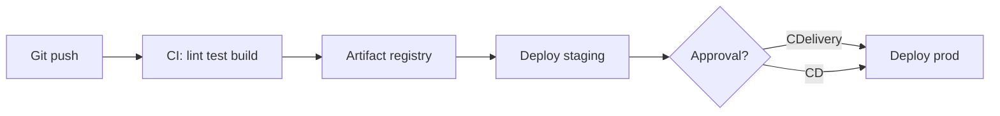

# Build — CI

CI/CD, менеджеры пакетов и средства запуска задач.

[ ← Вернуться в хаб](./10_build.md)

### Related docs

* [Сборка — CI](./10_build_ci.md) · [Сборка — Bundlers](./10_build_bundlers.md) · [Сборка — Docker](./10_build_docker.md) · [Сборка — Infra](./10_build_infra.md) · [Сборка — Интервью](./10_build_interview.md)

### Sections

- [CI/CD](#cicd)
- [Package management](#package-management)
- [Task runners](#task-runners)

---

## CI/CD

<details>
  <summary>CI/CD</summary>

### CI/CD
**Definition:** **CI/CD** означает **непрерывную интеграцию/непрерывную доставку** — способ работы, при котором сборка, тестирование и публикация (а зачастую и развертывание) автоматизированы, поэтому каждое изменение можно интегрировать и отправить с коротким циклом обратной связи. **Непрерывное развертывание** — более строгий вариант: передача кораблей CI в производство без участия человека. См. [CI против CD](#ci-vs-cd--сравнение).

**How it works:**

Итерации Agile становятся быстрее, когда каждый этап цикла автоматизирован (процесс: [7_special.md — Agile](./7_special_sdlc.md#agile)). Инструменты находятся на **Git**, инфраструктуре сервера/контейнера и командном чате/PR. Индивидуальные проекты тоже приносят пользу, а не только крупным продуктовым командам.

Принципы:

- **Разделение ответственности** — продукт, дизайн, инжиниринг, контроль качества и инфраструктура имеют разные стороны;между ними ручная работа конвейеров (созданный артефакт → тесты → релиз).
- **Снизить риск** — автоматизируйте проверки, чтобы неработающие сборки и регрессии стали видны пользователям.
- **Короткая обратная связь** — проверка/тестирование/разработка каждого PR; пользователи и владельцы быстрее увидят работающее программное обеспечение.
- **Общая среда** — те же версии Node/npm, файл блокировки (`npm ci`), и тестировщик локально и на CI, поэтому «работает на моей машине» редко.

Цикл продукта (этапы можно пропускать или объединять):

| Этап | Что происходит |
|-------|----------------|
| **Код** | Рабочий процесс Git (часто [GitHub Flow](./0_git_branching.md#github-flow--trunk-based): ветка → PR → проверка → слияние). Git Flow тяжелее — лучше для версий с версиями, чем для многих развертываний в день. || **Построить** | После локальных проверок CI использует средство выполнения — часто в **Docker** для получения повторяемого образа. Платформы: GitHub Actions, GitLab CI/CD, Jenkins, Bitbucket Pipelines, TeamCity; хосты, такие как Netlify/Vercel, запускают сборку + развертывание. Сравнение: [15_devops.md — системы CI](./15_devops.md#ci-systems). |
| **Тест** | Автоматизированный блок/интеграция/E2E в первую очередь; ручной контроль качества по-прежнему используется для UX и исследовательской работы.Предварительные сборки могут иметь версии (`v.2.4.5-1`). Шут, Драматург/Кукловод, Селен — [7_special.md — тесты](./7_special_testing.md#tests-and-aaa). |
| **Выпуск** | Частота зависит от продукта. Работа CI — это **рекламируемый артефакт**, а не Jira/аналитика. Метрики продукта (GA, Metrika) и трекеры задач располагаются рядом с циклом. |
| **Развертывание** | Доставляйте пользователям. Простым SPA требуется немного инфраструктуры;магазины/поиск/потоковое вещание конкурируют за кеширование, CDN и серверную архитектуру. |
| **Работа** | Поддержка и мониторинг. Служба поддержки/чат-боты не являются инструментами CI; они часто предоставляют API. Наблюдаемость: [15_devops.md](./15_devops.md). |
| **План** | Обратная связь → отставание → следующая итерация. Цикл закрывается. |

**When to use:**

Каждое производственное приложение; также полезно для репозиториев, проводимых одним человеком (проверка связей с общественностью, предварительное развертывание).

#### Common pitfalls

Отношение к CI/CD как к швейцарскому армейскому ножу для каждого процесса; пропуск общего файла блокировки/образа, поэтому локальный и CI расходятся; вызывая «CD», не произнося **доставка** или **развертывание**.

**Pluses and minuses:**

| + | − |
|------|------|
| Ускоренный цикл поставки и исправления | Чрезмерное проектирование конвейеров, если команда неопытна |
| Меньше ручного труда; меньше ошибок интеграции | Инструменты не исправляют командное общение |
| Быстрая обратная связь (PR красный/зеленый) | Все должны использовать одну и ту же цепочку инструментов и модель секретов |
| Легко изменить приоритеты, если план гибкий | Ненадежные тесты и медленная работа становятся узким местом |

**Examples:**

GitHub Actions — это платформа CI/CD: **событие** (push, PR, расписание, `workflow_dispatch`) запускает **рабочий процесс** (YAML в `.github/workflows/`). **Задания** выполняются на **бегунах** (размещенных на Ubuntu/Windows/macOS или на локальном хостинге); **шаги** запускают сценарии или повторно используемые **действия**.

```yaml
# .github/workflows/ci.yml
name: CI
on: [push, pull_request]
jobs:
  test:
    runs-on: ubuntu-latest
    steps:
      - uses: actions/checkout@v6
      - uses: actions/setup-node@v7
        with: { node-version: 24, cache: npm }
      - run: npm ci
      - run: npm run lint && npm test && npm run build
```

**Thoughts:** Автоматизируйте путь от фиксации до заведомо исправного артефакта (и, возможно, до запуска), чтобы цикл Agile оставался коротким и повторяемым.

**Sources:** [Действия GitHub — понимание действий GitHub](https://docs.github.com/en/actions/get-started/understand-github-actions) · [Doka — CI/CD](https://doka.guide/tools/ci-cd/)

</details>

<details>
  <summary>Continuous Integration (CI)</summary>

### Continuous Integration (CI)

**Definition:** Автоматизированный процесс сборки, тестирования и проверки каждого изменения кода, объединенного в общий репозиторий, — раннее выявление ошибок интеграции. Полный цикл: [Что такое CI/CD](#cicd).

**When to use:** Каждая команда, имеющая более одного разработчика; обязателен для производственных приложений.

**Pluses and minuses:**

| + | − |
|------|------|
| Обнаруживает сломанные сборки перед слиянием | Стоимость первоначальной установки трубопровода |
| Обеспечивает покрытие тестов и отсутствие ворса | Ненадежные тесты блокируют работу команды |
| Обеспечивает разработку на основе магистральной линии | Требует дисциплины в отношении небольших PR |

**Examples:**

```yaml
# .github/workflows/ci.yml
name: CI
on: [push, pull_request]
jobs:
  test:
    runs-on: ubuntu-latest
    steps:
      - uses: actions/checkout@v4
      - uses: actions/setup-node@v4
        with: { node-version: 20, cache: npm }
      - run: npm ci
      - run: npm run lint
      - run: npm test -- --coverage
      - run: npm run build
```

**Thoughts:** Область CI = сборка + тестирование + проверка. Он **не** обязательно развертывается. Поддерживайте скорость трубопроводов (< 10 минут); выделить медленные E2E/визуальные/маяки в отдельную работу — [системные тесты](./7_special_testing.md#system-testing).

**Sources:** [ByteByteGo — ускоренный курс CI/CD](https://blog.bytebytego.com/p/a-crash-course-in-cicd)

</details>

<details>
  <summary>Continuous Delivery</summary>

### Continuous Delivery
**Definition:** Каждое изменение, прошедшее CI, создает **развертываемый артефакт**; выпуск продукции — это шаг, выполняемый вручную (или после утверждения).

**When to use:** Регулируемые отрасли, поэтапное внедрение, команды, которые хотят автоматизации, но сохраняют контроль над выпуском.

**Pluses and minuses:**

| + | − |
|------|------|
| Всегда готовый к выпуску кандидат | Для производства все еще требуются человеческие ворота |
| Уменьшает количество сюрпризов в день релиза | Необходимо хранение артефактов и управление версиями |

**Examples:**

```yaml
# Deploy to staging automatically; prod requires manual approval
jobs:
  deploy-staging:
    needs: test
    runs-on: ubuntu-latest
    steps:
      - run: npx vercel deploy --token=${{ secrets.VERCEL_TOKEN }}
```

**Thoughts:** CDelivery ≠ CDployment. Артефакт (образ Docker, статический пакет, пакет npm) должен быть неизменяемым — продвигайте один и тот же артефакт через среды.

**Sources:** [ByteByteGo — CI/CD](https://blog.bytebytego.com/p/a-crash-course-in-cicd)

</details>

<details>
  <summary>Continuous Deployment (CD)</summary>

### Continuous Deployment (CD)

**Definition:** Каждое изменение, прошедшее CI, **автоматически развертывается в рабочей среде** без ручного вмешательства.

**When to use:** Зрелые команды с сильным тестовым покрытием, флажками функций и автоматическим откатом (канареечный, сине-зеленый).

**Pluses and minuses:**

| + | − |
|------|------|
| Самый быстрый выход на рынок | Требует высокой достоверности результатов испытаний |
| Небольшие постепенные изменения с низким уровнем риска | Стратегию отката необходимо автоматизировать |
| Устраняет узкие места выпуска | Флаги функций, часто необходимые для незавершенной работы |

**Thoughts:** CD расширяет CI. Многие команды говорят «CD», но имеют в виду CDelivery. Уточните в документации по архитектуре, какую модель вы используете.

**Sources:** [ByteByteGo — CI/CD](https://blog.bytebytego.com/p/a-crash-course-in-cicd)

</details>

<details>
  <summary>CI vs CD — comparison</summary>

### CI vs CD — comparison

| Аспект | КИ | CDДоставка | компакт-диск |
|--------|----|-----------|-----|
| **Объем** | Сборка + тестирование | + развертываемый артефакт | + автоматическое развертывание |
| **Цель** | Обнаружить ошибки интеграции | Всегда доступен для выпуска | Доставка непрерывно |
| **Развертывание** | Нет | Ручной / закрытый | Автоматический |
| **Риск** | Низкий | Средний | Высокий без гарантий |

**Sources:** [ByteByteGo — CI/CD](https://blog.bytebytego.com/p/a-crash-course-in-cicd)

</details>

<details>
  <summary>CI/CD pipeline stages</summary>

### CI/CD pipeline stages

**Definition:**

Путь **machine** от события git до артефакта/развертывания. Более широкий цикл **продукта** (план → код → работа) находится в разделе [Что такое CI/CD](#cicd).



**How it works:** Типичный фронтенд-конвейер: `install → lint → typecheck → unit tests → build → (E2E) → deploy`. Кэш `node_modules` и строить выходные данные между запусками. Продолжайте пиар-работу быстро (`< 10 min`); выделите медленный E2E/визуал в отдельную работу.

**When to use:** PR-проверка каждого изменения; постановка на `main`; производство на бирке или после утверждения (CDelivery) или автоматически (CD).

**Thoughts:** Один неизменяемый артефакт, продвигаемый через среды — не пересобирать по-другому для прода.

**Sources:** [Действия GitHub — рабочие процессы](https://docs.github.com/en/actions/using-workflows/workflow-syntax-for-github-actions)

</details>

<details>
  <summary>GitHub Actions</summary>

### GitHub Actions

**Definition:** Платформа CI/CD GitHub — рабочие процессы YAML в `.github/workflows/` эта проверка, тестирование, сборка и развертывание на событиях репозитория. Концепция: [Что такое CI/CD](#cicd). YAML: [YAML](#yaml). Конкуренты: [15_devops.md](./15_devops.md#github-actions-vs-gitlab-ci-vs-circleci).

**How it works:**

- Любой `*.yml` / `*.yaml` in `.github/workflows/` это **рабочий процесс**. Необязательный `name:` — это метка вкладки «Действия». Результаты отображаются в разделе **Действия**.
- `on:` перечисляет **триггеры** (`push`, `pull_request`, `schedule`, `workflow_dispatch`). Фильтровать с помощью `branches` / `tags` (or `*-ignore`). Не смешивайте `branches` и `branches-ignore` на том же мероприятии.
- `schedule` это **POSIX cron в формате UTC**, пять полей. Запланированные рабочие процессы запускаются из **ветви по умолчанию**.
- `jobs:` представляет собой карту идентификаторов (буква/`_` первый). `needs:` ожидает **успешного выполнения** перечисленных заданий; неудачные/пропущенные операции пропускают нисходящий поток, если только `if: always()`. `job3: needs: [job1, job2]` бежит за обоими.
- `runs-on:` выбирает бегуна (`ubuntu-latest` / `windows-latest` / `macos-latest` отслеживать текущие изображения GA — закрепить `ubuntu-24.04` для фиксированной ОС). Задания выполняются на размещенных виртуальных машинах (или **в** контейнере).
- **Матрица** (`strategy.matrix`) разбивает одну работу на комбинации. Следите за тем, чтобы ключи соответствовали `${{ matrix.* }}`.
- `${{ }}` **не** YAML — GitHub заменяет его после синтаксического анализа. Контексты: `github`, `env`, `vars`, `secrets`, `matrix`, `needs` (результаты **этого** задания `needs:`), `inputs`. Окружение бегуна (`$GITHUB_REF`) существует только после отправки; использовать контексты в `if:` **до** старта бегуна.
- `steps:` беги по порядку. `uses:` вызывает действие (закрепите SHA для безопасности цепочки поставок). `run:` представляет собой оболочку; `|` для многострочного.

**When to use:**

PR ворота включены `main`. Версии матричного узла. Крон. Оформить заказ → `npm ci` → тестирование → сборка → развертывание.

#### Common pitfalls

- Устаревшие ярлыки бегунов (`ubuntu-18.04`, `windows-2016`, `macos-10.15`) и Node 12.10.14 — используйте текущие изображения и LTS Node.
- Несоответствие матричного ключа (`matrix.node` vs `node-version` in `with:`).
- `needs` контекст — это результаты **обязательных** должностей, а не иждивенцев.
- `npm install` в КИ → `npm ci` с файлом блокировки.
- Cron рассматривается как местное время (это UTC).

**Pluses and minuses:**

| + | − |
|------|------|
| Нативные GitHub PR, секреты, окружение | Минуты + блокировка YAML |
| Матрица + многоразовые действия | `-latest` Метки ОС перемещаются; булавка, когда это необходимо |
| Тот же репозиторий, что и код | Публичные действия — это поверхность цепочки поставок — пин-версии/SHA |

**Examples:**

Узел CI при отправке/PR в `main`, матричная ОС + узел:

```yaml
# .github/workflows/test.yml
name: Test

on:
  push:
    branches: [main]
  pull_request:
    branches: [main]

jobs:
  test:
    runs-on: ${{ matrix.os }}
    strategy:
      matrix:
        os: [ubuntu-latest, windows-latest]
        node: [20, 22]
    steps:
      - uses: actions/checkout@v6
      - uses: actions/setup-node@v7
        with:
          node-version: ${{ matrix.node }}
          cache: npm
      - run: npm ci
      - run: |
          npm run build
          npm test
```

Разделенное развертывание с помощью `needs: [test]` на другой работе. Секреты: `${{ secrets.* }}`, никогда в репо.

**Thoughts:** Событие → вакансии (`needs`, матрица, `runs-on`) → заказано `uses`/`run` шаги; `${{ }}` читает контексты, которые заполняет GitHub.

**Sources:** [Синтаксис рабочего процесса](https://docs.github.com/en/actions/reference/workflows-and-actions/workflow-syntax) · [События/cron](https://docs.github.com/en/actions/reference/workflows-and-actions/events-that-trigger-workflows) · [Контексты](https://docs.github.com/en/actions/reference/workflows-and-actions/contexts) · [Изображения бегунов](https://github.com/actions/runner-images)

</details>

<details>
  <summary>YAML</summary>

### YAML

**Definition:** YAML (YAML Ain’t Markup Language) — удобочитаемый язык сериализации для структурированных данных — конфигов, CI, Compose, Kubernetes, OpenAPI, линтеров. Расширение файла: `.yaml` or `.yml`.

**How it works:**

- Три примитива: **отображения** (ключ/значение), **последовательности** (списки), **скаляры** (строки, числа, логические значения, `null`).
– Стиль блока: отступ с использованием **только пробелов** (табуляции недопустимы). Вложенные узлы должны иметь больший отступ, чем родительский; братья и сестры имеют одинаковый отступ. **2 пробела** — это обычное соглашение, спецификация не требует ровно два.
- `key: value` — двоеточие + пробел. Комментарии: `# …` (не допускается внутри скаляров).
- Последовательности: блок (`- item`) или поток (`[a, b]`). Сопоставления также могут использовать поток `{ k: v }`.
- Строки: без кавычек, `'single'`, or `"double"`. Цитируйте, когда значение выглядит как тип (`true`, `null`, `2.99`) или содержит `:`, `#`или ведущий `*`.
– Числа: целые числа и числа с плавающей запятой с **точкой** (`9.99`). Запятая не является десятичным разделителем. `2,99` представляет собой строку (или фрагмент списка потоков).
- Якоря `&name` отметить узел; псевдонимы `*name` используйте его повторно (например, именованную копию/JS-распространение значения). Объединить ключ `<<: *name` копирует ключи сопоставления; более поздние ключи переопределяют. `<<` это функция **YAML 1.1** (убрана в версии 1.2); GitHub Actions, Compose и многие парсеры по-прежнему поддерживают его.
- Корень документа может быть отображением, последовательностью или скаляром.

YAML допускает комментарии; JSON нет. Строки YAML могут быть не заключены в кавычки; Строки JSON должны содержать двойные кавычки. JSON (RFC 8259) также допускает скалярный корень; YAML по-прежнему предпочтителен для конфигураций, редактируемых человеком. JSON — это формат обмена API (`JSON.parse` / `stringify`) — см. [JSON](./3_js_async.md#json).

**When to use:**

Действия GitHub/GitLab CI; Docker Compose; Конфигурация ESLint/Prettier; Kubernetes манифестирует; Спецификации OpenAPI.

#### Common pitfalls

- Табы для отступа → ошибка синтаксического анализа. Настройте редактор/YAML-линтер.
- Непоследовательный отступ между братьями и сестрами.
- Без кавычек `true` / `false` / `null` / числа становятся типизированными значениями, а не строками.
- ЯМЛ 1.1: `yes`, `no`, `on`, `off`, `NO` может анализироваться как логические значения.
- Забываем пробел после `-` or `:`.

**Pluses and minuses:**

| + | − |
|------|------|
| Комментарии; строки без кавычек; читаемое вложение | Ошибки отступа приводят к сбою всего файла; табуляции и пробелы |
| Якоря сокращают дублирование | Сюрпризы типов YAML 1.1 и 1.2 (`yes`/`NO` как логические значения в версии 1.1) |
| Корневым может быть узел любого типа | Объединить `<<` нет в ядре YAML 1.2 — зависит от парсера |

**Examples:**

```yaml
# pet config — mapping + sequence + scalars
bestCat:
  name: mittens          # unquoted string
  isFluffy: true
  sounds:
    - mur
    - pur
  paws: 4
  lunchTime: 9.99        # float — use a dot, not a comma

# anchors + merge (YAML 1.1 / many CI parsers)
base: &base
  name: cool cat
  age: 2

cat1:
  <<: *base              # name + age from base

cat2:
  <<: *base
  age: 7                 # overrides base.age
```

Эквивалент после слияния: `cat1` → `{ name: cool cat, age: 2 }`; `cat2` → `{ name: cool cat, age: 7 }`.

Действия GitHub (минимальный рабочий процесс — `.github/workflows/*.yml` or `*.yaml`):

```yaml
name: CI
on: [pull_request]
jobs:
  test:
    runs-on: ubuntu-latest
    steps:
      - run: echo "event ${{ github.event_name }}"
      - run: echo "os ${{ runner.os }}"
```

`${{ }}` — это **синтаксис выражений GitHub**, а не YAML — бегун подставляет его после анализа файла.

**Thoughts:** YAML — это JSON с отступами для людей — пробелы, а не табуляции; цитируйте все, что похоже на тип.

**Sources:** [Спецификация YAML 1.2.2](https://yaml.org/spec/1.2.2/) · [Действия GitHub — синтаксис YAML](https://docs.github.com/en/actions/using-workflows/workflow-syntax-for-github-actions#about-yaml-syntax-for-workflows) · [Действия GitHub — якоря](https://docs.github.com/en/actions/how-tos/reuse-automations/reuse-workflows#yaml-anchors-and-aliases) · [eemeli/yaml — 1.1 против 1.2](https://eemeli.org/yaml/#version-differences)

</details>

<a name="packages"></a>

### Vite & Webpack (bundlers)

**Definition:**

**Webpack** — это зрелый, легко настраиваемый сборщик модулей с загрузчиками и плагинами. **Vite** использует собственный ESM при разработке (esbuild) и Rollup для производства — по умолчанию для современных приложений React/Vue/Svelte.

| | Веб-пакет | Вите |
|---|---------|------|
| Скорость разработки | Медленнее HMR | Мгновенный холодный старт |
| Конфигурация | Высокий | Низкий (разумные значения по умолчанию) |
| Лучшее для | Устаревшие приложения, Федерация модулей | Greenfield SPA, миграция CRA || Экосистема | Самый большой набор плагинов | Растущий; охватывает большинство приложений |

**When to use:** Ждём новых проектов; Webpack для устаревших кодовых баз или микроинтерфейсов Module Federation.

**Examples:**

```ts
// vite.config.ts
import { defineConfig } from 'vite';
import react from '@vitejs/plugin-react';

export default defineConfig({
  plugins: [react()],
  server: { host: '0.0.0.0', port: 3000 },
  build: { sourcemap: 'hidden' },
});
```

**Sources:** [vite.dev](https://vite.dev/) · [webpack.js.org](https://webpack.js.org/)

### Docker (containers)

**Definition:** Платформа для разработки, доставки и запуска приложений в легких изолированных **контейнерах** — упаковка кода, среды выполнения и зависимостей в воспроизводимые образы.

**When to use:** Микросервисы, конвейеры CI/CD, паритет локальной разработки, облачное развертывание.

**Pluses and minuses:**

| + | − |
|------|------|
| Последовательная разработка/постановка/производство | Кривая обучения (сети, объемы) |
| Быстрый запуск по сравнению с виртуальными машинами | Нативные модули должны соответствовать контейнерной арке |
| Портативные развертывания | Раздувание образа без многоэтапных сборок |

**Examples:**

```dockerfile
FROM node:20-alpine AS builder
WORKDIR /app
COPY package*.json ./
RUN npm ci
COPY . .
RUN npm run build

FROM node:20-alpine
WORKDIR /app
COPY --from=builder /app/dist ./dist
CMD ["node", "dist/index.js"]
```

**Sources:**

[docs.docker.com](https://docs.docker.com/)

---

<a name="ci-cd"></a>

## Package management

<details>
  <summary>npm</summary>

### npm

**Definition:** Менеджер пакетов по умолчанию для Node.js. Управляет зависимостями через `package.json` и `package-lock.json`.

**When to use:** Выбор по умолчанию; требуется только при работе с документами рабочих процессов npm.

**Pluses and minuses:**

| + | − |
|------|------|
| Universal, поставляется с Node | Установка медленнее, чем pnpm в больших монорепозиториях |
| Огромный реестр (npmjs.com) | Плоский `node_modules` может вызвать фантомный депрессивный синдром |
| `npm ci` для воспроизводимого КИ | Критические изменения в основных версиях npm |

**Examples:**

```json
{
  "dependencies": { "react": "^19.0.0" },
  "devDependencies": { "vite": "^6.0.0", "typescript": "^5.0.0" },
  "scripts": { "dev": "vite", "build": "tsc -b && vite build" }
}
```

```bash
npm install          # update lockfile (local dev)
npm ci               # clean install from lockfile (CI)
npm install -D eslint  # add devDependency (-D = --save-dev)
```

**Thoughts:**

| Поле | Цель |
|-------|---------|
| `dependencies` | Требуется во время выполнения; поставляется в комплекте поставки |
| `devDependencies` | Сборка, тестирование и только анализ; нет в комплекте поставки |
| `peerDependencies` | Ожидается, что будет предоставлено ведущим приложением (библиотеками) |
| `optionalDependencies` | Устанавливается по возможности; неудача не фатальна |

Использовать `npm ci` в CI — никогда `npm install`. Никогда не совершайте `node_modules`.

**Sources:** [документы npm](https://docs.npmjs.com/)

</details>

<details>
  <summary>Yarn (Classic & Berry)</summary>

### Yarn (Classic & Berry)

**Definition:** Альтернативный менеджер пакетов от Meta. Yarn Classic (v1) использует `yarn.lock`; Yarn Berry (v2+) дополнительно использует Plug'n'Play (PnP).

**When to use:** Существующие монорепозитории Yarn; команды стандартизировали рабочие пространства Yarn.

**Pluses and minuses:**

| + | − |
|------|------|
| Детерминированная установка через файл блокировки | Berry PnP ломает некоторые ожидаемые инструменты `node_modules` |
| Рабочие области для монорепозиториев | Две основные версии (Classic и Berry) вызывают путаницу |
| `yarn dlx` для одноразовых команд | Меньшая доля разума по умолчанию, чем у npm |

**Examples:**

```json
// package.json — workspaces
{
  "private": true,
  "workspaces": ["packages/*", "apps/*"]
}
```

```bash
yarn install
yarn workspace @myapp/web build
```

**Thoughts:** Большинство новых проектов предпочитают pnpm Yarn Classic. Если вы начинаете с Yarn, используйте Berry (v4) с `nodeLinker: node-modules` если вы не хотите PnP.

**Sources:** [yarnpkg.com](https://yarnpkg.com/)

</details>

<details>
  <summary>pnpm</summary>

### pnpm

**Definition:** Быстрый и экономичный менеджер пакетов, использующий глобальное хранилище с адресацией по содержимому и жесткой связью. `node_modules`.

**When to use:** Новые монорепозитории, большие команды, когда вызывают беспокойство фантомные ошибки зависимостей.

**Pluses and minuses:**

| + | − |
|------|------|
| Самая быстрая установка; экономит дисковое пространство | Некоторые инструменты предполагают плоскую компоновку npm |
| Строгое разрешение зависимостей (без фантомных задержек) | Случайные особенности разрешения одноранговых сетей |
| Первоклассные рабочие места монорепозитория | Менее универсальны в устаревших шаблонах CI |

**Examples:**

```bash
pnpm install
pnpm add -D vitest
pnpm --filter @myapp/web dev   # run script in one workspace package
```

```yaml
# .npmrc
strict-peer-dependencies=true
auto-install-peers=true
```

**Thoughts:** Строгость pnpm выявляет ошибки, которые npm позволяет молча — например. импорт пакета, который вы не декларировали. Предпочитайте pnpm для монорепозиториев Turborepo/Nx.

**Sources:** [pnpm.io](https://pnpm.io/)

</details>

<details>
  <summary>npm vs Yarn vs pnpm</summary>

### npm vs Yarn vs pnpm

| | НПМ | Пряжа | пнпм |
|---|-----|------|------|
| **Файл блокировки** | `package-lock.json` | `yarn.lock` | `pnpm-lock.yaml` |
| **Команда CI** | `npm ci` | `yarn install --frozen-lockfile` | `pnpm install --frozen-lockfile` |
| **Монорепо** | рабочие места | рабочие места | рабочие пространства (лучший DX) |
| **Использование диска** | Высокий (за проект) | Высокий | Низкий (общий магазин) |
| **Строгие требования** | Нет | Нет | Да |

**When to use:** Выберите по одному для каждой организации и обеспечьте соблюдение через `packageManager` поле в `package.json` + Базовый пакет.

```json
{ "packageManager": "pnpm@9.15.0" }
```

---

**Sources:** [pnpm — Сравнение функций](https://pnpm.io/feature-comparison)

</details>

<a name="task-runners"></a>

## Task runners

<details>
  <summary>npm scripts</summary>

### npm scripts

**Definition:** Команды, определенные в `package.json` `scripts` поле, выполняемое через `npm run <name>`. Современный стандарт по умолчанию для автоматизации рабочих процессов разработки.

**When to use:** Always — основной исполнитель задач для JS-проектов.

**Pluses and minuses:**

| + | − |
|------|------|
| Ноль дополнительных зависимостей | Сложная оркестровка становится многословной |
| Кроссплатформенность с `cross-env`, `rimraf` | Нет встроенной функции потоковой передачи/просмотра файлов |
| `pre`/`post` крючки для жизненного цикла | `pre` крючки могут удивить новичков |

**Examples:**

```json
{
  "scripts": {
    "dev": "vite",
    "build": "tsc -b && vite build",
    "lint": "eslint .",
    "format": "prettier --write .",
    "test": "vitest",
    "prepare": "husky"
  }
}
```

```bash
npm run dev          # runs "dev" script
npm test             # "test" is special — no "run" needed
npm run lint -- --fix  # pass args after --
```

**Thoughts:** `prepare` бежит за `npm install` — используйте для git-хуков (хаски), а не для тяжелых сборок. Предпочитайте специальные инструменты (Vite, Turborepo) вместо объединения множества команд оболочки.

**Sources:** [npm — скрипты](https://docs.npmjs.com/cli/v10/using-npm/scripts)

</details>

<details>
  <summary>Gulp</summary>

### Gulp

**Definition:** Устаревший исполнитель задач потоковой передачи, который передает файлы через плагины (SCSS → CSS, оптимизация изображений).

**When to use:** Поддержание только устаревших кодовых баз. Новые проекты: используйте скрипты npm + плагины для связывания.

**Pluses and minuses:**

| + | − |
|------|------|
| Детальный контроль файлового потока | В значительной степени заменены плагинами для сборщиков |
| Большая экосистема плагинов (устаревшая версия) | Файлы императивных задач плохо устаревают |

**Thoughts:**

Если вы видите `gulpfile.js`, планируйте миграцию на загрузчики Vite/Webpack вместо расширения Gulp.

---

**Sources:** [gulpjs.com](https://gulpjs.com/)

</details>

<a name="transpilers"></a>
