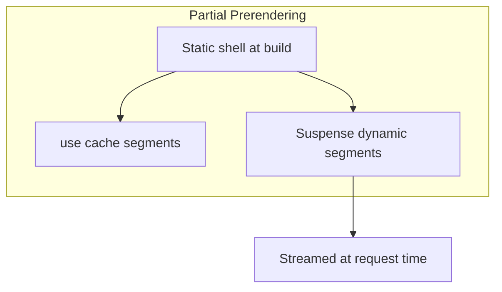

# Next.js — Core

Модель платформы, маршрутизатор приложений, рендеринг и потоковая передача.

[ ← Вернуться в центр](./4_nextjs.md)

### Related docs

- [Next.js — Ядро](./4_nextjs_core.md) · [Next.js — Данные](./4_nextjs_data.md) · [Next.js — Маршрутизация](./4_nextjs_routing.md) · [Next.js — Платформа](./4_nextjs_platform.md) · [Next.js — Интервью](./4_nextjs_interview.md)

### Sections

- [1. Framework overview](#1-framework-overview)
- [2. App vs Pages Router](#2-app-vs-pages-router)
- [3. Project structure](#3-project-structure)
- [4. Rendering strategies](#4-rendering-strategies)
- [5. Server & Client boundaries](#5-server-client-boundaries)
- [6. Streaming & Suspense](#6-streaming-suspense)
- [7. Design principles](#7-design-principles)

---

## 1. Framework overview

_Темы следующие: Определение → Плюсы и минусы → Когда использовать → Пример → Примечания → Источник ([шаблон](#topic-template))._

<details>
  <summary>Next.js overview</summary>

### Next.js overview

**Definition:** Next.js — это **фреймворк React** для создания полноценных веб-приложений. UI строится компонентами React; Next.js добавляет маршрутизацию, рендеринг, работу с данными и production-инструменты — сборщики и компиляторы уже настроены, чтобы вы сосредоточились на продукте, а не на стеке.

**When to use:**

- Маркетинговые сайты, блоги и документация с требованиями SEO
- E-commerce, дашборды и SaaS с аутентифицированными и публичными страницами
- BFF (Backend for Frontend) — API рядом с UI
- Команды на Vercel или со standalone Docker output
- Приложения с RSC (меньшие клиентские бандлы, доступ к серверным данным)

**When not to use:**

- Чисто статические сайты с минимальным JS — рассмотрите **Astro**
- Мобильные приложения — **Expo / React Native**
- Тяжёлый кастомный Node-сервер (долгоживущий WebSockets hub) — отдельный backend + Vite SPA могут подойти лучше
- Контентные сайты, где React — лишняя нагрузка

**Pluses and minuses:**

| +                                                                                | −                                                                                                    |
| -------------------------------------------------------------------------------- | ---------------------------------------------------------------------------------------------------- | --- | ------------------------------------------------ | ---------------------------------------------------------------------------- |
| Батарейки в комплекте: маршрутизация, SSR, API, оптимизация изображений/шрифтов  | Мнение: аварийные люки существуют, но усложняют ситуацию                                             |
| Серверные компоненты React + потоковая передача «из коробки» (App Router)        | Ментальная модель крутого кэширования; легко отправлять устаревшие или чрезмерно динамичные страницы |
| Отличная интеграция с Vercel (предварительные развертывания, CDN, аналитика)     | Привязка к поставщикам при использовании функций Vercel                                              |     | SEO-оптимизирован по умолчанию (SSR/SSG/ISR/PPR) | Холодный запуск на бессерверной версии; не идеален для всех рабочих нагрузок |
| TypeScript — прежде всего, большая экосистема, сильный сигнал о приеме на работу | Два маршрутизатора (приложение + страницы) — устаревшие кодовые базы несут долг по миграции          |
| Автоматическое разделение кода на маршрут                                        | Время сборки увеличивается с размером приложения                                                     |

**Examples:**

```bash
npx create-next-app@latest my-app --typescript --app --turbopack
cd my-app && npm run dev
```

```tsx
// app/page.tsx — Server Component by default
export default async function HomePage() {
  const res = await fetch("https://api.example.com/posts", {
    next: { revalidate: 60 },
  });
  const posts = await res.json();

  return (
    <main>
      <h1>Posts</h1>
      <ul>
        {posts.map((p: { id: string; title: string }) => (
          <li key={p.id}>{p.title}</li>
        ))}
      </ul>
    </main>
  );
}
```

**Thoughts:** Next.js **не** является заменой знаний React — это верхний слой. Оформление интервью: React = библиотека (просмотр); Next.js = фреймворк (маршрутизация, рендеринг, данные, развертывание). В новых проектах по умолчанию должен использоваться **App Router** (Next.js 13+). Pages Router — это режим обслуживания существующих приложений.

**Sources:** [nextjs.org/docs](https://nextjs.org/docs)

</details>

<details>
  <summary>React vs Next.js</summary>

### React vs Next.js

**Definition:**

React отображает пользовательский интерфейс; Next.js определяет, как и где создается, кэшируется и доставляется этот пользовательский интерфейс.

|                       | Реагировать                             | Next.js                                               |
| --------------------- | --------------------------------------- | ----------------------------------------------------- |
| **Роль**              | библиотека пользовательского интерфейса | Полнофункциональный фреймворк                         |
| **Маршрутизация**     | Принесите свой собственный              | Файловый `app/` каталог                               |
| **Извлечение данных** | Клиентские крючки / ручные SSR          | Серверные компоненты, `fetch` кэш, Действия сервера   |
| **Рендеринг**         | КСО по умолчанию (Vite)                 | SSR, SSG, ISR, PPR настраиваются для каждого маршрута |
| **API**               | Отдельный бэкэнд                        | Обработчики маршрутов + Действия сервера              |
| **Развертывание**     | Статический CDN или собственный         | Оптимизирован для Верселя; `standalone` для Докера    |

**Thoughts:** Общие правила RSC, гидратации и перехвата см. в [4_react.md §8 — Серверный рендеринг и RSC](./4_react_server.md#8-server-rendering--rsc). В этом документе рассматриваются API-интерфейсы **Next.js** и семантика кэширования.

**Sources:** [react.dev](https://react.dev/) · [nextjs.org/docs](https://nextjs.org/docs)

</details>

<details>
  <summary>Next.js vs alternatives</summary>

### Next.js vs alternatives

**Definition:**

Сравнение Next.js с другими полнофункциональными и метафреймворками для React и контентных сайтов.

| Рамочная                | Сила                                                     | Компромисс                                    |
| ----------------------- | -------------------------------------------------------- | --------------------------------------------- | --- | --------- | ----------------------------------- | ---------------------------------------------------------- |
| **Vite + React Router** | Максимальная гибкость, быстрая разработка, приоритет SPA | Ручная настройка SSR/RSC                      |
| **Ремикс**              | Веб-стандарты, загрузчики/действия, формы                | Меньшая экосистема, чем Следующая             |     | **Астро** | Контент-сайты, архитектура островов | Менее подходит для интенсивного взаимодействия с клиентами |
| **SvelteKit**           | Производительность, простота                             | Другая парадигма пользовательского интерфейса |

**How it works:** SEO, производительность при первой загрузке, логика совместного размещения серверов, командная стандартизация на Vercel.

**Sources:** [nextjs.org/docs/app](https://nextjs.org/docs/app)

</details>

<details>
  <summary>History (compressed)</summary>

### History (compressed)

**Definition:**

Хронология основных выпусков Next.js и основные этапы маршрутизации/рендеринга.

| Версия   | Веха                                                                         |
| -------- | ---------------------------------------------------------------------------- |
| **2016** | Next.js 1 — Маршрутизатор страниц, SSR                                       |
| **v9**   | API-маршруты (`pages/api`)                                                   |
| **v12**  | Промежуточное ПО, поддержка React 18                                         |
| **v13**  | Маршрутизатор приложений (бета-версия), RSC, `app/` каталог                  |
| **v14**  | App Router стабильный, частичный предварительный рендеринг экспериментальный |
| **v15**  | API асинхронных запросов (`cookies`, `headers`, `params`)                    |
| **v16**  | Компоненты кэша, `proxy.ts`, `use cache`, требуются асинхронные API          |

---

**Sources:** [nextjs.org/блог](https://nextjs.org/блог)

</details>

<a name="2-app-vs-pages-router"></a>

### Topic template

Каждая важная тема в `<details>` следующие разделы:

**Определение** → **Как это работает** → **Когда использовать** → **Плюсы и минусы** → **Примеры** → **Мысли** → **Источники**

---

<a name="1-framework-overview"></a>

### Primary references

**Definition:**

Официальная документация и руководства по платформам для Next.js и Vercel.

- [nextjs.org/docs](https://nextjs.org/docs) — официальная документация
- [nextjs.org/docs/llms.txt](https://nextjs.org/docs/llms.txt) — полный указатель документации для LLM.
- [Руководство по платформе Vercel Next.js](https://vercel.com/docs/frameworks/full-stack/nextjs)
- [Частичный предварительный рендеринг на Vercel](https://vercel.com/docs/partial-prerendering)\* [Кэш времени выполнения Vercel](https://vercel.com/docs/caching/runtime-cache)
- [Промежуточное программное обеспечение Vercel Routing] (https://vercel.com/docs/routing-middleware)

**Sources:** [nextjs.org/docs](https://nextjs.org/docs)

</details>

<details>
  <summary>Deep dives</summary>

## 2. App vs Pages Router

_Темы следующие: Определение → Плюсы и минусы → Когда использовать → Пример → Примечания → Источник ([шаблон](#topic-template))._

<details>
  <summary>App Router</summary>

### App Router

**Definition:** Современный маршрутизатор, живущий в `app/`. Построен на основе серверных компонентов React, вложенных макетов, потоковой передачи и новой модели кэширования. По умолчанию для всех новых проектов.

**When to use:** Каждый новый проект. Приложения Greenfield, электронная коммерция, информационные панели, сайты с контентом.

**Pluses and minuses:**

| +                                         | −                                                                      |
| ----------------------------------------- | ---------------------------------------------------------------------- |
| RSC, потоковая передача, вложенные макеты | Кривая обучения кэшированию и границам                                 |
| Совмещенный `loading.tsx`, `error.tsx`    | Невозможно смешать `pages/` и `app/` по тому же маршруту               |
| Действия сервера, API метаданных          | В некоторых сторонних библиотеках до сих пор отсутствует поддержка RSC |
| Мелкомасштабное кэширование с `use cache` | Миграция со Pages требует перезаписи                                   |

**Examples:**

```tsx
// app/blog/[slug]/page.tsx — async Server Component (default)
export default async function BlogPost({
  params,
}: {
  params: Promise<{ slug: string }>;
}) {
  const { slug } = await params;
  const post = await getPost(slug);
  return <article>{post.title}</article>;
}
```

**Sources:** [nextjs.org/docs/app](https://nextjs.org/docs/app)

</details>

<details>
  <summary>Pages Router</summary>

### Pages Router

**Definition:** Устаревший маршрутизатор в `pages/`. Использование `getServerSideProps`, `getStaticProps`, `getInitialProps`, и `pages/api` для конечных точек серверной части.

**When to use:** Поддержание только существующих приложений Pages Router. Не начинайте новые проекты на Pages Router.

**Pluses and minuses:**

| +                                                         | −                                                             |
| --------------------------------------------------------- | ------------------------------------------------------------- |
| Зрелые, хорошо документированные шаблоны                  | Нет RSC, нет вложенных макетов                                |
| Упрощенная ментальная модель (данные на основе реквизита) | `getServerSideProps` работает на странице — сложнее составить |
| Поддержка большой существующей кодовой базы               | Не там, где появляются новые возможности Next.js              |

**Examples:**

```tsx
// pages/blog/[slug].tsx — legacy pattern
export async function getStaticProps({ params }: { params: { slug: string } }) {
  const post = await getPost(params.slug);
  return { props: { post } };
}

export default function BlogPost({ post }: { post: Post }) {
  return <article>{post.title}</article>;
}
```

**Sources:** [nextjs.org/docs/pages](https://nextjs.org/docs/pages)

</details>

<details>
  <summary>Migration mapping</summary>

### Migration mapping

**Definition:**

Сопоставление «один к одному» API-интерфейсов Pages Router с эквивалентами App Router для поэтапной миграции.

| Маршрутизатор страниц | Эквивалент App Router                                     |
| --------------------- | --------------------------------------------------------- |
| `getStaticProps`      | `fetch` с `cache: 'force-cache'` + `generateStaticParams` |
| `getServerSideProps`  | `fetch` с `cache: 'no-store'` или динамический маршрут    |
| `getInitialProps`     | Асинхронная выборка данных серверного компонента          |
| `pages/api/*.ts`      | `app/**/route.ts` (Обработчики маршрутов)                 |
| `_app.tsx`            | `app/layout.tsx`                                          |
| `_document.tsx`       | `app/layout.tsx` + API метаданных                         |
| `next/head`           | `export const metadata` / `generateMetadata()`            |
| `next/router`         | `next/navigation` (`useRouter`, `usePathname`)            |
| `next/link`           | `next/link` (тот же пакет, с поддержкой App Router)       |

**Examples:**

```tsx
// Pages Router (legacy)
export async function getServerSideProps() {
  const res = await fetch("https://api.example.com/data");
  return { props: { data: await res.json() } };
}

// App Router (modern)
async function getData() {
  const res = await fetch("https://api.example.com/data", {
    cache: "no-store",
  });
  return res.json();
}

export default async function Page() {
  const data = await getData();
  return <pre>{JSON.stringify(data, null, 2)}</pre>;
}
```

**Thoughts:**

Оба роутера могут сосуществовать в одном проекте (`pages/` + `app/`), но **не для того же URL**. Маршрутизатор приложений имеет приоритет. Планируйте поэтапную миграцию по каждому маршруту.

---

**Sources:** [nextjs.org/docs/app/guides/migrating](https://nextjs.org/docs/app/guides/migrating)

</details>

<a name="3-project-structure"></a>

## 3. Project structure

_Темы следующие: Определение → Плюсы и минусы → Когда использовать → Пример → Примечания → Источник ([шаблон](#topic-template))._

<details>
  <summary>Directory layout</summary>

### Directory layout

**Definition:** Next.js использует соглашения о файловой системе. `app/` каталог (или `src/app/`) определяет маршруты; специальные имена файлов соответствуют функциям платформы.

**When to use:** Следуйте настройкам по умолчанию, если только не требуется monorepo или FSD. `src/app/` + функциональные папки.

**Pluses and minuses:**

| +                                                | −                                                                                    |
| ------------------------------------------------ | ------------------------------------------------------------------------------------ |
| Предсказуемая структура — быстрая адаптация      | Глубокая вложенность может слишком буквально отражать URL                            |
| Размещение интерфейса маршрута, загрузка, ошибки | Большой `app/` деревьям нужны группы маршрутов или дисциплина FSD                    |
| `src/` опция сохраняет корень чистым             | При перемещении файлов URL-адреса изменяются, если не используются группы/перезаписи |

**Examples:**

```
my-app/
├── app/                    # App Router (or src/app/)
│   ├── layout.tsx          # Root layout (required)
│   ├── page.tsx            # Home route (/)
│   ├── loading.tsx         # Loading UI for segment
│   ├── error.tsx           # Error boundary for segment
│   ├── not-found.tsx       # 404 for segment
│   ├── (marketing)/        # Route group (no URL segment)
│   │   └── about/page.tsx  # /about
│   ├── blog/
│   │   ├── page.tsx        # /blog
│   │   └── [slug]/page.tsx # /blog/:slug
│   └── api/
│       └── webhook/route.ts
├── public/                 # Static assets (served as-is)
├── next.config.ts
├── package.json
└── tsconfig.json
```

**Thoughts:** Предпочитать `src/app/` в более крупных базах кода для отделения кода приложения от конфигурации в корне. Личные папки: префикс с `_` (e.g. `_components`) — не маршрутизируется.

**Sources:** [nextjs.org/docs/app/getting-started/project-structure](https://nextjs.org/docs/app/getting-started/project-structure)

</details>

<details>
  <summary>Special files</summary>

### Special files

**Definition:**

Имена файлов соглашения в `app/` которые соответствуют функциям платформы — макетам, состояниям загрузки, ошибкам и маршрутам API.

| Файл            | Цель                                                                            |
| --------------- | ------------------------------------------------------------------------------- |
| `page.tsx`      | Уникальный интерфейс для сегмента маршрута; делает маршрут общедоступным        |
| `layout.tsx`    | Оболочка общего пользовательского интерфейса; сохраняет состояние при навигации |
| `template.tsx`  | Похож на макет, но **перемонтируется** при навигации (новое состояние/эффекты)  |
| `loading.tsx`   | Мгновенная загрузка пользовательского интерфейса через границу ожидания         |
| `error.tsx`     | Граница ошибки клиента для сегмента                                             |
| `not-found.tsx` | Пользовательский интерфейс, когда `notFound()` называется                       |
| `route.ts`      | Обработчик маршрута (конечная точка API)                                        |
| `default.tsx`   | Резервный вариант для слотов параллельных маршрутов                             |

**Examples:**

```tsx
// app/dashboard/layout.tsx
export default function DashboardLayout({
  children,
}: {
  children: React.ReactNode;
}) {
  return (
    <div className="flex">
      <aside>Sidebar</aside>
      <main>{children}</main>
    </div>
  );
}
```

**Thoughts:** `layout.tsx` состояние выдерживает навигацию клиента; `template.tsx` нет. Использовать `template` для ввода анимации или клавиш аналитики для каждой навигации.

**Sources:** [nextjs.org/docs/app/api-reference/file-conventions](https://nextjs.org/docs/app/api-reference/file-conventions)

</details>

<details>
  <summary>Route segments</summary>

### Route segments

**Definition:**

Сегменты URL-пути, созданные по именам папок в `app/` — статические, динамические, универсальные и группы маршрутов.

| Узор                         | URL-адрес               | Пример                                 |
| ---------------------------- | ----------------------- | -------------------------------------- |
| Статический                  | `/blog`                 | `app/blog/page.tsx`                    |
| Динамический                 | `/blog/hello`           | `app/blog/[slug]/page.tsx`             |
| Всеобъемлющий                | `/docs/a/b/c`           | `app/docs/[...slug]/page.tsx`          |
| Дополнительный всеобъемлющий | `/shop` or `/shop/a/b`  | `app/shop/[[...slug]]/page.tsx`        |
| Группа маршрутов             | Никакого влияния на URL | `app/(auth)/login/page.tsx` → `/login` |

**Sources:**

[nextjs.org/docs/app/api-reference/file-conventions](https://nextjs.org/docs/app/api-reference/file-conventions)

---

</details>

<a name="4-rendering-strategies"></a>

## 4. Rendering strategies

_Темы следующие: Определение → Плюсы и минусы → Когда использовать → Пример → Примечания → Источник ([шаблон](#topic-template))._

<details>
  <summary>Overview</summary>

### Overview

**Definition:**

Next.js поддерживает несколько режимов рендеринга для каждого маршрута. Маршрутизатор приложений по умолчанию использует статическое поведение, где это возможно, и выбирает динамическое поведение, когда маршрут считывает данные времени запроса (`cookies`, `headers`, `searchParams`, некэшированный `fetch`).

| Стратегия | Когда создается HTML                      | Свежесть данных                 | SEO          |
| --------- | ----------------------------------------- | ------------------------------- | ------------ | --- | ------- | ------------------------------------------------------- | --------------------- | ------- |
| **КС**    | Браузер (только клиентские компоненты)    | Живой                           | Слаб без ССР |
| **ССР**   | Сервер по запросу                         | Всегда свежий                   | Сильный      |
| **ССГ**   | Время сборки                              | Статично до восстановления      | Сильный      |
| **ИСР**   | Сборка + периодическая повторная проверка | Устарело при повторной проверке | Сильный      |     | **ППР** | Статическая оболочка + потоковые динамические отверстия | Смешанно по сегментам | Сильный |

**Examples:**



**Thoughts:** См. [4_react.md §8 — Серверный рендеринг и RSC](./4_react_server.md#8-server-rendering--rsc) для SPA, SSR и RSC. Таксономия (MPA против SPA, CSR/SSR/SSG/PWA): [6_web_api.md — Типы веб-приложений](./6_web_api_apps.md#types-of-web-apps). Next.js реализует их на уровне **сегмента маршрута**.

**Sources:** [nextjs.org/docs/app/getting-started/caching](https://nextjs.org/docs/app/getting-started/caching)

</details>

<details>
  <summary>Static Generation (SSG)</summary>

### Static Generation (SSG)

**Definition:** HTML, созданный во время сборки. Эквивалентно `getStaticProps` or `fetch` по умолчанию `force-cache`.

**When to use:** Маркетинговые страницы, блоги, каталоги продукции с `generateStaticParams`.

**Pluses and minuses:**

| +                                                          | −                                                             |
| ---------------------------------------------------------- | ------------------------------------------------------------- |
| Самая быстрая доставка CDN, самая низкая стоимость сервера | Время сборки увеличивается с увеличением количества страниц   |
| Предсказуемая производительность                           | Не подходит для индивидуального контента без загрузки клиента |

**Examples:**

```tsx
export async function generateStaticParams() {
  const posts = await fetch("https://api.example.com/posts").then((r) =>
    r.json(),
  );
  return posts.map((p: { slug: string }) => ({ slug: p.slug }));
}

export default async function PostPage({
  params,
}: {
  params: Promise<{ slug: string }>;
}) {
  const { slug } = await params;
  const post = await fetch(`https://api.example.com/posts/${slug}`).then((r) =>
    r.json(),
  );
  return <article>{post.title}</article>;
}
```

**Sources:** [nextjs.org/docs/app/building-your-application/rendering/server-comComponents](https://nextjs.org/docs/app/building-your-application/rendering/server-comComponents)

</details>

<details>
  <summary>Server-Side Rendering (SSR)</summary>

### Server-Side Rendering (SSR)

**Definition:** HTML генерируется при каждом запросе. По инициативе `cache: 'no-store'`, `dynamic = 'force-dynamic'`или чтение `cookies()` / `headers()`.

**When to use:** Аутентифицированные информационные панели, корзина, информационные панели в реальном времени.

**Pluses and minuses:**

| +                         | −                                      |
| ------------------------- | -------------------------------------- |
| Всегда свежие данные      | Более высокий TTFB, нагрузка на сервер |
| Персонализация по запросу | По умолчанию нет кэша CDN для HTML     |

**Examples:**

```tsx
import { cookies } from "next/headers";

export const dynamic = "force-dynamic"; // opt-in explicit SSR

export default async function Dashboard() {
  const session = (await cookies()).get("session")?.value;
  return <div>Welcome, {session}</div>;
}
```

**Sources:** [nextjs.org/docs/app/building-your-application/rendering/server-comComponents](https://nextjs.org/docs/app/building-your-application/rendering/server-comComponents)

</details>

<details>
  <summary>Incremental Static Regeneration (ISR)</summary>

### Incremental Static Regeneration (ISR)

**Definition:** Статические страницы проверяются по таймеру или по требованию. `fetch` с `next: { revalidate: N }` или маршрут `export const revalidate = N`.

**When to use:** Списки продуктов, новости, документы — контент, который меняется, но допускает задержки в секундах или минутах.

**Pluses and minuses:**

| +                                    | −                                                                             |
| ------------------------------------ | ----------------------------------------------------------------------------- |
| CDN-быстро + возможная свежесть      | Пользователи могут видеть устаревший контент во время окна повторной проверки |
| Масштабируется лучше, чем чистый SSR | Требуется четкая стратегия аннулирования срочных обновлений                   |

**Examples:**

```tsx
const res = await fetch("https://api.example.com/products", {
  next: { revalidate: 3600, tags: ["products"] },
});
```

**Sources:** [nextjs.org/docs/app/building-your-application/data-fetching/incremental-static-regeneration](https://nextjs.org/docs/app/building-your-application/data-fetching/incremental-static-regeneration)

</details>

<details>
  <summary>Partial Prerendering (PPR) / Cache Components</summary>

### Partial Prerendering (PPR) / Cache Components

**Definition:** Модель Next.js 16, сочетающая статическую предварительно обработанную оболочку с кэшированным и динамическим потоковым контентом. Включено через `cacheComponents: true` in `next.config.ts`.

**When to use:** Страницы с преимущественно общедоступным контентом + небольшие персонализированные области заголовков.

**Pluses and minuses:**

| +                                             | −                                       |
| --------------------------------------------- | --------------------------------------- |
| Лучшее из статики и динамики в одном маршруте | Требует `use cache` дисциплина          |
| Быстрый LCP из статической оболочки           | Новый API — необходимо обучение команды |

**Examples:**

```tsx
// next.config.ts
const nextConfig = { cacheComponents: true };
export default nextConfig;
```

```tsx
import { Suspense } from "react";
import { cacheTag } from "next/cache";
import { cookies } from "next/headers";

async function ProductsList() {
  "use cache";
  cacheTag("products-list");
  const products = await fetch("https://api.example.com/products").then((r) =>
    r.json(),
  );
  return (
    <ul>
      {products.map((p: { id: string; name: string }) => (
        <li key={p.id}>{p.name}</li>
      ))}
    </ul>
  );
}

async function Greeting() {
  const user = (await cookies()).get("user")?.value;
  return <p>Welcome back, {user ?? "guest"}</p>;
}

export default function Page() {
  return (
    <section>
      <h1>Dashboard</h1>
      <ProductsList />
      <Suspense fallback={<p>Loading…</p>}>
        <Greeting />
      </Suspense>
    </section>
  );
}
```

**Sources:** [vercel.com/docs/partial-prerendering](https://vercel.com/docs/partial-prerendering)

</details>

<details>
  <summary>Route segment config</summary>

### Route segment config

**Definition:**

Экспорт на уровне маршрута в `layout.tsx`, `page.tsx`, or `route.ts` которые переопределяют настройки Next.js по умолчанию для кэширования, рендеринга и среды выполнения для этого сегмента и его дочерних элементов (если дочерний элемент не переопределяет).

| Экспорт           | Ценности                                                                               | Эффект                                                                         |
| ----------------- | -------------------------------------------------------------------------------------- | ------------------------------------------------------------------------------ |
| `dynamic`         | `'auto'`, `'force-static'`, `'force-dynamic'`, `'error'`                               | Статический и динамический рендеринг для сегмента                              |
| `dynamicParams`   | `true` (по умолчанию), `false`                                                         | Разрешить генерацию по требованию невидимых динамических параметров вместо 404 |
| `revalidate`      | `false`, `0`, `number` (секунды)                                                       | Интервал ISR для сегмента                                                      |
| `fetchCache`      | `'auto'`, `'default-no-store'`, `'only-no-store'`, `'force-no-store'`, `'force-cache'` | Переопределить значение по умолчанию `fetch` кэширование в сегменте            |
| `runtime`         | `'nodejs'` (по умолчанию), `'edge'`                                                    | Среда выполнения серверных компонентов и обработчиков маршрутов                |
| `preferredRegion` | строка или `string[]`                                                                  | Закрепить бессерверное выполнение за регионами                                 |
| `maxDuration`     | число (секунды)                                                                        | Ограничение тайм-аута бессерверной функции                                     |

**When to use:**

- `export const revalidate = 60` — контент, который периодически меняется (блог, каталог)
- `export const dynamic = 'force-static'` — юридические/маркетинговые страницы, которые никогда не должны читать данные запроса
- `export const dynamicParams = false` — только слизни из `generateStaticParams` действительны
- `export const runtime = 'edge'` — обработчик маршрутов с низкой задержкой на границе (см. [Edge vs Node](./4_nextjs_platform.md#edge-vs-node-runtime))

**When not to use:**

- `force-dynamic` в корне `layout.tsx` когда только одному листу нужны файлы cookie — вместо этого читайте API запроса на этом листе
- `fetchCache = 'force-no-store'` когда `use cache` + `revalidateTag` уже модели недействительны

**Pluses and minuses:**

| +                                            | −                                                          |
| -------------------------------------------- | ---------------------------------------------------------- |
| Хирургический контроль по дереву маршрутов   | Легко накрыть одеялом `force-dynamic` и уничтожить кеш CDN |
| Дети наследуют родительскую конфигурацию     | Может бороться с декларативностью `use cache` границы      |
| Нет необходимости оборачивать каждый `fetch` | Некоторые экспорты устарели или сужены в Next.js 16        |

**Examples:**

```tsx
// app/blog/[slug]/page.tsx
export const revalidate = 3600;
export const dynamicParams = true;

export async function generateStaticParams() {
  const slugs = await getSlugs();
  return slugs.map((slug) => ({ slug }));
}

export default async function BlogPost({
  params,
}: {
  params: Promise<{ slug: string }>;
}) {
  const { slug } = await params;
  const post = await getPost(slug);
  return <article>{post.title}</article>;
}
```

```tsx
// app/dashboard/layout.tsx — authenticated subtree
export const dynamic = "force-dynamic";

export default async function DashboardLayout({
  children,
}: {
  children: React.ReactNode;
}) {
  const session = await getSession();
  if (!session) redirect("/login");
  return <>{children}</>;
}
```

**Thoughts:**

- Чтение `cookies()`, `headers()`, or `connection()` в серверном компоненте выбирает маршрут для **динамического рендеринга**, если только PPR/`use cache` предоставляет статическую оболочку.
- `dynamic = 'error'` — сборка завершается сбоем, если что-либо делает сегмент динамическим (защитное ограждение для маршрутов, которые должны быть статическими).
- Next.js 16: предпочитаете декларативное кэширование (`fetch` параметры, `use cache`, `cacheTag`) на уровне сегмента `force-dynamic`.
- Сопоставление маршрутизаторов страниц: `getStaticProps` + `revalidate` → `revalidate` экспорт; `getServerSideProps` → динамически через API запроса.

**Sources:** [nextjs.org/docs/app/api-reference/file-conventions/route-segment-config](https://nextjs.org/docs/app/api-reference/file-conventions/route-segment-config)

</details>

<a name="5-server--client-boundaries"></a>

## 5. Server & Client boundaries

_Темы следующие: Определение → Плюсы и минусы → Когда использовать → Пример → Примечания → Источник ([шаблон](#topic-template))._

<details>
  <summary>Server Components (default)</summary>

### Server Components (default)

**Definition:** Компоненты в `app/` являются серверными компонентами, если не отмечено `"use client"`. Они работают на сервере, могут быть `async`, получить доступ к базе данных/файловой системе и не отправлять клиенту компоненты JS.

**How it works:**

- Реагировать на хуки (`useState`, `useEffect`и т. д.)
- API браузера (`window`, `document`, `localStorage`)
- Обработчики событий (`onClick`, `onChange`)

**When to use:** Получение данных, макеты, статический контент, передача данных в интерактивные листья.

**Pluses and minuses:**

| +                                                                         | −                                                          |
| ------------------------------------------------------------------------- | ---------------------------------------------------------- |
| Нулевой клиентский JS для пользовательского интерфейса только для сервера | Нет `useState`, `useEffect`, обработчики событий           |
| Прямые секреты и доступ к БД                                              | Свойства клиентских компонентов должны быть сериализуемыми |
| Автоматическое разделение кода на границе импорта                         | Для отладки требуются журналы сервера                      |

**Examples:**

```tsx
// app/products/page.tsx — no "use client" directive
export default async function ProductsPage() {
  const products = await db.product.findMany();
  return (
    <ul>
      {products.map((p) => (
        <li key={p.id}>{p.name}</li>
      ))}
    </ul>
  );
}
```

**Sources:** [nextjs.org/docs/app/getting-started/server-and-client-comComponents](https://nextjs.org/docs/app/getting-started/server-and-client-comComponents)

</details>

<details>
  <summary>Client Components</summary>

### Client Components

**Definition:** Файлы с `"use client"` наверху. Гидрат в браузере; поддержка перехватчиков, состояния и событий.

**When to use:** Кнопки, формы с мгновенной проверкой, диаграммы и многое другое. `useState` / `useEffect`.

**Pluses and minuses:**

| +                                             | −                                         |
| --------------------------------------------- | ----------------------------------------- |
| Полная интерактивность                        | Увеличивает размер клиентского пакета     |
| API браузера, сторонние клиентские библиотеки | Невозможно импортировать серверные модули |

**Examples:**

```tsx
"use client";

import { useState } from "react";

export function Counter() {
  const [count, setCount] = useState(0);
  return <button onClick={() => setCount((c) => c + 1)}>{count}</button>;
}
```

**Thoughts:** Толкать `"use client"` **уходит**, а не корни страниц. Одиночный `"use client"` наверху большого дерева извлекает весь импорт в клиентский пакет.

**Sources:** [nextjs.org/docs/app/getting-started/server-and-client-comComponents](https://nextjs.org/docs/app/getting-started/server-and-client-comComponents)

</details>

<details>
  <summary>Composition pattern</summary>

### Composition pattern

**Definition:** Серверный компонент извлекает данные и передает сериализуемые реквизиты в листья клиентского компонента для интерактивности.

**Examples:**

```tsx
// app/posts/page.tsx — Server Component
import { LikeButton } from "./like-button";

export default async function PostsPage() {
  const posts = await getPosts();
  return (
    <ul>
      {posts.map((p) => (
        <li key={p.id}>
          {p.title}
          <LikeButton postId={p.id} />
        </li>
      ))}
    </ul>
  );
}
```

**Sources:** [nextjs.org/docs/app/getting-started/server-and-client-comComponents](https://nextjs.org/docs/app/getting-started/server-and-client-comComponents)

</details>

<details>
  <summary>Next.js 16 async request APIs</summary>

### Next.js 16 async request APIs

**Definition:** В Next.js 15+, `params`, `searchParams`, `cookies()`, и `headers()` являются **асинхронными** и их следует ожидать в компонентах сервера.

**Examples:**

```tsx
// Next.js 16 — required pattern
export default async function Page({
  params,
  searchParams,
}: {
  params: Promise<{ id: string }>;
  searchParams: Promise<{ q?: string }>;
}) {
  const { id } = await params;
  const { q } = await searchParams;
  const cookieStore = await cookies();
  const headersList = await headers();

  return (
    <div>
      ID: {id}, Query: {q}
    </div>
  );
}
```

| API                  | Цель                                 |
| -------------------- | ------------------------------------ |
| `await params`       | Динамические сегменты маршрута       |
| `await searchParams` | Строка запроса URL                   |
| `await cookies()`    | Чтение/запись файлов cookie (сервер) |
| `await headers()`    | Заголовки запросов                   |

**Thoughts:** Использование клиентских компонентов `useParams()` и `useSearchParams()` вместо этого крючки. Кодмод: `npx @next/codemod@latest next-async-request-api`.

**Sources:** [nextjs.org/docs/app/api-reference/functions](https://nextjs.org/docs/app/api-reference/functions)

</details>

<details>
  <summary>cookies() & headers() in Server Components</summary>

<a name="cookies-headers"></a>

### cookies() & headers() in Server Components

**Definition:**

`cookies()` и `headers()` от `next/headers` прочитать входящий HTTP-запрос на сервере. В Next.js 15+ оба возвращают **Promises** и должны быть `await`ред. При их использовании маршрут переключается на **динамический рендеринг** (если не изолирован с помощью PPR/`use cache: private`).

| API         | Читать                            | Написать          | Типичное использование                                                        |
| ----------- | --------------------------------- | ----------------- | ----------------------------------------------------------------------------- |
| `cookies()` | `get`, `getAll`, `has`            | `set`, `delete`   | Токены сеанса, настройки, сегменты A/B                                        |
| `headers()` | `get`, `getAll`, `has`, `entries` | Только для чтения | носитель аутентификации, `user-agent`, гео, пользовательские заголовки прокси |

**When to use:**

- Проверка сеанса в серверном компоненте перед отрисовкой защищенного пользовательского интерфейса.

- Чтение `Accept-Language` or `Authorization` для персонализации на стороне сервера
- Установка файлов cookie аутентификации в действиях сервера после входа в систему (`cookies().set(...)`)

**When not to use:**

- Чтение файлов cookie в корневом макете только тогда, когда `/dashboard` требуется авторизация — область действия макета информационной панели
- Хранение больших полезных данных в файлах cookie (ограничение 4 КБ, отправляется при каждом запросе)

**Pluses and minuses:**

| +                                                                       | −                                                                                                              |
| ----------------------------------------------------------------------- | -------------------------------------------------------------------------------------------------------------- |
| Никакого раскрытия конфиденциальных токенов клиенту                     | Вызывает динамический рендеринг при использовании в дереве страниц                                             |
| Работает с серверными компонентами, действиями, обработчиками маршрутов | Невозможно использовать в клиентских компонентах — используйте `document.cookie` экономно или действия сервера |
| `httpOnly` куки не используй `window`                                   | Чрезмерное чтение файлов cookie в макете влияет на все поддерево                                               |

**Examples:**

```tsx
import { cookies, headers } from "next/headers";
import { redirect } from "next/navigation";

export default async function AccountPage() {
  const cookieStore = await cookies();
  const session = cookieStore.get("session")?.value;

  if (!session) redirect("/login");

  const headersList = await headers();
  const country = headersList.get("x-vercel-ip-country") ?? "US";

  return <p>Welcome — region: {country}</p>;
}
```

```tsx
"use server";

import { cookies } from "next/headers";

export async function login(formData: FormData) {
  const token = await authenticate(formData);
  const cookieStore = await cookies();
  cookieStore.set("session", token, {
    httpOnly: true,
    secure: process.env.NODE_ENV === "production",
    sameSite: "lax",
    path: "/",
    maxAge: 60 * 60 * 24 * 7,
  });
}
```

**Thoughts:**

- Клиентские компоненты: используйте `useSearchParams()` / `useParams()` для состояния URL; никогда не импортируйте `next/headers` in `'use client'` файлы.
- `headers()` доступен только для чтения — установите заголовки ответов в обработчиках маршрутов (`NextResponse`) or `next.config` `headers`.
- Сопряжение с [Шаблонами аутентификации](./4_nextjs_platform.md#authentication-patterns) — проверка сеанса на уровне данных, а не только на прокси-сервере.

**Sources:** [nextjs.org/docs/app/api-reference/functions/cookies](https://nextjs.org/docs/app/api-reference/functions/cookies) · [headers](https://nextjs.org/docs/app/api-reference/functions/headers)

</details>

<details>
  <summary>Serialization rules</summary>

### Serialization rules

**Definition:**

Реквизиты, передаваемые из серверных компонентов в клиентские компоненты, пересекают **границу полета RSC** — они должны быть сериализуемы в формате JSON. Next.js сериализует их в полезную нагрузку RSC, отправляемую в браузер.

| Разрешено                                                      | Запрещено                                                           |
| -------------------------------------------------------------- | ------------------------------------------------------------------- |
| Примитивы (`string`, `number`, `boolean`, `null`)              | Функции (кроме ссылок на действия сервера)                          |
| Обычные объекты и массивы                                      | Экземпляры класса (`new Date()` — вместо этого передать строку ISO) |
| `undefined` (исключено из полезной нагрузки)                   | `Map`, `Set`, `Symbol`, `BigInt`                                    |
| Ссылки на функции действий сервера                             | Неисчислимые или круговые структуры                                 |
| Реагируйте на элементы из серверных компонентов как `children` | Узлы DOM, ссылки на серверные объекты                               |

**When to use:**

- Передача **DTO** (простых объектов) из выборки сервера в клиентский пользовательский интерфейс. `{ id, title, publishedAt: post.createdAt.toISOString() }`
  — Передача действий сервера в качестве реквизита компонентам формы клиента — `action={updateTodo}` без вызова внутренних кэшированных тел
- Используйте `children` composition — передайте `<ClientChart data={serialized} />` от Server parent

**When not to use:**

- Передача моделей ORM с методами/скрытыми полями — сначала сопоставьте их с простыми объектами
  — Передача обратных вызовов с сервера на клиент — вместо этого используйте действия сервера или обработчики на стороне клиента.

**Pluses and minuses:**

| +                                                   | −                                            |
| --------------------------------------------------- | -------------------------------------------- |
| Небольшие, предсказуемые полезные данные клиента    | Легко случайно пройти мимо огромных объектов |
| Очистить контракт сервера/клиента                   | `Date`/`Map` требуют ручного преобразования  |
| Действия сервера, которые можно считать реквизитами | Отладка ошибок сериализации непрозрачна      |

**Examples:**

```tsx
// app/posts/page.tsx — Server Component
import { LikeButton } from "./like-button";
import { toggleLike } from "./actions";

export default async function PostsPage() {
  const posts = await db.post.findMany();
  const serialized = posts.map((p) => ({
    id: p.id,
    title: p.title,
    createdAt: p.createdAt.toISOString(), // Date → string
  }));

  return (
    <ul>
      {serialized.map((p) => (
        <li key={p.id}>
          {p.title}
          <LikeButton postId={p.id} onLike={toggleLike} />
        </li>
      ))}
    </ul>
  );
}
```

```tsx
// WRONG — class instance won't serialize
<ClientCard user={await db.user.findUnique({ where: { id } })} />

// RIGHT — plain DTO
<ClientCard user={{ id: user.id, name: user.name }} />
```

**Thoughts:**

- Действия сервера, передаваемые как реквизиты, являются **ссылками** — не вызывайте их внутри. `'use cache'` кэшированные тела функций; передать ссылку.
- Размер полезной нагрузки RSC влияет на TTFB — обрезайте реквизиты до того, что на самом деле визуализирует клиент.
- `children` Шаблон слота позволяет избежать сериализации больших деревьев в качестве реквизита — сервер отображает статическую оболочку, клиент оборачивает интерактивные листья.

**Sources:** [nextjs.org/docs/app/getting-started/server-and-client-comComponents](https://nextjs.org/docs/app/getting-started/server-and-client-comComponents)

</details>

<a name="6-streaming--suspense"></a>

## 6. Streaming & Suspense

_Темы следующие: Определение → Плюсы и минусы → Когда использовать → Пример → Примечания → Источник ([шаблон](#topic-template))._

<details>
  <summary>Streaming SSR</summary>

### Streaming SSR

**Definition:** Сервер отправляет HTML частями по мере разрешения асинхронных серверных компонентов. Медленные разделы не блокируют быстрые разделы.

**When to use:** Страницы с независимыми областями медленных/быстрых данных.

**Pluses and minuses:**

| +                                                  | −                                               |
| -------------------------------------------------- | ----------------------------------------------- |
| Улучшение TTFB и воспринимаемая производительность | Более сложное проектирование состояния загрузки |
| Естественное соответствие вложенным данным         | Отладка потоковых ответов становится сложнее    |

**Examples:**

```tsx
import { Suspense } from "react";

async function SlowData() {
  const data = await fetch("https://api.example.com/slow").then((r) =>
    r.json(),
  );
  return <div>{data.value}</div>;
}

export default function Page() {
  return (
    <div>
      <h1>Fast header</h1>
      <Suspense fallback={<p>Loading…</p>}>
        <SlowData />
      </Suspense>
    </div>
  );
}
```

**Sources:** [nextjs.org/docs/app/getting-started/linking-and-navigating](https://nextjs.org/docs/app/getting-started/linking-and-navigating)

</details>

<details>
  <summary>loading.tsx</summary>

### loading.tsx

**Definition:** Файл соглашения, который помещает сегмент в режим ожидания с мгновенным возвратом во время навигации.

**Pluses and minuses:**

| +                                              | −                                                                      |
| ---------------------------------------------- | ---------------------------------------------------------------------- |
| Нулевой шаблонный саспенс на каждом маршруте   | Грубозернистый — один пользовательский интерфейс загрузки на сегмент   |
| Мгновенная обратная связь по навигации клиента | Не заменяет компонентную приостановку для частичной потоковой передачи |

**Examples:**

```tsx
// app/dashboard/loading.tsx
export default function Loading() {
  return <div className="skeleton">Loading dashboard…</div>;
}
```

**Sources:** [nextjs.org/docs/app/api-reference/file-conventions/loading](https://nextjs.org/docs/app/api-reference/file-conventions/loading)

</details>

<details>
  <summary>CSR bailout</summary>

### CSR bailout

**Definition:** Какие-то крючки(`useSearchParams`, `usePathname` в некоторых настройках) приводит к тому, что ближайшая граница приостановки выводится на клиентский рендеринг, если она не перенесена.

**When to use:** Оберните компоненты, используя `useSearchParams()` in `<Suspense>`.

**Examples:**

```tsx
import { Suspense } from "react";
import { SearchResults } from "./search-results";

export default function Page() {
  return (
    <Suspense fallback={<p>Loading search…</p>}>
      <SearchResults />
    </Suspense>
  );
}
```

**Sources:** [nextjs.org/docs/messages/missing-suspense-with-csr-bailout](https://nextjs.org/docs/messages/missing-suspense-with-csr-bailout)

</details>

<details>
  <summary>connection()</summary>

### connection()

**Definition:** API для отключения статического предварительного рендеринга маршрута — требуется для WebSockets, SSE или других функций, работающих только во время запроса.

**Examples:**

```tsx
import { connection } from "next/server";

export async function GET() {
  await connection();
  // WebSocket upgrade or dynamic handler
  return new Response("OK");
}
```

**Thoughts:**

См. [Архитектура React Suspense SSR] (https://github.com/reactwg/react-18/discussions/37) для получения информации о базовой конструкции потоковой передачи React 18.

---

**Sources:** [nextjs.org/docs/app/api-reference/functions/connection](https://nextjs.org/docs/app/api-reference/functions/connection)

</details>

## 7. Design principles

<details>
  <summary>SOLID in Next.js</summary>

### SOLID in Next.js

**Definition:** Пять принципов **SOLID** для **модулей Next.js, Server/Client Components, Route Handlers и хелперов в `lib/`** — не только для `class`.

| Principle                     | Meaning                            | Next.js example                                                                              |
| ----------------------------- | ---------------------------------- | -------------------------------------------------------------------------------------------- |
| **S** — Single Responsibility | Одна причина для изменения модуля  | `page.tsx` композирует · `queries.ts` читает · `actions.ts` мутирует                         |
| **O** — Open/Closed           | Расширять новым кодом, не правками | Добавить `applePay` — не править `checkout()` под каждый тип оплаты                          |
| **L** — Liskov Substitution   | Подтипы соблюдают контракт         | Общие layout/page props работают для каждого варианта — без client-only полей в server-типах |
| **I** — Interface Segregation | Маленькие сфокусированные API      | Передавать `{ readUser }` — не весь DB-клиент, когда нужны только чтения                     |
| **D** — Dependency Inversion  | Зависеть от абстракций             | `placeOrder(input, store)` — инжектить repository; в тестах — фейковый `store`               |

**How it works:**

Каждая буква соответствует **Examples** ниже — ищите `// good` и `// bad`:

1. **S** — разделить `page.tsx`, `queries.ts`, `actions.ts` — не один файл с fetch, validate, email и render.
2. **O** — новый payment provider = новая функция в map — не новый `if` в `checkout()`.
3. **L** — любой layout wrapper принимает тот же контракт `children` — без варианта, ломающего streaming/RSC.
4. **I** — `loadCheckout()` принимает `{ readCart }` — не весь модуль `db`.
5. **D** — домен в `lib/` получает `store` / `fetch` — Route Handler подключает конкретные адаптеры.

**When to use:** Рефакторинг жирных `page.tsx`; plugin-style провайдеры (auth, payments, CMS); code review для новых фич App Router.

**Examples:**

```ts
type OrderInput = { sku: string; qty: number };
type Order = OrderInput & { id: string };
type OrderStore = { save(order: Order): Promise<void> };

// S — good: domain validation separate from route wiring
export function validateOrder(input: OrderInput): Order {
  return { ...input, id: crypto.randomUUID() };
}

export async function placeOrder(input: OrderInput, store: OrderStore) {
  await store.save(validateOrder(input));
}

// S — bad: page.tsx fetches, validates, saves, sends email, renders form
// export default async function CheckoutPage() {
//   const cart = await db.cart.find(...);
//   await sendReceiptEmail(...);
//   return <form>...</form>;
// }

// O — good: add provider without editing checkout
const payProviders = {
  stripe: (amount: number) => ({ ok: true, provider: "stripe", amount }),
  paypal: (amount: number) => ({ ok: true, provider: "paypal", amount }),
};

function checkout(provider: keyof typeof payProviders, amount: number) {
  return payProviders[provider](amount);
}

// O — bad: edit checkout() for every new provider
// function checkout(provider: string, amount: number) {
//   if (provider === "stripe") return payStripe(amount);
//   if (provider === "paypal") return payPaypal(amount);
// }

// L — good: layout always renders children the same way
export default function AppLayout({ children }: { children: React.ReactNode }) {
  return (
    <html lang="en">
      <body>{children}</body>
    </html>
  );
}

// L — bad: "layout" that sometimes omits children or throws for certain routes
// export default function BrokenLayout({ children, variant }) {
//   if (variant === "marketing") throw new Error("No layout");
//   return <div>{children}</div>;
// }

// I — good: query helper needs only readUser
type UserReader = { readUser(id: string): Promise<{ id: string; name: string }> };

export async function loadProfile(id: string, users: UserReader) {
  return users.readUser(id);
}

// I — bad: pass whole db client into a function that only reads one row
// export async function loadProfile(id: string, db: DbClient) {
//   return db.user.findUnique({ where: { id } });
// }

// D — good: inject store in lib/ — test with fake
export async function placeOrder(input: OrderInput, store: OrderStore) {
  await store.save(validateOrder(input));
}
// placeOrder(input, { save: async () => {} });

// D — bad: lib/ imports Prisma directly — hard to test, locked to one DB
// import { prisma } from "@/lib/prisma";
// export async function placeOrder(input: OrderInput) {
//   await prisma.order.create({ data: validateOrder(input) });
// }
```

```tsx
// S — good: page composes; queries live elsewhere
import { CheckoutForm } from "./checkout-form";
import { loadCheckout } from "./queries";

export default async function CheckoutPage() {
  const checkout = await loadCheckout();
  return <CheckoutForm initial={checkout} />;
}
```

**Thoughts:** SOLID — **ориентир**, не закон: для одноразовой маркетинговой страницы пять интерфейсов не нужны. Применять, когда больно менять или тестировать. React: [SOLID in React](./4_react_core.md#solid-in-react). Express: [SOLID in Express](./8_nodejs_http.md#solid-in-express). Полный справочник: [OOP & SOLID](./7_special_engineering.md#solid-overview).

**Sources:** [freecodecamp — SOLID](https://www.freecodecamp.org/news/solid-principles-single-responsibility-principle-explained/) · [SOLID (overview)](./7_special_engineering.md#solid-overview) · [JS — SOLID in Classes](./3_js_core.md#solid-in-classes) · [JS — SOLID in Functions](./3_js_core.md#solid-in-functions) · [SOLID in React](./4_react_core.md#solid-in-react) · [SOLID in Express](./8_nodejs_http.md#solid-in-express)

</details>
