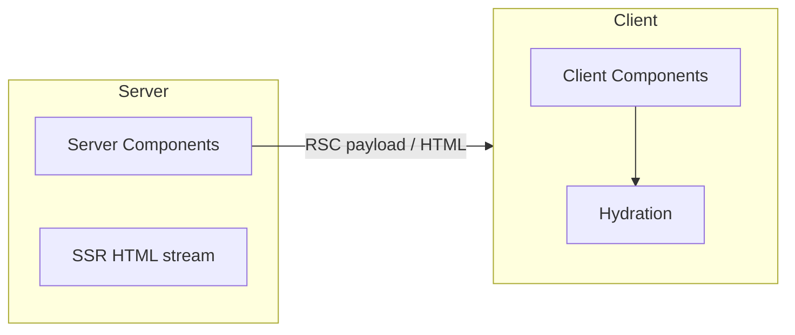

# React — React 19

API-интерфейсы React 19, SSR и серверные компоненты React.

[ ← Вернуться в центр](./4_react.md)

### Related docs

- [React — Core](./4_react_core.md) · [React — Hooks](./4_react_hooks.md) · [React — Components](./4_react_components.md) · [React — APIs](./4_react_apis.md) · [React — React 19](./4_react_server.md) · [React — Ecosystem](./4_react_ecosystem.md) · [React — Интервью](./4_react_interview.md)

### Sections

- [7. React 19](#7-react-19)
- [8. Server rendering & RSC](#8-server-rendering-rsc)

---

## 7. React 19

Обзор

<details>
  <summary>Overview</summary>

### Overview

**Definition:** В React 19 (декабрь 2024 г.) добавлены первоклассные **Действия** для асинхронных мутаций и форм, **React Compiler** для автоматического запоминания и **метаданные документа**, которые React поднимает из компонентов в `<head>`.

**How it works:**

| Площадь            | Особенность                              | Где читать                              |
| ------------------ | ---------------------------------------- | --------------------------------------- |
| Формы и мутации    | Действия со встроенным ожиданием/ошибкой | [Actions](#actions)                     |
| Производительность | Автоматическое запоминание               | [React Compiler](#react-compiler)       |
| DX                 | Метаданные в компонентах                 | [Document metadata](#document-metadata) |

Заменить руководство `isLoading` + `try/catch` + `e.preventDefault()` в формах с декларативным `action` функции React треки.

Новые проекты на React 19; переносите формы постепенно. Включите компилятор, если конвейер сборки его поддерживает.

**Examples:**

```tsx
// Action — pending comes from React
<form action={submitAction}>...</form>
```

**Thoughts:** _Меньше шаблонного кода для асинхронного UI — действия и компилятор заменяют ручную обвязку._

**See also:** [Действия](#actions) · [Компилятор React](#react-compiler) · [Document metadata](#document-metadata)

**Sources:**

[react.dev/blog/2024/12/05/react-19](https://react.dev/blog/2024/12/05/react-19)

Действия

</details>

<details>
  <summary>Actions</summary>

### Actions

**Definition:** Функции, переданные в `<form action={fn}>` или завернутый в `startTransition` которые обрабатывают асинхронную работу. React автоматически отслеживает состояния **ожидание**, **ошибка** и **результат**.

**How it works:**

1. Пользователь отправляет форму → Вызовы React. `action(prevState, formData)` (или пользовательская полезная нагрузка)
2. Пока обещание находится на рассмотрении → `isPending` правда, пользовательский интерфейс может отключать кнопки
3. В случае успеха → возвращаемое значение действия становится новым состоянием; форма может быть сброшена
4. При ошибке → вернуть сообщение об ошибке или перейти к границе ошибки.
5. При необходимости мгновенного отклика — оптимистичный UI до ответа сервера

**When to use:**

Отправка форм, мутации без руководства `isLoading` + `try/catch` состояние.

Сложные потоки проверки только для клиента, где RHF более понятен; неформальные мутации (оберните обновление в `startTransition`).

**Pluses and minuses:**

| +                                       | −                                                  |
| --------------------------------------- | -------------------------------------------------- |
| Встроенная обработка ожидающих/ошибок   | Требуется умственный сдвиг от `e.preventDefault()` |
| Работает с прогрессивным улучшением     | Действия сервера зависят от платформы (Next.js)    |
| Автоматический сброс формы после успеха |                                                    |

**Examples:**

```tsx
async function updateName(prev: string | null, formData: FormData) {
  const error = await saveName(formData.get("name") as string);
  if (error) return error;
  redirect("/profile");
  return null;
}

function ChangeName() {
  const [error, submitAction, isPending] = useActionState(updateName, null);
  return (
    <form action={submitAction}>
      <input name="name" />
      <button disabled={isPending}>Save</button>
      {error && <p role="alert">{error}</p>}
    </form>
  );
}
```

**Sources:**

[react.dev/reference/react/useActionState](https://react.dev/reference/react/useActionState) · [react.dev/reference/react-dom/components/form](https://react.dev/reference/react-dom/components/form)

React Compiler

</details>

<details>
  <summary>React Compiler</summary>

### React Compiler

**Definition:** Инструмент во время сборки, который автоматически запоминает компоненты и значения — снижает необходимость в ручном `useMemo`, `useCallback`, `React.memo`.

**How it works:** Компилятор анализирует функции рендеринга во время сборки и вставляет мемоизацию там, где это безопасно. Постепенное принятие: `"use memo"` на компоненте или крючке включается этот модуль; `"use no memo"` отказывается.

**When to use:**

Новые проекты на React 19; включить, если конвейер сборки поддерживает это.

#### Common pitfalls

Нечистый рендер (мутация реквизита, чтение `Date.now()` во время рендеринга) нарушает предположения компилятора. Поверхность диагностики компилятора через `eslint-plugin-react-hooks`.

**Pluses and minuses:**

| +                                                       | −                                                                  |
| ------------------------------------------------------- | ------------------------------------------------------------------ |
| Меньше производительных пистолетов                      | Требует `babel-plugin-react-compiler` или интеграция с фреймворком |
| Сосредоточьтесь на правильном коде, а не на запоминании | Не заменит плохую архитектуру                                      |
| Проверено в мета-приложениях                            |                                                                    |

**Examples:**

```js
// babel.config.js
module.exports = {
  plugins: [["babel-plugin-react-compiler", { target: "19" }]],
};

function TodoList({ todos }) {
  "use memo"; // opt this component into compilation
  const sorted = todos.slice().sort();
  return (
    <ul>
      {sorted.map((t) => (
        <li key={t.id}>{t.title}</li>
      ))}
    </ul>
  );
}
```

**Thoughts:**

Напишите правильный React; пусть компилятор запомнит. Профиль перед добавлением руководства `useMemo`.

Compiler assumes [Rules of React](./4_react_core.md#rules-of-react-catalog) — pure render, React-owned component calls, proper hook usage. Still profile with DevTools.

**Sources:**

[react.dev/learn/react-compiler](https://react.dev/learn/react-compiler)

Document metadata

</details>

<details>
  <summary>Document metadata</summary>

### Document metadata

**Definition:** Оказывать `<title>`, `<meta>`, `<link>` внутренние компоненты — React **поднимает** их `<head>` автоматически (React 19+).

**How it works:** Размещайте теги метаданных в любом месте дерева компонентов. React собирает их во время рендеринга и переходит к `document.head`. Несколько маршрутов/компонентов могут устанавливать метаданные — самые внутренние или последние победы для каждого типа тега (фреймворк может объединяться).

**When to use:** SEO по каждому маршруту в SPA, посты в блогах, динамические `description`/`og:` теги. В Next.js предпочитайте `metadata` экспортировать или `generateMetadata` для статической оптимизации.

**Examples:**

```tsx
function BlogPost({ post }: { post: Post }) {
  return (
    <article>
      <title>{post.title}</title>
      <meta name="description" content={post.excerpt} />
      <h1>{post.title}</h1>
    </article>
  );
}
```

**Thoughts:** _Совмещайте SEO-теги с компонентом, которому принадлежит контент._

**Sources:**

[react.dev/reference/react-dom/components/title](https://react.dev/reference/react-dom/components/title)

---

</details>

## 8. Server rendering & RSC

SPA против SSR против RSC

<details>
  <summary>SPA vs SSR vs RSC</summary>

### SPA vs SSR vs RSC

**Definition:**

Три модели доставки для приложений React — SPA только для клиента, HTML с гидратацией, отображаемый на сервере, и серверные компоненты React, которые передают потоковый пользовательский интерфейс с минимальным клиентским JS.

| | СПА | ССР | РСК |
| | ----------------- | ---------------------- | ----------------------- |
| | **Первая покраска** | Медленный (большой пакет JS) | Быстро (HTML с сервера) | Быстро (потоковая передача HTML + полезная нагрузка) |
| | **ТТИ** | После полного анализа JS | После гидратации | Меньший клиент JS — быстрее TTI |
| | **Извлечение данных** | Клиент после монтирования | Сервер по запросу | Сервер — нулевой клиентский водопад |
| | **Интерактивность** | Полный клиент | Гидратированный клиент | Только клиентские компоненты |
| | **SEO** | Слабее без РСБ | Сильный | Сильный |

**How it works:**

| Метрическая | Значение                                                                                                                                                    |
| ----------- | ----------------------------------------------------------------------------------------------------------------------------------------------------------- |
| **ФКП**     | Первый контент на экране (поддержка жизненно важного, а не основного).Полные примечания: [6_web_api.md](./6_web_api_security.md#first-contentful-paint-fcp) |
| **ЛКП**     | Самая большая по содержанию отрисовка — видно основное содержимое (ядро)                                                                                    |
| **ИЯФ**     | Взаимодействие со следующей отрисовкой — резкость ввода (Core; заменен FID)                                                                                 |



| Нужна                                                              | Выбрать                                |
| ------------------------------------------------------------------ | -------------------------------------- |
| Простая информационная панель, в основном интерактивная с клиентом | СПА (Vite + React)                     |
| SEO + быстрая первая отрисовка, традиционное веб-приложение        | SSR (страницы Next.js или ремикс)      |
| Минимальный клиентский JS, данные на сервере, потоковая передача   | RSC (маршрутизатор приложений Next.js) |

**Thoughts:** _SPA сначала отправляет JS; SSR сначала отправляет HTML; RSC поставляет серверные компоненты с минимальным клиентским пакетом._

**See also:**

[Типы веб-приложений](./6_web_api_apps.md#types-of-web-apps) (MPA против SPA, CSR/SSR/SSG/PWA) · [FCP](./6_web_api_security.md#first-contentful-paint-fcp) · [Гидратация](#гидратация)

Компоненты сервера

**Sources:** [react.dev/learn/start-a-new-react-project](https://react.dev/learn/start-a-new-react-project)

</details>

<details>
  <summary>Server Components</summary>

### Server Components

**Definition:** Компоненты React, которые работают **только на сервере**. Они могут быть `async`, извлекайте данные напрямую и отправляйте клиенту **нулевой JavaScript** для его логики.

**How it works:**

- `useState`, `useEffect`или любые крючки (кроме `use` с обещаниями в некоторых сетапах)
- API браузера (`window`, `localStorage`)
- Обработчики событий (`onClick`, и т. д.)

**When to use:** Статический контент, получение данных, макеты, неинтерактивный интерфейс.

**Pluses and minuses:**

| +                             | −                                                        |
| ----------------------------- | -------------------------------------------------------- |
| Меньшие пакеты клиентов       | Никакой интерактивности — никаких обработчиков событий   |
| Прямой доступ к БД/API        | Требуется платформа (Next.js App Router и т. д.)         |
| Потоковое вещание с ожиданием | Семантика кэширования/аннулирования зависит от платформы |

**Examples:**

```tsx
// app/posts/page.tsx — Server Component by default
async function PostsPage() {
  const posts = await db.posts.findAll();
  return (
    <ul>
      {posts.map((p) => (
        <li key={p.id}>
          <LikeButton postId={p.id} /> {/* Client Component */}
          {p.title}
        </li>
      ))}
    </ul>
  );
}
```

**Sources:**

[react.dev/reference/rsc/server-comComponents](https://react.dev/reference/rsc/server-comComponents)

Клиентские компоненты

</details>

<details>
  <summary>Client Components</summary>

### Client Components

**Definition:** Компоненты, отмеченные значком `"use client"` которые гидратируются в браузере и поддерживают перехватчики, состояние и события.

**How it works:** `"use client"` отмечает границу модуля — этот файл и его пакет импорта для браузера. Серверные компоненты могут импортировать клиентские компоненты (в виде листьев). Клиентские компоненты **не могут** напрямую импортировать серверные компоненты (передайте как `children` вместо реквизита).

**When to use:**

Все интерактивное — кнопки, формы, хуки, API браузера, сторонние клиентские библиотеки.

Пуговицы, формы, крючки, `useEffect`, API браузера (`localStorage`), сторонние библиотеки, которые касаются `window`.

Статическая разметка, выборка данных, макеты без интерактивности — оставьте как серверные компоненты.

**Examples:**

```tsx
"use client";

import { useState } from "react";

export function LikeButton({ postId }: { postId: string }) {
  const [liked, setLiked] = useState(false);
  return <button onClick={() => setLiked(!liked)}>Like</button>;
}
```

**Thoughts:** _Толкать_ `"use client"` _на листочки — интерактивные виджеты, а не целые страницы._

**See also:** [Компоненты сервера](#server-comComponents) · [SPA, SSR и RSC](#spa-vs-ssr-vs-rsc)

**Sources:**

[react.dev/reference/rsc/use-client](https://react.dev/reference/rsc/use-client)

Увлажнение

</details>

<details>
  <summary>Hydration</summary>

### Hydration

**Definition:** **Hydration** подключает прослушиватели событий и согласовывает **отображаемый сервером HTML** с клиентским деревом React, превращая статический HTML в живое приложение без повторного создания DOM с нуля.

**How it works:**

1. Сервер отправляет HTML + RSC payload (в RSC-приложениях) — wire-формат: [Next.js — RSC payload](./4_nextjs_rendering.md#rsc-payload).
2. Браузер немедленно рисует HTML (быстрый FCP/LCP).
3. Клиентский JS загружается → `hydrateRoot(domNode, <App />)`
4. React просматривает существующий DOM, сопоставляет его с деревом компонентов, подключает слушателей
5. Первый клиентский рендеринг **должен соответствовать** HTML-коду сервера — несоответствие → ошибка гидратации.

**When to use:**

Любое приложение SSR/RSC. Вход: `hydrateRoot` (React 18+), а не наследие `hydrate`.

#### Common pitfalls

- `typeof window` ветки, которые меняют сервер разметки по сравнению с клиентом
- `Date.now()`, `Math.random()` для идентификаторов — стабильные ID (`useId` на клиенте)
- Расширения браузера изменяют DOM до гидратации React.
- Разные локаль/часовой пояс на сервере и клиенте.

**Pluses and minuses:**

| +                                                 | −                                                                 |
| ------------------------------------------------- | ----------------------------------------------------------------- |
| Быстрая первая отрисовка + полная интерактивность | Ошибки несоответствия, если серверный HTML ≠ клиентский рендеринг |
| Повторно использует узлы DOM сервера              | Увлажнение больших деревьев стоит дорого (основная тема)          |

**Examples:**

```tsx
// Server and client must render the same initial HTML
const id = useId(); // not Math.random()

hydrateRoot(document.getElementById("root")!, <App />);
```

**Thoughts:**

_Серверный HTML — это контракт: первый рендеринг клиента должен соответствовать побайтовой структуре._

`suppressHydrationWarning` только для известных незначительных несоответствий (временных меток). Устраните первопричину, не подавляйте ее широко.

**See also:** [Конвейер рендеринга](./4_react_core.md#render-pipeline) · [Компоненты сервера](#server-comComponents)

**Sources:**

[react.dev/reference/react-dom/client/гидратRoot](https://react.dev/reference/react-dom/client/гидратRoot)

Стриминг и саспенс

</details>

<details>
  <summary>Streaming & Suspense</summary>

### Streaming & Suspense

**Definition:** **Потоковый SSR** отправляет HTML в браузер частями по мере разрешения асинхронных серверных компонентов. **Саспенс** показывает границы `fallback` Пользовательский интерфейс для разделов, которые еще загружаются — на сервере и клиенте.

**How it works:** Сервер начинает рендеринг оболочки (макет, быстрые компоненты) и передает HTML. Когда компонент `await`s или упакованы в Suspense, React сначала отправляет резервный вариант, затем передает в потоковом режиме разрешенный контент и небольшой скрипт для его замены. На клиенте Suspense координирует асинхронные границы во время гидратации и одновременного рендеринга. Множественные границы приостановки позволяют быстро рисовать разделы, а медленные загружаются независимо.

**When to use:** Панель инструментов с медленным виджетом + быстрый заголовок, страница продукта с обзорами, загружаемыми асинхронно, любая страница, сочетающая быструю статическую оболочку с медленными данными.

**Pluses and minuses:**

| +                                                         | −                                                                     |
| --------------------------------------------------------- | --------------------------------------------------------------------- |
| Более быстрый FCP/LCP — пользователи видят контент раньше | Более сложная ментальная модель по сравнению с одиночным объектом SSR |
| Прогрессивное улучшение разделов страницы                 | Запасной дизайн и смена макета требуют осторожности                   |
| Сочетается с асинхронными компонентами RSC                | API-интерфейсы, специфичные для платформы (Next.js, RR v7)            |

**Examples:**

```tsx
export default function Page() {
  return (
    <>
      <Header /> {/* streams immediately */}
      <Suspense fallback={<PostsSkeleton />}>
        <SlowPosts /> {/* async Server Component */}
      </Suspense>
    </>
  );
}
```

**Thoughts:** Избегайте единой границы ожидания вокруг всей страницы — разделенной по независимым источникам данных. Сопоставьте размеры скелета с конечным содержимым, чтобы уменьшить CLS.

**Sources:**

[react.dev/reference/react/Suspense](https://react.dev/reference/react/Suspense)

Слой каркаса

</details>

<details>
  <summary>Framework layer</summary>

### Framework layer

**Definition:** Метафреймворки (Next.js, React Router v7) реализуют **маршрутизацию**, **RSC**, **SSR**, **сборку** и **развертывание** — только ядро ​​React предоставляет только примитивы пользовательского интерфейса.

**How it works:**

Вы устанавливаете `react` + `react-dom`, но производственным приложениям нужна платформа для файловых маршрутов, серверного рендеринга, загрузчиков данных и объединения. Каркасные провода `react-dom/server`, протокол полета RSC и политики кэширования.

| Рамочная                               | поддержка РСК                                                |
| -------------------------------------- | ------------------------------------------------------------ |
| **Next.js** (маршрутизатор приложений) | Полный RSC, действия сервера, потоковая передача             |
| **React Router v7**                    | Рамочный режим с RSC                                         |
| **Vite + Реагировать**                 | Только SPA — без RSC без плагина/экспериментальной настройки |

**When to use:** Next.js для полнофункционального React; Вите для СПА; Режим платформы React Router v7 как золотая середина.

**Examples:**

```bash
npx create-next-app@latest my-app
# App Router enables RSC, Server Actions, and streaming by default
```

**Thoughts:**

_React — это библиотека пользовательского интерфейса; фреймворки владеют запросом → HTML → конвейером гидратации._

Рекомендации по безопасности от декабря 2025 г. затронули пакеты React Server Components — продолжайте `react`, `react-dom`и исправленные версии фреймворка. RSC — это **архитектура**, реализованная с помощью фреймворков, а не то, что вы можете включить с помощью `react` один.

**See also:** [SPA, SSR и RSC](#spa-vs-ssr-vs-rsc) · [Next.js](./4_nextjs.md)

**Sources:**

[react.dev/blog/2025/12/03/security-advisory-react-server-comComponents](https://react.dev/blog/2025/12/03/security-advisory-react-server-comComponents)

---

</details>
