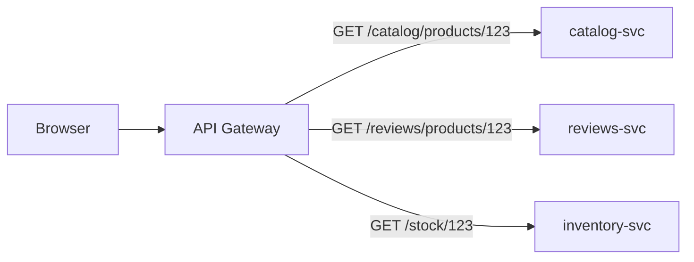
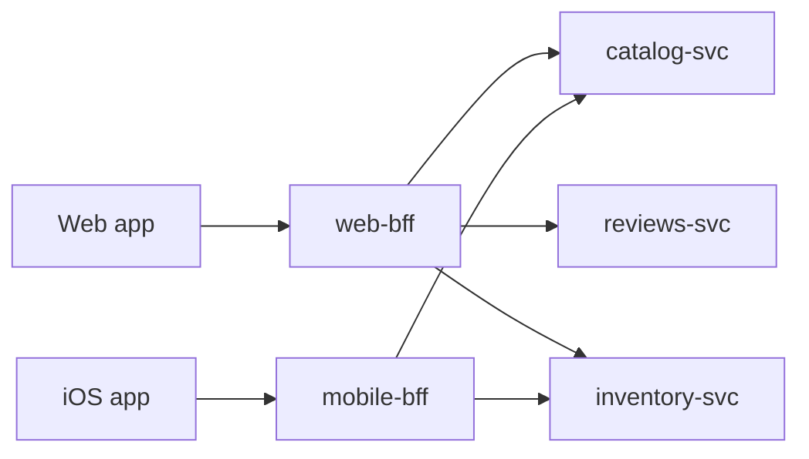
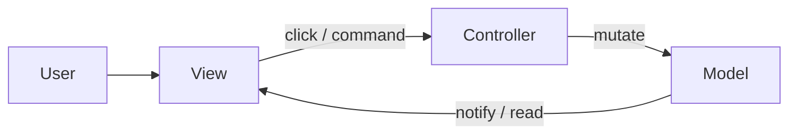

# Architecture patterns

Названы способы разрезания системы: состав (модульный монолит, события, шлюзы), семейство MVC, уровни/DDD, поток данных и структура внешнего интерфейса.

[ ← Вернуться в хаб](./0_system_design.md)

### Related docs

- [Проектирование системы — Ядро](./0_system_design_core.md) · [Проектирование системы — Архитектура](./0_system_design_architecture.md) · [Шаблоны архитектуры](./7_special_architecture.md) · [Проектирование системы — Данные](./0_system_design_data.md) · [SOLID](./7_special_engineering.md) · [DRY, KISS, YAGNI](./0_system_design_principles.md) · [GRASP](./0_system_design_grasp.md) · [Шаблоны проектирования](./7_special_patterns.md) · [Проектирование системы —Интервью](./0_system_design_interview.md) · [JS-функции](./3_js_functions.md) · [React — Экосистема](./4_react_ecosystem.md)

### Sections

- [3. Architecture patterns](#3-architecture-patterns)
- [Composition & integration](#composition-and-integration)
- [Layers & domain](#layers--domain)
- [MVC family](#mvc-family)
- [Reactive programming](#reactive-programming--reactivity)
- [Functional core, imperative shell](#functional-core-imperative-shell)
- [Frontend structure](#frontend-structure)

---

## 3. Architecture patterns

<details>
  <summary>Architecture vs design patterns</summary>

### Architecture vs design patterns

**Definition:**

**Архитектура** — это набор решений о том, как модули взаимодействуют друг с другом и с внешним миром — ограничения, правила и эвристика для всей системы. **Шаблон проектирования** — это именованный шаблон для решения небольшой, повторяющейся проблемы, близкой к коду. Архитектура охватывает проект; модели охватывают местные рабочие места.

Метафора дома (Дока): архитектура – ​​это «как построить дом»;шаблоны — «как забить сваи/замешать цемент/проложить проводку».

**How it works:**

Представьте себе фоторедактор.

- **Архитектура** отвечает: Кому принадлежит полотно? Кто разговаривает с камерой? Изменяет ли пользовательский интерфейс пиксели или отправляет только сообщение «применить сепию»? Это одно развертываемое приложение или виджет оформления заказа, загруженный другой командой? Эти правила применяются к _каждой_ функции.
- **Шаблон** отвечает на _локальное_ несоответствие: возвращается SDK камеры. `{ some_data: ["Name", "Lastname"] }` но ваш пользовательский интерфейс хочет `{ someData: "Name Lastname" }` → **Адаптер**. Вам не нужна новая архитектура для этого сопоставления.

Один и тот же продукт может использовать **оба**: слои + одностороннее хранилище (архитектура) _и_ Адаптер/Стратегию/Обсервер внутри модуля (шаблоны).

Каждая дополнительная строка нагружает читалку; слишком мало деталей скрывают смысл. Соответствующие стандартам сообщества (MVC, слои, Flux) и именованные шаблоны помогают поддерживать этот баланс.

Требования изменятся;люди не могут хорошо предсказать будущее. Полезная архитектура удешевляет изменения:

- API регулируемых модулей → реализации подкачки.
- Регулируемый ввод-вывод → меньше случайных утечек внутренних компонентов (и данных).
- Четкое разделение → более простые тесты.
- Предсказуемый макет → более быстрые функции и поиск ошибок.
- Известный стиль → более быстрая адаптация.

| **Как это работает — семейства подходов** (группировка по _целям_, а не по названию бренда): | Семья                                     | Вопрос, на который он отвечает                                                                                                    | Примеры внешнего интерфейса |
| -------------------------------------------------------------------------------------------- | ----------------------------------------- | --------------------------------------------------------------------------------------------------------------------------------- | --------------------------- | ---------------- | ------------------------------------------------------------- | ------------------------------------------------------------------------------------------------------- |
| **Ответственность**                                                                          | Какому модулю принадлежит какая работа?   | MVC/MVP/MVVM — [семейство MVC](#mvc-model-view-controller) · Doka «Model View What угодно»                                        |
| **Расстояние от домена**                                                                     | Что такое бизнес-логика и инфраструктура? | Трехслойный / Чистый / Шестиугольный — фото **фильтры** (домен) и **API камеры** (ниже)                                           |                             | **Поток данных** | Прямые звонки, автобус или магазин с односторонним движением? | Flux/Redux (однонаправленный); двусторонний/реактивный — [Поток данных](#data-flow--one-way-vs-two-way) |
| **Состав**                                                                                   | Одна программа или несколько?             | [Монолит против микросервисов](./0_system_design_architecture.md#monolithic-architecture) / [микро-интерфейсы](#микро-интерфейсы) |

односторонний процесс — событие пользовательского интерфейса → `dispatch(action)` → редукторы пробега магазина → новое состояние → `subscribe` / `useSelector` → Пользовательский интерфейс перерисовывается. Состояние внутри, вид снаружи; диспетчеризация — единственный API изменения состояния. Предпочитать `configureStore` + `createSlice` (РТК); наследие `createStore` все еще работает, но устарел. Примечания: [Поток данных](#data-flow--one-way-vs-two-way).

**When to use:**

Используйте именованную архитектуру, когда приложение уже «высотное» — много модулей, много людей, долгая жизнь. Откажитесь от тяжелой архитектуры и используйте одноразовый прототип (YAGNI). Выберите подход, сравнив **затраты и выгоды**.

#### Common pitfalls

Рассматривать MVC или Redux как _цель_. Слои доставки никому не нужны. Копирование узора, потому что он известен.

**Pluses and minuses:**

| +                                                     | −                                                                         |
| ----------------------------------------------------- | ------------------------------------------------------------------------- |
| Изменить, протестировать, внедрить дешевле в масштабе | Время, деньги, когнитивная нагрузка, чтобы изобретать _и_ следовать этому |
| Общий словарный запас в интервью                      | Неправильная архитектура обходится дорого                                 |
|                                                       | Чрезмерная архитектура на двухнедельном скачке                            |

**Examples:**

```ts
// 1) Responsibility (MVC-shaped): controller never paints pixels; view never talks to camera
type Photo = { pixels: Uint8ClampedArray };
const model = { photo: null as Photo | null };
function controllerCapture() {
  /* I/O */ model.photo = { pixels: new Uint8ClampedArray() };
  viewRender();
}
function viewRender() {
  /* DOM only reads model.photo */
}

// 2) Distance from domain: filters are testable without a phone
function applySepia(photo: Photo): Photo {
  /* pure domain */ return photo;
}
async function readCamera(): Promise<Photo> {
  /* infrastructure */ throw new Error("device");
}

// 3) Data flow — Redux Toolkit (redux.js.org getting-started). One-way: UI → dispatch → reducer → new state → subscribe
import { createSlice, configureStore } from "@reduxjs/toolkit";

const editor = createSlice({
  name: "editor",
  initialState: { filter: "none" as "none" | "sepia" },
  reducers: {
    setFilter(state, action: { payload: "none" | "sepia" }) {
      state.filter = action.payload; // Immer draft; store still immutable
    },
  },
});
const store = configureStore({ reducer: editor.reducer });
store.subscribe(() => console.log(store.getState()));
store.dispatch(editor.actions.setFilter("sepia"));
// UI may only change state through dispatch — not store.getState().filter = 'sepia'

// 4) Composition: one Next.js app vs a separately deployed checkout remote (micro-frontend)
```

**Как это работает — группы шаблонов** (слишком маленькие для архитектуры, слишком общие, чтобы их каждый раз изобретать):

| Вид             | Работа                                           | Список Doka                                                             |
| --------------- | ------------------------------------------------ | ----------------------------------------------------------------------- | --- | ----------------- | ----------------------------------- | ------------------------------------------------------------- |
| **Творческий**  | Создавать объекты/семейства; меньше дублирования | Фабрика (неформальная), Фабричный метод, Абстрактная фабрика, Строитель |
| **Структурный** | Как собрать компонент                            | Адаптер, Декоратор, Фасад, Прокси                                       |     | **Поведенческий** | Как организовать поведение/разговор | Цепочка ответственности, Стратегия, Командование, Наблюдатель |

```ts
// Creational — Factory: hide `new` / format choice
type Filter = { id: string; apply: (p: Photo) => Photo };
function createFilter(id: "sepia" | "gray"): Filter {
  if (id === "sepia") return { id, apply: applySepia };
  return { id, apply: (p) => p };
}

// Structural — Adapter: foreign API → app shape (Doka)
function serverToClientAdapter(data: { some_data: string[] }) {
  return { someData: data.some_data.join(" ") };
}

// Behavioral — Strategy: same call site, swap algorithm
const price: Record<"usd" | "eur", (cents: number) => string> = {
  usd: (c) => `$${(c / 100).toFixed(2)}`,
  eur: (c) => `${(c / 100).toFixed(2)} €`,
};
function formatPrice(cents: number, currency: "usd" | "eur") {
  return price[currency](cents);
}

// Behavioral — Observer: subject notifies whoever subscribed
type Listener = (photo: Photo) => void;
const listeners = new Set<Listener>();
function subscribe(fn: Listener) {
  listeners.add(fn);
  return () => listeners.delete(fn);
}
function notify(photo: Photo) {
  listeners.forEach((fn) => fn(photo));
}
```

**Thoughts:** Архитектура и шаблоны — это инструменты. Добавляйте их, когда выгоды превосходят затраты — они не являются системой показателей.

**See also:** [Чистый/шестиугольный](#clean-architecture--hexagonal) · [Состояние в масштабе](#state-at-scale) · [Каталог GOF](./7_special_patterns.md#gof-design-patterns--catalog) · [Адаптер](./7_special_patterns.md#adapter)

**Sources:** [Doka — Архитектура и шаблоны проектирования](https://doka.guide/tools/architecture-and-design-patterns/) (Беспойасов, обновление 25 января 2023 г.) · [Doka — Поток данных](https://doka.guide/tools/architecture-data-flow/) · [Redux — Начало работы (RTK счетчик)](https://redux.js.org/introduction/getting-started) · [Redux — поток данных](https://redux.js.org/tutorials/fundamentals/part-2-concepts-data-flow) · [Гуру рефакторинга — каталогг](https://refactoring.guru/design-patterns/catalog)

</details>

## Composition & integration

<details>
  <summary>Modular monolith</summary>

### Modular monolith

**Definition:** Один развертываемый модуль со строгими внутренними границами модулей (по доменам/функциям), обеспечивающими соблюдение правил зависимости между модулями.

**How it works:** Одно приложение, два уровня владения — часть **платформы** (система дизайна, общие перехватчики, ведение журналов), принадлежащая команде платформы, и папки **домена** (`user/`, `payments/`), принадлежащие фиче-командам. Тот же инстинкт, что и у шестиугольной/чистой архитектуры, без трех слоев между кнопкой и кнопкой. `fetch`. Полная чистая архитектура обычно является излишним для клиента.

**When to use:** Рекомендуемый вариант по умолчанию для большинства команд. Разделяйте работу на микросервисы только тогда, когда это оправдано границами модулей и структурой команды.

**Pluses and minuses:**

| +                                              | −                                                       |
| ---------------------------------------------- | ------------------------------------------------------- |
| Простое развертывание, подобное монолиту       | Требуется дисциплина для поддержания границ             |
| ACID-транзакции внутри монолита                | Все модули масштабируются вместе                        |
| Упрощенный рефакторинг для микросервисов позже | Может превратиться в большой ком грязи без ворса/отзывы |
| Одно репо, один конвейер CI                    |                                                         |

**Examples:** Модули `billing/`, `auth/`, `catalog/` — каждый предоставляет общедоступный API; нет межмодульного внутреннего импорта.

**Thoughts:** «Модульный монолит прежде всего» — все чаще рекомендация штатных инженеров. Извлекайте сервисы (или микро-интерфейсы), когда модуль нуждается в независимом масштабировании, независимом развертывании или командном владении, а не потому, что база кода стала большой. См. [Микро-интерфейсы](#микро-интерфейсы).

</details>

<details>
  <summary>Event-driven architecture</summary>

### Event-driven architecture

**Definition:** Компоненты взаимодействуют, создавая и потребляя события асинхронно, отделяя производителей от потребителей.

**How it works:**

1. Производитель публикует событие домена (`UserRegistered`, `OrderPlaced`) брокеру или шине событий.
2. Брокер продолжает работать и осуществляет доставку N абонентам (типично хотя бы один раз).
3. Каждый потребитель обрабатывает самостоятельно — может публиковать новые события (хореографию).
4. Неудачные повторные попытки; очередь недоставленных сообщений для подозрительных сообщений.

Kafka/RabbitMQ/SNS+SQS, реестр схем (Avro/JSON Schema), шаблон исходящих сообщений для надежной публикации после записи в БД.

**When to use:**

Конвейеры заказов, уведомления, аналитика, интеграция, взаимодействие микросервисов, прогнозы [CQRS](#cqrs).

Пользователь ожидает синхронного результата, который зависит от всех шагов — используйте запрос/ответ или оркестратор саги с опросом/WebSocket.

**Pluses and minuses:**

| +                                               | −                                                    |
| ----------------------------------------------- | ---------------------------------------------------- |
| Ослабленная связь                               | Окончательная согласованность                        |
| Легко добавлять новых потребителей              | Отладка распределенных потоков становится сложнее    |
| Естественный контрольный след                   | Эволюция схемы/версия                                |
| Обрабатывает всплески трафика (буфер в очереди) | Гарантии заказа различаются в зависимости от брокера |

**Examples:** `OrderPlaced` событие → служба инвентаризации резервирует товар, взимает плату за услуги, служба электронной почты отправляет подтверждение — самостоятельно.

**Thoughts:** Определите контракты событий (версионные схемы). Идемпотентные потребители обязательны при доставке хотя бы один раз. Коррелировать с `trace_id` в ОпенТелеметрии.

**See also:** [CQRS](#cqrs)

**Sources:** [Microservices.io — архитектура, управляемая событиями](https://microservices.io/patterns/data/event-driven-architecture.html)

</details>

<details>
  <summary>API Gateway</summary>

### API Gateway

**Definition:** Единая общедоступная точка входа (обычно обратный прокси-сервер), которая направляет клиентские запросы к нужной внутренней службе и скрывает карту службы от пользовательского интерфейса.

**How it works:**

Каждый микросервис предоставляет свой собственный API. Если интерфейс вызывает их напрямую, он должен знать адреса, аутентификацию и формы для каждого сервиса — жесткая связь. Шлюз предоставляет **один контракт**: протоколы, хосты/порты, правила запроса, правила ответа. Внутренности можно изменить без переписывания клиента.

Пройдите одну страницу продукта:

1. Браузер общается только с `https://api.shop.com` (один хост, один сертификат TLS, один файл cookie аутентификации).
2. Шлюз соответствует пути и **пересылает** запрос. Он не собирает модель страницы.
3. `catalog-svc` / `reviews-svc` по-прежнему возвращают _свой_ JSON. Пользовательский интерфейс по-прежнему выполняет **один обход на каждую услугу**, если вы не добавите лучшего друга.



Шаблон **Gateway Routing** от Microsoft: маршрутизация пути/хоста L7; шлюз также часто выполняет **сквозную** работу (аутентификация, TLS, ограничения скорости, ведение журнала). Типичные продукты: Kong, NGINX, Envoy, AWS/Azure API Gateway.

**When to use:**

Серверные части микросервисов (или многих), многие клиенты, использующие схожие формы запросов, нуждаются в стабильном общедоступном API. **Когда НЕТ:** один интерфейс + один сервер — у вас уже есть одна дверь.

#### Common pitfalls

Рассматривать шлюз как вторую кассовую службу. Разрешение браузеру сохранять жестко закодированные внутренние имена хостов (`catalog-svc:8080`). Забываем HA на шлюзе.

**Pluses and minuses:**

| +                                                                      | −                                                                                |
| ---------------------------------------------------------------------- | -------------------------------------------------------------------------------- |
| Один URL/контракт для множества услуг                                  | Дополнительный хмель; шлюз является **SPOF**, если только HA                     |
| Пользовательский интерфейс отделен от разделения/переименования службы | Толстый шлюз, если сюда сбросить доменную логику                                 |
| Кэш, аутентификация, ограничение скорости на границе                   | Конфигурация управления версиями и маршрутизации становится операционной работой |

**Examples:**

```nginx
server {
    listen 80;
    location /catalog/ { proxy_pass http://catalog-svc; }
    location /reviews/ { proxy_pass http://reviews-svc; }
    location /stock/   { proxy_pass http://inventory-svc; }
}
```

Та же идея, что и у Node, если вы используете только **прокси** (все еще не BFF — без агрегации):

```js
// Express 5: res.json(obj) only — set status separately. Catch async errors with next(err).
import express from "express";

const app = express();
const SVC = {
  catalog: "http://catalog-svc",
  reviews: "http://reviews-svc",
};

app.get("/catalog/products/:id", async (req, res, next) => {
  try {
    const upstream = await fetch(`${SVC.catalog}/products/${req.params.id}`);
    const body = await upstream.json();
    res.status(upstream.status).json(body); // same payload, new public URL
  } catch (err) {
    next(err);
  }
});

app.use((err, req, res, next) => {
  res.status(err.status || 500).json({ error: err.message });
});
```

**Что по-прежнему видит пользовательский интерфейс** (три вызова, три фигуры):

```http
GET /catalog/products/123  →  { "id":"123", "title":"Mug", "priceCents":1299, "warehouseSku":"W-9" }
GET /reviews/products/123  →  { "items":[{ "stars":5, "text":"…" }], "average":4.6 }
GET /stock/123             →  { "sku":"W-9", "qty":14 }
```

**Thoughts:**

Общая дверь. Маршрут + политика, а не JSON в форме страницы.

Doka: кэширование горячих путей; светоформирование в порядке. Если каждому _клиенту_ требуется разная полезная нагрузка, добавьте [BFF](#bff-backend-for-frontend).

**Sources:** [Azure — что такое шлюз API](https://learn.microsoft.com/azure/architecture/microservices/design/gateway) · [Azure — маршрутизация шлюза](https://learn.microsoft.com/azure/architecture/patterns/gateway-routing) · [Express — асинхронные ошибки / `res.json`](https://expressjs.com/) · [Doka — Gateway и BFF](https://doka.guide/tools/gateway-bff/)

</details>

<details>
  <summary>BFF (Backend for Frontend)</summary>

### BFF (Backend for Frontend)

**Definition:** Тонкий серверный уровень, **принадлежащий команде внешнего интерфейса**, который находится между одним пользовательским интерфейсом и серверной частью домена, преобразовывая данные именно так, как нужно этому клиенту. Схема Doka: BFF **включает шлюз** (один контракт) **плюс** подготовку ответа для этого интерфейса.

**How it works:**

Назван на SoundCloud (~2013 г.) во время разделения монолита: веб, iOS и Android боролись за один общий API, который никому не подходил. Фил Кальсадо задокументировал эту закономерность; Сэм Ньюман популяризировал эту статью. Каждый клиент получает свой собственный BFF (или один BFF на каждый _класс_ пользовательского интерфейса — например, приложения-прослушиватели iOS и Android используют один BFF). Netflix использовал адаптеры для каждого устройства (смарт-телевизор или телефон).Azure: **отдельный BFF для каждого интерфейса** (настольный или мобильный), поэтому один серверный компонент не разрывается между конфликтующими потребностями в полезной нагрузке и задержке.

Перейдите на ту же страницу продукта:

1. Веб-интерфейс выполняет **один** вызов: `GET /bff/pdp/123`.
2. Веб-лучший друг, **на сервере**, выход в каталог + обзоры + акции (параллельно `fetch`).
3. Он отображает эти три объекта JSON в **форму веб-PDP** (обрезка полей, переименование, вложение). Доменные службы остаются неизменными.
4. Mobile BFF — это **другой процесс** с меньшим картографом, а не параметрами запроса на общей мега-конечной точке.



Режим сбоя общего API: мобильному устройству требуется имя, цена, миниатюра; Интернету также нужны обзоры, акции и сопутствующие товары. Одна конечная точка выполняет слишком большую выборку для мобильных устройств или недостаточную выборку для веб-страниц — тогда вы гонитесь за ней. `?include=` навсегда.

Серверные части REST меняются редко, поэтому ответы часто включают поля, которые данный пользовательский интерфейс никогда не использует. Удаление полей приводит к поломке старых клиентов; клонирование почти идентичных конечных точек обходится дорого. BFF или **GraphQL** возвращает только то, что запросил клиент.

|                  | API-шлюз                              | лучший друг                                                                     |
| ---------------- | ------------------------------------- | ------------------------------------------------------------------------------- | --- | ------- | -------------------------- | --------------------------------------------------------------- |
| Кому принадлежит | Платформа/бэкэнд                      | Фронтенд-команда для этого клиента                                              |     | Клиенты | Часто много одинаковых API | Один пользовательский интерфейс (или один _класс_: iOS+Android) |
| Работа           | Маршрут, аутентификация, кеш, перевод | Агрегировать + **формировать содержимое экрана**                                |
| Стек             | NGINX/Конг/облачный GW                | Часто Node (интенсивный ввод-вывод; Doka: Deno/GraalVM в качестве альтернативы) |

Конг в масштабе всей компании — это не лучший друг. А `web-bff` который распределяется по десяти сервисам и возвращает одну домашнюю страницу в формате JSON. Вы можете сгруппировать их: UI → BFF → общий шлюз → сервисы.

общие шаблоны (например, JSX) на клиенте и BFF; тот же язык, поэтому код можно использовать повторно; скорость из кэша **и** подготовка данных для следующего клиентского запроса. Node подходит для большого количества операций ввода-вывода, а не для работы с тяжелыми нагрузками на процессор.

сохраняйте **тонкий фасад** — правила домена остаются в реальных бэкэндах.

| Подход | Подходит для лучших друзей ||----------|-------------|
| **Классический трехуровневый** (клиент/бизнес/данные) | Слабое — верхние слои приклеены к форме БД/API. Это не то же самое, что [three-layer](#three-layer-architecture-doka) Doka (сначала домен). |
| **Полный DDD** (пользовательский интерфейс/приложение/домен/инфра) | Слишком тяжело, если предметная область продукта уже находится ниже по течению; **дырявая абстракция**, если код приложения должен видеть ниже |
| **Чистый/шестиугольный** | Внешнее кольцо = адаптеры HTTP + выборка;внутрь = BFF DTO. Не выращивайте вторую доменную модель. См. [Чистая архитектура](#clean-architecture--hexagonal). |

Стек Doka «с чего начать»: Node + Express, часто с NestJS — по-прежнему следуйте продукту, а не фреймворку.

**Пример — веб-агрегаты BFF; мобильные версии BFF** (Express 5: `try/catch` + `next(err)`; `res.status(n).json(obj)`):

```js
import express from "express";

const app = express();
const CATALOG = "http://catalog-svc";
const REVIEWS = "http://reviews-svc";
const STOCK = "http://inventory-svc";

async function loadProductGraph(id) {
  const [catalogRes, reviewsRes, stockRes] = await Promise.all([
    fetch(`${CATALOG}/products/${id}`),
    fetch(`${REVIEWS}/products/${id}`),
    fetch(`${STOCK}/${id}`),
  ]);
  if (!catalogRes.ok) {
    const err = new Error("product not found");
    err.status = catalogRes.status;
    throw err;
  }
  const [catalog, reviews, stock] = await Promise.all([
    catalogRes.json(),
    reviewsRes.json(),
    stockRes.json(),
  ]);
  return { catalog, reviews, stock };
}

// Pick one mapper per deployed BFF (Azure: separate service per interface).
function toWebPdp({ catalog, reviews, stock }) {
  return {
    id: catalog.id,
    title: catalog.title,
    price: catalog.priceCents / 100,
    inStock: stock.qty > 0,
    reviewAverage: reviews.average,
    reviews: reviews.items.slice(0, 3),
  };
}

function toMobilePdp({ catalog, stock }) {
  return {
    id: catalog.id,
    name: catalog.title,
    price: catalog.priceCents / 100,
    thumbnail: catalog.images[0],
    inStock: stock.qty > 0,
  };
}

const toPdp = toWebPdp; // mobile-bff: toMobilePdp

app.get("/bff/pdp/:id", async (req, res, next) => {
  try {
    const graph = await loadProductGraph(req.params.id);
    res.json(toPdp(graph));
  } catch (err) {
    next(err);
  }
});

app.use((err, req, res, next) => {
  res.status(err.status || 500).json({ error: err.message });
});

app.listen(4000);
```

**Веб-ответ** и **мобильный ответ** (один и тот же продукт) `123`):

```json
{
  "id": "123",
  "title": "Mug",
  "price": 12.99,
  "inStock": true,
  "reviewAverage": 4.6,
  "reviews": [{ "stars": 5, "text": "…" }]
}
```

```json
{
  "id": "123",
  "name": "Mug",
  "price": 12.99,
  "thumbnail": "https://cdn/…",
  "inStock": true
}
```

Пользовательский интерфейс никогда не видит `warehouseSku` или три URL-адреса. Правила оформления заказа/скидки остаются в сервисах домена — только BFF **карты**.

**When to use:**

Множественным клиентам (веб-, мобильным, партнерским API) требуются **значительно разные** формы из одних и тех же серверных частей. Бэкэнд микросервисов. Альтернатива GraphQL, когда команда предпочитает владение REST +.

Один интерфейс, взаимодействующий с одним API — в основном вы добавляете сетевой переход. Microsoft: пропустите BFF, если все пользовательские интерфейсы выполняют одни и те же вызовы или только один интерфейс взаимодействует с серверной частью.GraphQL с преобразователями для каждого клиента или общим шлюзом API может быть достаточно.

#### Common pitfalls

Размещение «применить купон» в BFF. Один лучший друг для Интернета и мобильных устройств, который растет `if (isMobile)` навсегда (Azure: противоречивые требования). Нет тайм-аута/`Promise.all` обработка сбоев — одна медленная служба проверки зависает весь PDP. Пропуск SLO: если BFF не работает, пользовательский интерфейс не работает, даже если каталог исправен.

**Pluses and minuses:**

| +                                                                                                 | −                                                                                                      |
| ------------------------------------------------------------------------------------------------- | ------------------------------------------------------------------------------------------------------ | --- | ---------------------------------------------------------------- | ----------------------------------------------------------------------- |
| Индивидуальная полезная нагрузка (без избыточной выборки и дополнительных поездок туда и обратно) | Дополнительная служба для запуска, мониторинга и поддержания работоспособности                         |
| Фронтенд-команде принадлежит форма данных                                                         | **SPOF:** если BFF не работает, пользовательский интерфейс не работает, даже если API домена в порядке |
| Защищает пользовательский интерфейс от оттока микросервисов                                       | Дублирование в BFF (позже SoundCloud извлекла дополнительные услуги для логики общего домена)          |     | Индивидуальная аутентификация, кэширование, ограничения скорости | Может стать богослужением, если в него утечет логика предметной области |

**Thoughts:**

Агрегировать, трансформировать, кэшировать. Microsoft: сохраните в BFF логику, специфичную для клиента; поместите общую аутентификацию/мониторинг в другие шаблоны (часто шлюз). Ожидается дублирование в BFF; Позже SoundCloud извлекла дополнительные услуги для работы в общем домене.

Одно обращение туда и обратно, один JSON в форме экрана, один BFF на каждый класс клиента — правила домена остаются ниже по потоку.

**Sources:** [Фил Кальсадо — лучший друг](https://philcalcado.com/2015/09/18/the_back_end_for_front_end_pattern_bff.html) · [Сэм Ньюман — бэкэнды для внешних интерфейсов](https://samnewman.io/patterns/architectural/bff/) · [Azure — бэкэнды для Интерфейсы](https://learn.microsoft.com/azure/architecture/patterns/backends-for-frontends) · [Doka — Gateway и BFF](https://doka.guide/tools/gateway-bff/) · [Doka — Как работают веб-приложения](https://doka.guide/инструменты/веб-приложение-работает/) (средний уровень/GraphQL)

</details>

<details>
  <summary>Micro-frontends</summary>

### Micro-frontends

**Definition:**

Архитектура внешнего интерфейса, в которой независимо развертываемые внешние приложения объединяются в единый продукт, ориентированный на пользователя — обычно это **оболочка**, загружающая удаленные устройства во время выполнения (например, Webpack Module Federation).

**Провал, который на самом деле сжигает команды**, — это не «смешивание React и Vue». Это **дрейф общих зависимостей**: один удаленно обновляет React, другой нет, две копии борются за один DOM.

**How it works:**

| Численность / боль                                       | Типичная посадка                                                                                                           |
| -------------------------------------------------------- | -------------------------------------------------------------------------------------------------------------------------- |
| Менее 15 инженеров                                       | Модульный монолит почти всегда побеждает — не хватает людей для развертывания N конвейеров                                 |
| ~15–50, чистые домены                                    | Лучшие друзья + собственный модульный монолит; микро-интерфейсы еще преждевременны                                         |
| 50+ и команды **блокируют друг друга при развертывании** | Микро-интерфейсы начинают приносить прибыль — потому что _организация_ масштабировалась, а не потому, что это сделал пакет |

**When to use:** Узким местом является **координация между командами**, а не сложность приложения. Zalando, IKEA, DAZN и другие писали об этом в крупных организациях с тяжелым общим инструментарием. Ссылка: [micro-frontends.org](https://micro-frontends.org/).

**Pluses and minuses:**

| Состав                                | Как                                          | +                           | −                                                                                                                                                               |
| ------------------------------------- | -------------------------------------------- | --------------------------- | --------------------------------------------------------------------------------------------------------------------------------------------------------------- | --- | ---------------------------------------- | ----------------------------------- | ------------------------------------------ | ---------------------------------------- |
| **Время сборки**                      | пакеты npm, импортированные при сборке       | Простой                     | Связанный цикл выпуска                                                                                                                                          |
| **Время выполнения — iframe**         | Каждый MFE в iframe                          | Сильная изоляция            | UX/производительность; Позже Spotify объединил настройку iframe для настольных компьютеров отчасти потому, что швы стоят дороже, чем возвращается независимость |     | **Среда выполнения — Федерация модулей** | Интегрированные модули Webpack/Vite | Независимое развертывание, общие хранилища | Сложная настройка; **дрейф зависимости** |
| **Среда выполнения — веб-компоненты** | Пользовательские элементы в качестве границы | Независимость от фреймворка | Оснастка местами незрелая                                                                                                                                       |

**Examples:** Приложение оболочки загружается `header`, `checkout`, `catalog` как объединенные модули из разных команд/развертываний. Закрепите **одну** общую версию React в оболочке; рассматривать перекос версий как инцидент.

**Thoughts:** Микроинтерфейсы решают проблему _организационного_ масштабирования. Общая система проектирования, соглашения о маршрутизации и контракт о зависимостях являются обязательными. Смешение фреймворков возможно, но это редко является причиной принятия шаблона.

**Sources:** [micro-frontends.org](https://micro-frontends.org/)

</details>

## Layers & domain

<details>
  <summary>CQRS</summary>

### CQRS

**Definition:** Разделение ответственности за запросы команд — отдельные модели и пути для записи (команды) и чтения (запросов).

**When to use:** Приложения с большим объемом чтения и сложными запросами, различные потребности в масштабировании для чтения и записи, помощник по поиску событий.

**Pluses and minuses:**

| +                                                                         | −                                                          |
| ------------------------------------------------------------------------- | ---------------------------------------------------------- |
| Оптимизируйте независимое чтение и запись                                 | Повышенная сложность                                       |
| Масштаб читает отдельно (читать реплики, денормализованные представления) | Окончательная согласованность между моделями чтения/записи |
| Упрощенная модель записи, расширенная модель чтения                       | Избыток для простого CRUD                                  |

**Examples:** Напишите: нормализовано `orders` стол. Читай: денормализованный `order_summaries` материализованное представление, обновляемое событиями. Формы: [9_database.md — Обычные формы](./9_database_core.md#normal-forms-1nf3nf-bcnf); снимки: [Нормализовать или денормализовать](./9_database_core.md#normalization-vs-denormalization).

**Thoughts:** Не применяйте CQRS везде. Используйте, когда шаблоны чтения действительно отличаются от шаблонов записи и оправдывают затраты на синхронизацию. Фаулер: применять для ограниченного контекста, а не для всей системы; большинство доменов CRUD не должны его использовать.

**Sources:** [Мартин Фаулер — CQRS](https://martinfowler.com/bliki/CQRS.html)

</details>

<details>
  <summary>DDD (Domain-Driven Design)</summary>

### DDD (Domain-Driven Design)

**Definition:**

Подход к проектированию программного обеспечения, ориентированный на бизнес-сферу, с использованием повсеместного языка и ограниченных контекстов для моделирования сложных предметных областей.

| Концепция                 | Значение                                                              |
| ------------------------- | --------------------------------------------------------------------- | --- | ---------------------------- | --------------------------------------- |
| **Ограниченный контекст** | Явная граница применения предметной модели                            |
| **Вездесущий язык**       | Общий словарный запас разработчиков и экспертов в предметной области  |
| **Совокупный**            | Кластер объектов рассматривается как единое целое для согласованности |     | **Объект сущности/значения** | Идентичность и определение по атрибутам |

**When to use:** Сложные сферы бизнеса (финансы, логистика, здравоохранение). Менее ценно для простых приложений CRUD.

**Pluses and minuses:**

| +                                             | −                                              |
| --------------------------------------------- | ---------------------------------------------- |
| Приводит код в соответствие с бизнесом        | Крутая кривая обучения                         |
| Четкие границы обслуживания для микросервисов | Чрезмерное моделирование замедляет доставку    |
| Уменьшает несовпадающие предположения         | Требуется доступ эксперта в предметной области |

**Examples:** «Клиент» в контексте продаж ≠ «Клиент» в контексте поддержки — разные модели, разные ограниченные контексты, интеграция через API/события.

**Thoughts:** DDD бывает стратегическим (ограниченные контексты) и тактическим (агрегаты, сущности). Интервью часто фокусируются на ограниченных контекстах, таких как границы микросервисов. Модель — это вездесущий язык; крупным доменам необходимо несколько моделей, а не один клиент в масштабе всего предприятия.

**Sources:** [Мартин Фаулер — ограниченный контекст](https://martinfowler.com/bliki/BoundedContext.html)

</details>

<details>
  <summary>Clean Architecture & Hexagonal</summary>

### Clean Architecture & Hexagonal

**Definition:** Семейство архитектур с одной и той же идеей интервью: **бизнес-правила не зависят от фреймворков, баз данных или пользовательского интерфейса**. Шестиугольный (порты и адаптеры, Cockburn) рисует шестиугольник домена с входящим/исходящим портами. Лук (Палермо) — тот же инстинкт, но с немного другими кольцами. Чистая архитектура (дядя Боб) рисует концентрические кольца: **сущности → варианты использования → адаптеры интерфейса → фреймворки и драйверы**.**Трёхуровневая** структура Doka (домен/приложение/порты и адаптеры) аналогична идее для небольших приложений — рассматривайте имена как синонимы до тех пор, пока проект не станет достаточно большим, чтобы дополнительные кольца имели значение. См. [Трёхуровневая архитектура](#three-layer-architecture-doka).

**How it works:**

Внутренние круги — это **политика**; внешние круги — это **механизмы**. **Правило зависимости:** зависимости исходного кода направлены только **внутрь**. Внутренний круг не должен называть ничего, объявленного во внешнем круге (класс, функцию, тип или строку платформы/DTO). Данные, пересекающие границу, представляют собой простую структуру, удобную для **внутреннего** круга, а не строки Prisma или Express. `Request`.

| Кольцо                    | Владеет                                                              | Независимость от                                                |
| ------------------------- | -------------------------------------------------------------------- | --------------------------------------------------------------- | --- | ------------------------- | ----------------------------- | ------------------------------------------------- |
| **Объекты**               | Бизнес-правила предприятия/приложения (объекты или данные + функции) | Пользовательский интерфейс, база данных, навигация, авторизация |
| **Примеры использования** | Сценарии для конкретных приложений; оркестровать объекты             | БД, пользовательский интерфейс, фреймворки                      |
| **Интерфейсные адаптеры** | MVC, презентаторы, контроллеры, SQL, картографы API                  | — преобразует внутренние формы ↔ внешние формы                  |     | **Фреймворки и драйверы** | HTTP-фреймворк, ORM, БД, клей | Детали находятся здесь, поэтому их можно заменить |

Цели дяди Боба (все эти архитектуры): независимость от фреймворков, пользовательского интерфейса, БД и внешних агентств; **проверяемые** бизнес-правила без них.

Домен определяет **порты** (интерфейсы): `OrderRepository`, `PaymentGateway`. **Адаптеры** их реализуют: Prisma, Stripe SDK, Express/React. Варианты использования организуют сущности и порты. Пользовательский интерфейс и Nest/Express являются **внешними** — заменяемыми.

```
Frameworks (HTTP, ORM, queue)
        ↓ adapters
Use cases / application
        ↓
Entities / domain
```

Поток управления может идти **наружу** (вариант использования → презентатор), в то время как зависимости **источника** по-прежнему указывают **внутрь**: вариант использования вызывает интерфейс **выходного порта**, которым он владеет; презентатор во внешнем кольце реализует это (**Инверсия зависимостей**).

**When to use:**

Долговечные бэкэнды с реальными правилами домена. **Когда НЕТ:** MVP выходного дня — достаточно модульного монолита с прозрачными модулями. См. [0_mvp.md](./0_mvp.md).

#### Common pitfalls

Размещение вызовов Prisma в компонентах React. Называя его шестиугольным при импорте `pg` из папки домена. Передача типов строк ORM в сущности.

**Pluses and minuses:**

| +                                                        | −                                                                 |
| -------------------------------------------------------- | ----------------------------------------------------------------- |
| Тестовый домен без базы данных                           | Дополнительные интерфейсы в приложении CRUD с 4 конечными точками |
| Подмена Postgres на подделку в тестах                    | «Класс вариантов использования для каждой кнопки» карго-культ     |
| Та же история, что и со слоями FSD во внешнем интерфейсе | Команды спорят о названиях папок                                  |

**Examples:**

```ts
// port (owned inward — application/domain)
export type ChargeCard = (input: {
  orderId: string;
  cents: number;
}) => Promise<void>;

// use case — no Express, no Prisma
export function completeCheckout(charge: ChargeCard) {
  return async (orderId: string, cents: number) => {
    await charge({ orderId, cents });
  };
}
```

**Thoughts:** Зависимости направлены внутрь. Домен не знает Nest или Next.

**See also:** [Трехуровневая архитектура](#three-layer-architecture-doka) · [Архитектура против шаблонов проектирования](#architecture-vs-design-patterns) · [DDD](#ddd-domain-driven-design) · [FSD](#feature-sliced-design-fsd) · [Message broker](./12_message_broker.md) · [Kafka vs RabbitMQ vs BullMQ](./10_build_infra.md#kafka-vs-rabbitmq-vs-bullmq)

**Sources:** [Алистер Кокберн — Шестиугольная](https://alihair.cockburn.us/hexagonal-architecture/) · [Роберт К. Мартин — Чистая архитектура (2012)](https://blog.cleancoder.com/uncle-bob/2012/08/13/the-clean-architecture.html) · [Doka — Трехслойная архитектура](https://doka.guide/tools/clean-architecture/)

</details>

<a name="three-layer-architecture-doka"></a>

<details>
  <summary>Three-layer architecture (Doka)</summary>

### Three-layer architecture (Doka)

**Definition:** Разделите приложение на **домен**, **приложение** и **порты и адаптеры**, следуя жесткому правилу: **каждая зависимость указывает на домен**. Остальная часть кода предназначена для подачи домену нужных фигур, вызова его функций и сохранения или отображения результата. Цель: удешевить функции и удешевить поиск ошибок, потому что вы знаете, на каком уровне лежит ошибка.

**How it works:**

Нарисуйте три кольца. Центр = **чем занимается** (правила корзины). Средний = **что делает пользователь** (оформление заказа). Outer = **как мы общаемся с миром** (нажатие кнопки, HTTP, Postgres). Ошибка в «Скидка 10 % — это неправильно» — это домен. Баг в «мы забыли сохранить после оформления заказа» — это приложение. Баг в «snake_case from the API» — это адаптер.

```
     ┌─────────────────────────────────────────┐
     │  ports & adapters  (UI, fetch, DB)      │  ← world
     │   ┌─────────────────────────────────┐   │
     │   │  application  (use cases)       │   │
     │   │   ┌─────────────────────────┐   │   │
     │   │   │  domain (pure rules)    │   │   │
     │   │   └─────────────────────────┘   │   │
     │   └─────────────────────────────────┘   │
     └─────────────────────────────────────────┘
              arrows of *imports* only go inward
```

| Слой                 | Вопрос, на который он отвечает        | Разрешено делать                                                 | Запрещено                                |
| -------------------- | ------------------------------------- | ---------------------------------------------------------------- | ---------------------------------------- |
| **Домен**            | Каковы правила _этого_ продукта?      | Типы + **чистые** функции (то же самое → то же самое)            | `fetch`, Реагировать, Призма, `window`   |
| **Приложение**       | Что происходит в этом **сценарии**?   | Загрузка через **порт**, вызов домена, сохранение через **порт** | Импортировать Stripe SDK / `fetch` / JSX |
| **Порты и адаптеры** | Как мы подключаемся к реальному миру? | Реализация портов; карта DTO ↔ домен                             | Бизнес-правила (скидки, итоги)           |

| Код                                          | Слой                 | Почему                                         |
| -------------------------------------------- | -------------------- | ---------------------------------------------- |
| `type Cart = { items: CartItem[] }`          | Домен                | Данные о предмете                              |
| `cartTotal(cart)` / `addItem(cart, product)` | Домен                | Правило: нет ввода-вывода                      |
| `interface CartStorage { load(); save() }`   | Приложение           | Контракт, который мы бы хотели, чтобы мир имел |
| `checkout(userId, storage)`                  | Приложение           | Сценарий: загрузить → домен → сохранить        |
| `fetch('/cart').then(fromApi)`               | Приводной адаптер    | Реальное сопоставление полей HTTP +            |
| `onClick={() => checkout(...)}`              | Адаптер для вождения | Пользовательский сигнал в                      |
| Выражать `POST /checkout`                    | Адаптер для вождения | Та же идея на сервере                          |

Домен не импортирует ничего внешнего. Приложение импортирует домен + **типы портов**. Внешние **реализуют** порты и передаются в (DI). В JS нет встроенного DI — передайте функции в качестве аргументов или инверсифицируйте (`container.bind(id).to(Impl)`).

**порт** — это _желание_: «дай мне `saveCart(cart)`». **Адаптер** делает беспорядочный API похожим на это желание. Картирование `product_id` → `productId` это работа адаптера. `function saveCart(c) { return api.save(c) }` не является адаптером до тех пор, пока вы не сможете поменять серверную часть **без редактирования кода приложения**.

**Вождение** (слева) — мир сообщает приложению: UI, HTTP, CLI. **Управление** (справа) — приложение рассказывает миру: хранилище, электронная почта, платежи. Оба живут во внешнем кольце.

**Инфраструктура** = реальная база данных, SMS, платежные API. **Общее ядро** = дешевые глобальные переменные (`window`, язык). Общий код браузера и узла → эти глобальные переменные становятся адаптерами.

```ts
// WRONG — domain + HTTP + UI glued; cannot test total without fetch
async function onAddClickedWrong(userId: string, item: CartItem) {
  const res = await fetch(`/api/carts/${userId}`);
  const cart = await res.json();
  cart.items.push(item);
  await fetch(`/api/carts/${userId}`, {
    method: "PUT",
    body: JSON.stringify(cart),
  });
}

// RIGHT — same click, but rules are testable:
//   expect(cartTotalCents(addItem(empty, item))).toBe(500)
```

**When to use:**

Реальные правила домена; браузер + ССР + РН; поменять бэкенды местами. **Минимум:** сначала извлеките **домен**. Полные три уровня, когда ввод-вывод и варианты использования действительно вредны.

#### Common pitfalls

Домен, который `fetch`эс. Приложение, которое импортирует Stripe. Адаптер, который только переименовывает метод. **Реализации** портов располагаются рядом с вариантами использования. положить `%` логика скидок в JSX.

**Pluses and minuses:**

| +                                              | −                                                   |
| ---------------------------------------------- | --------------------------------------------------- |
| Охота за ошибками: правило, сценарий или клей  | Время разработки, адаптация                         |
| Модульные тесты предметной области без макетов | Дополнительные файлы; больше JS для анализа         |
| Поменяйте UI или API без переписывания итогов  | Излишество для трехстраничного маркетингового сайта |

**Examples:**

```ts
// --- domain/cart.ts  (pure; test with plain objects) ---
export type CartItem = { productId: string; priceCents: number; qty: number };
export type Cart = { items: CartItem[] };

export function addItem(cart: Cart, item: CartItem): Cart {
  const i = cart.items.findIndex((x) => x.productId === item.productId);
  if (i === -1) return { items: [...cart.items, item] };
  const items = cart.items.map((x, n) =>
    n === i ? { ...x, qty: x.qty + item.qty } : x,
  );
  return { items };
}

export function cartTotalCents(cart: Cart): number {
  return cart.items.reduce((sum, x) => sum + x.priceCents * x.qty, 0);
}

export function applyPercentOff(totalCents: number, percent: number): number {
  return Math.round(totalCents * (1 - percent / 100));
}

// --- application/ports.ts + addToCart.ts ---
export interface CartStorage {
  load(userId: string): Promise<Cart>;
  save(userId: string, cart: Cart): Promise<void>;
}

import {
  addItem,
  cartTotalCents,
  type Cart,
  type CartItem,
} from "../domain/cart";

export async function addToCartUseCase(
  userId: string,
  item: CartItem,
  storage: CartStorage, // port — not fetch
): Promise<{ cart: Cart; totalCents: number }> {
  const cart = await storage.load(userId);
  const next = addItem(cart, item);
  await storage.save(userId, next);
  return { cart: next, totalCents: cartTotalCents(next) };
}

// --- adapters/httpCartStorage.ts  (driven) ---
import type { CartItem } from "../domain/cart";
import type { CartStorage } from "../application/ports";

function fromApi(row: {
  product_id: string;
  price_cents: number;
  qty: number;
}): CartItem {
  return {
    productId: row.product_id,
    priceCents: row.price_cents,
    qty: row.qty,
  };
}

export const httpCartStorage: CartStorage = {
  async load(userId) {
    const res = await fetch(`/api/carts/${userId}`);
    const body: {
      items: { product_id: string; price_cents: number; qty: number }[];
    } = await res.json();
    return { items: body.items.map(fromApi) };
  },
  async save(userId, cart) {
    await fetch(`/api/carts/${userId}`, {
      method: "PUT",
      headers: { "Content-Type": "application/json" },
      body: JSON.stringify({
        items: cart.items.map((i) => ({
          product_id: i.productId,
          price_cents: i.priceCents,
          qty: i.qty,
        })),
      }),
    });
  },
};

// --- adapters/AddToCartButton.tsx  (driving) ---
// onClick is the adapter; it must not compute discounts itself
async function onAddClicked(userId: string, item: CartItem) {
  await addToCartUseCase(userId, item, httpCartStorage);
}
```

загрузить → чистое обновление → сохранить.

```ts
type Product = { id: string; name: string };

interface ProductsStorage {
  getProductById(id: string): Product;
  saveProduct(product: Product): void;
}

function updateProduct(product: Product, patch: { name: string }): Product {
  return { ...product, name: patch.name };
}

function renameProductHandler(
  command: { productId: string; name: string },
  storage: ProductsStorage,
) {
  const product = storage.getProductById(command.productId);
  const updated = updateProduct(product, { name: command.name });
  storage.saveProduct(updated);
}
```

домен = фрактал + 2D-математика; application = fractal → команды рисования; внешний = DOM/Canvas. То же разделение: геометрия не смешивается с `canvas.getContext('2d')`.

**Thoughts:** Программа _в домен_. Ему служат внешние слои; адаптеры делают мир совместимым, а порты делают приложение доступным.

**See also:** [Чистая архитектура и шестиугольная архитектура](#clean-architecture--hexagonal) · [Архитектура против шаблонов проектирования](#architecture-vs-design-patterns) · [Модульный монолит](#modular-monolith)

**Sources:** [Doka — Трехуровневая архитектура](https://doka.guide/tools/clean-architecture/) (Беспойасов, обновлено 27 января 2023 г.) · [Мартин — Правило зависимостей](https://blog.cleancoder.com/uncle-bob/2012/08/13/the-clean-architecture.html) · [InversifyJS — привязка / внедрить] (https://github.com/inversify/InversifyJS)

</details>

## MVC family

<details>
  <summary>MVC (Model-View-Controller)</summary>

### MVC (Model-View-Controller)

**Definition:** Разделяет модули на **Модель** (данные + бизнес-логика), **Представление** (макет и отображение) и **Контроллер** (направляет пользовательские команды в модель, а часто и в представление). Цель: в отличие от операций (API, валидация, DOM, всплывающие окна) не живут в одном блобе.

**How it works:**

- Пользователь разговаривает только с **View** (обычно с помощью графического интерфейса; голос/жесты по-прежнему учитываются).
- **Классический цикл (круг):** Пользователь → Вид → Контроллер → Модель → Вид перерисовывается.
- События могут попадать непосредственно на контроллер, или представление перехватывает их и затем вызывает контроллер — используются оба варианта.
- **Модель** — наиболее независимая часть (например, слой предметной области). Он не импортирует DOM.- **Классический веб:** Модель ≈ БД, Контроллер ≈ сервер, Представление ≈ HTML. **Жирный клиент**: сохраняет состояние документа как объекты JS, а не в разметке.

| кусок          | Владеет                                            | Не владеет              |
| -------------- | -------------------------------------------------- | ----------------------- |
| **Модель**     | Правда приложения(`isOn`, заказы, пользователи)    | Клики, CSS, разметка    |
| **Просмотр**   | Как выглядит состояние; коллекционирование событий | «Что означает удаление» |
| **Контроллер** | Намерение → изменение модели                       | Довольно рендеринг      |

1. На виде виден темный фонарик (`isOn: false`).
2. Пользователь нажимает кнопку (просмотр).
3. Контроллер работает `toggle()` — он не рисует пиксели.
4. Модель становится `{ isOn: true, color: "blue" }`.
5. View считывает модель и добавляет `is-on` + `has-color-blue`.



- **Тонкое сопоставление (предпочтительно в примерах ниже):** представление знает названия кнопок; контроллер получает цветовую строку.
- **Жирное сопоставление:** контроллер получает событие DOM и отображает его. `daylight` → `"blue"`.

- **Fat:** контроллер преобразует данные; модель - тупой объект. Риск: объект бога.
- **Тонкий:** модель принадлежит `toggle()` / `setColor()`; контроллер только вперед. Риск: сброс модели.

**When to use:**

Rails/Django, Backbone, настольный MVC, редакторы FAT-клиентов. Пропустите виджет из 50 строк.

**Пример 1 — тонкий контроллер** (просмотр отображает кнопку; контроллер только записывает модель):

```html
<div class="flashlight"></div>
<button type="button" name="power">On/Off</button>
<button type="button" name="daylight">Day</button>
<button type="button" name="nightlight">Night</button>
```

```js
const model = { isOn: false, color: "blue" };

const controller = {
  toggle() {
    model.isOn = !model.isOn;
  },
  updateColor(color) {
    model.color = color;
  },
};

const view = {
  el: document.querySelector(".flashlight"),
  redraw() {
    const { isOn, color } = model;
    this.el.className = `flashlight has-color-${color}${isOn ? " is-on" : ""}`;
  },
  initEvents() {
    const colors = { daylight: "blue", nightlight: "yellow" };
    document.querySelector('[name="power"]').addEventListener("click", () => {
      controller.toggle();
      view.redraw();
    });
    for (const [name, color] of Object.entries(colors)) {
      document
        .querySelector(`[name="${name}"]`)
        .addEventListener("click", () => {
          controller.updateColor(color);
          view.redraw();
        });
    }
  },
};

view.initEvents();
view.redraw();
```

**Пример 2 — толстый контроллер** (то же приложение; событие DOM остается в контроллере):

```js
const controller = {
  toggle() {
    model.isOn = !model.isOn;
  },
  selectColor(event) {
    const colors = { daylight: "blue", nightlight: "yellow" };
    model.color = colors[event.target.name];
  },
};

document.querySelector('[name="daylight"]').addEventListener("click", (e) => {
  controller.selectColor(e);
  view.redraw();
});
```

**Пример 3 — тонкий контроллер, толстая модель** (знание _как_ переключать жизни один раз):

```js
const model = {
  isOn: false,
  color: "blue",
  toggle() {
    this.isOn = !this.isOn;
  },
  setColor(color) {
    this.color = color;
  },
};

const controller = {
  toggle: () => model.toggle(),
  updateColor: (color) => model.setColor(color),
};
```

**Классический MVC** будет `subscribe` просмотр модели вместо вызова `redraw()` после каждого метода контроллера:

```js
const listeners = [];
function setOn(value) {
  model.isOn = value;
  listeners.forEach((fn) => fn(model));
}
listeners.push(() => view.redraw());
```

#### Common pitfalls

Смешение сопоставления DOM _и_ мутаций домена в обоих слоях. Позволить взгляду писать `model.isOn` напрямую (без контроллера). Забыв перерисовать, если вы не используете Observer.

**Pluses and minuses:**

| +                                                                | −                                                          |
| ---------------------------------------------------------------- | ---------------------------------------------------------- |
| Четкие роли; тестируемая модель без пользовательского интерфейса | Контроллер может стать божественным объектом               |
| Однонаправленный поток легко рассказать                          | Расположение представления и контроллера нечеткое          |
| Знаком с серверными и ранними SPA                                | Излишество для крошечных приложений; рамки размывают линии |

**Thoughts:**

Смешение встроенных стилей в «документе» делает экспорт болезненным. Состояние JS обычно представляет собой объект, который вы можете `JSON.stringify`. Хранилища (Redux/Vuex/NgRx) представляют собой однонаправленный поток в стиле MVC, а не классический MVC — см. [4_react.md](./4_react.md).

Модель = истина, Представление = презентация + поверхность ввода, Контроллер = «пользователь имел в виду это». Самое сложное — это последовательные границы, а не треугольник.

**See also:** [MVC против MVP против MVVM](#mvc-vs-mvp-vs-mvvm) · [Поток данных](#data-flow--one-way-vs-two-way)

**Sources:**

[Doka — MVC](https://doka.guide/tools/architecture-mvc/) · [Глоссарий MDN — MVC](https://developer.mozilla.org/en-US/docs/Glossary/MVC) · [Doka — Как работают веб-приложения](https://doka.guide/tools/web-app-works/)

---

</details>

<details>
  <summary>MVP (Model-View-Presenter)</summary>

### MVP (Model-View-Presenter)

**Definition:** Те же три проблемы, что и у MVC, но **Presenter** находится **на линии** между Моделью и Представлением. Данные не зацикливаются. Представление ↔ Модель; все идет через ведущего.

**How it works:**

- **Просмотр пассивный:** отображается только то, что говорит докладчик. Форматирование, которое MVC может внести в представление, находится в презентаторе.
- Ведущий владеет: пользовательскими командами, преобразованиями данных, сообщая представлению, что показывать.
- Нет «есть `initEvents` представление или контроллер?» дебаты — ценой толстого ведущего, которого вы потом разобьете на модули.

**When to use:**

Android (классический), WinForms, слои пользовательского интерфейса, требующие большого количества тестов.

**Пример — тот же фонарик, линейная топология.** Просмотр никогда не читается. `model`. Presenter форматирует и отправляет строки:

```js
const model = { isOn: false, color: "blue" };

const view = {
  el: document.querySelector(".flashlight"),
  label: document.querySelector(".status"),
  show({ className, text }) {
    this.el.className = className;
    this.label.textContent = text;
  },
  bind(presenter) {
    document.querySelector('[name="power"]').onclick = () =>
      presenter.onPower();
    document.querySelector('[name="daylight"]').onclick = () =>
      presenter.onColor("blue");
    document.querySelector('[name="nightlight"]').onclick = () =>
      presenter.onColor("yellow");
  },
};

const presenter = {
  paint() {
    const { isOn, color } = model;
    view.show({
      className: `flashlight has-color-${color}${isOn ? " is-on" : ""}`,
      text: isOn ? `On · ${color}` : "Off",
    });
  },
  onPower() {
    model.isOn = !model.isOn;
    this.paint();
  },
  onColor(color) {
    model.color = color;
    this.paint();
  },
};

view.bind(presenter);
presenter.paint();
```

Вариант входа: `view.onSubmit(email, pwd)` → `presenter.onLogin(...)` → модель/API → `view.showError()` or `view.navigateHome()`.

**Pluses and minuses:**

| +                                | −                                                                    |
| -------------------------------- | -------------------------------------------------------------------- |
| Взгляд тупой — легко высмеивать  | Presenter становится большим и сложным                               |
| Более четкое размещение, чем MVC | Больше церемоний, чем MVVM, для простых пользовательских интерфейсов |

**Thoughts:** Круг (MVC) и линия (MVP) — ведущий — единственный мозг.

**Sources:**

[Дока — MVC](https://doka.guide/tools/architecture-mvc/)

---

</details>

<details>
  <summary>MVVM (Model-View-ViewModel)</summary>

### MVVM (Model-View-ViewModel)

**Definition:** Заменяет контроллер на **ViewModel** — слой над представлением, который предоставляет привязываемое состояние. **Связующее устройство** (фреймворк, библиотека или язык) отображает изменения модели/ВМ в пользовательском интерфейсе, поэтому вам не нужно писать `redraw()` и маршрутизация кликов вручную.

**How it works:**

- ViewModel = состояние в форме представления + команды (не необработанные объекты домена).
- Binder синхронизирует View ↔ ViewModel (часто двустороннюю).
- Svelte (и шаблоны Vue/Angular) действуют как связующие: они связывают состояние и отображение.

**When to use:**

Angular, Vue (API параметров), WPF, Knockout. Компиляторы, подобные Svelte, тоже являются связующими.

**Пример — связыватель Vue** (`v-model` is `:value` + `@input`; no `redraw()`):

```vue
<script setup>
import { reactive } from "vue";

const model = reactive({ isOn: false, color: "blue" });

function toggle() {
  model.isOn = !model.isOn;
}
</script>

<template>
  <div
    class="flashlight"
    :class="[`has-color-${model.color}`, { 'is-on': model.isOn }]"
  />
  <button type="button" @click="toggle">On/Off</button>
  <select v-model="model.color">
    <option value="blue">Day</option>
    <option value="yellow">Night</option>
  </select>
</template>
```

Эквивалент без `v-model` (та же двусторонняя идея):

```vue-html
<input :value="text" @input="event => text = event.target.value" />
<!-- shorthand: -->
<input v-model="text" />
```

**Pluses and minuses:**

| +                                                                            | −                                       |
| ---------------------------------------------------------------------------- | --------------------------------------- |
| ViewModel можно тестировать без пользовательского интерфейса                 | Магия связывания скрывает поток данных  |
| Отлично подходит для пользовательских интерфейсов с большим количеством форм | Избыток для простых статических страниц |
| Декларативные шаблоны                                                        | Отладка проблем с привязкой болезненна  |

**Thoughts:** Вы перестаете писать циклы обновления пользовательского интерфейса; переплет — недостающая четвертая часть.

**Sources:**

[Doka — MVC](https://doka.guide/tools/architecture-mvc/) · [Vue — привязки ввода формы](https://vuejs.org/guide/essentials/forms.html)

---

</details>

<details>
  <summary>MVC vs MVP vs MVVM</summary>

### MVC vs MVP vs MVVM

**Definition:** Параллельное сравнение шаблонов уровня представления — кто является посредником между моделью и представлением и как передаются данные.

**How it works:**

|                        | Модель                 | Посмотреть                                                     | Медиатор       | Топология | Представление знает модель? | Поток данных                                   |
| ---------------------- | ---------------------- | -------------------------------------------------------------- | -------------- | --------- | --------------------------- | ---------------------------------------------- | --- | -------- | --------------- | -------------------- | ------------------------- | ---------- | --- | ----------------------------------- |
| **МВК**                | Данные + бизнес-логика | Отрисовывает пользовательский интерфейс; может отформатировать | **Контроллер** | **Круг**  | Часто да (наблюдатель)      | Пользователь → Вид → Контроллер → Модель → Вид |
| **Самый ценный игрок** | Данные + логика        | **Пассивный**                                                  | **Ведущий**    | **Линия** | Нет                         | Вид ↔ Ведущий ↔ Модель                         |     | **МВВМ** | Данные + логика | Декларативный шаблон | **ViewModel** + связующее | Связывание | Нет | Вид ↔ Модель представления ↔ Модель |

- **MVC:** Контроллер оркестрирует; Представление может наблюдать за моделью напрямую (классический рабочий стол) или управляться контроллером (веб-варианты).
- **MVP:** Ведущий – это тестируемый мозг; Просмотр только пересылает события и отображает то, что говорит Presenter, включая форматирование.- **MVVM:** ViewModel предоставляет привязываемые свойства; framework (связующее устройство) автоматически синхронизирует просмотр (Angular, Vue, Svelte-like).

| Рамочная         | Ближайший образец                                 |
| ---------------- | ------------------------------------------------- |
| Реакция + Редукс | Однонаправленный (в стиле MVC, а не классический) |
| Угловой          | МВВМ                                              |
| Вуэ              | МВВМ                                              |
| Магистраль       | МВК                                               |

**When to use:**

- **MVC:** Приложения, отображаемые на сервере (Rails, Django), SPA в стиле Backbone.
- **MVP:** Android (классический), пользовательский интерфейс с большим количеством тестов и пассивными представлениями.
- **MVVM:** Angular, Vue (API параметров), WPF — насыщенные формами, удобные для дизайнеров пользовательские интерфейсы.
- **React:** Однонаправленный поток (Redux) — вдохновлен MVC, но не классический; нет двусторонней привязки по замыслу.

**Pluses and minuses:**

| + (сравнение)                                                        | −                                                                   |
| -------------------------------------------------------------------- | ------------------------------------------------------------------- |
| Весь пользовательский интерфейс отделен от логики предметной области | Строгие дебаты о многоуровневости замедляют работу небольших команд |
| MVP/MVVM улучшают тестируемость по сравнению с классическим MVC      | Двустороннее связывание MVVM скрывает поток данных                  |
| MVC, знакомый по серверным и ранним SPA                              | Излишество для простых CRUD или статических сайтов                  |

**Examples:** Пользователь нажимает «Войти» → «Просмотреть звонки». `presenter.onLogin(email, pwd)` → Presenter проверяет, обращается к Model API → Presenter вызывает `view.showError()` or `view.navigateHome()`.

**Thoughts:** Интервью: опишите **направление потока данных**. React явно отверг двустороннюю привязку ради предсказуемости. Современный React (перехватчики, совместное размещение) часто пропускает строгое MV\* в пользу папок функций.

**Sources:**

[Doka — MVC](https://doka.guide/tools/architecture-mvc/) · [patterns.dev](https://www.patterns.dev/)

---

</details>

<details>
  <summary>MV* drawbacks</summary>

### MV\* drawbacks

**Definition:** Компромиссы MV\* (MVC, MVP, MVVM), общие для всех разделений уровня представления.

**How it works:** Небольшие инструменты, прототипы, статические сайты — одного модуля может быть достаточно.

**Pluses and minuses:**

| +                                  | −                                                       |
| ---------------------------------- | ------------------------------------------------------- |
| Средства разделения больших команд | Чрезмерная абстракция для CRUD-приложений               |
| Тестируемые слои                   | «На каком слое это происходит?» дебаты                  |
|                                    | Двусторонняя привязка → трудно отслеживаемые обновления |

**Thoughts:**

Feature-Sliced ​​Design и совмещенные компоненты часто заменяют строгий MV\* в современных базах кода React. Бэкэнд-эквивалент: [Чистая архитектура и шестиугольная](./0_system_design.md) — домен внутрь, фреймворки наружу.

---

</details>

<a name="data-flow--one-way-vs-two-way"></a>
<a name="unidirectional-vs-two-way-data-binding"></a>

<details>
  <summary>Data flow — one-way vs two-way</summary>

### Data flow — one-way vs two-way

**Definition:** **Поток данных** — это то, как одна часть программы получает данные из других частей и отправляет их в другие части. Программа — это преобразователь данных: вы вводите в нее входные данные и ожидаете результата. Разделите работу по модулям, и эти модули взаимодействуют, передавая **промежуточные результаты** — этот путь может сформировать всю архитектуру.

**How it works:**

Тот же продукт, два правила. Пример: строка тележки с `qty`. Пользователь нажимает «+». Что-то должно стать `qty + 1`, и пользовательский интерфейс должен это показать.

| Вид                               | Правило                                                                              | Что означает «+»                                                                                                                |
| --------------------------------- | ------------------------------------------------------------------------------------ | ------------------------------------------------------------------------------------------------------------------------------- |
| **Односторонний** (односторонний) | Между двумя модулями данные либо _приходят_, либо _уходят_. Направление не меняется. | Просмотр отправляет команду. Меняется только хранилище (или родительское состояние). `qty`. Просмотр **читает** новое значение. |
| **Двусторонний** (двусторонний)   | Одна и та же пара может отправлять **и** получать.                                   | Ввод ввода записывает модель; запись модели перезаписывает ввод.                                                                |

```
One-way (Redux / React):
  View  --action/event-->  reducer / setState  -->  new state  -->  View re-reads

Two-way (v-model):
  input.value  <-------->  model.email
```

#### One-way — Flux / Redux

Классический **Flux**: **магазин** (состояние), **диспетчер**, **просмотр**. Необязательные **создатели действий**, чтобы представление не знало, как создавать объекты действий.

Цикл Redux (проверено): пользовательский интерфейс считывает состояние → событие → `dispatch(action)` → редукторы возвращают следующее состояние → магазин уведомляет подписчиков → перерисовывает пользовательский интерфейс. `dispatch` это **единственный** способ изменить состояние магазина. Магазин **не** рисует пользовательский интерфейс — прослушиватель (React или ваш `render`) делает.

```
click "+"  →  { type: 'cart/inc' }  →  reducer  →  { qty: 2 }  →  subscribe  →  paint "2"
```

#### Two-way binding vs reactivity

**Двустороннее связывание** (`v-model`, `[(ngModel)]`): Элемент управления пользовательского интерфейса и поле модели остаются синхронизированными. Меньше кода обработчика; труднее отлаживать при использовании за пределами поля формы.

производные значения **пересчитываются при изменении источников** (Excel: изменение A, суммирование обновлений ячеек). Это не то же самое, что привязка. Привязка = пользовательский интерфейс ↔ выровнен по модели. Реактивность = когда X изменяется, Y пересчитывается.

**When to use:**

Односторонний для больших приложений/много людей/путешествий во времени. Двусторонний для небольших приложений и форм.

|                 | В одну сторону                             | Двусторонний                   |
| --------------- | ------------------------------------------ | ------------------------------ |
| Предсказуемость | Высокий — один путь обновления             | Нижний — неявная синхронизация |
| Отладка         | Трассировка отправки → редуктор → просмотр | «Кто это изменил?»             |
| Шаблон          | Явные обработчики/действия                 | Меньше для форм                |
| Примеры         | Реагирующий реквизит, Redux                | Вю `v-model`, Угловые формы    |

**Пример — одностороннее движение в React** (состояние вниз, события вверх; вы пишете в обоих направлениях):

```jsx
function CartLine() {
  const [qty, setQty] = useState(1);
  return (
    <>
      <QtyButton qty={qty} onInc={() => setQty((q) => q + 1)} />
      <input value={qty} onChange={(e) => setQty(Number(e.target.value))} />
    </>
  );
}

function QtyButton({ qty, onInc }) {
  // Child cannot write qty; it can only ask the parent
  return <button onClick={onInc}>{qty}</button>;
}
```

**Пример — односторонний в Redux** (тот же «+», явное действие + редуктор):

```js
function qtyReducer(state = { qty: 1 }, action) {
  switch (action.type) {
    case "cart/inc":
      return { qty: state.qty + 1 };
    default:
      return state;
  }
}

store.dispatch({ type: "cart/inc" });
store.subscribe(() => {
  document.getElementById("qty").textContent = String(store.getState().qty);
});
```

Сегодняшний Redux использует `configureStore` / ломтики; цикл тот же(`dispatch` → редуктор → подписчики).

**Пример — двусторонняя связь в Vue** (`v-model` это сахар для одностороннего входа + одностороннего выхода):

```html
<input v-model="email" />
<!-- same as: -->
<input :value="email" @input="email = $event.target.value" />
```

#### Common pitfalls

Рассматривая хранилище как средство визуализации. Использование двусторонней привязки для графа, не являющегося формой. запутанный `computed` с `v-model`. Размещение кэша сервера в Redux — [состояние в масштабе](#состояние в масштабе).

**Examples:**

```js
function sum(a, b) {
  return a + b;
}
let a1 = 2;
let a2 = 3;
let a3 = sum(a1, a2); // 5
a1 = 22;
a3; // still 5 — JS does not re-run the formula
```

```js
import { ref, computed } from "vue";
const A0 = ref(2);
const A1 = ref(3);
const A2 = computed(() => A0.value + A1.value); // 5
A0.value = 22; // A2 becomes 25
```

**Thoughts:**

Односторонний = «спроси, потом перечитай». Двусторонний = «поле _является_ моделью». Реактивность = «зависимые обновляются сами».

Действия формы React 19 стирают грань; базовая модель остается односторонней. Контролируемые входы = двусторонняя **вы** запись. У Original Flux был отдельный диспетчер; Redux сбрасывает отправку в магазин + один корневой редуктор.

**See also:** [Реактивное программирование](#reactive-programming--reactivity) · [MVC против MVP против MVVM](#mvc-vs-mvp-vs-mvvm) · [React](./4_react.md) · [Архитектура против шаблонов проектирования](#architecture-vs-design-patterns)

**Sources:**

[Doka — поток данных](https://doka.guide/tools/architecture-data-flow/) · [Redux — поток данных](https://redux.js.org/tutorials/essentials/part-1-overview-concepts) · [Vue — v-model](https://vuejs.org/guide/comComponents/v-model.html) · [Vue — вычислено] (https://vuejs.org/guide/essentials/computed.html)

---

</details>

## Reactive programming

<details>
  <summary>Reactive programming & reactivity</summary>

### Reactive programming & reactivity

**Definition:**

**Реактивность** — это автоматическое обновление системы при изменении данных. **Реактивное программирование** – это парадигма, основанная на **потоках данных** — упорядоченных по времени последовательностях событий из любого источника — и связях между ними.

| Перспектива      | Значение                                                                                 |
| ---------------- | ---------------------------------------------------------------------------------------- | --- | --------------- | ------------------------------------------------------------------------------------- |
| **Пользователь** | Пользовательский интерфейс мгновенно реагирует на ввод (набор текста, клики, загрузчики) |     | **Разработчик** | Производные значения остаются синхронизированными с источниками без ручного пересчета |

**How it works:**

Построен по шаблону **Наблюдатель**. Когда источник меняется, подписчики реагируют, но _когда_ они реагируют, зависит от push или pull:

| Тип         | Механизм                                         | Обновление подписчиков                               | Примеры JS                                       |
| ----------- | ------------------------------------------------ | ---------------------------------------------------- | ------------------------------------------------ |
| **Нажмите** | Источник немедленно отправляет каждое изменение  | На каждом мероприятии                                | `addEventListener`, RxJS `fromEvent`, веб-сокеты |
| **Тянуть**  | Потребители читают свежие ценности по требованию | При следующем проходе системы (например, рендеринге) | React повторный рендеринг, MobX `autorun`        |

`const sum = a + b` это одноразовый снимок — меняющийся `a`/`b` позже не обновляется `sum`. Реактивные системы пересчитывают иждивенцев при изменении входных данных (фреймворки обеспечивают это за вас).

| Нажмите                                       | Потянуть                                                     |
| --------------------------------------------- | ------------------------------------------------------------ |
| Немедленный; естественно для мероприятий      | Отложенная работа — вычисления только при необходимости      |
| Риск: дублирование работы при сильных потоках | Риск: обновление всего графика может оказаться дорогостоящим |

**When to use:** Живые информационные панели, насыщенные событиями пользовательские интерфейсы, цепочки проверки, синхронизация пользовательского интерфейса с push-уведомлением сервера. **FRP** (функциональное реактивное программирование) формирует потоки с `map` / `filter` / `scan` — RxJS в JS; Elm — это чистый язык FRP.

**Examples:**

```js
// Push — native events
document.addEventListener("click", () => console.log("clicked"));

// Push — RxJS
import { fromEvent } from "rxjs";
fromEvent(document, "click").subscribe(() => console.log("clicked"));
```

**Thoughts:**

Выразить _связи_ между данными; позвольте среде выполнения синхронизировать потребителей (особенно пользовательский интерфейс) вместо повторного запуска каждого шага вручную.

`$name` or `clicks$` часто отмечает Observables/streams. На практике реактивные идеи смешиваются с императивными/ООП (перехватчики React, Vue Proxy). Двусторонняя привязка — это _UI ↔ синхронизация модели_; реактивность — это _пересчет производных значений_ — [Поток данных](#data-flow--one-way-vs-two-way). См. [Наблюдатель](./7_special_patterns.md#observer) · [Состояние реакции](./4_react_core.md#state).

**Sources:**

[Doka — реактивность](https://doka.guide/js/reactivity/) · [Обзор RxJS](https://rxjs.dev/guide/overview)

---

</details>

## Functional core, imperative shell

<details>
  <summary>Functional core, imperative shell</summary>

### Functional core, imperative shell

**Definition:** Сохраняйте **чистую бизнес-логику** (функциональное ядро) внутри **грязной границы** (императивной оболочки), которая обрабатывает ввод-вывод — прагматичный шаблон FP для реальных приложений.

**How it works:**

- **Сэндвич-шаблон:** ввод-вывод → чистое преобразование → ввод-вывод.
- Пример — обновить запись БД: (1) получить строку [эффект], (2) `applyBusinessRules(row, input)` [чистый], (3) сохраняются [эффект].
- Правило: **нечистое может называться чистым; чистый не должен вызывать нечистый** — позволяет тестировать ядро ​​без макетов БД/сети.
- Строгий FP (Haskell, монады IO) продвигает дальше; JS/TS обычно использует этот более легкий шаблон.

**When to use:** Редукторы Redux (чистые) + преобразователи (эффекты), уровень обслуживания, действия сервера React (проверка чистоты → запись в БД нечисто).

**Pluses and minuses:**

| +                                                                                 | −                                                                      |
| --------------------------------------------------------------------------------- | ---------------------------------------------------------------------- |
| Базовая логика с возможностью модульного тестирования и простыми входами/выходами | Требуется дисциплина — легко осуществить утечку ввода-вывода в ядро ​​ |
| Четкое разделение «что» и «как достичь мира»                                      | Шаблонные адаптеры на границах                                         |

**Examples:**

```js
// pure core
function applyDiscount(cart, coupon) {
  return { ...cart, total: cart.total * (1 - coupon.percent) };
}

// imperative shell
async function checkout(cartId, couponCode) {
  const cart = await db.cart.find(cartId); // effect
  const coupon = await db.coupon.find(couponCode); // effect
  const updated = applyDiscount(cart, coupon); // pure
  await db.cart.save(updated); // effect
  return updated;
}
```

**Thoughts:** _Эффекты по краям; решения посередине._

**See also:** Сэндвич Марка Зеемана «**грязный/чистый/нечистый**» («нечистый») – та же идея. Почему это снижает сложность тестирования: [Упрощение тестирования](./7_special_testing_practices.md#making-tests-easy).

**Sources:**

[javascript.info/functional-programming](https://javascript.info/functional-programming)

---

</details>

## Frontend structure

<details>
  <summary>Feature-Sliced Design (FSD)</summary>

### Feature-Sliced Design (FSD)

**Definition:**

Методика архитектуры внешнего интерфейса, распределяющая код по **слоям** (приложение, страницы, виджеты, функции, сущности, общий доступ) и **фрагментам** по бизнес-доменам со строгим правилом общедоступного API для каждого фрагмента.

| Слой       | Ответственность                                                                    |
| ---------- | ---------------------------------------------------------------------------------- |
| `app`      | Провайдеры, маршрутизатор, глобальные стили, запись                                |
| `pages`    | Полные страницы, состав маршрутов                                                  |
| `widgets`  | Составные блоки пользовательского интерфейса (заголовок, боковая панель)           |
| `features` | Действия пользователя (вход, добавление в корзину)                                 |
| `entities` | Бизнес-существительные (пользователь, продукт)                                     |
| `shared`   | Комплект пользовательского интерфейса, клиент API, утилиты — никакой бизнес-логики |

**When to use:** Средние и крупные SPA, несколько команд, долгоживущие продукты.

**Pluses and minuses:**

| +                                                      | −                                                                 |
| ------------------------------------------------------ | ----------------------------------------------------------------- |
| Предсказуемая структура в масштабе                     | Кривая обучения может показаться тяжелой для небольших приложений |
| Принудительное направление зависимости (сверху → вниз) | Стоимость миграции с плоской структуры                            |
| Владение командой за срез                              | Чрезмерная сегментация, если срезы слишком детализированы         |

**Examples:**

```
src/
  app/
  pages/cart/
  widgets/header/
  features/add-to-cart/
  entities/product/
  shared/ui/
```

Правило импорта: `features/cart` могу импортировать `entities/product` и `shared/*`, а не внутренности другой функции.

**Thoughts:** Публичный API = `index.ts` баррель на кусок. Межсрезовый импорт только через общедоступный API — принудительное выполнение с помощью ESLint `boundaries` плагин.

**Sources:** [feature-sliced.design](https://feature-sliced.design/)

</details>

<details>
  <summary>Atomic Design</summary>

### Atomic Design

**Definition:**

UI-методология построения интерфейсов на пяти уровнях: Атомы → Молекулы → Организмы → Шаблоны → Страницы.

| Уровень       | Примеры                                                          |
| ------------- | ---------------------------------------------------------------- | --- | ------------ | ------------------------------ |
| **Атомы**     | Кнопка, ввод, метка, значок                                      |
| **Молекулы**  | Форма поиска (ввод + кнопка), Поле формы (метка + ввод + ошибка) |
| **Организмы** | Шапка, Карточка товара, Форма входа                              |
| **Шаблоны**   | Макет страницы без реальных данных                               |     | **Страницы** | Шаблоны с реальным содержанием |

**When to use:** Системы проектирования, библиотеки компонентов, команды дизайнеров, использующие общий словарь.

**Pluses and minuses:**

| +                                 | −                                                           |
| --------------------------------- | ----------------------------------------------------------- |
| Иерархия многоразовых компонентов | Может быть жестким — не все аккуратно помещается            |
| Общий язык дизайна                | Различие между атомами и молекулами может быть субъективным |
| Хорошо работает с Storybook       | Не учитывает архитектуру данных/состояния                   |

**Thoughts:** Atomic Design дополняет (а не заменяет) FSD. Атомы/молекулы живут в `shared/ui`; организмы могут быть виджетами или функциями.

**Sources:** [Брэд Фрост — Atomic Design](https://atomicdesign.bradfrost.com/)

</details>

<details>
  <summary>Module / package boundaries</summary>

### Module / package boundaries

**Definition:** Правила инкапсуляции, определяющие, какой код является общедоступным, а какой — внутренним внутри модуля, и в каком направлении могут протекать зависимости.

**When to use:** Монорепозитории, большие базы кода, библиотеки, используемые несколькими приложениями.

**Pluses and minuses:**

| +                                                  | −                                                |
| -------------------------------------------------- | ------------------------------------------------ |
| Предотвращает импорт спагетти                      | Требуется инструмент (ESLint, Nx, Turborepo)     |
| Обеспечивает безопасный рефакторинг внутри модулей | Исправление неправильных границ обходится дорого |
| Очистить право собственности                       |                                                  |

**Examples:**

```ts
// packages/billing/src/index.ts — public API only
export { createInvoice } from "./api";
export type { Invoice } from "./types";
// ./internal/* never exported
```

**Thoughts:** Направление зависимости: функции → сущности → общие. Никогда не публиковался → функции. Циклическое снижение = пограничный запах.

</details>

<details>
  <summary>State at scale</summary>

### State at scale

**Definition:**

Платформа принятия решений о том, где хранить состояние пользовательского интерфейса и сервера в крупных клиентских приложениях.

| Тип государства         | Где                             | Когда                                                |
| ----------------------- | ------------------------------- | ---------------------------------------------------- |
| **Локальный компонент** | `useState`                      | Только пользовательский интерфейс, не общий доступ   |
| **Общий клиент**        | Контекст, Зустанд, Йотай        | Межкомпонентный, только для клиента                  |
| **Сервер**              | React Query, SWR, RTK-запрос    | Удаленные данные, кэширование, синхронизация         |
| **URL**                 | Параметры поиска маршрутизатора | Общее состояние с возможностью добавления в закладки |
| **Форма**               | Форма React Hook                | Сложные формы, валидация                             |

**When to use:** Локальный → подъем или URL-адрес → кеш сервера → глобальное хранилище по умолчанию только в том случае, если он действительно является сквозным.

**Pluses and minuses:**

| + (правильное размещение)       | − (неправильное размещение)                          |
| ------------------------------- | ---------------------------------------------------- |
| Минимальный повторный рендеринг | Глобальное хранилище всего = невозможно поддерживать |
| Очистить поток данных           | Состояние сервера в Redux = ад ручного кэширования   |

**Thoughts:**

«Состояние сервера не является состоянием клиента». Не помещайте ответы API в Redux/Zustand — используйте библиотеку состояний сервера. См. [React — Экосистема](./4_react_ecosystem.md).

---

</details>
