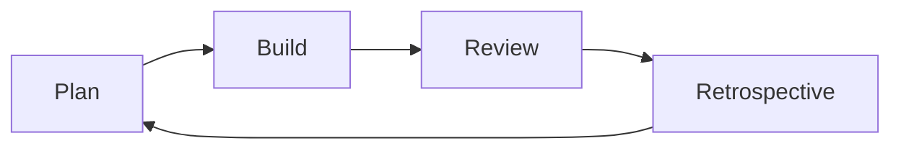
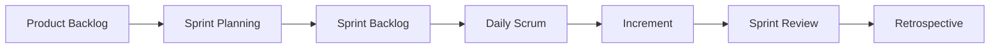

# SDLC

Водопад, Agile, Scrum и Канбан.

### Related docs

* [Информатика](./7_special_cs.md) · [Шаблоны архитектуры](./7_special_architecture.md) · [SOLID](./7_special_engineering.md) · [Шаблоны проектирования](./7_special_patterns.md) · [SDLC](./7_special_sdlc.md) · [Тестирование](./7_special_testing.md) · [Веб-безопасность](./7_special_security.md) · [Остатки интервью](./7_special_interview.md) · [CI/CD](./10_build_interview.md#what-is-cicd) · [DevOps](./15_devops.md)

### Sections

- [11. SDLC & Agile](#11-sdlc-agile)
- [Code refactoring](#code-refactoring)

---

## 11. SDLC & Agile

  
Software design methodology

### Software design methodology

**Definition:** Общий способ планирования, создания, поставки и улучшения программного обеспечения, позволяющий команде координировать работу, управлять рисками и отслеживать фактические изменения в бизнесе.

**How it works:**

Компаниям необходимо **быстро проверять гипотезы** — отбрасывать неправильные и развивать те, которые работают. Для этого методология является операционной системой: кто определяет приоритет, как протекает работа, когда пользователи видят ценность и как команда реагирует на изменение требований.

Требования → Проектирование → Реализация → Тестирование → Развертывание → Сопровождение.

Те же фазы, разные **порядок и обратная связь**. Водопад запускает их один раз, из конца в конец.Agile повторяет небольшой фрагмент всего цикла, поэтому продукт может измениться до того, как годы работы будут потрачены впустую.

**When to use:** Любая команда численностью более одного человека; интервью («как работает ваша команда?»); выбор Waterfall, Scrum и Kanban обусловлен **бизнес-ограничениями**, а не модой.

**Pluses and minuses:**

| + (формальная методология) | − |
|---------------------------|------|
| Общий язык для статуса, ролей и рисков | Карго-культовый процесс («делаем стендапы») без доставки |
| Контрольные точки перед необратимыми тратами | Накладные расходы, если процесс тяжелее продукта |

**Thoughts:** *Методы существуют, поэтому доставка соответствует неопределенности — изменения программного обеспечения обходятся дешевле, чем мосты, поэтому процесс должен допускать изменения.*

**Sources:**

[Doka — Agile](https://doka.guide/tools/agile/)

---

  
Development methodologies

### Development methodologies

**Definition:** Методологии — это структурированные практики организации кода и команд, отличные от языковых парадигм (того, как вы выражаете логику).

| Категория | Примеры | Заметки |
| --- | --- | --- |
| CSS-архитектура | БЭМ, SMACSS, OOCSS, атомарный дизайн | [Архитектура CSS](./2_css_architecture.md) |
| Структура приложения | MVC, MVVM, Flux, Redux | [Архитектурные шаблоны](./7_special_architecture.md) |
|Процесс | ТДД, БДД, ДДД | [Тестирование](./7_special_testing_fundamentals.md#12-testing) |
| Принципы | СУХОЙ, ПОЦЕЛУЙ, ТВЕРДЫЙ, ЯГНИ | [SOLID](./7_special_engineering.md#9-oop-and-solid) · [СУХОЙ, ПОЦЕЛУЙ, ЯГНИ](./0_system_design_principles.md) |
| Фронтенд | Прогрессивное улучшение на основе компонентов, ориентированное на мобильные устройства | Соглашения о продукте/UX |

**How it works:** Парадигмы отвечают *как выражать логику* (ФП против ООП). Методологии отвечают *как структурировать кодовую базу и сотрудничать* (MVC, TDD, BEM). Используйте оба варианта: парадигму проблемы и методологию ремонтопригодности в масштабе.

**Thoughts:** Не записывайте это в раздел «Примечания к языку JavaScript» — JS является многопарадигмальным; эти методы применяются ко всем стекам. Карта парадигм: [Парадигмы программирования](./7_special_cs.md#programming-paradigm).

**Sources:** [Doka — парадигмы программирования](https://doka.guide/tools/programming-paradigms/) · [Doka — Agile](https://doka.guide/tools/agile/) · [getbem.com](http://getbem.com/)

  
Waterfall

### Waterfall

**Definition:** Линейная **последовательная** модель SDLC — каждый этап (требования → проектирование → реализация → тестирование → развертывание → обслуживание) завершается до начала следующего.

**How it works:**

1. **Требования** — заранее задокументированные полные спецификации (часто огромное ТЗ/контракт).
2. **Дизайн** — архитектура и пользовательский интерфейс заморожены.
3. **Реализация** — сборка по спецификациям.
4. **Верификация** — проверка на соответствие требованиям док.
5. **Развертывание** — выпуск один раз (или редко).
6. **Техническое обслуживание** — только исправления; новая работа возобновляет контроль изменений.

Скопировано из строительства/электроники/производства.Программное обеспечение более динамично: изменение формата экспорта — это не то же самое, что изменение количества опор на железнодорожном мосту — поэтому замороженная многолетняя спецификация сильно стареет.

**Классические режимы неудач** (почему Agile распространился в 1990–2000-е годы):

- **Пропущенные даты** — чем длиннее горизонт, тем сложнее попасть; пропущенные годы превратились в деловой конфликт.
- **Устаревший продукт** — рынок и пользователи меняются, пока команда все еще находится в стадии «внедрения».- **Болезненное изменение** — даже небольшое дополнение заново открывает всю цепочку одобрения, зачастую медленнее, чем кодирование изменения.

**When to use:** Фиксированные требования, требовательные к соблюдению требования области (медицинское оборудование, аэрокосмическая промышленность, государственные контракты), аппаратное программное обеспечение, **агентская/фиксированная цена** — работа, при которой клиент платит за определенный результат.

**Pluses and minuses:**

| + | − |
|------|------|
| Четкие этапы и документация | Поздний отзыв — пользователи видят продукт в конце |
| Работы с фиксированным объемом и бюджетом | Дорого менять после проектирования |
| Прослеживаемость для регулируемых отраслей | Предполагается, что требования известны заранее |
| Предсказуемый для торгов по контракту | Длительное время без стоимости доставки |

**Examples:**

**Thoughts:** В современных **продуктовых** командах редко бывает чистый водопад – часто гибрид (итеративные фрагменты внутри фаз). В **аутсорсинге** все еще распространено: клиент платит за результат; многие студии до сих пор используют Agile **внутренне** (оценка диапазона, выставление счетов за фактическое время). Сравните с [Agile](#agile).

**Sources:**

[Doka — Agile](https://doka.guide/tools/agile/) · [Методологии SDLC](https://habr.com/ru/companies/edison/articles/269789/)

---

  
Iterative / Incremental

### Iterative / Incremental

**Definition:** Повторяющиеся циклы сборки → обратной связи → доработки. Инкрементальный метод предоставляет пригодные для использования фрагменты в каждом цикле.

**When to use:**

Самая современная продукция; основа Agile.

---

**Pluses and minuses:**

| + | − |
|------|------|
| Ранняя обратная связь | Ползучесть без дисциплины |
| Снижение риска большого взрыва | |

  
Spiral model

### Spiral model

**Definition:** Циклы планирования → анализа рисков → построения → оценки; ориентированный на риск.

**When to use:**

Крупные системы высокого риска (аэрокосмическая отрасль, предприятия).

---

**Pluses and minuses:**

| + | − |
|------|------|
| Явное управление рисками | Тяжелый для небольших проектов |
| | |

  
V-Model

### V-Model

**Definition:** Каждый этап разработки сопровождается этапом тестирования (требования ↔ приемочные испытания).

**When to use:**

Критически важные для безопасности, медицинские, встроенные со строгой проверкой.

---

**Pluses and minuses:**

| + | − |
|------|------|
| Раннее планирование тестирования | Жесткий |
| Прослеживаемость | |

  
RAD (Rapid Application Development)

### RAD (Rapid Application Development)

**Definition:** Быстро создавайте прототипы, учитывайте отзывы пользователей, минимизируйте предварительный дизайн.

**When to use:**

Приложения с тяжелым пользовательским интерфейсом, неопределенные требования, внутренние инструменты.

---

**Pluses and minuses:**

| + | − |
|------|------|
| Пришло время демо | Можно пожертвовать архитектурой |
| Управляемый пользователем | |

  
Agile

### Agile

**Definition:**

**Менталитет** (а не отдельный процесс): ценности и принципы из Agile-манифеста 2001 года. Их реализуют такие фреймворки, как Scrum и Kanban. Цель: люди, работающее программное обеспечение и **быстрая доставка функций**, чтобы можно было проверить гипотезы.

**Четыре значения** (левая сторона имеет значение *больше*, а не «вместо» правой):

| Мы ценим больше | Чем |
|---------------|------|
| Личности и взаимодействия | Процессы и инструменты |
|Рабочее программное обеспечение | Полная документация |
| Сотрудничество с клиентами | Переговоры по контракту |
| Реагируя на изменения | Следуя плану |

**How it works:**

- Короткие циклы, включающие анализ, сборку, тестирование и **пригодный** фрагмент, а не годы разработки спецификации, а затем кода.
- **Отставание** упорядочено по стоимости (и технологическому долгу); команда вытягивает верхние предметы.
- Заинтересованные стороны и разработчики постоянно работают вместе; перемены ожидаются, даже с опозданием.
- **Работающее программное обеспечение** — основной показатель прогресса; Предпочтительно личное (или эквивалентное) общение.- Команды надежные, самоорганизующиеся; они проверяют, как они работают, и настраивают (ретро).

**Двенадцать принципов** (взято из [agilemanifesto.org/principles](https://agilemanifesto.org/principles.html)):

1. Высший приоритет: удовлетворить потребности клиента посредством **ранней и непрерывной** поставки ценного программного обеспечения.
2. Приветствуйте изменение требований, даже поздно.
3. Часто доставляйте работающее программное обеспечение (от недель до месяцев);предпочитаю покороче).
4. Бизнесмены и разработчики работают вместе **ежедневно**.
5. Стройте вокруг мотивированных людей; дать поддержку и доверие.
6. Наиболее эффективное общение: разговор (по умолчанию — лицом к лицу).
7. Работающее программное обеспечение = основной показатель прогресса.
8. Устойчивый темп на неопределенный срок (спонсоры, разработчики, пользователи).
9. Постоянное внимание к техническому совершенству и хорошему дизайну.
10.Простота — максимизируйте **не** выполненную работу.
11. Лучшие проекты рождаются в самоорганизующихся командах.
12. Регулярное размышление; настроить поведение.

**When to use:** Неопределенные требования, продукт/SaaS, стартапы. Внедрения: [Scrum](#scrum) (спринты), [Kanban](#kanban) (поток), XP (инженерные практики). CI/CD сокращает тот же цикл — [10_build.md — CI/CD](./10_build_interview.md#what-is-cicd).

**Pluses and minuses:**

| + | − |
|------|------|
| Частое значение и обучение | Требуется заинтересованный владелец продукта/клиент |
| Адаптируется к отзывам рынка и пользователей | «Agile-театр» = церемонии без отгрузки |
| Снижает риск «большого взрыва» | Неудобно для жестких контрактов с фиксированной ценой и объемом |
| Постоянное улучшение с помощью ретро | Архитектура может дрейфовать без дисциплины |

**Examples:**

**Thoughts:** Agile ≠ никакой документации — **достаточно**, живая документация. В объявлениях о вакансиях часто используется слово **маркетинг**; спросите, как на самом деле работает команда. Это не серебряная пуля — см. [Не серебряная пуля](#не-серебряная-пуля).

**Sources:**

[Манифест Agile](https://agilemanifesto.org/) · [Принципы](https://agilemanifesto.org/principles.html) · [Doka — Agile](https://doka.guide/tools/agile/)

---

  
Scrum

### Scrum

**Definition:** Легкая Agile **структура** (Scrum Guide 2020) для сложной работы: небольшая Scrum-команда обеспечивает полезный **инкремент** каждый **спринт**. Эмпиризм + бережливое мышление; основные принципы **прозрачность, проверка, адаптация**. Ценности: **приверженность, целеустремленность, открытость, уважение, смелость**.

**How it works:**

**Спринт** – это контейнер для всех остальных событий — итерация фиксированной длины (**один месяц или меньше**, обычно 1–4 недели). Новый Спринт начинается сразу после предыдущего. Приращение должно быть **пригодным** (определение готовности); он *может* быть выпущен до Обзора Спринта (Обзор не является отправной точкой для выпуска).

| Подотчетность | Роль |
|----------------|------ |
| **Владелец продукта** | Один человек (не комитет). Максимизирует ценность продукта; заказывает Бэклог Продукта; Цель продукта. |
| **Скрам-мастер** | Отвечает за Скрам, как он определен, и за эффективность команды: тренирует, устраняет препятствия, поддерживает полезность мероприятий и ограничивает их по времени. |
| **Разработчики** | Кросс-функциональные люди, создающие Инкремент; собственный бэклог спринта и определение готовности. |Типичный размер команды: **10 или меньше**, самоуправление, без подгрупп. |

| Артефакт | Обязательство |
|----------|------------|
| **Желание продукта** | Экстренный упорядоченный список всего, что может улучшить продукт (функции **и** технический долг). **Цель продукта**. Доработка ведется (разбить, добавить детали, размеры). |
| **Журнал спринта** | Цель спринта (почему) + выбранные элементы (что) + план (как). Принадлежит разработчикам;обновлено во время спринта. |
| **Приращение** | Добавка, проверена, годна к использованию. **Определение «Готово»** — если не «Готово», это не инкремент (возврат к невыполненной работе). |

| Событие | Цель (Руководство) |
|-------|-----------------|
| **Планирование спринта** | Почему это важно → Цель спринта; что можно сделать; как. Временной интервал ≤ 8 часов для спринта продолжительностью 1 месяц. |
|**Ежедневный Скрам** | 15 минут. Разработчики: проверьте прогресс в достижении цели спринта, адаптируйте план на следующий день. |
| **Обзор спринта** | Проверяйте Increment вместе с заинтересованными сторонами; адаптировать бэклог продукта. Рабочая сессия, а не слайд-презентация. ≤ 4 часа в месяц. |
| **Ретроспектива спринта** | Проверяйте людей, процессы, инструменты, Министерство обороны; выбрать улучшения. Завершает спринт. ≤ 3 часа в месяц. |

Во время Спринта: не ставьте под угрозу Цель Спринта;качество не падает; отставание можно **уточнить**; объем может быть пересмотрен с заказчиком по мере обучения. Только заказчик заказа может **отменить** спринт, если цель устарела.

«Схватка» в стиле регби, популяризированная в газете HBR 1986 года (Такеучи/Нонака). Schwaber & Sutherland разработали Scrum программного обеспечения в начале 1990-х годов (OOPSLA, 1995); первое Scrum Guide 2010, актуальное — **ноябрь 2020**.Официально: [scrumguides.org](https://scrumguides.org/scrum-guide.html) / [scrum.org](https://www.scrum.org/).

**When to use:** Продуктовые команды с меняющимися приоритетами и специализированной межфункциональной командой. Тяжело, если работа представляет собой чистую очередь прерываний — рассмотрите [Канбан](#kanban).

**Pluses and minuses:**

| + | − |
|------|------|
| Каденция, прозрачность, регулярная проверка/адаптация | Стоимость церемонии; грузо-культ «Scrum», если события пропущены или пусты |
| Частые отзывы заинтересованных сторон о рабочем Инкременте | Нужен реальный заказ на покупку; Узкое место ПО, если это замаскированный комитет |
| Делает проблемы процесса видимыми | Руководство: частичный Scrum — это **не** Scrum: многие команды все еще адаптируют его (Scrumban) |

**Examples:**

**Thoughts:**

Скрам — это прежде всего модель **взаимодействия**, направленная на регулярную и качественную доставку, а не контрольный список встреч. Многие команды отказываются от турниров; другие нанимают Scrum-мастера, чтобы он хорошо управлял структурой.

*Спринт = цикл проверки и адаптации с временными рамками, который обеспечивает завершенный шаг к достижению цели продукта.*

**Sources:**

[Scrum Guide 2020](https://scrumguides.org/scrum-guide.html) · [Doka — Agile](https://doka.guide/tools/agile/)

---

  
Kanban

### Kanban

**Definition:** Поточный метод: **визуализируйте** конвейер, **ограничивайте незавершенное производство**, **вытягивайте** работу, когда у человека (или колонны) есть возможности. Нет обязательного спринта. Создан в **Toyota** (1960-е, производство); адаптировано к программному обеспечению в 2000-х годах.

**How it works:**

1. **Визуализация** — столбцы соответствуют реальным передачам (например, Готово к дизайну → Готово к разработке → Обзор → Готово).
2. **Вытягивать** — любой дизайнер берет из «готового дизайна»; любой разработчик из «готовых к разработке» — не менеджер, запихивающий целый спринт смешанной работы.
3. **Ограничить незавершенное производство** — ограничьте число элементов на человека или на столбец, чтобы очереди не скрывали перегрузку.
4.**Найдите узкие места** — если карточки с надписью «Готовность к разработке» накапливаются, **возможности разработчиков** становятся ограничением всей команды; устраните узкое место, не начинайте больше проектировать.
5. **Измерение потока** — время цикла, пропускная способность, совокупный поток (прогноз без цели спринта).

**When to use:** Работа, которая должна пройти **несколько ролей** последовательно (дизайн → код → QA); поддержка/вызов; DevOps/SRE; обслуживание, смешанное с прерываниями. Часто сочетается со Scrum (**Scrumban**).

**Pluses and minuses:**

| + | − |
|------|------|
| Прозрачный прогресс; узкие места видны | Нет встроенного ритма планирования или цели спринта |
| Ограничения Pull + WIP сокращают многозадачность | Слабый продукт для нового проекта: «Нам нужна общая частота кадров» |
| Подходит для работы с прерываниями | Даты — это прогнозы на основе показателей потока, а не обязательств по спринту |
| Непрерывная доставка, без границ спринта | Бесконечная незавершенная работа, если ограничения игнорируются |

**Examples:**

| Готово к дизайну | Готов к разработке | В процессе (НЗП ≤ 3) | Обзор | Готово |
|------------------|---------------|----------------------|--------|------|
| Лендинг v2 | API аутентификации | Особенность А | ПР №101 | версия 2.1 |

| Ошибка № 42 | | | |

**Thoughts:**

Канбан ≠ «без планирования». Доска Jira/GitHub является Канбаном только в том случае, если **ограничения незавершенного производства** реальны.

*Сделать очередь видимой; столбец, который заполняется, является узким местом команды.*

**Sources:**

[Doka — Agile](https://doka.guide/tools/agile/) · [Руководство по Канбану](https://kanbanguides.org/)

---

  
Not a silver bullet

### Not a silver bullet

**Definition:** Ни одна методология (включая Agile) не подходит каждой компании или проекту. Выберите процесс, который отвечает **потребностям бизнеса и команды**, а не ключевому слову в объявлении о работе.

**How it works:**

- Водопад / тяжелая спецификация по-прежнему подходят, когда прицел действительно фиксирован или юридически заморожен.
- Многие команды используют **только некоторые** принципы Agile (короткие демонстрации, бэклог, ограничения незавершенного производства) без полного Scrum — это может быть полезно.
- **Продуктовые** компании почти всегда хотят частых поставок и переменчивого результата.- **Агентство/аутсорсинг** часто продает результат (классический контракт), но может запускать Scrum/Kanban **внутри** (оценочный диапазон, время выставления счета).
- «Agile» на вакансию ≠ проверить и адаптировать на практике (**Agile-театр**).

**When to use:** Вопрос на собеседовании «Водопад или Agile?» — ответьте, указав **неопределенность, стоимость обратной связи и форму контракта**, затем назовите Scrum vs Kanban.

**Pluses and minuses:**

| + смешивания | − догмы |
|----------------|---------------|
| Процесс соответствует риску и типу контракта | Принудительное проведение Scrum-церемоний в очереди поддержки (или «Водопад» при запуске) приводит к потере времени |
| Честные гибриды (Scrumban, время-материалы) | Манифест значений без доставки рабочего программного обеспечения |

**Thoughts:** *Agile — это средство проверки гипотез и их отправки; если он не служит этому, отбросьте или сократите его.*

**Sources:**

[Doka — Agile](https://doka.guide/tools/agile/)

---

  
DevOps

### DevOps

**Definition:** Культура и практика, объединяющая разработку и эксплуатацию — автоматизация, CI/CD и совместная ответственность за надежность.

Канонические заметки хранятся в [DevOps](./15_devops.md). Инструменты конвейера: [CI/CD](./10_build_interview.md#what-is-cicd).

---

  
Code refactoring

### Code refactoring

**Definition:** Рефакторинг улучшает внутреннюю структуру, читабельность и удобство сопровождения **без изменения внешнего поведения**.

**When to use:** После зеленых тестов; маленькие шаги; прежде чем добавлять функции в запутанный код.

**Pluses and minuses:**

| + | − |
|------|------|
| Постепенно сокращает технологический долг | Рискованно без тестов |
| Обеспечивает более безопасную работу функций | Может стать бесконечной «уборкой» без ценности продукта |

**Examples:** Извлечь дублированную проверку в `validateUser(input)` — тот же API, более понятные модули.

**Thoughts:** «Рефакторинг» ≠ переписать. Правило бойскаутов: оставьте код немного лучше. Никогда не проводите рефакторинг и не меняйте поведение за один коммит.

**Sources:**

[refactoring.com](https://refactoring.com/)

---

