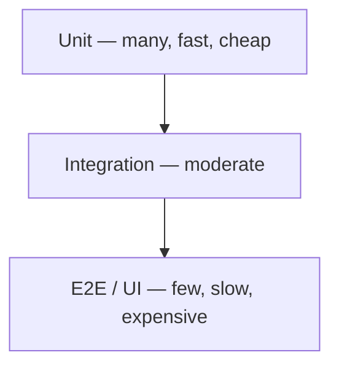

# Testing

AAA, the test pyramid, doubles, and Jest.

### Related docs

* [Computer science](./7_special_cs.md) · [Architecture patterns](./7_special_architecture.md) · [SOLID](./7_special_engineering.md) · [DRY, KISS, YAGNI](./0_system_design_principles.md) · [Design patterns](./7_special_patterns.md) · [SDLC](./7_special_sdlc.md) · [Testing](./7_special_testing.md) · [Web security](./7_special_security.md) · [Interview leftovers](./7_special_interview.md) · [Cache vs memoization](./0_system_design_data.md#cache-vs-memoization)

### Sections

- [12. Testing](#12-testing)

---

<a name="12-testing"></a>

## 12. Testing

<details>
  <summary>Tests and AAA</summary>

### Tests and AAA
**Definition:** A test is code that checks assumptions about other code. Tests make new code cleaner (you design the public API and edge cases first) and make old code safer to change (failures catch regressions before production).

**How it works:**

- Primitive check: call the unit, compare with an expected value (`console.assert`). That lacks a description, readable matchers, and auto-rerun on change — runners exist for that.
- Frontend runners: **Jest** (common default), **Vitest** (Jest-like API, Vite-native). Pick the runner for the layer: unit → Jest/Vitest; components / integration → RTL; E2E → Playwright / Cypress / WebdriverIO. Vue: [Vue Test Utils](./4_vue_ecosystem.md#testing) · Nuxt: [@nuxt/test-utils](./4_nuxt_platform.md#nuxt-test-utils). Setup: [Jest — first tests](#jest--first-tests-node-vs-jsdom). Layers: [Integration](#integration-testing) · [E2E](#e2e-testing).
- Anatomy is **AAA** (Arrange / Act / Assert) — Russian mnemonic **ПВП**: подготовка, выполнение, проверка.
  - **Arrange** — inputs, expected value, fakes/doubles.
  - **Act** — run the scenario (one call or user flow).
  - **Assert** — compare actual vs expected. Prefer **one assertion / one assumption** per test; extra cases → extra tests.
- Ideal test: all three stages (often three lines), independent of other tests (same result anywhere), readable as an English sentence via `describe` + `it`.
- Jest: `describe(name, fn)` groups a suite; `test` / `it(name, fn)` is one case; `expect(received).toEqual(expected)` is deep equality (`Object.is` for primitives). `toBe` is reference / exact primitive identity — two equal objects fail `toBe`.

**When to use:**

Default for production code. Skip or defer for throwaway prototypes and projects that will not live long enough for tests to pay back. Treat tests as planned work, not leftover time. Make the code cheap to test: [Making tests easy](#making-tests-easy).

#### Common pitfalls

- Coupled tests — shared mutable state so order changes the result.
- Many assertions in one `it` — a failure hides which assumption broke.
- Skipping tests because “extra work” — cost is front-loaded; the suite pays back on every refactor and upgrade.
- Testing only the happy path — the point of writing tests is to hunt “what can go wrong”.

**Pluses and minuses:**

| + | − |
|---|---|
| Forces edge cases, not only the happy path | More time on a young project |
| Fewer regressions when adding features or sharing helpers | Need structure for fixtures and doubles ([Test doubles](#test-doubles-stubs-mocks-spies)) |
| Confidence to refactor (including `==` vs `=` bugs) | CI must run the suite and block bad merges |
| Catch breaking dependency upgrades | Designing fakes is an architecture skill |
| Living docs that cannot silently rot (unlike comments) | |

**Examples:**

```js
function add(a, b) {
  return a + b;
}

// Primitive — no name, no watch, manual throw
function testAdd() {
  const result = add(10, 5);
  const expected = 15;
  console.assert(result === expected, `got ${result}, expected ${expected}`);
}

// AAA — Arrange args/expected, Act call, Assert matcher
describe('When given 2 numbers', () => {
  it('returns the sum of those 2 numbers', () => {
    const expected = 15;
    const result = add(10, 5);
    expect(result).toEqual(expected);
  });
});
```

Jest install: `npm install --save-dev jest`, `"test": "jest"` in `package.json`, then `npm test`. Official first test uses `toBe` for primitives (`expect(sum(1, 2)).toBe(3)`).

**Thoughts:** Tests are a development tool and a contract that stays true; write them from day one unless the code is a short-lived prototype.

**See also:** When writing tests still feels painful — [Making tests easy](#making-tests-easy). Green units but a dead app — [Integration](#integration-testing) · [System](#system-testing).

**Sources:**

[Doka — how and why to write tests](https://doka.guide/tools/how-to-test-and-why/) · [Jest Getting Started](https://jestjs.io/docs/getting-started) · [Jest `describe` / `test`](https://jestjs.io/docs/api) · [`.toEqual`](https://jestjs.io/docs/expect#toequalvalue)

---

</details>

<details>
  <summary>Test pyramid</summary>

### Test pyramid

**Definition:**

Ideal test distribution — many fast unit tests at the base, fewer integration tests, fewest slow E2E/UI tests at the top. Why write any of them: [Why write tests (AAA)](#tests-and-aaa).



| Layer | Scope | Speed | Cost |
|-------|-------|-------|------|
| **Unit** | One function/module; other deps replaced with doubles | Fast, parallel-safe | Low |
| **Integration** | Two+ parts of one job — **result** of collaboration, not call order | Medium | Medium |
| **E2E** (system) | App as a user: click, fill, assert | Slow | High |
| **Acceptance** | Spec / TZ scenarios before ship; often **manual** | Slowest | High |

**How it works:**

- **Unit** — most of the suite. Isolation: if the module imports others, use fakes. TDD sits here: [TDD](#tdd-test-driven-development).
- **Integration** — slightly richer harness so several units run together. Typical target: middleware — unit tests check the middleware’s job in isolation; integration checks how it talks to real neighbors.
- **E2E** — a robot that uses the product (e.g. full signup). Tools: Playwright (preferred in this conspect), Cypress, WebdriverIO.
- **Acceptance** — rarer on the web (short delivery cycle → automate instead). Common before desktop/mobile releases with a long store cycle.

**When to use:** Default strategy. Invert pyramid (ice cream cone) = pain.

**Pluses and minuses:**

| + (pyramid shape) | − |
|----------------------|------|
| Fast CI feedback | E2E-only gives slow, flaky suite |
| Cheap maintenance at base | Under-testing integration misses contract bugs |

**Thoughts:**

Contract tests between services sit between integration and E2E. Snapshot tests are unit-ish but can be brittle. Unit tests belong on **your** code; libraries get coverage via adapters + this pyramid’s integration/E2E layers — [Making tests easy](#making-tests-easy). Depth: [Integration](#integration-testing) · [System](#system-testing) · [E2E](#e2e-testing).

---

</details>

<details>
  <summary>Integration testing</summary>

### Integration testing

**Definition:** Tests that several modules work **together** (API + controller + DB, form + store + mocked HTTP) without booting the whole product as a user would.

**How it works:**

Unit tests isolate one unit (often with doubles). Integration tests keep real seams between a **group** of units. You still stub far edges (payment vendor, email, another team's service) so the suite stays deterministic.

| Approach | How | When |
|----------|-----|------|
| **Big bang** | Wire all modules, then run scenarios | Small systems; fast to write, slow to localize failures |
| **Incremental** | Integrate closest modules first (bottom-up or top-down) | Default — a failing test points at a smaller group |

a **stub** is called *by* the group (fake neighbor on the “output” side). A **driver** *calls* the group (test harness, HTTP client, RTL `userEvent` on the “input” side). Same idea as Jest [stubs/mocks](#test-doubles-stubs-mocks-spies), but named for assembling clusters, not a single function.

Prioritize **critical features** (checkout, auth, money, permissions). Fixtures: only fields the scenario needs. Automate in CI next to units; keep the real browser for [E2E](#e2e-testing).

[Testing Library](https://testing-library.com/) — user-visible queries; unit *and* integration; no shallow render. **Enzyme** is historical (shallow render, last aimed at React 16) — do not start new suites on it. Runners: Jest / Vitest. Network: MSW. Backend: test DB + HTTP against the app.

**When to use:**

Feature slices units cannot see — registration hitting routes + DB; a React page with MSW; OpenAPI contract vs a real handler.

#### Common pitfalls

Calling a jsdom RTL test “E2E”. Hitting production APIs. Huge JSON fixtures.

**Pluses and minuses:**

| + | − |
|------|------|
| Catches wiring bugs units miss | Slower than units; needs fixtures |
| Still cheaper/stabler than full E2E | Too many real deps → flaky “mini-E2E” |
| Good CI default for critical paths | Big-bang suites hide the broken module |

**Examples:**

```tsx
import { render, screen } from '@testing-library/react';
import userEvent from '@testing-library/user-event';
import { LoginForm } from './LoginForm';

test('submit shows welcome after a successful sign-in', async () => {
  const user = userEvent.setup();
  render(<LoginForm />);
  await user.type(screen.getByLabelText(/email/i), 'ada@example.com');
  await user.click(screen.getByRole('button', { name: /sign in/i }));
  expect(await screen.findByText(/welcome/i)).toBeInTheDocument();
});
```

RTL does not shallow-render: mock I/O at the boundary (MSW/`fetch`), not child components, so the test still resembles the user ([Testing Library FAQ](https://testing-library.com/docs/react-testing-library/faq)).

**Thoughts:** Units prove pieces; integration proves the **seams** — still not the full product.

**Sources:**

[Testing Library guiding principles](https://testing-library.com/docs/guiding-principles) · [Doka — integration & system tests](https://doka.guide/tools/integration-and-system-testing/) · [React Testing](./4_react_ecosystem.md#testing)

---

</details>

<details>
  <summary>System testing</summary>

### System testing

**Definition:** A **class** of tests that exercise the **whole program** (or a production-like build) — not a subset of modules.

**How it works:**

After units + integration, remaining risk is “does the assembled system behave for a user / under load / under attack?” Split by **purpose**:

| Kind | Question |
|------|----------|
| **[E2E](#e2e-testing)** | Can a user complete a flow in a real browser? |
| **[Screenshot / visual](#screenshot-testing)** | Did the UI pixels regress? |
| **[Performance](#performance-testing)** | Did we get slower (Web Vitals / lab budget)? |
| **[Security tests](#security-testing)** | Can we inject, steal cookies, or call APIs unsafely? |

Automate and run in CI — usually a **separate job** (slow, browsers, secrets). See [CI](./10_build_ci.md#continuous-integration-ci).

**When to use:** Release confidence; critical journeys; UI/perf budgets; compliance.

**Pluses and minuses:**

| + | − |
|------|------|
| Highest confidence the product works | Slow, flaky, expensive to maintain |
| Finds env/config bugs units never see | Overuse inverts the [pyramid](#test-pyramid) |

**Thoughts:** System tests answer “the app as a whole” — pick the subtype that matches the risk (flow, look, speed, attack).

**Sources:**

[Doka — integration & system testing](https://doka.guide/tools/integration-and-system-testing/)

---

</details>

<details>
  <summary>E2E testing</summary>

### E2E testing

**Definition:** End-to-end tests drive the app **as a user** (open page → click → see text) through a real browser, so the stack is exercised together.

**How it works:**

Script user actions and assert observable outcomes (URL, heading, toast). Playwright gives each test an isolated **browser context** (fresh profile) and auto-waits for actionability — avoid `sleep()`.

Playwright, Cypress, Puppeteer, Selenium, WebdriverIO, Nightwatch. Playwright/Cypress are the usual frontend default. Selenium/WebDriver is the older protocol; WebdriverIO is a runner that can sit on WebDriver *or* Playwright. RTL in jsdom is **not** E2E.

**When to use:**

Auth, checkout, navigation + Server Actions, anything that must work when units *and* integration already passed but the assembled app still failed.

#### Common pitfalls

Testing every unit path in E2E (ice-cream cone). Shared mutable test users. Asserting implementation instead of roles/text.

**Pluses and minuses:**

| + | − |
|------|------|
| Closest to real users | Slow; flake from timing, data, third parties |
| Catches CSS/JS/backend wiring | Few tests — only critical paths |

**Examples:**

```ts
import { test, expect } from '@playwright/test';

test('get started link', async ({ page }) => {
  await page.goto('https://playwright.dev/');
  await page.getByRole('link', { name: 'Get started' }).click();
  await expect(page.getByRole('heading', { name: 'Installation' })).toBeVisible();
});
```

**Thoughts:** Few, slow, valuable — describe **user** steps, not internals.

**Sources:**

[Playwright — writing tests](https://playwright.dev/docs/writing-tests) · [Next.js testing](./4_nextjs_platform.md#testing-nextjs-vitest--rtl)

---

</details>

<details>
  <summary>Screenshot testing</summary>

### Screenshot testing

**Definition:** Visual regression — capture a **baseline** screenshot and fail CI when later pixels differ beyond a tolerance.

**How it works:**

First run stores the gold image. Later runs compare. Playwright waits until two consecutive screenshots match (animations settle), then diffs against the baseline. Mask dynamic regions (ads, dates, avatars).

Playwright `expect(page).toHaveScreenshot()`, Puppeteer + a diff lib, Chromatic/Percy. Jest/RTL **HTML snapshots** (`toMatchSnapshot`) are markup, not pixels.

**When to use:** Design-system pages, marketing layouts, “did this CSS change the dashboard?” — not business rules (assert those in E2E with text/roles).

**Pluses and minuses:**

| + | − |
|------|------|
| Catches CSS/layout surprises | Fonts, OS, DPI make baselines brittle |
| Cheap once stable | Noise from animations, clocks, A/B flags |

**Examples:**

```ts
import { test, expect } from '@playwright/test';

test('docs home visual', async ({ page }) => {
  await page.goto('https://playwright.dev');
  await expect(page).toHaveScreenshot({ maxDiffPixels: 100 });
});
```

Run baselines in the **same environment** as CI (often Docker), or diffs are meaningless.

**Thoughts:** Pixel budget on UI — update the baseline only when the change is **intended**.

**Sources:**

[Playwright — visual comparisons](https://playwright.dev/docs/test-snapshots)

---

</details>

<details>
  <summary>Performance testing</summary>

### Performance testing

**Definition:** Check that the system did **not get slower** after a change — compare metrics to a baseline (lab budget and/or field Web Vitals).

**How it works:**

Frontend usually tracks **Core Web Vitals**: LCP (load), INP (responsiveness), CLS (stability). **Lighthouse** is lab (synthetic): it scores FCP, LCP, TBT, CLS, Speed Index. Default Lighthouse has **no user**, so it reports **TBT** as a proxy — not field **INP**. Ship gates on a budget; confirm with RUM / `web-vitals`. Micro-benchmarks use `performance.now()` / User Timing — **jsPerf.com is gone**.

Lighthouse (DevTools / CLI / [LHCI](https://github.com/GoogleChrome/lighthouse-ci)), Chrome Performance panel, `performance` API, PageSpeed Insights, WebPageTest. Theory: [6_web_api.md — Core Web Vitals](./6_web_api_security.md#core-web-vitals) · panel: [11_vsc_browser.md](./11_vsc_browser.md#devtools--core-web-vitals).

**When to use:** Perf SLO (“LCP p75 < 2.5s”), CI Lighthouse CI, catching a huge bundle or layout shift before release.

**Pluses and minuses:**

| + | − |
|------|------|
| Numeric regression signal | Lab ≠ field (CrUX / Search Console) |
| Lighthouse CI is automatable | One-off `performance.now()` in tests is noisy |

**Examples:**

```js
performance.mark('search-start');
await search(query);
performance.mark('search-end');
performance.measure('search', 'search-start', 'search-end');
const { duration } = performance.getEntriesByName('search')[0];
expect(duration).toBeLessThan(200); // lab-only; flake-prone — prefer Lighthouse budgets
```

**Thoughts:** Baseline → change → compare Vitals/Lighthouse — do not trust a green lab score against red field data.

**Sources:**

[Lighthouse](https://github.com/GoogleChrome/lighthouse) · [web.dev / CWV](https://web.dev/articles/vitals)

---

</details>

<details>
  <summary>Security testing</summary>

### Security testing

**Definition:** Checks that the **assembled** app does not leak or execute attacker-controlled data — mostly backend, but frontend still owns output encoding, cookies, and API calls.

**How it works:** Threats live in [web attacks](./7_special_security.md#14-common-web-attacks). Frontend-focused tests often assert: user input is escaped (no `innerHTML` XSS), session cookies are `HttpOnly`/`Secure`/`SameSite`, privileged APIs reject unauthenticated calls, CSP is present.

**When to use:** Auth cookies, rich-text/markdown renderers, `postMessage`, file uploads, CORS on the API you own.

**Pluses and minuses:**

| + | − |
|------|------|
| Catches XSS/CSRF-class bugs before prod | Scanners miss logic bugs (IDOR) |
| Cookie/header checks are cheap in E2E | Not a substitute for review + OWASP |

**Examples:**

```ts
const cookies = await context.cookies();
const session = cookies.find((c) => c.name === 'session');
expect(session?.httpOnly).toBe(true);
expect(session?.secure).toBe(true);
expect(session?.sameSite).toMatch(/Lax|Strict/);
```

**Thoughts:** Frontend security tests = escape input, lock cookies, never trust the client for authz.

**See also:** [XSS](./7_special_security.md#xss-cross-site-scripting) · [CSRF](./7_special_security.md#csrf-cross-site-request-forgery)

**Sources:**

[OWASP WSTG](https://owasp.org/www-project-web-security-testing-guide/) · [Doka — integration & system testing](https://doka.guide/tools/integration-and-system-testing/)

---

</details>

<details>
  <summary>TDD (Test-Driven Development)</summary>

### TDD (Test-Driven Development)

**Definition:** A development practice where you write a **failing test first**, then the **minimum code** to pass it, then **refactor** — repeat in small cycles (~10–15 min).

**How it works:**

| Phase | Goal | Rule |
|-------|------|------|
| **Red** | Test fails for the **expected reason** | If it fails for another reason (syntax, import), fix the test before writing production code |
| **Green** | Make the test pass | Simplest implementation — even "obvious" one-liners; don't over-engineer yet |
| **Refactor** | Clean up test + production code | Safe because tests catch regressions immediately |

TDD only covers the happy path. The cycle applies to **any** case — errors, edge cases, and invalid input are just the next Red test.

**When to use:**

Core business logic, utilities, parsers, reducers — anywhere inputs/outputs and edge cases are specifiable. Less suited for UI spikes, throwaway prototypes, or exploratory research.

#### Common pitfalls

- **Fake test** — `expect(expected).toEqual(expected)` always passes; always assert the **actual result**.
- **Wrong failure in Red** — test crashes on import/type error, not on missing behavior → fix test setup first.
- **`toFixed()` returns a string** — `Number((a / b).toFixed(n))` if you need a number back.
- **Optional args** — use `settings = {}` or a shared `defaultSettings` object, not bare `settings.precision`.
- **Over-complex tests** — test code is still code; keep tests readable, no nested logic.

**Pluses and minuses:**

| + | − / costs |
|------|--------------|
| Tests woven into the workflow — not "extra work after" | Slower at first; ~6 months to feel natural |
| Forces you to design the **public API** before implementation | Requires thinking about API upfront |
| Living documentation with runnable examples | "Make tests fail first" feels awkward but is essential |
| Safer refactoring — regressions show up instantly | Not every task benefits (exploratory spikes) |

**Examples:**

```js
const defaultSettings = { precision: 1 };

function divide(a, b, settings = defaultSettings) {
  if (b === 0) {
    throw new Error("I'm sorry, Dave. I'm afraid I can't do that.");
  }
  const { precision } = settings;
  return Number((a / b).toFixed(precision));
}

// 1. Red — basic division
test('returns a / b', () => {
  expect(divide(10, 5)).toBe(2);
});

// 2. Red — decimals (default 1 digit)
test('rounds to 1 decimal by default', () => {
  expect(divide(10, 3)).toBe(3.3);
});

// 3. Red — custom precision
test('respects precision option', () => {
  expect(divide(10, 3, { precision: 2 })).toBe(3.33);
});

// 4. Red — divide by zero (wrap call so Jest catches the throw)
test('throws on divide by zero', () => {
  expect(() => divide(10, 0)).toThrow("I'm sorry, Dave. I'm afraid I can't do that.");
});
```

**Refactor tests** with table-driven cases — same assertion, many inputs:

```js
it.each([
  { a: 10, b: 5, expected: 2 },
  { a: 15, b: 5, expected: 3 },
])('divide($a, $b) → $expected', ({ a, b, expected }) => {
  expect(divide(a, b)).toBe(expected);
});
```

**Thoughts:** Small red → green → refactor loops turn big tasks into verified steps; tests are the safety net that makes refactoring cheap. TDD also keeps test doubles small: if the test needs a park of mocks, redesign the API first ([Test doubles](#test-doubles-stubs-mocks-spies)).

**Sources:**

[Jest — toThrow](https://jestjs.io/docs/expect#tothrowerror) · [Eric Elliott on TDD](https://medium.com/javascript-scene)

---

</details>

<details>
  <summary>BDD (Behavior-Driven Development)</summary>

### BDD (Behavior-Driven Development)

**Definition:** Tests describe behavior in business language (often Gherkin: Given/When/Then); extends TDD with shared vocabulary between devs and stakeholders.

**When to use:** Acceptance criteria, cross-team alignment, feature files as contract.

**Pluses and minuses:**

| + | − |
|------|------|
| Readable specs for non-devs | Gherkin ceremony can bloat |
| Focus on user outcomes | Tooling overhead (Cucumber) |

**Examples:**

```gherkin
Scenario: Successful login
  Given a registered user "ada@example.com"
  When they log in with valid credentials
  Then they see the dashboard
```

| | TDD | BDD |
|---|-----|-----|
| Focus | Code correctness | Behavior / user value |
| Language | Code tests | Often natural language |
| Audience | Developers | Devs + PM + QA |

**Mocha-style `describe` / `it` (tutorial / classic BDD runners):**

- Spec = tests + docs + examples: `describe("pow", …)` groups; `it("raises to n-th power", …)` is one case.
- Prefer **one assertion per `it`** — if the first `assert` fails, later ones never run.
- Nested `describe` groups related cases; `before` / `after` / `beforeEach` / `afterEach` for setup/teardown.
- Chai-style checks: `assert.equal` (`==`), `assert.strictEqual` (`===`), `assert.isNaN`, …
- Flow: write failing spec → implement → green → add cases. Same spirit as [TDD](#tdd-test-driven-development); modern stack often uses Jest/Vitest with the same `describe`/`it` shape — see [Tests and AAA](#tests-and-aaa).

```js
describe("pow", function () {
  it("2^3 is 8", function () {
    assert.equal(pow(2, 3), 8);
  });
  it("for negative n returns NaN", function () {
    assert.isNaN(pow(2, -1));
  });
});
```

**Sources:** [javascript.info/testing-mocha](https://javascript.info/testing-mocha)

---

</details>

<details>
  <summary>Test doubles (stubs, mocks, spies)</summary>

### Test doubles (stubs, mocks, spies)

**Definition:** Test doubles are stand-ins for real dependencies. They share the same interface but are simpler, so tests stay fast, isolated, and repeatable when the unit under test has side effects (I/O, globals, other modules).

**How it works:**

- Pure functions need no doubles: call with arguments, assert the return value.
- Impure functions (`Math.random()`, `fetch`, DOM, `void` helpers that mutate the world) are hard to assert without replacing the dependency.
- Two practical groups (Doka): **stubs** replace a dependency and do **not** assert usage; **mocks** replace it **and** let you assert calls, args, and resulting state. **Spies** sit with mocks: they wrap a real method, record calls, and optionally stub the return value.
- Classic catalog (Meszaros / Fowler): **dummy** (unused filler arg), **stub** (canned answers), **spy** (records calls, often still runs real code), **mock** (pre-programmed expectations you verify), **fake** (working but simplified, e.g. in-memory repo).
- Jest: `jest.fn()` is a mock function (`undefined` if no impl). `.mock` stores `calls`, `results`, `instances`, `contexts`, `lastCall`. Matchers: `toHaveBeenCalled`, `toHaveBeenCalledWith` (same algorithm as `toEqual`). `jest.spyOn(obj, method)` tracks `obj[method]` and **still calls the original** unless you `.mockImplementation` / `.mockReturnValue`. `mockRestore()` restores the original — it only works for `spyOn`, not for a bare `jest.fn()` you assigned yourself. Prefer `afterEach(() => jest.restoreAllMocks())` over swapping `global.Math`.
- Inject dependencies (`getUser(id, repo)`) instead of mocking globals. Shared fixtures: one valid `fakeUser`, then named variants (`fakeUserInvalidEmail`). Put project-wide stubs/mocks in a test helpers module and override per suite.

**When to use:**

Stub `random` / clock / repo when you only need a known return. Mock / spy when the unit returns `undefined` and the contract is “call `toggleClassName('dark-theme')`”. Fake in-memory DB for integration-style unit tests. Skip doubles when the function is already pure.

#### Common pitfalls

- **Mock when a stub would do** — extra assertions on call counts couple tests to internals.
- **If you can avoid mocking, do** — fewer doubles to maintain; inject deps; shrink the impure shell ([DIP](./7_special_engineering.md#dependency-inversion-dip), [TDD](#tdd-test-driven-development)).
- **Assigning `global.Math = stub`** without restore leaks into other files; use `spyOn` + restore.
- **`spyOn` still runs the real method** until you mock the implementation — accidental I/O.
- **Shared fixture mutation** — copy fixtures per test (`{ ...fakeUser }`) so one suite does not poison another.

**Pluses and minuses:**

| + | − |
|------|------|
| Fast, deterministic tests without DB/DOM/network | Over-mocking tests the mock, not the product |
| Assert collaboration (calls + args) for effectful APIs | Doubles drift when the real interface changes |
| Shared fixtures keep suites short | Global mocks leak between tests if not restored |

**Examples:**

```js
function addRandom(a) {
  return a + Math.random();
}

function toggleTheme(app) {
  app.toggleClassName('dark-theme');
  app.userChangedTheme = true;
}

const fakeUser = { name: 'Alex', email: 'alex@site.com', role: 'user' };
const fakeUserInvalidEmail = { ...fakeUser, email: 'not-an-email' };

afterEach(() => {
  jest.restoreAllMocks();
});

test('stub: canned return, no call assertions required', () => {
  jest.spyOn(Math, 'random').mockReturnValue(0.42);
  expect(addRandom(2)).toBe(2.42);
});

test('mock: assert how the dependency was used', () => {
  const fakeApp = { toggleClassName: jest.fn(), userChangedTheme: false };
  toggleTheme(fakeApp);
  expect(fakeApp.toggleClassName).toHaveBeenCalledWith('dark-theme');
  expect(fakeApp.userChangedTheme).toBe(true);
});

test('spy: wrap a real method; restore after', () => {
  const video = { play() { return true; } };
  const spy = jest.spyOn(video, 'play');
  expect(video.play()).toBe(true);
  expect(spy).toHaveBeenCalled();
});
```

**Thoughts:** Stub to *have* a dependency; mock/spy to *check how it was used* — and prefer no double at all if the code can stay pure or injected.

**See also:** Shared fixture store + auto-restore as infrastructure — [Making tests easy](#making-tests-easy). Group-level stubs/drivers — [Integration testing](#integration-testing).

**Sources:**

[Jest mock functions](https://jestjs.io/docs/mock-functions) · [jest.spyOn](https://jestjs.io/docs/jest-object#jestspyonobject-methodname) · [toHaveBeenCalledWith](https://jestjs.io/docs/expect#tohavebeencalledwitharg1-arg2-) · [Doka — mocks & stubs](https://doka.guide/tools/mocks-n-stubs/)

---

</details>

<details>
  <summary>Making tests easy</summary>

### Making tests easy

**Definition:** Test laziness is usually **friction**: if a test needs a forest of mocks, shared state, or a novel data shape, people skip it. Lower friction in the **product code** and in the **suite**, and writing tests stops feeling like extra work. Why tests pay off: [Why write tests (AAA)](#tests-and-aaa).

**How it works:**

1. **Pure core** — same args → same return, no I/O. Tests need only inputs and expected output. Put business rules here ([Pure functions](./3_js_functions.md#pure-functions--side-effects)).
2. **Functional architecture (impureim sandwich)** — impure may call pure, never the reverse. Thin I/O shell: fetch/DB/UI → **pure transform** → persist/render. The “bread” sets up the call and observes the result ([Functional core, imperative shell](./7_special_architecture.md#functional-core-imperative-shell)).
3. **Low coupling** (зацепление / сцепление) ≠ **high cohesion** (связность / SRP). Tight coupling → mock archaeology. **DIP:** details depend on abstractions; tests swap fakes at the contract ([Cohesion vs coupling](./7_special_engineering.md#cohesion-vs-coupling), [DIP](./7_special_engineering.md#dependency-inversion-dip)).
4. **Independent tests** — any order, any machine, parallel workers. Shared DB/files/time leak into other cases and hide the real failure. Use `--randomize` to catch order bugs.
5. **Clear setup and expectations (ПВП / AAA)** — enough detail to see *what* and *under which preconditions*; not a novel. One naming style per repo. Anatomy: [Why write tests (AAA)](#tests-and-aaa).
6. **Unit-test your code only** — do not unit-test libraries you cannot change. Cover **adapters**. Dependency upgrades: [integration / E2E](#12-testing).
7. **Comfortable runner (Jest)** — `test.only` / `describe.only` (do not commit), `test.skip`, `test.todo` (name only — a callback is an error; use `skip` for implemented-but-disabled). Watch: `--watch` ≈ `-o` (related to **uncommitted** files); `--watchAll` reruns everything. Git: `jest -o` / `--onlyChanged`, `--lastCommit`, `--changedSince=<branch|sha>`. Filter: `jest path/pattern`, `-t` / `--testNamePattern`. `--debug` prints **config**, not a debugger — use `node --inspect-brk` + `--runInBand` to step through tests.
8. **Shared fakes** — fixtures/factories by entity; auto-reset (`--restoreMocks` / `afterEach(jest.restoreAllMocks)`). Treat test infra like product code.

**When to use:**

New module you dread testing; flaky suite that only fails in CI order; TDD skipped under deadline because setup hurts.

#### Common pitfalls

- **`--debug` ≠ debugger** — it dumps Jest config.
- **`test.todo(fn)` throws** — todo is a reminder, not a skipped implementation.
- **Leaving `test.only` in git** — CI silently drops the rest of the file.
- **Unit-testing `lodash` / React internals** — time sink; test *your* wrapper.
- **Shared mutable fixture** — clone per test (`{ ...fakeUser }`).

**Pluses and minuses:**

| + | − |
|------|------|
| Less mock theater; failures point at one unit | Upfront design (DIP, sandwich, fixture module) |
| Parallel CI; cheaper onboarding | Over-abstracted ports if every function is injected |

**Examples:**

```js
// fixtures/user.js — shared fake
export const fakeUser = { id: '1', name: 'Ada', email: 'ada@ex.com' };

// pure core
export function greeting(user) {
  return `Hello, ${user.name}`;
}

// impure shell (not unit-tested here — adapter + E2E)
export async function showGreeting(id, repo, render) {
  const user = await repo.findById(id); // impure in
  render(greeting(user));              // pure middle, impure out
}

test('greeting uses the user name', () => {
  // Arrange
  const user = { ...fakeUser, name: 'Ada' };
  // Act
  const text = greeting(user);
  // Assert
  expect(text).toBe('Hello, Ada');
});
```

```bash
npx jest -o                          # tests related to uncommitted files
npx jest --changedSince=main         # since a branch/commit
npx jest --watch                     # watch + related tests
npx jest -t greeting                 # name filter
npx jest --restoreMocks --randomize  # isolation + order bugs
```

**Thoughts:** Comfortable tests come from a pure, loosely coupled core plus independent AAA cases, your-code-only units, and shared fixtures — not from more willpower.

**Sources:**

[Doka — how to make testing easier](https://doka.guide/tools/how-to-make-testing-easier/) (Bespoiasov, 2023-01-25) · [Jest CLI](https://jestjs.io/docs/cli) · [Jest API `.only` / `.skip` / `.todo`](https://jestjs.io/docs/api)

---

</details>

<details>
  <summary>Jest — first tests (Node vs jsdom)</summary>

### Jest — first tests (Node vs jsdom)

**Definition:** Jest is a JS test runner with assertions, mocks, and two built-in environments: **`node`** (default, no `document`) and **`jsdom`** (browser APIs in Node). Use it to lock behavior of utilities, async I/O, and DOM code so refactors and CI fail loudly.

**How it works:**

- Tests document behavior, catch regressions on CI / pre-commit, and make refactors cheap.
- Pick the runner for the layer you test: unit (Jest/Vitest), component (RTL), E2E (Playwright/Cypress). Pyramid: [Test pyramid](#12-testing). Focus helpers, `-o` / `--watch`, `--restoreMocks`: [Making tests easy](#making-tests-easy).
- **Config** lives in `jest.config.js` (or `package.json`). Defaults: `testEnvironment: 'node'`. Transform with `babel-jest` so tests can use ESM and JSX. `setupFilesAfterEnv` runs after the framework loads (custom matchers, global setup).
- **Per-file env:** a JSDoc docblock overrides the global env — needed when one suite is Node (build scripts) and another needs `document`.
- Jest 28+: `jsdom` is the extra package `jest-environment-jsdom`, not bundled with `jest`.
- **`jest.fn()`** replaces a function and records calls (`mock.calls`, `toHaveBeenCalledTimes`). **`jest.mock(path, factory)`** replaces a whole module (hoisted above imports). Stub vs mock vs spy: [Test doubles](#test-doubles-stubs-mocks-spies).
- Importing a module **runs it**. If the import graph touches `document` at load time, the test fails before your `it()` — that is an import side effect, not “Jest forgot DOM”.

**When to use:**

- Node env: formatters, bundler/platform scripts, anything without DOM.
- jsdom: querySelector, `classList`, events — emulate a page in Node.
- Mock `fetch` / modules when you want offline, deterministic tests (not a live API).

#### Common pitfalls

- **Need to `export` only for tests** — either the function should already be public, or it should not be unit-tested (test through the public API).
- **Import side effects** — modules that touch DOM/globals on load are hard to test; prefer pure functions, effects at the edge ([Side effects](./3_js_async.md#side-effects)).
- **`fetch` polyfill vs mock** — real requests are integration tests; unit tests should not require the network.
- **jsdom ≠ Chrome** — no real layout, incomplete Web APIs; full pages → [E2E](#e2e-testing). Real `fetch` → [integration](#integration-testing), not a unit test.
- **`jest.mock` path** must match the module the SUT imports.

**Pluses and minuses:**

| + | − |
|------|------|
| One runner for Node + browser-like tests | jsdom is not a real browser (no layout, limited APIs) |
| Built-in mocks; `--watch` reruns related tests | Mocking `fetch` tests the mock, not the network |
| Living docs of public APIs | Import-time effects make setup painful |
| Cheap guard on tiny functions (signature changes fail CI) | Changing production code *only* for tests often means the API was wrong |

**Examples:**

```js
// jest.config.js
module.exports = {
  testEnvironment: 'node', // or 'jest-environment-node'
  setupFilesAfterEnv: ['<rootDir>/jest.setup.js'],
  transform: {
    '\\.[jt]sx?$': 'babel-jest',
  },
};
```

```json
{ "scripts": { "test": "jest" } }
```

```bash
npm test
npm test -- --watch   # rerun tests for changed files
```

```js
// title-formatter.js
function titleFormatter(segments) {
  return segments.filter(Boolean).join(' — ');
}

// __tests__/title-formatter.js
import { titleFormatter } from '../title-formatter';

describe('titleFormatter', () => {
  it('joins truthy segments with an em dash', () => {
    expect(titleFormatter(['test', 'test2'])).toEqual('test — test2');
  });
});
```

If someone swaps the signature to `titleFormatter(separator, segments)` without updating callers, the test fails instead of shipping `Cannot read properties of undefined (reading 'filter')`.

`fetch` is missing in Node unless polyfilled. A real network test couples you to the API and needs online. Stub `global.fetch` so it returns `{ json: () => Promise.resolve(data) }` — that is the `Response` shape `search()` uses.

```js
describe('searchClient', () => {
  it('returns JSON and hits the search query param', async () => {
    const expectedResult = {
      title: 'Как и зачем писать тесты',
      link: '/tools/how-to-test-and-why/',
      category: 'tools',
    };

    const json = jest.fn(() => Promise.resolve(expectedResult));
    global.fetch = jest.fn(() => Promise.resolve({ json }));

    const searchResult = await searchClient.search('test');
    expect(searchResult).toEqual(expectedResult);
    expect(global.fetch).toHaveBeenCalledTimes(1);
    expect(global.fetch.mock.calls[0][0]).toContain('search=test');
  });
});
```

A stub that resolves `42` fails with `.json is not a function`. A stub that always returns the same JSON only proves “given this fetch, search returns that value” — assert the URL/args too. Docs shorthand: `jest.fn().mockResolvedValue({ json: () => expected })`.

If `document` is undefined on import, set jsdom (config or docblock). Mock heavy `header` EventEmitter instead of running 250 lines of real header code.

```js
/**
 * @jest-environment jsdom
 */

import { init } from '../article-aside';

jest.mock('../header', () => {
  const fixed = [];
  return {
    on: (eventName, callback) => {
      if (eventName === 'fixed') fixed.push(callback);
    },
    callFixed: () => {
      fixed.forEach((callback) => callback());
    },
  };
});

import { callFixed } from '../header';

describe('articleAside', () => {
  it('adds offset class when header is fixed', () => {
    const el = document.createElement('div');
    el.className = 'article__aside';
    document.body.appendChild(el);
    init();
    expect(el.classList.contains('article__aside--offset')).toBe(false);
    callFixed();
    expect(el.classList.contains('article__aside--offset')).toBe(true);
  });
});
```

`expect(init).toBeDefined()` is a smoke test — it does not prove behavior.

**Thoughts:** Start with one test next to the code; Node for logic, jsdom + mocks for DOM/network — tests fail when the contract changes, not when the internet is down.

**Sources:**

[Jest configuration](https://jestjs.io/docs/configuration) · [Test environments](https://jestjs.io/docs/configuration#testenvironment-string) · [Mock functions](https://jestjs.io/docs/mock-functions) · [CLI `--watch`](https://jestjs.io/docs/cli#--watch) · [Doka — first tests](https://doka.guide/tools/how-to-test/)

---

</details>
