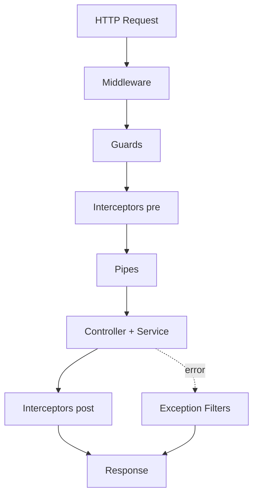

# Node.js — HTTP

Express, аутентификация, проверка, Koa, NestJS и выбор времени выполнения.

[ ← Вернуться в хаб](./8_nodejs.md)

### Related docs

* [Node.js — Core](./8_nodejs_core.md) · [Node.js — Модули](./8_nodejs_modules.md) · [Node.js — HTTP](./8_nodejs_http.md) · [Node.js — Дополнительно](./8_nodejs_process.md) · [Node.js — Интервью](./8_nodejs_interview.md)

### Sections

- [Express & HTTP](#express-http)
- [Auth & security](#auth-security)
- [Validation](#validation)
- [Koa](#koa)
- [NestJS](#nestjs)
- [Choosing a backend runtime](#choosing-a-backend-runtime)

---

## Express & HTTP

<details>
  <summary>Express overview</summary>

### Express overview

**Definition:**

Минимальный, скромный веб-фреймворк для Node.js — маршрутизация, промежуточное программное обеспечение, шаблоны, статические файлы, обработка ошибок.

| Особенность | Описание |
|---------|-------------|
| Маршрутизация | `app.get`, `app.post`, `app.use` |
| Промежуточное ПО | функции в конвейере запросов |
| Статические файлы | `express.static('public')` |
| Ошибка промежуточного программного обеспечения | 4-аргумент `(err, req, res, next)` |

**Examples:**

```js
import express from 'express';

const app = express();
app.use(express.json());

app.get('/api/health', (req, res) => res.json({ status: 'ok' }));
app.listen(3000);
```

**Sources:** [expressjs.com](https://expressjs.com/)

</details>

<details>
  <summary>Middleware</summary>

### Middleware

**Definition:**

Функции `(req, res, next) => {}` которые выполняются по порядку во время запроса. Вызов `next()` чтобы продолжить или отправить ответ, чтобы завершить цепочку.

| Вариант использования | Пример |
|----------|---------|
| Ведение журнала | метод журнала + URL |
| Разбор тела | `express.json()` |
| Авторизация | проверить JWT, прикрепить `req.user` |
| Ошибки | отловить и отформатировать ошибки |

**Examples:**

```js
app.use((req, res, next) => {
  console.log(`${req.method} ${req.url}`);
  next();
});

app.use((err, req, res, next) => {
  res.status(500).json({ error: err.message });
});
```

**Sources:** [промежуточное ПО expressjs.com](https://expressjs.com/en/guide/using-middleware.html)

</details>

<details>
  <summary>Error handling middleware</summary>

### Error handling middleware

**Definition:** Промежуточное программное обеспечение Express error имеет **четыре аргумента** `(err, req, res, next)` и перехватывает ошибки, переданные `next(err)` или добавлено в асинхронные обработчики (с оболочкой).

**How it works:**

1. Обычное промежуточное ПО работает нормально.
2. В случае ошибки позвоните `next(err)` — пропускает оставшееся обычное промежуточное программное обеспечение.
3. Экспресс переходит к **промежуточному программному обеспечению первой ошибки** (функция с 4 аргументами).
4. Обработчик ошибок форматирует ответ (JSON, код состояния) и журналы.

| Узор | Цель |
|---------|---------|
| `next(err)` | Явное распространение ошибок |
| `express-async-errors` / обертка | Перехватывает отклоненные обещания в асинхронных маршрутах |
| Центральный обработчик ошибок | Последовательный `{ error, code }` форма |
| обработчик 404 | `app.use((req,res) => res.status(404).json(...))` после маршрутов |

**When to use:** Карта `ValidationError` → 422, `UnauthorizedError` → 401, неизвестно → 500 без утечек внутренних компонентов.

**Pluses and minuses:**

| + | − |
|------|------|
| Единое место для регистрации и отображения ошибок | Необходимо зарегистрироваться после всех маршрутов |
| Скрывает следы стека в производстве | Легко забыть о пересылке асинхронных ошибок |

**Examples:**

```js
// Async wrapper — no extra dependency
const asyncHandler = (fn) => (req, res, next) =>
  Promise.resolve(fn(req, res, next)).catch(next);

app.post('/users', asyncHandler(async (req, res) => {
  const user = await db.createUser(req.body);
  res.status(201).json(user);
}));

// Error middleware — MUST be last
app.use((err, req, res, next) => {
  const status = err.status ?? 500;
  console.error(err);
  res.status(status).json({
    error: status === 500 ? 'Internal server error' : err.message,
  });
});
```

**Thoughts:** Необработанный отказ от обещания на маршруте без `try/catch` или оболочка приводит к сбою Node или зависает запрос. Всегда пересылать ошибки с помощью `next(err)`.

**Sources:** [обработка ошибок expressjs.com](https://expressjs.com/en/guide/error-handling.html)

</details>

<details>
  <summary>Route & query params</summary>

### Route & query params

**Definition:**

Параметры маршрута — это сегменты пути (`:id`); параметры запроса представляют собой пары ключ/значение после `?` в URL-адресе.

| Тип | Узор | Доступ |
|------|---------|--------|
| Параметры маршрута | `/users/:id` | `req.params.id` |
| Строка запроса | `/users?lang=en` | `req.query.lang` |

**Examples:**

```js
app.get('/users/:id', (req, res) => {
  const { id } = req.params;
  const { lang } = req.query;
  res.json({ id, lang });
});
```

**Sources:** [маршрутизация expressjs.com](https://expressjs.com/en/guide/routing.html)

</details>

<details>
  <summary>res.json vs res.send</summary>

### res.json vs res.send

**Definition:**

Оба отправляют HTTP-ответы; `res.json()` наборы `Content-Type: application/json` и сериализует объекты.

| Метод | Поведение |
|--------|----------|
| `res.send(data)` | автоматически определяет тип (строка, буфер, объект) |
| `res.json(obj)` | всегда JSON, явно устанавливает заголовок |

**Examples:**

```js
res.json({ users: [] });     // preferred for APIs
res.send('plain text');      // text/html or text/plain
```

**Sources:** [ответ expressjs.com](https://expressjs.com/en/4x/api.html#res)

</details>

---

<a name="auth-security"></a>

## Auth & security

<details>
  <summary>Authentication, identification & authorization</summary>

### Authentication, identification & authorization

**Definition:**

Три отдельных шага безопасности в большинстве потоков аутентификации.

| Шаг | Вопрос | Примеры |
|------|----------|----------|
| Аутентификация | Кто ты? | пароль, OTP, OAuth, ключи доступа |
| Идентификация | Какой аккаунт? | идентификатор пользователя, адрес электронной почты, имя пользователя (`sub` претензия) |
| Авторизация | Что ты можешь сделать? | роли, разрешения, области действия |

**How it works:**

1. **Регистрация** — идентификация (уникальный адрес электронной почты) → хэш-пароль (bcrypt) → сохранение пользователя.
2. **Вход** — проверка учетных данных → выдача файла cookie сеанса или JWT.
3. **Запрос** — промежуточное программное обеспечение проверяет сеанс/JWT → прикрепить. `req.user`.
4. **Авторизация** — проверка роли/разрешения перед обработчиком (`if (!req.user.can('delete'))` → 403).

| Узор | Хранение | Отзыв |
|---------|---------|------------|
| Сессия + Redis | Сеанс на стороне сервера | Удалить сеансовый ключ |
| Доступ к JWT + обновление | Клиентский файл cookie/заголовок | Короткое TTL + вращение обновления |
| API-ключ | хэш БД | Поворот клавиши на приборной панели |

идентифицировать → проверить уникальность электронной почты → создать учетную запись (минимальная аутентификация).

аутентифицировать учетные данные → идентифицировать пользователя → разрешить доступ.

**When to use:** Возвращать **401** при отсутствии аутентификации; **403** при аутентификации, но запрещено. Никогда не сообщайте, существует ли электронная почта при входе в систему (сравнение с учетом времени). HTTP Basic против сеансов → [6_web_api.md — Basic](./6_web_api_auth.md#identification-authentication-authorization--http-basic).

**Pluses and minuses:**

| + (многоуровневая аутентификация) | − |
|-----|----------------------|
| Четкое разделение задач | Легко спутать 401 и 403 |
| Промежуточное ПО можно повторно использовать на разных маршрутах | OAuth усложняет |

**Sources:** [Аутентификация OWASP](https://cheatsheetseries.owasp.org/cheatsheets/Authentication_Cheat_Sheet.html)

</details>

<details>
  <summary>JWT</summary>

### JWT

**Definition:** JSON Web Token — компактная подписанная строка (`header.payload.signature`) для аутентификации без сохранения состояния между клиентом и сервером.

**How it works:**

1. Пользователь проходит аутентификацию с использованием учетных данных.
2. Сервер аутентификации выдает JWT.
3. Клиент отправляет JWT при каждом запросе API (обычно `Authorization: Bearer <token>`).
4. API проверяет подпись и срок действия.

| Часть | Содержание |
|------|---------|
| Заголовок | алгоритм (`alg`), введите |
| Полезная нагрузка | `sub`, `iat`, `exp`, таможенные претензии |
| Подпись | проверяет целостность |

кратковременный токен доступа + долгосрочный токен обновления, хранящийся в надежном месте; конечная точка обновления выдает новый токен доступа.

**Examples:**

```js
import jwt from 'jsonwebtoken';

const token = jwt.sign({ sub: userId, role: 'user' }, process.env.JWT_SECRET, {
  expiresIn: '30m',
});
const payload = jwt.verify(token, process.env.JWT_SECRET);
```

**Sources:** [jwt.io](https://jwt.io/) · [RFC 7519](https://datatracker.ietf.org/doc/html/rfc7519)

</details>

<details>
  <summary>bcrypt & password hashing</summary>

### bcrypt & password hashing

**Definition:**

bcrypt — это медленный, адаптивный хеш для паролей. Никогда не храните простые пароли — сравните с `bcrypt.compare()`.

| Практика | Почему |
|----------|-----|
| Гашиш с солью | сопротивляется радужным столам |
| Медленный алгоритм | ограничивает грубую силу |
| Никогда не регистрируйте пароли | утечка безопасности |

**Examples:**

```js
import bcrypt from 'bcrypt';

const hash = await bcrypt.hash(password, 12);
const valid = await bcrypt.compare(password, hash);
```

**Sources:** [npm bcrypt](https://www.npmjs.com/package/bcrypt)

</details>

<details>
  <summary>Passport.js</summary>

### Passport.js

**Definition:** Промежуточное программное обеспечение аутентификации для Express — поддерживает более 500 стратегий (локальная, OAuth, JWT).

**Examples:**

```js
import passport from 'passport';
import { Strategy as LocalStrategy } from 'passport-local';

passport.use(new LocalStrategy(async (username, password, done) => {
  const user = await findUser(username);
  if (!user || !await bcrypt.compare(password, user.hash)) {
    return done(null, false);
  }
  return done(null, user);
}));
```

**Sources:** [passportjs.org](http://www.passportjs.org/)

</details>

<details>
  <summary>Environment variables & secrets</summary>

### Environment variables & secrets

**Definition:**

Конфигурация и секреты хранятся в `process.env`, загруженный из ОС или `.env` файлы. Никогда не передавайте секреты в git.

| Практика | Описание |
|----------|-------------|
| `.env` in `.gitignore` | хранить местные секреты в тайне от репо |
| `dotenv` пакет | нагрузка `.env` при запуске |
| Различные окружения | отдельные значения dev/staging/prod |

**Examples:**

```js
import 'dotenv/config';
const dbUrl = process.env.DATABASE_URL;
```

**Sources:** [конфигурация 12factor.net](https://12factor.net/config)

</details>

---

<a name="validation"></a>

## Validation

<details>
  <summary>Joi</summary>

### Joi

**Definition:**

Язык описания схемы и валидатор для объектов JavaScript — декларативные правила для тел запросов, конфигурации и полезных данных API.

| Особенность | Описание |
|---------|-------------|
| Типы схем | строка, число, массив, объект, дата |
| Правила | `.required()`, `.min()`, `.email()`, `.pattern()` |
| Санитарная обработка | `.trim()`, `.lowercase()` |
| Ошибки | подробные сообщения проверки |

**Examples:**

```js
import Joi from 'joi';

const schema = Joi.object({
  email: Joi.string().email().required(),
  age: Joi.number().integer().min(18),
});

const { error, value } = schema.validate(req.body);
```

**Sources:** [joi.dev](https://joi.dev/)

</details>

<details>
  <summary>Ajv</summary>

### Ajv

**Definition:**

Быстрый валидатор схемы JSON — компилирует схемы в эффективные функции проверки.

| Особенность | Описание |
|---------|-------------|
| Схема JSON | проект-07, 2019-09, 2020-12 |
| Производительность | скомпилированные валидаторы, очень быстро |
| Пользовательские ключевые слова | расширить с помощью плагинов |

**Examples:**

```js
import Ajv from 'ajv';

const ajv = new Ajv();
const validate = ajv.compile({
  type: 'object',
  properties: { name: { type: 'string' } },
  required: ['name'],
});

if (!validate(data)) console.log(validate.errors);
```

**Sources:** [ajv.js.org](https://ajv.js.org/)

</details>

---

<a name="process-cluster"></a>

## Koa

<details>
  <summary>Koa overview</summary>

### Koa overview

**Definition:**

Современная, облегченная HTTP-инфраструктура от команды Express — использует промежуточное программное обеспечение async/await и объект контекста (`ctx`) вместо узла `req`/`res` напрямую.

| против Экспресса | Коа |
|------------|-----|
| Промежуточное программное обеспечение обратного вызова | асинхронные функции |
| `req` / `res` | единый `ctx` |
| Батарейки в комплекте | минимальное ядро, добавьте промежуточное ПО |

**Examples:**

```js
import Koa from 'koa';

const app = new Koa();
app.use(async (ctx) => {
  ctx.body = { message: 'Hello Koa' };
});
app.listen(3000);
```

**Sources:** [koajs.com](https://koajs.com/)

</details>

<details>
  <summary>ctx (context)</summary>

### ctx (context)

**Definition:**

Объект контекста Koa инкапсулирует запрос и ответ для каждого HTTP-вызова.

| Недвижимость | Карты |
|----------|---------|
| `ctx.request` | входящий запрос |
| `ctx.response` | исходящий ответ |
| `ctx.body` | тело ответа, сокращение |
| `ctx.state` | общие данные промежуточного программного обеспечения |

**Examples:**

```js
app.use(async (ctx, next) => {
  console.log(ctx.method, ctx.url);
  ctx.state.user = await getUser(ctx);
  await next();
});
```

**Sources:** [контекст koajs.com](https://koajs.com/#context)

</details>

---

<a name="nestjs"></a>

## NestJS

<details>
  <summary>NestJS overview</summary>

### NestJS overview

**Definition:** NestJS — это прогрессивная платформа Node.js для создания масштабируемых серверных приложений с использованием TypeScript — продуманной структуры, внедрения зависимостей и декораторов поверх Express или Fastify.

**How it works:**

- Загрузка приложений из `@Module` график — импорт, контролеры, поставщики.
- HTTP-адаптер (Express/Fastify) обрабатывает необработанный запрос; Nest оборачивает его в контекст выполнения.
- **Поставщики** (`@Injectable`) регистрируются в модуле и внедряются через конструктор.
- **Контроллеры** сопоставляют маршруты с методами-обработчиками; бизнес-логика живет в сервисах.

**When to use:** Корпоративные API, микросервисы, команды, которым нужна согласованная структура серверной части, GraphQL/gRPC/WebSocket в одной среде.

**Pluses and minuses:**

| + | − |
|------|------|
| Модульная архитектура «из коробки» | Больше шаблона, чем сырого Express |
| DI + тестируемость | Кривая обучения (декораторы, модули) |
| Унифицированные модели (охранники, трубы, перехватчики) | Тяжелее для крошечных API |
| TypeScript-в первую очередь | Блокировка фреймворка против минимальных библиотек |

**Examples:**

```ts
@Module({
  imports: [UsersModule],
  controllers: [AppController],
  providers: [AppService],
})
export class AppModule {}
```

**Sources:** [docs.nestjs.com](https://docs.nestjs.com/)

</details>

<details>
  <summary>Request lifecycle — full path</summary>

### Request lifecycle — full path

**Definition:** Каждый HTTP-запрос в NestJS проходит через фиксированный конвейер перед отправкой ответа. Заказ описан в официальном FAQ по жизненному циклу запроса.

**How it works:**

1. **Входящий запрос** попадает в HTTP-адаптер (Express/Fastify).
2. **Промежуточное ПО** — глобальное, затем привязанное к модулю (`app.use`, `@Module` потребитель). Логирование, CORS, сырое тело. Можно завершить запрос или позвонить `next()`.
3. **Guards** — глобальный → контроллер → маршрут (`@UseGuards`). Возвращаться `true` или кинуть(`CanActivate`). Здесь живут авторизация и роли.
4. **Перехватчики (предконтроллер)** — глобальный → контроллер → маршрут. Ведение журнала, таймаут, кеш, преобразование входящего контекста.
5. **Pipes** — глобальный → контроллер → маршрут → **параметры маршрута** (параметры обрабатываются в порядке очереди среди оформленных аргументов). Проверка (`ValidationPipe`), разбор (`ParseIntPipe`), трансформация.
6. **Обработчик контроллера** — ваш `@Get()` / `@Post()` метод запускается.
7. **Сервисный уровень** — внедренные провайдеры (БД, внешние API).
8. **Перехватчики (постконтроллер)** — ответ отображения/преобразования, перенос `{ data, meta }`.
9. **Фильтры исключений** — если необнаруженная ошибка: маршрут → контроллер → глобальный (сначала самый низкий уровень). Отформатируйте ответ об ошибке.
10. **Ответ** отправлен клиенту.



| Слой | Вопрос, на который он отвечает | Нест против Экспресса |
|-------|---------------------|-----------------|
| Промежуточное ПО | Сквозной, любой маршрут? | Та же идея, что и у Express |
| Охранник | Звонящий разрешен? | Гнездо-специфическое |
| Труба | Является ли ввод действительным/преобразованным? | Гнездо-специфическое |
| Перехватчик | Логика обработчика до/после? | Гнездо-специфическое |
| Фильтр | Как отформатировать ошибки? | Как промежуточное программное обеспечение с ошибками Express |**Пример приказа охраны** — `@UseGuards(Guard1, Guard2)` на контроллере, `@UseGuards(Guard3)` по маршруту → `Guard1 → Guard2 → Guard3`.

**Thoughts:** Охранники = ворота авторизации; Трубы = вход; Перехватчики = AOP вокруг обработчика; Фильтры = ошибки только при выбрасывании.

**Sources:** [NestJS — жизненный цикл запроса](https://docs.nestjs.com/faq/request-lifecycle)

</details>

<details>
  <summary>Decorators cheat sheet</summary>

### Decorators cheat sheet

**Definition:**

Декораторы присоединяют метаданные и подключают DI и маршрутизацию Nest. Машинопись `experimentalDecorators` или требуются декораторы TS 5+ уровня 3.

| Декоратор | Уровень | Цель |
|-----------|-------|---------|
| `@Module()` | Приложение | Контроллеры комплектации, поставщики, импорт, экспорт |
| `@Controller('path')` | Класс | Префикс маршрута |
| `@Get()`, `@Post()`, `@Patch()`, `@Delete()` | Метод | HTTP-глагол + путь |
| `@Injectable()` | Класс | Регистрируемый поставщик для DI |
| `@Inject(token)` | Парам | Пользовательский токен поставщика |
| `@Body()`, `@Param()`, `@Query()`, `@Headers()` | Парам | Извлечение частей запроса |
| `@UseGuards()` | Класс/метод | Аутентификация/роли |
| `@UsePipes()` | Класс/метод | Проверка на маршруте |
| `@UseInterceptors()` | Класс/метод | Журналирование, картографирование, кэш |
| `@Catch()` | Класс | Фильтр исключений для конкретных ошибок |

**Декораторы параметров** (`@Body('email')`, `@Param('id')`) сообщает Nest, что вводить в аргументы обработчика — в сочетании с каналами для проверки.

**Examples:**

```ts
@Controller('users')
@UseGuards(JwtAuthGuard)
export class UsersController {
  constructor(private readonly users: UsersService) {}

  @Get(':id')
  @UseGuards(RolesGuard)
  @Roles('admin')
  findOne(@Param('id', ParseIntPipe) id: number) {
    return this.users.findOne(id);
  }

  @Post()
  @UsePipes(new ValidationPipe({ whitelist: true }))
  create(@Body() dto: CreateUserDto) {
    return this.users.create(dto);
  }
}
```

**Sources:** [NestJS — Контроллеры](https://docs.nestjs.com/controllers) · [NestJS — Пользовательские декораторы](https://docs.nestjs.com/custom-decorators)

</details>

<details>
  <summary>Guards vs middleware vs pipes</summary>

### Guards vs middleware vs pipes

**Definition:**

Три разных точки расширения — их легко перепутать на собеседованиях.

| | Промежуточное ПО | Охранник | Труба |
|---|------------|-------|------|
| **Запускается, когда** | В начале разработки | После промежуточного программного обеспечения, перед обработчиком | Перед передачей аргументов обработчика |
| **Доступ** | `req`, `res`, `next` | `ExecutionContext` | `ArgumentMetadata` + стоимость |
| **Типичное использование** | Логгер, шлем, парсер cookie | Проверка JWT, RBAC | `class-validator`, `ParseUUIDPipe` |
| **Можно заблокировать маршрут** | Да (не звони `next`) | Да (`return false` / бросить) | Да (бросить `BadRequestException`) |
| **Знает обработчик** | Нет | Да (метаданные отражателя) | Да (тип параметра) |

**Охранники** реализуют `CanActivate` — проверить роли из `@Roles()` с помощью `Reflector`, проверьте JWT, ключи API.

**Трубы** орудие `PipeTransform` — `ValidationPipe` использует `class-validator` по DTO; встроенные трубы принудительного типа.

**Перехватчики** сидят вокруг выполнения обработчика — `map` оператор на RxJS `Observable` возвращаемые значения, добавление заголовков синхронизации, кэширование ответов.

**When to use:**

#### Common pitfalls

— Включение аутентификации в промежуточное программное обеспечение, когда вам нужны роли на уровне маршрута → используйте Guards.
- Проверка в контроллере вручную → использовать `ValidationPipe` + ДТО.
- Забывая о глобальном `ValidationPipe` in `main.ts`.

**Sources:** [NestJS — Guards](https://docs.nestjs.com/guards) · [NestJS — Pipes](https://docs.nestjs.com/pipes)

</details>

<details>
  <summary>Data layer in NestJS</summary>

### Data layer in NestJS

**Definition:** Nest не поставляет ORM — вы интегрируете Prisma, TypeORM, Sequelize, Drizzle или сырую версию. `pg` через провайдеров и модули.

**How it works:**

1. Экспорт **Модуля базы данных** `PrismaService` / `TypeOrmModule` настроен один раз.
2. **Функциональный модуль** (например. `UsersModule`) импортирует модуль БД, объявляет `UsersService` + `UsersController`.
3. **Сервис** инкапсулирует запросы — контроллер остается тонким.
4. **Транзакции** — `prisma.$transaction([...])` or `@Transactional()` (ТипОРМ).
5. **Миграции** — ORM CLI или Prisma Migrate, запускаются в CI/CD перед развертыванием.

| Подход | Интеграция гнезда |
|----------|------------------|
| Призма | `PrismaService` простирается `PrismaClient`, `onModuleInit` соединяет |
| ТипORM | `@nestjs/typeorm`, сущности, `Repository<T>` инъекции |
| Необработанный SQL | Пользовательская упаковка провайдера `pg.Pool` |

**When to use:** Шаблон репозитория для тестируемости (макет-сервис в модульных тестах). Модуль CQRS для разделения чтения/записи в масштабе.

**Examples:**

```ts
@Injectable()
export class PrismaService extends PrismaClient implements OnModuleInit {
  async onModuleInit() {
    await this.$connect();
  }
  async onModuleDestroy() {
    await this.$disconnect();
  }
}

@Injectable()
export class UsersService {
  constructor(private prisma: PrismaService) {}

  findByEmail(email: string) {
    return this.prisma.user.findUnique({ where: { email } });
  }
}
```

**Sources:** [NestJS — База данных](https://docs.nestjs.com/techniques/database) · [9_database.md](./9_database.md)

</details>

<details>
  <summary>NestJS vs Express vs Fastify</summary>

### NestJS vs Express vs Fastify

**Definition:**

Express и Fastify — это минимальные HTTP-серверы; NestJS — это полноценная платформа приложений, которая может использовать любой из них в качестве механизма HTTP.

| | Экспресс | Фастафай | НестJS |
|---|---------|---------|--------|
| **Тип** | Минимальный маршрутизатор + промежуточное ПО | Быстрый HTTP-фреймворк + проверка схемы | Мнение фреймворка (модули, DI) |
| **Структура** | Вы проектируете | Вы проектируете | Модули, контроллеры, сервисы || **Производительность** | Базовый уровень | Часто 2×+ RPS против Express | Зависит от адаптера (быстрее закрепить) |
| **Типскрипт** | Типы сообществ | Сильная встроенная поддержка | Первоклассный |
| **Проверка** | Руководство/промежуточное программное обеспечение | `@fastify/*` плагины | `ValidationPipe` + ДТО |
| **Аутентификация** | Паспорт, пользовательское промежуточное ПО | Плагины | Модуль Охрана + Паспорт |
| **Кривая обучения** | Низкий | Низкий–средний | Средне-высокий |
| **Лучший вариант** | Малые API, наследие, гибкость | Высокопроизводительные API | Команды, микросервисы, долгоживущие продукты |

**How it works:**

- **Внедрение зависимостей** — тестируемые, заменяемые реализации.
- **Постоянные границы** — защитные устройства/каналы/перехватчики вместо специальных цепочек промежуточного программного обеспечения.
- **Транспорт микросервисов** — TCP, Redis, RabbitMQ, Kafka через `@nestjs/microservices`.
- **WebSockets/GraphQL** — собственные модули.

Бессерверные одноразовые функции, трехконечные прототипы, аллергия команды на декораторы.

```ts
// main.ts — Fastify adapter for better throughput
const app = await NestFactory.create<NestFastifyApplication>(
  AppModule,
  new FastifyAdapter(),
);
```

**Sources:** [NestJS — Производительность (Fastify)](https://docs.nestjs.com/techniques/ Performance) · [fastify.io](https://fastify.dev/)

</details>

---

<a name="runtime-choice"></a>

## Choosing a backend runtime

<details>
  <summary>Node.js vs Go vs Elixir</summary>

### Node.js vs Go vs Elixir

**Definition:**

Три распространенных варианта серверной части с различными моделями параллелизма и экосистемами — выбирайте в зависимости от рабочей нагрузки, навыков команды и операционных потребностей.

| | **Node.js** | **Вперёд** | **Эликсир (ЛУЧ)** |
|---|-------------|--------|-------------------|
| **Параллелизм** | Однопоточный JS + цикл событий; `worker_threads` / кластер | Горутины (дешевые потоки), каналы CSP | Актерские процессы, вытесняющий планировщик |
| **Сила** | API-интерфейсы с привязкой к вводу-выводу, в режиме реального времени, полностековый TS | ЦП + ввод-вывод, простое развертывание (статический двоичный файл) | Отказоустойчивость, миллионы подключений |
| **Слабость** | ЦП в главном потоке блокирует цикл | Подробная обработка ошибок, меньше веб-библиотек | Меньший пул найма, нишевая экосистема || **Типичная стопка** | Nest/Express + Postgres + Redis | Джин/Файбер + Постгрес | Феникс + Постгрес |
| **API JSON/HTTP** | Отлично | Отлично | Отлично |
| **WebSocket/чат** | Socket.IO, ws | Хорошо | Phoenix Channels — сила отрасли |

**How it works:**

— Команда уже пишет TypeScript во фронтенде.
- BFF, REST/GraphQL, SSR (Next.js), необходимо множество пакетов npm.
- Рабочая нагрузка связана с вводом-выводом (БД, HTTP, очереди).

- Микросервисы с высоким RPS, инструменты CLI, компоненты инфраструктуры.
- Нужна предсказуемая память и встроенный параллелизм без ментальной модели цикла событий.
— Небольшие образы контейнеров, быстрый холодный старт (также хорошо для Lambda).

- Мягкий режим реального времени (чат, уведомления, присутствие).- «Пусть выйдет из строя» + контроль OTP для обеспечения бесперебойной работы 99,99%.
- Соединение телекоммуникационного уровня рассчитано на один узел.

* «Мы выбрали Node, потому что команда работает с полным стеком TypeScript, продукт представляет собой CRUD с большим количеством операций ввода-вывода и интеграцию, а время вывода на рынок имело значение. Я бы рассмотрел Go для рабочей службы с привязкой к ЦП, если профилирование показало блокировку цикла событий, или Elixir, если мы создали ядро ​​​​для совместной работы в реальном времени». *

**Sources:** [Цикл событий Node.js](https://nodejs.org/en/docs/guides/event-loop-timers-and-nexttick) · [Go concurrency](https://go.dev/doc/efficient_go#concurrency)

</details>

---

<a name="interview-practice"></a>

<details>
  <summary>Interview Practice</summary>

### Interview Practice

Вопросы от [0_interview.md](0_interview.md). Попробуйте ответить, прежде чем открывать решения.

### Question index

| # | Тема | Ответ |
|---|-------|--------|
| 117 | РЕПЛ | Вопросы и ответы |
| 118 | Потоки | Вопросы и ответы |
| — | Файл против файловой системы | Вопросы и ответы |
| 119 | Промежуточное ПО | Вопросы и ответы |
| 120 | setImmediate против nextTick | Вопросы и ответы |
| — | ЕСМ против CJS | Вопросы и ответы |
| — | рабочие_потоки | Вопросы и ответы |
| — | Грациозное завершение работы | Вопросы и ответы |
| — | Жизненный цикл запроса NestJS | Вопросы и ответы |
| — | Guards против промежуточного программного обеспечения против каналов | Вопросы и ответы |
| — | NestJS против Express против Fastify | Вопросы и ответы || — | Node.js против Go против Elixir | Вопросы и ответы |
| Средний | Однопоточный, fork/spawn, JWT, bcrypt | Вопросы и ответы |

---
