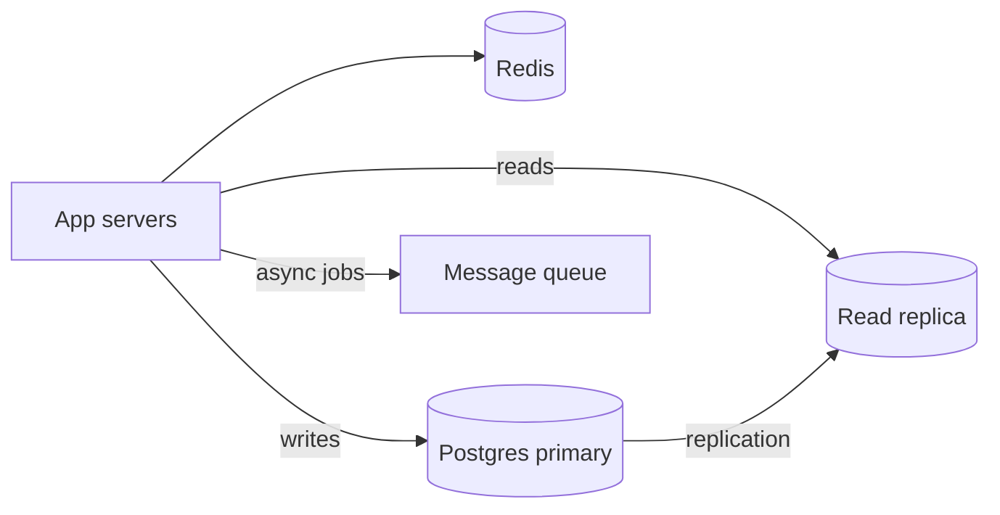

# Database — Interview

Интервью вопросов и ответов по базам данных.

[ ← Вернуться в хаб](./9_database.md)

### Related docs

- [БД — Основы](./9_database_core.md) · [БД — SQL](./9_database_sql.md) · [БД — NoSQL](./9_database_nosql.md) · [БД — ORM](./9_database_orm.md) · [БД — Производство](./9_database_production.md) · [БД — Интервью](./9_database_interview.md)

### Sections

- [Questions & Answers](#questions-answers)

---

## Questions & Answers

<details>
  <summary>HAVING vs WHERE?</summary>

### HAVING vs WHERE?

**Definition:** `WHERE` фильтрует **строки** перед агрегированием; `HAVING` фильтрует **группы** после `GROUP BY`.

**How it works:**

Порядок выполнения SQL — `FROM` → `WHERE` → `GROUP BY` → `HAVING` → `SELECT` → `ORDER BY` → `LIMIT`.

| Пункт    | Фильтры          | Можно ли использовать агрегаты? |
| -------- | ---------------- | ------------------------------- |
| `WHERE`  | Отдельные строки | Нет (`COUNT(*)` недействителен) |
| `HAVING` | Группы           | Да (`HAVING COUNT(*) > 5`)      |

**When to use:** «Авторы более 5 книг» → `HAVING`. «Книги 2020+» → `WHERE`. Тема: [WHERE vs HAVING](./9_database_sql.md#where-vs-having).

**Examples:**

```sql
SELECT author_id, COUNT(*) AS cnt
FROM books
WHERE published_at >= '2020-01-01'   -- row filter first
GROUP BY author_id
HAVING COUNT(*) > 5;                -- group filter after
```

**Sources:** [PostgreSQL — ВЫБРАТЬ](https://www.postgresql.org/docs/current/sql-select.html)

</details>

<details>
  <summary>LEFT JOIN vs INNER JOIN?</summary>

### LEFT JOIN vs INNER JOIN?

**Definition:** **INNER JOIN** возвращает только строки с совпадениями в обеих таблицах. **LEFT JOIN** возвращает все левые строки таблицы; правая сторона имеет значение NULL, если совпадений нет.

**How it works:**

Условие присоединения в `ON` — `FROM users u LEFT JOIN orders o ON o.user_id = u.id` удерживает каждого пользователя даже при нулевых заказах.

| Присоединяйтесь | Используйте, когда                                                             |
| --------------- | ------------------------------------------------------------------------------ |
| ВНУТРЕННИЙ      | Требуется связь (только пользователи с заказами)                               |
| СЛЕВА           | Необязательное отношение (все пользователи, общее количество заказов или NULL) |

**When to use:** Неправильный тип соединения автоматически удаляет данные — INNER, если вы имели в виду LEFT, теряет пользователей без заказов. Тема: [Объединения](./9_database_sql.md#joins).

**Sources:** [PostgreSQL — соединения](https://www.postgresql.org/docs/current/queries-table-expressions.html#QUERIES-JOIN) · [Использовать индекс, Люк — соединения](https://use-the-index-luke.com/sql/join)

</details>

<details>
  <summary>1NF vs 2NF vs 3NF vs BCNF?</summary>

### 1NF vs 2NF vs 3NF vs BCNF?

**Definition:**

Обычные формы — это сложенные правила, которые устраняют избыточность. Целевой показатель для OLTP — **3NF**. Теория: [Нормальные формы (1NF–3NF, BCNF)](./9_database_core.md#normal-forms-1nf3nf-bcnf).

| Форма    | Дополнительное правило по сравнению с предыдущим                                 |
|  --------  |  --------------------------------------------------------------------------------  |
| **1НФ**  | Атомарные значения — никаких списков/вложенных таблиц в ячейке |
| **2НФ** | Неключевые столбцы зависят от **всего** потенциального ключа |
| **3НФ**  | Неключевые столбцы зависят **только** от ключей (нет A → B → C через неключевые) |
| **БКНФ** | Каждый определитель нетривиального ФД является **суперключом**                   |

**How it works:** 2NF использует только **составные** ключи. Таблицы PK с одним столбцом, имеющие формат 1NF, уже являются 2NF. BCNF — это 3NF плюс «отсутствие остатков FD от неключа к ключу».

**When to use:** «Зачем раскалываться `products` от `order_items`?» → 2НФ/3НФ. Касса все еще копирует `unit_price` → преднамеренная денормализация, а не провал 3НФ.

**Sources:** [Нормализация базы данных](https://en.wikipedia.org/wiki/Database_normalization)

</details>

<details>
  <summary>MongoDB embed vs reference?</summary>

### MongoDB embed vs reference?

**Definition:**

**Встроить** вкладывает связанные документы в родительский элемент; **справочные** магазины `ObjectId` указывая на другую коллекцию.

| Узор     | Лучшее для                              | Избегайте, когда                                       |
| -------- | --------------------------------------- | ------------------------------------------------------ |
| Встроить | Один к нескольким, всегда читаем вместе | Неограниченные массивы (комментарии к вирусному посту) |
| Ссылка   | Общие сущности «один ко многим»         | Многим родителям необходимо атомарное обновление       |

**How it works:** Встроенные обновления документов с родителем за одно чтение; для ссылки требуется второй запрос или `$lookup` (например, ПРИСОЕДИНЯЙТЕСЬ).

**When to use:** Адрес пользователя встроен; указана категория продукта. Ограничение на встраивание документов размером 16 МБ.

**Sources:** [MongoDB — моделирование данных](https://www.mongodb.com/docs/manual/core/data-modeling-introduction/)

</details>

<details>
  <summary>N+1 problem?</summary>

### N+1 problem?

**Definition:** Один запрос загружает N родителей, затем N отдельных запросов загружают детей — 1 + N циклов туда и обратно.

**How it works:**

Отложенная загрузка ORM запускает запрос для каждой строки в цикле. Исправьте с нетерпением `include`, ПРИСОЕДИНЯЙТЕСЬ или `WHERE id IN (...)`.

| Исправить        | Подход                                       |
| ---------------- | -------------------------------------------- |
| ОРМ              | `include: { posts: true }`                   |
| SQL              | `LEFT JOIN` или партия `IN`                  |
| Загрузчик данных | Пакетная обработка + кэш на запрос (GraphQL) |

**Examples:**

```ts
// BAD
const users = await prisma.user.findMany();
for (const u of users)
  u.posts = await prisma.post.findMany({ where: { authorId: u.id } });

// GOOD
const users = await prisma.user.findMany({ include: { posts: true } });
```

**Sources:** [Prisma — Реляционные запросы](https://www.prisma.io/docs/orm/prisma-client/queries/relation-queries)

</details>

<details>
  <summary>What is ACID?</summary>

### What is ACID?

**Definition:** Гарантии транзакций — **Атомарность** (все или ничего), **Последовательность** (ограничения сохраняются), **Изоляция** (одновременные передачи не повреждаются), **Долговечность** (фиксация сохраняется после сбоя).

**When to use:** Банковский перевод — дебет и кредит одной транзакцией; `ROLLBACK` при любой неудаче.

**Thoughts:** По умолчанию изоляция Postgres — READ COMMITTED. Делайте транзакции короткими. Темы: [ACID](./9_database_core.md#acid), [COMMIT и ROLLBACK](./9_database_sql.md#commit-and-rollback).

**Sources:** [PostgreSQL — Транзакции](https://www.postgresql.org/docs/current/tutorial-transactions.html)

</details>

<details>
  <summary>Upsert — ON CONFLICT?</summary>

### Upsert — ON CONFLICT?

**Definition:** `INSERT ... ON CONFLICT (unique_col) DO UPDATE` — атомарно вставлять или обновлять в PostgreSQL.

**When to use:** Идемпотентные веб-перехватчики, синхронизация профиля пользователя по электронной почте, строка настроек для каждого пользователя. Тема: [Upsert](./9_database_sql.md#upsert-on-conflict).

**Examples:**

```sql
INSERT INTO settings (user_id, theme) VALUES (1, 'dark')
ON CONFLICT (user_id) DO UPDATE SET theme = EXCLUDED.theme;
```

**Sources:** [PostgreSQL — ПРИ КОНФЛИКТЕ](https://www.postgresql.org/docs/current/sql-insert.html#SQL-ON-CONFLICT)

</details>

<details>
  <summary>Foreign keys — why use them?</summary>

### Foreign keys — why use them?

**Definition:** FK обеспечивает ссылочную целостность — невозможно вставить `orders.user_id = 999` если пользователь 999 не существует.

**When to use:** `ON DELETE RESTRICT` предотвращает удаление пользователя с заказами; `CASCADE` удаляет детей вместе с родителем (используйте осторожно). Темы: [Первичный ключ](./9_database_sql.md#primary-key), [Внешний ключ](./9_database_sql.md#foreign-key).

**Sources:** [PostgreSQL — ограничения](https://www.postgresql.org/docs/current/ddl-constraints.html)

</details>

<details>
  <summary>Backup vs PITR?</summary>

### Backup vs PITR?

**Definition:** **Резервное копирование моментального снимка** восстанавливает время резервного копирования. **PITR** воспроизводит журналы WAL для восстановления до любой секунды в пределах хранения.

**When to use:** Случайный `DELETE` → PITR на минуту назад. Один только ежедневный снимок не может исправить полуденную ошибку.

**Thoughts:** Тест восстанавливается регулярно. Репликация не является резервной копией.

**Sources:** [PostgreSQL — Резервное копирование](https://www.postgresql.org/docs/current/backup.html)

</details>

<details>
  <summary>Scaling PostgreSQL to millions of users</summary>

### Scaling PostgreSQL to millions of users

**Definition:** Переход от небольшой базы данных OLTP к миллионам пользователей — это **последовательность взвешенных шагов**, а не немедленное сегментирование.

**How it works:**

| Этап | Действие                                                                                  | Что это исправляет                               |
|  ----  |  -----------------------------------------------------------------------------------------  |  ------------------------------------------------  |
| 1    | **Индексы** включены `WHERE`, `JOIN`, `ORDER BY` колонны                                  | Медленные запросы, последовательное сканирование |
| 2    | **Настройка запроса** — исправьте N+1, избегайте `SELECT *`, нумерация страниц            | Путешествия туда и обратно на уровне приложения  |
| 3    | **Пул соединений** (PgBouncer)                                                            | `max_connections` истощение                      |
| 4    | **Кэш Redis** — кеш для горячих клавиш (профиль, конфигурация)                            | Повторные идентичные чтения                      |
| 5    | **Чтение реплик** — отчеты и конечные точки с интенсивным чтением вне реплики             | Основной ЦП / ввод-вывод                         |
| 6    | **Денормализовать** — снимки для дашбордов (заказывать позиции при оформлении заказа)     | Дорогие соединения во время чтения |
| 7   | **Разделение** — по дате или `tenant_id` внутри одной БД | Обслуживание больших столов, архивное |
| 8    | **Асинхронная работа** — электронная почта, аналитика, поисковая индексация через очередь | Написать путь раздувания                         |
| 9    | **Шардинг** — разделение по `user_id` / `tenant_id` по БД                                 | Однопистовой потолок                             |



**When to use:**

1 миллион пользователей ≠ 1 миллион запросов в секунду — уточните соотношение чтения/записи и горячие пути на собеседовании. Начните с `EXPLAIN ANALYZE` и метрики пула соединений.

#### Common pitfalls

- Шардинг перед индексацией — операционный кошмар без особой выгоды.
- Чтение реплики сразу после записи — устаревшие данные (нарушение read-your-writes).
- `OFFSET 100000` нумерация страниц — используйте набор ключей (`WHERE id > $cursor`).

**Pluses and minuses:**

| + (инкрементальный масштаб)                       | −                                                      |
| ------------------------------------------------- | ------------------------------------------------------ |
| Каждый шаг обратим и измерим                      | Шардинг усложняет межсегментные запросы                |
| Большинству приложений никогда не требуется шаг 9 | Ошибки аннулирования кэша приводят к устаревшим данным |

**Thoughts:** _"Индексы, пул, кеш, реплики — шардинг в последнюю очередь."_

**Sources:** [PostgreSQL — Высокая доступность](https://www.postgresql.org/docs/current/high-availability.html) · [Используйте индекс, Люк](https://use-the-index-luke.com/)

</details>

<details>
  <summary>Indexes you use every day (interview answer)</summary>

### Indexes you use every day (interview answer)

**Definition:**

Практические шаблоны индексов для типичных приложений Node/Postgres — что ответить на вопрос «какие индексы вы используете ежедневно?»

| Узор                      | SQL                                              | Почему                          |
| ------------------------- | ------------------------------------------------ | ------------------------------- |
| Уникальный логин          | `UNIQUE INDEX ON users(email)`                   | Быстрый поиск + ограничение     |
| ФК + сортировка           | `INDEX ON orders(user_id, created_at DESC)`      | Список заказов пользователя     |
| Частичные активные строки | `INDEX ON users(email) WHERE deleted_at IS NULL` | Меньший индекс, мягкое удаление |
| Поле JSONB                | `GIN INDEX ON products USING gin(data)`          | `@>` / `?` запросы по JSON      |
| Полный текст              | `GIN ON to_tsvector('english', title)`           | Искать, а не `LIKE '%x%'`       |

**How it works:**

`EXPLAIN (ANALYZE, BUFFERS)` - хотеть `Index Scan` or `Index Only Scan`, нет `Seq Scan` на больших столах.

Каждый индекс замедляется `INSERT`/`UPDATE` — не индексируйте только столбцы с низкой мощностью (`status` с 3 значениями), если не частично.

**Examples:**

```sql
CREATE UNIQUE INDEX idx_users_email ON users (lower(email));
CREATE INDEX idx_orders_user_created ON orders (user_id, created_at DESC);
CREATE INDEX idx_users_active_email ON users (email) WHERE deleted_at IS NULL;
```

**Sources:** [PostgreSQL — Индексы](https://www.postgresql.org/docs/current/indexes.html)

</details>

<details>
  <summary>What is Redis and how does it work?</summary>

### What is Redis and how does it work?

**Definition:** Сервер структур данных в памяти — задержка менее миллисекунды для строк, хэшей, списков, наборов, отсортированных наборов, потоков.

**How it works:**

Ключ-значение в оперативной памяти; необязательное сохранение RDB/AOF; Срок действия ключей TTL истекает автоматически; однопоточная обработка команд (горячая клавиша = узкое место).

```js
const hit = await redis.get(`user:${id}`);
if (hit) return JSON.parse(hit);
const user = await db.user.findUnique({ where: { id } });
await redis.setex(`user:${id}`, 3600, JSON.stringify(user));
```

Основное надежное хранилище финансовых данных без тщательной настройки постоянного хранения.

**When to use:** Отказ от кэша, сеансы, ограничение скорости (`INCR` + TTL), pub/sub, очереди заданий Bull/BullMQ, списки лидеров (`ZADD`).

**Sources:** [Документация Redis](https://redis.io/docs/)

</details>

<details>
  <summary>What is Elasticsearch and how does it work?</summary>

### What is Elasticsearch and how does it work?

**Definition:** Распределенная поисковая система на основе Lucene — документы JSON в **индексах**, разбитые на **осколки** по **узлам**.

**How it works:**

Анализатор (фильтр символов → токенизатор → фильтры токенов) строит инвертированный индекс. Запрос DSL (`match`, `match_phrase`, `bool`) набирает очки. Реплики дают HA; координация узлов маршрута.

Первичное транзакционное хранилище.

**When to use:** Полнотекстовый поиск товаров, логи. Сохраняйте Postgres/Mongo как источник истины; синхронизироваться с ES.

**Sources:** [NoSQL — Elasticsearch](./9_database_nosql_core.md#elasticsearch)

</details>

<details>
  <summary>What is RabbitMQ and how does it work?</summary>

### What is RabbitMQ and how does it work?

**Definition:** Брокер сообщений (AMQP) — производители публикуют сообщения на **биржах**, биржи направляют сообщения в **очереди**, потребители обрабатывают сообщения асинхронно.

**How it works:**

- **Типы обмена:** прямой (ключ маршрутизации), разветвленный (трансляция), тематический (`order.*`), заголовки.
- **Ack/Nack** — потребитель подтверждает обработку; неподтвержденные сообщения доставлены повторно.
- **Очередь недоставленных писем (DLQ)** — сообщения, не прошедшие проверку/повторную попытку.
- Доставка: **хотя бы один раз** по умолчанию — потребители должны быть **идемпотентными**.

RabbitMQ — очереди задач и маршрутизация; Kafka — журнал событий с высокой пропускной способностью и повтором.

**When to use:** Отправка электронной почты, обработка заказов, разделение микросервисов, поглощение всплесков трафика.

**Sources:** [Уроки RabbitMQ](https://www.rabbitmq.com/tutorials)

</details>

---

### Tasks

### Task 1 — Top 3 authors by book count

<details><summary>Solution</summary>

```sql
SELECT a.name, COUNT(b.id) AS book_count
FROM authors a
JOIN books b ON b.author_id = a.id
GROUP BY a.id, a.name
ORDER BY book_count DESC LIMIT 3;
```

</details>

### Task 2 — Last 3 comments per user

<details><summary>Pattern</summary>

`ROW_NUMBER() OVER (PARTITION BY user_id ORDER BY created_at DESC) <= 3`или боковой подзапрос с `LIMIT 3` на пользователя.

</details>

### Task 3 — Library schema

Таблицы: `books`, `authors`, `members`, `loans`. Нормализовать авторов; индекс `loans(book_id)`, `loans(member_id)`.

### Task 4 — Fix N+1 with Prisma

```ts
prisma.user.findMany({
  include: { comments: { take: 3, orderBy: { createdAt: "desc" } } },
});
```

---

<details>
  <summary>Junior — DB</summary>

### Junior — DB

123. Напишите запрос, чтобы найти трех авторов, у которых больше всего книг.

124. Напишите запрос, который выбирает три последних комментария для конкретного пользователя.

125. Разработайте простую схему базы данных для библиотеки.

126. Что такое SQL `HAVING` пункт используется для?

127. Что такое `LEFT JOIN` используется для?

128. В чем разница между отношениями внедрения и ссылки в MongoDB?

129. Магазин комментариев `author_id` как обычную строку вместо `ObjectId` - что не так?

130. Как применить изменения схемы в производстве?

</details>

<details>
  <summary>Middle — DB</summary>

### Middle — DB

129. Что такое Redis и для чего он используется?

129б. Что такое Elasticsearch? Индекс vs шард vs анализатор? Почему бы не использовать его как источник истины?

130. Какие базы данных вы использовали? SQL против NoSQL?

131. Напишите запрос, возвращающий три последних комментария **на пользователя**.

132. Клиент просит выбрать базу данных для нового проекта. Ваш процесс?

133. Что такое `package-lock.json` для? → [10_build.md — npm](#пакеты)

134. `npm install` vs `npm ci`? → [10_build.md — npm](#пакеты)

135. Для чего нужны бандлеры? → [10_build.md — Объединение](#bundling)

136. Модульная загрузка скриптов и загрузчики бандлеров. → [10_build.md — Webpack](#bundlers)

См. также (git, а не базы данных): [0_git.md — Практика проведения собеседований](0_git_interview.md#interview-practice) — слияние и перебазирование, промежуточная область, проверка кода.

</details>

<details>
  <summary>DB (general)</summary>

### DB (general)

30. Какие альтернативные типы баз данных вы используете?

31. Что такое RDS и когда он не подходит?

32. Что такое SQL-инъекции и как их предотвратить?

33. Зачем использовать заполнители для запросов к базе данных?

34. Как спроектировать кластер MongoDB?

35. Для чего используется платформа агрегации MongoDB?

36. Опишите GraphQL.

</details>

</details>
