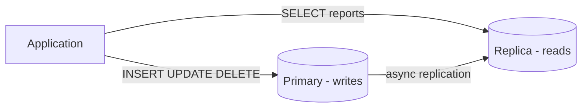

# Database — Production

Репликация, сегментирование, кэширование и масштабирование OLTP.

[ ← Вернуться в хаб](./9_database.md)

### Related docs

- [БД — Основы](./9_database_core.md) · [БД — SQL](./9_database_sql.md) · [БД — NoSQL](./9_database_nosql.md) · [БД — ORM](./9_database_orm.md) · [БД — Производство](./9_database_production.md) · [БД — Интервью](./9_database_interview.md)

### Sections

- [Production patterns](#production-patterns)
- [Scaling OLTP](#scaling-oltp)

---

## Production patterns

<details>
  <summary>Replication & read replicas</summary>

### Replication & read replicas

**Definition:**

Скопируйте данные из **основного** устройства записи в одну или несколько **реплик** (считывателей) для масштабирования и доступности.

| Синхронизация репликации             | Асинхронная репликация                        |
| ------------------------------------ | --------------------------------------------- | --- | ------------------------ | ---------------------------------------------- |
| Реплика подтверждает перед фиксацией | Первичная фиксация, реплика выполняется позже |     | Повышенная долговечность | Возможная задержка реплики (устаревшее чтение) |
| Более высокая задержка записи        | Лучшая производительность записи              |

**When to use:** Приложения с большим объемом чтения (каналы, информационные панели), отправляющие отчеты о реплике для защиты основного.

**Pluses and minuses:**

| +                                                          | −                                                                  |
| ---------------------------------------------------------- | ------------------------------------------------------------------ | --- | ------------------------------- | ------------------------------------------------------------------------- |
| Масштабировать трафик чтения по горизонтали                | Задержка репликации — возможность чтения и записи не гарантируется |
| Аварийное переключение для обеспечения высокой доступности | Риск разделения мозга без надлежащего инструмента                  |     | Географическое чтение местности | Репликация не является резервной копией — нужны отдельные резервные копии |

**Examples:**



**Thoughts:** После записи не предполагайте, что в реплике есть данные — используйте первичный для критического чтения или закрепления сеанса. Инструменты: Patroni, AWS RDS Multi-AZ, наборы реплик MongoDB.

**Sources:**

[PostgreSQL — Репликация](https://www.postgresql.org/docs/current/high-availability.html)

---

</details>

<details>
  <summary>Sharding vs partitioning</summary>

### Sharding vs partitioning

**Definition:**

- **Разбиение** — разбить одну логическую таблицу на сегменты внутри одной базы данных (по диапазону, списку, хешу).
- **Сегментирование** — разделение данных по **нескольким независимым базам данных** (осколкам), каждая из которых содержит подмножество. Elasticsearch делает это внутри кластера (индекс → первичные шарды + реплики) — [Elasticsearch](./9_database_nosql_core.md#elasticsearch).

| Плюсы (разделение) | Плюсы (шардинг) || --------------------------- | -------------------------------- |
| Прозрачно для приложения (в основном) | Неограниченный горизонтальный масштаб записи |
| Операции проще, чем шардинг | Изолировать шумных жильцов |

| Минусы (разделение)                   | Минусы (шардинг)                 |
| ------------------------------------- | -------------------------------- | --- | ------------------------ | ------------------------------ |
| Остается узким местом одного писателя | Межсегментные запросы болезненны |     | Ограничено одной машиной | Ребалансировка осколков сложна |

**How it works:**

Временные ряды (по месяцам), архивирование старых данных, очень большое ведение одной таблицы.

Пропускная способность записи превышает одиночный узел, многопользовательскую изоляцию на `tenant_id`, глобальный масштаб (Instagram, масштаб Uber).

**Thoughts:** Тщательно выбирайте **сегментный ключ** — равномерное распределение и местоположение для распространенных запросов. Большинству приложений никогда не требуется сегментирование; секционирование + реплики чтения + кеширование — это далеко не предел.

**Sources:**

[MongoDB — Шардинг](https://www.mongodb.com/docs/manual/sharding/)

---

</details>

<details>
  <summary>Caching strategies</summary>

### Caching strategies

**Definition:**

Шаблоны для размещения слоя быстрого кэша (обычно Redis) между приложением и базой данных.

| Узор                  | Поток                                               | Лучшее для                                         |
| --------------------- | --------------------------------------------------- | -------------------------------------------------- | --- | ---------- | -------------------------------------------- | ------------------------- |
| **Кэш**               | Приложение проверяет кеш → промах → БД → запись кеш | Общего назначения читает                           |     | **Чтение** | Кэш-библиотека загружается из БД при промахе | Упрощенный код приложения |
| **Сквозная запись**   | Синхронная запись в кэш и БД                        | Высокая согласованность кэша                       |
| **Отложенная запись** | Запись в кеш, асинхронная очистка в БД              | Высокая пропускная способность записи (рискованно) |

**When to use:** Горячие клавиши (профиль пользователя, страница товара), дорогие агрегации, данные сеанса.

**Pluses and minuses:**

| +                                  | −                                                 |
| ---------------------------------- | ------------------------------------------------- |
| Значительно снижает нагрузку на БД | Инвалидация кэша — сложная задача                 |
| Более низкая латентность p99       | Устаревшие данные, если TTL/аннулирование неверно |

**Examples:**

```js
async function updateUser(id, data) {
  const user = await prisma.user.update({ where: { id }, data });
  await redis.del(`user:${id}`);
  return user;
}
```

**Thoughts:** Паника в кэше — используйте блокировку или вероятностное досрочное истечение срока действия для горячих клавиш. Никогда не кэшируйте без TTL, если у вас нет надежной инвалидации.

**Sources:**

[Redis — Шаблоны кэширования](https://redis.io/docs/manual/patterns/)

---

</details>

<details>
  <summary>Message queues (Kafka / RabbitMQ)</summary>

### Message queues (Kafka / RabbitMQ)

**Definition:**

Асинхронное промежуточное программное обеспечение для развязки сервисов — производители публикуют события; потребители обрабатывают в своем собственном темпе.

| Кафка                                          | КроликMQ                                    |
| ---------------------------------------------- | ------------------------------------------- | --- | -------------------- | --------------------------- |
| Распределенный журнал, воспроизведение событий | Традиционный брокер, гибкость маршрутизации |
| Высокая пропускная способность, поиск событий  | Очереди задач, шаблоны RPC                  |     | Комплексные операции | Проще для среднего масштаба |

**When to use:** Связь с микросервисами, фоновые задания (электронная почта, обработка изображений), уведомления о событиях — **не** в качестве основного хранилища данных.

**Pluses and minuses:**

| +                              | −                                                                |
| ------------------------------ | ---------------------------------------------------------------- | --- | ------------------------------------------- | ---------------------------------------------- |
| Своевременное разделение услуг | Доставка хотя бы один раз: потребители должны быть идемпотентами |
| Поглощает всплески трафика     | Операционные накладные расходы (кластер, мониторинг)             |     | Включает архитектуру, управляемую событиями | Отладка асинхронных потоков становится сложнее |

**Examples:**

```
Order Service → [order.created] → Kafka → Inventory Service (reserve stock)
                                      → Email Service (send confirmation)
```

**Thoughts:** Предпочитайте очереди «базе данных как шине сообщений» (таблицам опроса). Для надежной доставки используйте **шаблон исходящих**. См. [Проектирование системы](./0_system_design.md).

**Sources:**

[Документация Kafka](https://kafka.apache.org/documentation/)

---

</details>

<details>
  <summary>Outbox pattern</summary>

### Outbox pattern

**Definition:** Записывайте бизнес-данные и **исходящее событие** в одной транзакции БД; отдельный процесс публикует события в очередь — гарантирует доставку хотя бы один раз без несогласованности двойной записи.

**When to use:** Микросервисы, в которых осуществляется запись в БД, должны надежно инициировать последующие действия (оплата → отправка электронной почты → обновление аналитики).

**Pluses and minuses:**

| +                                                   | −                                           |
| --------------------------------------------------- | ------------------------------------------- |
| Атомарно: БД + намерение события в одной транзакции | Дополнительная таблица и процесс публикации |
| Никаких потерянных событий при сбое после фиксации  | Потребителям все еще нужна идемпотентность  |
| Работает с любым брокером сообщений                 | Небольшая задержка доставки                 |

**Examples:**

```sql
BEGIN;
  INSERT INTO orders (id, user_id, total) VALUES (...);
  INSERT INTO outbox (id, aggregate_type, payload, created_at)
    VALUES (gen_random_uuid(), 'Order', '{"orderId":"..."}', now());
COMMIT;
-- Outbox worker polls outbox, publishes to Kafka, marks published
```

**Thoughts:** Альтернатива: **Транзакционный исходящий ящик** с Debezium (CDC из таблицы исходящих сообщений). Не вызывайте HTTP API внутри транзакций БД.

**Sources:**

[Microservices.io — исходящие транзакционные сообщения](https://microservices.io/patterns/data/transactional-outbox.html)

---

</details>

<details>
  <summary>Backup & PITR (ops note)</summary>

### Backup & PITR (ops note)

**Definition:** **Резервные копии** защищают от потери данных; **Восстановление на определенный момент времени (PITR)** восстанавливает любой момент между резервными копиями с использованием архивов WAL (журнал упреждающей записи).

**How it works:**

| Метод                                     | Что он фиксирует                                           | Восстановление                        |
| ----------------------------------------- | ---------------------------------------------------------- | ------------------------------------- | --- | ----------- | ----------- | --------------------------------------------------------- |
| **Логический дамп** (`pg_dump`)           | Снимок SQL или пользовательского формата                   | Восстановить только время дампа       |
| **Резервное копирование физической базы** | Копия каталога данных                                      | База + повтор WAL                     |
| **ПИТР**                                  | Резервное копирование базы + непрерывное архивирование WAL | Любая временная метка в окне хранения |     | **Реплика** | Живая копия | Аварийное переключение — не замена резервному копированию |

1. Включите автоматическое ежедневное создание снимков + архивирование WAL.
2. Ежеквартально тестируйте промежуточное восстановление (непроверенная резервная копия = нет резервной копии).
3. В случае инцидента: восстановить новый экземпляр → проверить → обрезать DNS/строку подключения.
4. ПИТР: `recovery_target_time = '2026-07-14 10:00:00'` для случайного `DELETE`.

**When to use:** `DROP TABLE` ошибка → PITR на 5 минут назад. Отключение региона → восстановить снимок в другом регионе. Задержка репликации ≠ резервное копирование — реплика может распространять неверные записи.

**Pluses and minuses:**

| +                                                  | −                                               |
| -------------------------------------------------- | ----------------------------------------------- |
| PITR восстанавливается после удаления «упс»        | Стоимость и сложность хранения WAL              |
| Управляемый RDS/Cloud SQL упрощает работу          | Время восстановления пропорционально размеру БД |
| Внешние резервные копии выдерживают потерю региона | RPO/RTO необходимо определить заранее           |

**Examples:**

```bash
# Logical backup (small/medium DBs)
pg_dump -Fc -h localhost -U app mydb > mydb.dump
pg_restore -d mydb_restored mydb.dump

# RDS — enable automated backups + PITR in console; restore creates new instance
```

**Thoughts:** Определите **RPO** (максимально допустимую потерю данных) и **RTO** (максимальное время простоя). Шифрование резервных копий в состоянии покоя. Секреты в дампах — относитесь к резервным копиям как к конфиденциальным. Команды дампа SQL: [Резервное копирование и восстановление](./9_database_sql.md#backup-and-restore).

**Sources:**

[PostgreSQL — резервное копирование и восстановление](https://www.postgresql.org/docs/current/backup.html) · [PostgreSQL — непрерывное архивирование](https://www.postgresql.org/docs/current/continious-archiving.html)

---

</details>

<a name="scaling-oltp"></a>

## Scaling OLTP

<details>
  <summary>Scaling PostgreSQL to millions of users (roadmap)</summary>

### Scaling PostgreSQL to millions of users (roadmap)

**Definition:**

Поэтапный путь масштабирования от небольшой OLTP до миллионов пользователей — собеседование и планирование производства.

Полную версию со схемой смотрите в [Практика проведения собеседований — Масштабирование PostgreSQL](./9_database_interview.md#scaling-postgresql-to-millions-of-users).

**How it works:** индексы → настройка запросов → PgBouncer → Redis → реплики чтения → денормализовать → раздел → асинхронная очередь → последний сегмент.

</details>

<a name="interview-practice"></a>

<details>
  <summary>Interview Practice</summary>

### Interview Practice

Вопросы от [0_interview.md](0_interview.md). Попробуйте ответить, прежде чем открывать решения.

### Question index

| #   | Тема                                       | Ответ            |
| --- | ------------------------------------------ | ---------------- | --- | ------- | ----------------------------- | ---------------- |
| 123 | Топ-3 авторов SQL                          | Задача 1         |
| 124 | Последние 3 комментария                    | Задача 2         |
| 125 | Схема библиотеки                           | Задача 3         |
| 126 | ИМЕЮ                                       | Вопросы и ответы |
| 127 | ЛЕВОЕ ПРИСОЕДИНЕНИЕ                        | Вопросы и ответы |
| —   | 1НФ / 2НФ / 3НФ / БКНФ                     | Вопросы и ответы |     | 128–130 | Вставка MongoDB против ссылки | Вопросы и ответы |
| —   | Проблема N+1                               | Вопросы и ответы |
| —   | КИСЛОТА                                    | Вопросы и ответы |
| —   | О КОНФЛИКТЕ upsert                         | Вопросы и ответы |
| —   | ограничения ФК                             | Вопросы и ответы |
| —   | Резервное копирование против PITR          | Вопросы и ответы |
| —   | Индексы — дневные закономерности           | Вопросы и ответы |
| —   | Масштабирование до миллионов пользователей | Вопросы и ответы |     | —       | Redis — что и как             | Вопросы и ответы |
| —   | Elasticsearch — что и как                  | Вопросы и ответы |
| —   | RabbitMQ — что и как                       | Вопросы и ответы |

---
